# 协方差：两个变量是不是一起偏离均值

> 视频来源：[Covariance, Clearly Explained!!!](https://www.youtube.com/watch?v=qtaqvPAeEJY&t=0)（YouTube · StatQuest with Josh Starmer，qtaqvPAeEJY，时长约 22 分钟）
> 本文基于视频演说图文稿整理，配图截自视频。

## 本讲要解决的核心问题（SCQA）

**背景**：在同样的五个细胞里，我们既数了基因 X 的 mRNA 转录本，也数了基因 Y 的转录本。对每个基因单独看，都可以算一个均值和一个方差：X 的平均表达是多少、Y 的平均表达是多少，各自波动多大。

**冲突**：可是这两列数字是**成对**测出来的——同一个细胞里既有 X 也有 Y。把两列分开算均值和方差，等于把配对关系丢掉了。配对里是否藏着单列数字没有的信息？

**疑问**：怎样用一个数字回答「X 高的时候 Y 是不是也高」？这个数字的正负、大小分别说明什么？它能不能直接当作「关系有多强」？

**回答（中心思想）**：**协方差把「两个变量是否一起偏离各自的均值」压成一个数**。把每个细胞的 $x-\bar x$ 与 $y-\bar y$ 相乘：同向偏离（都高于均值或都低于均值）贡献正数，反向偏离贡献负数；把所有乘积加起来再除以 $n-1$，就得到协方差。协方差为正说明趋势向上，为负说明趋势向下，为零说明没有可辨认的线性趋势。但协方差的**数值大小依赖数据的量纲和尺度**，所以它本身很难解释，通常只是计算相关系数、PCA 等更有用量的踏脚石。

---

## 一、先把两列数字各自概括：两个均值、两个方差

视频从一个已经熟悉的场景开始：五个细胞，基因 X 的转录本数分别是 10、20、30 等（横轴）。像之前讲方差时一样，先估计 X 的均值 $\bar x$，再估计 X 的方差。现在在同样的五个细胞里再数基因 Y 的转录本，放到纵轴上，于是又能估计 Y 的均值 $\bar y$ 和 Y 的方差。

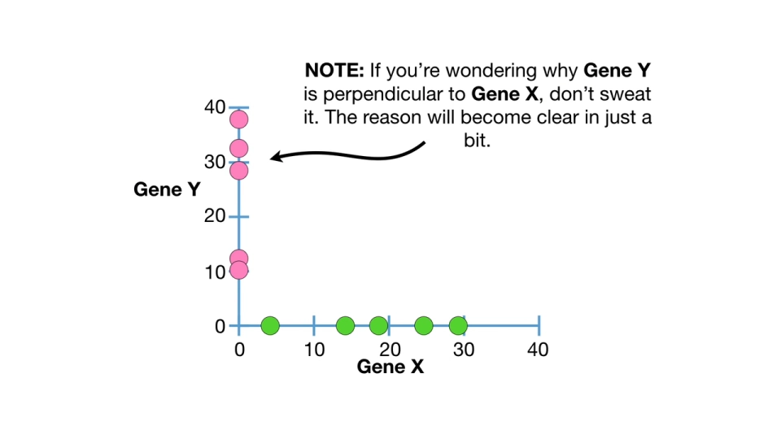

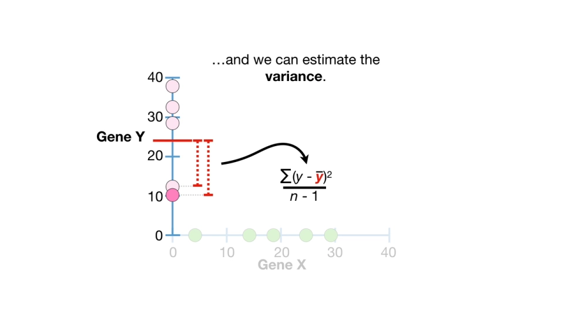

到这里为止，我们只是把一维的「位置 + 离散程度」做了两遍：

$$
\bar x=\frac{1}{n}\sum_{i=1}^{n}x_i,\qquad
s_x^2=\frac{1}{n-1}\sum_{i=1}^{n}(x_i-\bar x)^2
$$

Y 也照同样办法得到 $\bar y$ 与 $s_y^2$。这两个方差各管各的：X 波动大不大，和 Y 波动大不大，是两件独立的事。它们没有回答「X 和 Y 是否一起动」。

---

## 二、把成对测量画成一个点：三种趋势

因为每个 X 值和它的 Y 值来自同一个细胞，可以把它们合成平面上的一个点 $(x_i,y_i)$。五个细胞就是五个点。

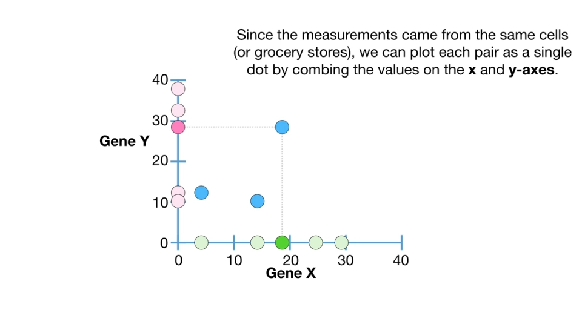

图上呈现的是**正趋势**：X 较小的细胞，Y 也较小；X 较大的细胞，Y 也较大。用一条正斜率的线可以概括这个趋势。视频用一句很直白的话说明它的用途：如果知道某个细胞的 X 很大，趋势会提示同一个细胞的 Y 也大；反过来，知道 Y 小，也会提示 X 小。

如果数据换成另一种样子——X 小的时候 Y 反而大、X 大的时候 Y 反而小——趋势线就是负斜率，这叫**负趋势**。

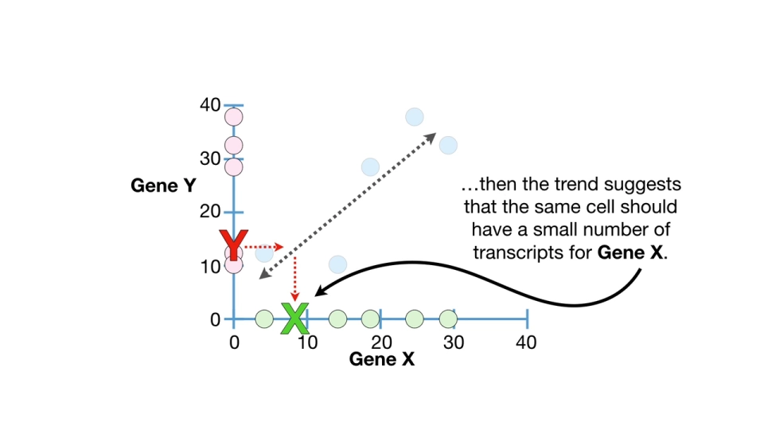

还有第三种情况：每个 X 都配上同一个 Y，或者每个 Y 都配上同一个 X。这时不管 X 怎么变，Y 都不变，画不出正斜率或负斜率的趋势线，叫**没有趋势**。

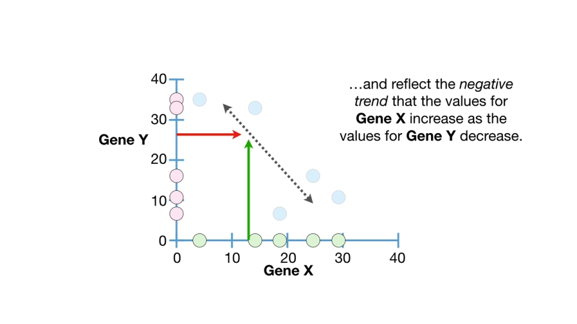

视频把协方差的第一个作用说得很清楚：**它就是把这三类关系分开的一个数**——正趋势、负趋势、没有趋势。

---

## 三、协方差怎么算：把两个「偏离」乘起来

协方差的计算式看起来有点吓人，但拆开只做三件事。

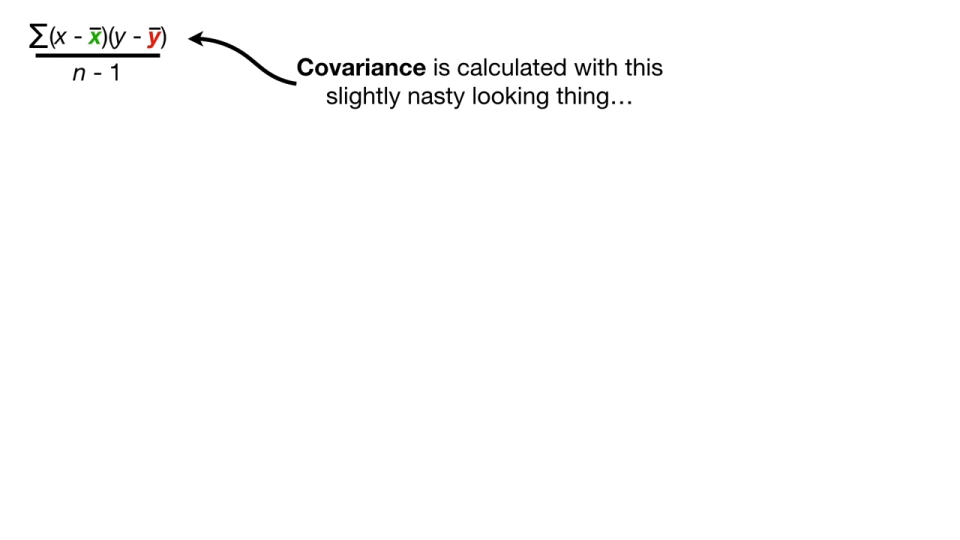

$$
\operatorname{Cov}(X,Y)=\frac{1}{n-1}\sum_{i=1}^{n}(x_i-\bar x)(y_i-\bar y)
$$

第一步，对每个点算 $x_i-\bar x$：它在均值竖线的左边还是右边，决定这个差是负还是正。
第二步，算 $y_i-\bar y$：它在均值横线的下边还是上边，决定这个差是负还是正。
第三步，把两个差相乘。**同号相乘得正，异号相乘得负**。

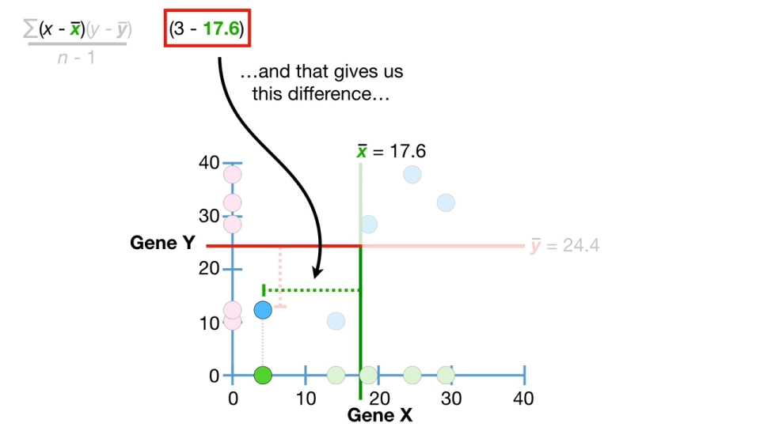

视频逐个点检查：落在左下角和右上角的点，两个偏离同号，乘积都是正数；落在左上角和右下角的点，两个偏离异号，乘积都是负数。于是整张图被两条均值线切成四个象限：

- 左下 + 右上：贡献正数；
- 左上 + 右下：贡献负数。

把所有乘积加起来再除以 $n-1$，就得到协方差。视频里的五个细胞算出来是 $116$，为正，所以关系是正趋势。

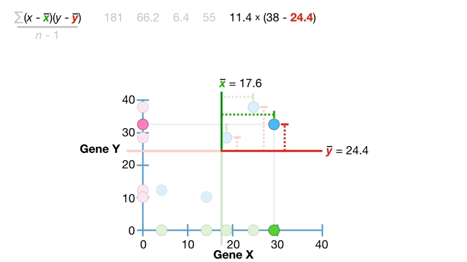

这里要特别注意：**协方差的正负号来自「多数点落在哪两个象限」**，而不是来自某一个点。单个点可能落在反方向，但只要同向偏离的总量压过反向偏离，总和就是正的。

---

## 四、负协方差与零协方差

把 Y 的测量换一组数，趋势反过来：X 小的点跑到上方，X 大的点跑到下方。此时左上和右下的点贡献负数，加起来得到 $-105.15$，协方差为负，趋势判为负。

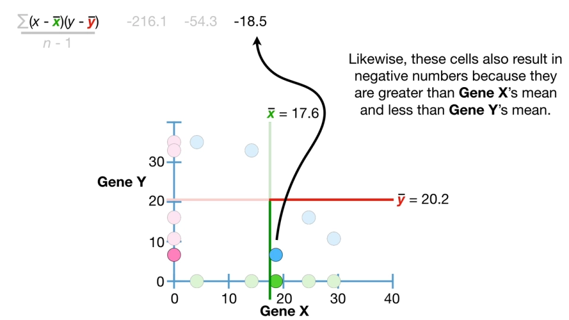

再看「没有趋势」的情形：每个 X 都配同一个 Y。此时每个点的 $y_i-\bar y$ 都等于 0，乘以任何数都是 0，所以每一项都是 0，协方差为 0。

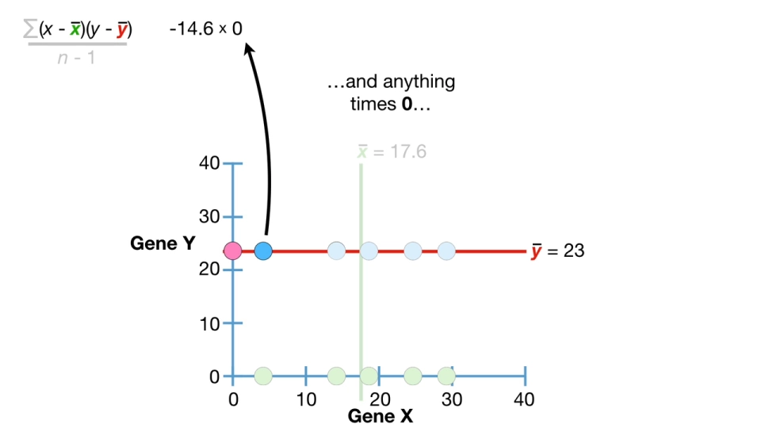

视频还演示了另一种「看起来在动、其实协方差为零」的数据：X 增大时 Y 有时增大、有时减小，正贡献与负贡献正好抵消，总和仍然是 0。这说明**协方差为零只表示「没有可辨认的线性趋势」，不表示两个变量绝对无关**。如果关系是弯曲的、周期性的，正负乘积可以互相抵消，协方差仍可能接近零。

> **编者注**：视频把「协方差为零」直接说成「没有关系」，这是教学上的简化。严格地说，协方差为零只排除了**线性**共变；两个变量完全可能通过非线性关系依赖彼此。判断独立性需要更多信息，不能只看一个协方差。

---

## 五、把 Y 换成 X：协方差退化成方差

视频做了一个很关键的对照：只保留基因 X，把它同时放在横轴和纵轴，计算 X 与自己的协方差。

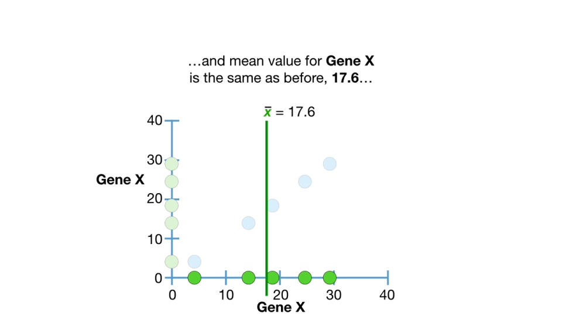

此时 $y_i=x_i$、$\bar y=\bar x$，协方差式里的 $(x_i-\bar x)(y_i-\bar y)$ 就变成 $(x_i-\bar x)^2$：

$$
\operatorname{Cov}(X,X)=\frac{1}{n-1}\sum_{i=1}^{n}(x_i-\bar x)^2=s_x^2
$$

也就是说，**方差是协方差的一个特例**：一个变量与自己的协方差。这条关系把「离散程度」和「共同变化」接在了同一个公式里——方差衡量一个变量偏离自己均值的方向有多远，协方差衡量两个变量偏离各自均值的方向是否一致。

---

## 六、协方差为什么难解释：它带着数据的尺度

视频最后用一个实验说明协方差的麻烦。它回到「X 与自己的协方差」——也就是上一节说的方差——原来五个点在同一条正斜率线上，这个值是 102。现在把每个数据都乘以 2：坐标轴上的刻度翻倍，均值也翻倍，但点的相对位置没变，仍然落在同一条正斜率线上。

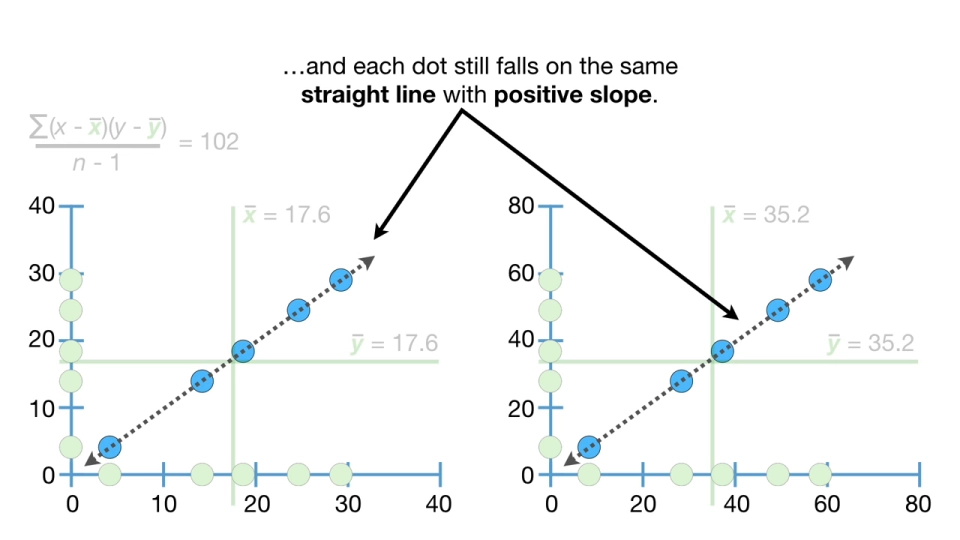

关系没有变，这个「与自己的协方差」却从 102 变成 408，正好是 4 倍——因为每个 $(x-\bar x)$ 和 $(y-\bar y)$ 都翻倍，乘积就翻四倍。这说明：

1. **协方差的数值大小不能直接当作关系强弱**。同一组关系换一个单位（比如从「转录本数」换成「千转录本数」），协方差就变了。
2. **协方差也不能告诉你点离趋势线有多近**。视频又构造了一组离趋势线更远的点，协方差反而更大；再把尺度改小，协方差又变小。数值大小被尺度搅乱了。
3. 协方差只能可靠地给出**符号**：正、负、零，对应正趋势、负趋势、没有线性趋势。

所以视频把协方差称为「踏脚石」：它本身不是终点，但它是计算**相关系数**的第一步。相关系数用两个标准差把协方差归一化，消掉尺度，得到一个固定在 $[-1,1]$ 之间的数；协方差矩阵也继续用在 PCA 等分析里。

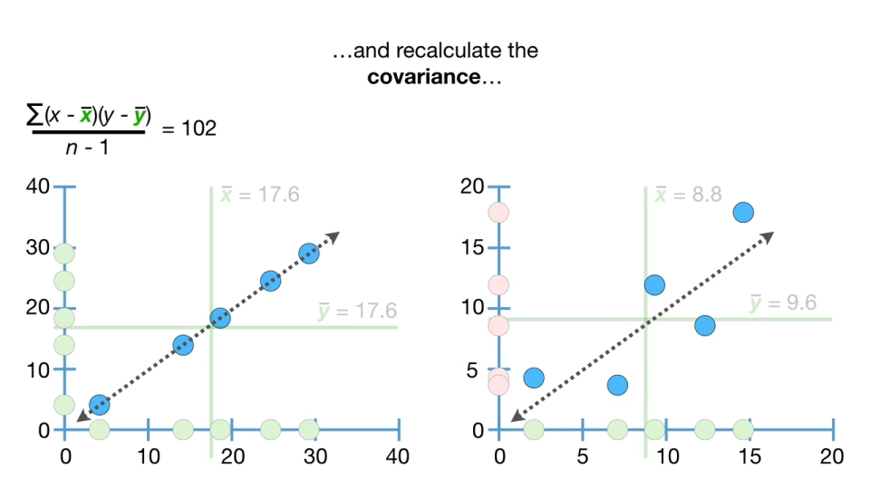

---

## 七、把这一讲的账目对齐

| 问题 | 协方差给出的答案 | 不能给出的答案 |
| --- | --- | --- |
| 两个变量同向还是反向？ | 符号：正 = 正趋势，负 = 负趋势，零 = 无线性趋势 | 具体是哪种曲线关系 |
| 关系有多强？ | 不能直接比较，数值受量纲和尺度影响 | 不能把 116 和 408 比大小当作强弱 |
| 点离趋势线多近？ | 不能判断 | 需要相关系数或 $R^2$ |
| 一个变量自己的波动？ | $\operatorname{Cov}(X,X)=s_x^2$，退化成方差 | 不能区分「波动大」与「关系强」 |
| 两个变量是否独立？ | 零协方差只排除线性共变 | 不能据此断言独立 |

一句话总结：**协方差是「两个偏离的乘积的平均」**。它用符号回答方向，用「与自己的协方差」接回方差，但因为带着尺度，不能独自回答强弱；要跨量纲比较，必须走到相关系数。