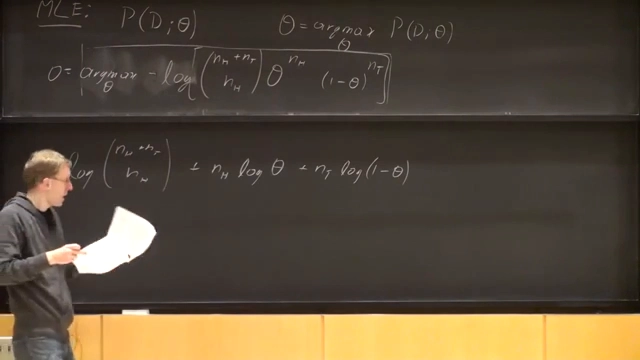
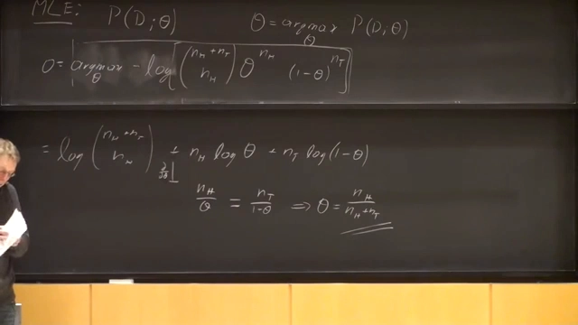
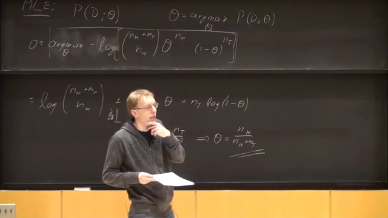
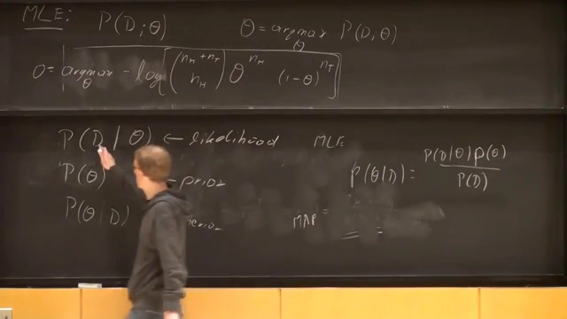
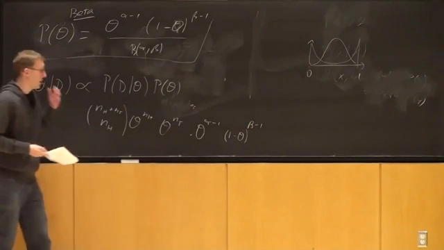
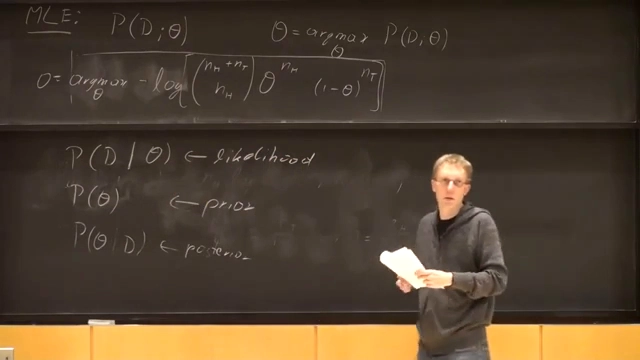

# 从似然到对数似然：抛硬币案例把概率写成可求导目标

> 视频来源：[Lecture 7 "Estimating Probabilities from Data: Maximum Likelihood Estimation" - Cornell CS4780 SP17](https://www.youtube.com/watch?v=RIawrYLVdIw)（YouTube · Kilian Weinberger）｜时长约 49 分钟
> 这篇讲座从“数据来自某个分布”讲起，用一枚古罗马硬币把最大似然估计完整推了一遍：写出二项似然、取对数、求导、解出闭式解，再讨论小样本为什么会失效，以及 MLE 与 MAP 的分界。本文按本节目标截取这条主线，略去课堂事务与感知机复习。

## 本讲要解决的核心问题（SCQA）

**背景**：机器学习常假设数据来自某个分布 $p(x)$ 或 $p(x,y)$。如果我们知道这个分布，预测就变成“在给定 $x$ 下选概率最大的 $y$”。

**冲突**：真实分布未知，手里只有有限个观测值。我们可以从数据估计分布，但“估计”需要一个准则：什么样的参数值才算好？

**疑问**：能不能把“好参数”写成一个明确的优化问题，并且真的解出来？

**回答（中心思想）**：**最大似然估计（MLE）把参数 $\theta$ 当作自变量，把已观测数据 $D$ 当作固定条件，最大化 $P(D;\theta)$。** 对独立同分布数据，$P(D;\theta)$ 是每个样本概率的连乘；取对数后变成求和，既避免数值下溢，也把求导变简单。硬币案例中，这套流程最终给出闭式解 $\hat\theta=n_H/(n_H+n_T)$。

---

## 一、为什么先估计分布：从“知道分布”到“从数据逼近分布”

讲座先回顾了一个理想情形：如果数据真的来自某个分布 $p(x,y)$，那么只要对每个测试点算出 $p(y\mid x)$，取概率最大的 $y$，就得到贝叶斯最优分类器 [【跳转到 05:16】](https://www.youtube.com/watch?v=RIawrYLVdIw&t=316)。

现实中没有这个分布，但可以退一步：**用数据估计分布，再用估计出的分布做预测** [【跳转到 06:02】](https://www.youtube.com/watch?v=RIawrYLVdIw&t=362)。这几乎是所有机器学习都在做的事，只是估计的对象不同 [【跳转到 06:26】](https://www.youtube.com/watch?v=RIawrYLVdIw&t=386)：

- **判别式学习**：直接估计 $p(y\mid x)$，学到的是“给定特征，标签是什么”；
- **生成式学习**：估计 $p(x,y)$，或把它分解成 $p(x\mid y)p(y)$，学到的是“每个类别会生成什么样的特征”。

本讲走的是后一条路：先把分布估计出来，预测就成了分布上的简单操作。于是问题聚焦为一句话——**怎样从数据估计分布参数**。

---

## 二、硬币案例：把“正面概率”变成一个待估参数

讲座用一枚从阁楼里翻出来的古罗马硬币开场。我们不知道它落地时正面朝上的概率，但可以反复抛、记录结果 [【跳转到 13:01】](https://www.youtube.com/watch?v=RIawrYLVdIw&t=781)。

假设抛了 10 次，得到 4 次正面、6 次反面。直觉上会说：正面概率大约是 $4/10=0.4$ [【跳转到 13:55】](https://www.youtube.com/watch?v=RIawrYLVdIw&t=835)。

这个直觉答案当然合理，但讲座要追问的是：**这个公式能不能从一条更一般的准则推出来？** 这条准则就是最大似然。

把问题形式化：

- 参数 $\theta$：一次抛掷出现正面的概率；
- 数据 $D$：$n_H$ 次正面、$n_T$ 次反面；
- 模型：$n=n_H+n_T$ 次独立抛掷，服从二项分布。

这里有一个容易混淆的记号。讲座一开始把模型写成 $P(D\mid\theta)$，随后专门纠正：在频率派语境里更准确的写法是 $P(D;\theta)$，分号表示“$\theta$ 是固定但未知的参数”，而不是“$\theta$ 是随机变量” [【跳转到 15:01】](https://www.youtube.com/watch?v=RIawrYLVdIw&t=901)。这个分号不是排版细节，它正是本节要守住的边界：**似然是参数的函数，但不是参数的概率分布**。

---

## 三、写出似然：每个参数值都对应一个“数据出现概率”

最大似然的准则可以写成一句话 [【跳转到 15:54】](https://www.youtube.com/watch?v=RIawrYLVdIw&t=954)：

> 已经观测到这组数据，那么哪个参数值会让“观测到这组数据”这件事最可能发生？

用公式表示，就是

$$
\hat\theta = \arg\max_\theta P(D;\theta)
$$

这里 $\arg\max$ 返回的是**使目标最大的参数值**，不是最大值本身。讲座特意区分了 $\max$ 和 $\arg\max$：前者是曲线的最高点，后者是最高点对应的横坐标 [【跳转到 16:40】](https://www.youtube.com/watch?v=RIawrYLVdIw&t=1000)。

对 10 次独立抛掷，二项似然是

$$
P(D;\theta)=\binom{n_H+n_T}{n_H}\theta^{n_H}(1-\theta)^{n_T}
$$

这个式子由三部分组成：

- 组合数 $\binom{n_H+n_T}{n_H}$：在 10 次抛掷中选出哪 4 次是正面，有多少种排列；
- $\theta^{n_H}$：每次正面都贡献一个 $\theta$，共 $n_H$ 次；
- $(1-\theta)^{n_T}$：每次反面都贡献一个 $1-\theta$，共 $n_T$ 次。

把 $n_H=4$、$n_T=6$ 代进去，似然就是 $\theta$ 的一个函数。**数据已经固定，只有 $\theta$ 在变**——这正是“似然”与“概率”的分工。

---

## 四、取对数：把连乘变成求和

直接最大化上面的连乘并不方便：多个小于 1 的概率相乘会迅速变得极小，计算机的浮点数很难表示；求导时也要对一长串乘积用乘积法则。讲座给出两步处理 [【跳转到 18:28】](https://www.youtube.com/watch?v=RIawrYLVdIw&t=1108)：

1. **取对数**。对数函数是单调递增的，所以最大化 $P(D;\theta)$ 与最大化 $\log P(D;\theta)$ 等价；
2. **利用对数的性质**。对数的乘积变加法，幂变系数。

于是二项似然的对数变成

$$
\log P(D;\theta)
= \log\binom{n_H+n_T}{n_H}
+ n_H\log\theta
+ n_T\log(1-\theta)
$$

第一项与 $\theta$ 无关，是一个常数；真正影响最优值的是后两项。讲座把取对数的理由说得很直白 [【跳转到 19:02】](https://www.youtube.com/watch?v=RIawrYLVdIw&t=1142)：

- **数学上更简单**：乘积变求和，求导容易；
- **数值上更稳定**：把许多很小的数相乘，改成把它们的对数相加，避免下溢。

这一步就是“从数据概率走到可优化目标”的关键转折：原来是一个连乘式的概率，现在是一个可以对 $\theta$ 求导的标量函数。

---

## 五、求导置零：解出 $\hat\theta=n_H/(n_H+n_T)$

有了对数似然，最大化就回到高中就学过的办法：求导，令导数为零 [【跳转到 20:49】](https://www.youtube.com/watch?v=RIawrYLVdIw&t=1249)。

对

$$
\ell(\theta)=n_H\log\theta+n_T\log(1-\theta)+\text{常数}
$$

求导：

$$
\frac{d\ell}{d\theta}=\frac{n_H}{\theta}-\frac{n_T}{1-\theta}
$$

令它等于零：

$$
\frac{n_H}{\theta}=\frac{n_T}{1-\theta}
$$

交叉相乘：

$$
n_H(1-\theta)=n_T\theta
$$

整理得：

$$
\theta=\frac{n_H}{n_H+n_T}
$$

把 $n_H=4$、$n_T=6$ 代入，得到 $\hat\theta=0.4$。直觉答案与最大似然答案在这里合上了。

讲座还补了一个容易被忽略的检查：导数为零只说明是驻点，还要确认它确实是最大值而不是最小值 [【跳转到 21:55】](https://www.youtube.com/watch?v=RIawrYLVdIw&t=1315)。在这个例子里，二阶条件（或直接看似然曲线两端趋于零）保证它是最大值。

到这里，完整链路是：

$$
\text{数据} \rightarrow \text{似然（连乘）} \rightarrow \text{对数似然（求和）} \rightarrow \text{求导置零} \rightarrow \text{闭式解}
$$

这条链路不只适用于硬币。只要模型给得出 $P(D;\theta)$，就可以尝试同样的“取对数、求导、解方程”路线；解不出闭式解时，再交给数值优化。

---

## 六、小样本为什么会把 MLE 推到极端

最大似然看起来非常合理，但它有一个明确的软肋：**太相信数据**。讲座用一个极端情形说明 [【跳转到 24:01】](https://www.youtube.com/watch?v=RIawrYLVdIw&t=1441)：

假设抛 10 次，结果全是反面。代入公式：

$$
\hat\theta=\frac{0}{0+10}=0
$$

于是模型断言“正面概率为零”。但任何有常识的人都知道，一枚硬币正面朝上的概率不太可能真的是零；只是这 10 次恰好没出现正面。更极端地，只抛 1 次得到正面，公式会给出 $\hat\theta=1$ [【跳转到 25:04】](https://www.youtube.com/watch?v=RIawrYLVdIw&t=1504)。

问题不在于公式算错，而在于**数据量太小时，最大似然没有别的信息可依靠**。讲座把这种现象概括为“把太多信任放进了数据” [【跳转到 24:44】](https://www.youtube.com/watch?v=RIawrYLVdIw&t=1484)。

一个常见的修补是平滑（smoothing）：假装在正式实验之前，已经见过 $m$ 次正面和 $m$ 次反面 [【跳转到 25:23】](https://www.youtube.com/watch?v=RIawrYLVdIw&t=1523)。估计式变成

$$
\hat\theta=\frac{n_H+m}{n_H+n_T+2m}
$$

当 $m=1$ 时就是常见的“加一平滑”：

$$
\hat\theta=\frac{n_H+1}{n_H+n_T+2}
$$

这样即使 $n_H=0$，估计值也不会是 0。讲座指出，加一平滑不只是工程上的补丁，它其实对应一个贝叶斯先验下的最大后验估计（MAP）[【跳转到 30:25】](https://www.youtube.com/watch?v=RIawrYLVdIw&t=1825)。

---

## 七、MLE 与 MAP：分号与竖线背后的区别

讲座用“频率派 vs 贝叶斯派”的对照，把参数的地位讲清楚。两派都同意要最大化“数据在参数下的概率”，分歧在于**参数是不是随机变量** [【跳转到 32:03】](https://www.youtube.com/watch?v=RIawrYLVdIw&t=1923)。

- **频率派**写 $P(D;\theta)$：$\theta$ 是固定但未知的参数，不是随机变量，所以不谈“$\theta$ 的概率分布”；
- **贝叶斯派**写 $P(D\mid\theta)$：$\theta$ 被视为随机变量，可以有一个先验分布 $P(\theta)$，于是可以谈“给定数据后 $\theta$ 的概率”。

这两种写法对应两个不同的优化目标 [【跳转到 37:49】](https://www.youtube.com/watch?v=RIawrYLVdIw&t=2269)：

$$
\text{MLE: } \hat\theta=\arg\max_\theta P(D;\theta)
$$

$$
\text{MAP: } \hat\theta=\arg\max_\theta P(\theta\mid D)
=\arg\max_\theta P(D\mid\theta)P(\theta)
$$

MAP 多乘了一个先验 $P(\theta)$。在硬币例子里，先验常取 beta 分布：

$$
P(\theta)=\frac{\theta^{\alpha-1}(1-\theta)^{\beta-1}}{B(\alpha,\beta)}
$$

把它与二项似然相乘，指数相加，再求导置零，得到 [【跳转到 44:43】](https://www.youtube.com/watch?v=RIawrYLVdIw&t=2683)：

$$
\hat\theta_{\text{MAP}}
=\frac{n_H+\alpha-1}{n_H+n_T+\alpha+\beta-2}
$$

当 $\alpha=\beta=2$ 时，分子是 $n_H+1$，分母是 $n_H+n_T+2$，正好回到加一平滑。也就是说：

- **MLE** 只看数据，数据少时容易给出 0 或 1 这样的极端估计；
- **MAP** 在数据之外再加一个先验，相当于用“虚拟样本”把估计往合理范围拉；
- 先验越强（$\alpha,\beta$ 越大），估计越偏向先验；数据越多，似然项越占主导。

这张图把三个量放在同一块黑板上，正好对应本节要区分的东西 [【跳转到 36:38】](https://www.youtube.com/watch?v=RIawrYLVdIw&t=2198)：

- **likelihood**：固定数据，作为参数的函数；
- **prior**：参数自身的分布，只在贝叶斯框架里出现；
- **posterior**：看到数据后参数的分布，由似然乘先验再归一化得到。

MLE 最大化的是第一行，MAP 最大化的是第三行。把这两行混为一谈，就会误以为“最大似然估计”给出了“参数最可能的概率”——它给出的只是一个使数据最不意外的参数点。

---

## 小结

- **出发点**：与其直接猜 $p(y\mid x)$，可以先从数据估计分布 $p(x,y)$，再用分布做预测。
- **似然**：固定数据 $D$，把参数 $\theta$ 当自变量，$P(D;\theta)$ 就是似然；它衡量“这个参数值让已观测数据有多不意外”。
- **对数似然**：对独立同分布数据，似然是连乘；取对数后变成求和，既避免数值下溢，也让求导变简单。
- **硬币闭式解**：二项似然取对数、求导置零，得到 $\hat\theta=n_H/(n_H+n_T)$；4 正 6 反给出 0.4。
- **小样本风险**：全反面时 MLE 给出 $\hat\theta=0$，这是“太相信数据”的结果；加一平滑把估计拉回合理范围。
- **MLE 与 MAP**：MLE 最大化 $P(D;\theta)$，MAP 最大化 $P(\theta\mid D)\propto P(D\mid\theta)P(\theta)$；区别的根源是参数被视为固定未知量还是随机变量。
- **边界**：似然不是参数的概率分布；最大似然给出点估计，不给出参数的后验概率。

## 关键术语速查

| 术语 | 一句话解释 |
| --- | --- |
| 似然 $P(D;\theta)$ | 固定观测数据后，把参数当作自变量时“数据出现可能性”的函数 |
| 对数似然 | 似然取对数；连乘变求和，便于求导并避免数值下溢 |
| 最大似然估计（MLE） | 让观测数据似然最大的参数值，$\hat\theta=\arg\max_\theta P(D;\theta)$ |
| $\arg\max$ | 返回使目标最大的自变量取值，而不是目标的最大值 |
| 二项似然 | $n$ 次独立伯努利试验中正面次数所服从的似然，含组合数与 $\theta^{n_H}(1-\theta)^{n_T}$ |
| 平滑 | 给每个类别加虚拟计数，避免小样本把概率估成 0 |
| 先验 $P(\theta)$ | 贝叶斯框架下参数自身的分布，表示看到数据前的信念 |
| 后验 $P(\theta\mid D)$ | 看到数据后参数的分布，正比于似然乘先验 |
| 最大后验估计（MAP） | 让后验最大的参数值，等价于最大化“似然 × 先验” |