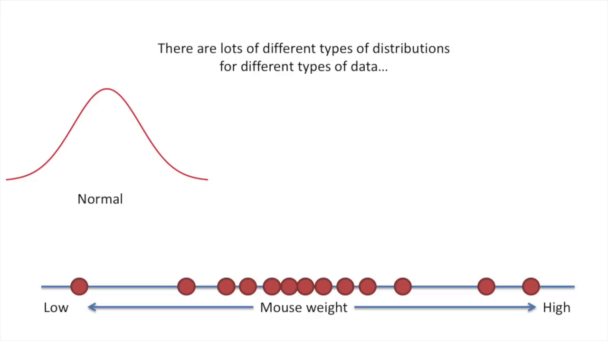
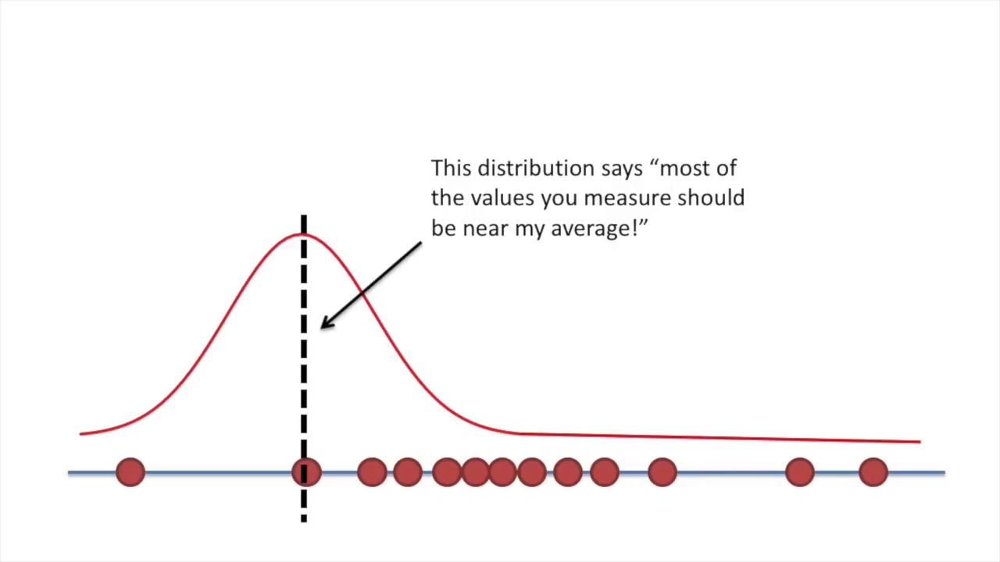
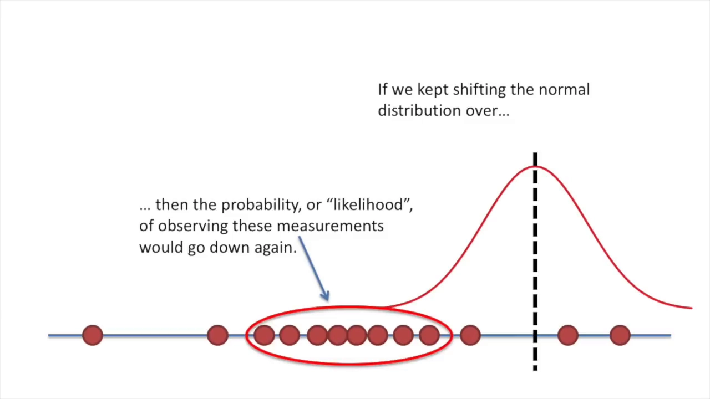
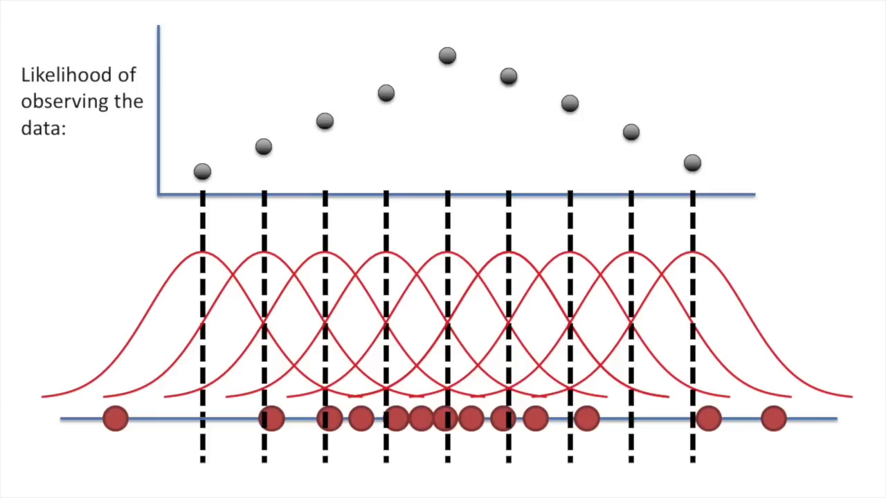
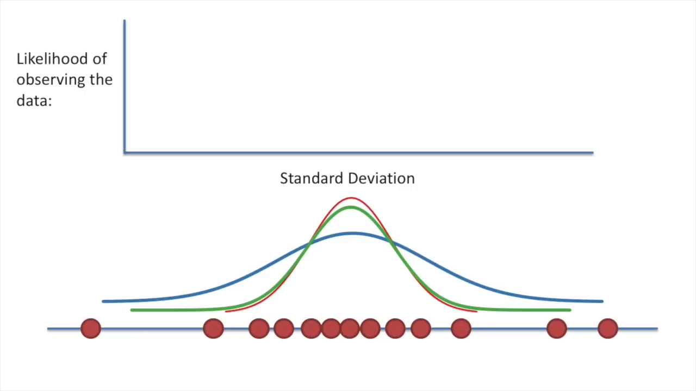
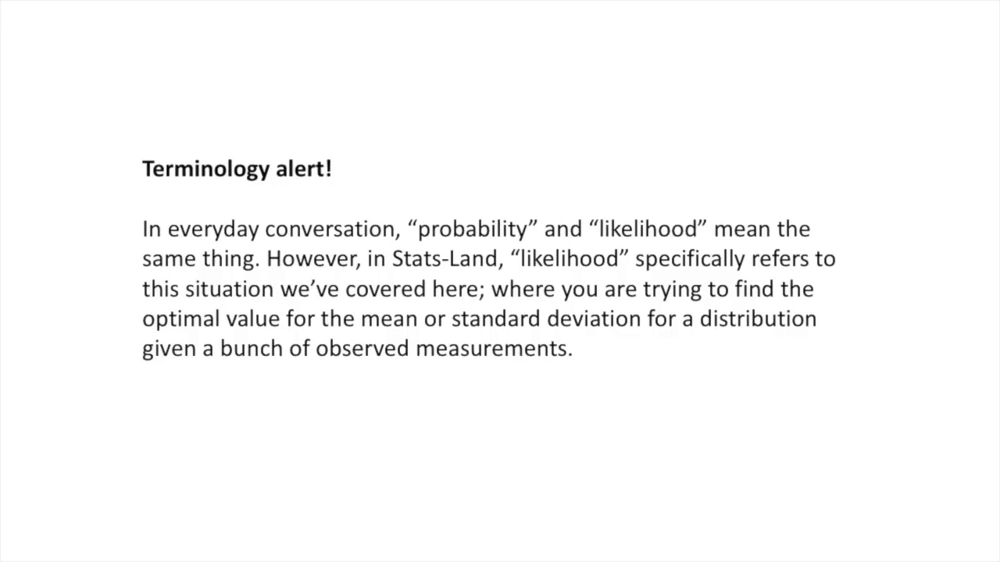

# 最大似然：把参数当旋钮，找让数据最可能出现的那个位置

> 视频来源：[Maximum Likelihood, clearly explained!!!](https://www.youtube.com/watch?v=XepXtl9YKwc)（YouTube · StatQuest with Josh Starmer）｜时长约 6 分钟
> 这支短片用一个“称小鼠体重、拟合正态分布”的例子，把似然讲成“固定数据、转动参数旋钮”的拟合过程。它不推导对数似然，适合先建立直觉；形式化的抛硬币推导见同节另一篇《从似然到对数似然》。

## 本讲要解决的核心问题（SCQA）

**背景**：我们量了一堆小鼠的体重，得到一串观测值。比起把每个数字原样背下来，更常见的做法是假设它们来自某类分布，比如正态分布。

**冲突**：一旦选定“正态分布”，分布的形状就不再自由：它的均值放在哪里、标准差取多大，会直接决定这串体重看起来“常不常见”。可我们并不知道这两个参数该取多少。

**疑问**：怎样才算把一条分布“拟合”到数据上？有没有一个客观标准，能比较不同参数值的好坏？

**回答（中心思想）**：**最大似然把参数当作可以转动的旋钮：每转到一个位置，就计算“若参数真是这个值，观测到这组数据的概率有多大”；让这个概率最大的位置，就是最大似然估计。** 这里被最大化的是“数据在参数下的概率”，不是“参数本身的概率”。

---

## 一、先选分布族，再决定它长什么样

最大似然的目标，是找到一种最优的方式，把分布拟合到数据上 [【跳转到 00:25】](https://www.youtube.com/watch?v=XepXtl9YKwc&t=25)。不同数据适合不同分布：正态分布、指数分布、伽马分布都只是候选 [【跳转到 00:50】](https://www.youtube.com/watch?v=XepXtl9YKwc&t=50)。

为什么要拟合分布，而不是只保留原始测量值？视频给了两个理由 [【跳转到 00:50】](https://www.youtube.com/watch?v=XepXtl9YKwc&t=50)：

- **更好用**：分布只有少量参数，拿到参数就能概括整批数据；
- **更通用**：同一类实验可以共享同一个分布假设，不必每次从零描述。

在这个例子里，我们假设体重服从正态分布。正态分布意味着两件事 [【跳转到 01:15】](https://www.youtube.com/watch?v=XepXtl9YKwc&t=75)：

1. 大多数测量值靠近均值；
2. 测量值围绕均值大致对称，不会严重偏向一侧。

这两条是“选择正态分布”时要先核对的数据特征。若数据强烈偏斜，硬套正态分布就会在第一步出错。

---

## 二、似然：固定数据，转动参数

正态分布可以胖瘦不同、位置不同。视频先随便放一条正态分布，看它和数据的匹配程度 [【跳转到 02:05】](https://www.youtube.com/watch?v=XepXtl9YKwc&t=125)。

这条分布的均值（黑色虚线）和数据的实际平均位置差得很远。按这条分布，大多数观测值都落在远离均值的地方，于是“观测到这些体重”的概率或似然很低 [【跳转到 02:30】](https://www.youtube.com/watch?v=XepXtl9YKwc&t=150)。

把分布向右平移，让它的均值与数据的平均位置重合，同一组观测值的似然就变高了 [【跳转到 02:55】](https://www.youtube.com/watch?v=XepXtl9YKwc&t=175)。若继续向右移，似然又会下降。

这里已经出现了最大似然的关键结构：

- **数据固定**：十个左右的体重值不变；
- **参数在动**：只改变分布均值的位置；
- **每个位置对应一个数**：该位置下“观测到这组数据”的似然。

把所有位置都试一遍，就得到一条“似然随参数变化”的曲线。曲线上最高的点，就是最大似然估计 [【跳转到 03:45】](https://www.youtube.com/watch?v=XepXtl9YKwc&t=225)。

视频特别提醒：这里说的是**分布的均值**，不是**数据的均值**。只是在正态分布这个特例下，两者恰好相等 [【跳转到 04:10】](https://www.youtube.com/watch?v=XepXtl9YKwc&t=250)。换成别的分布，最大似然估计未必等于样本均值，所以不能把“均值”这个词的两个含义混在一起。

---

## 三、一个参数拟合完，再拟合下一个

均值的最大似然位置找到后，还要找标准差的最大似然估计。做法完全一样：固定均值，把标准差从很小调到很大，看哪个值让观测数据的似然最大 [【跳转到 04:35】](https://www.youtube.com/watch?v=XepXtl9YKwc&t=275)。

把均值和标准差的最大似然估计放在一起，就得到一条“用最大似然拟合出来”的正态分布 [【跳转到 04:35】](https://www.youtube.com/watch?v=XepXtl9YKwc&t=275)。

这也解释了“最大似然估计”这个说法的日常用法：当有人说他得到了均值、标准差或某个参数的最大似然估计，意思就是他找到了那个参数值，使得“观测到你实际观测到的这些东西”的似然最大 [【跳转到 05:00】](https://www.youtube.com/watch?v=XepXtl9YKwc&t=300)。

---

## 四、似然不是参数的概率

视频最后专门做了一次术语提醒：在日常对话里，probability 和 likelihood 常常混着用；但在统计语境里，likelihood 特指上面这个过程——**给定一堆观测值，为分布参数寻找最优值** [【跳转到 05:25】](https://www.youtube.com/watch?v=XepXtl9YKwc&t=325)。

这句话值得展开成一条边界：

- **概率**通常把参数视为已知，问“在这个参数下，数据出现的可能性有多大”；
- **似然**把数据视为已知，把参数视为自变量，问“参数取哪个值，才让已经出现的数据最不意外”；
- 因此，似然曲线不是参数的概率分布。它不需要对参数积分等于 1；它只是用来比较不同参数值的相对好坏。

这也正是本节标题里“不混同参数的概率”的意思：最大似然估计给出的是**一个点估计**，不是“参数等于某值的概率”。参数的概率要等到贝叶斯框架里，把参数当作随机变量并配上先验之后才出现。

---

## 小结

- **最大似然的目标**：为选定的分布族找到最优参数，使观测数据在该参数下最可能出现。
- **操作方式**：固定数据，转动参数；每转到一个值就计算一次似然，取似然曲线的最高点。
- **两个参数可以分别处理**：先找均值的最大似然估计，再固定均值找标准差的最大似然估计。
- **正态分布的特例**：均值的最大似然估计恰好等于样本均值，但“分布的均值”和“数据的均值”概念上仍是两件事。
- **术语边界**：似然是“数据固定、参数变化”的函数，不是参数的概率分布；最大似然给出点估计，不给出参数的后验概率。

## 关键术语速查

| 术语 | 一句话解释 |
| --- | --- |
| 分布族 | 一类形状相同、由少量参数决定的分布，例如所有正态分布 |
| 参数 | 决定分布具体形状的数，例如正态分布的均值与标准差 |
| 似然 | 固定观测数据后，把参数当作自变量时“数据出现可能性”的函数 |
| 最大似然估计（MLE） | 让观测数据似然最大的那个参数值 |
| 拟合 | 用一组参数把分布调到与数据最匹配的位置 |