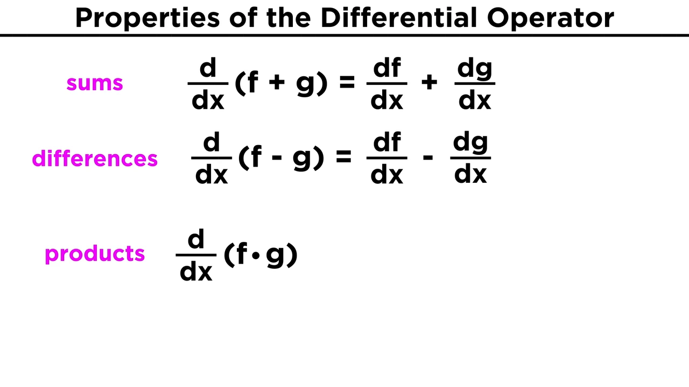
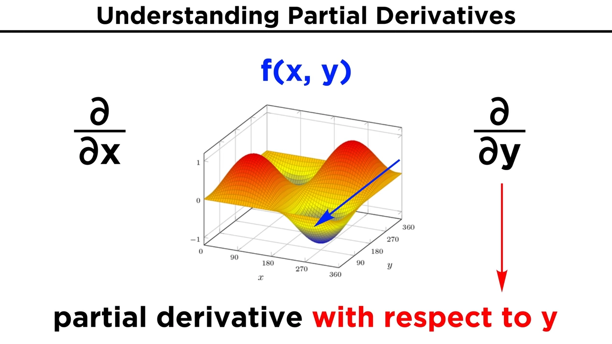
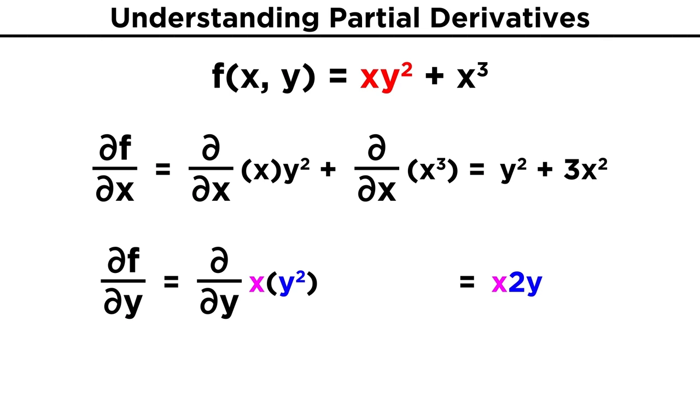
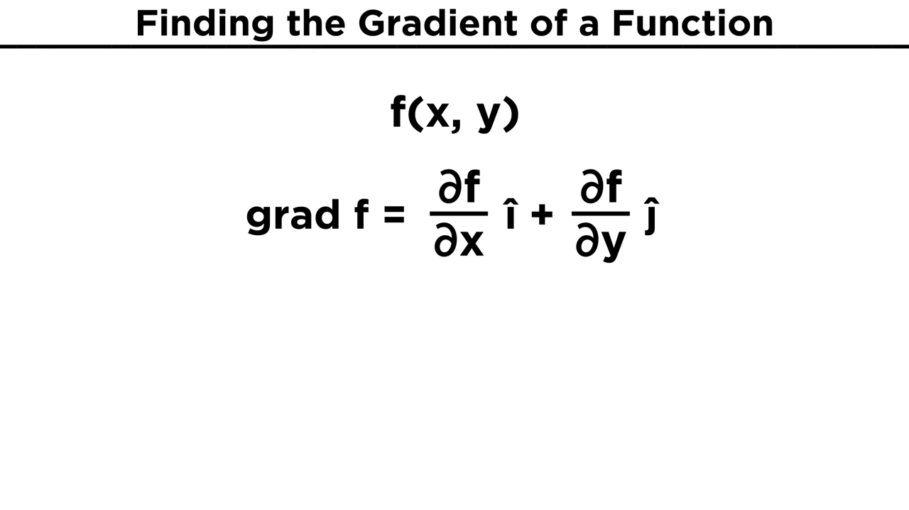
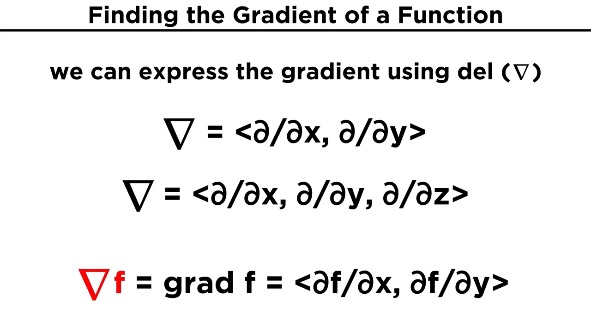
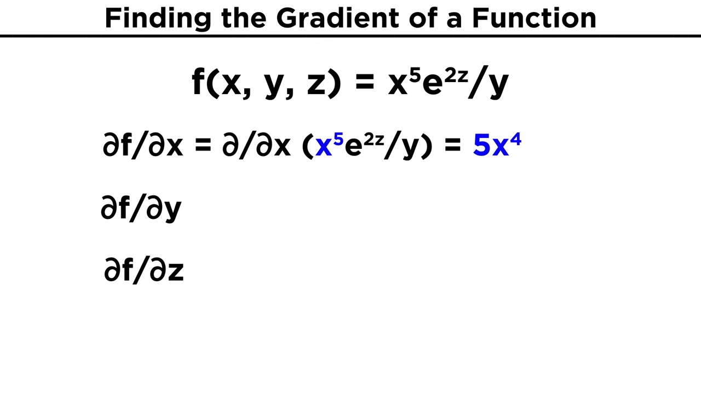

# 偏导数与梯度：二维曲面上的变化率如何合成最陡方向

> 视频来源：[Partial Derivatives and the Gradient of a Function](https://www.youtube.com/watch?v=AXH9Xm6Rbfc)（YouTube · Professor Dave Explains）｜时长约 11 分钟
> 这篇讲解从一元导数复习出发，把“变化率”推广到二元和三元函数：先定义偏导数并手算两个例子，再把偏导数拼成梯度向量，说明它的方向与模长各代表什么。本文按本节目标整理这条定义链，适合在读完梯度下降的算法流程后补几何直觉。

## 本讲要解决的核心问题（SCQA）

**背景**：一元函数 $f(x)$ 的导数 $f'(x)$ 表示曲线在某一点的斜率，也就是 $x$ 变化一点点时函数值变化多快。

**冲突**：机器学习里的损失函数通常依赖很多参数，例如 $f(x,y)$ 或 $f(x,y,z)$。它的图像不再是一条曲线，而是一张曲面；站在曲面上的一点，朝不同方向走坡度不同，“斜率”不再是一个数。

**疑问**：多元函数的变化率该怎么定义？能不能把各个方向的变化率合成一个量，用来判断“往哪走上升最快”？

**回答（中心思想）**：**偏导数就是“只让一个变量动、其余变量当常数”时的变化率；把同一个函数的所有偏导数按变量顺序排成向量，就得到梯度。梯度的方向是函数上升最快的方向，梯度的模长是这个最快变化率的大小。** 因此梯度既回答了“往哪走”，也回答了“有多陡”。

---

## 一、先复习一元导数：它衡量的是变化率

### 1.1 导数的两种写法

最初学微分时，导数被定义为**给定函数 $f(x)$ 所画曲线的变化率**。当时用“撇”记号表示求导操作，即 $f'(x)$ [【跳转到 00:09】](https://www.youtube.com/watch?v=AXH9Xm6Rbfc&t=9)。

后来引入了另一种写法 $\dfrac{d}{dx}$。它读作“d over dx”，可以看成一个**微分算子**：把它放在某个函数前面，就表示对这个函数求导 [【跳转到 00:38】](https://www.youtube.com/watch?v=AXH9Xm6Rbfc&t=38)。

两种记号含义相同，只是 $\dfrac{d}{dx}$ 更方便推广：**分母明确写出“对哪个变量求导”**，这正是多元函数需要的信息。

### 1.2 微分算子的运算法则

把 $\dfrac{d}{dx}$ 看成算子之后，一元求导的规则可以写成算子形式 [【跳转到 01:10】](https://www.youtube.com/watch?v=AXH9Xm6Rbfc&t=70)：

- **和与差**：算子可以逐项分配，

$$
\frac{d}{dx}(f+g)=\frac{df}{dx}+\frac{dg}{dx}
$$

- **乘积**：仍然服从乘积法则，

$$
\frac{d}{dx}(fg)=f\frac{dg}{dx}+\frac{df}{dx}g
$$

- **商**：仍然服从商法则，

$$
\frac{d}{dx}\left(\frac{f}{g}\right)=\frac{g\frac{df}{dx}-f\frac{dg}{dx}}{g^2}
$$

讲座重新介绍这套记号，是因为接下来**要对 $x$ 以外的变量求导**，需要一个能清楚标明“对谁求导”的写法 [【跳转到 02:15】](https://www.youtube.com/watch?v=AXH9Xm6Rbfc&t=135)。

---

## 二、二元函数：从曲线变成曲面，变化率要分方向

### 2.1 曲面上的“斜率”不再是一个数

设函数依赖两个变量，记作 $f(x,y)$。它的图像不再是平面上的曲线，而是空间中的一张曲面 [【跳转到 02:38】](https://www.youtube.com/watch?v=AXH9Xm6Rbfc&t=158)。

在曲面上取一点，可以沿 $x$ 方向走，也可以沿 $y$ 方向走，两条路径的坡度一般不同。所以**必须分别求“某个特定方向上的变化率”** [【跳转到 02:52】](https://www.youtube.com/watch?v=AXH9Xm6Rbfc&t=172)。

### 2.2 偏导数的定义：只让一个变量动

如果想知道 $x$ 方向的变化率，做法和一元求导一样：**对 $x$ 求导，同时把 $y$ 当作常数**。新的记号把普通的 $d$ 换成弯曲的 $\partial$：

$$
\frac{\partial f}{\partial x}
$$

这叫作 $f$ 对 $x$ 的**偏导数**（partial derivative）。它只把 $x$ 当作要微分的变量，$y$ 在这一步完全不动 [【跳转到 03:07】](https://www.youtube.com/watch?v=AXH9Xm6Rbfc&t=187)。

同理，$y$ 方向的变化率是 $f$ 对 $y$ 的偏导数，此时把 $x$ 当作常数 [【跳转到 03:28】](https://www.youtube.com/watch?v=AXH9Xm6Rbfc&t=208)。

用一句话概括：

> **偏导数 = 把其他变量冻结，只看一个变量变化时函数值的变化率。**

这也解释了一元导数为什么是偏导数的特例：一元函数只有一个变量，没有别的变量需要冻结。

---

## 三、手算一个例子：$f(x,y)=xy^2+x^3$

### 3.1 对 $x$ 求偏导

先求 $\dfrac{\partial f}{\partial x}$。把 $y$ 当常数，逐项处理 [【跳转到 03:47】](https://www.youtube.com/watch?v=AXH9Xm6Rbfc&t=227)：

- 第一项 $xy^2$：对 $x$ 求导，$x$ 的幂次降为 1，$y^2$ 作为常数系数保留，得到 $y^2$；
- 第二项 $x^3$：用幂法则，得到 $3x^2$。

所以

$$
\frac{\partial f}{\partial x}=y^2+3x^2
$$

### 3.2 对 $y$ 求偏导

再求 $\dfrac{\partial f}{\partial y}$。这次把 $x$ 当常数 [【跳转到 04:33】](https://www.youtube.com/watch?v=AXH9Xm6Rbfc&t=273)：

- 第一项 $xy^2$：对 $y$ 求导，$y^2$ 变成 $2y$，$x$ 作为常数系数保留，得到 $2xy$；
- 第二项 $x^3$：不含 $y$，对 $y$ 来说是常数，导数为零。

所以

$$
\frac{\partial f}{\partial y}=2xy
$$

这两个结果就是函数在 $x$ 方向和 $y$ 方向上的变化率。注意它们仍然是 $x$、$y$ 的函数：**同一个函数在不同位置，偏导数值不同**，就像一元导数在不同 $x$ 处不同一样。

---

## 四、梯度：把偏导数按方向拼成一个向量

### 4.1 定义

有了两个偏导数，就可以定义**梯度**（gradient）。讲座的定义是：**梯度就是由函数所有偏导数、按各自对应的方向位置组成的向量** [【跳转到 05:29】](https://www.youtube.com/watch?v=AXH9Xm6Rbfc&t=329)。

$$
\operatorname{grad} f=\frac{\partial f}{\partial x}\,\hat{i}+\frac{\partial f}{\partial y}\,\hat{j}
$$

如果是三元函数 $f(x,y,z)$，就再加一项：

$$
\operatorname{grad} f=\frac{\partial f}{\partial x}\,\hat{i}+\frac{\partial f}{\partial y}\,\hat{j}+\frac{\partial f}{\partial z}\,\hat{k}
$$

这里 $\hat{i}$、$\hat{j}$、$\hat{k}$ 分别是 $x$、$y$、$z$ 方向的单位向量。它们的作用只是标明“这个分量属于哪个方向”，让梯度成为一个有方向的对象，而不是一串无序的数。

### 4.2 几何意义：方向是最陡上升，模长是最大变化率

梯度最重要的性质是 [【跳转到 06:24】](https://www.youtube.com/watch?v=AXH9Xm6Rbfc&t=384)：

- **方向**：梯度指向函数值**变化最快**的方向，也就是上升最陡的方向；
- **模长**：梯度的长度等于这个**最大变化率**的数值。

讲座把它称为“高维空间里最接近斜率的东西” [【跳转到 06:13】](https://www.youtube.com/watch?v=AXH9Xm6Rbfc&t=373)。这句话点出了梯度和一元导数的关系：

| 对象 | 一元函数 | 多元函数 |
| --- | --- | --- |
| 变化率 | 一个数 $f'(x)$ | 每个方向一个偏导数 |
| 最陡方向 | 只有正、负两个方向 | 由梯度向量指出 |
| 最大变化率 | $\lvert f'(x)\rvert$ | 梯度的模长 $\lVert \nabla f\rVert$ |

所以在二维曲面上，**偏导数只回答“沿坐标轴走有多陡”，梯度回答“沿哪个方向走最陡、最陡有多陡”**。这也是为什么优化算法用梯度而不是只用某一个偏导数来决定方向。

### 4.3 另一种写法：del 算子

梯度还有一个常见写法，用倒三角符号 $\nabla$ 表示，读作“del” [【跳转到 06:39】](https://www.youtube.com/watch?v=AXH9Xm6Rbfc&t=399)。

$\nabla$ 本身是一个**由所有偏导数算子组成的向量**：

$$
\nabla=\left\langle\frac{\partial}{\partial x},\frac{\partial}{\partial y}\right\rangle
\quad\text{（二维）}
$$

$$
\nabla=\left\langle\frac{\partial}{\partial x},\frac{\partial}{\partial y},\frac{\partial}{\partial z}\right\rangle
\quad\text{（三维）}
$$

把 $\nabla$ 放在函数 $f$ 前面，就相当于对 $f$ 取梯度：

$$
\nabla f=\operatorname{grad} f=\left\langle\frac{\partial f}{\partial x},\frac{\partial f}{\partial y}\right\rangle
$$

讲座提到 $\nabla$ 还有别的用法，但这一节只用到“$\nabla f$ 等于梯度”这一条。

---

## 五、三元算例：$f(x,y,z)=\dfrac{x^5e^{2z}}{y}$

### 5.1 分别求三个偏导数

三元函数的梯度需要三个偏导数。以

$$
f(x,y,z)=\frac{x^5e^{2z}}{y}
$$

为例 [【跳转到 07:15】](https://www.youtube.com/watch?v=AXH9Xm6Rbfc&t=435)：

**对 $x$ 求偏导**：把 $y$、$z$ 当常数，只对 $x^5$ 用幂法则，得到

$$
\frac{\partial f}{\partial x}=\frac{5x^4e^{2z}}{y}
$$

**对 $y$ 求偏导**：把 $x$、$z$ 当常数。$\dfrac{1}{y}=y^{-1}$，用幂法则得到 $-y^{-2}=-\dfrac{1}{y^2}$，再乘上常数因子：

$$
\frac{\partial f}{\partial y}=-\frac{x^5e^{2z}}{y^2}
$$

**对 $z$ 求偏导**：把 $x$、$y$ 当常数。$e^{2z}$ 对 $z$ 求导，用链式法则保留 $e^{2z}$，再乘上指数 $2z$ 的导数 2：

$$
\frac{\partial f}{\partial z}=\frac{2x^5e^{2z}}{y}
$$

### 5.2 拼成梯度向量

把三个偏导数按 $x$、$y$、$z$ 的顺序放进向量，就得到梯度 [【跳转到 09:00】](https://www.youtube.com/watch?v=AXH9Xm6Rbfc&t=540)：

$$
\nabla f=\left\langle
\frac{5x^4e^{2z}}{y},\;
-\frac{x^5e^{2z}}{y^2},\;
\frac{2x^5e^{2z}}{y}
\right\rangle
$$

这个例子说明：**求梯度的全部工作就是求偏导数，剩下的只是把它们排好位置**。变量再多也一样，每多一个变量就多求一个偏导、多加一个分量。

---

## 六、回到参数梯度：这套定义在优化里怎么用

讲座最后提到，这一节已经把变量放进了向量里，后面讲向量场时会继续展开 [【跳转到 09:42】](https://www.youtube.com/watch?v=AXH9Xm6Rbfc&t=582)。

把这里的定义对到参数优化上，对应关系很直接：

- 把损失函数看成 $f$，把参数看成 $x,y,z$；
- 每个偏导数 $\dfrac{\partial f}{\partial x}$ 就是“只动这一个参数时，损失变化多快”；
- 梯度 $\nabla f$ 就是所有参数方向变化率拼成的向量，指向损失上升最快的方向；
- 要让损失下降，就往梯度的**反方向**走，步长由学习率控制。

这也解释了一个常见说法：**梯度是“最陡上升”方向，所以梯度下降走的是“最陡下降”方向**。本节给出的是这个方向的来源；具体怎么迭代、步长怎么定，属于梯度下降算法本身的内容。

---

## 小结

- **一元导数是变化率**；$\dfrac{d}{dx}$ 是把“对谁求导”写清楚的算子记号，和 $f'(x)$ 等价。
- **二元函数的图像是曲面**，不同方向坡度不同，所以变化率必须分方向定义。
- **偏导数 = 冻结其余变量，只对一个变量求导**；$\partial$ 记号就是用来标明“对谁求导”的。
- **梯度是把所有偏导数按变量顺序排成的向量**：二维是 $\left\langle \partial f/\partial x,\ \partial f/\partial y\right\rangle$，三维再加 $\partial f/\partial z$。
- **梯度的方向是函数上升最快的方向，模长是最大变化率**；它是高维空间里“斜率”的推广。
- **$\nabla$（del）是由偏导算子组成的向量**，$\nabla f$ 就是 $\operatorname{grad} f$。
- **求梯度没有新运算**：把每个变量当一次“唯一的变量”求偏导，再按顺序装进向量即可。

## 关键术语速查

| 术语 | 一句话解释 |
| --- | --- |
| 变化率（rate of change） | 自变量变化一点点时，函数值变化多快 |
| 微分算子 $\dfrac{d}{dx}$ | 表示“对 $x$ 求导”的操作符号，作用在函数上得到导数 |
| 偏导数（partial derivative） | 多元函数中只对一个变量求导、其余变量视为常数得到的变化率 |
| 梯度（gradient） | 所有偏导数按变量方向排成的向量 |
| $\nabla$（del） | 由各偏导算子组成的向量算子，$\nabla f$ 即梯度 |
| 最陡上升方向 | 函数值增加最快的方向，由梯度方向给出 |
| 最大变化率 | 沿最陡方向的变化速度，等于梯度的模长 |