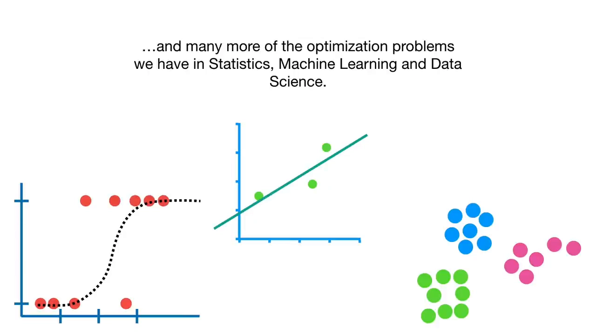
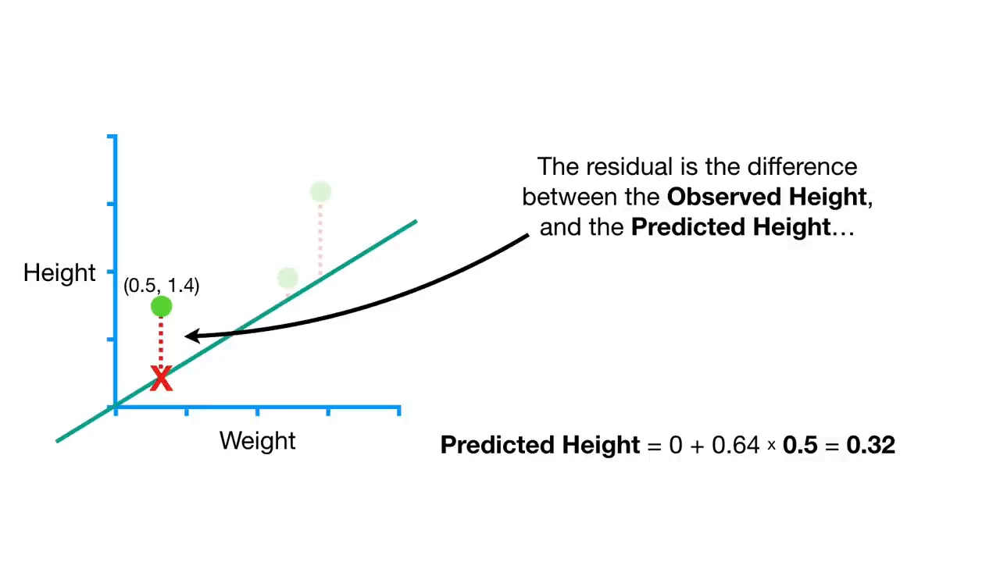
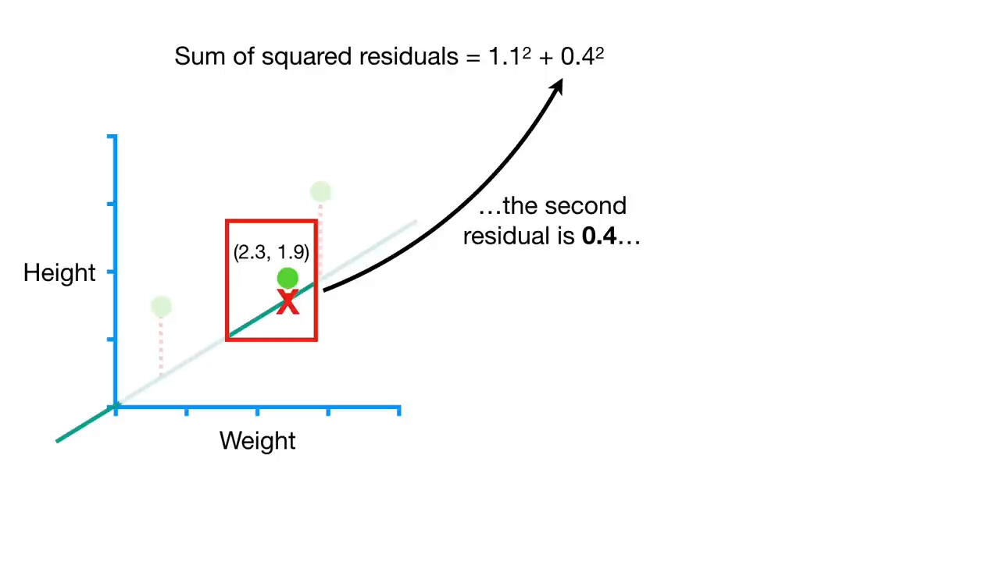
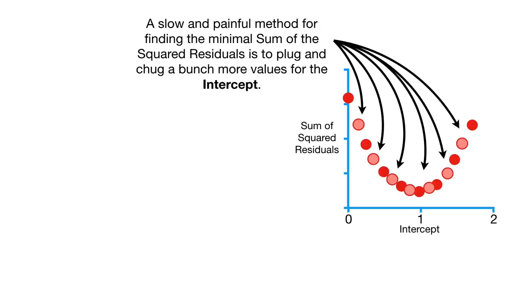
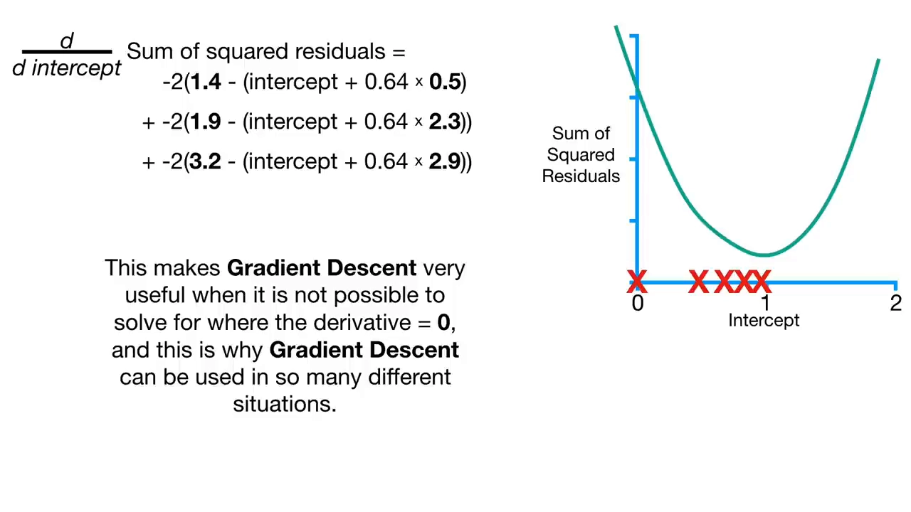
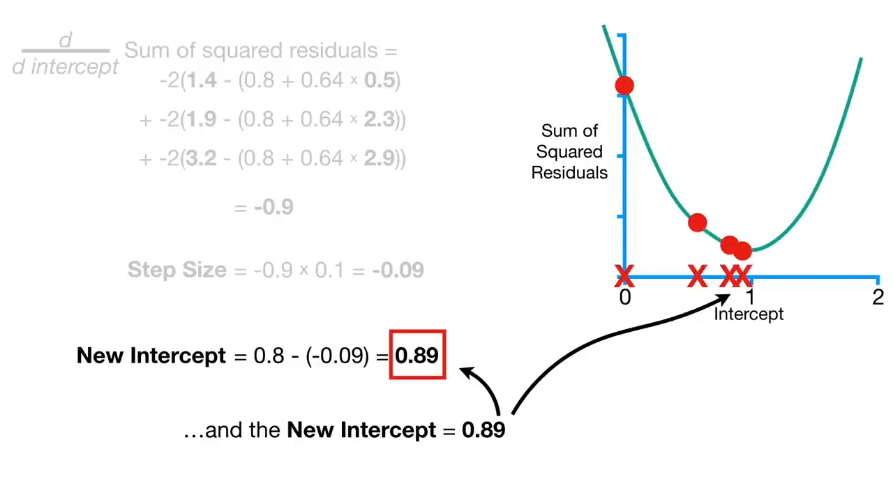
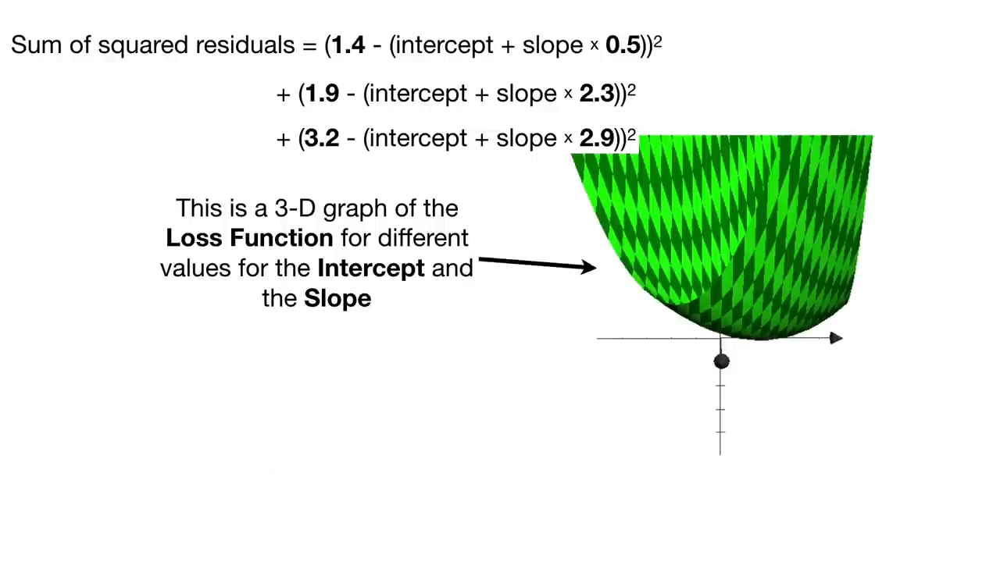
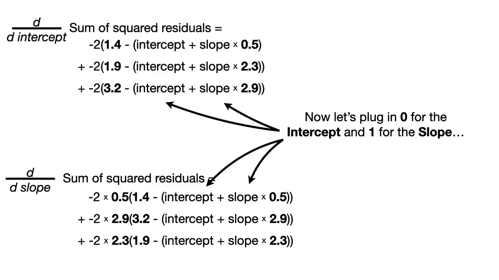
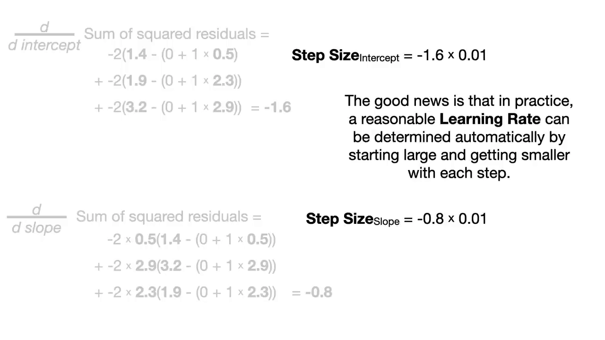
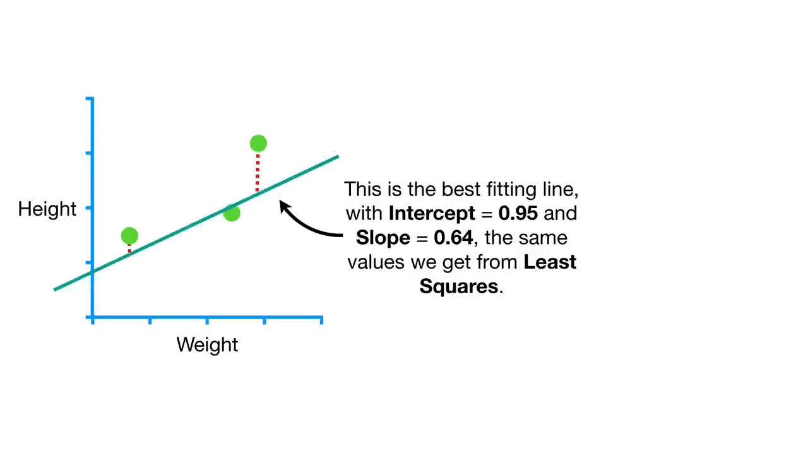

# 损失函数的导数与梯度：梯度下降如何用斜率决定步长

> 视频来源：[Gradient Descent, Step-by-Step](https://www.youtube.com/watch?v=sDv4f4s2SB8)（YouTube · StatQuest with Josh Starmer）｜时长约 24 分钟
> 这篇讲解用一个只有三个数据点的身高—体重例子，把“损失函数 → 求导 → 用斜率决定步长 → 更新参数”完整走了一遍。本文按本节目标截取这条主线：先看单参数时的导数与步长，再看双参数时的偏导数、二维损失面和梯度，最后给出通用的五步流程。

## 本讲要解决的核心问题（SCQA）

**背景**：拟合一条直线要选截距和斜率，训练逻辑回归要选一条曲线的形状，t-SNE 要摆出一组点的位置。这些任务表面上各不相同，做的却是同一件事——调整一组参数，让某个衡量“拟合好坏”的数值尽量小。

**冲突**：这个数值通常是参数的复杂函数，直接令导数为零往往解不出来；把参数值一个个试过去又太慢。我们需要一种“从某个猜测出发、逐步逼近最小值”的办法。

**疑问**：每一步应该往哪个方向走、走多远？这个方向和距离能不能从函数本身算出来？

**回答（中心思想）**：**对损失函数求导，得到的斜率告诉你当前点有多陡、朝哪边下降；把斜率乘以一个很小的学习率当作步长，用旧参数减去步长，就完成一次更新。** 参数多于一个时，对每个参数各求一个偏导数，把它们按参数顺序拼成向量，就是梯度；梯度下降就是沿着这个向量的反方向反复迈步，直到步长小到可以停下。

---

## 一、梯度下降要解决的是同一类问题：把参数调到让损失最小

讲座开场先列了三件看起来毫不相干的事 [【跳转到 00:21】](https://www.youtube.com/watch?v=sDv4f4s2SB8&t=21)：

- 线性回归拟合直线时，要优化**截距**和**斜率**；
- 逻辑回归拟合一条 S 形曲线时，要优化这条曲线的形状；
- t-SNE 把高维数据摆到平面上时，要优化**簇**的位置。

它们都是“优化某些东西”的例子。梯度下降的价值在于：**学会用它优化一条直线的两个参数，就等于掌握了同一套可以搬到曲线、簇以及更多问题上的策略** [【跳转到 00:57】](https://www.youtube.com/watch?v=sDv4f4s2SB8&t=57)。

为了把注意力集中在“怎么优化”上，讲座用了一个极小的数据集：横轴是体重，纵轴是身高，只有三个点 [【跳转到 01:22】](https://www.youtube.com/watch?v=sDv4f4s2SB8&t=82)。

正常做法是同时求截距和斜率，但讲座故意拆成两步：**先把斜率固定成最小二乘给出的 0.64，只用梯度下降求截距**；等单参数的流程讲清楚，再放开斜率，看两个参数一起优化 [【跳转到 01:47】](https://www.youtube.com/watch?v=sDv4f4s2SB8&t=107)。这个拆法让“导数”和“步长”的关系可以先在一维曲线上看清楚。

---

## 二、把“拟合好坏”写成一个标量函数

### 2.1 残差：观测身高与预测身高之差

先随便猜一个截距，讲座取 0。于是直线方程是

$$
\text{predicted height} = \text{intercept} + 0.64 \times \text{weight}
$$

对第一个样本（体重 0.5，身高 1.4），预测身高是 $0 + 0.64 \times 0.5 = 0.32$。**残差**定义为观测值减预测值：

$$
r_i = y_i - \hat{y}_i = 1.4 - 0.32 = 1.1
$$

[【跳转到 03:02】](https://www.youtube.com/watch?v=sDv4f4s2SB8&t=182)

三个样本的残差分别是 1.1、0.4、1.3。把它们的平方加起来，得到**残差平方和**（sum of squared residuals）：

$$
\mathrm{SSR} = 1.1^2 + 0.4^2 + 1.3^2 = 3.1
$$

[【跳转到 03:27】](https://www.youtube.com/watch?v=sDv4f4s2SB8&t=207)

在机器学习的说法里，这个残差平方和就是一种**损失函数**（loss function）：它把“这条直线拟合得有多差”压缩成一个数，数越大越差 [【跳转到 02:37】](https://www.youtube.com/watch?v=sDv4f4s2SB8&t=157)。这一步很关键——**只有把好坏变成一个标量，才谈得上对它求导**。

### 2.2 换一个截距，就得到损失曲线上的另一个点

截距取 0 时 SSR 是 3.1；截距取 0.25、0.5、……时，可以各算出一个 SSR。以截距为横轴、SSR 为纵轴，就得到一条 U 形曲线 [【跳转到 03:52】](https://www.youtube.com/watch?v=sDv4f4s2SB8&t=232)。

图上算过的几个点里，有一个最低，但它未必是真正的最低点——最优点可能落在两个采样值之间。想更精确，就得继续试更多截距值，而这是“又慢又痛苦”的办法 [【跳转到 04:42】](https://www.youtube.com/watch?v=sDv4f4s2SB8&t=282)。

梯度下降的效率来自一个简单策略：**离最优点远时迈大步，离最优点近时迈小步** [【跳转到 05:07】](https://www.youtube.com/watch?v=sDv4f4s2SB8&t=307)。要做到这一点，它需要知道当前点有多陡——这正是导数提供的信息。

---

## 三、导数：损失曲线在当前参数值处的斜率

### 3.1 先把损失写成截距的显式函数

要求导，先要把 SSR 写成截距的函数。把每个样本的预测值代回残差：

$$
\mathrm{SSR}(\text{intercept}) = \bigl(1.4 - (\text{intercept} + 0.64 \times 0.5)\bigr)^2
+ \bigl(1.9 - (\text{intercept} + 0.64 \times 2.3)\bigr)^2
+ \bigl(3.2 - (\text{intercept} + 0.64 \times 2.9)\bigr)^2
$$

这样，只要给定一个截距，就能算出对应的 SSR；这条曲线也就有了明确的表达式 [【跳转到 06:47】](https://www.youtube.com/watch?v=sDv4f4s2SB8&t=407)。

### 3.2 对截距求导：平方项用链式法则

对三项分别求导再相加。以第一项为例：先把平方提到前面，再乘上括号内部的导数。括号里只有截距是变量，$1.4$ 和 $0.64 \times 0.5$ 都是常数，导数为零，所以内部导数就是 $-1$。整理后得到

$$
\frac{d}{d\,\text{intercept}}\mathrm{SSR}
= -2\bigl(1.4 - (\text{intercept} + 0.64 \times 0.5)\bigr)
- 2\bigl(1.9 - (\text{intercept} + 0.64 \times 2.3)\bigr)
- 2\bigl(3.2 - (\text{intercept} + 0.64 \times 2.9)\bigr)
$$

[【跳转到 07:37】](https://www.youtube.com/watch?v=sDv4f4s2SB8&t=457)

这个式子的含义很直接：**把当前截距代进去，算出的数就是损失曲线在该点的斜率**。斜率为负，说明增大截距会让损失下降；斜率为正，说明减小截距才会让损失下降；斜率接近零，说明已经接近谷底。

### 3.3 令导数为零能解出最优点，但很多问题解不出来

如果目标是让斜率等于零，可以直接解方程，得到最小二乘的截距估计。讲座特意对比了这两条路 [【跳转到 09:07】](https://www.youtube.com/watch?v=sDv4f4s2SB8&t=547)：

- **最小二乘**：找到导数为零的位置，一步到位；
- **梯度下降**：从一个初始猜测出发，按斜率一步一步走，直到走到接近谷底。

后者看起来笨，但它的适用范围大得多：**当“令导数为零”无法解析求解时，仍然可以一步步逼近**。这正是梯度下降在统计、机器学习和数据科学里到处出现的原因。

---

## 四、步长 = 斜率 × 学习率：一次更新的完整算法

### 4.1 从截距 0 出发，第一步走到 0.57

把截距 0 代入导数，得到斜率 $-5.7$ [【跳转到 09:32】](https://www.youtube.com/watch?v=sDv4f4s2SB8&t=572)。

这里有两个观察：

1. 斜率绝对值越大，说明离谷底越远，应该迈大步；
2. 越接近最优截距，斜率越接近零，应该迈小步。

但步子不能无限大：如果一步跨得太远，会直接冲到曲线的另一侧，反而让 SSR 变大 [【跳转到 09:57】](https://www.youtube.com/watch?v=sDv4f4s2SB8&t=597)。所以步长要和斜率挂钩，同时再乘一个很小的系数来控制幅度。

这个系数叫**学习率**（learning rate）。步长与参数更新写成：

$$
\text{step size} = \text{slope} \times \text{learning rate}
$$

$$
\text{new intercept} = \text{old intercept} - \text{step size}
$$

取学习率 0.1，第一步的步长是 $-5.7 \times 0.1 = -0.57$，新截距是 $0 - (-0.57) = 0.57$ [【跳转到 10:47】](https://www.youtube.com/watch?v=sDv4f4s2SB8&t=647)。

为什么是“减去”步长？因为斜率指向损失上升的方向；要下降，就得往反方向走。斜率本身带符号，减去它就自动完成了“反方向”这一步。

### 4.2 越靠近谷底，步子自动变小

把新截距 0.57 代回导数，斜率变成 $-2.3$，步长变成 $-0.23$，新截距是 0.8。再代一次，斜率 $-0.9$，步长 $-0.09$，新截距 0.89 [【跳转到 11:37】](https://www.youtube.com/watch?v=sDv4f4s2SB8&t=697)。

继续迭代，截距依次变成 0.92、0.94、0.95。**每一步都比上一步小，因为斜率在接近零** [【跳转到 12:52】](https://www.youtube.com/watch?v=sDv4f4s2SB8&t=772)。六步之后得到 0.95，恰好等于最小二乘的截距估计——梯度下降没有对照标准答案，却走到了同一个位置。

### 4.3 什么时候停：步长足够小，或者步数用完

梯度下降的停止条件有两条 [【跳转到 13:17】](https://www.youtube.com/watch?v=sDv4f4s2SB8&t=797)：

- **步长足够小**：实际中常取 $0.001$ 或更小。例如斜率 0.009、学习率 0.1 时步长是 0.0009，小于阈值，就停止；
- **达到最大步数**：实际中常取 1000 步或更多。即使步长还不小，走满上限也会强制停止，避免无限循环。

这两条合起来说明：梯度下降给出的是**近似解**，精度由步长阈值和步数上限控制，而不是像解析解那样一次算准。

---

## 五、两个参数：二维损失面、偏导数与梯度

### 5.1 放开斜率，损失变成一个曲面

现在同时优化截距和斜率。损失函数变成两个变量的函数：

$$
\mathrm{SSR}(\text{intercept}, \text{slope}) = \sum_{i=1}^{3}\bigl(y_i - (\text{intercept} + \text{slope} \times x_i)\bigr)^2
$$

把截距和斜率分别放在两条水平轴上、SSR 放在竖直轴上，得到一张三维曲面 [【跳转到 15:59】](https://www.youtube.com/watch?v=sDv4f4s2SB8&t=959)。

一维时“曲线的斜率”只有一个；二维时，站在曲面上的某一点，朝不同方向走会有不同的坡度。**偏导数回答的是“只沿某一个参数方向走，坡度是多少”**。

### 5.2 偏导数：求一个参数时，把另一个当常数

对截距求偏导时，把斜率视为常数。因为斜率不是变量，它所在的那一项在求导时按常数处理；截距的导数仍然是 $-1$，平方照旧提到前面 [【跳转到 17:00】](https://www.youtube.com/watch?v=sDv4f4s2SB8&t=1020)。

对斜率求偏导时反过来：把截距视为常数，截距的导数为零；斜率乘在体重上，所以每一项会多出一个体重因子。三个样本的体重 0.5、2.3、2.9 就出现在结果里 [【跳转到 17:25】](https://www.youtube.com/watch?v=sDv4f4s2SB8&t=1045)。

把两个偏导数放在一起：

$$
\frac{\partial\,\mathrm{SSR}}{\partial\,\text{intercept}}
= -2\sum_i \bigl(y_i - (\text{intercept} + \text{slope} \times x_i)\bigr)
$$

$$
\frac{\partial\,\mathrm{SSR}}{\partial\,\text{slope}}
= -2\sum_i x_i\bigl(y_i - (\text{intercept} + \text{slope} \times x_i)\bigr)
$$

**同一个函数有两个或更多偏导数时，把它们合起来就叫梯度**（gradient）[【跳转到 19:04】](https://www.youtube.com/watch?v=sDv4f4s2SB8&t=1144)。梯度不是一个新的运算，它只是把“每个参数方向上的变化率”按参数顺序装进一个向量。

### 5.3 在二维面上下降：每个参数各用各的偏导更新

有了梯度，更新规则和一维时一模一样，只是每个参数用自己的偏导数：

$$
\text{intercept}_{\text{new}} = \text{intercept}_{\text{old}} - \eta \cdot \frac{\partial\,\mathrm{SSR}}{\partial\,\text{intercept}}
$$

$$
\text{slope}_{\text{new}} = \text{slope}_{\text{old}} - \eta \cdot \frac{\partial\,\mathrm{SSR}}{\partial\,\text{slope}}
$$

讲座从截距 0、斜率 1 出发，学习率取 0.01。代进去得到两个偏导数 $-1.6$ 和 $-0.8$，对应步长 $-0.016$ 和 $-0.008$，于是参数被更新到新的位置 [【跳转到 19:59】](https://www.youtube.com/watch?v=sDv4f4s2SB8&t=1199)。

这里出现了一个一维时没暴露的问题：**学习率很敏感**。第一段单参数例子用的 0.1 在这里行不通，走很多步也到不了正确答案；换成 0.01 才正常收敛 [【跳转到 20:11】](https://www.youtube.com/watch?v=sDv4f4s2SB8&t=1211)。讲座给了一个实用做法：让学习率从较大值开始、每步逐渐减小，实践中就不必过度纠结这个超参数。

反复迭代后，截距收敛到 0.95、斜率收敛到 0.64，与最小二乘结果一致 [【跳转到 21:25】](https://www.youtube.com/watch?v=sDv4f4s2SB8&t=1285)。

如果参数更多，做法不变：**多一个参数就多求一个偏导数，其余步骤完全一样** [【跳转到 21:50】](https://www.youtube.com/watch?v=sDv4f4s2SB8&t=1310)。这就是为什么同一套梯度下降可以用于直线、逻辑回归、t-SNE 以及神经网络。

---

## 六、通用流程：五步循环

把前面的过程抽象出来，梯度下降对任何损失函数都是同一套循环 [【跳转到 21:50】](https://www.youtube.com/watch?v=sDv4f4s2SB8&t=1310)：

1. **求梯度**：对损失函数里每个参数各求一个偏导数；
2. **初始化**：给每个参数随便取一个初始值；
3. **代入**：把当前参数值代进各偏导数，得到当前点的梯度；
4. **算步长**：每个偏导数乘上学习率；
5. **更新**：用旧参数减去对应步长，回到第 3 步，直到步长足够小或达到最大步数。

讲座最后补了一个工程上的变体：数据量很大时，每一步都算全量数据的梯度很慢，于是**随机梯度下降**（stochastic gradient descent, SGD）每次只随机抽一部分数据来估计梯度，减少计算时间 [【跳转到 22:40】](https://www.youtube.com/watch?v=sDv4f4s2SB8&t=1360)。它听起来高级，但替换的只是“梯度用多少数据算”，更新公式和停止逻辑都没有变。

---

## 小结

- **损失函数把拟合好坏压成一个标量**；只有变成标量，才能对它求导、谈“往哪个方向变好”。
- **导数就是损失曲线在当前参数值处的斜率**：斜率为负说明增大参数会降低损失，斜率为正说明要减小参数，斜率接近零说明接近谷底。
- **步长 = 斜率 × 学习率，新参数 = 旧参数 − 步长**。斜率负责方向，学习率负责幅度；越靠近谷底斜率越小，步子自动变小。
- **参数多于一个时，对每个参数各求一个偏导数**：求某个参数的偏导时，把其余参数当常数。
- **梯度是按参数顺序排列的偏导数向量**；梯度下降对每个参数各用自己的偏导数更新，参数再多也只是“多求几个偏导”。
- **停止条件是步长足够小或步数达到上限**，所以梯度下降给的是受阈值控制的近似解。
- **学习率对能否收敛很敏感**：太大会越过谷底，太小则走得太慢；实践中可以让它从大到小逐步衰减。

## 关键术语速查

| 术语 | 一句话解释 |
| --- | --- |
| 残差（residual） | 观测值减去模型预测值，表示这个样本被拟合得多偏 |
| 残差平方和（SSR） | 所有残差平方相加，是一种具体的损失函数 |
| 损失函数（loss function） | 把模型拟合好坏压缩成一个标量的函数，训练就是让它变小 |
| 导数（derivative） | 一元函数在某一点的瞬时变化率，几何上是曲线在该点的切线斜率 |
| 偏导数（partial derivative） | 多元函数中只对一个变量求导、其余变量视为常数得到的变化率 |
| 梯度（gradient） | 把同一函数的所有偏导数按变量顺序排成的向量 |
| 学习率（learning rate） | 乘在斜率上、控制每步走多远的正系数 |
| 步长（step size） | 斜率与学习率的乘积，是本次参数实际移动的量 |
| 梯度下降（gradient descent） | 反复沿负梯度方向更新参数、使损失下降的迭代算法 |
| 随机梯度下降（SGD） | 每次只用随机抽取的一部分数据估计梯度，降低单步计算量 |