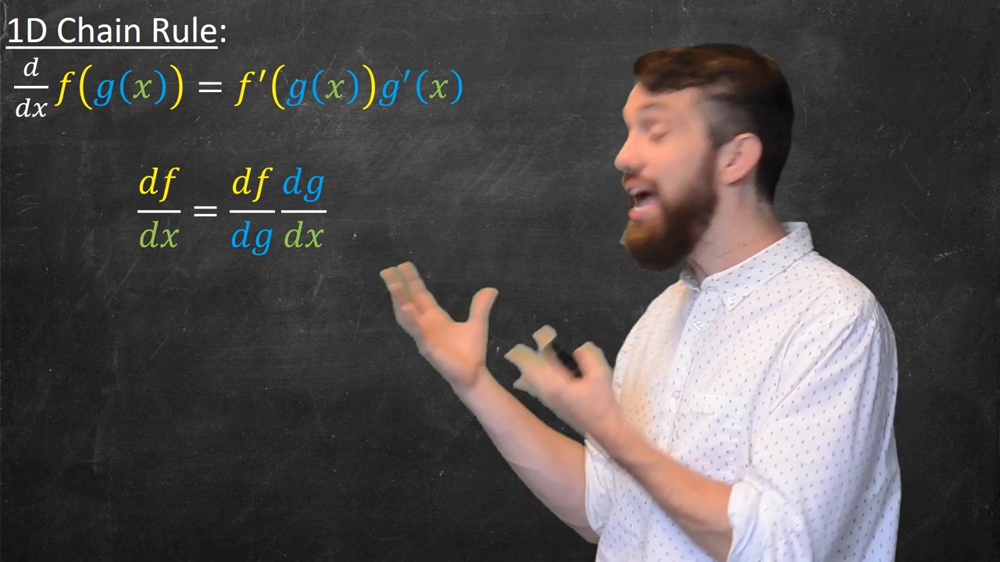
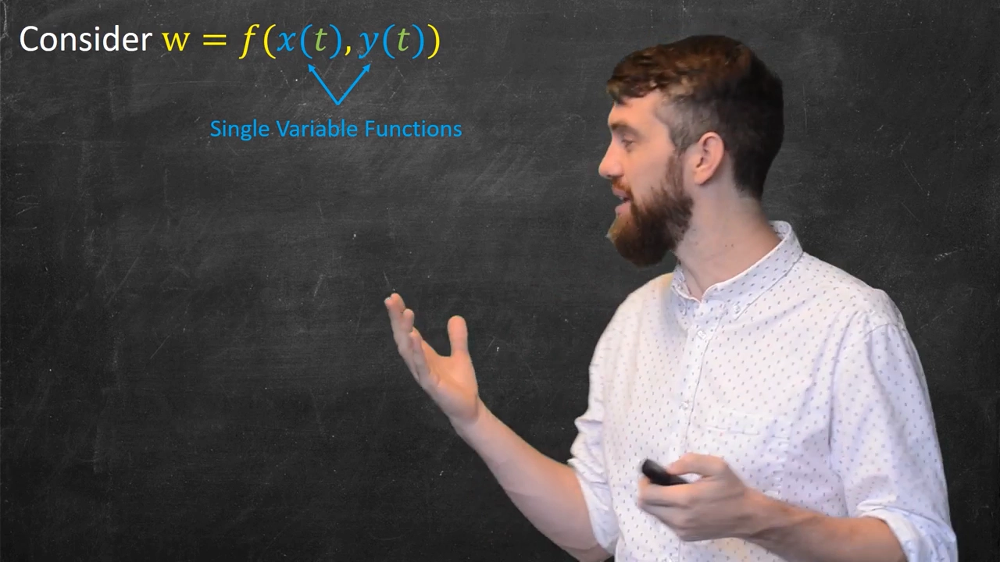
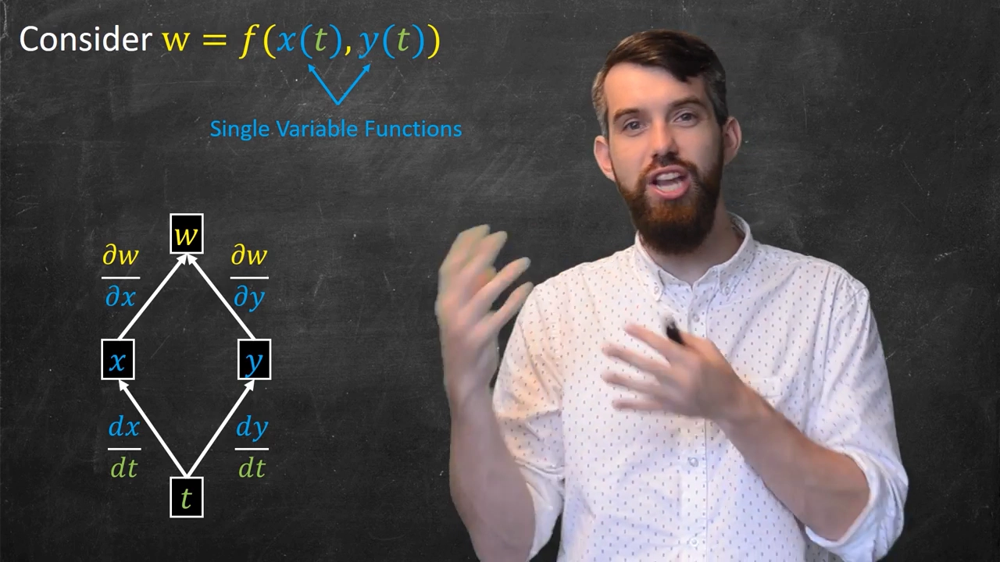
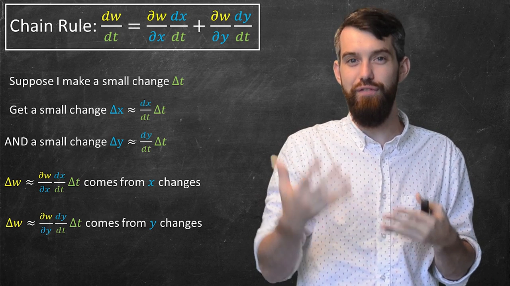
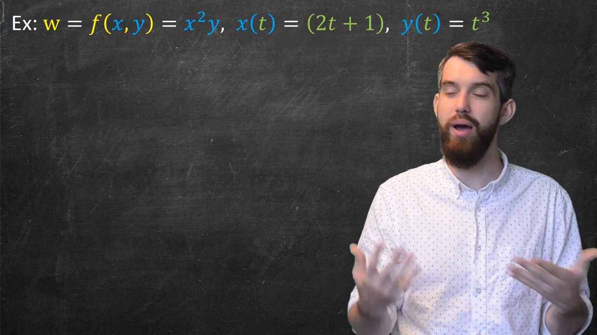
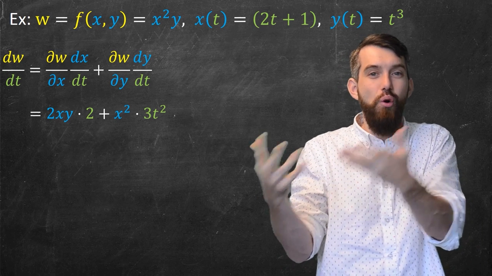

# 多元链式法则：依赖图上的分支求和与全导数和偏导数之分

> 视频来源：[The Multi-Variable Chain Rule: Derivatives of Compositions](https://www.youtube.com/watch?v=9yCtWfI_Vjg)（YouTube · Dr. Trefor Bazett）｜时长约 10 分钟
> 这篇讲解从一元链式法则出发，把"复合函数求导"推广到中间变量不止一个的情形：先画出变量依赖图，再说明为什么结果是若干条路径之和，最后用一个算例走完全流程。本文按本节目标整理，重点在"维度与路径如何决定项数"，不展开矩阵形式的 Jacobian（见同节另一篇）。

## 本讲要解决的核心问题（SCQA）

**背景**：一元复合函数 $f(g(x))$ 的导数是 $f'(g(x))\,g'(x)$，也就是"外层导数乘内层导数"。这是链式法则最熟悉的形式。

**冲突**：神经网络或物理模型里的复合关系通常不是一条链，而是分叉再汇合：输入 $t$ 先影响 $x$ 和 $y$ 两个中间量，$x$ 和 $y$ 又共同决定最终输出 $w$。这时"乘一次内层导数"就不够了——$t$ 的变化会同时从两条路影响 $w$。

**疑问**：中间变量有多个、路径有分叉时，复合函数的导数到底怎么写？哪些地方该用全导数 $d$、哪些地方该用偏导数 $\partial$？项数由什么决定？

**回答（中心思想）**：**把复合关系画成依赖图，从输入到输出有几条路径，链式法则就有几项；每一项是一条路径上各段导数之积，总导数是这些项之和。** 全导数 $d$ 用于"整条路径的净效果"，偏导数 $\partial$ 用于"只沿某一条边、冻结其他变量"的局部效果。维度（输入个数、输出个数）不改变这条规则，只改变每一项是数还是矩阵。

---

## 一、先把一元链式法则写成"路径乘积"的形式

### 1.1 撇记号与 Leibniz 记号是同一件事

一元情形下，复合函数 $f(g(x))$ 的导数是外层导数在内层取值处乘以内层导数 [【跳转到 00:11】](https://www.youtube.com/watch?v=9yCtWfI_Vjg&t=11)：

$$
\frac{d}{dx}f\big(g(x)\big)=f'\big(g(x)\big)\,g'(x)
$$

用 Leibniz 记号写出来是 [【跳转到 00:41】](https://www.youtube.com/watch?v=9yCtWfI_Vjg&t=41)：

$$
\frac{df}{dx}=\frac{df}{dg}\cdot\frac{dg}{dx}
$$

两种写法含义相同，但 Leibniz 记号更适合推广：它把"对谁求导"写在分母上，一旦变量变多，就能一眼看出每一段是沿着哪条边走的。本节后面全部使用这种"分段相乘"的读法。

### 1.2 一个变量、一条路径，所以只有一项

一元链式法则之所以只有一项，是因为从 $x$ 到 $f$ 只有一条路：$x\to g\to f$。把这件事记住，下一节看到"两项"时就不会觉得是新公式——它只是路径从一条变成了两条。

## 二、中间变量有两个时，依赖图决定项数

### 2.1 问题的设置：一个多变量函数套两个单变量函数

考虑这样的复合关系 [【跳转到 01:05】](https://www.youtube.com/watch?v=9yCtWfI_Vjg&t=65)：函数 $f$ 依赖 $x$ 和 $y$，输出一个标量 $w$；而 $x$ 和 $y$ 各自又依赖同一个变量 $t$。

$$
w=f(x,y),\qquad x=x(t),\qquad y=y(t)
$$

这里要特别注意三件事的差别 [【跳转到 01:21】](https://www.youtube.com/watch?v=9yCtWfI_Vjg&t=81)：

- $x(t)$ 和 $y(t)$ 都是**单变量函数**：一个输入 $t$，一个输出。
- 只有 $f$ 是**多变量函数**：两个输入 $x,y$，一个输出 $w$。
- 因此 $w$ 最终是 $t$ 的单变量函数（$t$ 进、$w$ 出），尽管中间绕过了两个变量。

### 2.2 依赖图：把"谁依赖谁"画成有向边

把上面的关系画成一张**依赖图**（dependency diagram），事情就清楚了 [【跳转到 01:29】](https://www.youtube.com/watch?v=9yCtWfI_Vjg&t=89)：最下面是自变量 $t$，中间一层是 $x$ 和 $y$，最上面是输出 $w$；箭头从"被改变的量"指向"随之改变的量"。

图上每条边都可以标一段导数 [【跳转到 02:26】](https://www.youtube.com/watch?v=9yCtWfI_Vjg&t=146)：

- 下层的 $t\to x$、$t\to y$ 是**全导数** $\dfrac{dx}{dt}$、$\dfrac{dy}{dt}$：$x$ 只依赖 $t$ 一个变量，所以这是完整的"$t$ 变一点、$x$ 变多少"。
- 上层的 $x\to w$、$y\to w$ 是**偏导数** $\dfrac{\partial w}{\partial x}$、$\dfrac{\partial w}{\partial y}$：$w$ 同时依赖 $x$ 和 $y$，所以只能问"只让 $x$ 动、$y$ 冻住"时 $w$ 变多少。

**记号不是装饰，而是在声明"其他变量怎么处理"。** 这是本节最容易出错的地方：同一个公式里 $d$ 和 $\partial$ 混用，恰恰是因为不同边的"其他变量"情况不同。

### 2.3 两条路径，两项相加

从 $t$ 走到 $w$ 有两条路：$t\to x\to w$ 和 $t\to y\to w$。$t$ 的微小变化会同时沿两条路推动 $w$，所以总变化率是两段贡献之和 [【跳转到 03:35】](https://www.youtube.com/watch?v=9yCtWfI_Vjg&t=215)：

$$
\frac{dw}{dt}=\frac{\partial w}{\partial x}\frac{dx}{dt}+\frac{\partial w}{\partial y}\frac{dy}{dt}
$$

左边用 $d$，因为 $w$ 最终只是 $t$ 的单变量函数；右边每个乘积是一段"边上的导数"相乘，对应一条路径。

### 2.4 为什么是"相加"：把 Δt 的传播拆开看

公式可以靠"小变化的传播"直接读出来 [【跳转到 04:29】](https://www.youtube.com/watch?v=9yCtWfI_Vjg&t=269)。给 $t$ 一个很小的改变 $\Delta t$，它先分别引起

$$
\Delta x\approx\frac{dx}{dt}\Delta t,\qquad \Delta y\approx\frac{dy}{dt}\Delta t
$$

而 $w$ 的变化来自两部分：$x$ 变了引起的部分，加上 $y$ 变了引起的部分 [【跳转到 05:32】](https://www.youtube.com/watch?v=9yCtWfI_Vjg&t=332)：

$$
\Delta w\approx\frac{\partial w}{\partial x}\Delta x+\frac{\partial w}{\partial y}\Delta y
$$

把 $\Delta x$、$\Delta y$ 代进去，两边同除以 $\Delta t$ 再取极限，就得到上面的链式法则 [【跳转到 06:36】](https://www.youtube.com/watch?v=9yCtWfI_Vjg&t=396)。所以"求和"不是约定，而是"$t$ 的变化确实分两路进入 $w$"的直接后果。

### 2.5 "分子分母约掉"只是方便记忆的虚构

看着 $\dfrac{\partial w}{\partial x}\dfrac{dx}{dt}$，很容易以为是把 $dx$ 约掉了。讲者明确提醒：$\dfrac{\partial w}{\partial x}$ 是一个整体符号，表示"$w$ 对 $x$ 的变化率"，并不是两个可以拆开的量，所以这里并没有真正的约分 [【跳转到 06:49】](https://www.youtube.com/watch?v=9yCtWfI_Vjg&t=409)。

这个"虚构"作为记忆法很好用：沿着路径把边上的导数串起来相乘，就像单位换算时把相同的量约掉。但推导时要知道它背后是取极限的过程，不能拿它当证明。

### 2.6 变量更多只是项数更多

如果 $w$ 还依赖 $z$，只要再加一项 $\dfrac{\partial w}{\partial z}\dfrac{dz}{dt}$ 即可 [【跳转到 07:36】](https://www.youtube.com/watch?v=9yCtWfI_Vjg&t=456)：**有多少条从输入到输出的路径，就有多少项**。

讲者在这里留下两个未展开的问题：如果顶上有多个输出（$w$ 变成向量）会怎样？如果底下有多个输入（$t$ 变成向量）会怎样？这两个问题正是 Jacobian 矩阵要回答的内容——当输入、输出都是向量时，每一项不再是数，而是一张"每个输出对每个输入"的偏导数表，链式法则相应变成矩阵乘法。

## 三、算例：$w=x^2y$，$x=2t+1$，$y=t^3$

### 3.1 两条路：先代入再求导，或直接用链式法则

给定 [【跳转到 08:06】](https://www.youtube.com/watch?v=9yCtWfI_Vjg&t=486)：

$$
w=f(x,y)=x^2y,\qquad x(t)=2t+1,\qquad y(t)=t^3
$$

有两种做法 [【跳转到 08:28】](https://www.youtube.com/watch?v=9yCtWfI_Vjg&t=508)：一是把 $x(t)$、$y(t)$ 直接代进 $w$，得到一个只含 $t$ 的长表达式再求导；二是按链式法则分段算再相加。两种做法结果相同，后者的好处是每一步都只处理一小段、不容易在展开时出错。

### 3.2 逐段求导：偏导时把另一个变量当常数

先算经过 $x$ 的那条路 [【跳转到 08:56】](https://www.youtube.com/watch?v=9yCtWfI_Vjg&t=536)。对 $x$ 求偏导时，$y$ 被当成常数（讲者的说法是"就像数字 7 一样跟着走"）：

$$
\frac{\partial w}{\partial x}=2xy,\qquad \frac{dx}{dt}=2
$$

再算经过 $y$ 的那条路 [【跳转到 09:27】](https://www.youtube.com/watch?v=9yCtWfI_Vjg&t=567)。这次 $x$ 被冻住：

$$
\frac{\partial w}{\partial y}=x^2,\qquad \frac{dy}{dt}=3t^2
$$

代进链式法则：

$$
\frac{dw}{dt}=\frac{\partial w}{\partial x}\frac{dx}{dt}+\frac{\partial w}{\partial y}\frac{dy}{dt}=2xy\cdot 2+x^2\cdot 3t^2
$$

### 3.3 收尾：把中间变量换回 $t$

上面的结果里同时有 $x,y,t$，还不是最终形式。把 $x=2t+1$、$y=t^3$ 代回，就得到完全用 $t$ 表达的答案 [【跳转到 09:53】](https://www.youtube.com/watch?v=9yCtWfI_Vjg&t=593)。

这一步看起来只是代数整理，但它对应一个重要的检查：**链式法则给出的是"中间变量还在场"的表达式，最终结果必须能化成只含自变量的形式**。如果化不出来，通常说明某条路径漏了、或者某个偏导把不该冻的变量冻住了。

## 四、这套规则怎么用到网络上

把依赖图换成计算图，本节的三条结论可以直接搬过去：

1. **一条边一段局部导数**：每个运算（加法、乘法、激活函数）只负责自己那一段的导数，不需要知道整条链。
2. **一个变量有几条出边，就把几条贡献加起来**：这正是后面反向传播里"梯度在多条路径上累加"的来源。
3. **$d$ 与 $\partial$ 的区别就是"是否还有其他变量在场"**：标量损失对单个参数的导数用 $d$，某个中间量对多个输入的导数则是一组偏导。

当输入、输出都是向量时，第 1 条的"一段导数"升级成矩阵（Jacobian），第 2 条的"相加"升级成矩阵乘法——这正是同节另一篇《Jacobian 矩阵：向量值函数的局部导数表与逐层维度传递》的内容。

## 小结

- 一元链式法则 $\dfrac{df}{dx}=\dfrac{df}{dg}\dfrac{dg}{dx}$ 是"沿一条路径把各段导数相乘"。
- 复合关系分叉时，先画依赖图：从输入到输出有几条路径，链式法则就有几项，项与项之间是相加。
- 全导数 $d$ 描述"整条路径的净效果"，偏导数 $\partial$ 描述"只动一个变量、其余冻住"的局部效果；同一个公式里混用两者是由依赖结构决定的。
- $\Delta t\to\Delta x,\Delta y\to\Delta w$ 的传播链条解释了"为什么相加"：不同支路的贡献同时进入输出。
- 把分子分母"约掉"只是记忆法，$\partial w/\partial x$ 是整体符号，不是可拆的商。
- 变量变多只是项数变多；输入或输出变成向量时，才需要 Jacobian 这样的矩阵记号。

## 关键术语速查

| 术语 | 一句话解释 |
| --- | --- |
| 复合函数 | 一个函数的输出当作另一个函数的输入，如 $w=f(x(t),y(t))$ |
| 依赖图 | 把"谁随谁变化"画成有向边的图；从输入到输出的路径数决定链式法则的项数 |
| 全导数 $\frac{dw}{dt}$ | 把所有路径的贡献都算进去的总变化率，用于"输出最终只依赖一个变量"的情形 |
| 偏导数 $\frac{\partial w}{\partial x}$ | 只让 $x$ 变、其余变量冻结时 $w$ 的变化率 |
| 路径求和 | 每条路径上各段导数相乘，再把所有路径的乘积相加 |