# 蒙特卡洛积分：样本平均如何逼近期望并给出误差

> 视频来源：[Monte Carlo Integration Explained: Using randomness to approximate integrals](https://www.youtube.com/watch?v=0zbLv2k17vU)（YouTube · 频道 SoME4 参赛作品）｜时长约 16 分钟
> 本篇讲同一件事的两个方向：积分可以写成某个随机变量的期望，于是「算积分」可以换成「采样再平均」；而平均值的误差不是凭感觉，它由中心极限定理给出 $\sigma/\sqrt{n}$ 的量级。

## 本讲要解决的核心问题（SCQA）

**背景**：积分是「曲线下的面积」，也是连续变量的期望。对一些简单函数，可以用辛普森法则、梯形法则等确定性方法，把面积切成固定的小块来近似。

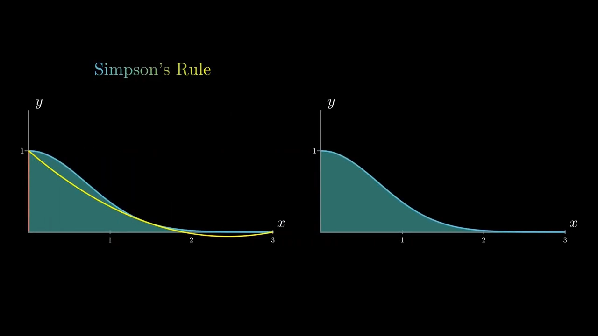

**冲突**：很多积分没有解析原函数，确定性方法在高维时还会遇到「维数灾难」——每增加一维，网格点数就指数增长。另一方面，即便能写出积分，也不一定知道被积函数在哪些区域贡献最大。

**疑问**：能不能不画网格，而是用随机采样来估计积分？这种估计为什么有效，误差又有多大？

**回答（中心思想）**：把积分改写成某个随机变量的期望，再从这个分布里独立采样、取样本平均。大数定律保证它收敛到积分；中心极限定理进一步给出误差约为 $\sigma/\sqrt{n}$——**误差随样本数按 $1/\sqrt{n}$ 缩小，而且这个阶数与积分维数无关**。采样分布选得好（重要性采样）还能减小 $\sigma$，让同样的样本数更准。

---

## 一、先看一个不用公式的例子：用随机点估圆面积

### 1.1 圆、正方形与落点比例

单位圆的面积是 $\pi$。视频把它放进一个边长为 2 的正方形里，在正方形内均匀随机撒点：落在圆内的点涂红，落在圆外的点涂蓝。

如果点撒得足够多，那么

$$
\frac{\text{圆内点数}}{\text{总点数}}\approx\frac{\text{圆面积}}{\text{正方形面积}}
$$

正方形面积是 4，所以圆面积约等于 $4\times$（圆内点数 / 总点数）。这就是蒙特卡洛估计最直观的版本：**用一个容易算的面积作参照，用落点比例去推另一个面积**。[【跳转到 00:25】](https://www.youtube.com/watch?v=0zbLv2k17vU&t=25)

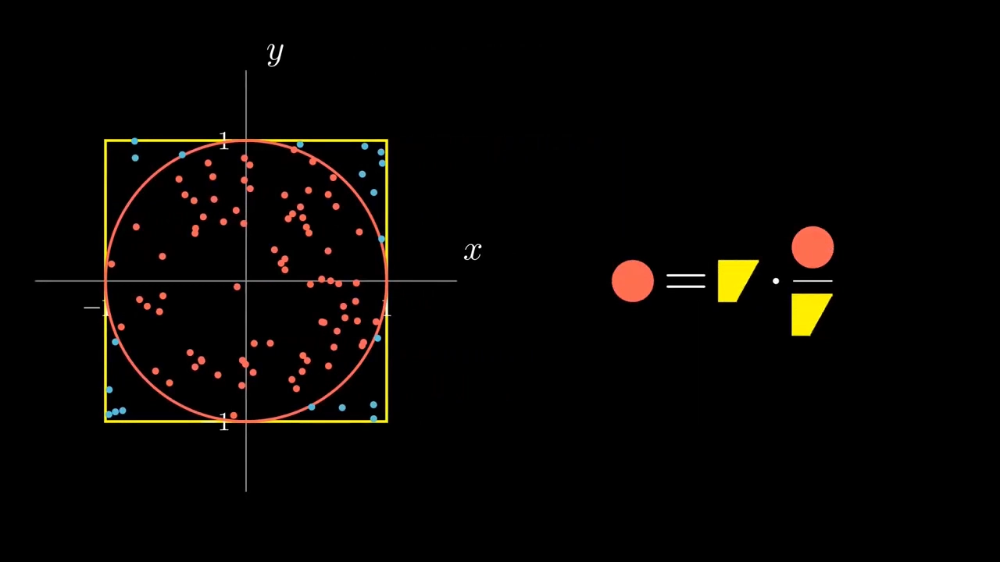

### 1.2 它其实是在算一个积分

把「点是否落在圆内」写成一个取 0 或 1 的函数，圆面积就等于这个函数在正方形上的积分。撒点、数比例，本质上是在用样本平均估计这个积分。[【跳转到 01:46】](https://www.youtube.com/watch?v=0zbLv2k17vU&t=106)

这个例子说明了两件事：第一，随机采样可以绕开「找原函数」；第二，样本越多，比例越稳定。但「越稳定」具体是多少？要回答这个问题，需要把估计写成期望，再用大数定律和中心极限定理。

---

## 二、样本平均能算积分：把积分写成期望

### 2.1 连续变量的期望定义

设 $X$ 是连续随机变量，密度为 $p(x)$，$g$ 是任意函数。按定义，$g(X)$ 的期望是

$$
\mathbb{E}[g(X)]=\int_{\Omega} g(x)\,p(x)\,\mathrm{d}x
$$

只要这个积分绝对收敛。[【跳转到 01:56】](https://www.youtube.com/watch?v=0zbLv2k17vU&t=116)

这个式子和上一篇的连续期望是同一个东西：**期望就是「函数值 × 密度」的积分**。区别只在于，这里被积的是 $g(x)$，而不是 $x$ 本身。注意 $p(x)$ 仍然是密度：单点的 $p(x)$ 不是概率，概率由 $p$ 在区间上的积分给出；期望则是 $g(x)$ 按这个密度加权后的积分。

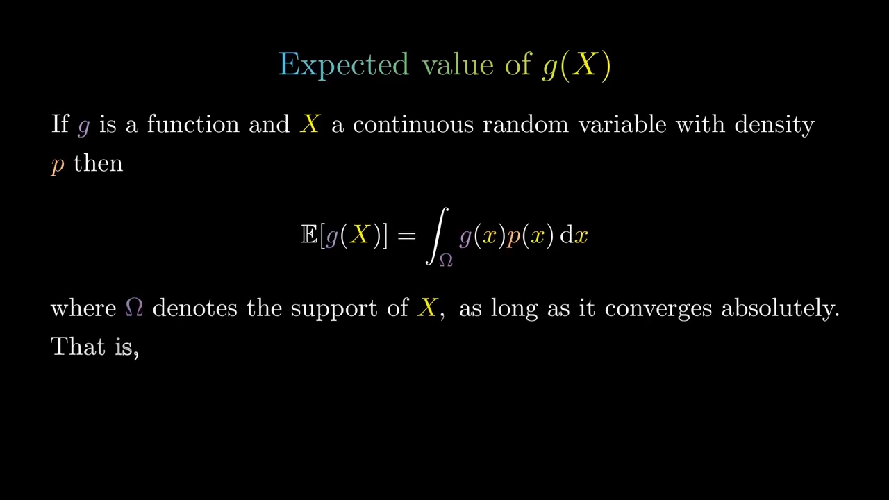

### 2.2 把目标积分「伪装」成期望

现在要算的是任意积分

$$
I=\int_{\Omega} f(x)\,\mathrm{d}x
$$

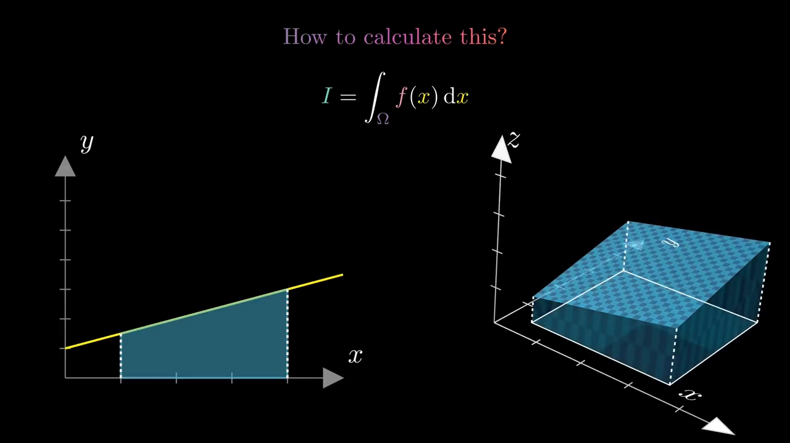

它和期望的定义只差一个密度因子。于是可以主动选一个容易采样的密度 $p(x)$，令

$$
g(x)=\frac{f(x)}{p(x)}
$$

代回期望定义：

$$
\mathbb{E}[g(X)]=\int_{\Omega}\frac{f(x)}{p(x)}\,p(x)\,\mathrm{d}x=\int_{\Omega} f(x)\,\mathrm{d}x=I
$$

也就是说，**只要从 $p$ 采样、对 $f/p$ 求平均，就能估计 $f$ 的积分**。$p$ 可以选均匀分布，也可以选别的分布；选不同的 $p$ 不改变期望，但会改变估计的方差——这一点后面会用到。[【跳转到 02:19】](https://www.youtube.com/watch?v=0zbLv2k17vU&t=139)

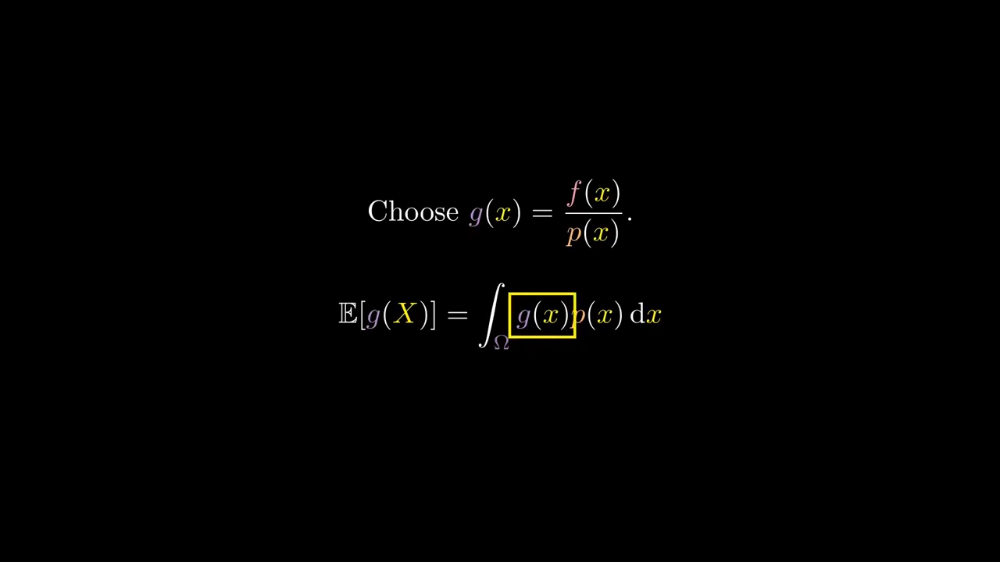

### 2.3 大数定律：样本平均几乎必然收敛

设 $X_1,\dots,X_n$ 独立同分布，且 $\mathbb{E}[X_i]=\mu$。强大数定律说：

$$
\frac{1}{n}\sum_{i=1}^{n}X_i \xrightarrow{\text{a.s.}} \mu
$$

把 $X_i$ 换成 $g(X_i)$，就得到

$$
\frac{1}{n}\sum_{i=1}^{n}g(X_i)\xrightarrow{\text{a.s.}}\mathbb{E}[g(X)]=I
$$

所以「采样求平均」不是启发式，而是有收敛保证的估计：样本越多，平均值几乎必然越接近积分。[【跳转到 02:44】](https://www.youtube.com/watch?v=0zbLv2k17vU&t=164)

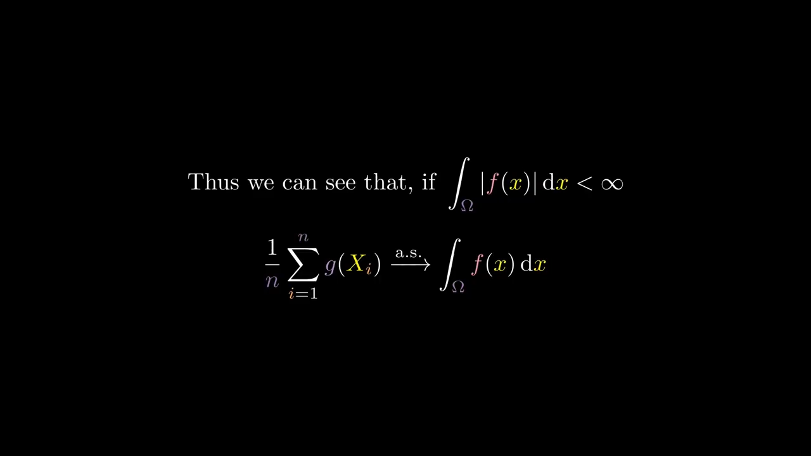

---

## 三、误差的量级：中心极限定理与 $1/\sqrt{n}$

### 3.1 估计量是一个随机变量

把每个样本算出的 $g(X_i)$ 记作 $Y_i$，估计量就是样本平均

$$
\bar{Y}_n=\frac{1}{n}\sum_{i=1}^{n}Y_i
$$

它本身是随机变量：换一批样本，平均值就会变。要谈「误差」，就要谈这个随机变量的分布。

### 3.2 均值的期望与标准差

因为 $Y_i$ 独立同分布，且 $\mathbb{E}[Y_i]=I$，所以

$$
\mathbb{E}[\bar{Y}_n]=\frac{1}{n}\sum_{i=1}^{n}\mathbb{E}[Y_i]=I
$$

估计是**无偏**的：平均来看不会系统性地偏高或偏低。

方差则要把系数平方后提出：

$$
\operatorname{Var}(\bar{Y}_n)=\frac{1}{n^2}\sum_{i=1}^{n}\operatorname{Var}(Y_i)=\frac{\sigma^2}{n}
$$

开根号得到标准差：

$$
\sigma_{\bar{Y}}=\frac{\sigma}{\sqrt{n}}
$$

其中 $\sigma$ 是单个 $Y_i$ 的标准差，由采样分布 $p$ 和被积函数 $f$ 共同决定。[【跳转到 04:49】](https://www.youtube.com/watch?v=0zbLv2k17vU&t=289)

### 3.3 中心极限定理给出近似正态

中心极限定理说：当 $n$ 很大时，标准化后的样本平均趋近标准正态，

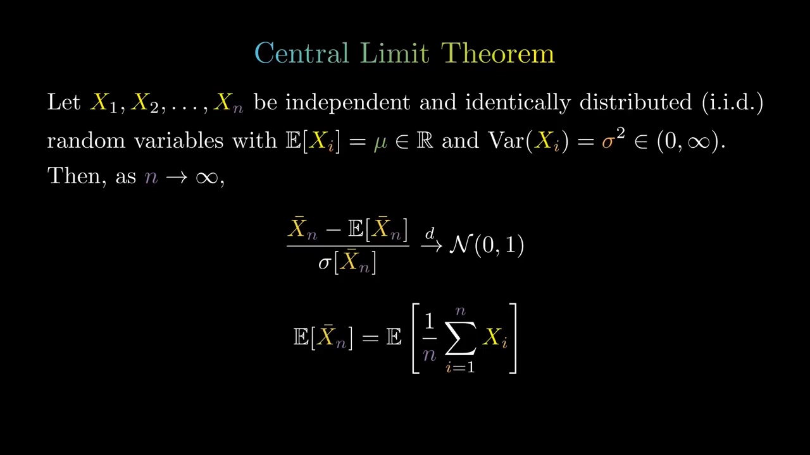

$$
\frac{\bar{Y}_n-I}{\sigma/\sqrt{n}}\xrightarrow{d}\mathcal{N}(0,1)
$$

等价地，$\bar{Y}_n$ 近似服从均值为 $I$、标准差为 $\sigma/\sqrt{n}$ 的正态分布。[【跳转到 06:29】](https://www.youtube.com/watch?v=0zbLv2k17vU&t=389)

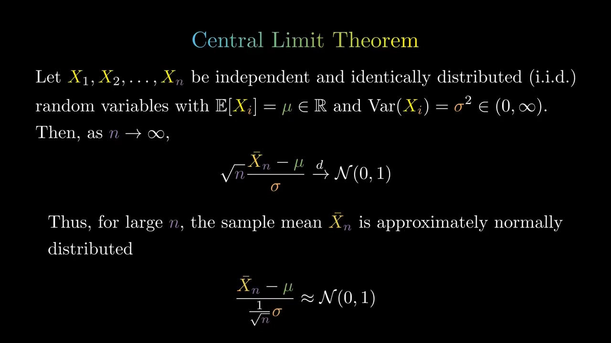

### 3.4 把误差写成概率

想知道「估计值离真值不超过某个上限」的概率，可以把这个上限写成标准差的倍数 $t\sigma/\sqrt{n}$：

$$
P\left(|\bar{Y}_n-I|\le t\frac{\sigma}{\sqrt{n}}\right)\approx P(|Z|\le t)
$$

其中 $Z$ 是标准正态变量。$t=3$ 时，这个概率约为 99.7%。也就是说，**只要样本数足够大，就可以用「3 倍标准误」画出一个约有 99.7% 把握覆盖真值的区间**。[【跳转到 07:44】](https://www.youtube.com/watch?v=0zbLv2k17vU&t=464)

### 3.5 误差阶数是 $1/\sqrt{n}$，且与维数无关

从上面的式子可以直接读出：误差上限与 $\sigma/\sqrt{n}$ 成正比，因此

$$
\text{误差}=O\left(\frac{1}{\sqrt{n}}\right)
$$

样本数翻 4 倍，误差才减半；想把误差缩小 10 倍，样本数要增加 100 倍。这是蒙特卡洛的代价。

但它也有一个确定性方法比不上的优点：**这个 $1/\sqrt{n}$ 的阶数与积分维数无关**。梯形法则、辛普森法则在高维下网格点数指数增长，而蒙特卡洛的误差只取决于样本数和 $\sigma$。[【跳转到 08:34】](https://www.youtube.com/watch?v=0zbLv2k17vU&t=514)

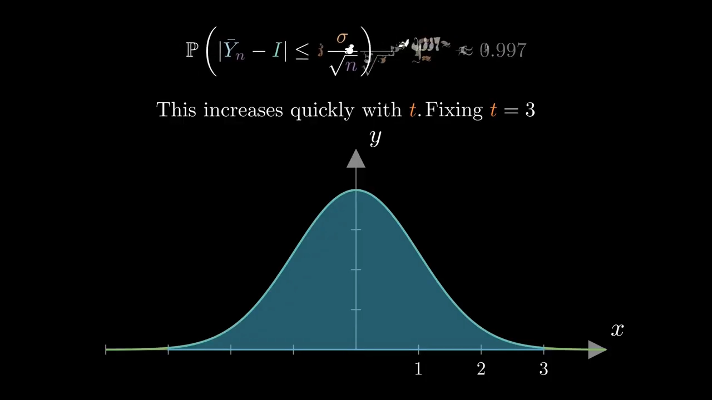

---

## 四、采样分布的选择：均匀分布与重要性采样

### 4.1 最省事的均匀分布

最简单的选择是均匀分布。若采样区域 $\Omega$ 的体积为 $\operatorname{Vol}(\Omega)$，均匀密度就是

$$
p(x)=\frac{1}{\operatorname{Vol}(\Omega)}
$$

代进估计量：

$$
I\approx\frac{\operatorname{Vol}(\Omega)}{n}\sum_{i=1}^{n}f(X_i)
$$

也就是「区域体积 × 函数值的平均」。它实现简单、通用，适合被积函数比较平缓、没有明显尖峰的情况。[【跳转到 08:59】](https://www.youtube.com/watch?v=0zbLv2k17vU&t=539)

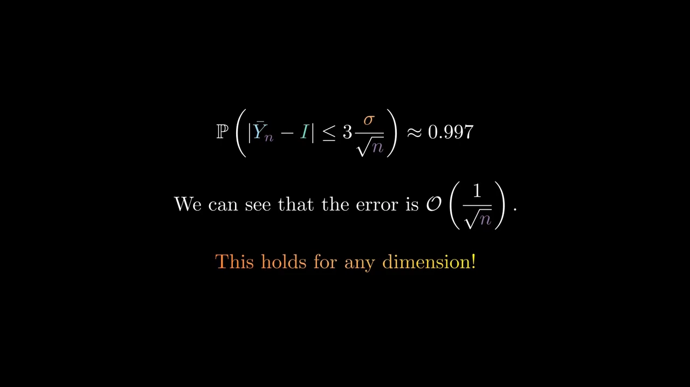

### 4.2 方差决定收敛速度

误差公式里的 $\sigma$ 不是固定的：它取决于 $p$ 和 $f$ 的匹配程度。$\sigma$ 越小，同样的 $n$ 下误差越小，收敛越快。所以「换一个采样分布」不是改变答案，而是改变估计的波动。

### 4.3 重要性采样：让采样密度贴近被积函数

视频给出最优采样密度的结论：

$$
p^*(x)=\frac{|f(x)|}{\int_{\Omega}|f(x)|\,\mathrm{d}x}
$$

也就是说，最优密度正比于 $|f|$：**在被积函数大的地方多采样，在贡献小的地方少采样**。这个最优密度本身需要算一个和原问题同类的积分，实际中不能直接得到；但它给出了方向——选一个形状与 $|f|$ 相似的分布，就能显著减小方差。[【跳转到 10:19】](https://www.youtube.com/watch?v=0zbLv2k17vU&t=619)

视频用一个例子说明：要积 $f(x)=1/(1+x^2)$ 在 $[0,5]$ 上的积分，$f$ 在靠近 0 处大、在远处小，于是选一个截断指数分布，让采样点更多落在贡献大的区域。[【跳转到 12:24】](https://www.youtube.com/watch?v=0zbLv2k17vU&t=744)

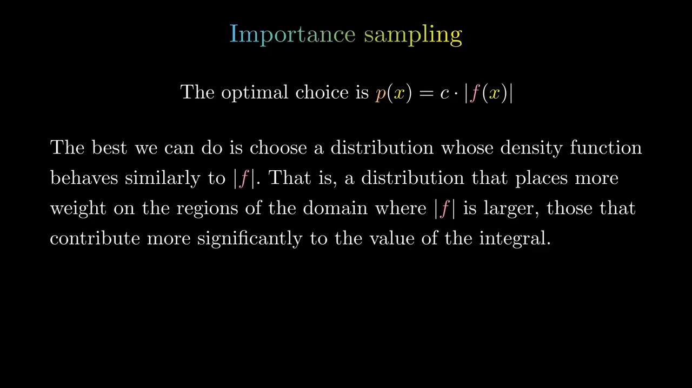

---

## 五、区域不好采样时：用指示函数包进矩形

### 5.1 把不规则区域塞进盒子

如果积分区域 $D$ 形状奇怪（视频画了一个星形），直接在其中均匀采样很麻烦。办法是找一个容易采样的矩形 $\Omega$ 把 $D$ 包住，再用指示函数把「区域外」的函数值置为 0：

$$
\int_D f(x)\,\mathrm{d}x=\int_{\Omega} f(x)\,\mathbf{1}_D(x)\,\mathrm{d}x,
\qquad
\mathbf{1}_D(x)=
\begin{cases}
1, & x\in D\\
0, & x\notin D
\end{cases}
$$

这样仍然在矩形里均匀撒点，只是区域外的点贡献为 0。[【跳转到 14:04】](https://www.youtube.com/watch?v=0zbLv2k17vU&t=844)

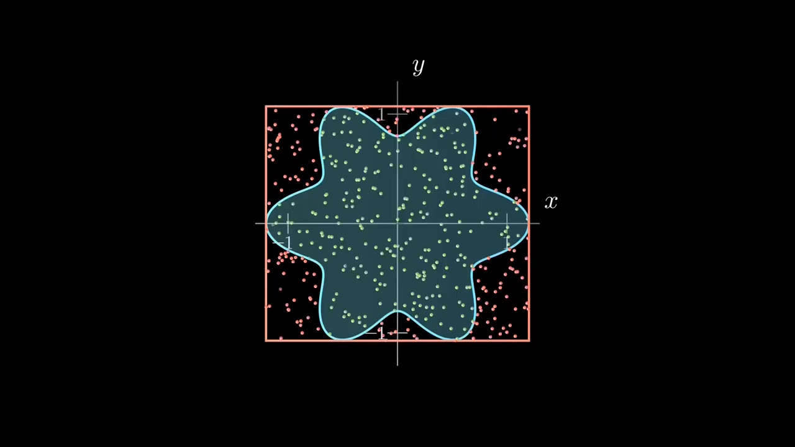

### 5.2 一个完整算例：星形区域上的 $x^2+y^2$

视频在星形区域上积 $f(x,y)=x^2+y^2$：

- 外包盒子的体积 $\operatorname{Vol}(\Omega)=5.14$；
- 样本数 $n=1000$；
- 1000 个样本的函数值之和为 337.44。

代入均匀采样估计量：

$$
I\approx\frac{5.14}{1000}\times337.44=1.73
$$

用极坐标精确计算得到的值是 1.76，误差约 0.03，相对误差不大。视频也指出，增加样本数还能更准；这里没有继续增加，只是为了控制动画渲染成本。[【跳转到 15:30】](https://www.youtube.com/watch?v=0zbLv2k17vU&t=930)

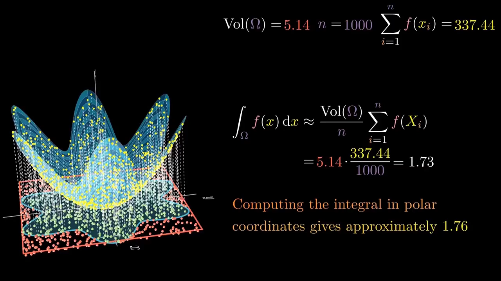

---

## 六、边界：误差结论依赖的假设

- **样本必须独立同分布**。大数定律和中心极限定理都建立在 i.i.d. 上；如果样本相关（例如马尔可夫链采样），误差公式要换成别的形式。
- **$\sigma$ 必须有限且非零**。若 $\sigma=0$，估计永远等于真值；若 $\sigma$ 无穷大，估计仍可能几乎必然收敛，但收敛速度不足以支撑可靠的数值近似。
- **误差是概率陈述，不是确定性上界**。$3\sigma/\sqrt{n}$ 给出的是约 99.7% 的覆盖概率，不是「误差一定小于这个数」。
- **$\sigma$ 通常未知**。实际计算时要用样本标准差去估计它；这时区间带有额外的估计不确定性，小样本下尤其要小心。
- **误差与维数无关，不等于高维一定容易**。$\sigma$ 本身可能随维数增大而变大；蒙特卡洛的优势是「阶数不随维数恶化」，不是「高维没有代价」。
- **随机数质量会影响结果**。伪随机数生成器的周期、相关性和并行采样方式都可能引入偏差；这是工程实现问题，不是公式问题。
- **它不是唯一选择**。被积函数光滑、维数低时，确定性求积（梯形、辛普森）往往更准；蒙特卡洛的优势在高维、复杂区域和被积函数没有解析原函数的情形。

## 小结

- 蒙特卡洛积分把积分写成期望：选一个容易采样的密度 $p$，令 $g=f/p$，则 $\mathbb{E}[g(X)]=\int f$。
- 从 $p$ 独立采样、对 $g(X_i)$ 取平均，就得到积分的估计；大数定律保证它几乎必然收敛。
- 估计是无偏的，标准差为 $\sigma/\sqrt{n}$；中心极限定理给出近似正态，$3\sigma/\sqrt{n}$ 对应约 99.7% 的覆盖概率。
- 误差阶数为 $O(1/\sqrt{n})$：样本翻 4 倍误差才减半；但这个阶数与积分维数无关，是高维积分的优势。
- 均匀分布是最简单的采样分布；重要性采样让 $p$ 贴近 $|f|$，通过减小 $\sigma$ 来提高同样的样本数下的精度。
- 不规则区域可以用指示函数包进矩形；星形算例用 1000 个样本得到 1.73，精确值 1.76。

## 关键术语速查

| 术语 | 一句话解释 |
| :-- | :-- |
| 蒙特卡洛积分 | 用随机样本的平均值估计积分的方法 |
| 确定性求积 | 梯形法则、辛普森法则等按固定网格近似积分的方法，同样输入总得到同样输出 |
| 估计量 | 由样本算出的、用来近似未知量的随机变量；换一批样本就会变 |
| 无偏 | 估计量的期望等于被估计的真值 |
| 强大数定律 | 独立同分布样本的平均几乎必然收敛到期望 |
| 中心极限定理 | 样本平均经标准化后近似标准正态；均值 $I$、标准差 $\sigma/\sqrt{n}$ |
| 标准误 | 估计量的标准差，这里为 $\sigma/\sqrt{n}$ |
| 误差阶数 | 误差随样本数缩小的速度，蒙特卡洛为 $O(1/\sqrt{n})$ |
| 均匀采样 | 在区域 $\Omega$ 内按常数密度采样，估计量为 $\operatorname{Vol}(\Omega)\cdot\frac{1}{n}\sum f(X_i)$ |
| 重要性采样 | 选一个与 $\lvert f\rvert$ 形状相近的采样密度，减小估计方差 |
| 指示函数 | 区域 $D$ 内取 1、区域外取 0 的函数，用来把不规则区域上的积分搬到矩形上 |