# 连续变量的期望：从密度曲线下的面积到积分

> 视频来源：[Expected Values for Continuous Variables!!!](https://www.youtube.com/watch?v=OSPr6G6Ka-U)（YouTube · StatQuest with Josh Starmer）｜时长约 20 分钟
> 本篇讲连续变量的期望怎样从「离散求和」过渡到「密度乘取值再积分」。重点不在积分技巧，而在三件事的区别：曲线在某点的高度、一段区间下的面积、以及把所有取值按密度加权后的平均。

## 本讲要解决的核心问题（SCQA）

**背景**：离散随机变量的期望已经有一套清楚的算法——把每个可能取值乘上它的概率，再全部相加，$E(X)=\sum_x x\,P(X=x)$。

**冲突**：连续变量（等待时间、浓度、长度）的取值可以无限细分，任何一个精确取值的概率都是 0。这时「每个取值乘它的概率再求和」既写不出，也求不动；而直方图的柱子高度又会随分组间隔变化，不能直接当概率用。

**疑问**：连续变量的期望到底该怎样定义？直方图、密度曲线和积分之间是什么关系？

**回答（中心思想）**：把连续变量暂时切成许多小区间，每个区间用「曲线高度 × 区间宽度」近似它的概率，就退回离散求和；让区间宽度趋于 0、区间数趋于无穷，求和就变成积分：

$$
E(X)=\int x\,f(x)\,\mathrm{d}x
$$

其中 $f(x)$ 是概率密度，不是概率。整条推导的关键只有一句：**密度曲线下的面积才是概率，期望则是「取值 × 该处密度 × 微小宽度」的连续累加**。

---

## 一、连续变量不能直接套离散公式

### 1.1 从「两种结果」到「连续测量」

StatQuest 先用一个赌局复习离散期望：和朋友打赌下一个人有没有看过某部电影，输赢各 1 元，把「赢 1 元」和「输 1 元」分别乘上各自概率再相加，得到每次下注的平均收益 0.66 元。只要结果是有限个、可一一列出的，就是离散变量，期望就是「取值 × 概率」的求和。[【跳转到 01:31】](https://www.youtube.com/watch?v=OSPr6G6Ka-U&t=91)

连续变量则来自**测量**：等下一班车要多久、两个路人之间隔几秒、某个样本的浓度是多少。测量结果落在一条连续的坐标轴上，任意两个可能值之间都还有别的可能值。视频用「在 StatLand 里记录遇到下一个人的等待秒数」作为贯穿例子：10 秒、30 秒、0 秒、10 秒……每遇到一个人就在数轴上打一个点。[【跳转到 02:01】](https://www.youtube.com/watch?v=OSPr6G6Ka-U&t=121)

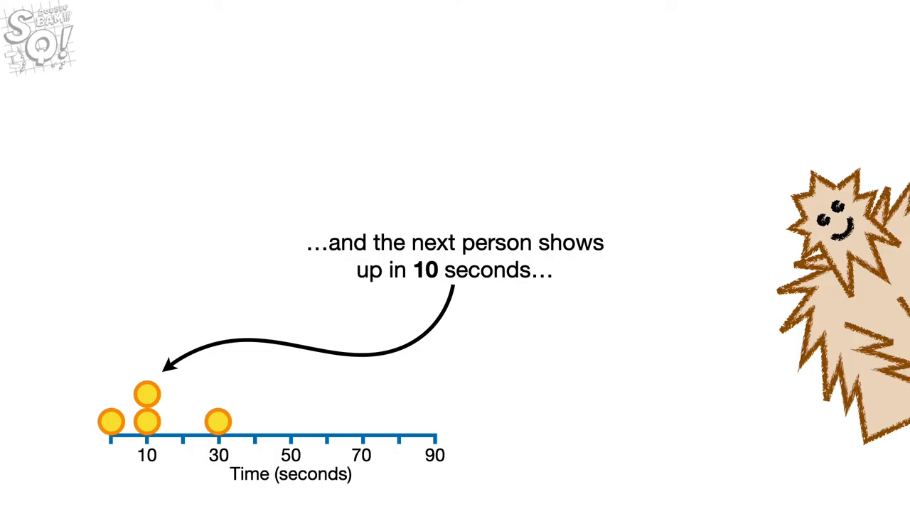

### 1.2 直方图的两个麻烦：空隙与分组宽度

把这些点画成直方图，会立刻遇到两个问题。

第一是**空隙**：样本总是有限的，数轴上的样本点之间有空隙，而真实等待时间可以取空隙里的任何值。第二是**分组宽度**：同一批数据按 10 秒分组和按 5 秒、2.5 秒分组，直方图的柱高和形状都会变；如果柱高代表「这个区间的概率」，那么换一个分组宽度，概率的读数就跟着变了。[【跳转到 02:51】](https://www.youtube.com/watch?v=OSPr6G6Ka-U&t=171)

解决办法不是继续收集数据，而是用一个**连续曲线**去拟合数据，让曲线在任意位置都有定义、也能对任意区间做计算。视频用指数分布来拟合等待时间：

$$
f(x)=\lambda e^{-\lambda x},\qquad x\ge 0
$$

其中 $\lambda$ 是**率**（单位时间遇到多少个人），决定曲线的陡峭程度；$\lambda=0.05$ 时曲线最贴合已收集的数据。[【跳转到 03:41】](https://www.youtube.com/watch?v=OSPr6G6Ka-U&t=221)

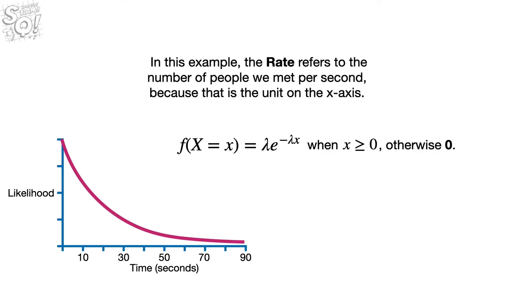

---

## 二、单点密度不是概率，区间面积才是

### 2.1 一个具体读数：10 秒以内遇到人的概率

要看「10 秒以内遇到人」的概率，视频没有去读 $x=10$ 处曲线的高度，而是计算曲线在 0 到 10 之间的**面积**：

$$
P(0\le X\le 10)=\int_0^{10}\lambda e^{-\lambda x}\,\mathrm{d}x
$$

当 $\lambda=0.05$ 时，这个积分等于 0.39。也就是说，10 秒以内遇到人的概率是 0.39，而不是曲线在 $x=10$ 处的高度。[【跳转到 04:49】](https://www.youtube.com/watch?v=OSPr6G6Ka-U&t=289)

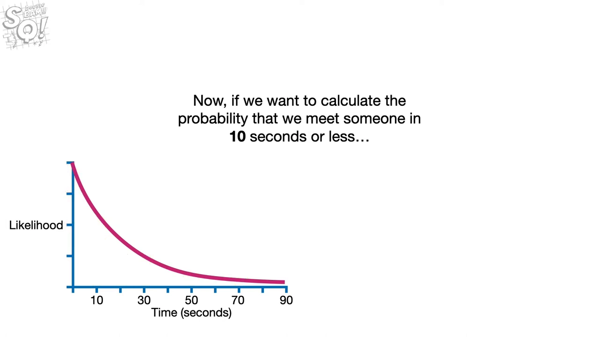

### 2.2 区间可以任意窄，也可以任意宽

同样的读法适用于任何区间。视频又算了一个很窄的区间：25.302 秒到 30.122 秒之间遇到人的概率，等于曲线在这两个数之间的面积，结果是 0.06。[【跳转到 05:14】](https://www.youtube.com/watch?v=OSPr6G6Ka-U&t=314)

这正好说明了连续变量的特点：**区间越窄，面积越小；区间缩成一个点时，面积为 0**。所以「$X$ 恰好等于 10 秒」的概率是 0，但「$X$ 落在 10 秒附近的一小段里」可以有非零概率。单点上的曲线高度只是**密度**，它描述的是「这一点附近单位长度里能分到多少概率」，本身不是概率。

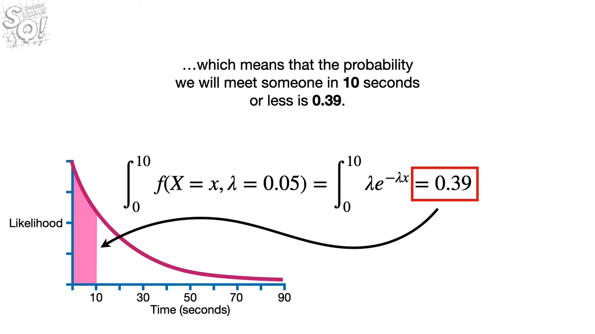

### 2.3 两个必须检查的性质

视频在这里补了两个容易忽略的细节：

- **纵轴是密度（likelihood）**：它来自指数分布的公式，用于最大似然估计；它不是「取这个值的概率」。
- **总面积为 1**：曲线被缩放到与横轴围成的总面积等于 1。这是连续分布的归一化条件，和离散分布「所有概率加起来等于 1」对应。[【跳转到 05:39】](https://www.youtube.com/watch?v=OSPr6G6Ka-U&t=339)

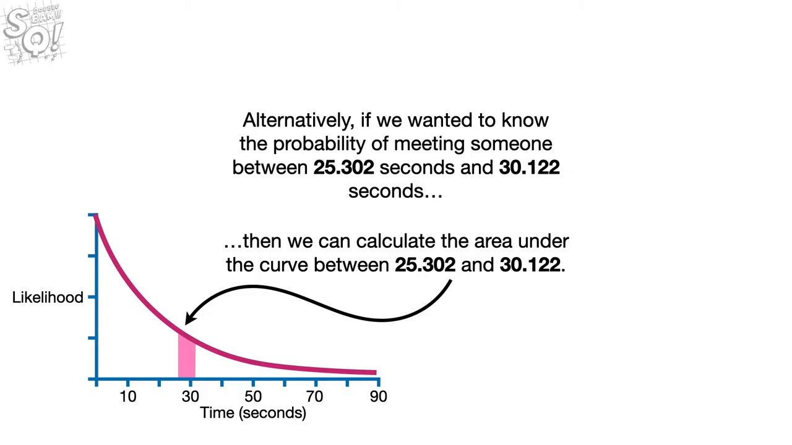

---

## 三、把连续问题切回离散：矩形近似

### 3.1 先假装它是离散的

有了密度曲线，期望仍然不好直接算。视频的做法很朴素：**先假装它是离散的**，把横轴切成 10 秒一格，每一格当作一个「结果」，用这一格的中点代表该结果的取值。

第一格是 0 到 10 秒，中点是 5 秒；第二格是 10 到 20 秒，中点是 15 秒；依此类推。每一格的概率用「矩形面积」近似：矩形的宽是 10 秒，高是曲线在中点处的高度。[【跳转到 06:29】](https://www.youtube.com/watch?v=OSPr6G6Ka-U&t=389)

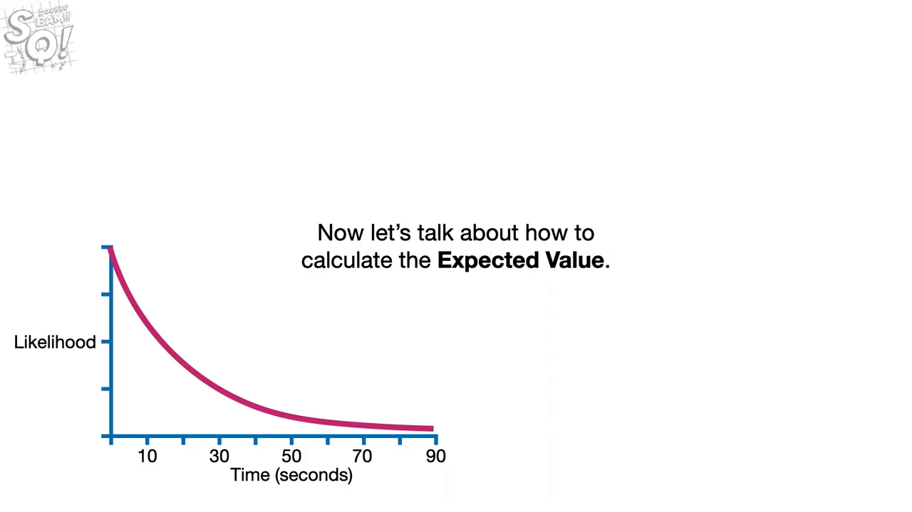

### 3.2 一格一格算概率

以第一格为例。中点是 $x=5$，把它代入指数分布公式，得到高度约 0.04；矩形面积就是高 × 宽：

$$
0.04\times 10=0.4
$$

所以「10 秒以内遇到人」的概率近似为 0.4。和前面用积分算出的精确值 0.39 相比，误差不大。对其余各格重复同样的操作，就得到一组「结果 + 近似概率」。[【跳转到 08:09】](https://www.youtube.com/watch?v=OSPr6G6Ka-U&t=489)

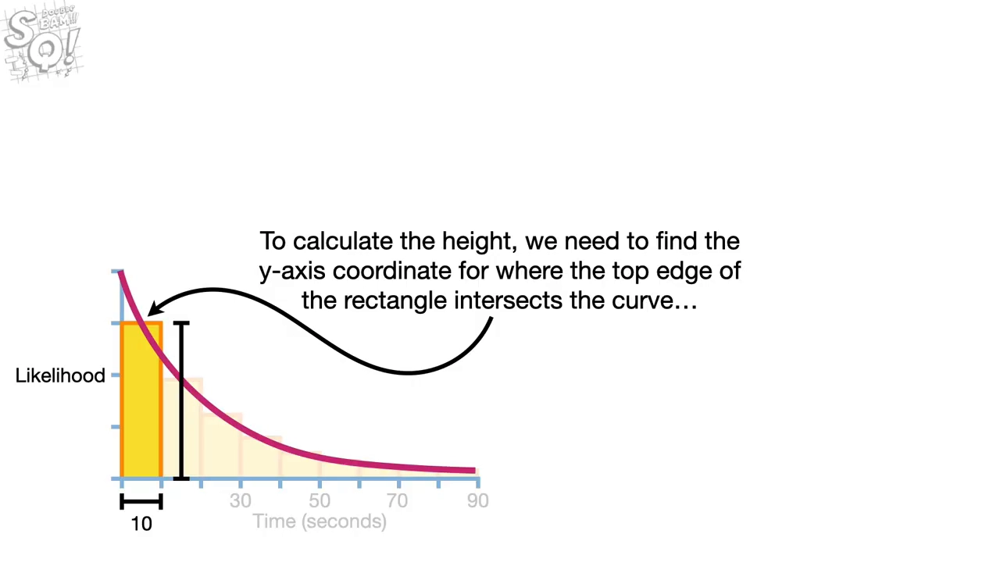

### 3.3 用离散期望公式算出一个数

现在可以套离散期望的公式了。第一项是「第一格的取值 × 第一格的概率」，即 $10\times0.4$；第二项是 $20\times0.2$；把其余项都加上，得到 22。这表示按 10 秒分组近似，平均要等 22 秒。[【跳转到 09:24】](https://www.youtube.com/watch?v=OSPr6G6Ka-U&t=564)

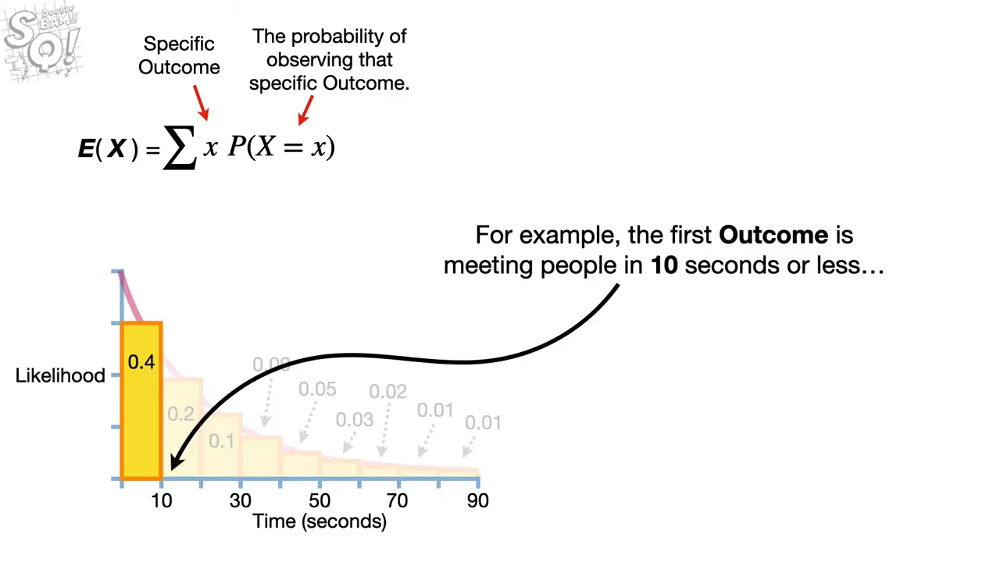

### 3.4 分组越细，结果越接近真值

把每格从 10 秒改成 5 秒，矩形变窄、数量翻倍，重新用「中点 × 面积」求和，得到 21.8，比 22 更接近后面的精确值 20。[【跳转到 09:49】](https://www.youtube.com/watch?v=OSPr6G6Ka-U&t=589)

这说明分组宽度不是随便选的：**宽度越小，矩形面积越接近曲线下真实面积，期望的近似也越准**。但无论分得多细，只要宽度还是有限值，就仍然只是近似。

---

## 四、宽度趋于 0：求和变成积分

### 4.1 从有限个矩形到无穷多个矩形

继续把宽度减半、再减半，直到宽度趋于 0、矩形个数趋于无穷。这时矩形面积之和不再「近似」曲线下面积，而是**精确等于**曲线下面积；同样，「取值 × 面积」的求和也不再是近似，而是精确的期望。[【跳转到 10:14】](https://www.youtube.com/watch?v=OSPr6G6Ka-U&t=614)

把每一格的面积写成「高度 × 宽度」，高度就是该点的密度 $L(X=x)$，宽度记作 $\Delta x$。于是离散求和变成：

$$
\lim_{\text{矩形数}\to\infty}\sum_x x\,L(X=x)\,\Delta x
=\int x\,L(X=x)\,\mathrm{d}x
$$

[【跳转到 10:39】](https://www.youtube.com/watch?v=OSPr6G6Ka-U&t=639)

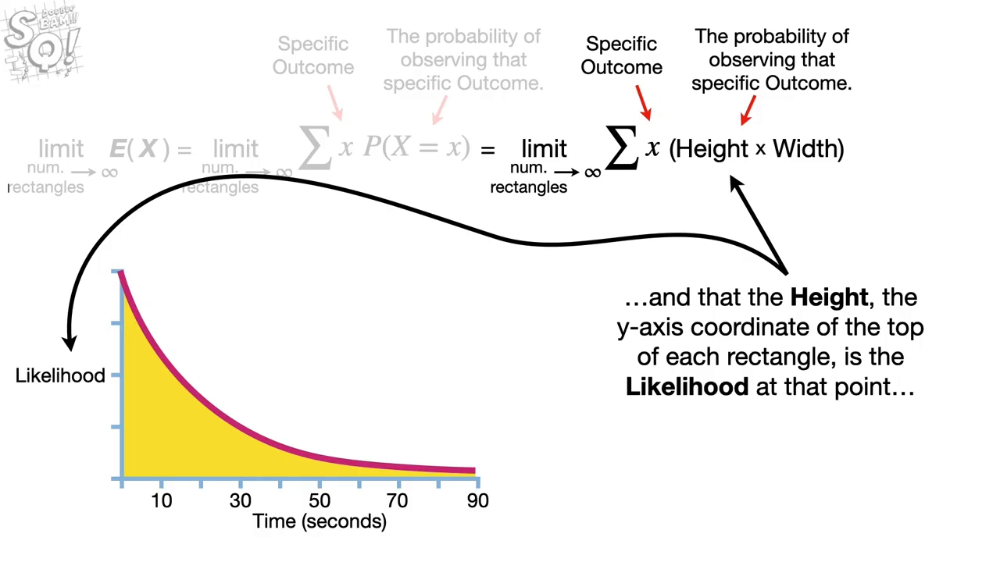

### 4.2 离散与连续只差两处替换

视频把两套公式并排放在一起，差别只有两点：

| 对象 | 离散变量 | 连续变量 |
| :-- | :-- | :-- |
| 求和的运算符 | $\sum_x$ | $\int \mathrm{d}x$ |
| 每个取值的权重 | 概率 $P(X=x)$ | 密度 $L(X=x)$（曲线高度） |

其余结构完全一样：都是「取值 × 权重」再累加。公式对任何连续变量都成立，不只是指数分布。[【跳转到 11:29】](https://www.youtube.com/watch?v=OSPr6G6Ka-U&t=689)

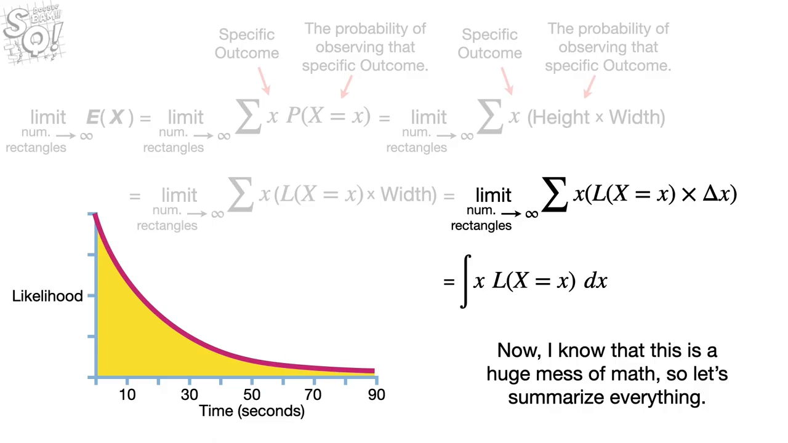

---

## 五、完整算例：指数分布的期望 $1/\lambda$

### 5.1 把密度代入公式

把指数分布的密度 $f(x)=\lambda e^{-\lambda x}$ 代入连续期望公式，积分范围是这个分布的定义域 $x\ge 0$：

$$
E(X)=\int_0^\infty x\,\lambda e^{-\lambda x}\,\mathrm{d}x
$$

[【跳转到 12:22】](https://www.youtube.com/watch?v=OSPr6G6Ka-U&t=742)

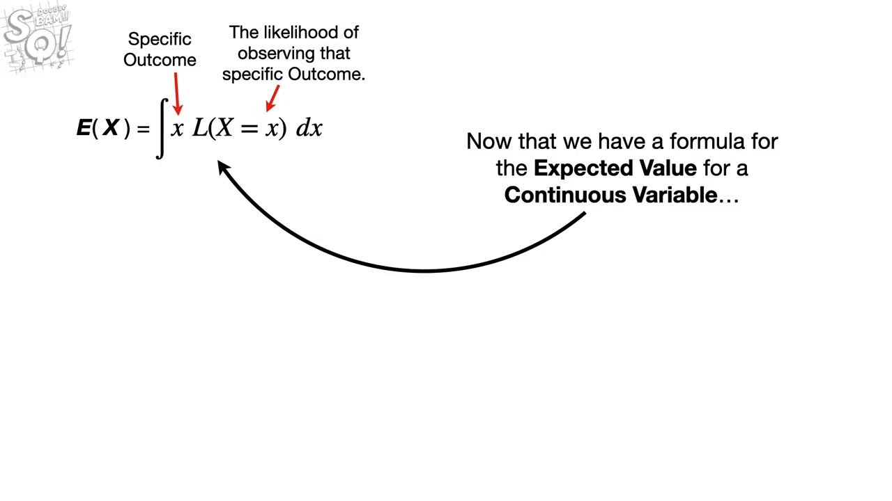

### 5.2 分部积分得到 $1/\lambda$

这个积分要用分部积分。视频把过程拆得很细：令 $f(x)=x$，令 $g'(x)=\lambda e^{-\lambda x}$，再通过试错找到 $g(x)=-e^{-\lambda x}$，代进分部积分公式后逐项求值。第一项在无穷远处由洛必达法则得到 0，在 0 处也是 0；第二项剩下 $1/\lambda$。[【跳转到 12:47】](https://www.youtube.com/watch?v=OSPr6G6Ka-U&t=767)

最终结果：

$$
E(X)=\frac{1}{\lambda}
$$

### 5.3 代回具体数值

当 $\lambda=0.05$（每秒遇到 0.05 个人）时：

$$
E(X)=\frac{1}{0.05}=20\ \text{秒}
$$

也就是说，平均每 20 秒遇到一个人。这个结果和前面矩形近似的 22、21.8 一致，只是积分给出的是精确值。[【跳转到 17:47】](https://www.youtube.com/watch?v=OSPr6G6Ka-U&t=1067)

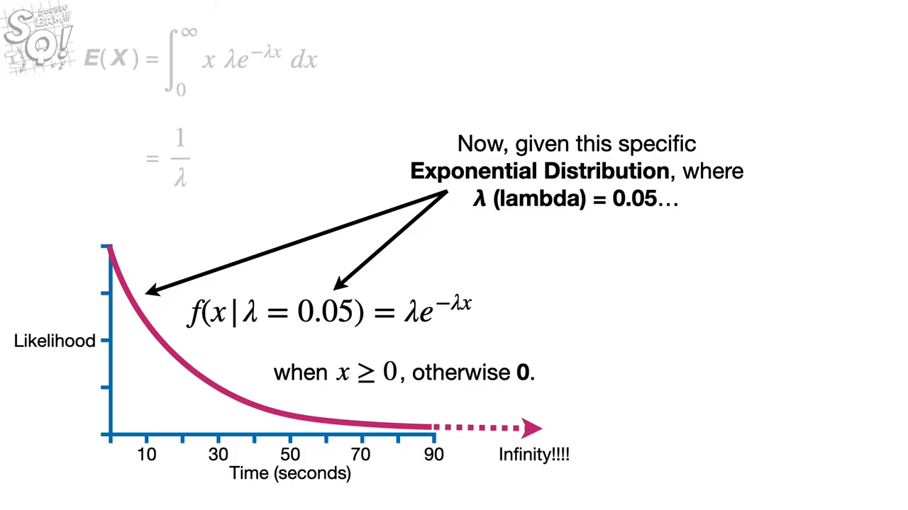

---

## 六、边界：公式成立的条件

- **积分必须收敛**。连续期望的定义要求 $\int |x|f(x)\,\mathrm{d}x$ 收敛；如果尾部太重，积分可能发散，期望就不存在。视频用的指数分布满足这个条件。
- **密度必须归一化**。曲线下总面积为 1，否则「面积 = 概率」不成立，期望也会被整体缩放。
- **单点密度不是概率**。读图时先问「我要的是某一点的高度，还是一段区间的面积」；只有后者能直接当概率。
- **连续与离散的公式不能混用**。连续变量不能写 $\sum_x xP(X=x)$，因为每个 $P(X=x)$ 都是 0；离散变量也不需要用积分。
- **期望是一个数，不是整个分布**。它把分布压成一个中心位置，丢掉了形状、宽度和尾部信息；要描述不确定性，还需要方差、分位数或整个分布（见 [1.2.4 分布统计量](../../1.2_概率语言/1.2.4_分布统计量：期望、方差与协方差/协方差：两个变量是不是一起偏离均值.md)）。
- **积分通常算不出来**。上面指数分布能解析积出 $1/\lambda$，但大多数真实密度没有初等原函数；这时就要用数值方法，把「积分」换成「样本平均」——这正是同节第二篇《蒙特卡洛积分：样本平均如何逼近期望并给出误差》的主题。

## 小结

- 连续变量的单点概率为 0，概率由**密度曲线下的面积**给出；纵轴高度是密度，不是概率。
- 把横轴切成小区间，用「中点取值 × 矩形面积」求和，可以近似连续期望；区间越细，近似越好。
- 宽度趋于 0、区间数趋于无穷时，求和变成积分：$E(X)=\int x f(x)\,\mathrm{d}x$。
- 离散与连续的期望只差两处：$\sum$ 换成 $\int$，概率换成密度；「取值 × 权重再累加」的结构不变。
- 指数分布的期望是 $1/\lambda$；$\lambda=0.05$ 时平均等待 20 秒，矩形近似的 22 和 21.8 都在向它收敛。
- 连续期望要求积分收敛、密度归一化；实际计算中经常算不出原函数，需要转向数值采样。

## 关键术语速查

| 术语 | 一句话解释 |
| :-- | :-- |
| 连续随机变量 | 取值可以连续变化、来自测量的随机变量；任意单点的概率为 0 |
| 概率密度 $f(x)$ | 曲线在 $x$ 处的高度，描述该点附近单位长度分到多少概率；本身不是概率 |
| 区间概率 | 密度曲线在区间 $[a,b]$ 下的面积，$P(a\le X\le b)=\int_a^b f(x)\mathrm{d}x$ |
| 归一化 | 密度曲线下总面积为 1，对应离散分布「所有概率之和为 1」 |
| 矩形近似 | 用「曲线高度 × 区间宽度」近似每一小段的概率，把连续问题暂时变成离散求和 |
| 连续期望 | $E(X)=\int x f(x)\mathrm{d}x$，取值按密度加权的连续累加 |
| 指数分布 | $f(x)=\lambda e^{-\lambda x}$（$x\ge0$），描述等待时间；期望为 $1/\lambda$ |
| 分部积分 | 把 $\int x\lambda e^{-\lambda x}\mathrm{d}x$ 拆成两项分别求值的积分技巧 |