# 损失函数在给什么计分：回归误差与分类交叉熵的预测对象

> 视频来源：[损失函数到底是什么？从手算误差，讲到大模型的交叉熵](https://www.bilibili.com/video/BV1TQs76ZEhw/)（Bilibili · 云泊飘）｜时长约 10 分钟
> 导读：一支从“预测温度”讲到“预测下一个 token”的入门视频。本文按“预测对象”重排其内容：先看回归为什么用绝对值或平方误差，再看分类为什么必须放弃编号、改用概率的负对数，最后把它们放回大模型的逐 token 训练里。

## 本讲要解决的核心问题（SCQA）

**背景**：训练模型时，日志里总有一个数字叫 loss（损失）。它从 2 降到 1，再降到零点几，看起来模型就在变好。这个数是由损失函数算出来的：把模型预测和实际目标一起送进一套事先定好的规则，得到一个标量。

**冲突**：可回归任务和分类任务的输出根本不是同一种东西。预测温度，输出是一个有大小、有正负的连续数值；预测下一个词，输出是一组候选词上的概率。对前者可以直接做减法，对后者却连“咖啡编号 8、茶编号 9，所以预测成茶只错 1”这种说法都站不住脚。如果计分规则和预测对象对不上，训练就会去优化一个并不想优化的东西。

**疑问**：同一个“损失”概念，为什么回归常用平方误差、分类常用交叉熵？这两种损失各自在给什么计分，又为什么不能互换？

**回答（中心思想）**：**损失函数是一套计分规则，它计的是“预测对象”与“目标”之间的差距。** 回归的预测对象是连续数值，误差有大小也有方向，所以要先用绝对值或平方消掉符号、再汇总；分类的预测对象是类别上的概率分布，类别编号没有距离，只能看模型给真实类别分配了多少概率，再取负对数——当目标写成 one-hot 时，这个负对数就是交叉熵。换句话说，**先确定预测对象，损失函数才有唯一合理的写法**。

---

## 一、损失函数是一套规则，损失值是一次结果

先把两个容易混的词分开 [【跳转到 00:24】](https://www.bilibili.com/video/BV1TQs76ZEhw/?t=24)：

- **损失函数（loss function）**：一套计分规则。它规定需要哪些输入、执行哪些运算，把“模型预测”和“实际目标”变成一数。
- **损失值（loss value）**：按这套规则算出来的这一次结果。换一批数据、换一个预测，数值就会变。

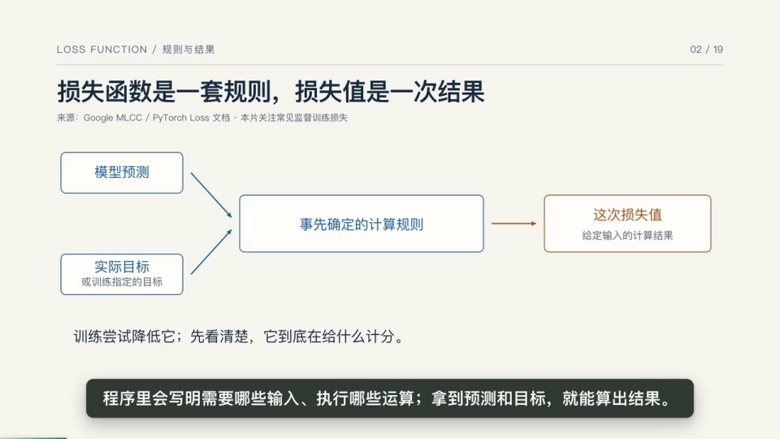

训练会尝试让选定的损失更小。但这句话有个容易被忽略的前提：**你怎么定义损失，也就决定了训练具体在努力改善什么** [【跳转到 00:24】](https://www.bilibili.com/video/BV1TQs76ZEhw/?t=24)。同一个模型、同一批预测，换一种计分规则，被压低的对象就变了。所以读 loss 之前，先要问清楚它在给什么计分。

---

## 二、回归：预测连续数值，误差要先消掉符号

### 2.1 带符号的误差会互相抵消

先看一个假设例子：两次实际温度都是 20 度，模型分别预测 18 度和 22 度 [【跳转到 00:52】](https://www.bilibili.com/video/BV1TQs76ZEhw/?t=52)。如果直接用“预测减实际”，两次误差是 $-2$ 和 $+2$，加起来除以二居然是 0：

$$
\frac{(-2) + (+2)}{2} = 0
$$

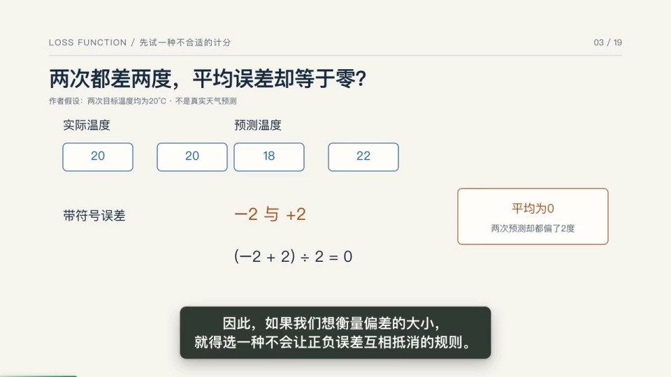

模型明明两次都偏了两度，平均值却是 0。这个 0 不是“预测完美”，而是正负号把偏差抵消掉了。因此，**要衡量偏差的大小，就得选一种不会让正负误差互相抵消的规则**：可以取绝对值，也可以把差值平方 [【跳转到 01:09】](https://www.bilibili.com/video/BV1TQs76ZEhw/?t=69)。

### 2.2 均方误差：先平方，再取平均

取平方的算法是：每个误差先平方，再对所有样本求平均。上面两个误差的平方都是 4：

$$
\mathrm{MSE} = \frac{1}{n}\sum_{i=1}^{n}\left(\hat{y}_i - y_i\right)^2
= \frac{4 + 4}{2} = 4
$$

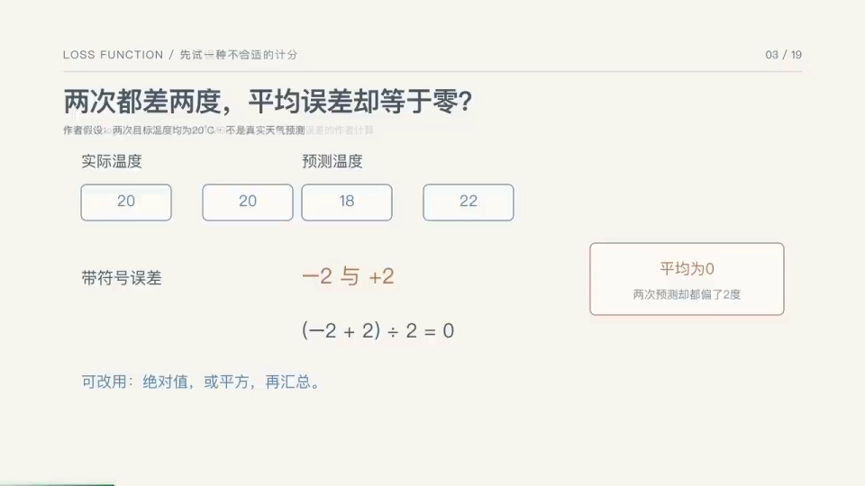

这里要留意一个尺度问题：**4 不是说平均差了 4 度**。因为做了平方，数值的单位和尺度都变了（度的平方）。如果要直接读“平均差了多少度”，可以改用绝对误差的平均 [【跳转到 01:32】](https://www.bilibili.com/video/BV1TQs76ZEhw/?t=92)：

$$
\mathrm{MAE} = \frac{1}{n}\sum_{i=1}^{n}\left\lvert \hat{y}_i - y_i \right\rvert
= \frac{2 + 2}{2} = 2
$$

在这个例子里，MAE 给出的 2 度正好对应“每次都差两度”的直觉；MSE 给出的 4 则是一个被平方放大过的惩罚值。

### 2.3 选 MAE 还是 MSE：同一批预测，排名可能反过来

两种规则不只是数值大小不同，它们对“大偏差”的态度也不同。视频给了一组对照 [【跳转到 01:44】](https://www.bilibili.com/video/BV1TQs76ZEhw/?t=104)：模型甲两次误差分别是 0 和 4，模型乙两次都差 2.5。

| 模型 | 两项误差 | 平均绝对误差（MAE） | 均方误差（MSE） |
| --- | --- | --- | --- |
| 甲 | 0 与 4 | 2（更低） | 8 |
| 乙 | 2.5 与 2.5 | 2.5 | 6.25（更低） |

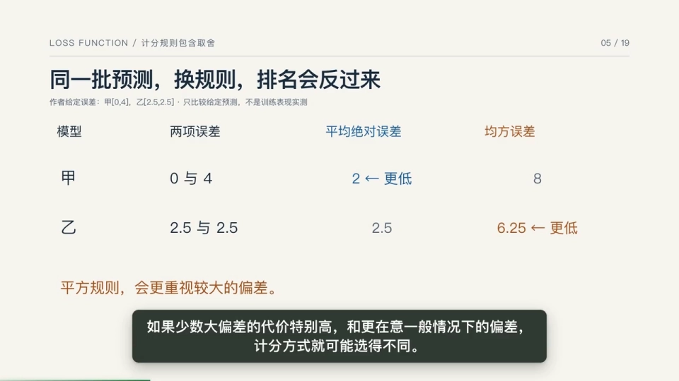

按 MAE，甲更好；按 MSE，乙更好。原因很直接：**平方让较大的偏差受到更重的计分**。甲有一次差了 4，平方后变成 16，把平均值拉了上去；乙虽然每次都差一点，但没有大偏差。

所以“选哪种回归损失”本身就是一个任务判断 [【跳转到 01:49】](https://www.bilibili.com/video/BV1TQs76ZEhw/?t=109)：

- 如果少数大偏差的代价特别高（例如预测错一个关键数值后果严重），MSE 更合适，因为它会优先压掉大误差；
- 如果更在意一般情况下的平均偏离，或者数据里离群点很多、不想被它们主导，MAE 更合适。

这也解释了为什么回归损失不能只看公式“顺不顺眼”：**规则里藏着你对“哪种错误更不可接受”的取舍**。

---

## 三、分类：预测类别分布，编号不能当距离

### 3.1 类别编号没有大小和距离

回归那套做法有一个前提：预测值和目标值在同一条数轴上，差值本身有意义。分类不满足这个前提 [【跳转到 02:14】](https://www.bilibili.com/video/BV1TQs76ZEhw/?t=134)。

温度有大小和距离：18 度离 20 度差 2 度，22 度也差 2 度，这些差值可以比较。但咖啡、茶、水这些类别，只有“身份”，没有“距离”。假如咖啡编号 8、茶编号 9，**不能说预测成茶就只错了 1，而预测成另一种饮料就错得更多** [【跳转到 02:24】](https://www.bilibili.com/video/BV1TQs76ZEhw/?t=144)。

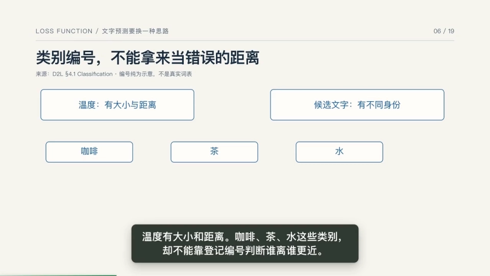

编号只是用来找到词表里的项目。任意调换编号，不应该改变同一次语义预测的好坏。因此，**大模型预测下一块文字时，通常看它给各个候选分配了多少概率，而不是拿编号直接相减** [【跳转到 02:24】](https://www.bilibili.com/video/BV1TQs76ZEhw/?t=144)。

### 3.2 只看“猜中没猜中”，会丢掉概率分配的信息

假设原文接下来写的是“咖啡”，我们只拿咖啡、茶、水三个候选做教学示意 [【跳转到 02:24】](https://www.bilibili.com/video/BV1TQs76ZEhw/?t=144)。模型甲给咖啡 60%，模型乙给咖啡 90%，其余概率分给茶和水。

两个模型都把咖啡排在第一。如果只按“猜中没猜中”计分，他们的成绩完全一样 [【跳转到 02:58】](https://www.bilibili.com/video/BV1TQs76ZEhw/?t=178)。可一个给目标六成、一个给九成，模型对正确答案的“把握”显然不同。

这种计分方式还有两个训练上的麻烦 [【跳转到 03:03】](https://www.bilibili.com/video/BV1TQs76ZEhw/?t=183)：

- 它看不出概率分配的差别，60% 和 90% 被当成同一档；
- 只看第一名有没有改变，经常是改了一点参数、成绩却完全不动，**不方便拿来指导训练**。

### 3.3 负对数：给目标的概率越低，这次损失越高

一种常用办法是：**取出模型分给实际目标的概率 $p$，算它的负对数** [【跳转到 03:17】](https://www.bilibili.com/video/BV1TQs76ZEhw/?t=197)：

$$
\ell = -\ln p
$$

看几组换算就有感觉了 [【跳转到 03:23】](https://www.bilibili.com/video/BV1TQs76ZEhw/?t=203)：

| 模型给实际目标的概率 $p$ | 负对数损失 $-\ln p$ |
| --- | --- |
| 90% | 约 0.11 |
| 50% | 约 0.69 |
| 10% | 约 2.30 |
| 1% | 约 4.61 |

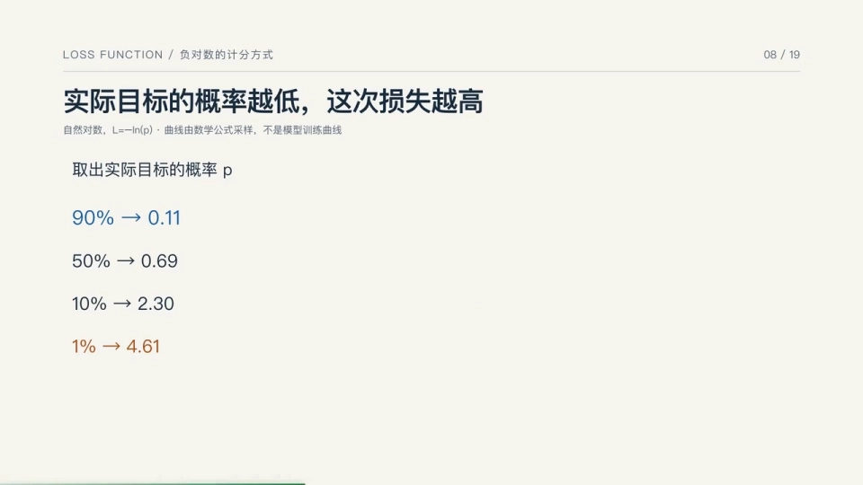

规律是：**实际发生的结果，你给它的概率越小，这一次损失越大；概率越接近 1，损失越接近 0** [【跳转到 03:34】](https://www.bilibili.com/video/BV1TQs76ZEhw/?t=214)。回到咖啡的例子，两个都猜对的模型损失就不同，大约 0.51 和 0.11——90% 的那个更低。

这里用的是自然对数。对数有不同底数，所以看数值时也得知道采用哪一种 [【跳转到 03:39】](https://www.bilibili.com/video/BV1TQs76ZEhw/?t=219)。底数换了，损失的绝对数值会变，但“给目标的概率越低、损失越大”这个方向不变。

### 3.4 为什么偏偏选对数：把连乘变成相加

看到这里自然会问：为什么偏偏选对数？随便画一条递减曲线不行吗 [【跳转到 03:53】](https://www.bilibili.com/video/BV1TQs76ZEhw/?t=233)？

对生成文字的模型来说，一段原文的概率，可以按顺序把每一步给实际目标的条件概率乘起来 [【跳转到 03:58】](https://www.bilibili.com/video/BV1TQs76ZEhw/?t=238)。比如两步分别给一半，连起来是 $0.5 \times 0.5 = 0.25$；如果分别给九成和一成，乘起来只有 $0.9 \times 0.1 = 0.09$。

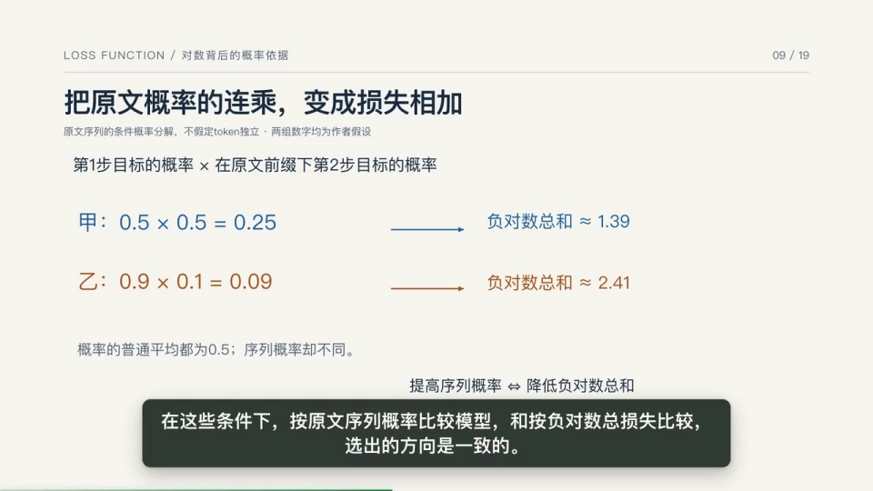

注意这两组概率的**普通平均都是一半**，但它们给整段原文的概率并不一样。如果只看平均，就分不出这两种模型；看连乘，才能分出 0.25 和 0.09。

对数有一个方便的性质：**乘积的对数可以拆成每一项对数相加** [【跳转到 04:09】](https://www.bilibili.com/video/BV1TQs76ZEhw/?t=249)：

$$
\ln(p_1 p_2 \cdots p_T) = \ln p_1 + \ln p_2 + \cdots + \ln p_T
$$

再加上负号，就把“尽量提高原文概率”转成“尽量降低各项损失之和”，这叫**负对数**。在这些条件下，按原文序列概率比较模型，和按负对数总损失比较，选出的方向是一致的 [【跳转到 04:27】](https://www.bilibili.com/video/BV1TQs76ZEhw/?t=267)。

### 3.5 交叉熵：用目标分布给负对数加权

你经常听到的**交叉熵损失**，和刚才的负对数是什么关系 [【跳转到 04:32】](https://www.bilibili.com/video/BV1TQs76ZEhw/?t=272)？

可以把目标也排成一张表：只认定这一次的目标是咖啡，就给咖啡 1，茶和水都给 0。再拿目标表里的每个数，去加权模型对相应候选的负对数，最后相加：

$$
H(y, \hat{y}) = -\sum_{j=1}^{q} y_j \ln \hat{y}_j
$$

因为其他候选的权重是 0，只剩咖啡这一项，就回到了刚才的算法 $-\ln \hat{y}_{\text{咖啡}}$。所以**交叉熵是负对数的推广**：目标只有一个明确类别时，它退化成“真实类别的负对数”；如果目标本身是一份概率分布，也能按这套规则计分，此时交叉熵比较的就是目标分布和模型预测分布 [【跳转到 04:57】](https://www.bilibili.com/video/BV1TQs76ZEhw/?t=297)。

把两种损失并排放在一起，预测对象的差别就清楚了：

| | 回归误差（MAE / MSE） | 分类交叉熵 |
| --- | --- | --- |
| 预测对象 | 一个连续数值（或数值向量） | 各个类别上的概率分布 |
| 目标形态 | 同尺度的数值 | 类别标签，写成 one-hot 或概率分布 |
| 差距怎么量 | 预测减目标，取绝对值或平方 | 取目标类别的预测概率，算负对数 |
| 为什么不能换 | 类别编号没有距离，减法无意义 | 概率输出要的是“信念离真相多远”，不是数值差多少 |

---

## 四、接回大模型：逐 token 计分，logits 进 softmax

### 4.1 每个位置一个目标，错位与忽略

把上面的规则接回大模型，文本先切成 token，也就是模型处理的小块文字 [【跳转到 04:57】](https://www.bilibili.com/video/BV1TQs76ZEhw/?t=297)。假设为了讲解，把“我喝茶”拆成“我”“喝”“茶”，再加一个结束标记：

- 看到“我”，目标是“喝”；
- 看到“我喝”，目标是“茶”；
- 看到“我喝茶”，目标是“结束”。

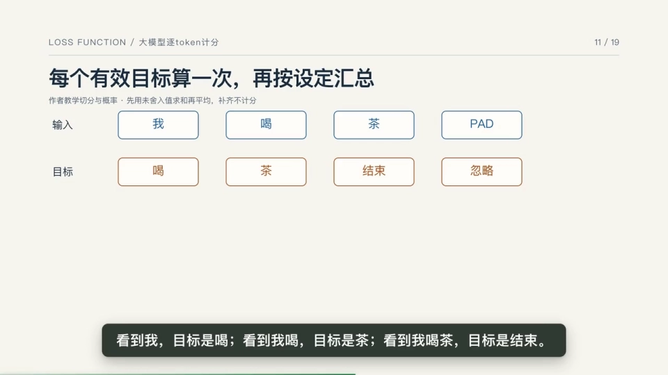

如果模型给这三个目标的概率分别是 $1/2$、$1/4$、$4/5$，各自的损失大约是 0.69、1.39、0.22 [【跳转到 05:22】](https://www.bilibili.com/video/BV1TQs76ZEhw/?t=322)。把没舍入的数相加，再除以三个有效目标，平均损失大约 0.77：

$$
\frac{-\ln(1/2) - \ln(1/4) - \ln(4/5)}{3}
\approx \frac{0.693 + 1.386 + 0.223}{3}
\approx 0.767
$$

这里有两个工程细节，会直接影响日志里的数值：

- **补齐出来的空位不应该算进来**。为了凑成同样长度的批次而补的 PAD 位置没有真实目标，计分时忽略；
- **某些训练还会指定只给回答部分计分**，具体分母和范围都得跟着配置看 [【跳转到 05:37】](https://www.bilibili.com/video/BV1TQs76ZEhw/?t=337)。

### 4.2 logits → softmax → 交叉熵，接口内部完成

算这些损失之前，不用先抽出一个词、看看猜中了没有 [【跳转到 05:42】](https://www.bilibili.com/video/BV1TQs76ZEhw/?t=342)。网络通常先给整个词表打出分数，这些还没变成概率的分数叫 **logits**；**softmax** 能把分数转换成总和为 1 的概率，再接上刚才讲的计分过程。

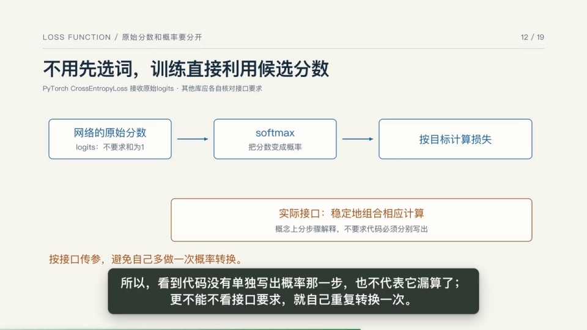

实际代码里，比如 PyTorch 的交叉熵接口，直接接收这些原始分数，在内部稳定地完成相应计算 [【跳转到 05:47】](https://www.bilibili.com/video/BV1TQs76ZEhw/?t=347)。所以看到代码没有单独写出概率那一步，也不代表它漏算了；更不能不看接口要求，就自己重复转换一次。

---

## 五、损失值怎么读：方向、下界与可比性

### 5.1 同一个损失值，可能对应相反的方向

一个数怎么知道那么多参数该往哪改？只拿这个数其实判断不了 [【跳转到 06:12】](https://www.bilibili.com/video/BV1TQs76ZEhw/?t=372)。预测 18 和 22，平方损失都是 4，可实际温度是 20：18 应该往上调，22 应该往下调，方向正好相反。

要判断方向，需要知道损失沿着计算过程怎样随参数变化；这种局部变化的信息就是**梯度** [【跳转到 06:30】](https://www.bilibili.com/video/BV1TQs76ZEhw/?t=390)。训练框架会沿着网络的计算依赖，用反向传播求出各参数对损失的影响，然后优化器才根据梯度和更新规则改动参数。这一段是下一章“优化”的入口，本节只记住分工：**损失函数负责把任务变成可计算的信号，怎么用这个信号更新参数是优化器的事**。

### 5.2 有不确定性时，损失不会降到零

还有一个常见误会：是不是训练得足够好，损失就一定等于 0 [【跳转到 07:23】](https://www.bilibili.com/video/BV1TQs76ZEhw/?t=443)？

看一个假设的小数据集：模型拿到的信息完全相同，四次目标里三次是咖啡、一次是茶。它没法在同一份输入下既给咖啡 100%、又给茶 100%。对这个例子的平均交叉熵来说，最合适的折中是咖啡 75%、茶 25%；即使分配成这样，平均损失仍然大约 0.56，不是 0 [【跳转到 07:48】](https://www.bilibili.com/video/BV1TQs76ZEhw/?t=468)。

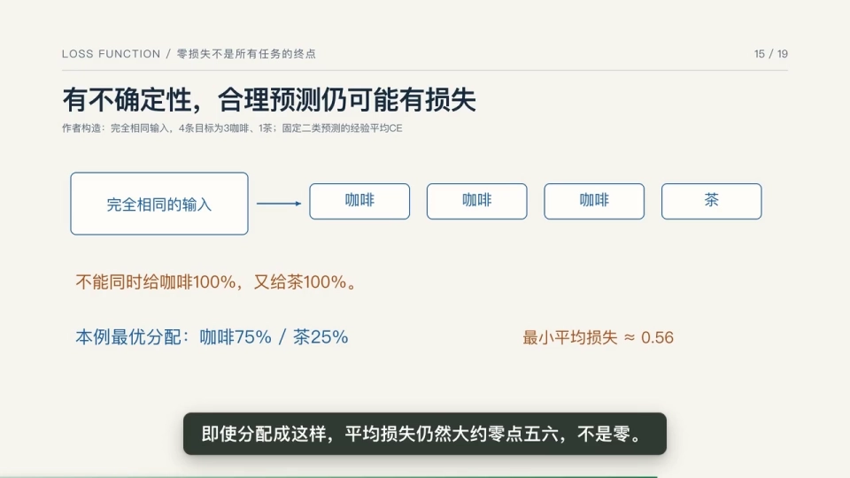

$$
-\left(0.75\ln 0.75 + 0.25\ln 0.25\right) \approx 0.56
$$

这不表示任何高损失都可以不用管，只是提醒你：**目标的不确定性和任务条件也会影响损失能降到哪**。损失曲线的下界不是必然的 0。

### 5.3 数字小，不等于可以跨规则宣布更强

那一个模型损失 0.5、另一个是 1.0，前一个一定更强吗 [【跳转到 07:59】](https://www.bilibili.com/video/BV1TQs76ZEhw/?t=479)？

先别急，要问：他们算的是同一种损失吗？用的文本、分词器和计分范围一样吗 [【跳转到 08:04】](https://www.bilibili.com/video/BV1TQs76ZEhw/?t=484)？视频给了一个极端的演示：把刚才的记分结果统一乘 100，同样的预测数字就从 4 变成 400，预测本身一点没变。求和还是平均、平均时除以什么，也会影响日志中的数。

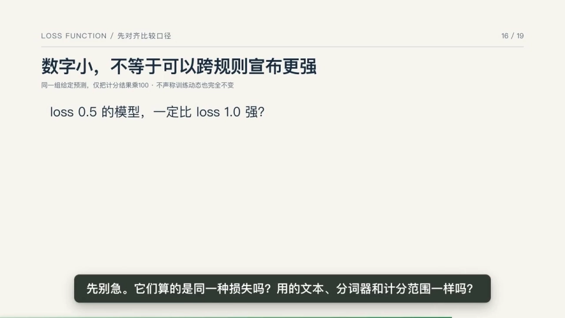

所以只有**比较口径对得上**，“损失更低”这个判断才有明确含义 [【跳转到 08:21】](https://www.bilibili.com/video/BV1TQs76ZEhw/?t=501)。换了规则，不能只盯着小数点。

### 5.4 训练损失降，还要看没参与更新的数据

即使口径一样，训练数据上的损失一直降，也还没回答模型会不会处理新材料 [【跳转到 08:26】](https://www.bilibili.com/video/BV1TQs76ZEhw/?t=506)。为此要让不参与参数更新的验证数据，用相同任务检查：如果训练损失继续下降，验证损失却开始变差，就要检查是不是越来越依赖训练样本里的细节。

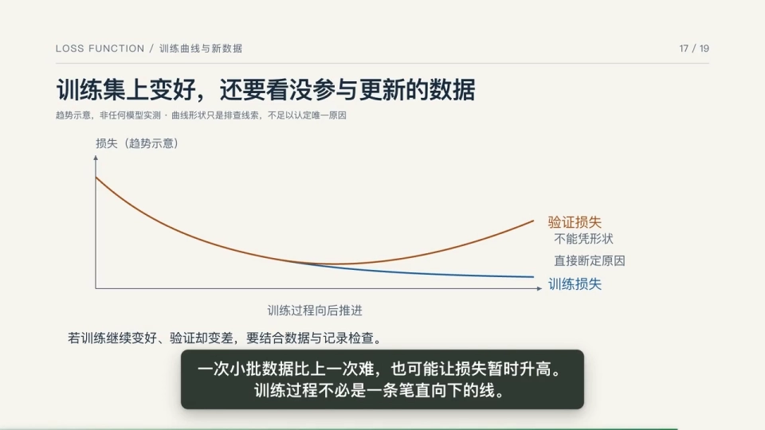

但曲线只是线索。数据分布、样本质量、计算配置等问题也需要结合记录排查，不能看一张图就认定唯一原因；一次小批数据比上一次难，也可能让损失暂时升高，训练过程不必是一条笔直向下的线 [【跳转到 08:56】](https://www.bilibili.com/video/BV1TQs76ZEhw/?t=536)。

---

## 六、边界：交叉熵只给原文 token 记分

最后还有一条边界：把原文预测得更好，不等于自动解决所有使用问题 [【跳转到 09:02】](https://www.bilibili.com/video/BV1TQs76ZEhw/?t=542)。

原文里可能有错误、过时信息、写得像真实答案的句子，也可能缺少事实依据。我们刚才算的交叉熵，检查的是**给实际 token 分了多少概率**，没有直接核实整段回答是否符合事实 [【跳转到 09:07】](https://www.bilibili.com/video/BV1TQs76ZEhw/?t=547)。如果你希望模型回答正确、遵循要求，还得安排相应的数据、训练目标和评估，不能全寄托在一个预训练损失上。

回到那杯咖啡：两个模型都把咖啡排第一，一个给六成、一个给九成 [【跳转到 09:37】](https://www.bilibili.com/video/BV1TQs76ZEhw/?t=577)。如果目标就是咖啡，他们的这次准确率一样，交叉熵损失却不同，九成的那个更低。如果有人只给你看一个更低的损失，还想顺便证明模型在所有问题上都更可靠，你就该追问：算的是什么目标、用的是什么数据？

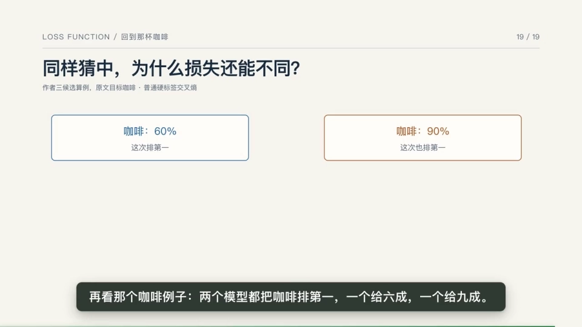

---

## 小结

- **损失函数是规则，损失值是结果**。规则怎么定，决定了训练具体在压什么；读 loss 之前先问它在给什么计分。
- **回归的预测对象是连续数值**。带符号误差会互相抵消，所以要取绝对值（MAE）或平方（MSE）再汇总；平方会放大尺度，也会更重地惩罚大偏差。
- **MAE 与 MSE 是取舍，不是对错**。同一批预测，按 MAE 和按 MSE 可能排出相反的名次；选哪种取决于你更怕大偏差还是更怕离群点。
- **分类的预测对象是类别上的概率分布**。类别编号没有距离，不能拿编号相减；只看“猜中没猜中”又会丢掉概率分配的信息。
- **负对数只看真实类别的概率**：给目标的概率越低，损失越高。选对数是为了把序列概率的连乘拆成损失相加。
- **交叉熵是负对数的推广**：目标为 one-hot 时退化成 $-\ln \hat{y}_{y}$，目标本身是分布时则比较两个分布。
- **大模型逐 token 计分**：logits 经 softmax 变成概率，交叉熵接口通常直接接收 logits；PAD 位置和“只给回答计分”等配置会影响分母。
- **损失值要带着口径读**：同一个数可能对应相反的更新方向；有不确定性时损失不会到 0；换规则、换分词器、换平均方式后的数字不能直接比；训练损失之外还要看验证损失。

## 关键术语速查

| 术语 | 一句话解释 |
| --- | --- |
| 损失函数（loss function） | 把模型预测与实际目标映射成一个标量的计分规则 |
| 损失值（loss value） | 按损失函数对某次预测算出的具体数值 |
| 平均绝对误差（MAE） | 每个误差取绝对值再平均，单位与原始目标一致，对离群点相对不敏感 |
| 均方误差（MSE） | 每个误差先平方再平均，更重地惩罚大偏差，数值尺度被平方改变 |
| 负对数损失 | $-\ln p$，$p$ 是模型给实际目标的概率；$p$ 越小损失越大 |
| 交叉熵 | $-\sum_j y_j \ln \hat{y}_j$，用目标分布给各候选的负对数加权；one-hot 时只剩真实类别一项 |
| one-hot | 目标向量中只有真实类别为 1、其余为 0 的写法 |
| logits | 网络输出的原始分数，可正可负、不要求和为 1，尚未变成概率 |
| softmax | 把一组 logits 变成总和为 1 的正数分布的函数 |
| 梯度 | 损失随参数局部变化的方向与大小，用来决定参数往哪边调 |
| 验证损失 | 在不参与参数更新的数据上算出的同一种损失，用来检查模型是否只会拟合训练集 |