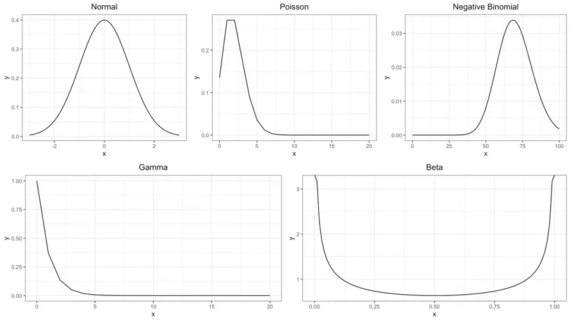
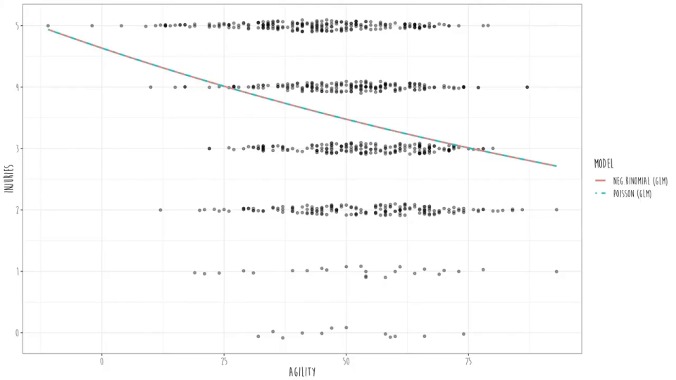

# 对数连接把计数均值放到加法尺度：泊松与负二项的 GLM 读法

> 视频来源：[Understanding Generalized Linear Models (Logistic, Poisson, etc.)](https://www.youtube.com/watch?v=SqN-qlQOM5A)（YouTube · Simplistics (QuantPsych)）｜时长约 20 分钟
> 导读：这是一支概念课，用“三个部件”的框架讲广义线性模型：系统成分还是那条线性预测子，连接函数负责把它弯到 outcome 的尺度上，随机成分决定残差服从什么分布。重点落在连接函数与变换的区别，以及泊松默认用 log、负二项只改方差假设这两件事。字幕为 YouTube 官方字幕，link function、systematic component、random component 等术语已按画面表格订正。

## 本讲要解决的核心问题（SCQA）

**背景**：普通线性回归假设残差正态、方差恒定，预测值可以取任意实数。很多生物数据的 outcome 却不是这样：计数只能取 0、1、2、…，二分类只能是 0/1，正偏的连续值不能为负。

**冲突**：直接把计数当连续值做线性回归，会遇到两个问题：预测值可能变成负数；残差的方差随均值增长，不再恒定。另一方面，很多人以为“对 y 取个对数”就解决了，但取对数会改变残差的尺度，也让零值无法处理。

**疑问**：广义线性模型到底改了什么？连接函数和“对 y 取对数”有什么区别？为什么泊松回归默认用 log 连接？泊松和负二项又差在哪里？

**回答（中心思想）**：**GLM 把“线性预测子”和“outcome 的分布”分开处理。** 线性部分仍然是 $b_0+b_1x+\cdots$；连接函数把线性预测子映射到均值尺度上；随机成分声明观测围绕均值如何波动。泊松用 log 连接，所以协变量在 log 尺度上相加、在计数尺度上相乘；负二项保留同样的均值结构，只把“方差等于均值”放宽为“方差单独估计”。

## 一、GLM 的三个部件：系统成分、连接函数、随机成分

视频把 GLM 拆成三个部件，并强调这三个部件可以独立选择。[【跳转到 07:00】](https://www.youtube.com/watch?v=SqN-qlQOM5A&t=420)

### 1.1 系统成分：还是那条线性预测子

系统成分（systematic component）就是熟悉的线性组合：

$$
\eta = b_0 + b_1 x_1 + b_2 x_2 + \cdots
$$

视频的原话是：这部分和普通线性回归“完全一样，没有变化”。[【跳转到 07:09】](https://www.youtube.com/watch?v=SqN-qlQOM5A&t=429)

### 1.2 连接函数：把线性预测子弯到均值尺度

连接函数（link function）是一个数学函数，负责把 $\eta$ 映射到 outcome 的均值上。视频用“把线弯一下”来描述它：线性预测子本身是直的，连接函数让它按 outcome 的尺度弯曲。[【跳转到 07:32】](https://www.youtube.com/watch?v=SqN-qlQOM5A&t=452)

常见的连接包括平方、平方根、指数、logit、log。视频举了几个例子：$y=x^2$ 的连接是平方函数，$\sqrt{x+10}$ 的连接是平方根，$e^{0.1x}$ 的连接是指数。[【跳转到 07:46】](https://www.youtube.com/watch?v=SqN-qlQOM5A&t=466)

### 1.3 随机成分：残差服从什么分布

随机成分（random component）声明观测值围绕均值如何分布。普通线性回归假设正态；GLM 可以换成泊松、负二项、Gamma、Beta 等。[【跳转到 08:35】](https://www.youtube.com/watch?v=SqN-qlQOM5A&t=515)

视频给了一个很实用的提醒：**不需要先画残差图、再猜它像哪个分布**。更稳的做法是先看 outcome 是什么类型的数据——计数、二分类、正偏连续——再决定随机成分。[【跳转到 09:12】](https://www.youtube.com/watch?v=SqN-qlQOM5A&t=552)

## 二、连接函数不是“对 y 取对数”

这是全片最容易被混淆的一点。视频专门用一段区分**变换**（transformation）和**连接**（link）。[【跳转到 10:15】](https://www.youtube.com/watch?v=SqN-qlQOM5A&t=615)

- **变换**：直接改 outcome 本身，比如 $\log(y)$。残差也跟着被变换了。
- **连接**：只改预测部分，比如 $\log(b_0+b_1x)$。残差仍然留在原来的尺度上。

视频的判据很干脆：**如果表达式里包含误差项 $e$，它是变换；如果不包含，它是连接。**[【跳转到 11:02】](https://www.youtube.com/watch?v=SqN-qlQOM5A&t=662)

这个区别不是文字游戏。对 $y$ 取对数后，模型预测的是“log 计数的均值”，反变换回来得到的是几何均值；而 log 连接预测的是“计数的均值”，只是保证均值始终为正。两者在零值附近的行为也不同：$\log(0)$ 没有定义，但 log 连接下的均值可以趋近于 0 而不出问题。

## 三、泊松的默认连接是 log

视频给了一张对照表，把常见模型的连接函数和随机成分放在一起。[【跳转到 11:20】](https://www.youtube.com/watch?v=SqN-qlQOM5A&t=680)

| 模型 | 连接函数 | 随机成分 |
| --- | --- | --- |
| 普通线性回归 | identity（恒等） | 正态 |
| 逻辑回归 | logit | 二项 |
| 泊松回归 | log | 泊松 |
| Gamma 回归 | inverse（常用替代是 log） | Gamma |

对泊松来说，连接是 log，于是模型写成

$$
\log \mu(x) = b_0 + b_1 x
$$

等价地，

$$
\mu(x) = e^{b_0 + b_1 x}
$$

这就是“对数连接”的名字来源：**线性预测子作用在 log 均值上**。它带来两个直接后果：

1. **均值永远为正**。指数函数的值域是 $(0,\infty)$，所以预测的计数均值不会变成负数。
2. **系数在计数尺度上是乘性的**。$x$ 增加 1，$\log\mu$ 增加 $b_1$，$\mu$ 乘以 $e^{b_1}$。所以泊松回归的系数通常被解释成“率比”（rate ratio），而不是“加了多少次”。

视频没有展开系数解释，但它明确说了连接函数的作用是“把预测弯到 outcome 的尺度上”；上面的乘性解释是 log 连接的直接数学后果。[【跳转到 12:18】](https://www.youtube.com/watch?v=SqN-qlQOM5A&t=738)

## 四、泊松与负二项：只差一个方差假设

视频把负二项放在“什么时候用哪种分布”这一段讲。它的说法很朴素：**泊松假设均值等于方差；负二项允许均值与方差不同。** 两者可以共享同一套线性预测子和连接函数，差别在随机成分。[【跳转到 14:36】](https://www.youtube.com/watch?v=SqN-qlQOM5A&t=876)

视频进一步说：泊松嵌套在负二项里（nested model）。也就是说，负二项多了一个描述方差的参数；当这个参数取特定值时，负二项退化成泊松。[【跳转到 15:22】](https://www.youtube.com/watch?v=SqN-qlQOM5A&t=922)

这解释了为什么“换负二项”通常不会改变模型里的线性部分：它改的是**方差假设**，不是均值结构。如果数据只是方差比均值大，负二项会把标准误调宽；如果均值结构本身漏了交互或非线性，负二项不会自动补上。

## 五、怎么选：先看 outcome 的类型

视频在结尾给了一张“什么时候用哪个”的清单。[【跳转到 18:38】](https://www.youtube.com/watch?v=SqN-qlQOM5A&t=1118)

- **计数**（0、1、2、…）→ 泊松；如果方差明显大于均值 → 负二项；
- **二分类**（0/1）→ 逻辑回归（logit + 二项）；
- **正偏的连续值**（不能为负）→ Gamma；
- **普通连续值、残差近似正态** → 线性回归（identity + 正态）。

视频还提醒：泊松要求 outcome 非负；如果数据里有负数，需要先整体平移，使最小值变成 0，再套泊松。[【跳转到 14:17】](https://www.youtube.com/watch?v=SqN-qlQOM5A&t=857)

这套清单的排序逻辑是“数据类型 → 随机成分 → 默认连接”，而不是“先跑一遍再按 p 值挑模型”。后者会把模型选择变成结果导向的调参。

## 六、这套语言在下游模型里的位置

本节的三个概念——线性预测子、log 连接、泊松/负二项随机成分——在后继模型里会反复出现：

- **pseudobulk 差异分析**：把 counts 聚合到供体级后，用负二项 GLM 建模，设计矩阵就是线性预测子，log 连接把样本级协变量映射到期望计数。配套阅读《[细胞是观测，供体才是重复：Donor-level 差异分析的五个步骤](../../../3_统计推断与实验设计/3.2_合理的实验单位/3.2.1_重复测量、分层结构与伪重复/细胞是观测供体才是重复：Donor-level差异分析的五个步骤.md)》展示了这条链在 edgeR/DESeq2 里的具体写法。

所以“泊松还是负二项”不是孤立的选择题：它决定了下游模型如何解释均值、如何估方差、如何算标准误。把这三个部件分清，读到任何计数模型时都能先问：线性部分是什么？连接是什么？随机成分是什么？

## 小结

- GLM 由三个部件组成：线性预测子（系统成分）、连接函数、随机成分。
- 连接函数作用在**预测**上，不是对 outcome 做变换；$\log(y)$ 是变换，$\log(b_0+b_1x)$ 是连接。
- 泊松回归默认用 **log 连接**：$\log\mu=b_0+b_1x$，所以均值恒正，系数在计数尺度上是乘性的。
- 泊松假设均值等于方差；负二项保留同样的均值结构，但把方差单独估计，泊松是它的特例。
- 选分布先看 outcome 类型：计数 → 泊松/负二项，二分类 → 逻辑回归，正偏连续 → Gamma。
- 换负二项只改方差假设，不会自动修正漏掉的交互或非线性。

## 关键术语速查

| 术语 | 一句话解释 |
| --- | --- |
| 广义线性模型（GLM） | 用连接函数把线性预测子映射到非正态 outcome 均值上的模型框架 |
| 系统成分（systematic component） | 线性预测子 $b_0+b_1x+\cdots$，与普通线性回归相同 |
| 连接函数（link function） | 把线性预测子映射到均值尺度的函数，如 identity、logit、log |
| 随机成分（random component） | 观测围绕均值波动的分布假设，如正态、泊松、负二项 |
| 对数连接（log link） | 令 $\log\mu=\eta$ 的连接；均值恒正，系数在计数尺度上乘性可解释 |
| 变换（transformation） | 直接改变 outcome 本身，如 $\log(y)$；残差尺度也随之改变 |
| 泊松回归 | log 连接 + 泊松随机成分；假设均值等于方差 |
| 负二项回归 | 与泊松共享均值结构，但多估一个方差参数；泊松嵌套在其中 |
| 嵌套模型（nested model） | 一个模型是另一个模型在参数受限时的特例 |