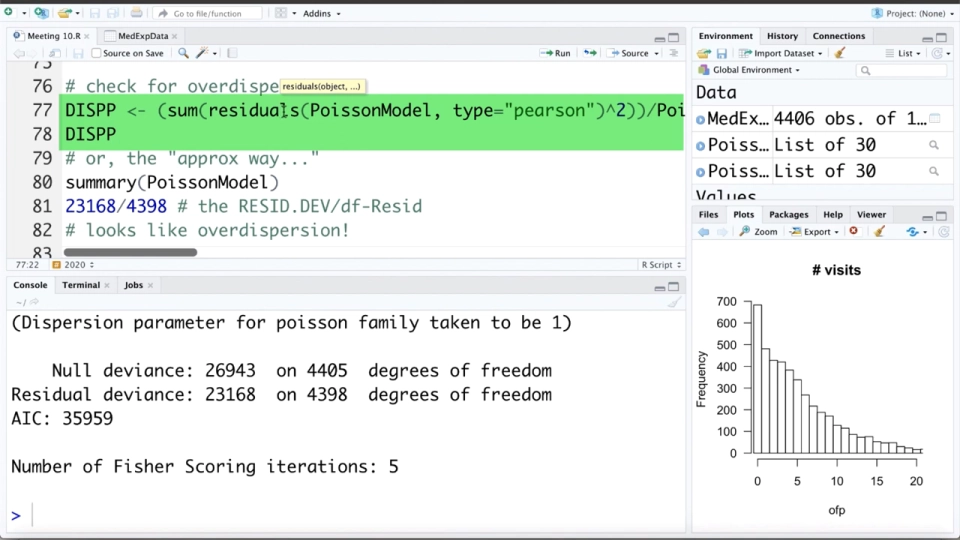
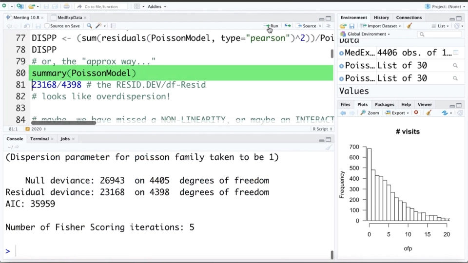

# 过度离散从哪里来：泊松回归的均值—方差假设与负二项补救

> 视频来源：[Poisson Regression: Overdispersion causes and Solutions](https://www.youtube.com/watch?v=0W5QF_OnR7w)（YouTube · MarinStatsLectures-R Programming & Statistics）｜时长约 10 分钟
> 导读：这支短片只做一件事——把泊松回归“均值等于方差”这条隐含假设拆开，说明过度离散怎么定义、怎么用离散参数检查、常见来源有哪几类，以及为什么负二项是默认补救。字幕为 YouTube 自动字幕，Poisson、overdispersion、dispersion parameter、negative binomial 等术语已按白板内容订正。零膨胀只在视频开头被点名为“另一个问题”，本文不展开，留给 B04/P08。

## 本讲要解决的核心问题（SCQA）

**背景**：计数数据（每天就诊次数、每个细胞测到的 UMI 数、每个样本的 reads 数）常用泊松回归。泊松回归的输出看起来和线性回归一样：有系数、有标准误、有 p 值。

**冲突**：泊松回归并不是“只要 y 是整数就能用”。它在估计均值的同时，把方差也锁死成同一个数。真实计数数据往往比这个假设更“散”——同样一组协变量下，个体的计数波动远大于泊松允许的范围。这时系数可能还勉强能用，但标准误和 p 值已经不可信。

**疑问**：过度离散到底是什么意思？怎么从模型输出里看出来？它是数据本身的问题，还是模型写错了？如果确实存在，应该换什么模型？

**回答（中心思想）**：**泊松回归假设方差等于均值；过度离散就是方差大于均值。** 它通常不是“数据坏了”，而是模型漏了结构（交互、非线性、重要变量），或者计数分布本身比泊松更宽。检查方法是看离散参数是否明显大于 1；最常见的补救是负二项回归——它把均值与方差分开估计。

## 一、泊松回归只估一个参数：均值等于方差

视频先用一句话把泊松回归的假设说清楚：模型估计一个“率”（rate），并假设**均值等于这个率，方差也等于这个率**。[【跳转到 00:34】](https://www.youtube.com/watch?v=0W5QF_OnR7w&t=34)

写成公式就是

$$
\mathbb{E}[y \mid x] = \lambda(x), \qquad \operatorname{Var}(y \mid x) = \lambda(x)
$$

所以标准差是

$$
\operatorname{SD}(y \mid x) = \sqrt{\lambda(x)}
$$

视频给了一个具体例子：对某一组协变量相同的人（同样的性别、慢性病数量、自评健康等），模型估计每年平均就诊 **9 次**。按泊松假设，方差也必须是 9，于是标准差是 $\sqrt{9}=3$。[【跳转到 01:03】](https://www.youtube.com/watch?v=0W5QF_OnR7w&t=63)

这意味着：如果均值是 9，泊松模型认为“大多数人的就诊次数落在 9 附近，波动大约是 3 次”。它不允许出现“均值 9、但很多人是 0 次、另一些人 30 次”这种更宽的分布。

## 二、过度离散：方差大于均值

过度离散（overdispersion）的定义很直接：**观测到的变异比模型预期的更大**，也就是方差大于均值。[【跳转到 01:47】](https://www.youtube.com/watch?v=0W5QF_OnR7w&t=107)

回到就诊次数的例子：如果同样这组人的就诊次数标准差实际上是 8、10 甚至更大，而不是 3，那么泊松模型给出的标准误就会偏小。后果不是“预测值差一点”，而是：

- 系数的标准误被低估；
- 置信区间过窄；
- p 值偏小，容易把弱证据当成显著。

视频没有展开这些后果的推导，但它明确指出：过度离散是泊松回归最常见的两个问题之一（另一个是零过多）。[【跳转到 00:10】](https://www.youtube.com/watch?v=0W5QF_OnR7w&t=10)

## 三、怎么查：离散参数是否明显大于 1

检查过度离散不需要复杂工具。视频给了两个等价的快速算法。[【跳转到 03:05】](https://www.youtube.com/watch?v=0W5QF_OnR7w&t=185)

### 3.1 用 Pearson 残差算离散参数

$$
\hat{\phi} = \frac{\sum_i r_i^2}{n-p}
$$

其中 $r_i$ 是 Pearson 残差，$n-p$ 是残差自由度。$\hat{\phi}$ 就是**离散参数**（dispersion parameter）。泊松模型假设 $\phi=1$；如果 $\hat{\phi}$ 明显大于 1，就说明方差比均值大。

### 3.2 用残差偏差快速近似

在 R 的 `summary()` 输出里，可以直接拿**残差偏差除以残差自由度**：

$$
\hat{\phi} \approx \frac{\text{Residual deviance}}{\text{Residual df}}
$$

视频给了一个经验判读：如果离散参数在 1.1、1.2、1.3 附近，通常还可以接受；一旦到了 2、3、5、6，就说明过度离散很明显。[【跳转到 03:58】](https://www.youtube.com/watch?v=0W5QF_OnR7w&t=238)

### 3.3 一次 R 运行里的两个数

视频随后用一份真实数据演示。先按 Pearson 残差手算，得到离散参数 **6.7**；再看模型摘要，残差偏差 23168、残差自由度 4398，两者相除约 **5.27**。两个数都远大于 1，结论一致：存在过度离散。[【跳转到 09:02】](https://www.youtube.com/watch?v=0W5QF_OnR7w&t=542)

两个数不完全相同是正常的：Pearson 残差版本和偏差版本只是近似等价，不必追求小数点后一致。重要的是它们都指向同一个量级。

## 四、过度离散的三个来源

视频把常见原因归成三类。[【跳转到 04:23】](https://www.youtube.com/watch?v=0W5QF_OnR7w&t=263)

### 4.1 模型设定错误：漏了交互、非线性或重要变量

最常见的一类原因是**模型没有准确表示数据里的关系**，也就是设定错误（misspecification）或缺乏拟合（lack of fit）。具体可能是：

- 漏了一个**交互项**；
- 漏了一个**非线性关系**（某个 X 在 log 尺度上不是线性的）；
- 漏了一个**重要变量**。

视频举了英国医生数据的例子：只用吸烟和年龄分组两个变量时，模型出现过度离散；进一步检查发现，吸烟与年龄分组之间本来应该有交互项，但模型里没有。[【跳转到 04:49】](https://www.youtube.com/watch?v=0W5QF_OnR7w&t=289)

这一类过度离散的启示很重要：**先检查模型结构，再考虑换分布**。如果只是漏了一个交互项，直接上负二项只是把方差放宽，并没有修正均值结构。

### 4.2 零过多：大量个体的事件根本没发生

第二类原因是**零过多**（excessive zeros）：很大一部分个体的事件一次都没发生，导致零的比例远高于泊松预期。视频把它列为泊松回归的另一个常见问题，并说明它会在下一段单独讨论。[【跳转到 06:01】](https://www.youtube.com/watch?v=0W5QF_OnR7w&t=361)

本小节不展开零膨胀模型的实现。按课程边界，零膨胀的实现留给 B04/P08；这里只需要记住：**零过多和过度离散不是同一个问题**，前者改变的是零点的概率质量，后者改变的是整体方差。

### 4.3 分布本身就不够宽

第三类原因更朴素：泊松分布只是一个理论分布，真实数据未必服从它。即使模型结构没问题、零也不异常，方差仍可能比均值大。视频的原话是“it just is”——数据就是这样。[【跳转到 06:52】](https://www.youtube.com/watch?v=0W5QF_OnR7w&t=412)

这一类才是负二项最直接的用武之地：不是去修均值结构，而是承认方差需要单独估计。

## 五、补救：负二项把均值与方差分开估

视频把负二项回归概括为一句话：**它和泊松回归几乎一样，区别是它分别估计均值和方差。** 泊松只有一个参数（率），这个率同时决定均值和方差；负二项多一个参数，用来单独描述方差。[【跳转到 07:47】](https://www.youtube.com/watch?v=0W5QF_OnR7w&t=467)

视频用线性回归作类比：线性回归先估计均值，再单独估计残差标准误；负二项对计数数据做的是同一件事——均值归均值，方差归方差。[【跳转到 08:27】](https://www.youtube.com/watch?v=0W5QF_OnR7w&t=507)

用公式说，负二项通常写成

$$
\operatorname{Var}(y \mid x) = \mu(x) + \alpha\,\mu(x)^2
$$

其中 $\mu(x)$ 是均值，$\alpha$ 是离散参数。$\alpha \to 0$ 时，方差退化成 $\mu$，负二项回到泊松。因此泊松是负二项的一个特例（嵌套模型）；$\alpha>0$ 时，方差随均值平方增长，正好容纳“方差大于均值”。

这也解释了为什么负二项能修正 p 值：它把被泊松低估的方差放回标准误里，检验统计量随之变小。**它不会自动修正均值结构**——如果过度离散来自漏掉的交互项，负二项只是把标准误调宽，并没有把模型设对。

## 六、把似然选择与下游模型接起来

这支视频停在“负二项是默认补救”，没有继续讲它在具体工具里的样子。本小节配套的另一篇《[细胞是观测，供体才是重复：Donor-level 差异分析的五个步骤](../../../3_统计推断与实验设计/3.2_合理的实验单位/3.2.1_重复测量、分层结构与伪重复/细胞是观测供体才是重复：Donor-level差异分析的五个步骤.md)》补上了下游的一段：pseudobulk 差异分析把每个供体、每个细胞类型的原始 counts 按基因求和，再交给 **负二项广义线性模型 + 拟似然 F 检验**（edgeR/DESeq2 一类框架）。那里关心的正是本节的三个量：

- 输入必须是**计数**，因为负二项的均值参数对应计数的期望；
- 离散度要单独估计，样本少时还要用经验贝叶斯或拟似然做收缩；
- 模型选择会直接改变标准误、自由度和最终显著基因表。

换句话说：**选泊松还是负二项，不是“哪个更高级”，而是你愿意为方差结构声明多强的假设。** 泊松声明方差等于均值；负二项声明方差可以更大，并多估一个参数。数据支持哪一种，就用哪一种。

## 小结

- 泊松回归只估一个率，并强制 **均值 = 方差 = 率**；标准差是率的平方根。
- 过度离散就是 **方差大于均值**，表现为同样协变量下个体波动比泊松预期更宽。
- 快速检查：离散参数 $\hat{\phi}=\sum r_i^2/(n-p)$，或残差偏差除以残差自由度；明显大于 1 即提示过度离散。
- 常见来源有三类：模型设定错误（漏交互、漏非线性、漏重要变量）、零过多、以及计数分布本身比泊松更宽。
- 负二项在泊松的基础上多估一个离散参数，把均值与方差分开；泊松是它的特例。
- 先检查均值结构，再换分布：漏掉的交互项不会因为换负二项而自动补上。
- 零膨胀是另一个问题，本单元不展开，实现留给 B04/P08。

## 关键术语速查

| 术语 | 一句话解释 |
| --- | --- |
| 泊松回归（Poisson regression） | 用对数连接把线性预测子映射到计数均值，并假设方差等于均值的广义线性模型 |
| 过度离散（overdispersion） | 观测方差大于模型假设的方差；对泊松而言就是方差大于均值 |
| 离散参数（dispersion parameter） | 用 Pearson 残差平方和除以残差自由度得到的量，泊松假设它为 1 |
| 残差偏差（residual deviance） | 模型与饱和模型之间偏差的两倍；除以残差自由度可快速近似离散参数 |
| 负二项回归（negative binomial regression） | 在泊松均值结构上增加一个离散参数，使方差可以大于均值的计数回归 |
| 嵌套模型（nested model） | 一个模型是另一个模型的参数受限特例；泊松是负二项在离散参数趋于 0 时的特例 |
| 零过多（excessive zeros） | 零的比例高于泊松预期；与过度离散不同，需要零膨胀或 hurdle 模型处理 |
| 设定错误（misspecification） | 模型漏掉交互、非线性或重要变量，导致均值结构不能准确描述数据 |