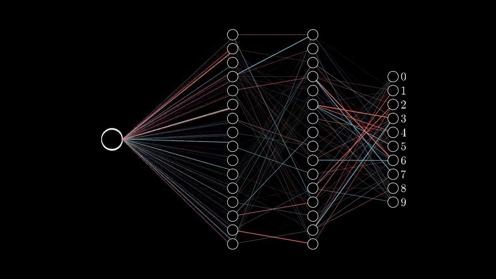
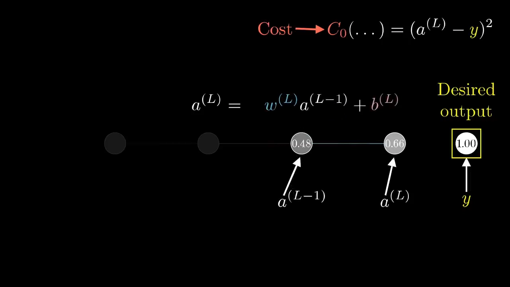
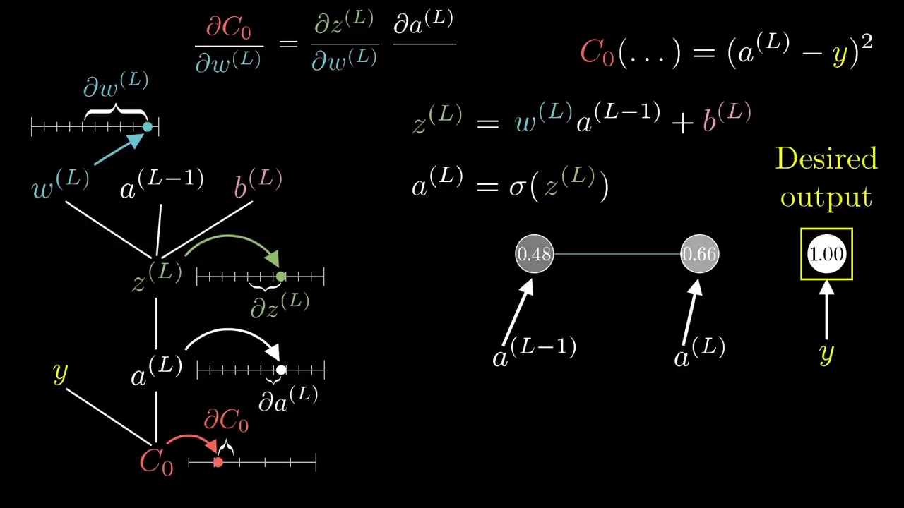
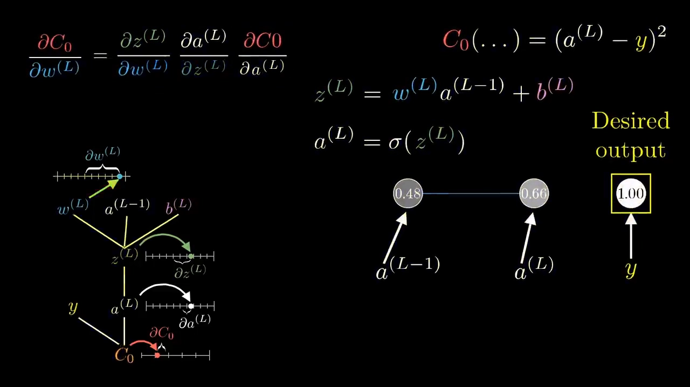
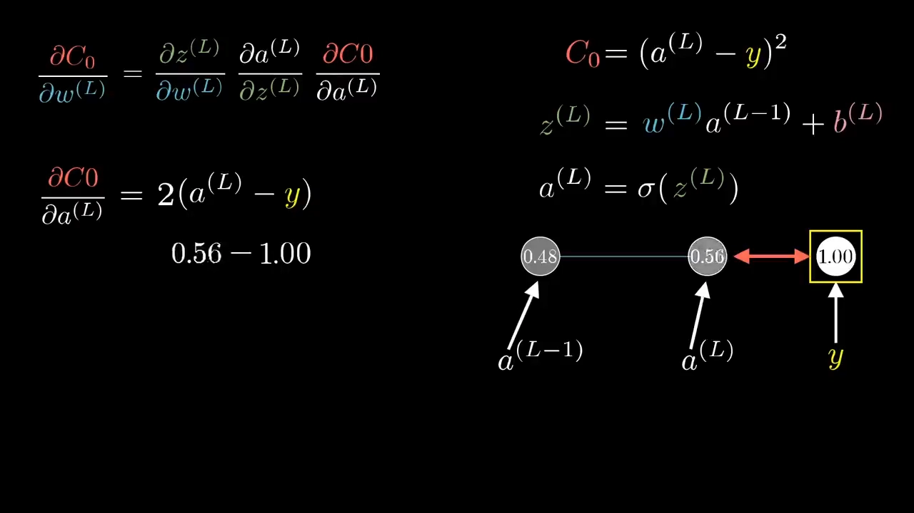
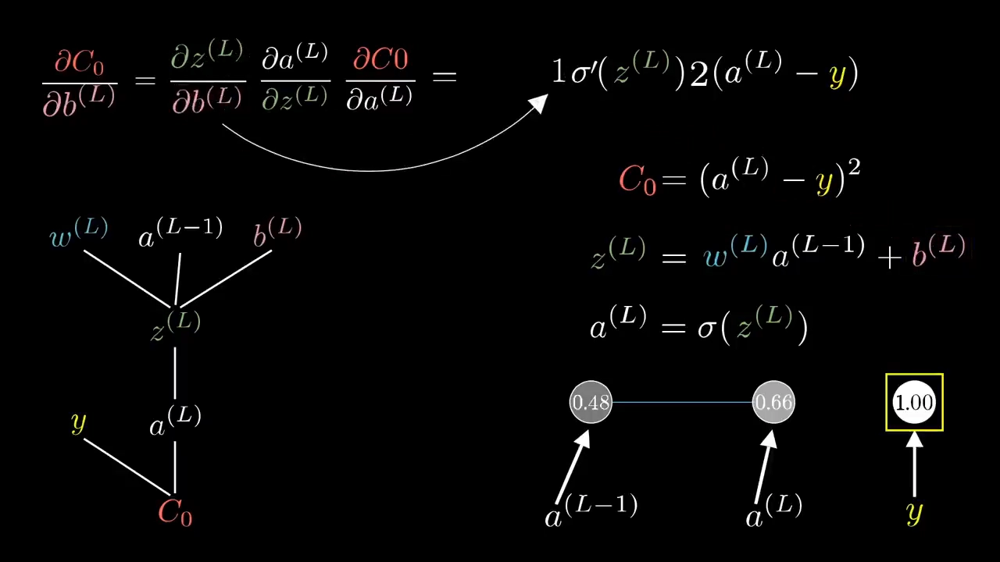
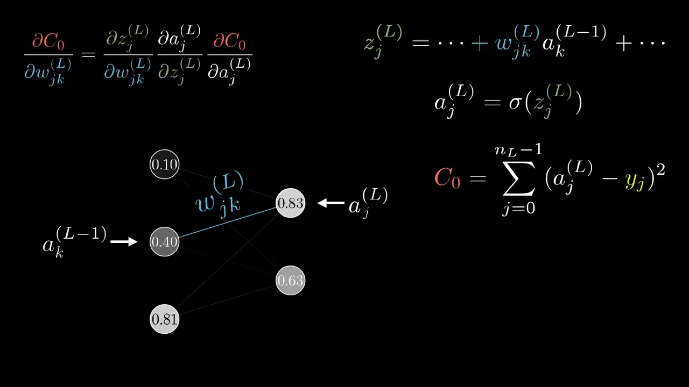
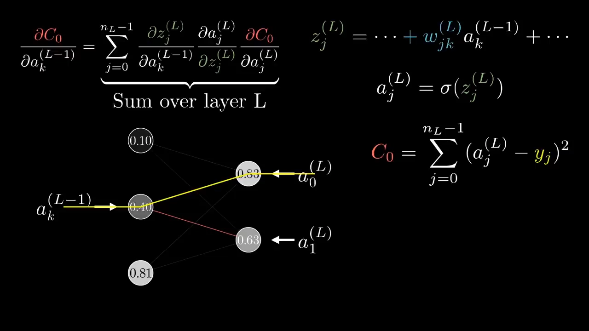

# 反向传播的链式分解：局部导数、上游信号与多路径求和

## 本讲要解决的核心问题（SCQA）

**背景**：一个网络里的参数动辄成千上万个，训练时要回答的问题是"每个参数各自该往哪个方向动、动多少"。这个答案就是损失对每个参数的偏导数，也就是梯度。

**冲突**：直接按定义求偏导，要写下一个参数经由网络到达损失的每一条路径，再把路径上的因子乘起来。层数一多，路径数按指数增长，手算和机器算都受不了。初学者常见的困境是：链式法则在单变量微积分里会用，一放到"一层有多个神经元、彼此交叉连接"的网络上，就不知道哪些项该乘、哪些项该加。

**疑问**：网络上的链式法则到底被组织成了什么形状，才能让每个偏导只算一次、并且能一层层往回复用？

**回答（中心思想）**：把网络写成一串"加权和 → 激活 → 损失"的复合函数，任何一个参数的梯度都能分解成三段局部导数的乘积；其中"损失对某一层激活的敏感度"这一段与参数无关，可以整段传给下一层继续用。一层有多个神经元时，公式形状不变，只是多几个索引，并且同一个神经元到损失有多条路径时，各路贡献必须相加。这就是反向传播的全部结构。

本讲来自 3Blue1Brown 的《Backpropagation calculus》[【跳转到 00:00】](https://www.youtube.com/watch?v=tIeHLnjs5U8&t=0)。它假定读者已经看过同一系列讲反向传播直觉的第三集，这里只做形式化推导，不做数值算例；数值手算另见《手算一个十一参数网络的梯度：逐层回传、零梯度与两种校验》。

## 一、先把网络写成一条计算链

### 1.1 从一个每层只有一个神经元的网络开始

推导从最极端的简化开始：每一层只有一个神经元。这样的网络由三个权重和三个偏置完全决定 [【跳转到 00:41】](https://www.youtube.com/watch?v=tIeHLnjs5U8&t=41)。

目标是弄清楚损失函数对这些变量有多敏感——只有知道敏感度，才知道调哪一项能以最小代价把损失压下去。为了不一开始就被索引淹没，先只看最后两个神经元之间的那条连接 [【跳转到 01:01】](https://www.youtube.com/watch?v=tIeHLnjs5U8&t=61)。

记号约定：最后一层神经元的激活记作 $a^{(L)}$，上标表示它属于第几层，所以前一个神经元的激活是 $a^{(L-1)}$。这些上标不是指数，只是层号；下标要留给同一层里不同神经元的编号 [【跳转到 01:06】](https://www.youtube.com/watch?v=tIeHLnjs5U8&t=66)。

单个训练样本的损失用平方误差：

$$
C_0=\left(a^{(L)}-y\right)^2
$$

其中 $y$ 是这个样本期望的输出（比如 0 或 1）[【跳转到 01:31】](https://www.youtube.com/watch?v=tIeHLnjs5U8&t=91)。

### 1.2 给加权和起名 z，链条变成三步

最后这个激活由三样东西决定：权重 $w^{(L)}$、上一层激活 $a^{(L-1)}$、偏置 $b^{(L)}$。先算加权和，再过非线性函数（sigmoid 或 ReLU 之类）：

$$
z^{(L)}=w^{(L)}a^{(L-1)}+b^{(L)},\qquad a^{(L)}=\sigma\left(z^{(L)}\right)
$$

给这个加权和单独起名 $z$，是为了后面写链式法则时每一步只对应一个因子 [【跳转到 01:56】](https://www.youtube.com/watch?v=tIeHLnjs5U8&t=116)。

于是整条链是：权重、上一层激活和偏置一起算出 $z$，$z$ 算出 $a$，$a$ 连同常数 $y$ 算出损失 [【跳转到 02:21】](https://www.youtube.com/watch?v=tIeHLnjs5U8&t=141)。当然 $a^{(L-1)}$ 自己又受它前面的权重和偏置影响，但这一层先不管。

这些量都只是普通数字，可以想象每个数字都有自己的数轴，微扰就是在自己的数轴上挪一小格 [【跳转到 02:21】](https://www.youtube.com/watch?v=tIeHLnjs5U8&t=141)。

## 二、对一条链求导：三个局部比值相乘

### 2.1 微扰的物理图像

要求的是 $\partial C_0/\partial w^{(L)}$。把 $\partial w$ 读成"对 $w$ 施加一个极小的扰动，比如 0.01"，把 $\partial C_0$ 读成"由此引起的损失变化"，要的就是这两个变化量之比 [【跳转到 02:46】](https://www.youtube.com/watch?v=tIeHLnjs5U8&t=166)。

因果链是清楚的：$w^{(L)}$ 的小扰动先引起 $z^{(L)}$ 的小扰动，再引起 $a^{(L)}$ 的小扰动，最后才影响损失 [【跳转到 03:11】](https://www.youtube.com/watch?v=tIeHLnjs5U8&t=191)。

### 2.2 链式法则就是三个比值相乘

既然变化是一段一段传过去的，就把整段比值拆成三段比值：

$$
\frac{\partial C_0}{\partial w^{(L)}}
=
\frac{\partial z^{(L)}}{\partial w^{(L)}}
\cdot
\frac{\partial a^{(L)}}{\partial z^{(L)}}
\cdot
\frac{\partial C_0}{\partial a^{(L)}}
$$

三个局部比值相乘，就得到损失对权重的敏感度 [【跳转到 03:36】](https://www.youtube.com/watch?v=tIeHLnjs5U8&t=216)。

这一步之所以关键，是因为三段局部导数各自都很容易求：它们只涉及相邻两个量之间的关系，不需要知道整条链。

## 三、三个局部导数各自是什么

### 3.1 损失对激活：误差本身放大两倍

$$
\frac{\partial C_0}{\partial a^{(L)}}=2\left(a^{(L)}-y\right)
$$

它的绝对值与"网络输出和期望值差多少"成正比：输出偏得越远，稍微动一点对损失的影响就越大 [【跳转到 04:01】](https://www.youtube.com/watch?v=tIeHLnjs5U8&t=241)。视频用 $a^{(L)}=0.66$、$y=1.00$ 这组数演示这个式子 [【跳转到 04:26】](https://www.youtube.com/watch?v=tIeHLnjs5U8&t=266)。

### 3.2 激活对加权和：所选非线性函数的导数

$\partial a^{(L)}/\partial z^{(L)}$ 就是 sigmoid（或任何选定的非线性函数）的导数 [【跳转到 04:26】](https://www.youtube.com/watch?v=tIeHLnjs5U8&t=266)。这一项是"门"：激活函数在某点越平，梯度过去得越少。

### 3.3 加权和对权重：上一层激活值

$$
\frac{\partial z^{(L)}}{\partial w^{(L)}}=a^{(L-1)}
$$

这一项的含义值得停一下：权重的一次微扰对最后输出的影响有多大，取决于前一个神经元有多强。视频把它和"一起激活的神经元连在一起"这句口号联系起来——上一层神经元越活跃，连它的权重就越"有话语权" [【跳转到 04:51】](https://www.youtube.com/watch?v=tIeHLnjs5U8&t=291)。

### 3.4 偏置几乎一样，只换一个因子

对偏置求敏感度的式子与对权重几乎相同，只需把 $\partial z/\partial w$ 换成 $\partial z/\partial b$，而这个导数是 1 [【跳转到 05:41】](https://www.youtube.com/watch?v=tIeHLnjs5U8&t=341)。所以偏置的梯度就是"传到这里的那段信号"本身，不带输入值。

还有两件事要说清楚：

- 上面算的都是**单个训练样本**的损失 $C_0$ 的导数。完整损失是许多样本损失的平均，所以它的导数也是这些表达式的平均 [【跳转到 05:16】](https://www.youtube.com/watch?v=tIeHLnjs5U8&t=316)。
- 这只是梯度向量里的一个分量。梯度由损失对所有参数（每个权重、每个偏置）的偏导共同组成 [【跳转到 05:16】](https://www.youtube.com/watch?v=tIeHLnjs5U8&t=316)。但即便如此，这一个分量已经占了全部工作量的一半以上，因为其余参数的式子形状完全一样 [【跳转到 05:41】](https://www.youtube.com/watch?v=tIeHLnjs5U8&t=341)。

## 四、往回传的关键：对上一层激活的敏感度等于权重

### 4.1 一个不打算直接使用的导数

链式表达式里还有一段：$z^{(L)}$ 对上一层激活 $a^{(L-1)}$ 的敏感度，它等于权重 $w^{(L)}$ [【跳转到 06:06】](https://www.youtube.com/watch?v=tIeHLnjs5U8&t=366)。

我们并不能直接去改上一层的激活值，那为什么还要算它？因为有了它，就可以把同一套链式法则继续往回迭代，算出损失对更前面那些权重和偏置的敏感度 [【跳转到 06:31】](https://www.youtube.com/watch?v=tIeHLnjs5U8&t=391)。

这就是"反向"两个字的来源：从损失出发，一段段往回乘，每退一层只做一次局部乘法，而不是从损失重新走一遍所有路径。

## 五、一层有多个神经元：索引变多，公式形状不变

### 5.1 补上下标

真实网络一层有多个神经元，看起来会复杂很多，但本质上只是多几个索引 [【跳转到 06:43】](https://www.youtube.com/watch?v=tIeHLnjs5U8&t=403)。

- 激活不再是一个数 $a^{(L)}$，而是带神经元编号的 $a^{(L)}_j$；用 $k$ 索引第 $L-1$ 层，用 $j$ 索引第 $L$ 层。
- 损失变成对各输出分量求平方差再求和：$C_0=\sum_j\left(a^{(L)}_j-y_j\right)^2$ [【跳转到 07:08】](https://www.youtube.com/watch?v=tIeHLnjs5U8&t=428)。
- 权重多两个下标：$w^{(L)}_{jk}$ 表示连接第 $L-1$ 层第 $k$ 个神经元与第 $L$ 层第 $j$ 个神经元的那条边。下标顺序看着有点反，但它和权重矩阵的索引方式一致 [【跳转到 07:33】](https://www.youtube.com/watch?v=tIeHLnjs5U8&t=453)。

### 5.2 唯一真正变化的地方：路径要相加

加权和、激活、链式乘积这些式子，与单神经元情形**形状完全一样**，只是符号更啰嗦 [【跳转到 07:58】](https://www.youtube.com/watch?v=tIeHLnjs5U8&t=478)。

真正变化的是"损失对第 $L-1$ 层某个激活的敏感度"。在单神经元链里，一个神经元只影响后面一个神经元；在全连接网络里，它会同时影响第 $L$ 层的多个神经元，而这些神经元各自都参与损失。所以必须把所有路径的贡献加起来 [【跳转到 08:23】](https://www.youtube.com/watch?v=tIeHLnjs5U8&t=503)：

$$
\frac{\partial C_0}{\partial a^{(L-1)}_k}
=
\sum_{j}
\frac{\partial z^{(L)}_j}{\partial a^{(L-1)}_k}
\cdot
\frac{\partial a^{(L)}_j}{\partial z^{(L)}_j}
\cdot
\frac{\partial C_0}{\partial a^{(L)}_j}
$$

求和号遍历第 $L$ 层的全部神经元 [【跳转到 08:48】](https://www.youtube.com/watch?v=tIeHLnjs5U8&t=528)。

一旦算出"损失对倒数第二层各激活的敏感度"，就可以对喂进这一层的所有权重和偏置重复同样的过程 [【跳转到 08:48】](https://www.youtube.com/watch?v=tIeHLnjs5U8&t=528)。整段推导到此结束：这些链式表达式给出的导数，构成梯度向量的各个分量，而梯度正是让网络沿下坡方向反复迈步、把损失压下去的依据 [【跳转到 09:13】](https://www.youtube.com/watch?v=tIeHLnjs5U8&t=553)。

## 六、这条推导链给出什么，边界在哪

把上面的内容压成三句话：

1. **梯度是局部导数的乘积**。任何一个参数的梯度，都能拆成"参数→加权和→激活→损失"三段局部导数之积；每段只涉及相邻两个量，单独求都很便宜。
2. **中间那段信号可以复用**。"损失对本层激活的敏感度"与具体参数无关，算一次就能整段传给下一层；反向传播之所以比逐路径展开快，靠的就是这次复用。
3. **多路径必须相加**。一层有多个神经元时，公式形状不变，但同一个神经元到损失有多条路径，回传时要把各路贡献求和。

需要标明的边界：

- 本讲只做**符号推导**，没有代入具体数字，也没有讨论怎么在代码里实现、怎么检查梯度算得对不对。数值手算与校验见同节的另一篇《手算一个十一参数网络的梯度：逐层回传、零梯度与两种校验》。
- 视频用的是平方误差配 sigmoid。换成别的损失（例如分类的交叉熵）时，$\partial C_0/\partial a^{(L)}$ 这一段会变，但"三段相乘 + 逐层回传 + 多路径求和"的结构不变。
- 视频只推导一阶导数，不涉及二阶信息，也不涉及梯度消失/爆炸的成因；后者属于训练诊断的范围。
- 这里讨论的是"怎样算出梯度"。梯度算出来之后怎么用（步长、批量、动量）是另一个问题，不在本讲范围内。

## 原始资料

- 3Blue1Brown, *Backpropagation calculus*（Deep Learning 系列第 4 集），[YouTube](https://www.youtube.com/watch?v=tIeHLnjs5U8)，约 10 分钟。