# 手算一个十一参数网络的梯度：逐层回传、零梯度与两种校验

## 本讲要解决的核心问题（SCQA）

**背景**：一个两层小网络做二分类，输出"开泵"的概率 0.69，而正确答案是"开泵"（真值 1），交叉熵损失 0.371。这个网络一共有十一个可以调的数。

**冲突**：损失是一个数，参数有十一个。要知道下一步该动哪个、动多少，就必须回答"这十一个数各自该为这个损失负多少责任"。凭直觉猜不行：有的参数看起来很大，却对损失没有影响；有的参数看起来很小，责任却不小。

**疑问**：能不能只用一支笔，把这十一个梯度全部算出来，并且证明算对了？

**回答（中心思想）**：能。反向传播只有两条记账规则：**某个权重的梯度 = 到达它所在神经元的误差信号 × 这个权重在前向时看到的输入**；**要往下一层传的信号 = 用同一批权重反向加权 × 上游信号 × 激活函数的斜率**。按这两条规则从输出层退到第一层，十一个梯度一次算完，其中一个隐藏神经元的整行都是零。再用自动微分和"微扰测斜率"两种独立方法校验，三者一致到小数点后八位。

本讲来自 YouTube 频道 Zero to AI Engineer 的《Backpropagation Explained: Every Gradient by Hand》[【跳转到 00:00】](https://www.youtube.com/watch?v=u-58TopD-RE&t=0)。它假定你已经跑过一次前向传播、用损失函数打过分；这里的任务是把这个分数拆回到每个参数头上。

## 一、先把网络和它的前向账本摆出来

### 1.1 网络形状与十一个参数

网络是三层：三个输入（湿度、气温、降雨概率）、两个隐藏神经元、一个输出（开泵的概率）。视频里给出的具体参数是 [【跳转到 05:22】](https://www.youtube.com/watch?v=u-58TopD-RE&t=322)：

- 输入 $x=(0.2,\ 0.9,\ 0.1)$，真值 $y=1$（该开泵）
- 第一层权重 $W_1=\begin{bmatrix}-2 & 1 & -1\\ 1 & 0 & 2\end{bmatrix}$，偏置 $b_1=(0.5,\ -0.5)$
- 第二层权重 $W_2=(2,\ -3)$，偏置 $b_2=-1.0$

按层清点，这正好是十一个数：$W_1$ 六个、$b_1$ 两个、$W_2$ 两个、$b_2$ 一个 [【跳转到 00:05】](https://www.youtube.com/watch?v=u-58TopD-RE&t=5)。整节课要算的就是这十一个数各自的偏导数。

### 1.2 前向：从输入到 0.69 与 0.371

前向计算分三步：

1. 第一层加权和 $z_1=W_1x+b_1=(-0.4+0.9-0.1+0.5,\ 0.2+0+0.2-0.5)=(0.9,\ -0.1)$；
2. 过 ReLU 得到隐藏层输出 $h=(0.9,\ 0)$——第二个神经元的前置值是 $-0.1$，被 ReLU 截成 0，也就是"关着"；
3. 第二层 $z_2=2\times0.9+(-3)\times0+(-1)=0.8$，过 sigmoid 得 $p=\sigma(0.8)\approx0.69$，交叉熵损失 $-\log p\approx0.371$。

前向结束后，这十一个参数各自"看到"了什么就固定下来了：每条权重都记住了它乘过的那个输入值。反向传播要用的正是这些记录。

## 二、两条记账规则

### 2.1 规则一：权重的责任 = 到达的信号 × 它看到的输入

把反向传播想成一次责任追查：总经理不问每个员工，只问各部门负责人"你这边多做一点，总数会动多少"；负责人再问自己的组长，并乘上自己那一份的比例。没有人需要看整张组织架构图 [【跳转到 01:13】](https://www.youtube.com/watch?v=u-58TopD-RE&t=73)。

落到公式上，第一条规则是：

$$
\frac{\partial L}{\partial w}=\text{（到达该神经元的误差信号）}\times\text{（该权重在前向时看到的输入）}
$$

[【跳转到 03:28】](https://www.youtube.com/watch?v=u-58TopD-RE&t=208)

### 2.2 规则二：往下一层传的信号 = 权重反向加权 × 上游信号 × 激活斜率

第二条规则负责"传"：

$$
\delta_{\text{下层}}=\left(W^{\top}\delta_{\text{上层}}\right)\odot\sigma'(z)
$$

也就是把权重反过来用一次、乘上从上面传下来的信号，再过一次激活函数的斜率（ReLU 的斜率是"开则为 1、关则为 0"）[【跳转到 03:28】](https://www.youtube.com/watch?v=u-58TopD-RE&t=208)。

这两条规则合起来就是链式法则，只不过被组织成"每个信号只算一次、然后复用"的形式。整个反向流程是：从损失出发，先算输出层的误差信号，再逐层往回传，直到第一层 [【跳转到 01:38】](https://www.youtube.com/watch?v=u-58TopD-RE&t=98)。

## 三、手算十一个梯度

### 3.1 第一步：输出层的信号是 p − y

sigmoid 配交叉熵有一个很省事的结果：损失对输出打分的导数就是预测概率减真值 [【跳转到 02:03】](https://www.youtube.com/watch?v=u-58TopD-RE&t=123)。

$$
\delta_2=p-y=0.69-1=-0.31
$$

有了这个信号，输出层的三个参数立刻可以结账：

- $W_2$ 的两个权重：信号乘以它们各自看到的隐藏层输出，即 $-0.31\times0.9=-0.279$ 和 $-0.31\times0=0$；
- 输出偏置：它看到的输入恒为 1，所以责任就是信号本身 $-0.31$。

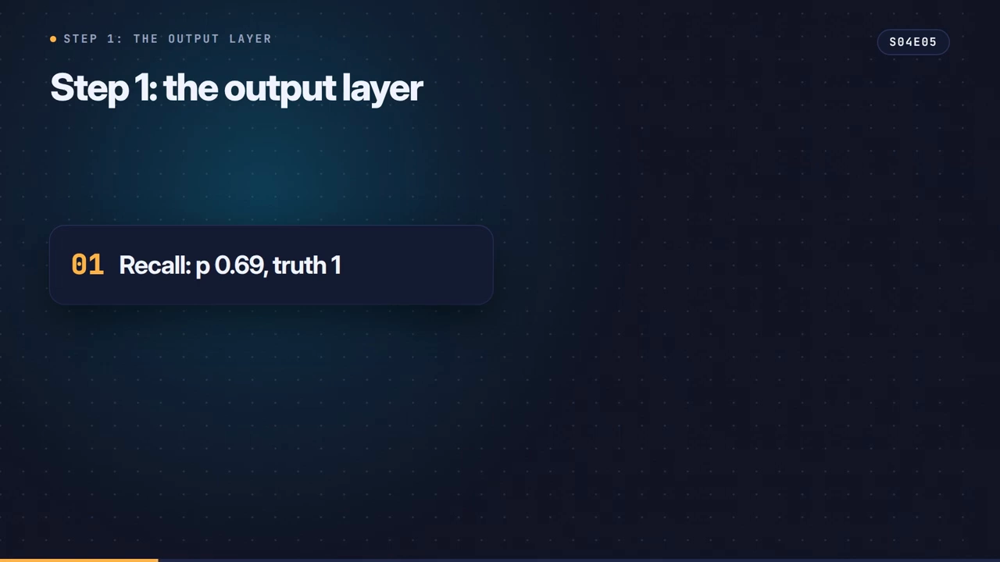

### 3.2 第二步：把信号传回隐藏层

每个隐藏神经元收到的信号，等于输出层信号乘以连接它的那个权重 [【跳转到 02:28】](https://www.youtube.com/watch?v=u-58TopD-RE&t=148)：

- 神经元一：$2\times(-0.31)=-0.62$；
- 神经元二：$(-3)\times(-0.31)=+0.93$。

然后过 ReLU 这道门：

- 神经元一前向时是开着的（$z_1=0.9$），斜率 1，所以 $-0.62$ 原样通过；
- 神经元二前向时是关着的（$z_1=-0.1$），斜率 0，所以 $+0.93$ 被挡住，变成 0。

这一步是整个手算里最容易出错的地方：**信号先乘权重、再过斜率**，顺序不能反；被 ReLU 关掉的神经元，无论上游信号多大，回传都是零。

### 3.3 第三步：第一层的六个权重

第一层每个权重的责任，等于"通过门之后的信号"乘以它自己在前向时看到的输入 [【跳转到 02:53】](https://www.youtube.com/watch?v=u-58TopD-RE&t=173)：

| 参数 | 计算 | 梯度 |
| --- | --- | --- |
| 神经元一的湿度权重 | $-0.62\times0.2$ | $-0.124$ |
| 神经元一的气温权重 | $-0.62\times0.9$ | $-0.558$ |
| 神经元一的降雨权重 | $-0.62\times0.1$ | $-0.062$ |
| 神经元二的一整行 | $0\times(\cdot)$ | $0,\ 0,\ 0$ |

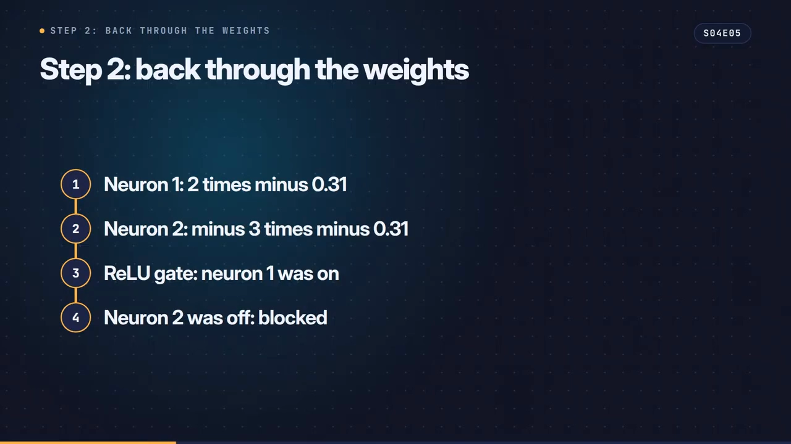

加上前面输出层的三个数，十一个梯度全部到手 [【跳转到 03:18】](https://www.youtube.com/watch?v=u-58TopD-RE&t=198)。

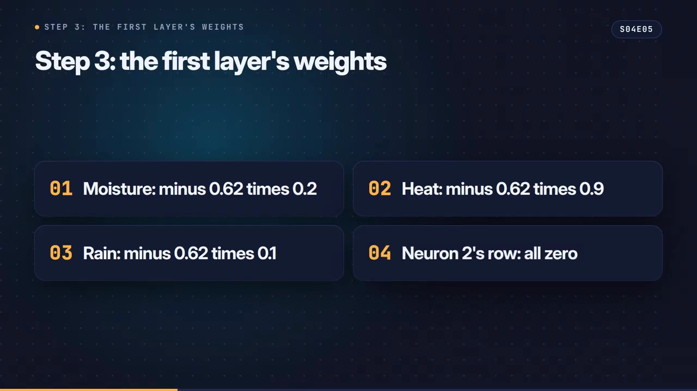

## 四、这些数字怎么读

### 4.1 符号说明方向，大小说明"谁最该动"

梯度为负，意味着把这个权重调大一点会让损失下降；所以神经元一的三个权重都会往上走，把 $p$ 从 0.69 推向 1 [【跳转到 04:16】](https://www.youtube.com/watch?v=u-58TopD-RE&t=256)。

大小则直接反映"输入有多大"：气温的梯度是降雨的九倍，原因很简单——气温这个输入是 0.9，降雨只有 0.1，而它们乘的是同一个信号 $-0.62$ [【跳转到 04:16】](https://www.youtube.com/watch?v=u-58TopD-RE&t=256)。

### 4.2 零梯度：这次为零，不等于永远为零

第二个隐藏神经元这一整行都是零，因为它在前向时被 ReLU 关掉了。但要注意限定条件：**只是这个样本、这一次**为零 [【跳转到 04:16】](https://www.youtube.com/watch?v=u-58TopD-RE&t=256)。换一个样本（比如降雨概率高的那个农场），它可能就醒着，那时它的权重就会有非零梯度。视频后面用三个农场的批量计算验证了这一点 [【跳转到 07:48】](https://www.youtube.com/watch?v=u-58TopD-RE&t=468)。

### 4.3 顺带得到输入的梯度

同一套规则也能算出损失对**输入**的敏感度：湿度的梯度是 $+1.24$，是三个读数里最敏感的一个 [【跳转到 04:39】](https://www.youtube.com/watch?v=u-58TopD-RE&t=279)。这就是显著性图背后的机制——图像分类器上高亮的那些像素，正是输入梯度的绝对值大的位置。

## 五、两次校验：自动微分与微扰测斜率

### 5.1 用 NumPy 复算一遍

把上面的流程写成五行代码，输出与手算逐位一致：`dz2 = -0.31`、`dW2 = [-0.279, 0]`、`dh = [-0.62, 0.93]`、`dz1 = [-0.62, 0]`、`dW1 = [[-0.124, -0.558, -0.062], [0, 0, 0]]` [【跳转到 03:51】](https://www.youtube.com/watch?v=u-58TopD-RE&t=231)。

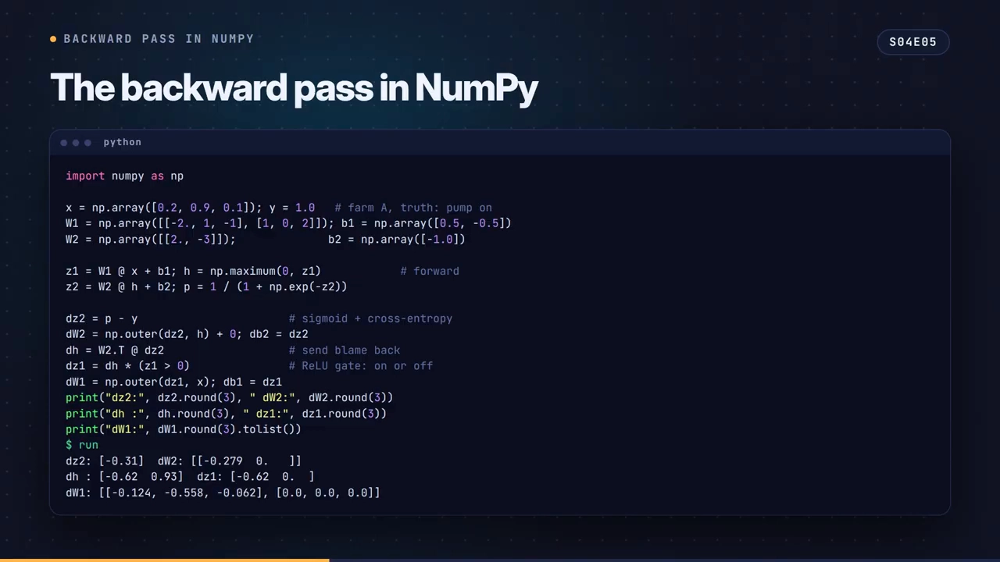

### 5.2 用自动微分再算一遍

给每个权重张量标上 `requires_grad`，前向过程就会被记成一张计算图，`loss.backward()` 沿图反向走一遍。输出同样吻合：损失 0.371，$W_1$ 的梯度是 $-0.124$、$-0.558$、$-0.062$ 加三个零 [【跳转到 04:57】](https://www.youtube.com/watch?v=u-58TopD-RE&t=297)。

### 5.3 但笔、NumPy、PyTorch 可能一起错

如果三者的推导都建立在同一个错误理解上，它们会一致地错。所以要直接测定义本身：把气温权重往上挪一点点测一次损失，再往下挪同样幅度测一次，用两次损失之差除以两倍步长，就得到斜率，完全不需要微积分 [【跳转到 05:22】](https://www.youtube.com/watch?v=u-58TopD-RE&t=322)。

这个"微扰测试"的结果与反向传播的公式给出的值一致到小数点后八位：$-0.55804593$ [【跳转到 05:47】](https://www.youtube.com/watch?v=u-58TopD-RE&t=347)。视频还把这个数写成一条链来核对：$(p-1)\times w_2\times\text{ReLU 斜率}\times\text{气温输入}$，四个因子连乘。

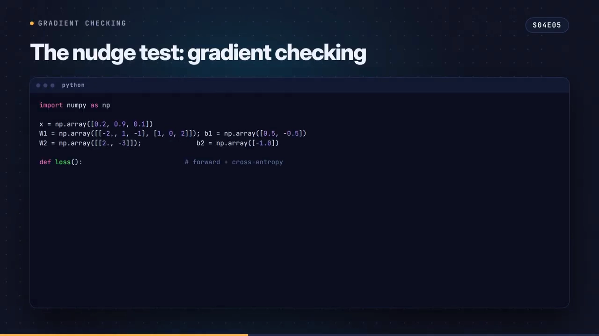

### 5.4 梯度检查的四条经验

- **两头都挪**，不要只挪一头：中心差分精度高得多；
- 用 **float64**，不要用 float32；PyTorch 自带的 `gradcheck` 就要求双精度；
- **避开 ReLU 在 0 点的折角**，那里斜率会跳变，一次微扰就可能跨过它；
- **抽查几个权重，不要全查**：每查一个权重都要两次前向，十亿个权重根本查不完，而反向传播一次就能拿到全部 [【跳转到 05:47】](https://www.youtube.com/watch?v=u-58TopD-RE&t=347)。

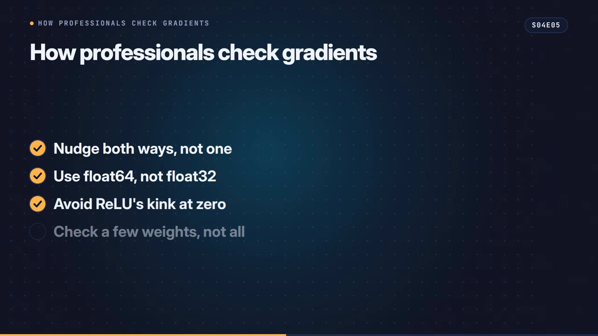

## 六、反向传播不是梯度下降

一次训练步骤有五个部分 [【跳转到 06:12】](https://www.youtube.com/watch?v=u-58TopD-RE&t=372)：

1. 前向传播，得到预测；
2. 损失函数给这个预测打分；
3. 反向传播，算出梯度——**反向传播只做这一件事**，它只判定责任，从不修改任何权重；
4. 优化器更新参数，例如梯度下降让每个权重沿负梯度方向挪一小步；
5. 梯度清零，因为 PyTorch 默认把新梯度累加到旧梯度上。

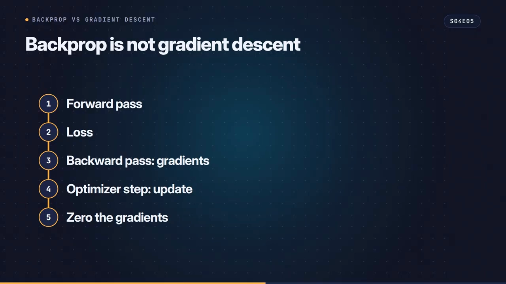

用学习率 0.5 的 SGD 在这个网络上跑几步，损失从 0.371 降到 0.094，再降到 0.056；而第二个神经元那一行权重始终是原来的 $(1,\ 0,\ 2)$——零责任意味着零更新 [【跳转到 06:51】](https://www.youtube.com/watch?v=u-58TopD-RE&t=411)。

## 七、从单个样本到批量

### 7.1 矩阵形式：只有三行

真实训练一次喂一批样本，每个样本一行。规则几乎不变 [【跳转到 07:26】](https://www.youtube.com/watch?v=u-58TopD-RE&t=446)：

- 信号：$p-y$，再除以批量大小（因为损失是平均）；
- 权重梯度：信号转置后乘输入矩阵；
- 往下一层传：信号乘权重，再过 ReLU 门。

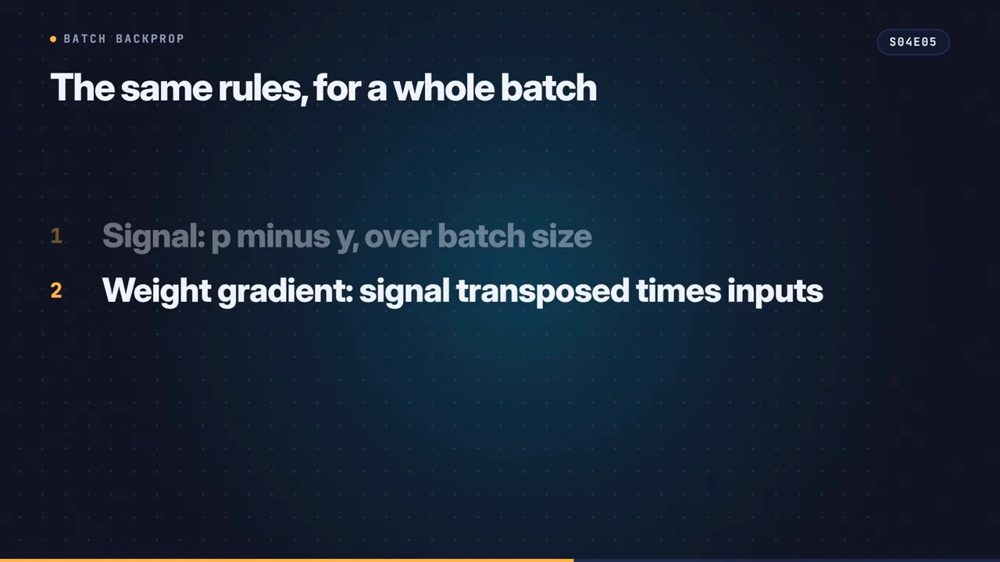

有一个值得记住的自检：**梯度的形状必须等于权重的形状**。形状不对，公式一定写错了 [【跳转到 07:26】](https://www.youtube.com/watch?v=u-58TopD-RE&t=446)。

### 7.2 批量下"死"神经元的复活

用三个农场（A、C 该开泵，B 不该）做批量前向，再手算与自动微分对照，$W_1$ 的梯度形状是 $2\times3$，与权重一致 [【跳转到 07:48】](https://www.youtube.com/watch?v=u-58TopD-RE&t=468)。

关键变化在第二行：它不再是零。第二个神经元对农场 A 是关着的，但对那个湿润的农场 B 是开着的，于是农场 B 教会了它东西 [【跳转到 08:13】](https://www.youtube.com/watch?v=u-58TopD-RE&t=493)。**一个神经元只有在所有样本上都关着时，才算真正死掉。**

## 八、反向传播的代价

### 8.1 "反向约为前向两倍"这句话有前提

用 PyTorch 的 FLOP 计数器在一个数字分类网络上实测（批量 64）[【跳转到 08:38】](https://www.youtube.com/watch?v=u-58TopD-RE&t=518)：

- 只对参数求梯度时，反向只有前向的 **1.08 倍**；
- 当输入也需要梯度时，反向恰好是前向的 **2.00 倍**。

原因是每一层在反向时要算两个矩阵乘：一个给权重梯度，一个给传向下一层的信号，各自与一次前向乘法同价，所以是两倍。但第一层跳过了输入梯度（像素不可学），而第一层往往占了大部分权重，于是总账被拉低 [【跳转到 08:57】](https://www.youtube.com/watch?v=u-58TopD-RE&t=537)。对深网络，一次训练步骤约等于三次前向，这是大模型估算算力的常用口径。

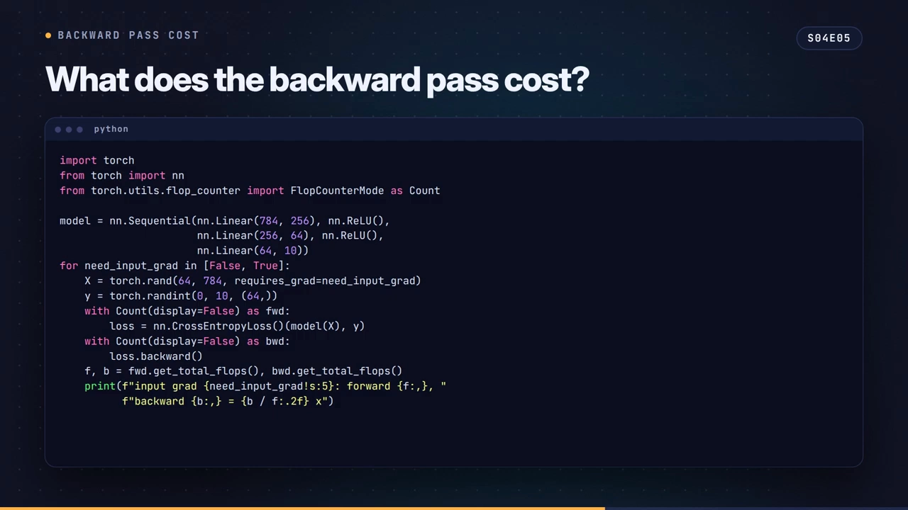

### 8.2 显存：激活值要留到反向

前向的中间结果（激活值）必须保留到反向传播时使用，所以训练比推理更吃显存。放不下时的标准做法是**激活检查点**：只存一部分层的激活，反向时从最近的检查点重新算出来，用计算换显存 [【跳转到 09:22】](https://www.youtube.com/watch?v=u-58TopD-RE&t=562)。

## 九、会静默出错的几处

视频演示了四个梯度相关的 bug [【跳转到 10:00】](https://www.youtube.com/watch?v=u-58TopD-RE&t=600)：

- 对同一个计算图**反向两次**：报错，因为 PyTorch 在第一次反向之后就释放了保存的中间值（除非显式要求保留计算图）；
- 对自动微分保存过的值做**原地修改**：报错，版本计数器会发现它被改过；
- 最危险的一种：损失有一半是在**detach 出来的副本**上算的。程序不报错，梯度却从 5 变成 2。

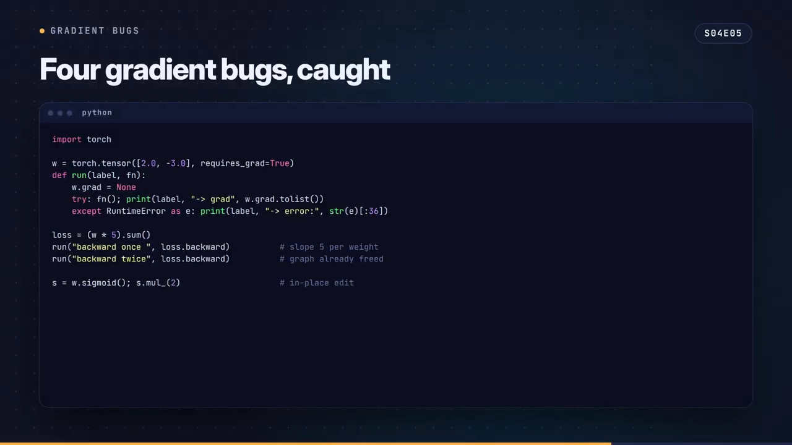

还有三个常见误区 [【跳转到 10:25】](https://www.youtube.com/watch?v=u-58TopD-RE&t=625)：

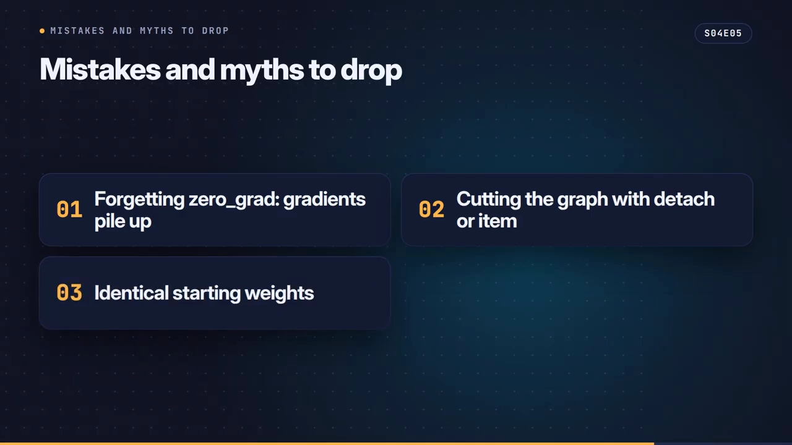

- **忘记清零梯度**：梯度跨步累加，每次更新都混进上一步的旧责任；
- **用 detach、`.item()` 或 NumPy 切断计算图**：代码照常跑，但网络的一部分永远学不到东西；
- **所有隐藏神经元用相同初始权重**：视频里把每个权重都设成 0.5，两个隐藏神经元拿到完全相同的梯度（气温权重都是 $-0.0756$），它们会永远保持成双胞胎。

最后一条边界值得记住：反向传播是工程方法，不是生物学结论——大脑是否做类似的事，仍是开放问题 [【跳转到 10:42】](https://www.youtube.com/watch?v=u-58TopD-RE&t=642)。

## 十、本节的位置与边界

- 本节只处理**怎样把损失拆回每个参数**。梯度算出来之后怎么用（步长、批量、动量、自适应尺度）属于下一节。
- 视频里的网络是"三个输入、两个隐藏神经元、一个输出"，激活是 ReLU，损失是交叉熵。换网络形状或损失函数时，两条记账规则不变，变的只是各段的局部导数。
- 视频给出了一个自测练习：农场 C（湿度 0.1、气温 1、降雨 0，真值开泵，前向得 $p=0.832$）手算一遍，并事先预测"哪两类权重会恰好为零" [【跳转到 11:25】](https://www.youtube.com/watch?v=u-58TopD-RE&t=685)。答案要看 ReLU 的门和输入值：输入为零的权重，责任必然为零；被 ReLU 关掉的神经元，整行为零 [【跳转到 11:55】](https://www.youtube.com/watch?v=u-58TopD-RE&t=715)。
- 公式推导的系统版本（三段局部导数相乘、多路径求和）见同节的另一篇《反向传播的链式分解：局部导数、上游信号与多路径求和》。

## 原始资料

- Zero to AI Engineer, *Backpropagation Explained: Every Gradient by Hand*（Deep Learning 系列第 5 讲），[YouTube](https://www.youtube.com/watch?v=u-58TopD-RE)，约 13 分钟。