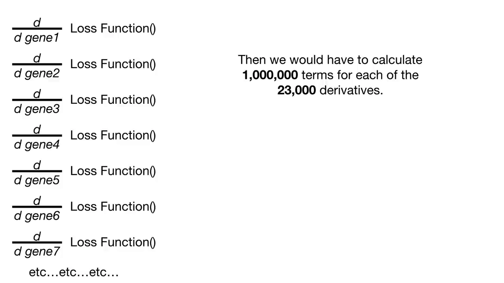
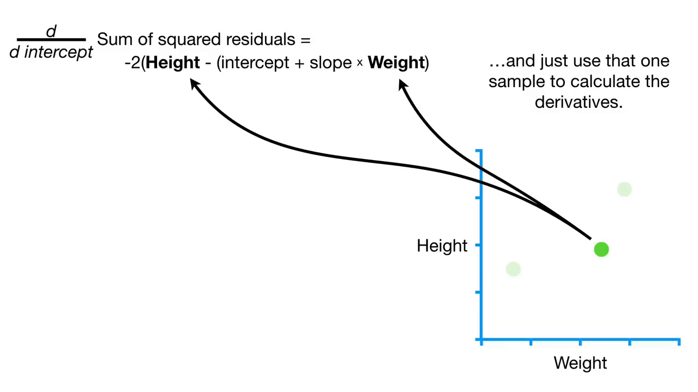
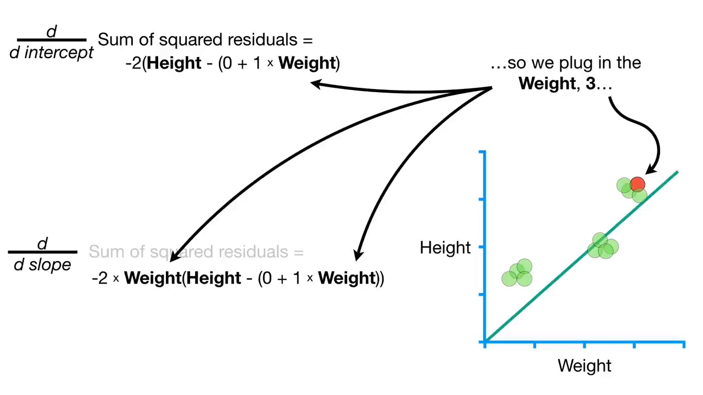
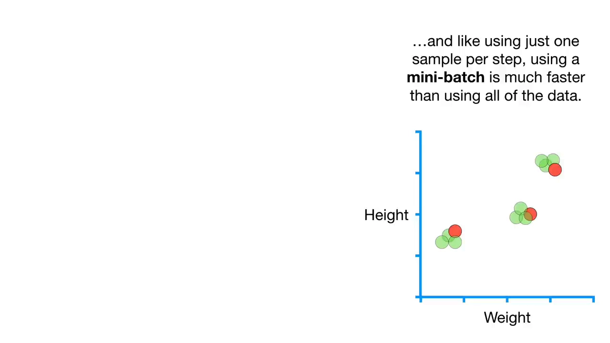
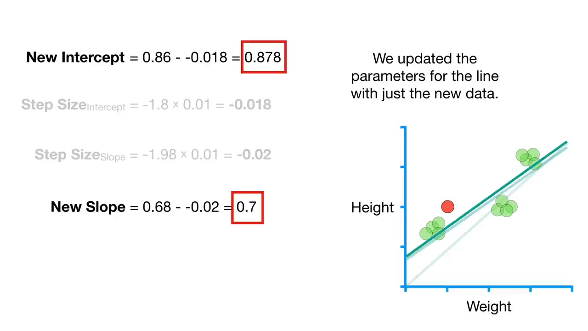

# 小批量与随机梯度：用部分样本估计全量梯度，在噪声与速度之间取舍

> 视频来源：[Stochastic Gradient Descent, Clearly Explained!!!](https://www.youtube.com/watch?v=vMh0zPT0tLI)（YouTube · StatQuest / Josh Starmer）｜时长约 11 分钟
> 导读：上一支视频把梯度下降的"斜率 → 步长 → 新参数"讲完了，这一支只追问一件事：每一步的梯度，真的需要把全部数据算一遍吗？本文沿着同一条直线拟合的损失面，比较全批量、单样本与小批量三种更新，重点看计算量、更新方向的抖动，以及小批量为什么是折中。

## 本讲要解决的核心问题（SCQA）

**背景**：梯度下降已经能用了：算损失函数对每个参数的导数，乘学习率，沿反方向走一步，重复到收敛。前面三个数据点、两个参数的例子里，每步只算三项，几乎不费时间。

**冲突**：真实数据不是三个点。若用 23,000 个基因预测疾病、有 100 万个样本，那么每个参数每步都要把 100 万项加起来；23,000 个参数就是每步 230 亿项，走 1000 步就是万亿级运算。全批量梯度下降在“大数据”上慢到不可行。

**疑问**：能不能不扫全量数据，仍然朝着让损失下降的方向走？少用一些样本，会不会把方向算错？如果会，错多少、怎么折中？

**回答（中心思想）**：**梯度的本质是"平均每个样本带来的下降方向"，因此可以用一部分样本来估计它。** 随机梯度下降（SGD）每步只随机抽一个样本算导数，计算量降到全批量的 $1/N$；代价是每步方向会随抽到的样本摆动。小批量（mini-batch）每步抽一小批，既比单样本稳定，又比全批量快，是实践中最常用的折中。三者用的是同一个损失函数、同一个更新式，区别只在"这一步用多少样本算梯度"。

---

## 一、全批量梯度下降的账：每步都要扫全量数据

先把上一支视频的流程压缩成一句：用残差平方和当损失，对截距和斜率分别求导，把当前参数代进去得到两个导数，乘学习率得到两个步长，更新参数，重复到步长很小或达到最大步数 [【跳转到 01:38】](https://www.youtube.com/watch?v=vMh0zPT0tLI&t=98) [【跳转到 02:42】](https://www.youtube.com/watch?v=vMh0zPT0tLI&t=162)。

在三个点的例子里，每个参数的导数只有三项要加，计算量可以忽略 [【跳转到 03:07】](https://www.youtube.com/watch?v=vMh0zPT0tLI&t=187)。但把规模换掉，账就完全不一样了：

- 模型：逻辑回归，用 **23,000 个基因**预测是否患病，于是有 23,000 个导数要算；
- 数据：**100 万个样本**，每个导数都要把这 100 万项加起来；
- 每步：$23{,}000 \times 1{,}000{,}000 = 230$ 亿项；
- 至少 1000 步：视频按 1000 步估算为 2.3 万亿项（按 230 亿 × 1000 严格算是 23 万亿，量级相同）[【跳转到 03:54】](https://www.youtube.com/watch?v=vMh0zPT0tLI&t=234)。

这就是"全批量"（full batch）的含义：每一步都用全部训练样本计算梯度。它的方向最稳，因为用的是完整损失面；但每一步都贵，数据一大就慢得不可行 [【跳转到 10:10】](https://www.youtube.com/watch?v=vMh0zPT0tLI&t=610)。

---

## 二、随机梯度：每步只抽一个样本

### 2.1 做法：随机选一个点，就用它算导数

随机梯度下降的做法很直接：每一步从数据里随机挑**一个**样本，只用这个样本计算导数，再乘学习率更新参数 [【跳转到 04:19】](https://www.youtube.com/watch?v=vMh0zPT0tLI&t=259) [【跳转到 04:33】](https://www.youtube.com/watch?v=vMh0zPT0tLI&t=273)。

计算量的差别可以直接数出来：三个点的例子从每步三项变成一项，降为三分之一；100 万个样本则降为一百万分之一。原来每步 230 亿项，现在每步只有 23,000 项（每个参数一项）。

### 2.2 为什么一个样本也能代表方向：数据里有冗余

只用一个点，听起来像是在用局部代替整体。视频给了一个直观理由：当数据存在**冗余**时，一个样本已经能代表一类情况。

例子是 12 个点，但它们聚成三个簇，簇内高度重复。随机抽到某个簇里的一个点，它给出的下降方向与该簇其他点几乎一样；换一个簇，方向会调整，但不会把模型带离整体趋势 [【跳转到 04:58】](https://www.youtube.com/watch?v=vMh0zPT0tLI&t=298)。

### 2.3 走完的结果：接近最小二乘，但不完全相同

在这个例子里，SGD 从截距 0、斜率 1 出发，学习率取 0.01，每次随机抽一个点更新，重复很多次后得到截距 0.85、斜率 0.68；作为"金标准"的最小二乘解是截距 0.87、斜率 0.68 [【跳转到 06:53】](https://www.youtube.com/watch?v=vMh0zPT0tLI&t=413)。

斜率已经一致，截距差了 0.02。这个差距不是程序错误，而是"每次只看一个点"带来的随机性：抽到的点不同，走出来的路径就不同，最后停下的位置也会略有差别。

---

## 三、单样本的代价：更新方向会抖动

SGD 每一步只根据一个样本决定方向，因此相邻两步的方向可能来自完全不同的样本，参数轨迹会来回摆动，而不是像全批量那样沿着损失面平滑下降 [【跳转到 06:28】](https://www.youtube.com/watch?v=vMh0zPT0tLI&t=388)。

这种抖动有两面：

- **坏处**：单步方向不等于全量梯度方向，最后会在最优点附近来回跳，不容易精确停住；结果依赖抽样的随机顺序。
- **好处**：抖动本身提供了一种"扰动"，让参数不会死死卡在某个位置；而且每步极便宜，同样时间内可以走很多步。

> 视频只展示了"随机抽点 → 参数摆动 → 结果略偏离金标准"这一现象，没有展开噪声的方差分析。这里也不把"抖动一定有助于跳出局部最优"当成结论——它取决于损失面形状与学习率，不能一概而论。

---

## 四、小批量：稳定与速度的折中

### 4.1 严格 SGD 其实很少直接用

严格定义的 SGD 是"每步一个样本"。但实践中更常见的是每步抽一小批，叫**小批量**（mini-batch）。例如每步用三个样本，而不是一个 [【跳转到 07:18】](https://www.youtube.com/watch?v=vMh0zPT0tLI&t=438)。

### 4.2 小批量同时继承了两边的优点

视频用一句话概括：小批量取了"单样本"和"全量数据"的中间道路 [【跳转到 07:43】](https://www.youtube.com/watch?v=vMh0zPT0tLI&t=463)：

- **像全量数据**：一次看好几个样本，梯度估计更稳，因此能在更少的步数内得到较稳定的参数估计；
- **像单样本**：每步只算一小批，远比全量数据快。

同一个例子，每步用三个样本，最后得到截距 0.86、斜率 0.68；截距比单样本的 0.85 更接近金标准 0.87 [【跳转到 08:08】](https://www.youtube.com/watch?v=vMh0zPT0tLI&t=488)。

### 4.3 三者在同一张损失面上的对照

三种做法用的是同一个损失函数（残差平方和）、同一个更新式（步长 = 梯度 × 学习率），差别只在"这一步用多少样本估计梯度"：

| 做法 | 每步用多少样本 | 每步计算量 | 更新方向 | 结果（本例截距） |
| --- | --- | --- | --- | --- |
| 全批量梯度下降 | 全部 | 最大，随样本数线性增长 | 最稳，就是完整损失面的梯度 | 与最小二乘一致（0.87） |
| 随机梯度下降（SGD） | 1 个 | 最小 | 抖动最大，随抽样变化 | 0.85 |
| 小批量 | 一小批（本例 3 个） | 介于两者之间 | 较稳，仍有抽样噪声 | 0.86 |

所以"小批量"不是一个独立的新算法，而是**批量大小**这个旋钮的中间档：批量越大越稳、每步越贵；批量越小越快、方向越抖。

---

## 五、学习率与调度：随机版本同样敏感

SGD 并没有绕开学习率。视频明确提醒：和普通梯度下降一样，SGD 对学习率的取值很敏感；一般策略也是开始时用较大的学习率，之后逐步调小 [【跳转到 05:38】](https://www.youtube.com/watch?v=vMh0zPT0tLI&t=338)。

学习率从大到小的这套变化有一个名字，叫**调度**（schedule）。很多实现会默认处理好；如果参数估计不收敛，首先要检查的就是这个设置 [【跳转到 06:03】](https://www.youtube.com/watch?v=vMh0zPT0tLI&t=363)。

> 为什么随机梯度下学习率通常还要更小、衰减更快，涉及噪声与步长的相互作用；动量、Adam 等改写更新式的方法放在下一小节，本节不展开。

---

## 六、附带的好处：新数据来了可以接着走

SGD 还有一个全批量不具备的性质：**新数据可以直接拿来走一步**，不必回到初始猜测重算全部 [【跳转到 08:33】](https://www.youtube.com/watch?v=vMh0zPT0tLI&t=513)。

例子中，模型已经停在截距 0.86、斜率 0.68；现在来了一个新样本（体重 1.1、身高 2），把它代进导数式，用最近一次估计（而不是最初猜测）作为起点，再走一步，就得到截距 0.878、斜率 0.7 [【跳转到 09:23】](https://www.youtube.com/watch?v=vMh0zPT0tLI&t=563)。

这使 SGD 适合数据持续到达、或数据量大到无法一次装进内存的场景：模型可以边来边学。

---

## 七、边界：什么时候该用哪种批量

视频的总结很克制：SGD 和普通梯度下降的唯一区别，是每步只看一个样本或一小批；它适合"数据非常多、参数非常多"的情况，因为这时全批量梯度下降在计算上不可行 [【跳转到 09:48】](https://www.youtube.com/watch?v=vMh0zPT0tLI&t=588) [【跳转到 10:10】](https://www.youtube.com/watch?v=vMh0zPT0tLI&t=610)。

据此可以把选择条件写清楚：

- **数据小、要求稳定复现**：全批量更直接，一步就是完整损失面的梯度。
- **数据大、参数多**：单样本或小批量更现实；批量越小，每步越便宜、方向越抖。
- **需要在线更新**：SGD 可以接着当前参数走，不必重训。
- **要精确停在最优点**：纯 SGD 会在附近抖动；通常配合学习率衰减，或增大批量来降低噪声。

本节只比较"每步用多少样本"这一维度。梯度本身怎么算（链式法则与反向传播）在上一小节；动量、自适应学习率与优化轨迹在下一小节；批量大小对泛化的影响属于容量与正则化部分，不能由"小批量更快"直接推出"小批量泛化更好"。

## 小结

- **全批量的瓶颈是计算量**：每步扫全部样本，23,000 个参数 × 100 万样本就是每步 230 亿项。
- **SGD 用部分样本估计梯度**：每步随机抽一个样本，计算量降为 $1/N$，方向会随抽样抖动。
- **冗余让单样本也可用**：数据聚成少数几类时，一个样本已能代表一类情况。
- **小批量是折中**：比单样本稳、比全量快；本例截距 0.85（单样本）→ 0.86（3 个样本）→ 0.87（全量/最小二乘）。
- **学习率仍然关键**：随机版本同样敏感，常见做法是先大后小，这个变化叫调度。
- **可在线更新**：新样本到来时从当前估计继续走一步，不必从头重训。
- **批量大小是旋钮**：越大越稳越贵，越小越快越抖；不能把"更快"直接当成"更好"。

## 关键术语速查

| 术语 | 一句话解释 |
| --- | --- |
| 全批量梯度下降（batch GD） | 每一步都用全部训练样本计算梯度，方向最稳但每步最贵。 |
| 随机梯度下降（SGD） | 每一步只随机抽一个样本估计梯度，计算便宜但方向抖动。 |
| 小批量（mini-batch） | 每一步抽一小批样本估计梯度，在稳定性与速度之间折中。 |
| 批量大小（batch size） | 每一步参与梯度计算的样本数，是控制稳定性与开销的旋钮。 |
| 梯度噪声 | 用部分样本估计全量梯度带来的随机偏差，表现为更新方向与轨迹的抖动。 |
| 调度（schedule） | 学习率随训练进程按计划变化，常见做法是从较大逐渐调小。 |
| 在线更新 | 新样本到来时，从当前参数继续走一步，而不是从头重新训练。 |
| 金标准（gold standard） | 本例中用最小二乘解析解作为对照，用来衡量迭代结果的偏差。 |