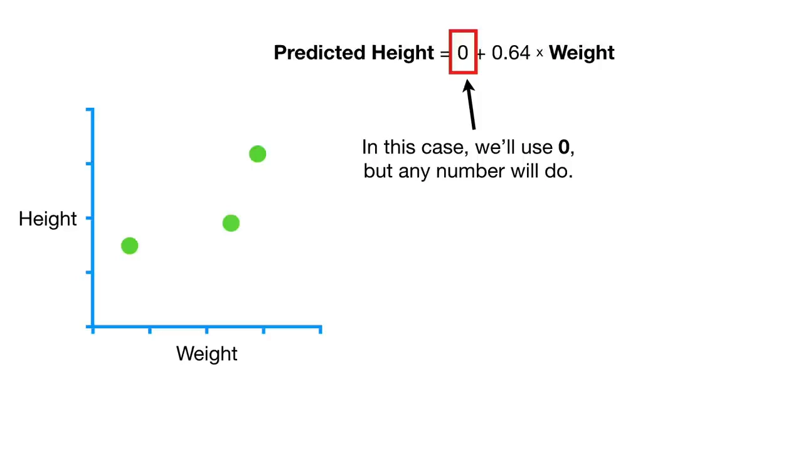
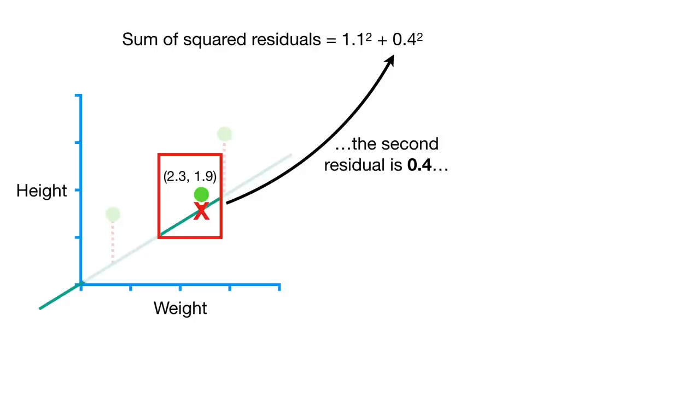
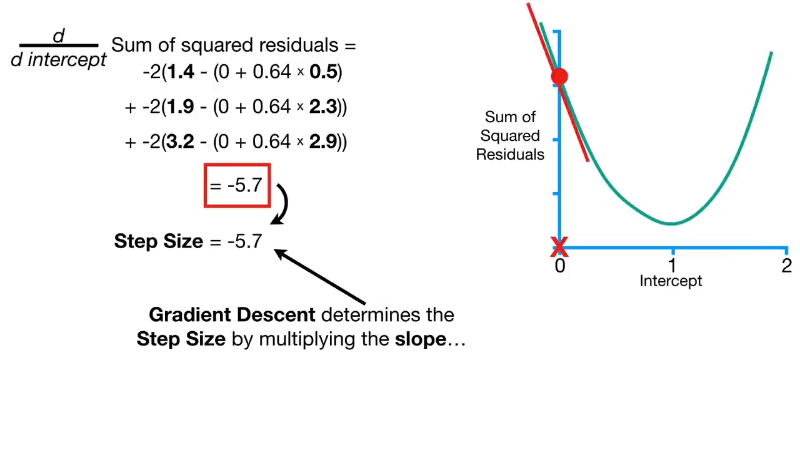
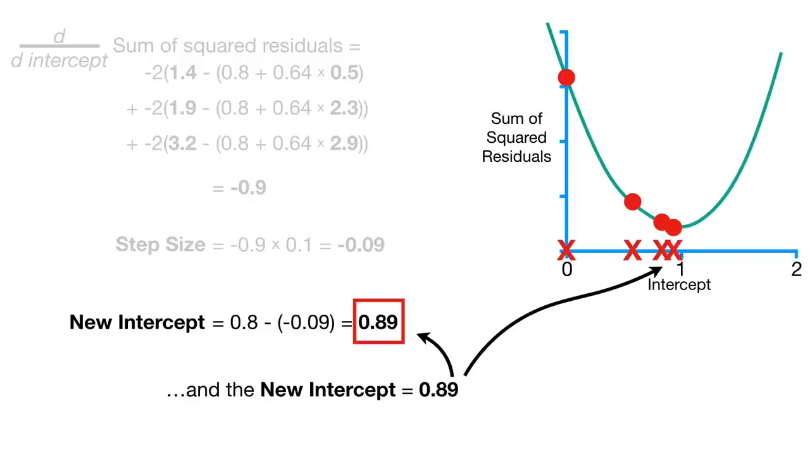
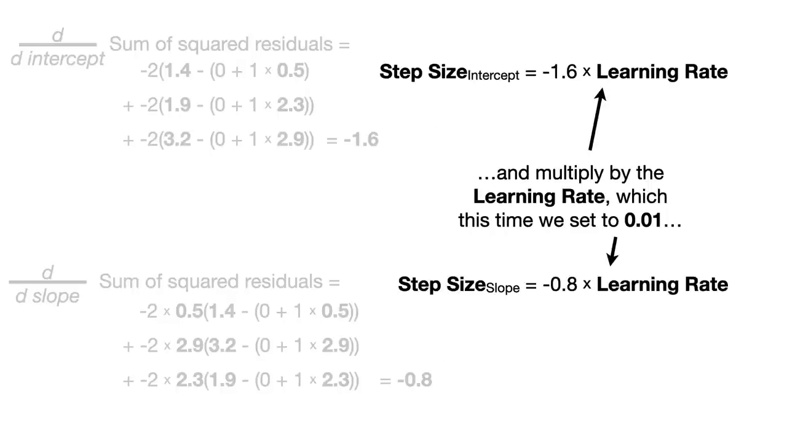
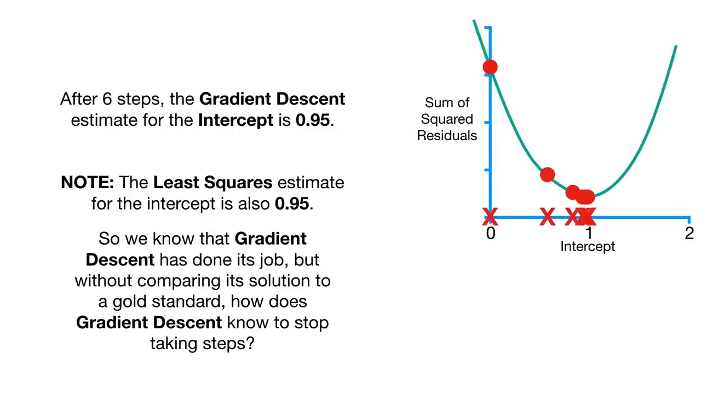
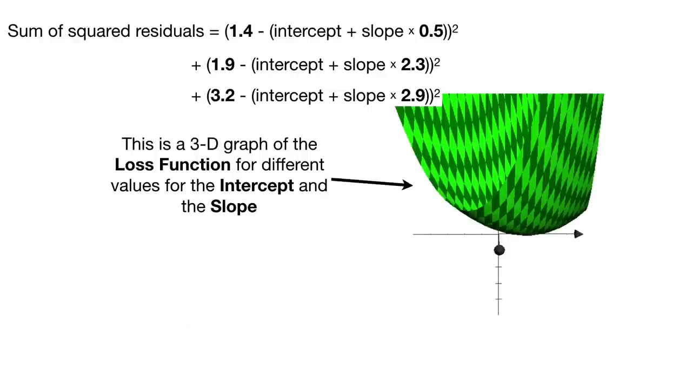

# 梯度下降：损失面上的步长、学习率与收敛

> 视频来源：[Gradient Descent, Step-by-Step](https://www.youtube.com/watch?v=sDv4f4s2SB8)（YouTube · StatQuest / Josh Starmer）｜时长约 24 分钟
> 导读：一支把梯度下降拆成"损失曲线 → 斜率 → 步长 → 新参数"四件事的入门讲解。本文只跟优化这条线走：不重推链式法则，重点看同一条损失面上步长怎么随斜率变小、学习率如何决定会不会跨过谷底，以及算法靠什么判断该停。

## 本讲要解决的核心问题（SCQA）

**背景**：线性回归、逻辑回归、t-SNE 都在做同一类事——调整一组参数，让某个"错得多离谱"的数值变小。这个数值就是损失函数；参数是自变量，损失是因变量。

**冲突**：损失函数写出来以后，参数的最优值并不会自己出现。网格搜索要试遍所有取值，参数一多就不可行；最小二乘能直接解出"导数为零"的点，但很多模型的损失函数根本解不出闭式解。

**疑问**：如果既不能穷举、也不能直接解方程，怎么从一个随便选的初始值出发，一步步走到损失最低的地方？每一步该迈多大？什么时候该停？

**回答（中心思想）**：**梯度下降把"找最低点"换成了"沿当前位置的负斜率走一小步"**。斜率（梯度）告诉你谷底在哪个方向、离得还有多远；步长等于斜率乘一个很小的系数——学习率。于是离谷底远时步子大、靠近时步子自动变小，直到步长小到可以忽略（或达到最大步数）就停。学习率决定的是"同样的斜率要放大成多大的步子"，太大可能一步跨过谷底，太小则要走很久；实践中常让它从大逐渐变小。

---

## 一、先把"拟合得好不好"写成一条曲线

### 1.1 一个参数：固定斜率，只优化截距

视频用一份很小的数据：三个人的体重（weight，横轴）和身高（height，纵轴）。拟合一条直线，就能用体重预测身高 [【跳转到 00:57】](https://www.youtube.com/watch?v=sDv4f4s2SB8&t=57)。

为了让例子先简单，讲解固定斜率为最小二乘给出的 0.64，只用梯度下降找**截距**（intercept）的最优值 [【跳转到 01:47】](https://www.youtube.com/watch?v=sDv4f4s2SB8&t=107)。第一步是随便给截距一个初始猜测，这里取 0——任何数都可以，它只是给算法一个可以改进的起点 [【跳转到 02:12】](https://www.youtube.com/watch?v=sDv4f4s2SB8&t=132)。

### 1.2 残差平方和：把每个点的误差合成一个数

有了直线，就逐点算**残差**：观测身高减去预测身高。第一个点体重 0.5、身高 1.4，代进直线得到预测 0.32，残差是 1.1；第二个点残差 0.4；第三个点残差 1.3。把三个残差各自平方再相加，得到**残差平方和** 3.1 [【跳转到 03:27】](https://www.youtube.com/watch?v=sDv4f4s2SB8&t=207)。

在机器学习里，残差平方和就是一种**损失函数**（loss function）：它把"这条线错得多离谱"压缩成一个可比较的数，越小越好 [【跳转到 02:37】](https://www.youtube.com/watch?v=sDv4f4s2SB8&t=157)。

### 1.3 换一个截距，就得到损失曲线上的另一个点

截距取 0 时损失是 3.1；取 0.25、0.5、…… 时又各有一个损失值。把"横轴是截距、纵轴是残差平方和"的点都画出来，就得到一条 U 形曲线 [【跳转到 03:52】](https://www.youtube.com/watch?v=sDv4f4s2SB8&t=232) [【跳转到 04:17】](https://www.youtube.com/watch?v=sDv4f4s2SB8&t=257)。

这条曲线就是本节反复说的**损失面**（一维情形下是一条曲线）。优化问题于是变成几何问题：在这条曲线上找最低点。注意，曲线上的每个点都对应"一整组参数下的模型"，不是某个数据点。

---

## 二、梯度下降：用斜率决定方向和步子

### 2.1 穷举太慢，而斜率已经告诉你谷底在哪边

一种笨办法是继续"代入—计算"，把截距的可能取值试个遍 [【跳转到 05:07】](https://www.youtube.com/watch?v=sDv4f4s2SB8&t=307)。梯度下降不这么做：它只在离最优值远时算几次、靠近时再多算几次，用"远时大步、近时小步"的方式逼近谷底 [【跳转到 05:32】](https://www.youtube.com/watch?v=sDv4f4s2SB8&t=332)。

为什么斜率能当路标？因为损失曲线在当前位置的斜率（导数）有两个信息：

- **符号**：斜率为负，说明往右走损失会下降；为正则要往左走。
- **大小**：斜率越陡，说明离谷底越远；越接近谷底，曲线越平，斜率越接近 0。

### 2.2 步长 = 斜率 × 学习率

把损失函数对截距求导，再把当前截距代进去，就得到该点的斜率 [【跳转到 07:12】](https://www.youtube.com/watch?v=sDv4f4s2SB8&t=432)。例如截距为 0 时斜率是 −5.7 [【跳转到 09:32】](https://www.youtube.com/watch?v=sDv4f4s2SB8&t=572)。

但斜率不能直接当步子：斜率是"每单位参数变化带来多少损失变化"，量纲和参数不同；而且如果按斜率原样迈步，陡峭处会迈得过大，反而把损失推高 [【跳转到 10:22】](https://www.youtube.com/watch?v=sDv4f4s2SB8&t=622)。所以梯度下降把斜率乘上一个很小的数，这个数就是**学习率**（learning rate）：

$$
\text{步长} = \text{斜率} \times \text{学习率}
$$

$$
\text{新参数} = \text{旧参数} - \text{步长}
$$

负号的作用是"往斜率的反方向走"：斜率为负时，减去一个负数等于往右走 [【跳转到 10:47】](https://www.youtube.com/watch?v=sDv4f4s2SB8&t=647)。

### 2.3 走一遍：步子为什么会自己变小

取学习率 0.1，从截距 0 出发：

| 步 | 当前截距 | 该点斜率 | 步长（斜率 × 0.1） | 新截距 |
| --- | --- | --- | --- | --- |
| 1 | 0 | −5.7 | −0.57 | 0.57 |
| 2 | 0.57 | −2.3 | −0.23 | 0.80 |
| 3 | 0.80 | −0.9 | −0.09 | 0.89 |
| 4 | 0.89 | — | — | 0.92 |
| 5 | 0.92 | — | — | 0.94 |
| 6 | 0.94 | — | — | 0.95 |

第一步从 0 跳到 0.57，一步就靠近了很多；之后斜率从 −2.3 降到 −0.9，步长也跟着从 0.23 缩到 0.09，越接近谷底步子越小 [【跳转到 11:12】](https://www.youtube.com/watch?v=sDv4f4s2SB8&t=672) [【跳转到 12:02】](https://www.youtube.com/watch?v=sDv4f4s2SB8&t=722) [【跳转到 12:52】](https://www.youtube.com/watch?v=sDv4f4s2SB8&t=772)。

六步之后截距是 0.95，而最小二乘的解析解也是 0.95——梯度下降没有解方程，却走到了同一个地方 [【跳转到 13:17】](https://www.youtube.com/watch?v=sDv4f4s2SB8&t=797)。

> 这里体现了梯度下降与最小二乘的分工：最小二乘直接找"斜率等于 0"的位置，要求能解方程；梯度下降只要求能算当前点的斜率，因此能用在解不出闭式解的损失函数上 [【跳转到 09:07】](https://www.youtube.com/watch?v=sDv4f4s2SB8&t=547)。

---

## 三、学习率：同一条曲线上的步子系数

### 3.1 学习率太大，会一步跨过谷底

学习率不是"越大越快"。在损失曲线上，步子迈得超过谷底宽度，参数就会落到另一侧更高的位置，下一步再往回跨，形成来回震荡，甚至越走越高 [【跳转到 10:22】](https://www.youtube.com/watch?v=sDv4f4s2SB8&t=622)。

反过来，学习率太小，每步只挪一点点，虽然稳定，却要很多步才到谷底。所以学习率控制的是**收敛速度与稳定性之间的取舍**，不是单纯的"快慢旋钮"。

### 3.2 参数变多后，同一个学习率可能突然不灵

视频随后把斜率也交给梯度下降，同时优化截距和斜率两个参数。这时仍从截距 0、斜率 1 出发，但学习率必须从 0.1 降到 0.01：用之前那个较大的学习率，走很多步也到不了正确答案 [【跳转到 19:59】](https://www.youtube.com/watch?v=sDv4f4s2SB8&t=1199) [【跳转到 20:11】](https://www.youtube.com/watch?v=sDv4f4s2SB8&t=1211)。

这说明梯度下降对学习率相当敏感，而且"合适的值"会随损失面形状、参数尺度变化，不能把一个任务上的学习率直接搬到另一个任务。

### 3.3 常见做法：先大后小

既然前期离谷底远、需要大步，后期靠近谷底、需要小步，一个自然的策略是让学习率随训练进行逐渐减小：开始时取较大值，之后每一步或每隔若干步调小一些 [【跳转到 20:36】](https://www.youtube.com/watch?v=sDv4f4s2SB8&t=1236)。很多实现会默认帮你做这件事，所以实践中不必把学习率当成必须手调到底的超参数；但一旦训练不收敛，学习率调度仍是首先要检查的设置。

> 学习率如何按余弦曲线衰减、动量与自适应尺度如何进一步改写更新式，属于后续"动量与 Adam"小节；本节只建立"步长 = 斜率 × 学习率"这一层。

---

## 四、收敛判据：什么时候停

梯度下降不可能无限走下去，它有两个停止条件 [【跳转到 13:42】](https://www.youtube.com/watch?v=sDv4f4s2SB8&t=822)：

1. **步长足够小**：当步长小于某个阈值（实践中常取 0.001 或更小）就停。由于步长 = 斜率 × 学习率，这等价于"斜率已经接近 0"，也就是走到了平坦的谷底附近。
2. **达到最大步数**：即使步长还不小，走满预设的最大步数（实践中常取 1000 或更多）也会停，避免死循环 [【跳转到 14:07】](https://www.youtube.com/watch?v=sDv4f4s2SB8&t=847)。

这里有一个容易混淆的点：**"停下来了"不等于"一定到了全局最优"**。步长趋零只说明当前点附近很平；如果损失面有多个局部低点，或者学习率设得不合适，算法可能停在半路。判断训练是否真的收敛，还要结合损失曲线的整体趋势，这属于"训练诊断"小节的范围。

---

## 五、从一条曲线到一张损失面

### 5.1 两个参数就是三维曲面

同时优化截距和斜率时，损失函数变成二元函数：横轴是截距、另一个横轴是斜率、纵轴是残差平方和，画出来是一张三维曲面 [【跳转到 15:59】](https://www.youtube.com/watch?v=sDv4f4s2SB8&t=959)。

这时"斜率"不再是一个数，而是每个参数方向上的偏导。把同一函数对多个参数分别求导，得到的一组偏导就叫**梯度**（gradient）[【跳转到 19:04】](https://www.youtube.com/watch?v=sDv4f4s2SB8&t=1144)。梯度指向损失上升最快的方向，所以更新时取它的反方向——这正是算法名字"梯度下降"的来源。

### 5.2 参数再多，流程不变

视频最后把梯度下降概括成五步 [【跳转到 22:15】](https://www.youtube.com/watch?v=sDv4f4s2SB8&t=1335) [【跳转到 22:40】](https://www.youtube.com/watch?v=sDv4f4s2SB8&t=1360)：

1. 对损失函数里每个参数求偏导，得到梯度；
2. 给所有参数取随机初值；
3. 把当前参数代入梯度；
4. 用"梯度 × 学习率"算出每个参数的步长；
5. 用旧参数减步长，得到新参数；回到第 3 步，直到步长足够小或达到最大步数。

参数从两个变成两千个，变的只是"多求几个偏导"，更新式的结构完全一样。也正因为每一步都要用**全部数据**算一次梯度，数据量大时这种"全批量"做法会很慢——这正是随机梯度与小批量要解决的问题，见同节的《小批量与随机梯度》。

---

## 小结

- **损失面**：固定模型形式后，参数是横轴、损失是纵轴；拟合问题变成在这张面上找最低点。
- **方向来自斜率**：斜率的符号决定往哪边走，大小反映离谷底还有多远。
- **步长 = 斜率 × 学习率**：学习率把斜率换算成参数实际移动的距离；新参数 = 旧参数 − 步长。
- **步长会自动变小**：越靠近谷底曲线越平，斜率越小，步长随之缩短；例子中六步从 0 走到 0.95，与最小二乘解一致。
- **学习率是取舍**：太大可能跨过谷底、震荡甚至发散；太小则收敛很慢。参数变多后同一个学习率可能失效，常见策略是让它从大逐渐变小。
- **停止条件**：步长小于阈值（等价于斜率接近 0），或达到最大步数；停下不等于保证全局最优。
- **多参数**：每个参数一个偏导，合起来是梯度；更新流程与单参数完全相同。

## 关键术语速查

| 术语 | 一句话解释 |
| --- | --- |
| 损失函数（loss function） | 把模型预测与观测的差距合成一个数，训练就是让它变小。 |
| 残差（residual） | 观测值减去预测值；残差平方和是最常用的一种回归损失。 |
| 损失面 / 损失曲线 | 以参数为横轴、损失为纵轴画出的曲面或曲线，最低点对应最优参数。 |
| 梯度（gradient） | 损失函数对各个参数的偏导组成的向量，指向损失上升最快的方向。 |
| 学习率（learning rate） | 把梯度换算成参数移动距离的系数，控制步子大小。 |
| 步长（step size） | 梯度乘学习率的结果，是本次参数实际移动的量。 |
| 收敛（convergence） | 迭代不再带来明显改进；实现上常以步长趋零或达到最大步数判定。 |
| 学习率调度（schedule） | 让学习率随训练进程按计划变化，常见做法是先大后小。 |
| 全批量（full batch） | 每一步都用全部训练数据计算梯度；稳定但数据量大时很慢。 |