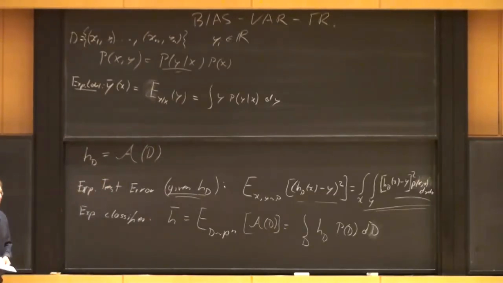
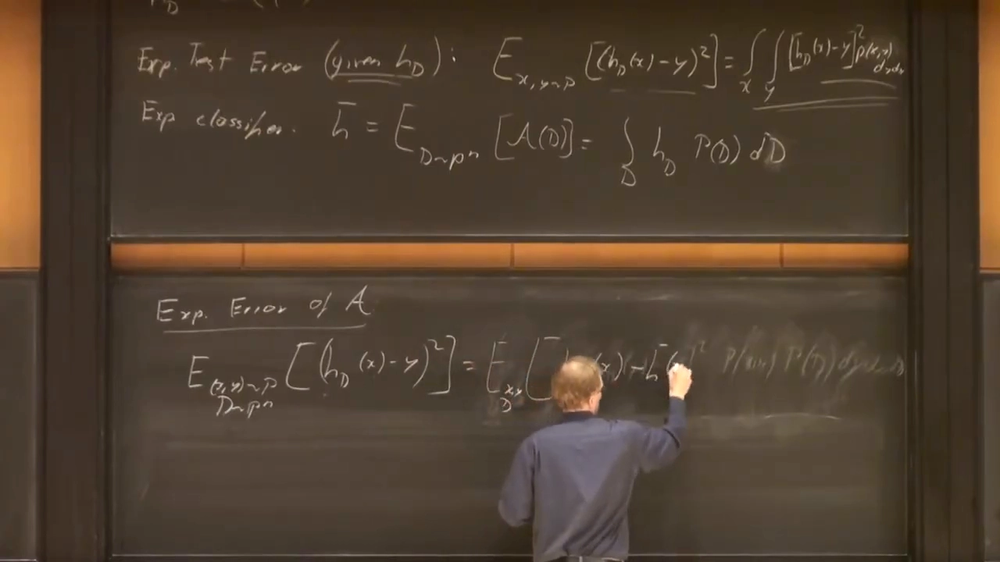
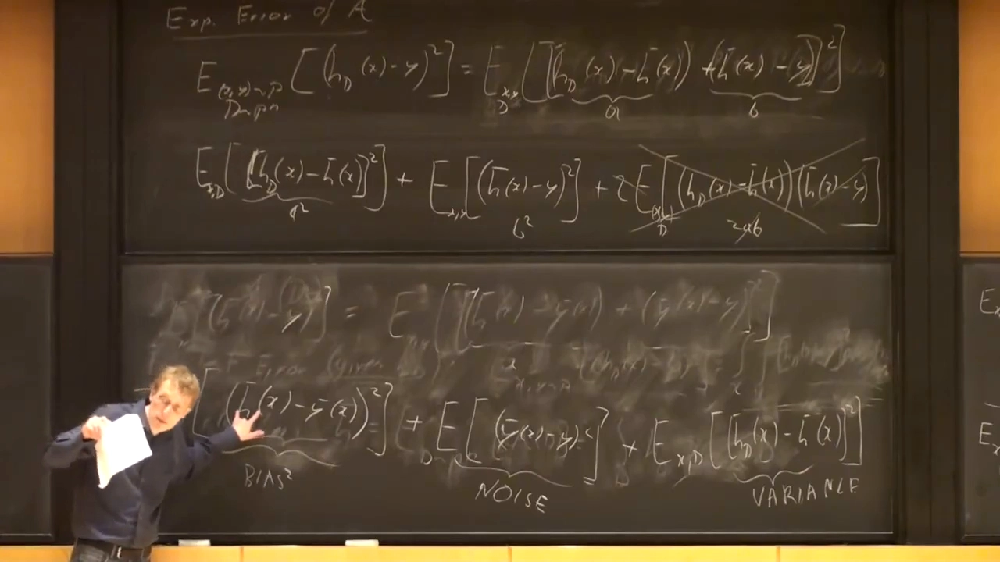

# 偏差—方差分解：泛化误差的方差、偏差平方与噪声

> 视频来源：[Machine Learning Lecture 19 "Bias Variance Decomposition" - Cornell CS4780 SP17](https://www.youtube.com/watch?v=zUJbRO0Wavo)（YouTube · Cornell CS4780 / Kilian Weinberger）｜时长约 51 分钟
> 导读：一支在黑板上一项一项推完偏差—方差分解的课。本文只跟这条推导走：先把"期望标签""期望分类器"两个对象定义清楚，再用两次"加一项、减一项"把算法的期望误差拆成方差、偏差平方与噪声，最后用飞镖盘把四种组合对应起来。容量、数据量与正则化的取舍留给同节《模型复杂度与测试误差》《学习曲线诊断》《容量、数据量与正则化》三篇。

## 本讲要解决的核心问题（SCQA）

**背景**：训练模型时我们手里只有一个能算的量——训练误差。于是常规做法是最小化训练误差，然后希望它在没见过的数据上也低。

**冲突**：训练误差低不等于泛化误差低；更麻烦的是，"泛化误差高"是一句笼统的话。误差高的时候，到底该换更复杂的模型、加更多数据、还是清洗标签？如果不知道误差由哪几块组成，就只能凭感觉试。

**疑问**：泛化误差能不能拆成几个来源清楚、各自含义明确的部分？每一部分由什么决定，又该用什么手段去减小？

**回答（中心思想）**：在平方损失、数据独立同分布的假设下，**一个算法的期望误差可以精确地拆成三项之和：方差 + 偏差平方 + 噪声**。方差来自"训练集是随机抽的"这件事——换一批数据，模型就变一点；偏差平方来自模型族本身的限制——即使有无限多数据、把噪声排除，模型仍会犯的错；噪声来自数据本身——同一个输入对应的标签本来就在波动，任何模型都消不掉。三项都是平方项，所以诊断的第一步是判断哪一项大，再针对它下手。

---

## 一、先把三个对象定义清楚

### 1.1 数据来自一个分布，同一个 x 可以有不同 y

设定和往常一样：有数据点 $(x_1,y_1),\dots,(x_n,y_n)$，它们从某个分布 $P(x,y)$ 中独立同分布地抽出来 [【跳转到 04:23】](https://www.youtube.com/watch?v=zUJbRO0Wavo&t=263)。这是机器学习几乎所有结论都依赖的假设；比如 $P$ 可以是"收件箱里邮件的分布"。

为了推导方便，这一讲只做回归，也就是 $y\in\mathbb{R}$；结论在一般情况下同样成立 [【跳转到 03:52】](https://www.youtube.com/watch?v=zUJbRO0Wavo&t=232)。

关键的一点是：**同一个 $x$ 未必对应唯一的 $y$**。比如 $x$ 描述一套房子——面积、卧室数、楼层等十个特征；特征完全相同的另一套房子，成交价可能不同 [【跳转到 05:13】](https://www.youtube.com/watch?v=zUJbRO0Wavo&t=313)。所以对固定的 $x$，$y$ 仍然有一个分布，也就是 $P(y\mid x)$。

### 1.2 回归里要预测的是"期望标签"

分类里我们有贝叶斯最优分类器；那么在回归里，给定 $x$ 该预测什么？答案是**期望标签** [【跳转到 05:57】](https://www.youtube.com/watch?v=zUJbRO0Wavo&t=357)：

$$
\bar y(x)=E_{y\mid x}[y]=\int y\,p(y\mid x)\,dy
$$

给定 $x$，$y$ 有多种可能；预测"平均而言会出现的那个 $y$"是合理的——把 $x$ 下所有可能的 $y$ 按概率加权积掉 [【跳转到 06:35】](https://www.youtube.com/watch?v=zUJbRO0Wavo&t=395)。$\bar y(x)$ 就是这一讲反复出现的**期望标签**，它是模型想要逼近的目标。

### 1.3 算法 A 与它输出的预测函数 h_D

机器学习算法 $A$ 吃进训练集 $D$，输出一个函数 $h_D$；$h_D$ 是假设（hypothesis），输入 $x$、输出一个预测值 [【跳转到 04:48】](https://www.youtube.com/watch?v=zUJbRO0Wavo&t=280)。比如 $A$ 可以是感知机，也可以是 SVM——$A$ 是"产生预测函数的那个过程"，$h_D$ 是它这一次的产物。

### 1.4 泛化误差：给定 h_D 的期望测试误差

有了 $h_D$，可以问它的期望误差是多少。训练误差只能在 $D$ 上量，我们真正关心的是新数据上的误差 [【跳转到 09:28】](https://www.youtube.com/watch?v=zUJbRO0Wavo&t=568)。用平方损失，它就是

$$
E_{x,y\sim P}\big[(h_D(x)-y)^2\big]
$$

注意这里的措辞：**期望测试误差是"给定 $h_D$"的**，条件在某个具体预测函数上 [【跳转到 09:47】](https://www.youtube.com/watch?v=zUJbRO0Wavo&t=587)。用平方损失有两个理由：回归里它很自然，而且推导会干净得多；换成绝对值损失结论原则上仍成立，但不会这么漂亮地拆成三项 [【跳转到 10:42】](https://www.youtube.com/watch?v=zUJbRO0Wavo&t=642)。

这个量原则上算不出来，只能采样估计；但它是我们想最小化的东西 [【跳转到 11:55】](https://www.youtube.com/watch?v=zUJbRO0Wavo&t=715)。

---

## 二、h_D 是随机变量，所以有"期望分类器"

### 2.1 训练集是随机变量

每个 $(x_i,y_i)$ 是随机变量，抽 $n$ 个得到 $D$，所以 $D$ 也是随机变量；把 $D$ 送进确定性的算法 $A$，得到的 $h_D$ 也是随机变量 [【跳转到 13:45】](https://www.youtube.com/watch?v=zUJbRO0Wavo&t=825)。于是存在一个"函数的分布"：换一批训练集，就得到略有不同的预测函数。

### 2.2 期望分类器 h̄

对这个分布取均值，就得到**期望分类器**（expected classifier）：

$$
\bar h=E_{D\sim P^n}\big[A(D)\big]=\int h_D\,P(D)\,dD
$$

它怎么估计？抽很多训练集，各自训练，再把输出平均；训练集足够多时由弱大数定律收敛到 $\bar h$ [【跳转到 15:25】](https://www.youtube.com/watch?v=zUJbRO0Wavo&t=925)。

要小心的是：$\bar h$ **不是数，是函数**——对每个 $x$ 输出一个值，即无数个预测函数的平均预测 [【跳转到 15:50】](https://www.youtube.com/watch?v=zUJbRO0Wavo&t=950)。它可以来自决策树这类非线性模型，不一定是线性的。另外，分类问题里"平均"不好定义，得取众数，这正是推导先做回归的原因 [【跳转到 16:35】](https://www.youtube.com/watch?v=zUJbRO0Wavo&t=1000)。

### 2.3 我们真正想评估的是算法 A

只谈某个 $h_D$ 的误差是不够的：你要选的是算法——固定的 SVM 输出一个预测函数，但你关心的是 SVM 这个流程好不好 [【跳转到 20:25】](https://www.youtube.com/watch?v=zUJbRO0Wavo&t=1225)。所以要把 $h_D$ 也积掉：

$$
E_{x,y\sim P,\;D\sim P^n}\big[(h_D(x)-y)^2\big]
$$

具体流程是：抽训练集 $D$ → 训练得到 $h_D$ → 抽测试点 $(x,y)$ → 算平方误差 → 取期望；重复很多次取平均，就是算法 $A$ 的泛化误差 [【跳转到 21:57】](https://www.youtube.com/watch?v=zUJbRO0Wavo&t=1317)。选算法时，我们想选的就是这个期望误差最低的那个 [【跳转到 23:37】](https://www.youtube.com/watch?v=zUJbRO0Wavo&t=1417)。

---

## 三、分解：两次"加一项、减一项"

### 3.1 第一次：加减 h̄(x)

分解只用两个技巧，各用两次：加一项减一项，然后让交叉项归零 [【跳转到 24:27】](https://www.youtube.com/watch?v=zUJbRO0Wavo&t=1467)。

先把 $(h_D(x)-y)^2$ 写成

$$
\big[(h_D(x)-\bar h(x))+(\bar h(x)-y)\big]^2
$$

也就是在括号里加 $\bar h(x)$ 再减 $\bar h(x)$，什么也没改变 [【跳转到 25:29】](https://www.youtube.com/watch?v=zUJbRO0Wavo&t=1529)。记 $a=h_D(x)-\bar h(x)$、$b=\bar h(x)-y$，展开成 $a^2+b^2+2ab$ [【跳转到 27:01】](https://www.youtube.com/watch?v=zUJbRO0Wavo&t=1601)。

### 3.2 交叉项为什么是零

交叉项是 $2E\big[(h_D(x)-\bar h(x))(\bar h(x)-y)\big]$。关键观察：$x,y$ 与 $D$ 独立，所以可以先对 $D$ 求期望 [【跳转到 31:01】](https://www.youtube.com/watch?v=zUJbRO0Wavo&t=1876)：

$$
E_D\big[h_D(x)-\bar h(x)\big]=\bar h(x)-\bar h(x)=0
$$

而 $(\bar h(x)-y)$ 里不含 $D$，对 $D$ 来说是常数，可以提出去。于是交叉项变成 $2\cdot 0\cdot(\bar h(x)-y)=0$，整项消失 [【跳转到 32:41】](https://www.youtube.com/watch?v=zUJbRO0Wavo&t=1940)。

![板书：交叉项归零后，误差只剩 E_D[(h_D-h̄)²] 与 E[(h̄-y)²] 两项](assets/偏差—方差分解：泛化误差的方差、偏差平方与噪声/02450.webp)

### 3.3 第二次：加减 ȳ(x)

现在误差剩两项：$E_D[(h_D(x)-\bar h(x))^2]+E_{x,y}[(\bar h(x)-y)^2]$。第一项已经是方差的形式，第二项还要再拆一次 [【跳转到 33:26】](https://www.youtube.com/watch?v=zUJbRO0Wavo&t=2006)。

对第二项加减期望标签 $\bar y(x)$，写成

$$
\big[(\bar h(x)-\bar y(x))+(\bar y(x)-y)\big]^2
$$

再展开。交叉项 $2E[(\bar h(x)-\bar y(x))(\bar y(x)-y)]$ 同样为零：对固定的 $x$，$\bar y(x)$ 是常数，$E_{y\mid x}[\bar y(x)-y]=0$ [【跳转到 36:42】](https://www.youtube.com/watch?v=zUJbRO0Wavo&t=2218)。这里 $x$ 与 $y$ 不独立，不能直接拆期望，但可以先对 $x$ 求期望、再对 $y\mid x$ 求期望，两者合起来等于对联合分布求期望 [【跳转到 38:26】](https://www.youtube.com/watch?v=zUJbRO0Wavo&t=2306)。

### 3.4 三项结果

把两项合起来，就得到这一讲的主结果 [【跳转到 40:52】](https://www.youtube.com/watch?v=zUJbRO0Wavo&t=2452)：

$$
\underbrace{E_{x,y,D}\big[(h_D(x)-y)^2\big]}_{\text{算法的期望误差}}
=
\underbrace{E_D\big[(h_D(x)-\bar h(x))^2\big]}_{\text{方差}}
+
\underbrace{(\bar h(x)-\bar y(x))^2}_{\text{偏差平方}}
+
\underbrace{E_{x,y}\big[(\bar y(x)-y)^2\big]}_{\text{噪声}}
$$

---

## 四、三项各自在说什么

### 4.1 方差：换一批训练集，预测抖多少

第一项 $E_D[(h_D(x)-\bar h(x))^2]$ 是**方差**。它和"预测对不对"无关，只问一件事：换一批训练集，同一个 $x$ 上的预测值会差多少 [【跳转到 41:17】](https://www.youtube.com/watch?v=zUJbRO0Wavo&t=2477)。两个训练集训练出两个模型，它们的预测差别越大，方差越大。

### 4.2 偏差平方：即使有无穷多数据仍会犯的错

第三项 $(\bar h(x)-\bar y(x))^2$ 叫**偏差平方**。它问的是：即使有无限多训练集、把噪声排除，模型还会错多少 [【跳转到 43:22】](https://www.youtube.com/watch?v=zUJbRO0Wavo&t=2602)。

比如真实关系是非线性的，你却在拟合一条直线。再多数据、再多次平均，模型仍然偏向那个特定解——**更多数据不会说服一个有偏的模型**，这就是偏差 [【跳转到 44:12】](https://www.youtube.com/watch?v=zUJbRO0Wavo&t=2652)。偏差可正可负，平方之后只剩大小，所以叫偏差平方 [【跳转到 45:02】](https://www.youtube.com/watch?v=zUJbRO0Wavo&t=2702)。

### 4.3 噪声：不可约的那部分

第二项 $E_{x,y}[(\bar y(x)-y)^2]$ 是**噪声**。同一个特征向量对应的标签时高时低，说明这个问题本身很难；你不可能比期望标签 $\bar y(x)$ 做得更好，所以这部分误差不可约 [【跳转到 42:07】](https://www.youtube.com/watch?v=zUJbRO0Wavo&t=2527)。

### 4.4 为什么三项都是平方

三项都是二次的：误差就是这三块之和，没有别的来源 [【跳转到 45:52】](https://www.youtube.com/watch?v=zUJbRO0Wavo&t=2752)。这一点直接决定了诊断方式：如果减错了项，误差不会明显下降。

---

## 五、飞镖盘：四种组合

讲者用飞镖盘做类比：靶心是期望标签，每一镖是一个训练集训练出的模型 [【跳转到 47:11】](https://www.youtube.com/watch?v=zUJbRO0Wavo&t=2831)。

- **低偏差低方差**：所有镖都扎在靶心，误差最小。
- **低偏差高方差**：镖的平均位置在靶心，但散布很大——平均下来是准的，每一镖都在抖 [【跳转到 49:39】](https://www.youtube.com/watch?v=zUJbRO0Wavo&t=2979)。
- **高偏差低方差**：镖非常集中，但整体偏在一边——手很稳，只是瞄错了地方 [【跳转到 50:19】](https://www.youtube.com/watch?v=zUJbRO0Wavo&t=3019)。
- **高偏差高方差**：既偏又散，平均位置是错的，每次还抖得厉害，最糟 [【跳转到 50:54】](https://www.youtube.com/watch?v=zUJbRO0Wavo&t=3054)。

飞镖盘只是类比：真实模型里你看不到"靶心"，只能通过验证集估计误差。所以下一件事是——怎么从数据判断自己处在哪一个格子里。

---

## 六、诊断顺序：先判断哪一项大

### 6.1 三项是相加的，减错项没用

数据科学家的任务很具体：如果模型不够准，先判断是偏差高还是方差高，再针对大的那一项下手 [【跳转到 46:17】](https://www.youtube.com/watch?v=zUJbRO0Wavo&t=2777)。现实中最常见的错误是：模型明明是偏差问题，却去降方差或降噪声 [【跳转到 46:42】](https://www.youtube.com/watch?v=zUJbRO0Wavo&t=2802)。因为三项相加，减错项不会让误差明显下降。

### 6.2 更多数据不会纠正偏差

偏差来自模型族的限制，方差来自训练集的随机性——这两句话给出了两种完全不同的"补救方向"：前者要改模型假设，后者要减少对具体训练集的依赖。讲者在这里只指出方向，具体手段（更灵活的模型、更多数据、正则化）留给后面的课 [【跳转到 46:17】](https://www.youtube.com/watch?v=zUJbRO0Wavo&t=2777)。

---

## 小结

- **期望标签** $\bar y(x)=E_{y\mid x}[y]$ 是回归要逼近的目标；同一个 $x$ 可以有不同 $y$，所以目标是条件期望而不是某个标签。
- **$h_D$ 是随机变量**：训练集随机，训练出的模型就随机；它的均值是期望分类器 $\bar h$，它的散布就是方差。
- **分解靠两次"加一项、减一项"**：交叉项因 $E_D[h_D]=\bar h$ 和 $E_{y\mid x}[\bar y]=y$ 的均值性质归零。
- **三项含义**：方差 = 换训练集的抖动；偏差平方 = 模型族的系统性偏离；噪声 = 数据本身的不可约波动。
- **飞镖盘**：低偏差低方差命中靶心；低偏差高方差散布大；高偏差低方差集中但偏离；两者都高最糟。
- **诊断顺序**：三项相加，先判断哪一项大再动手；更多数据不会纠正偏差。

## 关键术语速查

| 术语 | 一句话解释 |
| --- | --- |
| 期望标签 $\bar y(x)$ | 给定 $x$ 时 $y$ 的条件期望，是回归的理论目标。 |
| 期望分类器 $\bar h$ | 对无数训练集训练出的模型取平均得到的函数，逐点给出平均预测。 |
| 泛化误差 | 模型在从同一分布新抽的数据上的期望误差。 |
| 方差（variance） | 换一批训练集，预测值在同一个 $x$ 上抖动的幅度。 |
| 偏差平方（bias²） | 平均预测与期望标签的差距的平方；来自模型族的限制。 |
| 噪声（noise） | 同一 $x$ 下标签本身的波动，任何模型都无法消除。 |
| 不可约误差 | 噪声部分，是误差的下界。 |
| 平方损失 | 用 $(预测-观测)^2$ 度量误差，是本节分解成立的前提。 |
| 独立同分布（i.i.d.） | 样本从同一分布独立抽取，是整套推导的假设。 |