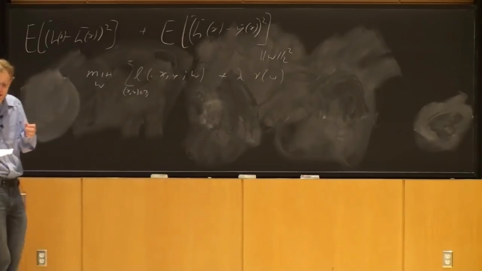
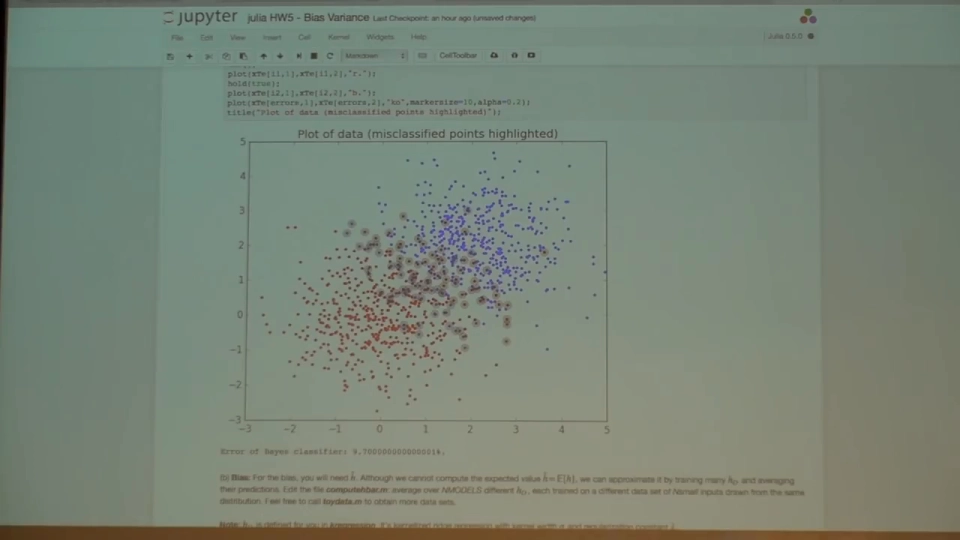
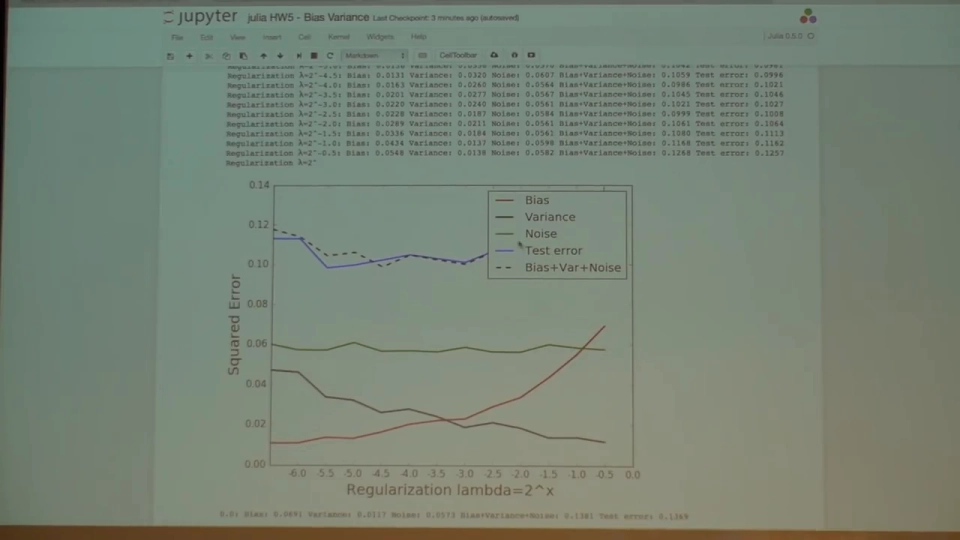
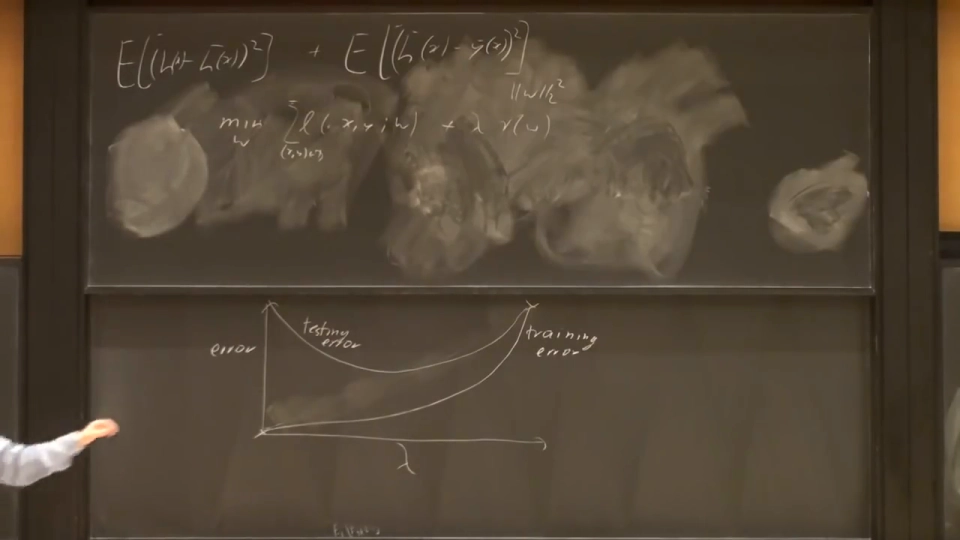
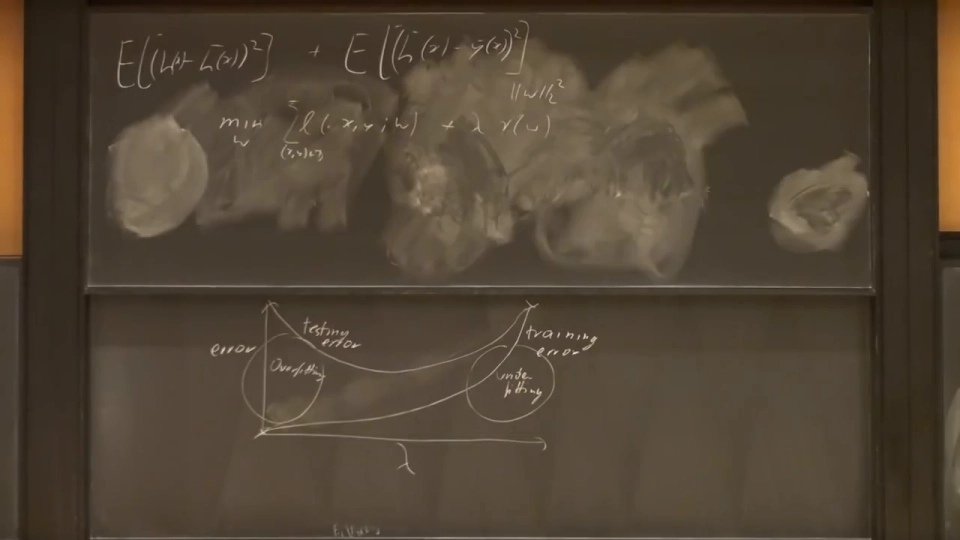
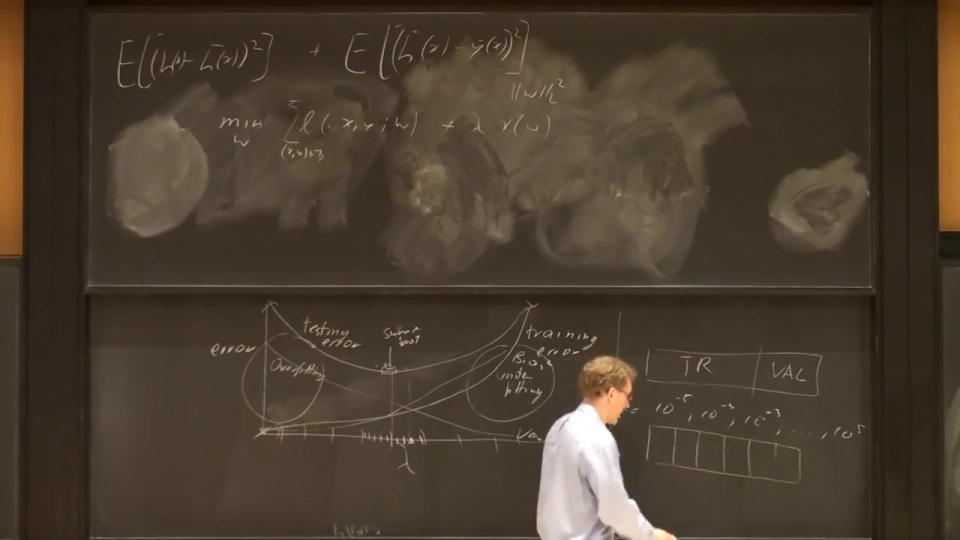
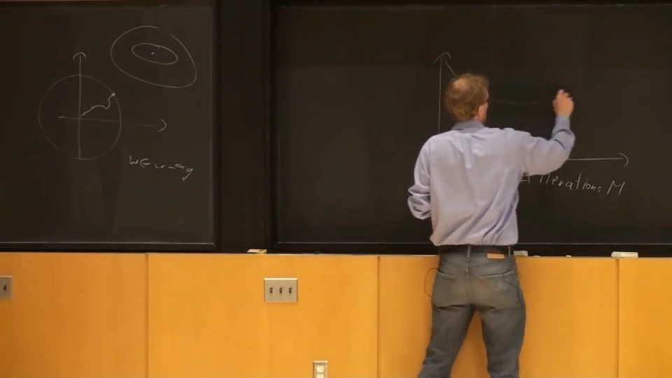
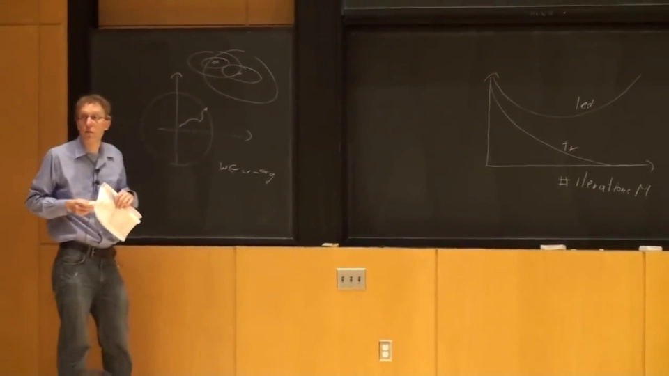

# 容量、数据量与正则化：偏差—方差权衡上的三个旋钮

> 视频来源：[Machine Learning Lecture 20 "Model Selection / Regularization / Overfitting" - Cornell CS4780 SP17](https://www.youtube.com/watch?v=65UJPA10dW8)（YouTube · Cornell CS4780 / Kilian Weinberger）｜时长约 47 分钟
> 导读：这是同节《偏差—方差分解》那堂课的下一次课。前半段把三项分解重新摆回桌面，并追问"每一项能不能人为去动"；后半段用一个已知分布上的模拟实验，把正则系数 λ 在一段范围内扫过，看偏差、方差、噪声各自怎么动，于是欠拟合与过拟合被定位成同一条 U 形曲线的两端。最后讲两件事：λ 只能在没参与拟合的数据上选；早停和 L2 正则其实是同一种"限制容量"的做法。交叉验证的细节、L1/L2 的公式与几何分别留给 2.2.5 与 2.2.6，本文只到"λ 怎么影响三项"为止。

## 本讲要解决的核心问题（SCQA）

**背景**：上一课把期望测试误差拆成了方差、偏差平方与噪声三项。知道误差由三块组成之后，最自然的问题是：这三块里，哪一块是我能动的？怎么动？

**冲突**：三项此消彼长。想把偏差压下去，就要让模型更灵活；模型更灵活，方差又上来了。反过来把模型压简单，方差下去了，偏差又起来。更麻烦的是，"泛化误差高"这句话本身不告诉你该往哪个方向动——是该加数据、换更复杂的模型，还是加正则化？

**疑问**：有没有一个统一的旋钮，能让我在偏差与方差之间连续移动，并且看清每一步落在曲线的哪个位置？这个旋钮与数据量、与"训练多久"又是什么关系？

**回答（中心思想）**：**正则系数 λ 就是这样一个旋钮**。在经验风险最小化里加上 λ 乘正则项之后，λ 从 0 增大到很大，等价于把模型容量从"任意灵活"连续压到"全零向量"：λ 小的一侧方差高、偏差低，叫过拟合；λ 大的一侧偏差高、方差低，叫欠拟合；测试误差在中间呈 U 形，最低点就是甜点。数据量是第二个旋钮，但它只压方差、不压偏差；训练迭代数是第三个旋钮，早停与 L2 正则在"限制参数范数"这件事上等价。三者动的是同一组三项，所以诊断的第一步永远是：先看清哪一项大。

---

## 一、把三项摆回桌面：谁可以被"人为去动"

### 1.1 方差：换一份训练集，分类器就变一点

把"抽数据集 D、再训练分类器"整体看成一个随机过程，那么抽到的分类器本身就是一个随机变量。**方差**衡量的是这些分类器相对它们均值的波动有多大 [【跳转到 02:00】](https://www.youtube.com/watch?v=65UJPA10dW8&t=120)。

这个量之所以重要，是因为它对应的正是"换一批数据重训一次，结论会不会变"这个实际问题。

### 1.2 数据量只压方差，不压偏差

有人问：如果每次都用同样大小的数据集，方差会怎样？讲者的回答给出了本节第一个关键结论：**数据集越大，方差越小** [【跳转到 05:38】](https://www.youtube.com/watch?v=65UJPA10dW8&t=338)。

理由很直观：采样十亿个点，再采样十亿个点，这两批数据不会差很多；不可能第一批全落在这个角落、第二批全落在那个角落 [【跳转到 05:13】](https://www.youtube.com/watch?v=65UJPA10dW8&t=313)。数据集很小时，不同数据集训练出的分类器差别很大；数据集很大时，再抽一批几乎得到同一批数据，分类器也就不再变化 [【跳转到 05:38】](https://www.youtube.com/watch?v=65UJPA10dW8&t=338)。

反过来，**加数据不会改变偏差**。偏差是对标签和训练集都取了期望之后的量，跟你的具体数据集 D 无关，只跟数据分布有关 [【跳转到 08:33】](https://www.youtube.com/watch?v=65UJPA10dW8&t=513)。所以"再多数据也救不了一个假设就错了的模型"不是修辞，而是分解的直接推论。

### 1.3 偏差：模型族的系统性限制

**偏差**是平均分类器 h̄ 与期望标签 ȳ 之间的差距。即使对无穷多个分类器取平均、有无限多数据，我们仍然打不中期望标签——因为我们做了数据并不满足的假设，比如假设数据线性可分，而它其实不是 [【跳转到 06:28】](https://www.youtube.com/watch?v=65UJPA10dW8&t=388)。

### 1.4 噪声：只能靠换特征空间或清洗数据去动

**噪声**衡量的是：即使你每次都百分之百命中 ȳ，仍然会有的误差，因为数据点本身的标签就在 ȳ 附近波动 [【跳转到 03:33】](https://www.youtube.com/watch?v=65UJPA10dW8&t=213)。

噪声看起来完全不可控，但讲者给了一个可操作的例外：ȳ 是 x 的函数，而 x 是由你的特征空间描述的。预测房价时，如果只有卧室数、卫生间数、面积三个特征，同一套房子的价格仍有很大分布；特征更细，就能把价格的细微差别抓出来，这部分误差随之下降 [【跳转到 07:43】](https://www.youtube.com/watch?v=65UJPA10dW8&t=463)。所以三项都不是天生给定的，数据科学家可以影响每一项 [【跳转到 08:08】](https://www.youtube.com/watch?v=65UJPA10dW8&t=488)。

### 1.5 三项都是平方项，所以是"打地鼠"式的权衡

有意思的地方在于：加特征把偏差压小，方差可能变大，就像打地鼠——按下一个，另一个冒出来 [【跳转到 09:23】](https://www.youtube.com/watch?v=65UJPA10dW8&t=563)。你不可能把某一项压到零而其他项不动，这永远是一个权衡，所以叫**偏差—方差权衡** [【跳转到 09:48】](https://www.youtube.com/watch?v=65UJPA10dW8&t=588)。

好在你还有主动权：每一项都是平方项，所以总有一项占主导。很可能偏差很大、另外两项很小；因为平方关系，你可以大幅降低偏差而只让方差升一点。通常你权衡的就是方差和偏差：压下一个，另一个会升，但不必升同样多 [【跳转到 10:13】](https://www.youtube.com/watch?v=65UJPA10dW8&t=613)。

---

## 二、λ 是容量的旋钮：经验风险加正则项

### 2.1 目标函数：训练损失加 λ 乘正则项

讲者把上一课的图重新画成今天要用的形式：回到经验风险最小化，最小化关于参数 W 的、对所有样本求和的损失函数，再加上 λ 乘一个正则项，通常就是 L2 范数 [【跳转到 23:28】](https://www.youtube.com/watch?v=65UJPA10dW8&t=1408) [【跳转到 24:08】](https://www.youtube.com/watch?v=65UJPA10dW8&t=1448)：

$$
\min_{w}\ \sum_{(x,y)\in S} \ell\big(x,y;w\big)\;+\;\lambda\,\|w\|_2^2
$$

### 2.2 两个极端：λ=0 只最小化训练误差，λ→∞ 得到全零向量

λ 的作用可以直接从目标函数读出来。

- **λ 等于 0**：优化完全不看正则项，只优化训练集上的损失，所以训练误差一定非常低——因为我们除了最小化训练误差什么都没做 [【跳转到 25:33】](https://www.youtube.com/watch?v=65UJPA10dW8&t=1533)。
- **λ 非常大**：正则项完全主导，优化目标变成"找一个简单的解"，极端情况就是全零向量 [【跳转到 25:53】](https://www.youtube.com/watch?v=65UJPA10dW8&t=1553)。全零向量和随机猜差不多，训练误差会很高 [【跳转到 26:06】](https://www.youtube.com/watch?v=65UJPA10dW8&t=1566)。

也就是说，λ 是一个连续的**容量旋钮**：它不改变模型族的形式，只改变"允许多大的参数、多复杂的解"。这正是本节学习目标里"容量"的可操作定义。

---

## 三、模拟实验：把 λ 从强扫到弱，三项各自怎么动

### 3.1 设定：已知分布，所以三项都能精确算

这个实验从已知分布 P 里抽数据，也就是扮演上帝。通常我们不知道分布，但这样我们可以精确控制并计算每一项 [【跳转到 12:01】](https://www.youtube.com/watch?v=65UJPA10dW8&t=721)。

具体设定是两个高斯分布，红色一类、蓝色一类。知道分布就可以用贝叶斯最优分类器；它标出的灰圈点就是它会判错的点 [【跳转到 12:26】](https://www.youtube.com/watch?v=65UJPA10dW8&t=746)。

因为两个分布有重叠：一个蓝点按位置更可能是红色，贝叶斯最优分类器就会判成红色，尽管它实际是蓝色。这个例子里它犯 9.7% 的错 [【跳转到 12:51】](https://www.youtube.com/watch?v=65UJPA10dW8&t=771)。**这 9.7% 就是噪声**：这部分你永远做不对 [【跳转到 13:16】](https://www.youtube.com/watch?v=65UJPA10dW8&t=796)。

实验里唯一改变的量是正则系数 λ，写成 2 的幂；越往右正则化越强，正则化越强就越是在强迫分类器变简单 [【跳转到 15:24】](https://www.youtube.com/watch?v=65UJPA10dW8&t=924)。

### 3.2 三条曲线：偏差升、方差降、噪声平

跑出来的图里，红线是偏差，黑线是方差，绿线是噪声；三项相加得到虚线，虚线很接近蓝线，而蓝线是实际误差。两者不完全一样，是因为为了跑得快只采样了 100 个分类器 [【跳转到 16:14】](https://www.youtube.com/watch?v=65UJPA10dW8&t=974)。

图上有两个趋势，正好对应两端的失效模式：

- **正则化越强，偏差越大**：偏差解释的误差份额越来越大，因为模型太简单了 [【跳转到 17:29】](https://www.youtube.com/watch?v=65UJPA10dW8&t=1049)。
- **正则化越弱，方差越大**：测试误差里很大一部分来自它在死记训练集，所以不同分类器之间差别很大 [【跳转到 18:44】](https://www.youtube.com/watch?v=65UJPA10dW8&t=1124)。

噪声则与 λ 无关：λ 只是建模假设，噪声是数据的函数，所以基本是常数，只是每次都被重新估计一遍 [【跳转到 19:34】](https://www.youtube.com/watch?v=65UJPA10dW8&t=1174)。

### 3.3 甜点：方差已经低、偏差还没大到拖垮模型

作为数据科学家，你要找的是最低点：方差已经低、偏差又还没大到把模型拖垮的那个位置，也就是甜点 [【跳转到 19:59】](https://www.youtube.com/watch?v=65UJPA10dW8&t=1199)。

这里要注意一个容易被忽略的细节：**甜点的位置不是普适常数**。它取决于真函数长什么样、噪声有多大、你手里有多少数据。实验里能画出这条曲线，是因为我们扮演上帝知道了分布；现实中只能靠留出数据去估。

---

## 四、欠拟合与过拟合，就是偏差与方差的两个极端

### 4.1 训练误差随 λ 单调上升，测试误差呈 U 形

把刚才的三项换回"训练误差 / 测试误差"两条线，形状更容易记 [【跳转到 26:58】](https://www.youtube.com/watch?v=65UJPA10dW8&t=1618)：

- **训练误差**：λ 增大、正则化增强，训练误差只会单调上升 [【跳转到 27:25】](https://www.youtube.com/watch?v=65UJPA10dW8&t=1645)。λ=0 时它最低，λ→∞ 时它最高。
- **测试误差**：λ 太小时测试误差高，中间有一个甜点，λ 太大就是正则化过度、测试误差又升上去 [【跳转到 27:12】](https://www.youtube.com/watch?v=65UJPA10dW8&t=1632)。

### 4.2 两个名字：左边叫过拟合，右边叫欠拟合

讲者在 U 形曲线上直接标了两个名字：λ 太小的一端叫**过拟合**，λ 太大的一端叫**欠拟合** [【跳转到 27:34】](https://www.youtube.com/watch?v=65UJPA10dW8&t=1654)。

这张图就是本节最需要记住的对应关系：

| 现象 | 偏差—方差语言 | 在 λ 轴上的位置 | 训练误差 | 测试误差 |
| --- | --- | --- | --- | --- |
| 过拟合 | 方差高、偏差低 | λ 太小（容量太大） | 很低 | 高 |
| 欠拟合 | 偏差高、方差低 | λ 太大（容量太小） | 高 | 高 |
| 拟合合适 | 两项都不占主导 | 甜点附近 | 中等 | 最低 |

### 4.3 过拟合 = 高方差：在记忆训练集里过于具体的细节

讲者对过拟合给了一个很具体的刻画：**过拟合就是方差高**，意思是我们在记忆训练集里过于具体的细节 [【跳转到 29:49】](https://www.youtube.com/watch?v=65UJPA10dW8&t=1789)。

例子是学生和教师的照片分类：如果学生的照片碰巧大多在树前、教师的照片大多在楼前，这纯属巧合，但分类器会抓住它，因为它在这份数据里确实成立，却无法泛化 [【跳转到 30:29】](https://www.youtube.com/watch?v=65UJPA10dW8&t=1829)。换一份数据，这个"规律"就消失了——这正是方差：结论随训练集而变。

### 4.4 欠拟合 = 高偏差：连见过的训练点都分不对

欠拟合的情形正相反：它在训练集上就很差，连见过的数据点都分不对 [【跳转到 30:49】](https://www.youtube.com/watch?v=65UJPA10dW8&t=1849)。

原因可以落回容量：比如正则化过度，分类器被限制在一个小球里，表达力不够，连每个训练点都拟合不了 [【跳转到 31:14】](https://www.youtube.com/watch?v=65UJPA10dW8&t=1874)。换成偏差—方差语言，就是偏差占了主导，而方差因为模型太简单反而很小。

### 4.5 一个校准用的极端：贝叶斯最优分类器的偏差与方差都是零

为了确认三项的含义没搞反，讲者拿贝叶斯最优分类器做校准：它根据分布算出来，跟训练集没有关系，所以**方差是零** [【跳转到 21:24】](https://www.youtube.com/watch?v=65UJPA10dW8&t=1284)；在回归里它对每个 x 都正好输出 ȳ(x)，所以**偏差也是零** [【跳转到 22:37】](https://www.youtube.com/watch?v=65UJPA10dW8&t=1357)。

剩下的就只有噪声 [【跳转到 21:54】](https://www.youtube.com/watch?v=65UJPA10dW8&t=1314)——连贝叶斯最优分类器也躲不掉的那部分，去不掉 [【跳转到 23:23】](https://www.youtube.com/watch?v=65UJPA10dW8&t=1403)。这个极端说明：**容量不是越大越好，也不是越小越好；上限由噪声封顶，下限由偏差决定。**

---

## 五、λ 只能在没参与拟合的数据上选

### 5.1 训练/验证切分 + 网格搜索

λ 是模型的超参数，它平衡这个权衡。那怎么找最好的 λ？最常用的办法是交叉验证，做法很简单，人们也把它叫网格搜索 [【跳转到 31:19】](https://www.youtube.com/watch?v=65UJPA10dW8&t=1879)：把训练集切成训练和验证两部分 [【跳转到 31:58】](https://www.youtube.com/watch?v=65UJPA10dW8&t=1918)，试一大堆不同的 λ，每个 λ 记录一次验证误差，挑误差最低的那个 [【跳转到 31:58】](https://www.youtube.com/watch?v=65UJPA10dW8&t=1918)。

实际做的时候不必均匀撒点，常用**望远镜式搜索**：先按数量级试 λ=10^-5、10^-4、…、10^5，弄清合适的量级在哪里 [【跳转到 33:03】](https://www.youtube.com/watch?v=65UJPA10dW8&t=1983)，再在这个量级附近细试十个值，挑最好的那个 [【跳转到 33:22】](https://www.youtube.com/watch?v=65UJPA10dW8&t=2002)。

### 5.2 危险：你会在验证集上过拟合

试非常多的 λ 有一个危险：你会不知不觉地在验证集上过拟合 [【跳转到 33:59】](https://www.youtube.com/watch?v=65UJPA10dW8&t=2039)。有些 λ 可能只是恰好在这份验证集上表现好；验证集只有几百个点，你只错了五个，多错一个误差就从 5% 变成 6%，但那只多错了一个点，这真的可靠吗 [【跳转到 34:24】](https://www.youtube.com/watch?v=65UJPA10dW8&t=2064)？

所以要非常小心：验证集太小时，很容易做出不稳定的决定，验证误差低但并不泛化到真正的测试集 [【跳转到 34:32】](https://www.youtube.com/watch?v=65UJPA10dW8&t=2072)。注意这与过拟合训练集是同一件事的两种表现——**只要一个量被反复用来做选择，它就会开始被过拟合**。

### 5.3 k 折与留一：把每个点都用上一次

缓解办法是 k 折交叉验证：把数据分成 K 份，每次用 K-1 份训练、留一份做验证，正好做 K 次 [【跳转到 35:26】](https://www.youtube.com/watch?v=65UJPA10dW8&t=2126)。好处是估计准得多，而且能得到标准差，知道它在不同验证集上波动多大 [【跳转到 35:51】](https://www.youtube.com/watch?v=65UJPA10dW8&t=2151)。

K 取样本数就是留一交叉验证，估计非常精确，唯一的问题是慢，所以数据集很小时常用 [【跳转到 37:35】](https://www.youtube.com/watch?v=65UJPA10dW8&t=2255)。测试集则只能碰一次，那是你向老板汇报的数字，是对误差的真实估计 [【跳转到 36:17】](https://www.youtube.com/watch?v=65UJPA10dW8&t=2177)。

> k 折、分层、嵌套交叉验证与超参数选择的完整讨论见 2.2.5；本节只需要记住一条：**λ 的选择必须发生在没参与拟合的数据上，否则 U 形曲线的最低点是假的。**

---

## 六、早停：不加正则项也能限制容量

### 6.1 早停是什么

抑制过拟合的一种办法是正则化，另一种非常常用的是早停 [【跳转到 38:44】](https://www.youtube.com/watch?v=65UJPA10dW8&t=2324)。早停的意思就是字面意思：它是优化过程的一部分，你找参数向量 W 时不优化到底，而是提前停下 [【跳转到 39:09】](https://www.youtube.com/watch?v=65UJPA10dW8&t=2349)。

### 6.2 与 L2 正则的等价：玻璃墙 vs 走一段就停

讲者说正则化和早停之间有很深的联系，并让学生先自己想。答案其实一句话：**两种做法都在控制我们到底把损失函数最小化到什么程度** [【跳转到 42:46】](https://www.youtube.com/watch?v=65UJPA10dW8&t=2566)。

从正则化的视角看，是在 L2 球的边界上停住，不让你再往外走 [【跳转到 42:51】](https://www.youtube.com/watch?v=65UJPA10dW8&t=2571)：我们从某个 W 出发，想走到损失函数的谷底，而正则化相当于在周围立了一堵玻璃墙，极小值点往下走、撞到玻璃墙就出不去 [【跳转到 43:06】](https://www.youtube.com/watch?v=65UJPA10dW8&t=2586)。

从早停的视角看，是你往前走、往前走，然后停下 [【跳转到 43:20】](https://www.youtube.com/watch?v=65UJPA10dW8&t=2600)。

### 6.3 为什么等价：范数随迭代慢慢长大

换个角度算一遍就清楚了：从零向量出发，第一步是 W 变成 W 减去 α 乘梯度，而 α 是非常小的数，所以一开始你加上的是一个很小的向量，范数很小 [【跳转到 44:02】](https://www.youtube.com/watch?v=65UJPA10dW8&t=2642)。随着迭代越来越多，范数会慢慢长大；而正则化是直接给范数设一个上限 [【跳转到 44:27】](https://www.youtube.com/watch?v=65UJPA10dW8&t=2667)。

所以两者的关系非常清楚：**迭代越多，等于正则化越弱** [【跳转到 44:48】](https://www.youtube.com/watch?v=65UJPA10dW8&t=2688)。早停的"迭代次数"和正则化的"λ"是同一根轴的两个刻度，方向相反。

### 6.4 早停下的两条曲线与方差视角

这时测试误差的形状和 λ 那张图一样，但训练误差长这样：迭代越多，训练集上错得越来越少，因为那正是我们在最小化的东西 [【跳转到 44:54】](https://www.youtube.com/watch?v=65UJPA10dW8&t=2694)。一开始拟合到的东西能泛化到测试点，但到某个时刻，我们开始学到不再泛化的东西，就过拟合了 [【跳转到 45:13】](https://www.youtube.com/watch?v=65UJPA10dW8&t=2713)。

从方差角度看会更清楚：如果有两个不同的数据集，两个损失函数的极小值位置会略有差别 [【跳转到 45:48】](https://www.youtube.com/watch?v=65UJPA10dW8&t=2748)。开始阶段方差非常小，因为只走几步梯度下降，参数几乎不受数据集影响，它们都朝同一个大方向走 [【跳转到 46:00】](https://www.youtube.com/watch?v=65UJPA10dW8&t=2760)；而迭代越多，我越来越精确地落到这份数据集的极小值上，而不是另一个训练集的极小值 [【跳转到 46:22】](https://www.youtube.com/watch?v=65UJPA10dW8&t=2782)。所以最小化得越多，这些解之间的方差就越大 [【跳转到 46:32】](https://www.youtube.com/watch?v=65UJPA10dW8&t=2792)。

---

## 七、把三个旋钮放在一起

到这里，本节学习目标里的三样东西可以合成一张表。三个旋钮动的是同一组三项，方向各不相同：

| 旋钮 | 往"更强"的方向拧 | 方差 | 偏差 | 典型症状 |
| --- | --- | --- | --- | --- |
| 容量（模型灵活度、特征数） | 更灵活、更多特征 | ↑ | ↓ | 训练误差极低、测试误差高 |
| 数据量 | 更多样本 | ↓ | 不变 | 训练/测试都低但差距大 |
| 正则化（λ、早停的迭代数倒数） | λ 更大 / 更早停 | ↓ | ↑ | 训练误差本身就高 |

由此得到三条可以直接用的判断：

1. **训练误差很低、测试误差很高**：方差占主导。先加数据（只压方差），或加正则化 / 早停（压容量）；不要换更复杂的模型。
2. **训练误差本身就高**：偏差占主导。加正则化只会更糟；该做的是加特征、换更灵活的模型族，或检查假设是否成立。
3. **两个误差都低、但差距明显**：先确认数据量与分布一致性，再谈调参——因为噪声那一项是任何模型都消不掉的，别把噪声当偏差去追。

一句话总结本讲：**偏差—方差分解告诉你误差由哪几块组成；λ 与早停是把"容量"这根轴连续调节的两个刻度；数据量只作用在方差那一块。** 诊断的顺序永远是先看哪一项大，再决定拧哪个旋钮。

---

## 关键术语速查

| 术语 | 含义 |
| --- | --- |
| 方差（variance） | 换一份训练集重训，分类器相对平均分类器的波动；数据量增大时下降 |
| 偏差（bias） | 平均分类器与期望标签之差；模型族假设带来的系统性偏离，加数据不消除 |
| 噪声（noise） | 同一 x 上标签本身的波动；连贝叶斯最优分类器也躲不掉 |
| 容量（capacity） | 模型能表达多复杂的解；在本文里由 λ 连续调节 |
| 正则化（regularization） | 在损失上加 λ 乘参数范数，用"简单解"换更小的方差 |
| 早停（early stopping） | 不把损失最小化到底，提前返回参数；与 L2 正则同属"限制范数" |
| 过拟合 | 方差高、偏差低：记忆训练集里过于具体的细节 |
| 欠拟合 | 偏差高、方差低：模型太简单，连训练点都拟合不了 |
| 甜点（sweet spot） | 测试误差 U 形曲线的最低点，位置取决于真函数、噪声与数据量 |