# 嵌套交叉验证：把模型选择与性能估计分开

> 视频来源：[You Should Probably Be Doing Nested Cross-Validation](https://www.youtube.com/watch?v=DuDtXtKNpZs)（YouTube · PyData Miami 2019，讲者 Sergey Feldman）｜时长约 24 分钟
> 导读：一场把"选模型"和"报性能"当成两件不同任务的演讲。讲者先说明为什么"最低的验证误差"是个有偏的估计，再用图解和 scikit-learn 代码演示嵌套交叉验证的结构、代价与适用规模。本文只讲选择偏差与嵌套结构；k 折、分层、分组等切分变体的机制见同小节的另一篇。

## 本讲要解决的核心问题（SCQA）

**背景**：交叉验证已经是标准做法。我们拿它挑超参数、比较模型，然后把"最好的那个模型"的交叉验证分数写进报告。

**冲突**：讲者指出这里混进了两个不同的目标——**选出一个最好的模型**，和**估计这个模型将来有多好**。前者用验证数据挑选，后者却还想用同一批验证数据回答。问题在于，报出来的数字是"所有候选里最小的那个误差"，而**最小值天然偏低**：它不只是某个模型的成绩，还包含了"这个模型在这一批数据上运气好"的成分 [【跳转到 03:47】](https://www.youtube.com/watch?v=DuDtXtKNpZs&t=227)。

**疑问**：为什么"最小的那个"不能当作它真实水平的估计？如果既要选、又要估，数据该怎么分？

**回答（中心思想）**：**选择与估计必须用两套互不重叠的数据**。最朴素的做法是训练/验证/测试三分：验证集选模型，测试集只评一次。当数据不够做三分时，用**嵌套交叉验证**——外层把数据切成若干"测试折"，每个外层训练块内部再做一次 k 折交叉验证来完成选择，最后只用外层测试折打分。代价是计算量乘以外层折数，换来的是 n 个独立的性能估计，而不是一个。嵌套交叉验证**不会让你选出更好的模型**，它只让"这个模型有多好"这句话更可信 [【跳转到 01:03】](https://www.youtube.com/watch?v=DuDtXtKNpZs&t=63)。

---

## 一、两个目标，一套数据，冲突从这里开始

讲者把机器学习流程里的一小段单独拿出来，定义了两个目标 [【跳转到 00:31】](https://www.youtube.com/watch?v=DuDtXtKNpZs&t=31)：

1. **选模型**：手上有一堆候选（不同超参数、不同模型族），要挑一个最好的上线，或者向别人解释它为什么好。
2. **估性能**：估计这个被选中的模型上线后会有多好。

两个目标都必要，但**同时做很难**。原因不是技术细节，而是统计上的：一旦用同一批数据既做挑选又做评估，评估结果就被挑选动作污染了。

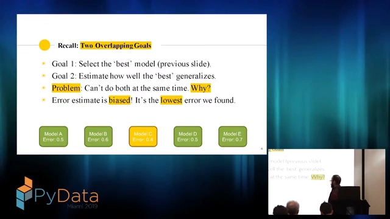

---

## 二、训练误差只能发现欠拟合，发现不了过拟合

讲者先从一个理想化的图开始：真实函数是一条曲线，我们采样到一些点，拟合一条线。有时拟合得刚好，有时明显欠拟合（该用多项式却用了直线），有时明显过拟合（用了十二阶多项式去穿每一个点）[【跳转到 01:33】](https://www.youtube.com/watch?v=DuDtXtKNpZs&t=93)。

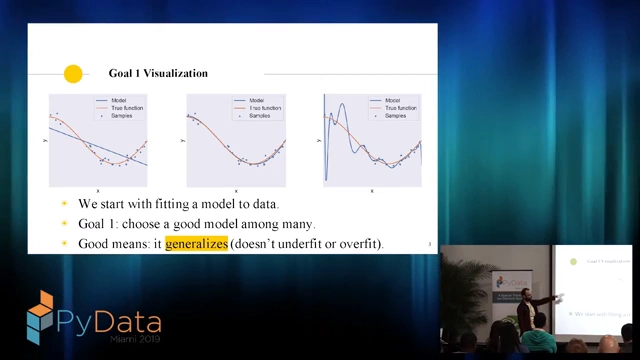

现实里没有这种图可看，只能靠数字选模型。而**训练误差是误导性的** [【跳转到 02:23】](https://www.youtube.com/watch?v=DuDtXtKNpZs&t=143)：

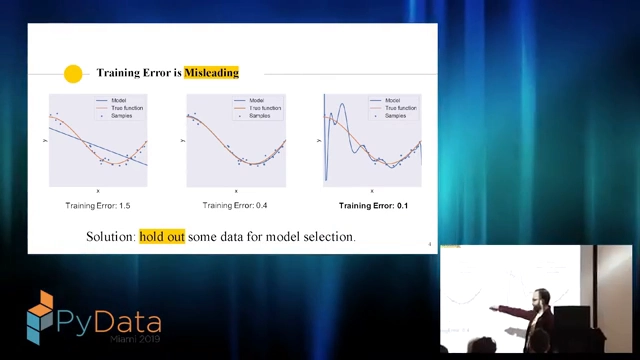

- 训练误差**大**，能说明欠拟合——模型连训练数据都没学会；
- 训练误差**小**，什么也说明不了——模型可能只是把训练数据记住了。

所以第一步永远是：**留出一部分数据不参与拟合，专门用来评估和选择** [【跳转到 02:42】](https://www.youtube.com/watch?v=DuDtXtKNpZs&t=162)。如果数据没有结构就随机切，如果是时间序列就按时间切（周一到周五训练、周末验证）。

---

## 三、用验证集挑模型，挑出来的分数是有偏的

### 3.1 流程本身没错，错在拿它当性能估计

标准的做法是：切出训练集和验证集，在训练集上拟合所有候选模型，在验证集上打分，选误差最低的那个 [【跳转到 03:01】](https://www.youtube.com/watch?v=DuDtXtKNpZs&t=181)。

**作为"选择"这一步，它完全合法**——讲者强调这不是错误做法。问题出在下一步：我们往往顺手把"最低的那个验证误差"当成这个模型未来的表现。这个数字是偏低的，因为它是**我们从一堆数里挑出的最小值** [【跳转到 03:26】](https://www.youtube.com/watch?v=DuDtXtKNpZs&t=206)。

### 3.2 把泛化误差当成随机变量

要看清偏在哪里，得换个视角：**一个模型的泛化误差不是一个固定数字，而是一个随机变量**。数据是从一个我们看不到的真实分布里抽样出来的，换一批样本，同一个模型的误差就会变。所以每个模型都对应一条误差分布，分布的中心才是它"真正的"泛化误差 [【跳转到 04:17】](https://www.youtube.com/watch?v=DuDtXtKNpZs&t=257)。

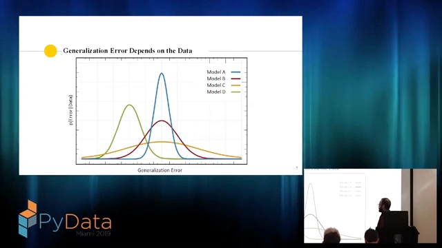

我们做的事情，本质上是从每条分布里各抽一个样本（用某一次切分算出的验证误差），然后挑最小的那个样本。**如果恰好抽中的就是中心最低的模型，这个样本还算个不错的估计；如果运气让我们挑错了一个中心较高的模型，这个样本对它的真实水平就是严重低估** [【跳转到 05:07】](https://www.youtube.com/watch?v=DuDtXtKNpZs&t=307)。

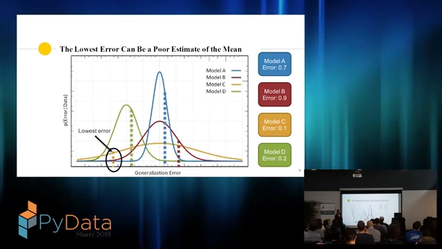

讲者的结论很直接：我们不知道这些分布的形状和宽度，所以不能赌"挑中的就是最好的"。**必须再留一手** [【跳转到 05:45】](https://www.youtube.com/watch?v=DuDtXtKNpZs&t=345)。

---

## 四、训练/验证/测试三分：把"选"和"估"分开

最传统的解法是把数据切成三份 [【跳转到 06:08】](https://www.youtube.com/watch?v=DuDtXtKNpZs&t=368)：

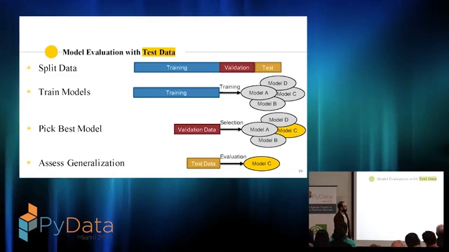

图中的四步就是全部逻辑：

1. 切出训练、验证、测试三块；
2. 在训练集上逐个拟合候选模型；
3. 在验证集上打分，选出最好的那个（这里是 Model C）；
4. **只把这一个模型**拿到测试集上评估——这个数字才是可报告的性能估计。

代码上就是调用两次 `train_test_split`：先切出测试集，再把剩下的切成训练和验证 [【跳转到 06:42】](https://www.youtube.com/watch?v=DuDtXtKNpZs&t=402)。

```python
X_trval, X_test, y_trval, y_test = train_test_split(X, y, test_size=0.2)
X_train, X_val, y_train, y_val = train_test_split(X_trval, y_trval, test_size=0.25)

for depth in [3, 5, 10, None]:          # 候选超参数
    clf = RandomForestClassifier(max_depth=depth).fit(X_train, y_train)
    errors[depth] = error(y_val, clf.predict(X_val))   # 只用于"选"

best = min(errors, key=errors.get)      # 选择步骤，不看这个误差的绝对值
final = RandomForestClassifier(max_depth=best).fit(X_trval, y_trval)
test_error = error(y_test, final.predict(X_test))       # 唯一可报告的数字
```

注意最后一步：选定超参数后，模型要在**训练+验证**上重新拟合，再拿去测测试集 [【跳转到 07:48】](https://www.youtube.com/watch?v=DuDtXtKNpZs&t=468)。验证集已经完成了它的使命，可以并回训练数据。

---

## 五、k 折解决验证集的切分方差，但测试集还是只有一个

三分法还有一个毛病：验证集只有一份，分数依赖那次随机切分。讲者的处理方式和"为什么要交叉验证"完全一样——**多切几次** [【跳转到 08:14】](https://www.youtube.com/watch?v=DuDtXtKNpZs&t=494)。

5 折交叉验证把训练数据分成五份，每份轮流当一次验证集，同一个模型被拟合五次，得到五个误差，取平均 [【跳转到 08:44】](https://www.youtube.com/watch?v=DuDtXtKNpZs&t=524)。

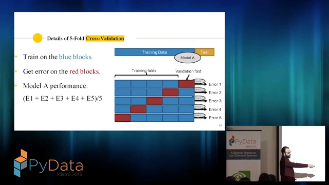

把这一步嵌进流程，就得到常见的"k 折 + 测试集"结构：训练数据整体进入 k 折盒子，盒子输出每个候选模型的平均交叉验证误差，据此选出 Model C，最后在从未参与任何选择的测试集上评估一次 [【跳转到 09:37】](https://www.youtube.com/watch?v=DuDtXtKNpZs&t=577)。

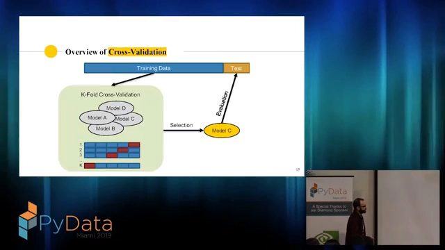

代码上 `GridSearchCV` 把"分折、拟合、选参数"全包了，选定后自动在全部训练数据上重拟合 [【跳转到 10:14】](https://www.youtube.com/watch?v=DuDtXtKNpZs&t=614)：

```python
from sklearn.model_selection import GridSearchCV

grid = {"max_depth": [3, 5, 10, None]}
clf = GridSearchCV(RandomForestClassifier(), grid, cv=5)   # 内层 5 折
clf.fit(X_train, y_train)
test_error = error(y_test, clf.predict(X_test))
```

但讲者立刻追问：**测试集本身也只有一份**，换一份测试集，结论会不会变？[【跳转到 11:04】](https://www.youtube.com/watch?v=DuDtXtKNpZs&t=664) 既然验证集的方差问题要靠多切几次解决，测试集的方差问题没有理由不管。

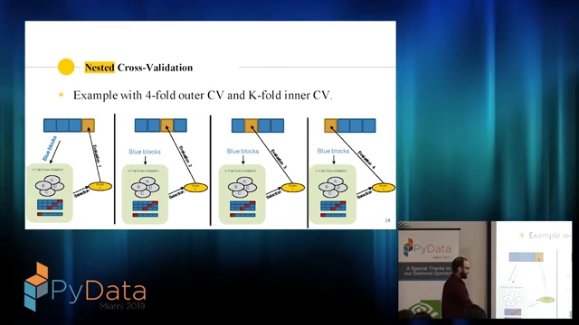

---

## 六、嵌套交叉验证：外层评估，内层选择

### 6.1 结构

把同样的思路再套一层：外层做 n 折，每一折的外层训练块内部再做一次 k 折交叉验证完成选择，选出的模型只在**这一折的外层测试块**上评估 [【跳转到 11:38】](https://www.youtube.com/watch?v=DuDtXtKNpZs&t=698)。

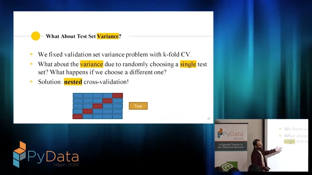

讲者把它说成"在循环上再套一个循环"：以前只有一个 k 折盒子加一个固定测试集，现在让**每一块数据都轮流当一次测试集** [【跳转到 11:47】](https://www.youtube.com/watch?v=DuDtXtKNpZs&t=707)。整个流程重复 n 次，就得到 n 个互不重叠的测试块上的 n 个分数。

```python
from sklearn.model_selection import cross_val_score, GridSearchCV

inner = GridSearchCV(RandomForestClassifier(), grid, cv=5)   # 内层：选择
nested_scores = cross_val_score(inner, X, y, cv=4)           # 外层：评估
```

`cross_val_score` 接受的"估计器"本身就可以是一个 `GridSearchCV`——于是外层交叉验证每折都会在内部重新跑一遍完整的调参流程 [【跳转到 15:35】](https://www.youtube.com/watch?v=DuDtXtKNpZs&t=935)。代码只多两行，语义却完全不同：**内层负责选，外层负责估，两层的数据不重叠**。

### 6.2 代价

如果外层 n 折、内层 k 折、候选模型 m 个，总共要拟合 n×k×m 次；普通"k 折 + 测试集"只需 k×m 次 [【跳转到 13:01】](https://www.youtube.com/watch?v=DuDtXtKNpZs&t=781)。

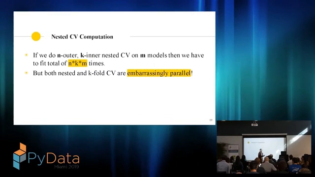

讲者的态度很务实：如果原来要跑五小时，现在要跑二十小时，可能无法接受；但这类计算彼此独立，多花钱就能换回一个可靠得多的估计。

### 6.3 得到的不是一个模型，而是 n 个

嵌套交叉验证还有一个容易被忽略的后果：每个外层折都可能选出**不同的**最优模型，于是你手上有了 n 个模型和 n 个性能估计 [【跳转到 13:18】](https://www.youtube.com/watch?v=DuDtXtKNpZs&t=798)。这看起来麻烦，其实带来了两个好处：

- **有方差信息**：n 个分数之间的差异，直接告诉你模型表现对数据切分有多敏感；单次测试集给不了这个信息 [【跳转到 14:33】](https://www.youtube.com/watch?v=DuDtXtKNpZs&t=873)。
- **可以集成**：如果 n 个模型各不相同，把它们集成起来相当于对"遇到什么样的数据"做了对冲；如果它们高度一致，说明这个选择很稳 [【跳转到 15:05】](https://www.youtube.com/watch?v=DuDtXtKNpZs&t=905)。

### 6.4 一个具体的数字

讲者在一个玩具数据集上跑了 4 折外层 + 内层调参，得到的四个误差是 `[0.03, 0.05, 0.06, 0.00]` [【跳转到 16:00】](https://www.youtube.com/watch?v=DuDtXtKNpZs&t=960)。

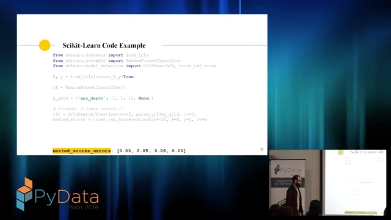

这正是要点：如果只做一次切分，你可能恰好落在 0.00 那一折，于是以为模型完美；也可能落在 0.06，于是低估。四个数摆在一起，你才知道"这个模型大概在 0–6% 误差之间，取决于数据"。

---

## 七、什么时候用哪一种

讲者给了一张按数据规模选方案的速查表 [【跳转到 16:50】](https://www.youtube.com/watch?v=DuDtXtKNpZs&t=1010)：

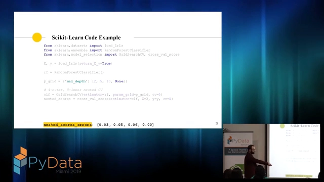

| 数据规模 | 建议 | 讲者给的理由与例子 |
| --- | --- | --- |
| 小数据 | **总是嵌套交叉验证** | 几乎没有理由不做，只有好处。例：医学数据，几千位病人、几十到几百个特征 |
| 中等数据 | 看情况 | 模型快（sklearn、XGBoost）且等得起 → 嵌套；深度学习或算力不足 → 普通 k 折 + 测试集。例：十万行、约一千个特征 |
| 大数据 | 单次训练/验证/测试切分 | 例：五百万样本、ImageNet。验证集本身已经足够大 |

大数据为什么可以偷懒？因为验证误差是验证集上所有样本误差的**平均**。样本量足够大时，这个平均已经很接近真实均值，换一批样本也差不多 [【跳转到 21:11】](https://www.youtube.com/watch?v=DuDtXtKNpZs&t=1271)。但这个论证有一个前提：**验证集必须能代表真实分布**。讲者举了个反例——如果一百万样本全来自周二，而现实发生在周日，那再大的验证集也没用 [【跳转到 21:29】](https://www.youtube.com/watch?v=DuDtXtKNpZs&t=1289)。ImageNet 之所以成立，是因为它的数据是人工收集并随机划分的。

在问答里，讲者还补充了折数的选择：他倾向把外层和内层都取大一些（比如 10 和 10），因为超参数是在"训练集占 9/10"这个条件下选出来的；如果内层只有 3 折，训练集只占 2/3，选出的学习率等参数在数据量变大后可能不再适用 [【跳转到 22:35】](https://www.youtube.com/watch?v=DuDtXtKNpZs&t=1355)。代价是 10×10 的组合会非常贵，所以中等数据上"偷懒"是可以接受的。

---

## 八、小结

- **两个目标要分开**：选模型用验证数据，报性能要用另一套没参与选择的数据；把"最低的验证误差"当性能估计，会系统性偏低。
- **泛化误差是随机变量**：每个模型有一条分布，挑最小值等于挑"运气好的样本"，可能严重低估真实水平。
- **三分是最小可行方案**：训练拟合、验证选择、测试只评一次；选定后模型要在训练+验证上重拟合。
- **k 折解决验证集的切分方差**：每份数据轮流当验证集，误差取平均；但测试集仍只有一份。
- **嵌套交叉验证把同一逻辑再套一层**：外层 n 折做评估，内层 k 折做选择，两层数据不重叠；代价是计算量乘 n，但完全可并行。
- **它不改善模型选择，只改善性能估计**，并额外给出 n 个分数之间的方差信息。
- **按数据规模选方案**：小数据总是嵌套；中等数据看算力；大数据用单次三分，前提是验证集足够大且能代表真实分布。

## 关键术语速查

| 术语 | 一句话解释 |
| --- | --- |
| 模型选择 | 在候选模型/超参数中挑一个最好的；允许使用验证数据，但不产生可报告的性能数字 |
| 性能估计 | 回答"这个模型上线后有多好"；必须用没有参与任何选择的数据 |
| 选择偏差 | 因为用同一批数据既挑又评，报出的分数系统性偏低（乐观） |
| 泛化误差分布 | 同一模型在不同数据抽样下的误差构成一个分布，其中心才是"真实"水平 |
| 留出验证集 | 从训练数据中切出、用于选择的那部分；用一次切分时分数依赖切分 |
| k 折交叉验证 | 把训练数据分 k 份轮流当验证集，误差取平均，降低切分带来的方差 |
| 嵌套交叉验证 | 外层 n 折评估、内层 k 折选择；每折的测试块从未参与该折的选择 |
| 外层/内层 | 外层负责"估"，内层负责"选"；两层的数据划分互不重叠 |
| 计算代价 | 外层折数 × 内层折数 × 候选模型数 次拟合，但各次拟合彼此独立、可并行 |