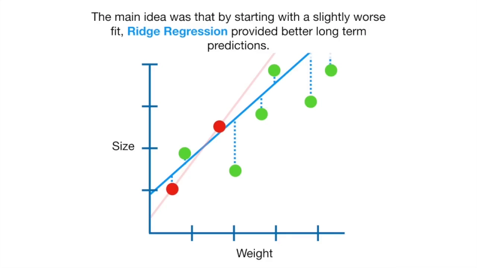
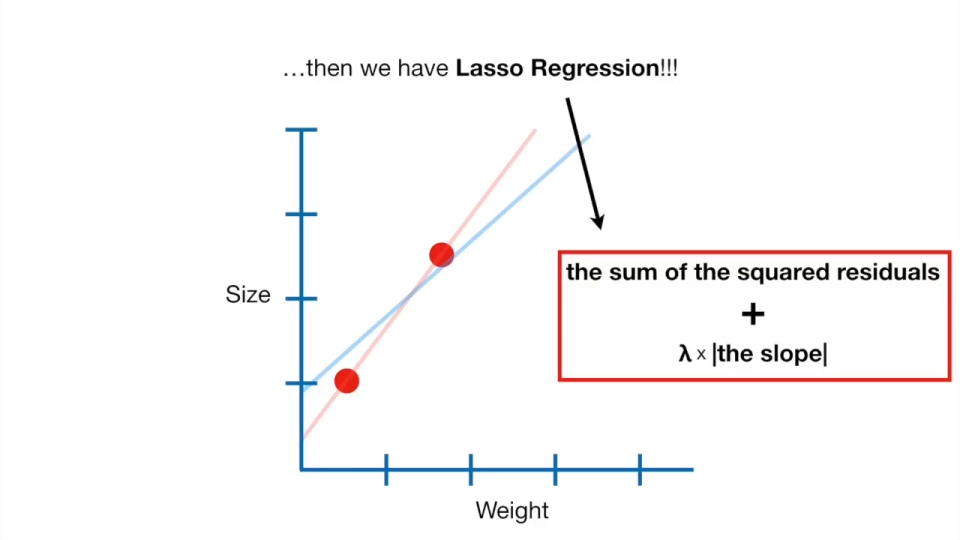
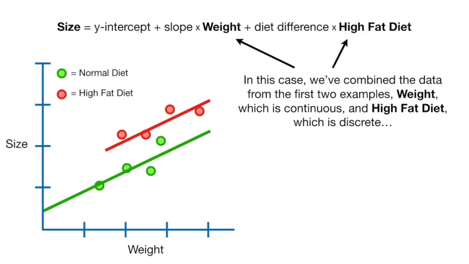
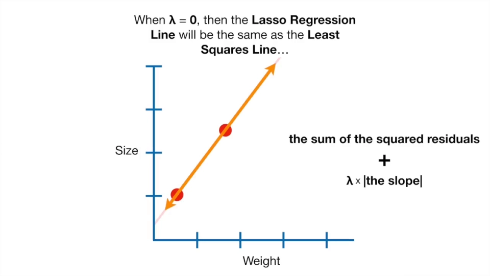
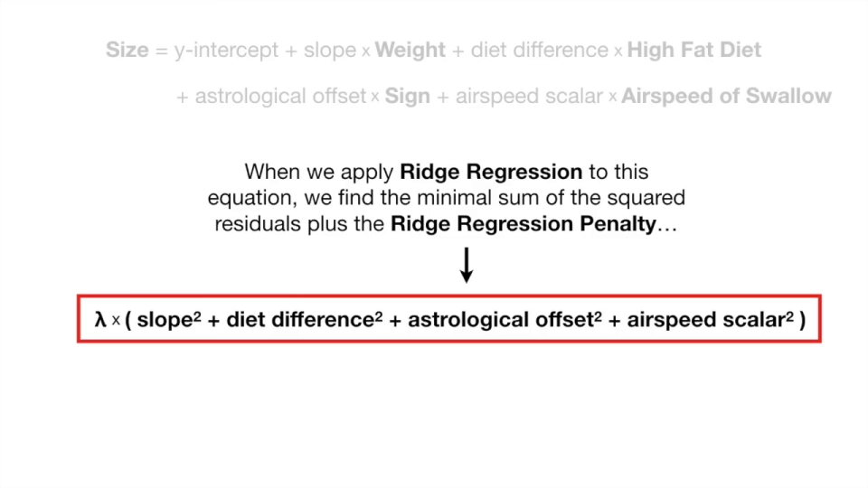
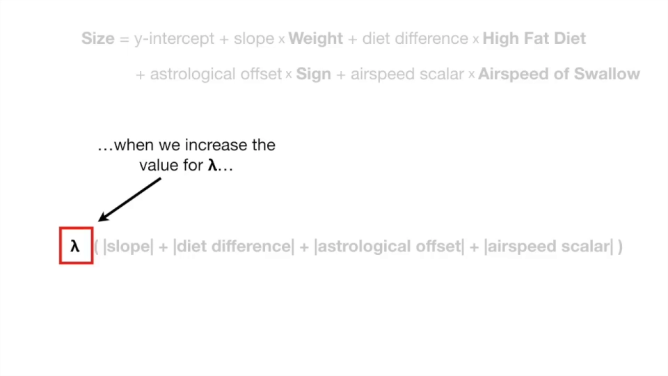
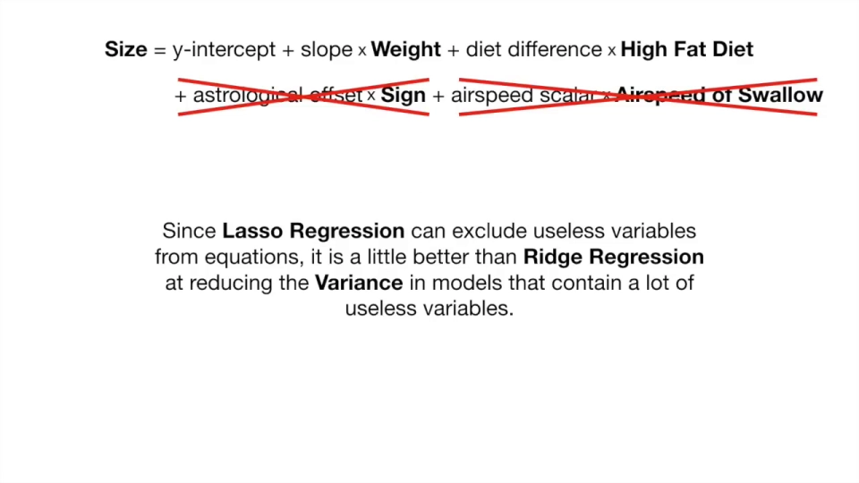
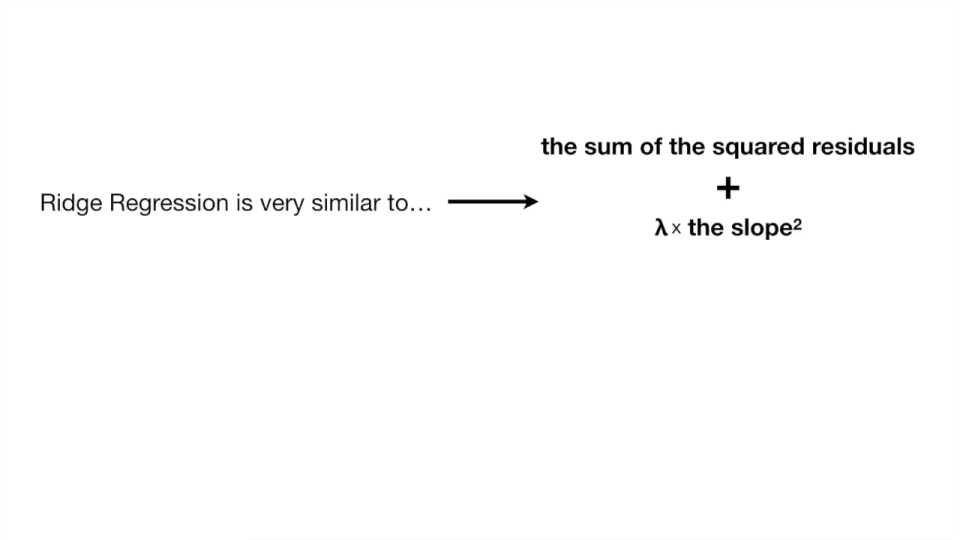

# Lasso（L1）：绝对值惩罚、系数归零与变量选择

> 视频来源：[Regularization Part 2: Lasso (L1) Regression](https://www.youtube.com/watch?v=NGf0voTMlcs)（YouTube · StatQuest，讲者 Josh Starmer）｜时长约 8 分钟
> 导读：这支视频是岭回归那支的续集，沿用同一组小鼠数据。它先快速复习岭回归"用一点偏差换方差下降"的主线，然后把惩罚项里的平方换成绝对值，得到 Lasso。两者的关键差别只有一个：岭回归只能把系数渐近压向 0，Lasso 可以把系数压到正好等于 0，于是无用变量被整项剔除，模型变简单、也更容易解释。两篇需连读，本文不重复岭回归的推导。

## 本讲要解决的核心问题（SCQA）

**背景**：岭回归已经解决了小样本下最小二乘方差过大的问题：在残差平方和上加 λ×斜率平方，把斜率收缩，用一点偏差换方差下降。

**冲突**：岭回归的收缩是"渐近"的——λ 再大，系数也只是越来越接近 0，永远不等于 0。于是一个装满无用变量的方程，即使做了岭回归，方程里仍然留着所有这些项，只是系数很小。模型没有变简单，解释性也没有改善。

**疑问**：能不能让惩罚项直接把无用变量的系数压到 0，把它们从方程里删掉？

**回答（中心思想）**：把惩罚项里的平方换成绝对值，就得到 Lasso。这个看似很小的改动带来性质上的差别：**Lasso 能把系数压到正好等于 0**，于是无用变量整项消失，模型只留下有用变量。代价是 Lasso 的偏差行为与岭回归不同：无用变量很多时 Lasso 降方差更好，而多数变量都有用时岭回归通常略好。λ 同样由交叉验证选定。

---

## 一、先复习岭回归：同一组数据、同一笔交换

视频开头把岭回归的例子压缩重讲一遍 [【跳转到 00:28】](https://www.youtube.com/watch?v=NGf0voTMlcs&t=28)。小鼠的体重与体型数据被分成训练集（红点）与测试集（绿点）；最小二乘拟合训练集，训练拟合很好（低偏差），但测试集上很差（高方差）[【跳转到 00:48】](https://www.youtube.com/watch?v=NGf0voTMlcs&t=48)。

岭回归最小化"残差平方和 + λ×斜率平方"，也就是最小二乘加上岭惩罚 [【跳转到 01:13】](https://www.youtube.com/watch?v=NGf0voTMlcs&t=73)。结果这条蓝线在训练集上不如最小二乘贴合，也就是偏差更大；但换回来的是方差显著下降。核心想法是：**从稍差一点的拟合出发，反而得到更好的长期预测** [【跳转到 01:38】](https://www.youtube.com/watch?v=NGf0voTMlcs&t=98)。

## 二、把平方换成绝对值：Lasso 的目标函数

回到岭回归最小化的式子，只看惩罚部分：**如果不对斜率取平方，而是取绝对值，得到的就是 Lasso 回归** [【跳转到 02:03】](https://www.youtube.com/watch?v=NGf0voTMlcs&t=123)。

和岭回归一样，λ 可以取 0 到正无穷，并由交叉验证确定 [【跳转到 02:28】](https://www.youtube.com/watch?v=NGf0voTMlcs&t=148)。在这组两点数据上，Lasso 给出的橙线同样带一点偏差、但方差小于最小二乘。

### 2.1 相同之处

视频明确列出两者共用的场景 [【跳转到 02:53】](https://www.youtube.com/watch?v=NGf0voTMlcs&t=173)：

- 都能让预测对这个小训练集不那么敏感；
- 都能用于离散变量（两种饮食预测体型）与逻辑回归（体重预测是否肥胖）；
- 都能用于把不同类型数据合在一起的复杂模型（体重连续 + 饮食离散）[【跳转到 03:43】](https://www.youtube.com/watch?v=NGf0voTMlcs&t=223)；
- 惩罚项都包含除截距以外的全部待估参数 [【跳转到 03:56】](https://www.youtube.com/watch?v=NGf0voTMlcs&t=236)；
- 收缩时都不必对所有参数等比例下手：λ 增大时，可能把"饮食差"压得比斜率多得多 [【跳转到 04:21】](https://www.youtube.com/watch?v=NGf0voTMlcs&t=261)。

两种惩罚都不含截距，且收缩不必等比例：λ 增大时，可能把"饮食差"压得比斜率多得多 [【跳转到 04:21】](https://www.youtube.com/watch?v=NGf0voTMlcs&t=261)。

## 三、关键差别：Lasso 能把斜率压到 0

回到两个点的训练数据，看 λ 增大时发生什么 [【跳转到 04:46】](https://www.youtube.com/watch?v=NGf0voTMlcs&t=286)：

- λ=0 时，Lasso 线与最小二乘线重合 [【跳转到 04:51】](https://www.youtube.com/watch?v=NGf0voTMlcs&t=291)；
- λ 增大，斜率变小，**一直到斜率等于 0** [【跳转到 05:16】](https://www.youtube.com/watch?v=NGf0voTMlcs&t=316)。

这就是视频反复强调的"大而重要的差别"：**岭回归只能让斜率渐近地接近 0，Lasso 能让斜率一路变成 0** [【跳转到 05:16】](https://www.youtube.com/watch?v=NGf0voTMlcs&t=316)。

## 四、后果：无用变量被整项剔除

为了看清这个差别的意义，视频构造了一个"又大又离谱"的方程：预测体型，其中体重与高脂饮食是合理的预测变量，而星座（astrological sign）和燕子的飞行速度（air speed of a swallow）是糟糕的预测变量 [【跳转到 05:41】](https://www.youtube.com/watch?v=NGf0voTMlcs&t=341)。

对同一个方程做岭回归，最小化残差平方和加岭惩罚；λ 越大，这些系数可能缩一点、也可能缩很多，**但永远不会等于 0** [【跳转到 06:06】](https://www.youtube.com/watch?v=NGf0voTMlcs&t=366)。

换成 Lasso，λ 增大时，合理的系数缩一点，而无用变量的系数**一路降到 0**，这些项随之消失 [【跳转到 06:13】](https://www.youtube.com/watch?v=NGf0voTMlcs&t=373)。

最后留下的预测公式只包含体重与饮食，排除了所有荒唐项 [【跳转到 06:38】](https://www.youtube.com/watch?v=NGf0voTMlcs&t=398)。这带来两个直接结果：

1. **模型变简单**：方程里真的少了项，而不只是系数很小；
2. **更容易解释**：留下的变量就是模型实际使用的变量。

## 五、什么时候选 Lasso，什么时候选岭回归

视频给出的取舍很具体 [【跳转到 06:38】](https://www.youtube.com/watch?v=NGf0voTMlcs&t=398)：

- 因为 Lasso 能把无用变量排除出方程，所以在**含大量无用变量的模型**里，它降方差的效果比岭回归略好；
- 反过来，**多数变量都有用**时，岭回归通常表现略好 [【跳转到 07:03】](https://www.youtube.com/watch?v=NGf0voTMlcs&t=423)。

这条取舍可以和第二节的共同点连起来读：两者的目标函数只差"平方"与"绝对值"，λ 的选法相同，适用场景也高度重叠；真正的分水岭是"要不要把系数压到 0"。

## 六、小结

- **表面差别**：岭回归对变量取平方，Lasso 取绝对值 [【跳转到 07:03】](https://www.youtube.com/watch?v=NGf0voTMlcs&t=423)。
- **实质差别**：Lasso 能把无用变量从方程里排除，因此最终方程更简单、更容易解释 [【跳转到 07:27】](https://www.youtube.com/watch?v=NGf0voTMlcs&t=447)。
- **共同点**：都是"最小二乘/似然 + λ×惩罚"，λ 都由交叉验证确定，都通过收缩参数降低方差、提高对新数据的预测稳定性。

回到本节的学习目标：L1 与 L2 改的都是**目标函数**，但改的方式决定了**解的形态**——L2 让系数整体变小，L1 让一部分系数恰好为零。解的形态又决定了**泛化**：前者靠"预测不敏感"降方差，后者还额外靠"去掉无用变量"降方差。这就是"目标与泛化的关系"在 L1/L2 上的具体含义。

## 关键术语速查

| 术语 | 一句话解释 |
| --- | --- |
| Lasso（L1） | 在残差平方和上加 λ×参数绝对值之和（不含截距）的回归 |
| 岭回归（L2） | 同一位置加 λ×参数平方和，系数只渐近趋近 0 |
| 稀疏解 | 一部分系数正好等于 0，对应变量被排除出模型 |
| 变量选择 | 由惩罚项自动决定哪些变量留在方程里 |
| λ | 惩罚强度，由交叉验证选定；越大收缩越强 |
| 截距 | 不进入惩罚项的参数 |

## 本讲边界

- 视频只讲"Lasso 能把系数压到 0"这一性质，没有给出几何解释（约束区域的尖角）或坐标下降等求解算法；本文不补。
- 视频未讨论 Lasso 在相关变量组上的行为，也未讨论弹性网；这些不在本讲范围。
- 岭回归的目标函数、λ 的作用与高维情形见同节《岭回归（L2）：惩罚项、λ 与系数收缩》；早停见同节《早停：验证损失最低点与迭代数作为容量旋钮》。