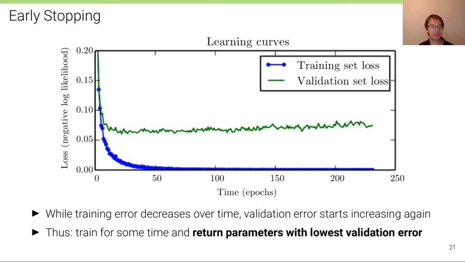
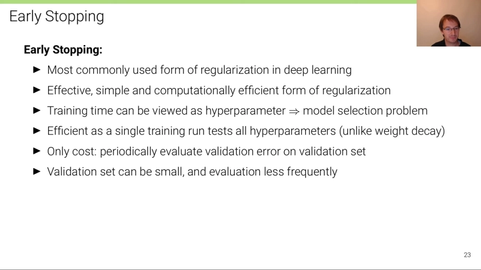
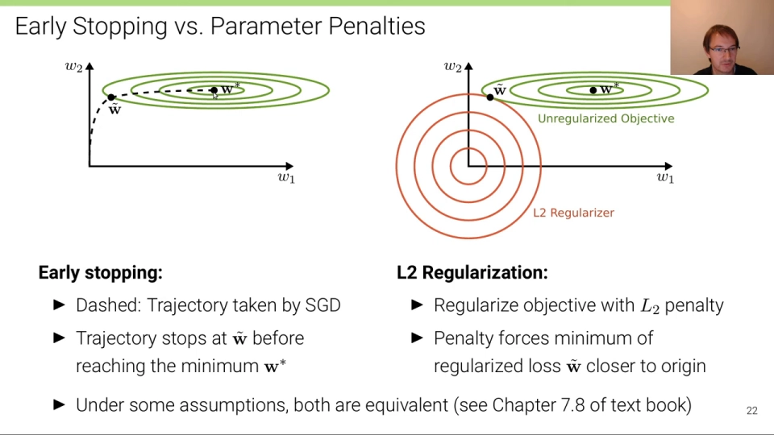
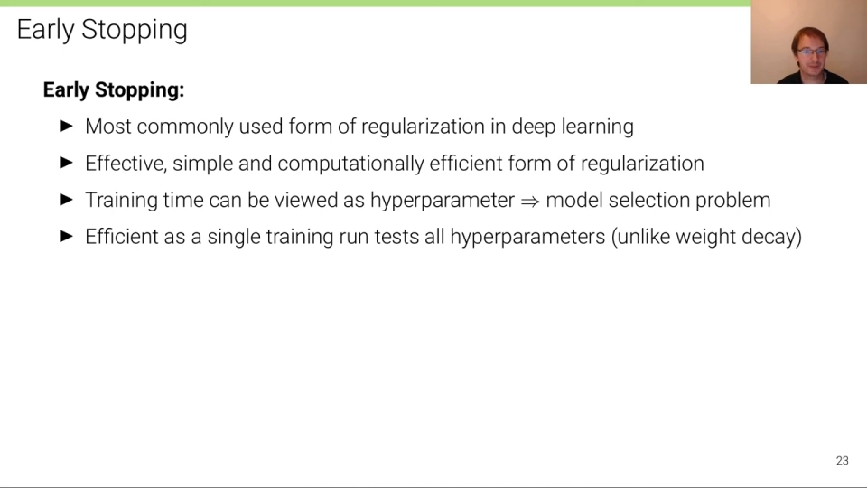
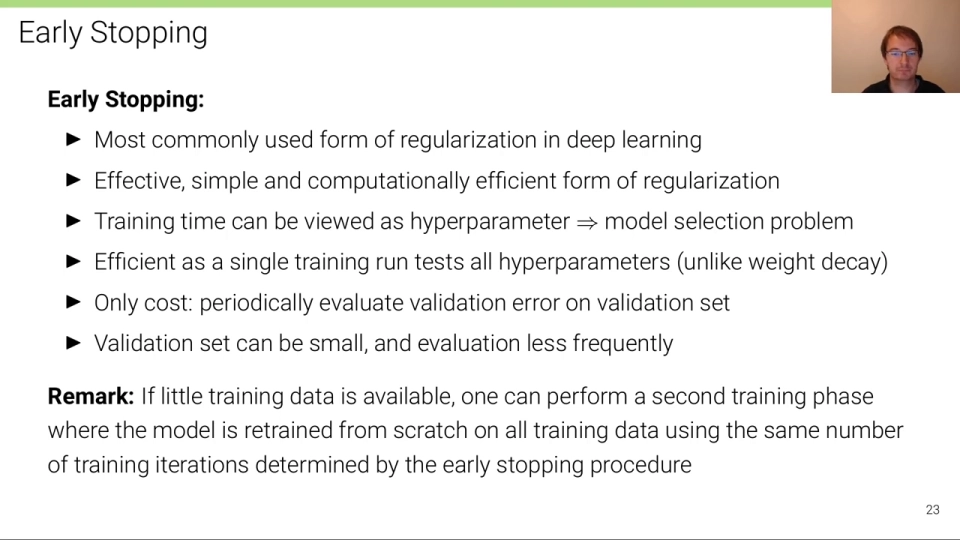

# 早停：验证损失最低点与迭代数作为容量旋钮

> 视频来源：[Deep Learning - Lecture 5.2 (Regularization: Early Stopping)](https://www.youtube.com/watch?v=PVec2wps_N0)（YouTube · Tübingen Machine Learning）｜时长约 9 分钟
> 导读：这支课从"训练损失一路下降、验证损失却先降后升"这张学习曲线讲起，把早停定义成"回到验证误差最低的那组参数"，再说明它为什么在深度学习里几乎默认使用：它把训练时长本身当成超参数，只需一次训练就能比较所有取值。后半段用参数轨迹图对照 L2 正则，指出两者在"把解拉向原点"上效果相似、在一定假设下等价，最后给出小数据时"二次训练"的补救办法。L1/L2 的目标函数见同节另两篇。

## 本讲要解决的核心问题（SCQA）

**背景**：训练一个网络时，我们最小化的是训练集上的损失。按定义，训练得越久，这个损失越小，参数在训练集上就越"合适"。

**冲突**：训练损失持续下降，并不代表模型变好。视频给出的学习曲线里，验证损失先快速下降，随后掉头上升：模型开始拟合训练集特有的噪声，而不是可迁移的规律。如果一直训练到训练损失足够小，拿到的恰恰是泛化最差的那一段。

**疑问**：既然目标函数本身不能告诉我们何时该停，那应该用什么信号决定停在哪里？停下来这件事，和加正则项是不是同一类操作？

**回答（中心思想）**：用**验证损失**当信号。训练过程中周期性在留出的验证集上算损失，记录验证损失最低的那组参数，训练结束后回到这组参数——这就是早停。它把**迭代数/训练时长**变成一个控制容量的超参数：停得早，参数离初值近、模型有效容量小；停得晚，容量大。视频进一步指出，这条"提前停下的轨迹"与 L2 正则把解拉向原点的效果相似，在一定假设下两者等价。

---

## 一、两条曲线：训练损失单调降，验证损失先降后升

先把两个时间单位说清楚：**epoch** 是把整个数据集完整过一遍；**iteration** 是处理一个 mini-batch。做完数据集的许多 batch 叫一个 epoch，然后重复多个 epoch，直到训练误差降下去 [【跳转到 00:22】](https://www.youtube.com/watch?v=PVec2wps_N0&t=22)。

视频展示的学习曲线（取自 Goodfellow 等的《深度学习》一书）里，纵轴是负对数似然损失，横轴是 epoch [【跳转到 00:47】](https://www.youtube.com/watch?v=PVec2wps_N0&t=47)：

- 训练损失（蓝）随时间不断逼近更小的值；
- 验证损失（绿）一开始下降很快，再降一点之后，在某个时刻开始上升——图中能看到绿线明显的上坡 [【跳转到 01:12】](https://www.youtube.com/watch?v=PVec2wps_N0&t=72)。

我们真正想要的是最好的泛化性能，而它只能用验证误差来近似 [【跳转到 01:37】](https://www.youtube.com/watch?v=PVec2wps_N0&t=97)。所以"训练到收敛"这个默认做法在这里是错的：训练越久，验证误差可能越大。

## 二、早停的规则：回到验证误差最低的那组参数

既然目标不是让训练误差任意小，做法就变成 [【跳转到 02:02】](https://www.youtube.com/watch?v=PVec2wps_N0&t=122)：

1. 训练一段时间，直到验证误差开始上升；
2. 训练过程中把中间结果都存下来；
3. 训练结束后，回到**验证误差最低**的那组参数。

这就是早停：不等训练误差变得任意小，而是在更早的时间点停下——当验证误差已经有一段时间没有低于此前的最好值时就停 [【跳转到 02:27】](https://www.youtube.com/watch?v=PVec2wps_N0&t=147)。

实现上有一件事不能省：每个 epoch（或按你选的频率）都要在**留出的验证集**上跑一次前向传播，算出这个数 [【跳转到 02:52】](https://www.youtube.com/watch?v=PVec2wps_N0&t=172)。验证集不参与参数更新，所以它给出的信号才不是"训练集上的假象"。

## 三、代价：多一次前向传播，可以降频、可以缩小验证集

早停不是免费的，但代价很小。额外开销只有"周期性在验证集上评估"这一项 [【跳转到 06:37】](https://www.youtube.com/watch?v=PVec2wps_N0&t=397)。视频给了两个降低开销的办法 [【跳转到 07:27】](https://www.youtube.com/watch?v=PVec2wps_N0&t=447)：

- 验证集可以比训练集小（实践中通常如此），这一次前向传播就不算什么；
- 评估可以降频，例如每个 epoch 只评一次，而一个 epoch 里可能已经做了上千次迭代。

和中间大量的前向、反向传播相比，这点开销可以忽略 [【跳转到 07:52】](https://www.youtube.com/watch?v=PVec2wps_N0&t=472)。视频也强调：看验证误差应该是训练时做的第一件事——打开 TensorBoard 之类的监控，看它是否开始回升 [【跳转到 07:02】](https://www.youtube.com/watch?v=PVec2wps_N0&t=422)。

## 四、与 L2 的对照：轨迹提前停在 w̃

早停看起来只是"少训练几步"，但它和加惩罚项在做同一件事。视频用两张参数空间示意图对照 [【跳转到 03:17】](https://www.youtube.com/watch?v=PVec2wps_N0&t=197)：

**左图（早停）**：参数初始化在 0 附近（实际不可能正好为 0，而是接近 0 加一点噪声），虚线是 SGD 沿梯度下降走向**无正则目标**最小点 $\mathbf{w}^*$ 的轨迹。轨迹并没有走到 $\mathbf{w}^*$，而是停在 $\tilde{\mathbf{w}}$——因为在那里训练误差已经很小，而验证误差开始上升，于是我们在此停下 [【跳转到 03:42】](https://www.youtube.com/watch?v=PVec2wps_N0&t=222)。

**右图（L2 正则）**：目标函数里加了 L2 惩罚，惩罚项把正则化损失的最小点 $\tilde{\mathbf{w}}$ 拉得比 $\mathbf{w}^*$ 更靠近原点 [【跳转到 04:32】](https://www.youtube.com/watch?v=PVec2wps_N0&t=272)。

两种做法的效果非常相似，而且在某些假设下**两者等价**；视频把推导指向《深度学习》第 7.8 章，没有在课上展开 [【跳转到 04:57】](https://www.youtube.com/watch?v=PVec2wps_N0&t=297)。

这条对照解释了早停为什么算"正则化"：它没有改目标函数，却通过限制"走多远"限制了参数能到达的区域——视频的轨迹图里初值就在原点附近，停得越早，参数离原点越近。**迭代数就是那个控制走多远的旋钮**。

## 五、迭代数是超参数，但只需一次训练就能比较所有取值

把训练时长当超参数，就出现一个模型选择问题：到底训练多少 epoch [【跳转到 05:47】](https://www.youtube.com/watch?v=PVec2wps_N0&t=347)？

早停的特殊之处在于它极其高效：**一次训练就能测试所有取值**。因为每个迭代都在验证集上评估一次，验证误差曲线本身就记录了每个"停在这里"的取值对应的表现 [【跳转到 06:12】](https://www.youtube.com/watch?v=PVec2wps_N0&t=372)。这与 weight decay 形成对照：要交叉验证惩罚系数 α，就得对每个 α 重新训练一次模型。

## 六、什么时候这条曲线不成立

视频明确说，验证误差回升不是所有问题都成立 [【跳转到 07:02】](https://www.youtube.com/watch?v=PVec2wps_N0&t=422)：

- 数据量非常充足时，验证误差可能连续几天、几周都在下降；
- 但当数据量相对模型复杂度很小的时候，验证误差往往很快就转为上升。

所以早停不是无条件生效的规则，它的前提是"模型容量相对数据足够大，以至于过拟合真的会发生"。这也和 2.2.4 的诊断逻辑一致：先看训练/验证两条曲线的形状，再决定要不要停。

## 七、数据很少时的补救：二次训练

如果训练数据本来就少，留出一部分做验证集很浪费。视频给了一个可选做法 [【跳转到 08:17】](https://www.youtube.com/watch?v=PVec2wps_N0&t=497)：

1. 先跑一次，用早停确定需要多少迭代/epoch；
2. 从零重新初始化，用**全部训练数据（含原验证集）**再训练一次，迭代数就用第一步定下来的那个值。

代价是要训练两次，所以只有在数据确实很少、那份验证数据对最终性能确实重要时才值得 [【跳转到 08:42】](https://www.youtube.com/watch?v=PVec2wps_N0&t=522)。

## 八、小结：目标与泛化的关系

- **目标函数与我们要的东西不是一回事**：训练损失单调下降，验证损失却会回升；早停用后者做停止信号，而不是用前者。
- **早停的规则**：周期性在留出验证集上评估，记录验证误差最低的参数，训练结束后回到它 [【跳转到 02:02】](https://www.youtube.com/watch?v=PVec2wps_N0&t=122)。
- **它等价于一个容量旋钮**：迭代数越少，参数离初值越近、有效容量越小；轨迹提前停在 $\tilde{\mathbf{w}}$，与 L2 把解拉向原点效果相似，一定假设下等价 [【跳转到 04:57】](https://www.youtube.com/watch?v=PVec2wps_N0&t=297)。
- **它几乎总是可用**：深度学习中最常用的正则化形式，简单、有效、计算高效，一次训练即可比较所有训练时长 [【跳转到 05:22】](https://www.youtube.com/watch?v=PVec2wps_N0&t=322)。
- **它有前提**：数据充足时验证误差可能长期不回升，早停不会触发；数据相对模型很小时才最需要它。

## 关键术语速查

| 术语 | 一句话解释 |
| --- | --- |
| epoch | 把整个训练集完整过一遍 |
| iteration | 处理一个 mini-batch 的一次参数更新 |
| 学习曲线 | 训练损失与验证损失随训练时间变化的曲线 |
| 验证集 | 不参与参数更新、只用来评估泛化的留出数据 |
| 早停 | 记录验证误差最低的参数，训练结束后返回它 |
| 有效容量 | 早停通过限制迭代数间接限制模型能到达的参数区域 |
| L2 等价 | 早停的轨迹提前停止与 L2 惩罚把解拉向原点，在一定假设下等价 |
| 二次训练 | 先用早停定迭代数，再用全部数据（含验证集）重训一次 |

## 本讲边界

- 视频只声明"一定假设下早停与 L2 等价"，推导指向教材第 7.8 章，本文不补证明。
- 视频没有讨论早停的变体（如学习率调度配合、按指标而非损失早停、patience 的具体取值），本文不补。
- 视频用负对数似然作为损失示例；换成其他损失时曲线形状可能不同，这一点视频未展开。
- L1/L2 的目标函数、λ 的选择与系数收缩见同节《岭回归（L2）：惩罚项、λ 与系数收缩》《Lasso（L1）：绝对值惩罚、系数归零与变量选择》。