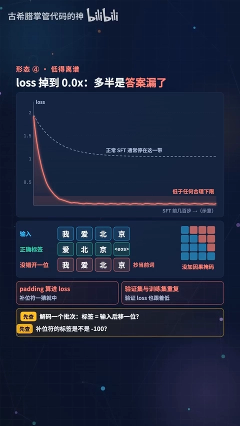

# loss 曲线形态图鉴：八种异常形状的病因定位与修复

> 视频来源：[【训练排障】loss 曲线形态图鉴：八种异常形状的病因定位与修复](https://www.bilibili.com/video/BV19h4N66E3B/?t=0)（Bilibili · 古希腊掌管代码的神）｜时长约 5 分钟
> 本文基于视频演说图文稿整理，配图截自视频。视频里的曲线多为示意（函数生成），处理办法引用了 PaLM 论文 5.5.1 节、Takase et al.（arXiv 2312.16903）与 fast.ai 2023 年的工作。

## 本讲要解决的核心问题（SCQA）

**背景**：训练时最直接的可观测量就是 loss 曲线。它一直在往下走，通常说明优化在推进。

**冲突**：可同样是一条往下走的曲线，有的在报平安，有的已经在报警——尖刺、台阶、锯齿、低得离谱、卡在一个奇怪的数上。每种形状背后是不同的病 [【跳转到 00:00】](https://www.bilibili.com/video/BV19h4N66E3B/?t=0)。

**疑问**：看到某种形状，该先查哪里、怎么修？

**回答（中心思想）**：**先建立坐标，再认形状，最后查原因。** 语言模型的 loss 是交叉熵，健康的曲线从 $\ln V$（词表大小的自然对数）出发、先陡后缓。八种异常形状各自对应一类病因：尖刺看能否回落、水平线看参数是否在更新、低得离谱看标签是否漏了、台阶是记忆、剪刀口是过拟合、固定周期去配置里对数字、慢平台先做学习率短跑对照。

---

## 一、先建立坐标：健康曲线从 $\ln V$ 出发

语言模型的 loss 是交叉熵，模型越有把握地猜对下一个词，它就越低：

$$
\mathcal{L}=-\log p_\theta\left(y_t \mid y_{<t}\right)
$$

刚初始化时，模型对每个词一视同仁，loss 约等于**词表大小的自然对数**：

$$
\mathcal{L}_0 \approx -\log\frac{1}{V}=\ln V
$$

3 万 2 千的词表是 10.37，15 万的词表是 11.93。健康的曲线从这里出发，先陡后缓，像一条幂律慢慢逼近下线，身上带着小噪声 [【跳转到 00:25】](https://www.bilibili.com/video/BV19h4N66E3B/?t=25)。

读图鉴时问四个问题：**形状像什么 → 可能的原因 → 第一眼先查什么 → 怎么修。**

## 二、尖刺：回得来还是回不来

### 2.1 形态一：尖刺后自己回落

往往是某个批次撞上了很陡的参数状态，**梯度范数在同一步一起冲高**。偶尔一次可以继续训；频繁出现就降低峰值学习率。Spike No More 这篇论文还指出：子层初始化要小、残差主干要大，尖刺会少很多 [【跳转到 00:50】](https://www.bilibili.com/video/BV19h4N66E3B/?t=50)。

### 2.2 形态二：尖刺之后回不来

越飙越高，最后变成 NaN——这是**发散**。论文里的做法是退回尖刺前约 100 步的检查点，跳过 200 到 500 个批次再继续。前提是**检查点连同优化器状态一起存** [【跳转到 01:15】](https://www.bilibili.com/video/BV19h4N66E3B/?t=75)。

## 三、水平线停在 $\ln V$：参数根本没在更新

形态三是一条水平线，而且恰好停在词表大小的对数上（15 万词表就是 11.93）。这说明模型从头到尾都在**均匀瞎猜**。先查三处：

1. 第一步的学习率是不是零；
2. 参数有没有冻结、或者漏传给优化器；
3. 梯度范数是不是零。

注意：如果标签全被屏蔽，loss 不会卡在这条线上，而是直接变成 NaN——那是另一种 bug [【跳转到 01:22】](https://www.bilibili.com/video/BV19h4N66E3B/?t=82)。

## 四、低得离谱：多半是答案漏了

形态四：SFT 才训几百步，loss 就掉到 0.0 几，比任何合理的下限都低。通常不是模型聪明，而是**答案漏了**：

- 自己算 loss 时忘了把标签错开一位，模型抄当前词就行；
- 没加因果掩码，偷看了后文；
- padding 也算进了 loss，补位符一猜就中；
- 验证集和训练集重复，验证 loss 也跟着低。

先查一个批次：把标签解码出来，看是不是输入往后挪了一位，补位符有没有设成 -100 [【跳转到 01:47】](https://www.bilibili.com/video/BV19h4N66E3B/?t=107)。

## 五、台阶是记忆，剪刀口是过拟合

**形态五：台阶。** 多轮 SFT 里，每到新一轮开头，loss 就整体往下跳一截。视频引用的研究（fast.ai，2023）专门看过这个现象：模型看一遍就把这些样本记住了。台阶的本质是**记忆**，不代表泛化变好。

**形态六：剪刀口。** 训练 loss 继续降，验证 loss 却在某一步掉头往上——这是**过拟合**。两者修法相同：盯住验证 loss，在最低点停下，或选那一步的检查点；少训几轮，多补数据 [【跳转到 02:12】](https://www.bilibili.com/video/BV19h4N66E3B/?t=132)。

## 六、固定周期的起伏：去配置里对数字

形态七：每隔同样的步数，loss 就规律地波动一次。做法是**先量出周期是多少步，再去配置里找对得上的数字** [【跳转到 02:37】](https://www.bilibili.com/video/BV19h4N66E3B/?t=157)：

- 周期等于每轮步数 → 数据没打乱，或调度器每轮被重新创建；
- 周期等于梯度累积步数 → 日志按微批次记录，或累积配置写错；
- 周期等于数据分片长度 → 分片顺序是固定的，全程只见一次。

## 七、慢平台：先怀疑学习率

形态八：loss 在高位缓缓爬行，几千步只降一点点，看不出明显的错。**两种相反的学习率问题都会这样**：太小，每步挪得太少；太大，在山谷两侧来回弹，降不下去。

第一检查是"短跑对照"：学习率乘 3、除以 3，各跑几百步，看哪边降得更快。如果都不动，就去查数据——重复率太高、样本太单一，模型很快就学无可学 [【跳转到 03:27】](https://www.bilibili.com/video/BV19h4N66E3B/?t=207)。

## 八、把图鉴写成代码：四个自动检查

最后把诊断写成脚本 `loss_doctor.py`，四个检查各对应一类形状：

| 检查 | 做法 | 对应形状 |
| --- | --- | --- |
| 尖刺检测 | 滚动中位数 + 稳健 Z 分数（比均值和标准差更不怕尖刺本身干扰） | 形态一、二 |
| 均匀猜测检查 | 最近 100 步的平均 loss 与 $\ln V$ 差不到 0.05 就报警 | 形态三 |
| 过拟合检查 | 找平滑后验证 loss 的最低点 | 形态六 |
| 周期检测 | 去趋势后做自相关，找过零之后最强的那个峰 | 形态七 |

在合成日志上实际跑一遍：尖刺定在第 1200 步（检出 1200、1201、1202），卡在 11.93 被认出，验证最低点在 1200 步附近，周期测出 201 步 [【跳转到 03:40】](https://www.bilibili.com/video/BV19h4N66E3B/?t=220)。

![脚本输出：尖刺步数 [1200, 1201, 1202]、均匀猜测 True、验证最低点 1218、周期 201](assets/loss曲线形态图鉴：八种异常形状的病因定位与修复/00245.webp)

## 小结

- 先建立坐标：健康曲线从 $\ln V$ 出发，先陡后缓。
- **尖刺**：看能不能回落。回得来就继续（频繁出现降峰值学习率）；回不来就回滚到尖刺前约 100 步、跳过 200–500 个批次。
- **水平线卡在 $\ln V$**：参数没在更新——查学习率、冻结、梯度范数。
- **低得离谱**：答案漏了——查标签错位、因果掩码、padding、验证集重复。
- **台阶**是记忆，**剪刀口**是过拟合，后者要靠验证 loss 早停。
- **固定周期**去配置里对数字（每轮步数、梯度累积、分片长度）。
- **慢平台**先做学习率短跑对照，再看数据重复率。
- 一句话：每种形状都是一条线索，**先认形状，再查原因**。

## 关键术语速查

| 术语 | 一句话解释 |
| --- | --- |
| $\ln V$ | 词表大小的自然对数，模型均匀瞎猜时的交叉熵水平 |
| 尖刺 spike | 某一步 loss 突然冲高，通常伴随梯度范数同步冲高 |
| 发散 | 尖刺不回落、越飙越高直到 NaN |
| 剪刀口 | 训练 loss 继续降、验证 loss 掉头往上，即过拟合 |
| 稳健 Z 分数 | 用中位数与中位数绝对偏差代替均值方差算的异常分数 |
| 自相关 | 曲线与"错开 k 步的自己"的相似度，用来量周期 |
| 学习率短跑 | 用 ×3 / ÷3 的学习率各跑几百步，比较下降速度 |