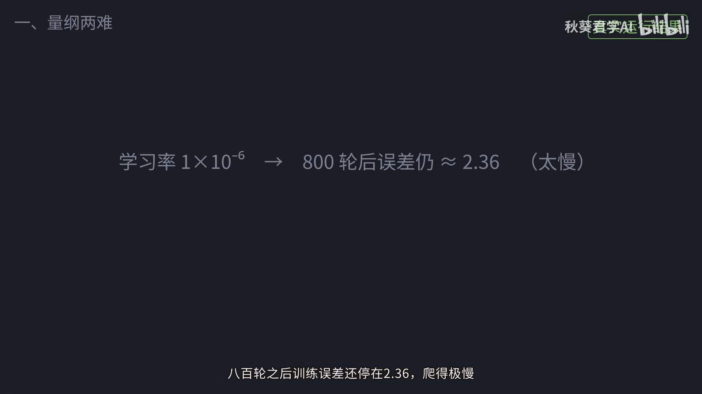
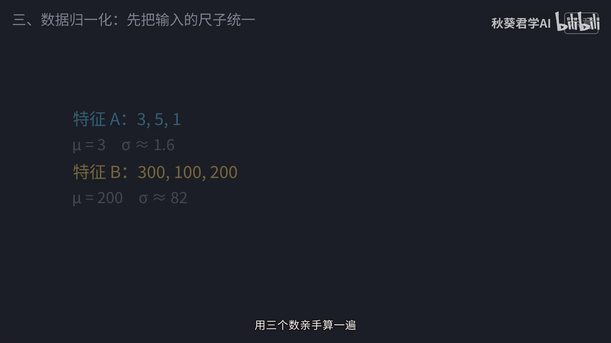
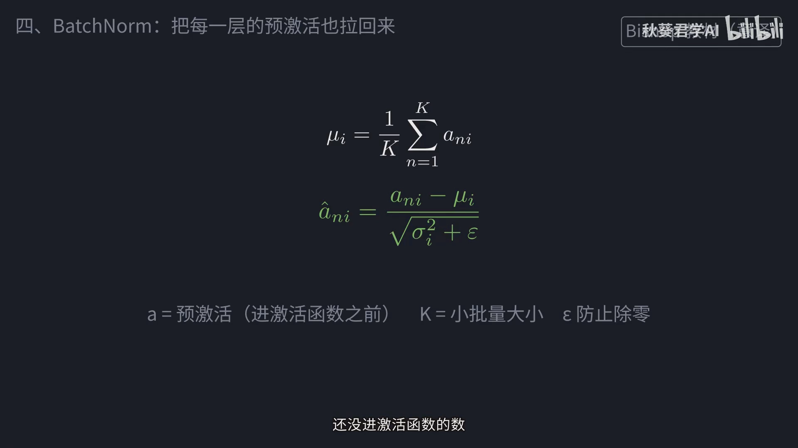
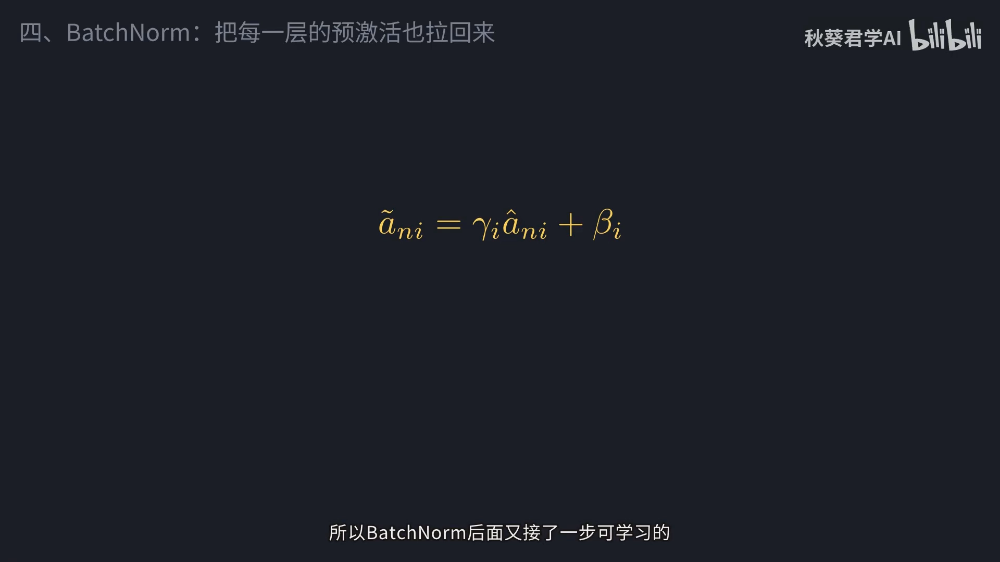
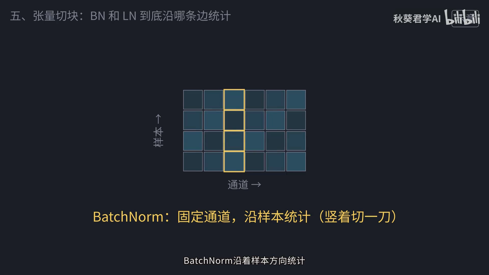
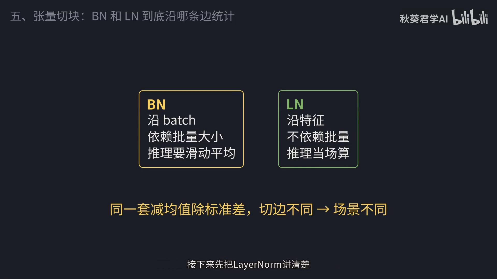
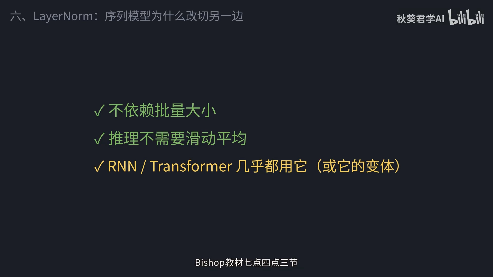
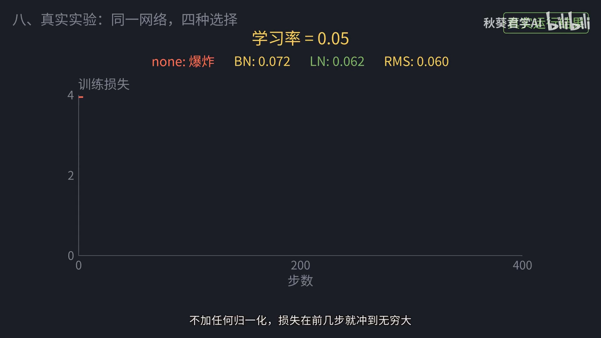
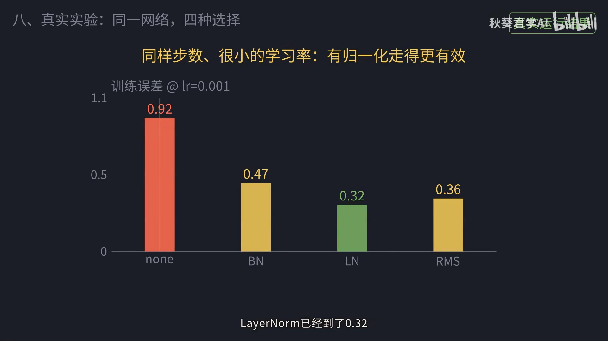

# 归一化：BatchNorm、LayerNorm 与 RMSNorm 的切边方向

> 视频来源：[【深度学习科普10】归一化：BatchNorm、LayerNorm 与 RMSNorm｜一行减均值除标准差，为什么训练快好几倍？](https://www.bilibili.com/video/BV1cMnt6PERr/?t=0)（Bilibili · 秋葵君学AI）｜时长约 12 分钟
> 本文基于视频演说图文稿整理，配图截自视频。视频主要参考 Bishop 教材第 7.4 节（7.4.1–7.4.3），RMSNorm 部分来自 2019 年的论文。

## 本讲要解决的核心问题（SCQA）

**背景**：梯度下降给所有参数共用一个学习率。特征量纲差得远时，这个学习率很难伺候——这是做过特征标准化的人都知道的事。

**冲突**：可输入数据你只能事先归一化一次。**隐藏层的预激活**（还没进激活函数的那些数）会随着权重更新不断变化：今天均值是零，训着训着可能飘到别处，方差也可能拉得很大。地形本身变得又陡又扭，再好的优化器也吃力 [【跳转到 01:40】](https://www.bilibili.com/video/BV1cMnt6PERr/?t=100)。

**疑问**：为什么"减均值、除以标准差"这一行操作，能让训练快好几倍？BatchNorm、LayerNorm、RMSNorm 又到底差在哪？

**回答（中心思想）**：**先把数字的尺子统一，再学习。** 归一化把每一层看到的信号重新拨回"均值 0、尺度 1"，于是同一个学习率对所有参数都合适，损失地形更平滑、可用更大学习率。三种归一化用的是同一套公式，区别只在**沿哪条边统计**：BatchNorm 沿样本方向（竖着切），LayerNorm 沿特征方向（横着切），RMSNorm 则省掉减均值、只除以均方根。

---

## 一、量纲两难：一个学习率伺候两个差 100 倍的特征

视频先给了一个具体的坑。用两个数预测一个结果：第一个数典型大小在 0 到 1 左右，第二个数在 -100 到 +100，两者的"尺子刻度"差了大约 100 倍。真实关系其实很简单：

$$
y \approx 2x_1 + 0.02x_2
$$

两项对结果的贡献差不多大。可是给两个参数共用一个学习率，马上就两难 [【跳转到 00:25】](https://www.bilibili.com/video/BV1cMnt6PERr/?t=25)：

- 学习率 $10^{-6}$：800 轮之后训练误差还停在 2.36，爬得极慢；
- 学习率 $3\times10^{-5}$：能降到 0.2，勉强能看；
- 学习率 $10^{-1}$：误差直接爆掉，数字变成无穷大。

问题出在梯度上。梯度（误差对参数有多敏感）会带着输入一起放大：第二个特征本身大 100 倍，对应参数的梯度也大 100 倍。同一步长，对第一个参数可能刚好，对第二个参数就已经跨过山谷摔下山了 [【跳转到 00:50】](https://www.bilibili.com/video/BV1cMnt6PERr/?t=50)。

## 二、输入归一化：先把尺子统一

对每一个特征，用**全体训练样本**算一个均值和一个标准差，然后每个数减去均值、再除以标准差：

$$
\tilde{x}=\frac{x-\mu}{\sigma}
$$

均值代表"典型大小落在哪里"，标准差代表"这些数离开均值有多散"，也就是尺子的刻度。减完再除，这一维就大致变成 0 附近、散开程度约为 1。

用三个数亲手算一遍：特征 A 取值 3、5、1，均值是 3，标准差约 1.6；特征 B 取值 300、100、200，均值是 200，标准差约 82。标准化之后两组数都落在 -1.2 到 +1.2 附近，尺子对齐了 [【跳转到 02:55】](https://www.bilibili.com/video/BV1cMnt6PERr/?t=175)。

回到那个差 100 倍的实验：把两个特征都标准化，再用学习率 0.01——**注意这正是刚才让原始特征直接爆炸的那个学习率**——训练误差降到 0.22，测试误差 0.24，稳稳收敛。

这里有一条必须记住的纪律：**验证集和测试集要用训练集那一套均值和标准差，不能重新估**，否则等于偷看了考试题的分布。统一尺子是为了训练，考试时尺子不能偷偷换掉 [【跳转到 03:20】](https://www.bilibili.com/video/BV1cMnt6PERr/?t=200)。

## 三、BatchNorm：把每一层的预激活也拉回来

输入对齐了，中间层呢？2015 年 Ioffe 和 Szegedy 提出**批归一化**（Batch Normalization，BatchNorm）：训练时每一次拿一小批样本，对每一个隐藏通道在这批样本上算均值和方差，当场标准化。

设 $a_{ni}$ 是第 $n$ 个样本在第 $i$ 个通道上的预激活，$K$ 是小批量大小：

$$
\mu_i=\frac{1}{K}\sum_{n=1}^{K}a_{ni},\qquad
\hat{a}_{ni}=\frac{a_{ni}-\mu_i}{\sqrt{\sigma_i^2+\varepsilon}}
$$

分母里那个很小的 $\varepsilon$ 是为了防止标准差接近零时除零 [【跳转到 04:10】](https://www.bilibili.com/video/BV1cMnt6PERr/?t=250)。

但强制每一层输出都是零均值、单位方差，这一层就没法再用"整体偏大或偏小"来表达信息了。所以 BatchNorm 后面还接了一步**可学习的伸缩和平移**：

$$
\tilde{a}_{ni}=\gamma_i\hat{a}_{ni}+\beta_i
$$

$\gamma$ 和 $\beta$ 会在训练中自己更新。这一点很关键：均值和方差虽然可以再次变成任意值，但它们变成了**独立参数**，比缠在所有权重里的复杂函数好学得多。可以把它想成先把尺子拨正，再允许模型自己决定要不要把刻度拧回去一点 [【跳转到 04:35】](https://www.bilibili.com/video/BV1cMnt6PERr/?t=275)。

**它为什么有用？** 原始论文把动机写成"内部协变量偏移"（每层输入分布一直在变）。后来的研究——比如 2018 年 Santurkar 等人的工作——更倾向于另一个解释：BatchNorm 让**损失地形更平滑**，学习率可以更大，训练更稳。

还有一个容易踩的细节：推理时往往一次只来一个样本，没有"一小批"可统计。所以训练时会用**指数滑动平均**把均值和方差慢慢记下来，推理时用这套固定统计量 [【跳转到 05:00】](https://www.bilibili.com/video/BV1cMnt6PERr/?t=300)。

## 四、BN 与 LN 的差别：竖着切一刀，还是横着切一刀

把一小批数据画成一张网格，纵轴是样本、横轴是特征通道：

- **BatchNorm 沿样本方向统计**：固定某一个通道，把这一批里所有样本在该通道上的值拿来算均值和方差——竖着切一刀；
- **LayerNorm 沿特征方向统计**：固定某一个样本，把这个样本所有通道上的值拿来算均值和方差——横着切一刀 [【跳转到 05:50】](https://www.bilibili.com/video/BV1cMnt6PERr/?t=350)。

同一套"减均值除标准差"，切的边不同，适用场景就不同。

## 五、LayerNorm：为什么序列模型改切另一边

BatchNorm 有一个天生的麻烦：**它依赖批量大小**。批量很小，或者数据被拆到很多块显卡上时，每一小撮样本算出来的均值方差会又吵又不稳定；对序列模型更麻烦——句子长短不一，有时批量里的有效样本更少。

2016 年 Ba、Kiros 和 Hinton 提出**层归一化**（Layer Normalization，LayerNorm）：对每一个样本单独动手，在该层全部隐藏单元上算均值和方差，不看别的样本 [【跳转到 06:40】](https://www.bilibili.com/video/BV1cMnt6PERr/?t=400)。

好处立刻显现：

- 不依赖批量大小；
- 推理时不需要滑动平均——每个样本自己的统计量当场就能算；
- 所以循环网络和后来的 Transformer 几乎都站到了 LayerNorm 这边。

## 六、RMSNorm：省掉减均值

再往前走一步。2019 年 Zhang 和 Sennrich 提出 **RMSNorm**，做了一件更狠的简化：**不再减均值**，只除以均方根，再乘一个可学习的增益。

均方根先回答"这些数整体有多猛"：先平方、再平均、再开根号。它不管正负、不管中心在哪，只把整体幅度拨回 1 附近。少做一次减均值，也少算一些梯度。现代许多大语言模型（比如 LLaMA 系列）的隐藏层就常用 RMSNorm。

需要说清楚的是：RMSNorm 不在 Bishop 教材 7.4 节里，它来自那篇论文；教材帮我们把数据归一化、BatchNorm、LayerNorm 的主线搭好，而 RMSNorm 是这条线上的**工程简化** [【跳转到 07:30】](https://www.bilibili.com/video/BV1cMnt6PERr/?t=450)。

## 七、实验：同一网络，四种选择

作者搭了一个"小而深"的网络：6 个隐藏层、每层 64 个神经元，激活函数用 tanh，初始化比常用的 Xavier 再放大三倍（好让尺度失控更容易露出来），数据是合成的回归任务，固定随机种子。

**学习率 0.05：**

- 不加归一化：损失在前几步就冲到无穷大，训练失败；
- BatchNorm：400 步后训练误差 0.072；
- LayerNorm：0.062；
- RMSNorm：0.060。

同一条悬崖，有没有归一化，差别就是掉下去还是走过去 [【跳转到 08:20】](https://www.bilibili.com/video/BV1cMnt6PERr/?t=500)。

**学习率 0.02：** 四种都能训完，可测试误差差很多——无归一化 0.68，BatchNorm 0.30，LayerNorm 和 RMSNorm 大约 0.33。训练误差低不等于新数据也好。

**学习率 0.001（很小的步子）：** 同样步数下，无归一化训练误差还停在 0.92，BatchNorm 0.47，LayerNorm 0.32，RMSNorm 0.36。尺子拨正以后，同样小的步子也能走得有效率得多 [【跳转到 08:45】](https://www.bilibili.com/video/BV1cMnt6PERr/?t=525)。

**推理时的坑：** 用滑动平均做测试，误差是 0.30，预测还有起伏，标准差约 0.66；如果错误地把单个测试样本当成一批，减均值后全变成零，网络输出会塌成同一个常数，测试误差升到 0.50。

## 八、四个常见误解

1. **"BatchNorm 只是一种正则化。"** 它确实时常带来一点正则效果，因为小批量统计有噪声；但主线作用是稳住尺度、平滑地形。dropout、权重衰减才是专门冲着过拟合去的。
2. **"推理时也可以随便用当前 batch 的均值方差。"** 不行。刚才的实验里，单个样本当 batch 预测直接变成常数。批量统计是训练期的工具，推理要换滑动平均。
3. **"LayerNorm 和 BatchNorm 只是名字不同。"** 不是。一个按 batch 切，一个按特征切；一个依赖批量、推理要记统计量，一个不依赖、推理当场算。**换切边，换的是适用场景。**
4. **"归一化会改变网络能表示的函数，把能力消掉。"** BatchNorm 后面的 $\gamma$ 和 $\beta$ 是可逆的仿射，表达力可以补回来。真正改变的是优化时看见的那片地形，让更大的学习率变得可用 [【跳转到 10:25】](https://www.bilibili.com/video/BV1cMnt6PERr/?t=625)。

## 小结

- 特征量纲差很多时，共用一个学习率必然两难：梯度会带着输入一起放大。
- **数据归一化**先把输入尺子统一，并且测试时沿用训练集的均值方差。
- 中间层的预激活也会漂移，于是有了**层内归一化**：BatchNorm 在小批量上按通道标准化，再仿射；LayerNorm 改成对每个样本沿特征标准化，更适合序列和 Transformer；RMSNorm 省掉减均值，是现代大模型里常见的工程简化。
- 实验里学习率 0.05 时无归一化会爆炸，三种归一化都能收敛；学习率很小时，归一化的优势同样明显。
- 推理时 BatchNorm 必须用滑动平均，不能拿单个样本假冒一批。
- 归一化改善的是**优化过程**（地形更平滑、可用更大学习率），不是模型能表示的函数类别。

## 关键术语速查

| 术语 | 一句话解释 |
| --- | --- |
| 数据归一化 | 用训练集每个特征的均值、标准差把输入缩放到 0 均值、单位尺度 |
| 预激活 $a$ | 线性层算完、还没进激活函数的数，是 BatchNorm 的作用对象 |
| BatchNorm | 在小批量上按通道算均值方差做标准化，再乘 $\gamma$ 加 $\beta$ |
| $\varepsilon$ | 分母里的小常数，防止标准差接近零时除零 |
| 内部协变量偏移 | 每层输入分布随训练不断变化；原始论文的动机，后来的解释偏向"平滑损失地形" |
| 滑动平均统计量 | 训练时累计的均值方差，推理时替代批量统计 |
| LayerNorm | 对每个样本沿特征方向标准化，不依赖批量大小 |
| RMSNorm | 只除以均方根、不减均值，再乘可学习增益 |