# 梯度消失与爆炸：误差信号的连乘、方差不变式与 He 初始化

> 视频来源：[【深度学习科普07】梯度消失与爆炸：深网络为什么曾经训不动｜0.9 的 50 次方有多小？何恺明初始化凭什么是 2/n？](https://www.bilibili.com/video/BV1w8nM67EKo/?t=0)（Bilibili · 秋葵君学AI）｜时长约 15 分钟
> 本文基于视频演说图文稿整理，配图截自视频。视频里的实验数字（梯度大小、标准差、准确率）都是作者自己跑出来的，本文照抄，不做额外推断。

## 本讲要解决的核心问题（SCQA）

**背景**：反向传播能对任意层数的网络算出梯度——每一层的误差信号乘上权重、再乘上激活函数的斜率，一层层往回传。工具早就齐了。

**冲突**：可 2006 年以前，深层的多层神经网络就是普遍训不出来。视频开头做了一个对照实验：同一个 20 层网络、同样的数据、同样的训练方法，只改一处——初始权重随机取多大。一种取法训练 3000 步，损失几乎纹丝不动；另一种取法，任务学得相当不错 [【跳转到 00:25】](https://www.bilibili.com/video/BV1w8nM67EKo/?t=25)。

**疑问**：为什么"层数一多"就成了问题？初始权重到底该取多大？

**回答（中心思想）**：因为误差信号每往回传一层都要乘一个倍数（激活斜率 × 权重），几十层连乘下来，倍数略小于 1 就指数衰减（梯度消失），略大于 1 就指数爆炸。所以好的初始化只有一个目标——**让每层的倍数保持在 1 附近，也就是让信号在每一层的方差保持不变**。写成公式是 $n\cdot\mathrm{Var}(w)=1$（Xavier 初始化），ReLU 把一半信号砍成零，于是方差再翻一倍，变成 $n\cdot\mathrm{Var}(w)=2$（He 初始化）。

---

## 一、先看清现象：只改初始权重的尺度，训练结果天差地别

视频搭的网络是 2 维输入、20 个隐藏层、每层 64 个神经元、输出接 sigmoid 加交叉熵，学的是第五期那个异或问题的放大版：平面上一三象限是一类，二四象限是另一类 [【跳转到 10:50】](https://www.bilibili.com/video/BV1w8nM67EKo/?t=650)。

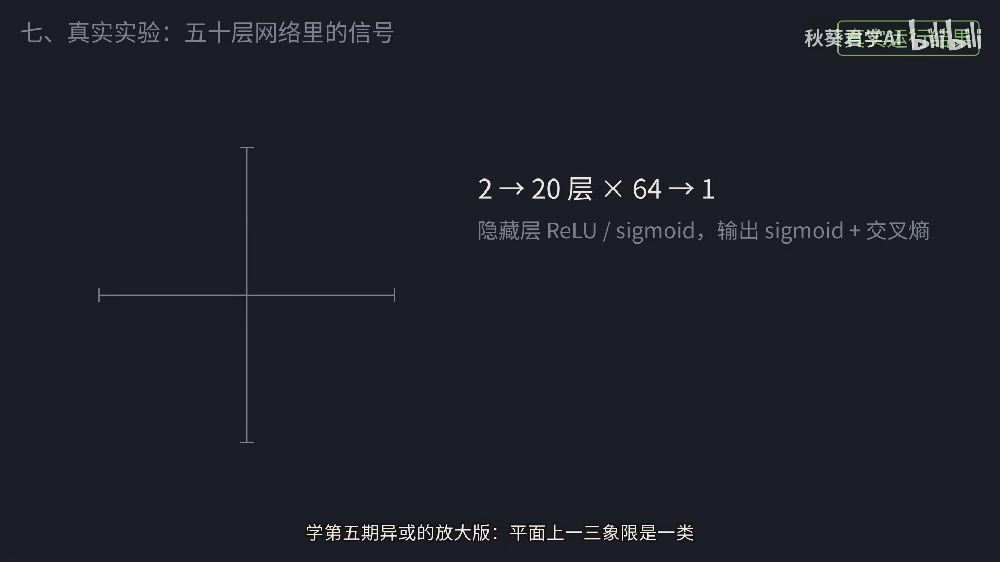

同样的数据、同样的学习率 0.1、同样训练 3000 步，只换初始权重：

| 初始权重 | 训练结果 | 判读 |
| --- | --- | --- |
| 0.01 上下 | 损失从 0.693 只降到 0.692，准确率 52.5% | 等于一直猜人数多的那一类，梯度消失 |
| 0.3 上下 | 一开始损失就是 13.1，更新两次后数值溢出成 NaN | 训练直接崩溃，梯度爆炸 |
| He 初始化 | 损失降到 0.000084，100 个点全部分对 | 四个象限分得清清楚楚 |

权重太小的那个网络，整个平面上的输出都是 0.525——它什么也没学到 [【跳转到 11:15】](https://www.bilibili.com/video/BV1w8nM67EKo/?t=675)。这三行结果就是本讲的诊断入口：**loss 卡在"瞎猜的水平"和 loss 一步冲到 NaN，是两种完全不同的病，而它们的病根都在同一处。**

## 二、病根：误差信号每层乘一个倍数，几十层就是几十次连乘

### 2.1 一层做的事：乘权重，再乘斜率

反向传播从损失出发，把误差信号一层层往回传，Bishop 的教材把它记作 $\delta$。每回传一层做的都是同一件事：

- 先乘上连线的权重；
- 再乘上激活函数在这一点的斜率——斜率就是"局部倍数"，分数变一点，输出变几倍。

而某个权重的梯度，等于传到它这里的误差信号乘上它接收的输入。所以**误差信号传到前面的层时还剩多大，直接决定了前面那些层能学多快** [【跳转到 01:15】](https://www.bilibili.com/video/BV1w8nM67EKo/?t=75)。

### 2.2 连乘的算术：0.9 的 50 次方只剩 5‰

先抛开网络只看数字。假设每传一层信号都乘上 0.9——只比 1 小一点点：

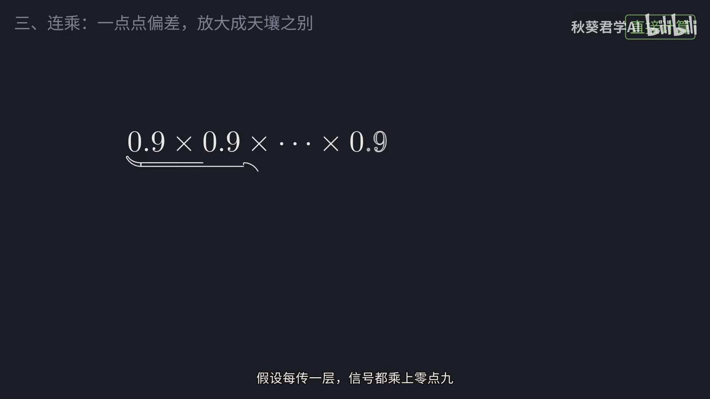

$$
0.9^{10}\approx 0.35,\qquad 0.9^{50}\approx 0.0052
$$

十层还剩三分之一多，50 层只剩原来的 5‰。反过来，每层乘 1.1，50 层以后是原来的 117 倍 [【跳转到 02:05】](https://www.bilibili.com/video/BV1w8nM67EKo/?t=125)。

这种每一步都乘同一个倍数的变化叫**指数变化**：倍数小于 1 叫指数衰减，大于 1 叫指数增长。生活里最熟悉的例子是复利——每年涨 10%，50 年后就是 100 多倍。它的脾气是开头不起眼，越往后越吓人 [【跳转到 02:30】](https://www.bilibili.com/video/BV1w8nM67EKo/?t=150)。

于是两个名字就有了着落：误差信号越往前越小、前面的层几乎收不到梯度、学不动，叫**梯度消失**；越往前越大、参数一更新就被甩飞，叫**梯度爆炸**。而每层的倍数由两样东西相乘得到——**激活函数的斜率**和**权重的大小**。这两样就是本讲的两个"嫌疑人"。

## 三、嫌疑人一：激活函数的斜率

sigmoid 把任意分数压到 0 到 1 之间，早年的隐藏层普遍用它。它的斜率在正中间（分数为零处）最陡，等于 0.25；往两边走曲线越来越平，斜率越来越接近零——这就是"饱和" [【跳转到 03:20】](https://www.bilibili.com/video/BV1w8nM67EKo/?t=200)。

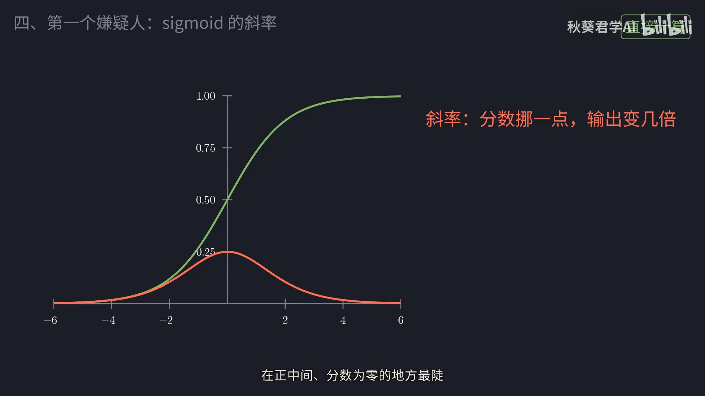

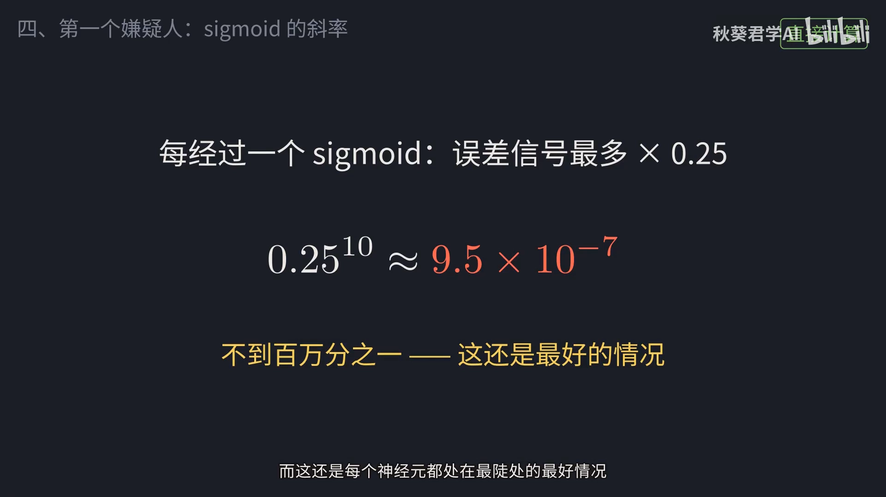

$$
0.25^{10}\approx 9.5\times 10^{-7}
$$

也就是说，误差信号每经过一个 sigmoid 最多只能保留 1/4，连过十层就不到百万分之一——而这还是假设每个神经元都恰好待在最陡处的最好情况 [【跳转到 03:45】](https://www.bilibili.com/video/BV1w8nM67EKo/?t=225)。

作者实测了一个 20 层的 sigmoid 网络，看训练第一步时每一层拿到的梯度：越往前越小，平均每往回一层缩小到大约 1/2 到 1/4，和 0.25 很接近；到第一层只剩 $4.3\times10^{-16}$，小数点后面要先写 15 个零。

换成 ReLU 就不一样了：分数为正时斜率正好是 1，误差信号原样通过，一点不打折。这是 ReLU 在深网络里流行起来的一个重要原因。

**但换 ReLU 并不万事大吉。** 同一个 20 层 ReLU 网络，把权重随机取在 0.01 上下（早年很常见的取法），第一层拿到的梯度只有 $1.0\times10^{-27}$，比 sigmoid 还惨 [【跳转到 04:35】](https://www.bilibili.com/video/BV1w8nM67EKo/?t=275)。

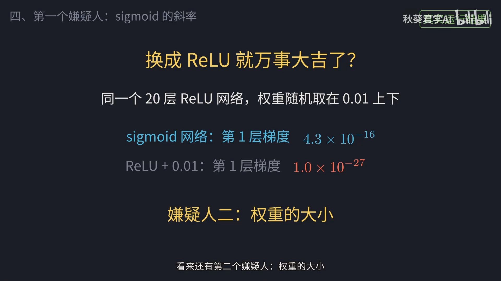

斜率这条路走到了头，第二个嫌疑人就浮出来了：**权重的大小**。

## 四、嫌疑人二：权重的大小，用方差来量

### 4.1 先有一把尺子：方差与标准差

要问"权重多大才合适"，先得有一把量"一堆随机数散得多开"的尺子，这把尺子叫**方差**：先算平均数，再看每个数离平均数多远，把距离平方，最后取平均。

- 1、-1、1、-1：平均是 0，每个数离 0 都是 1，平方还是 1，方差是 1；
- 3、-3、3、-3：方差是 9。

方差开根号叫**标准差**，意思是"一个数通常离中心多远"：前一组是 1，后一组是 3。

### 4.2 两条方差规则

现在看一个神经元：它的分数是把 $n$ 个输入各乘一个权重再加起来。假设输入和权重都是 0 附近的随机数、彼此无关，输入的方差是 1，那么这个分数的方差是多少？需要两条规则：

1. **相乘 → 方差相乘**：两个互不相关、平均为零的随机数相乘，方差也相乘。所以每一项"权重 × 输入"的方差，就是权重的方差乘输入的方差。
2. **相加 → 方差相加**：互不相关的随机数相加，方差也相加。

第二条规则可以用走路来体会：每一步随机往左或往右迈一步，走 100 步以后，你离起点通常不是 100 步，而是十步左右——方差是 100，标准差才是 10 [【跳转到 05:50】](https://www.bilibili.com/video/BV1w8nM67EKo/?t=350)。

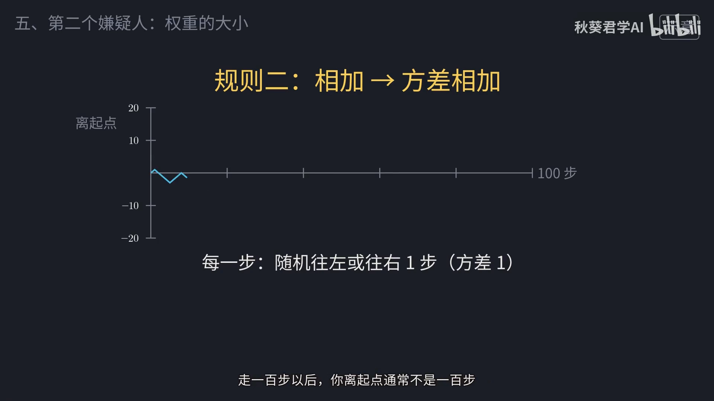

两条合起来，$n$ 项相加，分数的方差等于：

$$
\mathrm{Var}(a)=n\cdot \mathrm{Var}(w)\cdot \mathrm{Var}(z)
$$

这里的 $n$ 就是一个神经元接收几个输入，英文叫 fan-in，中文叫**扇入**。代入数字：$n=256$，若 $\mathrm{Var}(w)=1$，则 $\mathrm{Var}(a)=256$，标准差 16——信号过一层就放大 16 倍，作者实测标准差是 16.08。

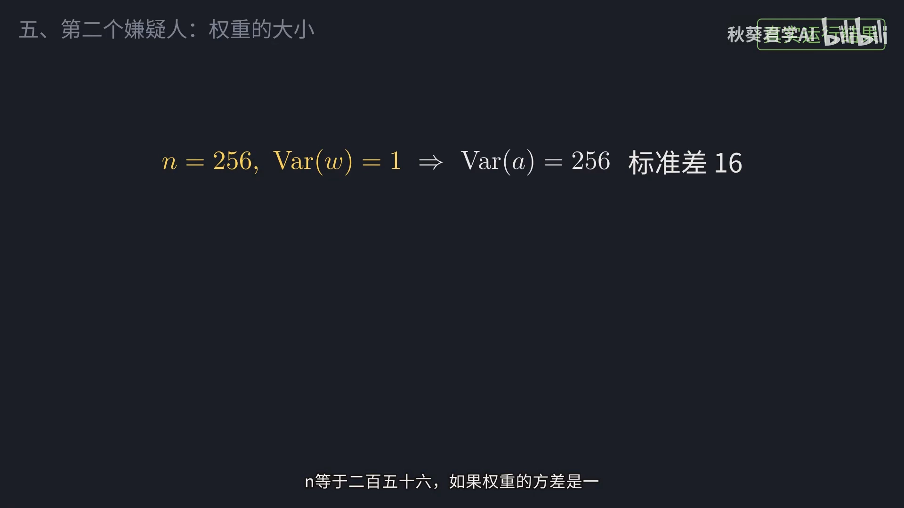

### 4.3 方差不变式：$n\cdot\mathrm{Var}(w)=1$

要让信号过一层后标准差还是 1，权重的方差就得是 $1/256$，也就是标准差 $1/16$——作者实测是 1.001。这就是好的初始化背后的想法：**让信号每过一层既不放大也不缩小**。写成公式：

$$
n\cdot \mathrm{Var}(w)=1
$$

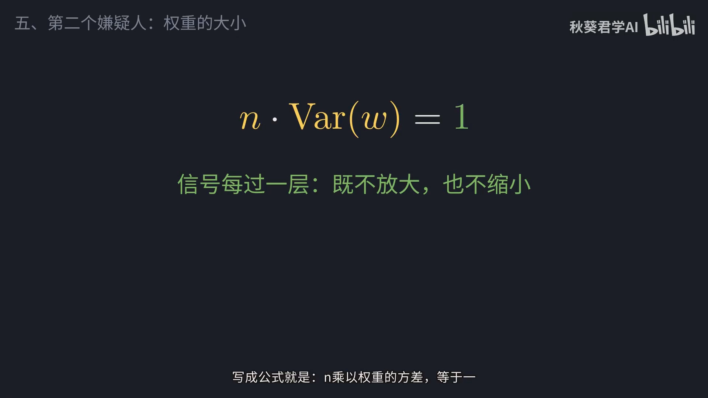

## 五、Xavier 初始化：输入个数与输出个数取折中

反向传播时误差信号也是乘权重再相加，只不过相加的项数换成了这一层的**输出个数**。2010 年 Glorot 和 Bengio 取了个折中：

$$
\mathrm{Var}(w)=\frac{2}{n_{\text{in}}+n_{\text{out}}}
$$

这就是 **Xavier 初始化**，也叫 Glorot 初始化。每层宽度都一样时，它就是 $1/n$ [【跳转到 07:05】](https://www.bilibili.com/video/BV1w8nM67EKo/?t=425)。

不过这个推导悄悄假设了一件事：**激活函数不改变信号的大小**。tanh 在零附近差不多是一条斜率为 1 的直线，这个假设还说得过去；可 ReLU 会把一半的数直接变成零，假设就不成立了。

## 六、He 初始化：ReLU 砍掉一半，就把方差翻一倍

ReLU 把负的分数全变成零，正的原样保留。分数一半正一半负，所以输出里大约一半是零——作者实测零的比例是 50.02%。

这对下一层意味着什么？下一层的分数是这些输出乘权重再相加，而刚才的规则里真正起作用的是"输入平方的平均"；输入平均为零时它就是方差。一半的数变成零，平方的平均也就只剩一半：

$$
\mathbb{E}\left[z^2\right]=\frac{1}{2}\mathrm{Var}(a)
$$

作者实测正好是上一层分数方差的 0.499 倍 [【跳转到 07:55】](https://www.bilibili.com/video/BV1w8nM67EKo/?t=475)。

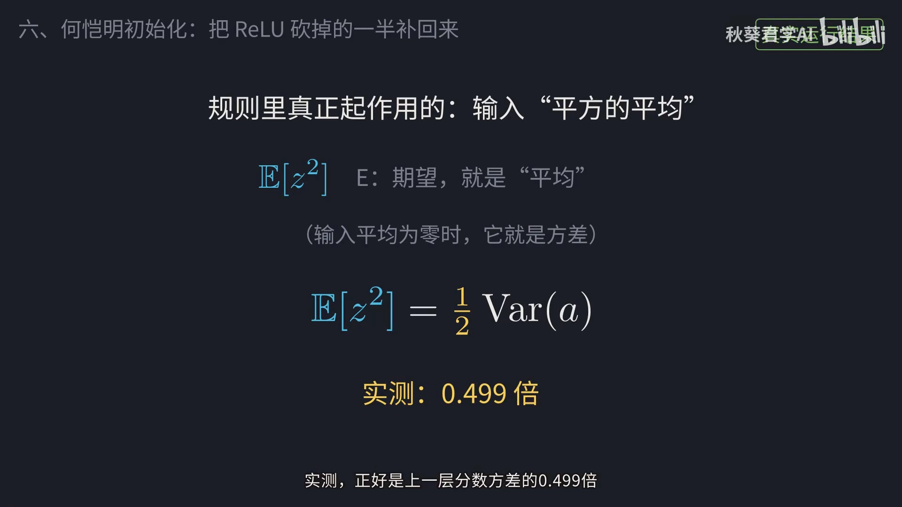

也就是说，每过一层 ReLU，信号的方差就被砍掉一半。还按 $1/n$ 取权重，50 层以后方差要乘上 $1/2^{50}$。补救办法很直接：**既然每层砍掉一半，就把权重的方差翻一倍**：

$$
\mathrm{Var}(w)=\frac{2}{n}
$$

这就是何恺明等人在 2015 年提出的初始化，叫 **He 初始化**，也叫 Kaiming 初始化。论文里说，好的初始化应该避免把输入信号指数级地缩小或放大；他们的实验里，30 层的网络用这个初始化可以从头训练到收敛，而用 Xavier 初始化训练完全停滞 [【跳转到 08:45】](https://www.bilibili.com/video/BV1w8nM67EKo/?t=525)。

## 七、50 层实验：三条曲线，只有一条是平的

作者搭了一个 50 层的 ReLU 网络，每层 256 个神经元，喂 1000 个随机输入，记下每一层分数的分布。按 He 初始化，每个权重的标准差是 $\sqrt{2/256}\approx 0.088$。

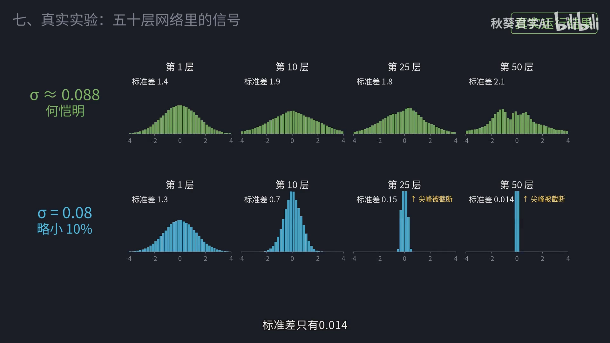

- $\sigma\approx 0.088$（He）：50 层走下来形状基本没变，标准差一直在 1.4 到 2.2 之间；
- $\sigma=0.08$（只小 10%）：每层缩到大约 0.9 倍，第十层还看得出形状，到第 50 层标准差只有 0.014；
- $\sigma=0.10$（只大 13%）：每层放大约 1.13 倍，第十层已经有一半的分数跑出画面，第 50 层标准差是 983，全部跑到画面以外 [【跳转到 10:00】](https://www.bilibili.com/video/BV1w8nM67EKo/?t=600)。

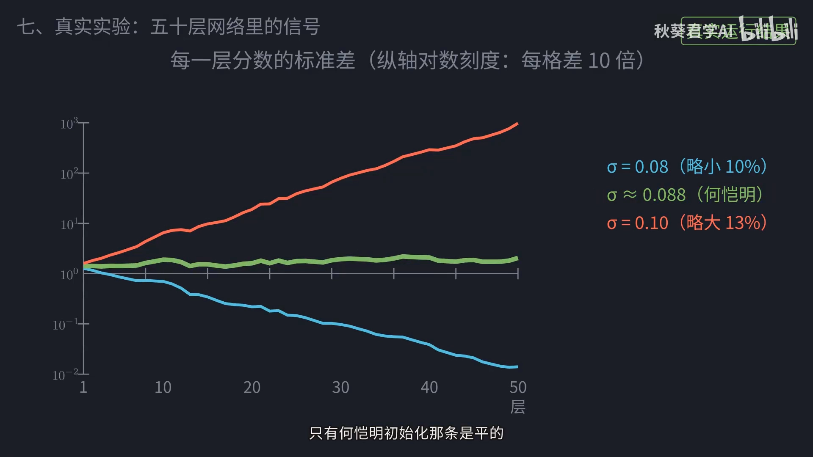

把三条线画在同一张对数纵轴的图上，一条往下、一条往上，只有 He 初始化那条是平的。**注意 10% 这个量级**：权重标准差只差 10%，50 层之后就是"平的"和"掉到 0.014"的区别——这正是"指数"两个字的实际含义。

反向也一样。在输出端放一个固定大小的误差信号往回传到第一层：He 初始化下是出发时的 1.3 倍；$\sigma=0.08$ 时只剩 0.98%；$\sigma=0.10$ 时放大了 551 倍。

## 八、初始化之外的几道保险

好的初始化只管得了训练刚开始的那一刻。训练中权重不断变化，信号的大小还可能慢慢跑偏，所以后来还有几道保险 [【跳转到 11:40】](https://www.bilibili.com/video/BV1w8nM67EKo/?t=700)：

1. **梯度裁剪**：对付梯度爆炸最朴素的办法。梯度太大时按比例把它缩回一个上限，就像给车装个限速器：

$$
g \leftarrow g\cdot \min\left(1,\ \frac{c}{\lVert g\rVert}\right)
$$

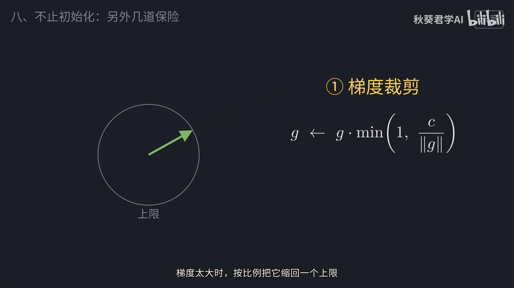

2. **归一化**：每一层算完以后直接把信号重新调回平均为零、方差为一，不管前面乘了多少——这是本系列第十期的内容。
3. **残差连接**：每一块的输出等于它的输入本身加上这一块算出的修正量。这样误差信号往回传时，除了要乘各层的倍数，还多了一条乘 1 的直通路，不会被连乘吃掉。

另外，梯度消失不止出现在很深的网络里：循环神经网络读一句话时，每读一个词就把同一组权重再乘一次，句子越长连乘越多，前面的词就越难影响后面的学习。

## 九、四个常见误解

1. **"梯度消失是 sigmoid 的锅，换成 ReLU 就没事了。"** ReLU 解决了斜率打折，但权重太小或太大照样消失或爆炸——0.01 和 0.3 的实验就是例子。
2. **"初始化只影响开头几步，训练久了自己会调过来。"** 可如果梯度已经小到 $10^{-20}$ 量级，参数几乎一动不动，训练根本没有机会调过来 [【跳转到 12:55】](https://www.bilibili.com/video/BV1w8nM67EKo/?t=775)。
3. **"梯度爆炸就是学习率太大。"** 学习率太大确实会让训练发散，但深网络里的爆炸根子在层与层之间的连乘——0.3 的实验里，第一步时第一层梯度的典型大小就有 576，是 He 初始化的 5 万倍。
4. **"只要能训练，越深就越好。"** 何恺明的论文也发现，他们 30 层的模型虽然能训练收敛，准确率却不如 14 层的。**能训得动和训得好是两回事** [【跳转到 13:20】](https://www.bilibili.com/video/BV1w8nM67EKo/?t=800)。

## 小结

- 反向传播时，误差信号每往回传一层都要乘一个倍数：**激活函数的斜率 × 权重**。
- 几十层连乘下来，倍数略小于 1 就指数衰减（梯度消失），略大于 1 就指数爆炸。0.9 的 50 次方只剩 5‰，1.1 的 50 次方是 117 倍。
- 诊断时看两处：**各层梯度的量级**（越往前是否指数级变小/变大）和**第一步的 loss**（卡在瞎猜水平还是直接 NaN）。
- 对策是让每层的倍数保持在 1 附近，即让信号在每一层的方差保持不变：$n\cdot\mathrm{Var}(w)=1$ 是基本式，Xavier 取 $2/(n_{\text{in}}+n_{\text{out}})$，ReLU 再乘 2 得到 He 初始化的 $2/n$。
- 初始化只保证开头，训练中还要靠梯度裁剪、归一化、残差连接这几道保险。
- 初始化解决的是"能不能训"，不解决"训得好不好"。

## 关键术语速查

| 术语 | 一句话解释 |
| --- | --- |
| 误差信号 $\delta$ | 反向传播中从损失往回传的那个量，决定前面各层拿到多大的梯度 |
| 梯度消失 | 误差信号每层乘小于 1 的倍数，几十层后指数衰减到几乎为零 |
| 梯度爆炸 | 倍数大于 1，误差信号指数增长，参数一更新就溢出成 NaN |
| 扇入 fan-in | 一个神经元接收的输入个数 $n$，决定这一层分数的方差放大倍数 |
| 方差不变式 | $n\cdot\mathrm{Var}(w)=1$，让信号过一层后方差不变 |
| Xavier（Glorot）初始化 | $\mathrm{Var}(w)=2/(n_{\text{in}}+n_{\text{out}})$，适合 tanh 一类对称激活 |
| He（Kaiming）初始化 | $\mathrm{Var}(w)=2/n$，为 ReLU 砍掉一半信号补回方差 |
| 梯度裁剪 | 梯度范数超过上限 $c$ 时按比例整体缩小 |