# 线性回归的系数何时可信：四条误差假设与结论的依赖关系

> 视频来源：[数据越多，结论越错？线性回归四条假设：哪条错了要命，哪条其实没那么要紧](https://www.bilibili.com/video/BV1HVytzVE3M/)（Bilibili · 两万一张饼）｜时长约 44 分钟
> 导读：这支视频不把回归假设当成一张要背的清单，而是逐条追问“哪个结论靠哪条假设撑着”。本文按“模型—无偏—标准误—检验—预测区间”的顺序整理，重点保留视频里的模拟结果和那张“假设账本”。

## 本讲要解决的核心问题（SCQA）

**背景**：线性回归的软件输出很整齐：斜率、标准误、t 值、p 值、置信区间、预测区间，每个数字都算得清清楚楚。

**冲突**：软件不会在输出里提醒你，这些数字的前提可能已经不成立。同一个斜率，在误差独立时和在误差成段相关时，含义和可信度完全不同；数据越多，有时反而越糟。

**疑问**：线性回归到底依赖哪些假设？每个假设撑起哪一个结论？某条假设被打破时，是估计本身偏了，还是我们对它有多准的判断错了？

**回答（中心思想）**：四条假设全部是在约束误差项 $\varepsilon$：线性（给定 $X$ 时误差均值为零）、独立、等方差、正态。它们不是平铺的清单，而是一座一层叠一层的楼：无偏只靠线性；标准误在无偏之上再加独立和等方差；t 检验、置信区间在小样本时还要正态；预测区间最苛刻，始终要求正态。假设被打破时，出错方式只有三种：估计本身偏了、尺子（标准误）错了、区间的上下分配错了。

## 一、出发点：真实直线加误差

### 1.1 模型写的是什么

视频把线性回归的出发点写成

$$
y_i = m x_i + b + \varepsilon_i,
$$

其中 $m$ 和 $b$ 是总体里那条真实直线的斜率和截距，固定但看不见；$\varepsilon_i$ 是第 $i$ 个观测的误差，随机、看不见，每个点各有一份（[【跳转到 01:42】](https://www.bilibili.com/video/BV1HVytzVE3M/?t=102)）。

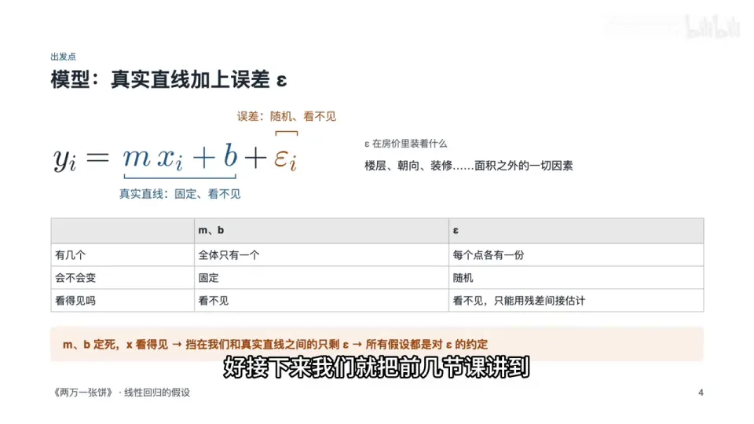

视频用房价解释 $\varepsilon$：面积 $x$ 之外，楼层、朝向、装修等所有因素都混在误差里。$m$、$b$ 是定死的，$x$ 是看得见的，挡在我们和真实直线之间的就只剩 $\varepsilon$ 这一团干扰。因此接下来所有假设，都是对 $\varepsilon$ 的约定（[【跳转到 02:07】](https://www.bilibili.com/video/BV1HVytzVE3M/?t=127)、[【跳转到 02:32】](https://www.bilibili.com/video/BV1HVytzVE3M/?t=152)）。

### 1.2 误差与残差不是一回事

误差 $\varepsilon_i$ 是观测值离**真实直线**的距离，真实直线看不见，所以误差也看不见；残差 $e_i$ 是观测值离**拟合直线**的距离，可以算出来。我们只能用残差间接估计误差，这是一种间接办法（[【跳转到 12:33】](https://www.bilibili.com/video/BV1HVytzVE3M/?t=753)）。

这个区分在后面很重要：最小二乘有一条性质——残差加起来一定等于零。但“残差和为零”是拟合方法造成的，不是“每个 $x$ 上误差长期平均为零”的证据。

## 二、最小二乘斜率：无偏只靠线性

### 2.1 斜率可以写成加权和

视频先把最小二乘估计出的斜率写成

$$
\hat{m}=\sum_{i=1}^{n} w_i y_i,
$$

其中权重 $w_i$ 正比于 $x_i-\bar{x}$：在均值左边的点权重为负，右边的点权重为正，离中心越远权重绝对值越大。权重只由 $x$ 决定，和 $y$、噪声都没有关系（[【跳转到 02:57】](https://www.bilibili.com/video/BV1HVytzVE3M/?t=177)）。

把 $y_i=m x_i+b+\varepsilon_i$ 代进去，$\hat{m}$ 被拆成两部分：直线那部分正好还原出真实斜率 $m$，噪声那部分原样留下来。于是

$$
\hat{m}=m+\sum_i w_i\varepsilon_i.
$$

### 2.2 无偏：误差在每个 $x$ 上长期平均为零

所谓**无偏**，是指如果反复重复抽样、每次都算一个 $\hat{m}$，长期平均下来等于真实斜率 $m$。对上式两边取期望，右边噪声项的期望要为零，这一步用到的正是：对每一个 $x$，误差的长期平均为零（[【跳转到 03:47】](https://www.bilibili.com/video/BV1HVytzVE3M/?t=227)）。

视频特别提醒：不是要求每一个 $\varepsilon_i$ 都等于零，而是要求在每个固定的 $x$ 上反复观测很多次，误差的平均值为零。这一次偏高、下一次偏低可以，但不能系统性地偏向某一边。

这条假设通常叫**线性**：给定 $X$ 时误差的条件均值为零，等价于 $Y$ 的平均值随 $X$ 的变化确实是一条直线。如果真实关系是弯的，在曲线两端误差长期平均为正、中间为负，直线就系统性地偏离真实关系（[【跳转到 10:03】](https://www.bilibili.com/video/BV1HVytzVE3M/?t=603)）。

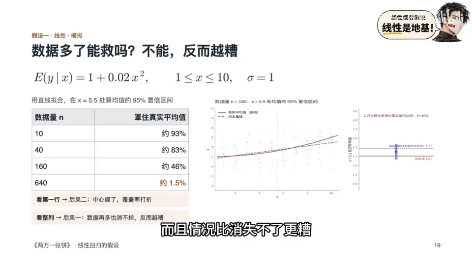

### 2.3 线性被打破：估计本身偏了，数据再多也消不掉

视频用房价举例：如果面积最大的那几套房子，实际价格总是高于真实直线，那么这些点的误差长期平均为正；而它们的权重 $w_i$ 又是正的，正数乘正数，加权和就会系统性地偏正，$\hat{m}$ 平均下来大于真实 $m$（[【跳转到 13:48】](https://www.bilibili.com/video/BV1HVytzVE3M/?t=828)）。

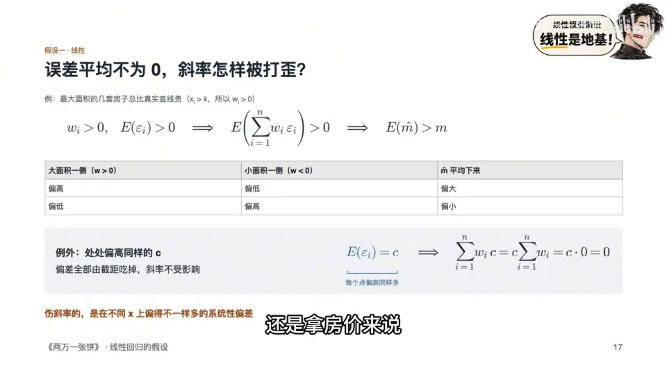

偏差的方向不一定向上，取决于误差往哪边偏、权重正负怎么搭配。有一个例外：如果每个位置上的误差都偏高同一个常数 $c$，那么 $\sum w_i c=c\sum w_i=0$，偏差全部被截距吃掉，斜率不受影响。真正伤害斜率的是**在不同 $x$ 上偏得不一样多**的系统性偏差（[【跳转到 14:13】](https://www.bilibili.com/video/BV1HVytzVE3M/?t=853)、[【跳转到 14:38】](https://www.bilibili.com/video/BV1HVytzVE3M/?t=878)）。

线性被打破的后果有两个：第一，偏差不会因为数据变多而消失，数据越多 $\hat{m}$ 的波动越小，但中心仍然偏；第二，后面的置信区间都以 $\hat{m}$ 为中心，中心偏了，区间再窄也是围着错误的位置（[【跳转到 15:03】](https://www.bilibili.com/video/BV1HVytzVE3M/?t=903)）。

视频用一个模拟展示这件事：真实关系是一条向上弯曲的曲线，却用直线去拟合。只有 10 个点时，号称 95% 的置信区间还能罩住真实平均值约 93%；数据从 10 加到 640，覆盖率一路掉到约 1.5%。原因是直线无论有多少数据都不会变成曲线，最小二乘会尽责地找到“最接近曲线的那条直线”，但直线和曲线之间的差距不会因为数据变多而消失，而置信区间的宽度只考虑噪声，数据越多越窄，最后稳定地停在错误的位置上（[【跳转到 16:32】](https://www.bilibili.com/video/BV1HVytzVE3M/?t=992)、[【跳转到 17:22】](https://www.bilibili.com/video/BV1HVytzVE3M/?t=1042)）。

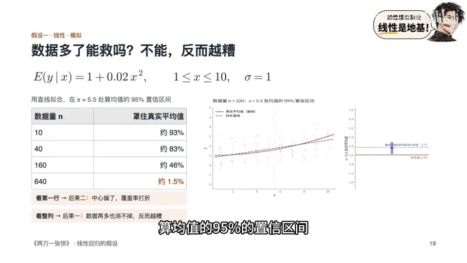

### 2.4 残差和为零，不能用来检验线性

一个常见疑问是：最小二乘的残差加起来不是零吗？既然加起来是零，怎么能说两端系统性偏高、中间系统性偏低？

视频解释：残差和为零是最小二乘选截距的方式造成的——它把直线上下挪到正负残差正好抵消的位置。不管数据长什么样、真实关系是不是直线，残差和都会是零。所以不能用“残差和是不是零”来检验线性，这条检验永远通过，什么也查不出来。要检查线性，得看残差在不同 $x$ 位置上有没有规律，比如排成 U 形或拱形（[【跳转到 10:53】](https://www.bilibili.com/video/BV1HVytzVE3M/?t=653)、[【跳转到 12:58】](https://www.bilibili.com/video/BV1HVytzVE3M/?t=778)）。

## 三、标准误：独立与等方差撑起的尺子

### 3.1 标准误的公式从哪里来

第二个结论是斜率的标准误。真实斜率 $m$ 是一个固定的数，不会波动，所以 $\hat{m}$ 的波动全部来自噪声的加权和 $\sum w_i\varepsilon_i$。要算这个加权和的方差，视频拆成四步（[【跳转到 05:02】](https://www.bilibili.com/video/BV1HVytzVE3M/?t=302)）：

1. 把一个和的方差拆成每一项方差的和——这一步要求各个 $\varepsilon_i$ **独立**，否则协方差项不能丢；
2. 把权重平方后拿出来——这是方差的基本性质，不需要假设；
3. 把共同的 $\sigma^2$ 提到求和号外——这一步要求每个 $\varepsilon_i$ 的方差都相同，即**等方差**；
4. 用残差估计 $\sigma^2$——这一步又用到线性、独立、等方差。

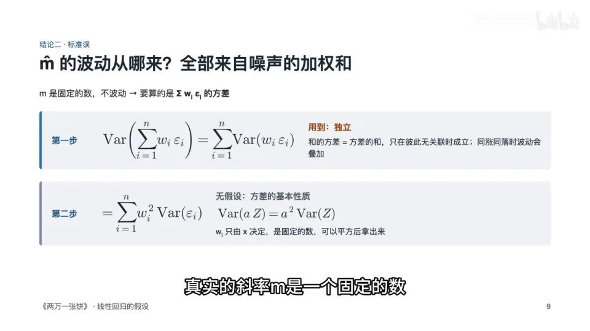

所以标准误的公式一共依赖三条假设：线性、独立、等方差。视频把这三条称为“尺子”的地基：尺子量的不是估计值本身偏不偏，而是估计值在重复抽样中散得有多开。

### 3.2 独立被打破：估计没偏，尺子短了

视频用一个模拟只破坏“独立”这一条：真实关系仍是直线，误差的均值仍为零，方差也处处相同，但今天的误差会继承昨天的一部分，

$$
\varepsilon_t=\rho\,\varepsilon_{t-1}+u_t,
$$

其中 $\rho$ 在 0 到 1 之间，表示今天继承昨天多少；$\rho=0$ 就是完全独立，$\rho$ 越大，误差越容易连着几天往同一个方向偏（[【跳转到 19:37】](https://www.bilibili.com/video/BV1HVytzVE3M/?t=1177)、[【跳转到 20:02】](https://www.bilibili.com/video/BV1HVytzVE3M/?t=1202)）。

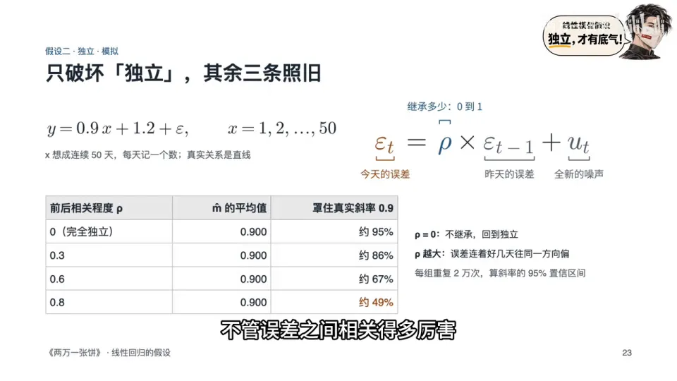

结果很关键：

- $\hat{m}$ 的平均值始终等于真实斜率，**无偏性没有被破坏**。因为无偏只用到“误差均值为零”，根本没用到独立。
- 但 95% 置信区间的实际覆盖率随 $\rho$ 增大而下降：$\rho=0$ 时约 95%，$\rho=0.3$ 时约 86%，$\rho=0.6$ 时约 67%，$\rho=0.8$ 时只剩约 49%。

原因是标准误的公式把 50 个误差当成 50 份独立信息来算。独立时，50 个误差有高有低，加起来大多互相抵消；误差成段相关时，偏高是一段一段来的，一次巧合能拖十几天，真正能互相抵消的信息远没有 50 份。于是 $\hat{m}$ 在重复抽样中实际散得比公式以为的更开，公式算出的标准误偏小，区间太窄，t 值被夸大，p 值变小，更容易宣布“显著”（[【跳转到 22:32】](https://www.bilibili.com/video/BV1HVytzVE3M/?t=1352)、[【跳转到 23:47】](https://www.bilibili.com/video/BV1HVytzVE3M/?t=1427)）。

视频还提醒：独立性通常没法只从数据里判断，很大程度上取决于数据是怎么收集的——是不是按时间顺序采的、有没有成组结构、是不是同一个对象测了好几次。这些问题往往比任何统计检验都更能说明问题（[【跳转到 25:13】](https://www.bilibili.com/video/BV1HVytzVE3M/?t=1513)）。

### 3.3 等方差被打破：无偏不受影响，区间最受伤

第三条假设是**等方差**：不管 $x$ 在哪里，误差的波动幅度都是同一个 $\sigma$。现实中这条经常不成立：收入低的人每月消费差别不大，收入高的人有的节俭、有的挥霍，差别大得多；小户型房价相近，大户型可能天差地别（[【跳转到 25:43】](https://www.bilibili.com/video/BV1HVytzVE3M/?t=1543)）。

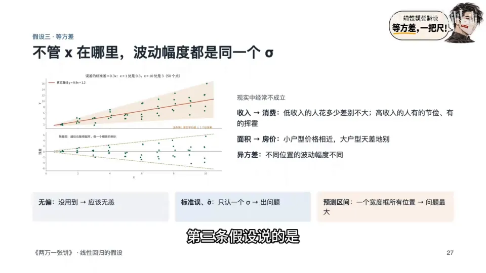

视频的模拟让误差标准差随 $x$ 成正比，结果：

- 无偏性安然无恙，$\hat{m}$ 的平均值仍等于真实斜率；
- 斜率的标准误偏小，95% 置信区间实际覆盖率约 93%，偏差不算严重；
- 预测区间问题最大：同一个宽度去框所有位置，左端白白宽了，右端太窄。视频里 $x=1.5$ 处实际罩住 100%，$x=9.5$ 处只罩住约 80%（[【跳转到 26:33】](https://www.bilibili.com/video/BV1HVytzVE3M/?t=1593)、[【跳转到 27:23】](https://www.bilibili.com/video/BV1HVytzVE3M/?t=1643)）。

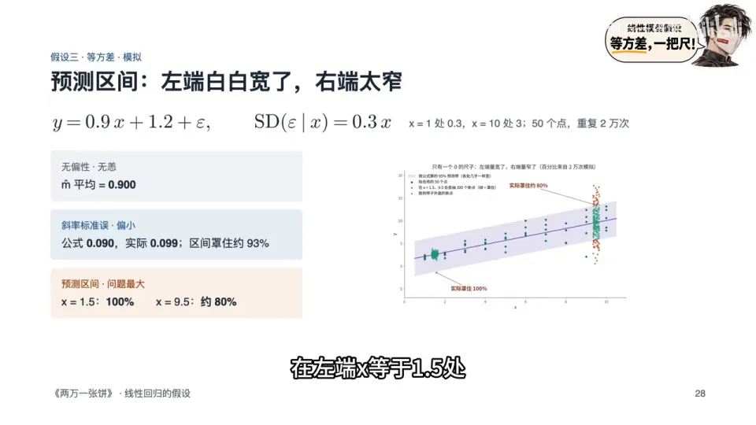

等方差的本质是“只有一个 $\sigma$，只有一把尺子”。各处波动不同时，并没有那一个统一的 $\sigma$ 可以估计；把残差混在一起算出的 $\hat{\sigma}$ 只是各处波动的混合平均。拿这个平均尺子去量波动小的地方会量宽，量波动大的地方会量窄。整体覆盖率可能还维持在 95% 左右，但落到任何一个具体位置上，出错的概率就大多了（[【跳转到 27:48】](https://www.bilibili.com/video/BV1HVytzVE3M/?t=1668)、[【跳转到 28:13】](https://www.bilibili.com/video/BV1HVytzVE3M/?t=1693)）。

视频提到，补救异方差的常用办法是换一种算标准误的方法（如异方差稳健标准误），它修正斜率的检验，但修正不了预测区间；要把预测区间做对，需要直接对波动如何随 $x$ 变化建模，或对 $Y$ 做变换（[【跳转到 28:38】](https://www.bilibili.com/video/BV1HVytzVE3M/?t=1718)）。

## 四、正态：对斜率宽容，对预测区间苛刻

### 4.1 正态只影响“查表”的精确性

第四条假设是误差服从正态分布。视频说，很多人一提到回归假设第一个想到正态，但对斜率的推断而言，它往往是最宽容的一条（[【跳转到 29:03】](https://www.bilibili.com/video/BV1HVytzVE3M/?t=1743)）。

- 无偏只用到误差均值为零，不用正态；
- 标准误的公式只用到独立和等方差，不用正态；
- 正态真正登场的地方是 t 检验和置信区间：t 统计量要精确服从自由度为 $n-2$ 的 t 分布，前提是误差服从正态。只有满足这个条件，查表得到的临界值（比如 10 个点时约 $\pm 2.306$）才是精确的。

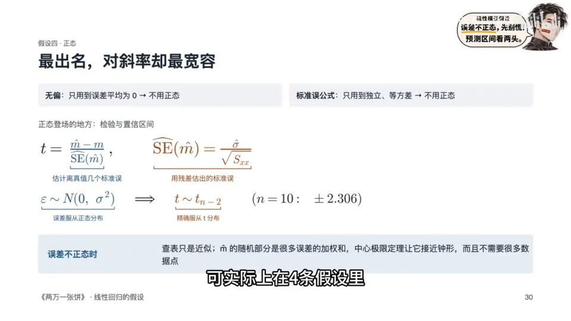

误差不正态时，查表得到的临界值只能当近似。好在对斜率而言，这个近似通常相当好：$\hat{m}$ 的随机部分是很多个误差的加权和，中心极限定理告诉我们，很多独立量加起来会趋向钟形，而且不需要很多数据点。视频用两种很不正态的误差做模拟，只有 10 个点时置信区间也基本兑现了 95% 的承诺（[【跳转到 30:18】](https://www.bilibili.com/video/BV1HVytzVE3M/?t=1818)、[【跳转到 30:43】](https://www.bilibili.com/video/BV1HVytzVE3M/?t=1843)）。

但有一个重要例外：如果样本很小，又有一两个离中心很远的点，少数几个极端误差可能主导整个结果，正态假设就会变得重要（[【跳转到 31:08】](https://www.bilibili.com/video/BV1HVytzVE3M/?t=1868)）。

### 4.2 预测区间：没有平均可借，必须面对误差形状

预测区间比均值的置信区间多了一项：新数据点自己的那一份误差。那只是单独一个 $\varepsilon$，没有别的东西可以拿来平均，中心极限定理帮不上忙。误差是什么形状，预测区间就得面对什么形状（[【跳转到 31:33】](https://www.bilibili.com/video/BV1HVytzVE3M/?t=1893)）。

视频用长尾误差模拟：数据非常多时，按正态的 $\pm1.96\sigma$ 算预测区间，整体覆盖率约 96%，看起来还不错；但落空的 4% 全部在上方，下方几乎从不漏。也就是说，区间整体罩住的比例差不多，可上下分配不对：下界几乎没用，上界又不够高（[【跳转到 31:58】](https://www.bilibili.com/video/BV1HVytzVE3M/?t=1918)、[【跳转到 32:23】](https://www.bilibili.com/video/BV1HVytzVE3M/?t=1943)）。

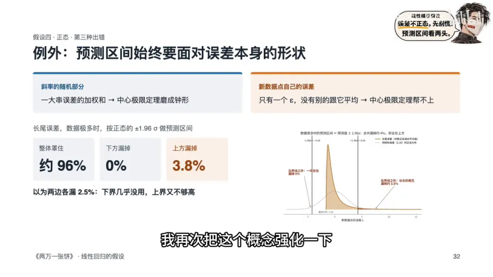

这类情形在现实里很常见：房价里的学区房、江景房会比平均值高出一大截，却很少有房子低出同样一大截；住院天数、保险理赔金额、快递送达时间也往往是右偏长尾。公式给出的预测区间是对称的，上下各延伸一样长，于是风险在最有用的那一侧被低估（[【跳转到 33:05】](https://www.bilibili.com/video/BV1HVytzVE3M/?t=1985)、[【跳转到 33:30】](https://www.bilibili.com/video/BV1HVytzVE3M/?t=2010)）。

视频给出几条常见思路：对 $Y$ 做变换（比如取对数）后再算区间；不依赖正态的 $\pm1.96\sigma$，直接看残差里最低 2.5% 和最高 2.5% 在哪（Bootstrap 沿着这个思路）；直接对分位数建模；或用符合右偏形状的分布建模（广义线性模型的一个思路）。核心提醒是：做预测区间之前一定要看一眼残差的行为，出现大的非正态偏差时，数据再多也救不了它（[【跳转到 34:04】](https://www.bilibili.com/video/BV1HVytzVE3M/?t=2044)、[【跳转到 34:54】](https://www.bilibili.com/video/BV1HVytzVE3M/?t=2094)）。

## 五、四条假设的账本

视频最后把四条假设和前面的结论放在一张表里，这张表最值得记住的是“打勾区域的形状”：越往下的结论，需要的假设越多（[【跳转到 35:11】](https://www.bilibili.com/video/BV1HVytzVE3M/?t=2111)）。

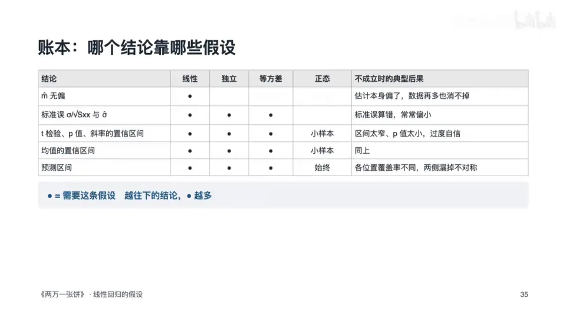

| 结论 | 线性 | 独立 | 等方差 | 正态 | 假设不成立时的典型后果 |
| --- | --- | --- | --- | --- | --- |
| $\hat{m}$ 无偏 | 需要 | 不需要 | 不需要 | 不需要 | 估计本身偏了，数据再多也消不掉 |
| 标准误 $\sigma/\sqrt{S_{xx}}$ 与 $\hat{\sigma}$ | 需要 | 需要 | 需要 | 不需要 | 标准误错，常常偏小 |
| t 检验、p 值、斜率的置信区间 | 需要 | 需要 | 需要 | 小样本需要 | 区间太窄、p 值太小、过度自信 |
| 均值的置信区间 | 需要 | 需要 | 需要 | 小样本需要 | 同上 |
| 预测区间 | 需要 | 需要 | 需要 | 始终需要 | 各位置覆盖率不同，两侧漏掉不对称 |

视频把出错方式归纳成三种（[【跳转到 09:33】](https://www.bilibili.com/video/BV1HVytzVE3M/?t=573)、[【跳转到 35:36】](https://www.bilibili.com/video/BV1HVytzVE3M/?t=2136)）：

1. **估计本身打歪了**：线性被打破，$\hat{m}$ 有偏，后面所有结论都建立在错误中心上，数据越多问题越严重。
2. **尺子错了**：独立或等方差被打破，估计仍然无偏，但标准误算错，通常偏小，导致区间太窄、t 值虚高、p 值偏小，结论过度自信。
3. **区间上下分配错了**：正态被打破，整体覆盖率可能还接近，但上下两侧漏掉的比例不对称，最关心的一侧反而被低估。

## 六、常见误读与检查顺序

视频最后专门拆了两个常见误解（[【跳转到 36:46】](https://www.bilibili.com/video/BV1HVytzVE3M/?t=2206)、[【跳转到 37:11】](https://www.bilibili.com/video/BV1HVytzVE3M/?t=2231)）。

### 6.1 不是 $Y$ 要正态，也不是 $X$ 要正态

四条假设说的全都是误差 $\varepsilon$，而且是给定 $X$ 之后的误差，不是 $Y$ 本身。视频举例：如果面积从小到大均匀铺开，每个面积上的房价围绕真实直线正态偏离，那么四条假设都成立；但把所有房价画成一个直方图，它可能是平平的一块，因为面积均匀铺开把价格也铺平了。$Y$ 不正态，斜率的估计、置信区间、预测区间照样可以没问题（[【跳转到 37:11】](https://www.bilibili.com/video/BV1HVytzVE3M/?t=2231)、[【跳转到 37:36】](https://www.bilibili.com/video/BV1HVytzVE3M/?t=2256)）。

$X$ 也没有分布要求，可以是任何分布，甚至可以是实验者事先设定的几种户型面积。要检查的是“同样面积下价格围绕直线的偏离”，也就是残差，而不是价格本身。

### 6.2 假设很少分毫不差，要问偏离影响哪个结论

视频强调，几乎没有哪一条假设是分毫不差地成立的：真实关系多少有点弯，波动幅度多少有点不同，误差形状也不会恰好是教科书上的正态。所以更有用的问题不是“假设成不成立”，而是“偏离有多大、具体影响我关心的哪个结论”（[【跳转到 37:57】](https://www.bilibili.com/video/BV1HVytzVE3M/?t=2277)、[【跳转到 38:22】](https://www.bilibili.com/video/BV1HVytzVE3M/?t=2302)）。

- 如果只是想知道斜率大概是多少、数据又不少，线性之外的几条可以相对宽容；
- 如果要给一套具体房子报价格范围，预测区间对正态和等方差都很敏感，就得认真对待；
- 如果数据是一个班一个班收集的，哪怕任何检验都没报警，也应该怀疑独立性。

视频给出的检查顺序不是“先检验正态”，而是先问更根本的三个问题：关系真的是直线吗？数据是怎么收集的、彼此有没有关联？不同位置的波动幅度差不多吗？这三条比“残差是不是正态”更值得花时间（[【跳转到 36:01】](https://www.bilibili.com/video/BV1HVytzVE3M/?t=2161)、[【跳转到 36:26】](https://www.bilibili.com/video/BV1HVytzVE3M/?t=2186)）。

## 小结

- 线性回归的四条假设全部是在约束误差 $\varepsilon$：线性（给定 $X$ 时均值为零）、独立、等方差、正态。
- 无偏只靠线性；线性被打破时估计本身有偏，数据越多偏差不会消失，置信区间会稳定地停在错误位置。
- 标准误在无偏之上再加独立和等方差；这两条被打破时估计仍无偏，但尺子错了，通常表现为区间太窄、p 值偏小、过度自信。
- 正态主要影响 t 检验和置信区间的精确性；对斜率而言，样本一大中心极限定理会让它变得不敏感；对预测区间而言，正态始终重要，因为新数据点自己的误差没有平均可借。
- 四条假设不是平铺的清单，而是一层叠一层的楼：越往下游的结论，依赖的假设越多。
- 检查假设时，先看残差有没有形状、数据是不是成组收集、波动是否随 $X$ 变化，再决定要不要担心正态。

## 关键术语速查

| 术语 | 一句话解释 |
| --- | --- |
| 误差 $\varepsilon$ | 观测值离真实直线的距离；随机、看不见，每个点各有一份。 |
| 残差 $e$ | 观测值离拟合直线的距离；可以算出来，用来间接估计误差。 |
| 无偏 | 反复抽样得到的估计值长期平均等于真实参数。 |
| 线性假设 | 给定 $X$ 时误差的条件均值为零，等价于 $Y$ 的平均值随 $X$ 呈直线变化。 |
| 独立 | 一个点的误差不会系统性地影响另一个点的误差。 |
| 等方差 | 不管 $X$ 在哪里，误差的波动幅度都是同一个 $\sigma$。 |
| 正态假设 | 误差服从正态分布；主要影响 t 检验和预测区间的精确性。 |
| 标准误 | 估计值在重复抽样中的波动幅度，用来衡量估计有多准。 |
| 置信区间 | 对参数（如斜率）的区间估计；重复抽样时约有一定比例的区间罩住真值。 |
| 预测区间 | 对一个新的个体观测值的区间估计；比均值置信区间多一份个体误差。 |