# 线性回归：从残差平方和到设计矩阵的连续值预测

> 视频来源：[线性回归——机器学习的第一个模型](https://www.bilibili.com/video/BV1xrNGzrEJx/)（Bilibili · 谦行AIing）｜时长约 20 分钟
> 导读：这支视频从“面积预测房价”出发，把线性回归拆成模型、残差、损失、求解四步，再推广到多特征、向量形式和设计矩阵。本文按这条主线整理，并补上视频中一带而过的“最小二乘”与“梯度下降”的分工。

## 本讲要解决的核心问题（SCQA）

**背景**：我们手里有一张表，每个样本有若干特征 $x$，还有一个连续的标签 $y$，比如房屋面积与总价。直觉上面积越大房价越高，但点并不落在同一条线上。

**冲突**：可以画出无数条“差不多穿过这些点”的直线，哪一条才算好？把特征从一个扩展到多个之后，又该怎么统一表示和求解？

**疑问**：怎样把“拟合得好”写成一个可优化的目标？这个目标的最小值用什么方法找？找到的权重和偏置又该怎么读？

**回答（中心思想）**：线性回归先用一个线性函数 $\hat{y}=w^\top x+b$ 表示预测，再用残差平方和（均方误差）把“拟合得好不好”变成一个数，最后用最小二乘或梯度下降求参数。多特征时把所有样本的特征排成设计矩阵 $X$，模型仍是同一个线性加权和；多项式回归、逻辑回归和神经网络都可以看作在这个骨架上换特征或换输出层。

## 一、任务：给连续值找一条可计算的规律

### 1.1 从面积预测房价

视频先给出一张面积与总价的表：50 平方米约 122 万，70 平方米约 157 万，90 平方米约 203 万，110 平方米约 255 万，130 平方米约 303 万。把这些点画成散点图，能看到面积越大、总价越高的趋势，但点并不严格共线（[【跳转到 00:25】](https://www.bilibili.com/video/BV1xrNGzrEJx/?t=25)）。

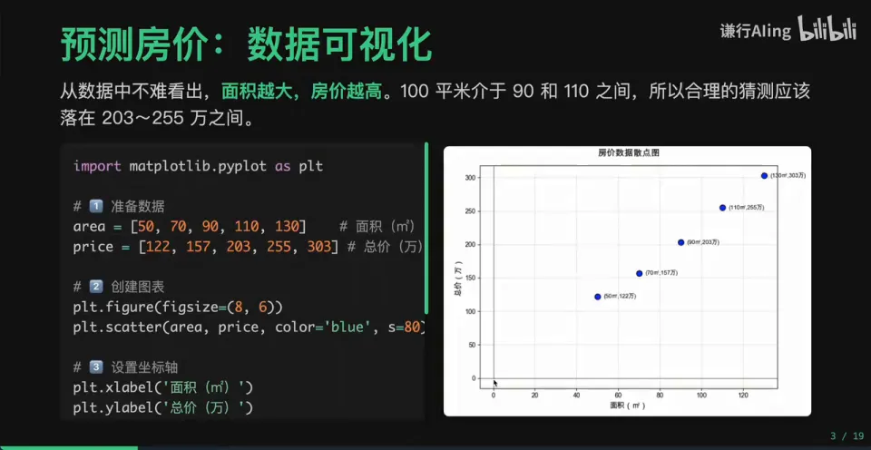

既然趋势存在，就可以尝试画一条直线去描述它。视频里先“目测”了一条

$$
\text{房价} = 2.2 \times \text{面积} + 10
$$

把 100 平方米代进去，得到约 230 万。这个数比只看邻近点得到的 203～255 万区间更具体，说明一条合适的直线可以把零散观测压缩成一个可计算的预测规则（[【跳转到 00:56】](https://www.bilibili.com/video/BV1xrNGzrEJx/?t=56)、[【跳转到 01:19】](https://www.bilibili.com/video/BV1xrNGzrEJx/?t=79)）。

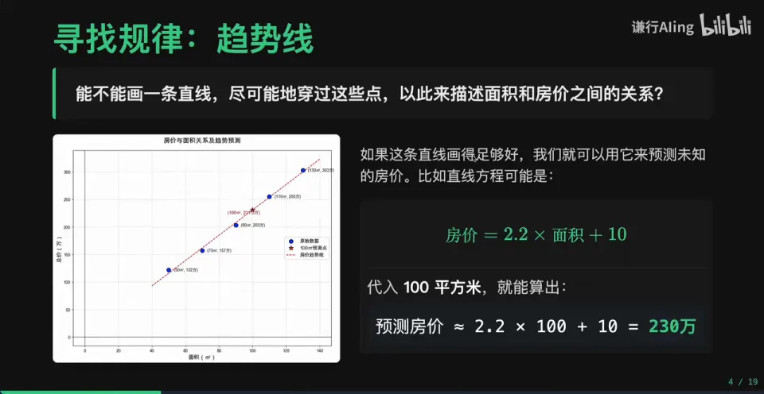

这里的预测对象是**连续数值**：房价可以取 230.5 万，也可以取 231.7 万，不是“是/否”这样的离散类别。视频把这种“输入特征、输出连续值”的任务称为回归，把输出离散类别的任务称为分类（[【跳转到 03:15】](https://www.bilibili.com/video/BV1xrNGzrEJx/?t=195)）。

### 1.2 “线性”不是“直线”

一个容易误解的地方是：线性回归里的“线性”并不等于“在平面上画一条直线”。视频给出的数学定义是，一个映射 $f$ 若满足

$$
f(ax)=a\,f(x), \qquad f(x+y)=f(x)+f(y),
$$

也就是**按比例变化、可叠加**，就称为线性（[【跳转到 02:01】](https://www.bilibili.com/video/BV1xrNGzrEJx/?t=121)、[【跳转到 02:26】](https://www.bilibili.com/video/BV1xrNGzrEJx/?t=146)）。

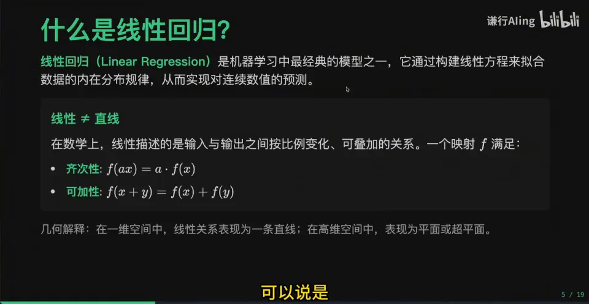

在一维输入时，线性关系在几何上确实表现为一条直线；到了高维，它表现为一个平面或超平面。这个区分在后面讲多项式回归时很关键：只要模型对**参数**是线性的，即使特征里出现 $x^2$、$x^3$，它仍然属于线性回归的范畴。

### 1.3 “回归”一词从哪里来

视频还补充了“回归”这个词的来源：统计学家高尔顿观察到，身高极高或极矮的父母，其子女身高往往会向群体平均值靠拢，这种现象被称为“回归均值”。在机器学习里，“回归”被引申为通过数据建模变量之间的映射关系，进而预测连续数值（[【跳转到 03:25】](https://www.bilibili.com/video/BV1xrNGzrEJx/?t=205)）。

## 二、单特征模型：权重决定斜率，偏置决定基准

### 2.1 模型公式

最简单的线性回归只有一个特征。视频把模型写成

$$
\hat{y}=wx+b,
$$

其中 $\hat{y}$ 是预测值，$x$ 是输入特征，$w$ 是权重，$b$ 是偏置（[【跳转到 04:08】](https://www.bilibili.com/video/BV1xrNGzrEJx/?t=248)）。

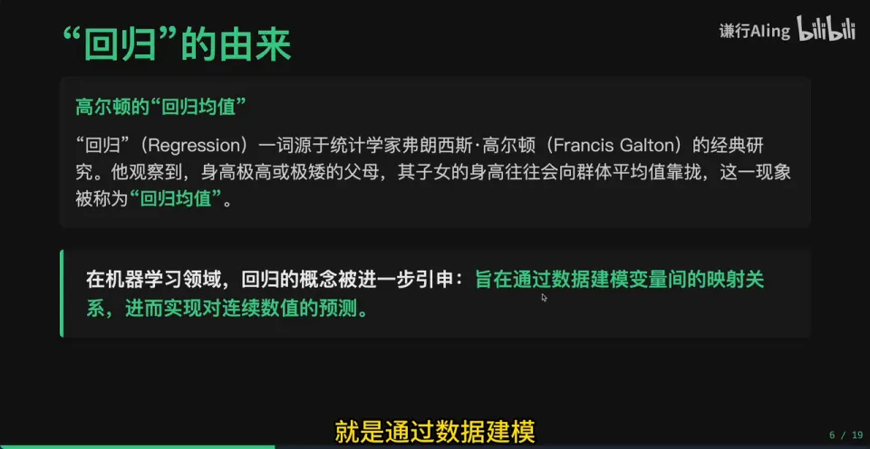

在房价例子里：

- $w$ 是直线的斜率，表示面积每增加 1 平方米，预测房价变化多少；
- $b$ 是直线的截距，表示面积为零时的理论基准值；
- $\hat{y}$ 上方的“帽子”表示这是模型的预测，不是真实观测。

### 2.2 训练就是在搜索一组参数

视频强调，$w$ 和 $b$ 就是模型要学习的**参数**。训练模型的本质，是搜索一组最合适的 $w$ 和 $b$，让这条线画得更准、预测得更准（[【跳转到 04:33】](https://www.bilibili.com/video/BV1xrNGzrEJx/?t=273)、[【跳转到 04:58】](https://www.bilibili.com/video/BV1xrNGzrEJx/?t=298)）。

这也解释了大模型里常说的“多少 B 参数”：参数就是模型里可以被训练调整的数。线性回归只有两个参数，但它和后面动辄数十亿参数的模型共享同一个基本问题：给定一个模型结构，怎样找到一组让损失尽可能小的参数。

## 三、残差平方和：把“拟合得好”变成一个数

### 3.1 残差是预测与真实的差

知道当前参数好不好，需要一个度量。视频的做法是：对每个训练样本先做预测，再看预测值与真实值差多少，这个差就是误差；在线性回归的语境里，它对应每个点离拟合直线的竖直距离，也就是**残差**（[【跳转到 05:18】](https://www.bilibili.com/video/BV1xrNGzrEJx/?t=318)、[【跳转到 05:43】](https://www.bilibili.com/video/BV1xrNGzrEJx/?t=343)）。

### 3.2 为什么要把残差平方

如果直接把残差相加，正误差和负误差会互相抵消，可能出现“明明每个点都偏得很远，加起来却等于零”的情况。平方之后，正负号被消掉，所有偏差都变成正数，损失就不会被抵消掉（[【跳转到 06:08】](https://www.bilibili.com/video/BV1xrNGzrEJx/?t=368)、[【跳转到 06:22】](https://www.bilibili.com/video/BV1xrNGzrEJx/?t=382)）。

平方还有第二个作用：放大较大的误差。视频举了一个例子：误差 3 和 0.4 看起来差距不算大，但平方后变成 9 和 0.16，差距被明显拉开。这样优化时会更“在意”那些偏得很远的点，相当于给大误差加了一个惩罚项（[【跳转到 06:47】](https://www.bilibili.com/video/BV1xrNGzrEJx/?t=407)）。

### 3.3 均方误差 MSE

把每个样本的残差平方加起来再求平均，就得到**均方误差**（Mean Squared Error，MSE）：

$$
\mathrm{MSE}=\frac{1}{n}\sum_{i=1}^{n}(\hat{y}_i-y_i)^2.
$$

其中 $n$ 是样本数，$\hat{y}_i$ 是第 $i$ 个样本的预测值，$y_i$ 是真实值（[【跳转到 05:43】](https://www.bilibili.com/video/BV1xrNGzrEJx/?t=343)）。

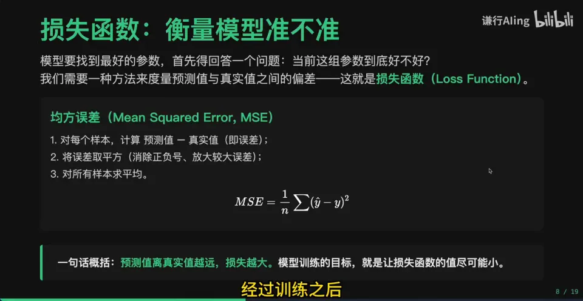

MSE 越小，说明预测值整体上离真实值越近；MSE 越大，说明拟合越差。于是“找最好的直线”就变成了“找一组使 MSE 最小的参数”。

## 四、两种求解路径：最小二乘与梯度下降

### 4.1 最小二乘：小数据时可以一次解出

视频提到，在线性回归里，参数可以用**最小二乘法**一次算出来：它直接寻找使残差平方和最小的那组参数。数据量比较小、特征不多时，这种数学方法很直接（[【跳转到 09:22】](https://www.bilibili.com/video/BV1xrNGzrEJx/?t=562)、[【跳转到 13:07】](https://www.bilibili.com/video/BV1xrNGzrEJx/?t=787)）。

“最小二乘”这个名字说的就是准则：让残差的**平方和最小**。它不改变模型形式，只是换了一种求参数的方式。

### 4.2 梯度下降：大数据和多特征时的迭代办法

当数据量很大、特征很多时，视频说通常改用**梯度下降**。它的做法是对损失函数求导（多特征时求偏导），得到当前参数下损失变化的方向，然后沿着让损失下降的方向小步调整参数（[【跳转到 07:17】](https://www.bilibili.com/video/BV1xrNGzrEJx/?t=437)）。

视频用“蒙着眼睛下山”作比喻：

1. 用脚感知当前坡度，判断是上坡还是下坡；
2. 沿着下坡方向迈出一小步；
3. 到新位置再感知坡度，继续走；
4. 直到再也找不到下坡路，认为到达谷底。

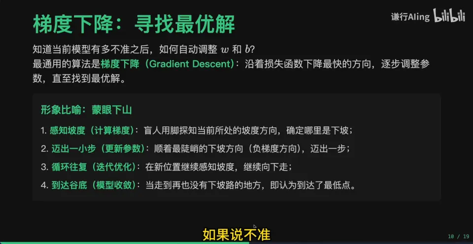

对应到机器学习：

- 山的高度是损失函数的值；
- 下坡方向是梯度（偏导数）；
- 每一步迈多大是**学习率**；
- 反复迭代直到损失接近最小，就是模型收敛。

学习率太大会“迈过头”，在谷底两侧来回跳；太小则走得很慢。视频没有展开学习率的调参细节，只强调它要设一个合适的值（[【跳转到 09:47】](https://www.bilibili.com/video/BV1xrNGzrEJx/?t=587)）。

### 4.3 训练循环

把上面的步骤串起来，就是线性回归的训练循环：

```text
输入数据
  → 计算预测
  → 计算损失（MSE）
  → 计算梯度
  → 更新参数
  → 回到“计算预测”，重复多轮
```

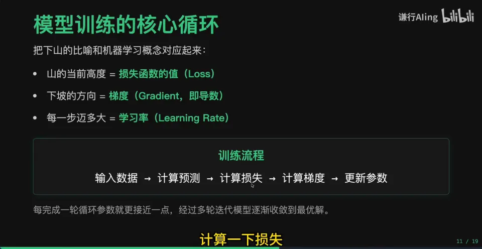

视频把这一轮循环看作机器学习的基本范式：模型表达规律，损失衡量误差，梯度下降优化参数，迭代让参数逐步接近最优（[【跳转到 10:12】](https://www.bilibili.com/video/BV1xrNGzrEJx/?t=612)、[【跳转到 10:37】](https://www.bilibili.com/video/BV1xrNGzrEJx/?t=637)）。

## 五、多特征与设计矩阵

### 5.1 从一个特征到 d 个特征

房价不只由面积决定。视频又给出一张表，加入楼层、距地铁距离、房龄等特征：110 平方米的房子可能比 90 平方米的更便宜，因为它离地铁更远、房龄更长。单靠面积无法解释这种差异（[【跳转到 11:02】](https://www.bilibili.com/video/BV1xrNGzrEJx/?t=662)、[【跳转到 11:27】](https://www.bilibili.com/video/BV1xrNGzrEJx/?t=687)）。

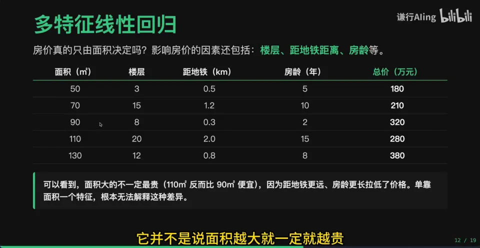

模型自然扩展为

$$
\hat{y}=w_1x_1+w_2x_2+\cdots+w_dx_d+b,
$$

其中 $d$ 是特征数。每个特征有自己的权重，权重为正表示该特征越大预测值越大，为负表示该特征越大预测值越小。视频用房价例子说明：面积、楼层的权重可能为正，距地铁距离、房龄的权重可能为负（[【跳转到 11:52】](https://www.bilibili.com/video/BV1xrNGzrEJx/?t=712)）。

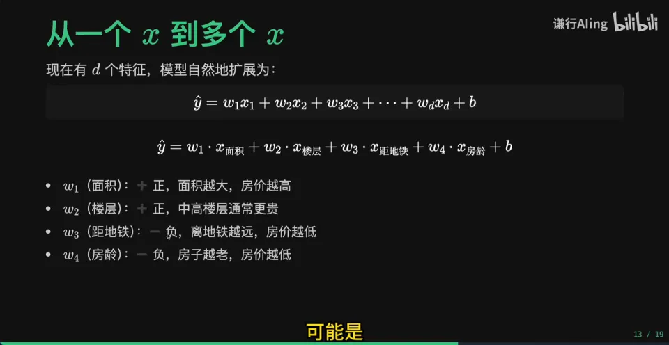

### 5.2 向量形式

特征一多，公式会很长。视频用向量记号把它压缩成

$$
\hat{y}=w^\top x+b,
$$

其中 $x=(x_1,\dots,x_d)^\top$ 是特征向量，$w=(w_1,\dots,w_d)^\top$ 是权重向量。$w^\top x$ 就是对应分量相乘再相加，也就是“加权求和”（[【跳转到 14:22】](https://www.bilibili.com/video/BV1xrNGzrEJx/?t=862)）。

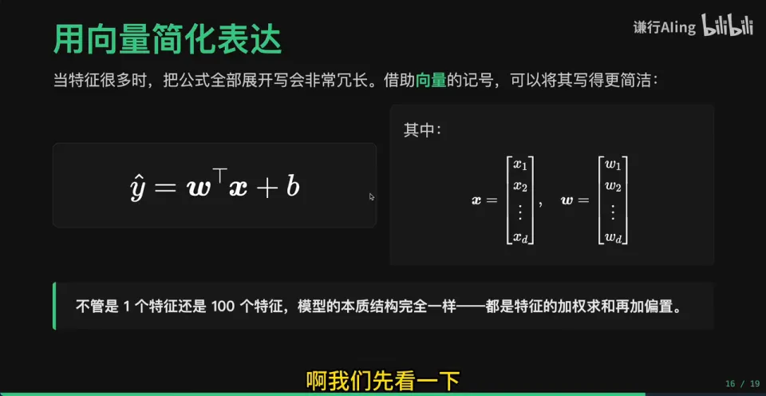

视频特别指出：不管是一个特征还是 100 个特征，模型的本质结构完全一样，都是特征的加权和再加偏置；特征多的时候只是向量变长（[【跳转到 14:47】](https://www.bilibili.com/video/BV1xrNGzrEJx/?t=887)）。

### 5.3 设计矩阵：把 N 个样本排成矩阵

单个样本写成向量后，多个样本可以按行叠起来。把 $N$ 个样本的 $d$ 个特征排成一个 $N\times d$ 的矩阵 $X$：

$$
X=
\begin{bmatrix}
x_{11} & x_{12} & \cdots & x_{1d}\\
x_{21} & x_{22} & \cdots & x_{2d}\\
\vdots & \vdots & \ddots & \vdots\\
x_{N1} & x_{N2} & \cdots & x_{Nd}
\end{bmatrix}.
$$

这个矩阵就是线性回归的**设计矩阵**（design matrix）：每一行是一个样本，每一列是一个特征。把所有样本的预测值也排成向量 $\hat{y}$，模型可以写成

$$
\hat{y}=Xw+b\mathbf{1}.
$$

视频里用 NumPy 准备特征数据时，构造的正是这样一个二维数组：行对应样本，列对应特征；随后把 $X$ 和 $y$ 一起传给 `fit`，由库函数完成训练（[【跳转到 12:42】](https://www.bilibili.com/video/BV1xrNGzrEJx/?t=762)）。

> 说明：视频用“二维数组/矩阵”描述特征表，没有逐项写出 $X$ 的维度记号。上面的 $N\times d$ 写法是把视频中的代码形状和“每行一个样本、每列一个特征”的含义明确化，便于和后续小节的设计矩阵语言对齐。

设计矩阵的好处是：不管有 1 个还是 100 个特征，模型都写成同一个矩阵乘法；样本数 $N$ 只影响矩阵有多少行，特征数 $d$ 只影响有多少列。后面讲最小二乘的闭式解、正则化和数值稳定性时，都会直接在这个矩阵上操作。

### 5.4 代码里的参数

视频用 scikit-learn 的 `LinearRegression` 演示了多特征拟合：把特征矩阵和标签传进 `fit`，再打印学到的权重和偏置。

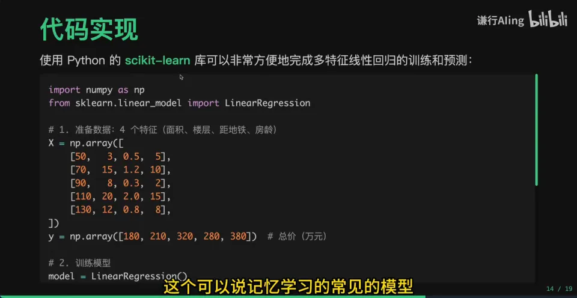例子里面积权重约 2.42，楼层权重约 1.3，距地铁距离和房龄的权重为负，偏置约 49。用这些参数预测一套 100 平方米、指定楼层、地铁距离和房龄的房子，得到约 289 万，比只用面积预测的 230 万更细（[【跳转到 13:07】](https://www.bilibili.com/video/BV1xrNGzrEJx/?t=787)、[【跳转到 13:32】](https://www.bilibili.com/video/BV1xrNGzrEJx/?t=812)）。

这段代码也说明了“最小二乘”和“梯度下降”在工程上的分工：数据量小时，库可能直接用最小二乘一次解出；数据量大或特征多时，则用梯度下降迭代求解（[【跳转到 13:07】](https://www.bilibili.com/video/BV1xrNGzrEJx/?t=787)）。

### 5.5 正则化入口：在最小二乘目标上加一项惩罚

最小二乘的目标只有残差平方和。如果在这个目标后面再加一项惩罚，例如 $\lambda\sum_j w_j^2$（不含截距），就得到**岭回归**：惩罚让“系数很大”本身变成一种代价，最优解被拉向系数更小的方向。训练拟合会差一点，但预测对训练数据的细节不那么敏感，用一点偏差换方差下降。$\lambda$ 控制惩罚强度，$\lambda=0$ 时退回最小二乘。

这就是线性回归通往正则化的入口：模型形式不变，只改目标函数。完整的数值例子、$\lambda$ 的选择和高维情形，见 [岭回归（L2）：惩罚项、λ 与系数收缩](../../2.2_优化与容量/2.2.6_模型正则化：L1、L2%20与早停/岭回归（L2）：惩罚项、λ%20与系数收缩.md)。

## 六、多项式回归：特征可以弯，参数仍是线性

现实中的数据不一定沿直线分布。房价随面积增长可能先慢后快，也可能先快后慢，直线拟合不好。视频引入**多项式回归**：

$$
\hat{y}=w_1x+w_2x^2+\cdots+w_dx^d+b.
$$

当 $d=1$ 时就是普通线性回归；$d=2$ 时拟合一条抛物线；阶数越高，曲线越灵活（[【跳转到 15:28】](https://www.bilibili.com/video/BV1xrNGzrEJx/?t=928)）。

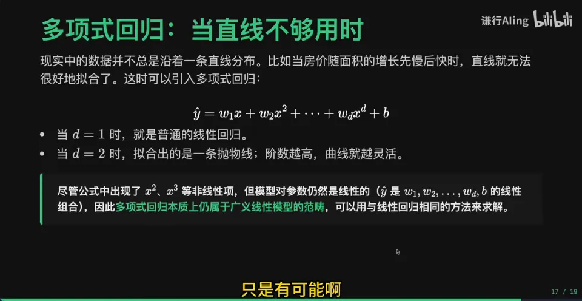

关键点是：虽然公式里出现了 $x^2$、$x^3$ 这些非线性项，模型对**参数** $w_1,\dots,w_d,b$ 仍然是线性的。只要把 $x^2$ 看成另一个新特征，把 $x^3$ 看成再一个新特征，模型又回到了“特征的加权和”这个形式，因此可以用与线性回归相同的方法求解（[【跳转到 15:53】](https://www.bilibili.com/video/BV1xrNGzrEJx/?t=953)、[【跳转到 16:18】](https://www.bilibili.com/video/BV1xrNGzrEJx/?t=978)）。

视频把这一点总结成两句话：

1. 线性回归不一定画的是直线；
2. 线性回归的“线性”是指对参数线性，不是对输入特征线性。

这也解释了为什么“多项式回归”本质上仍属于广义的线性模型：它只是先做特征变换，再套用线性模型。

## 七、线性回归为什么是起点

视频最后把线性回归放到更大的地图上：它虽然简单，却是很多复杂模型的起点（[【跳转到 17:06】](https://www.bilibili.com/video/BV1xrNGzrEJx/?t=1026)、[【跳转到 17:31】](https://www.bilibili.com/video/BV1xrNGzrEJx/?t=1051)）。

- **逻辑回归**：在线性打分 $wx+b$ 外面加一个 Sigmoid 激活函数，把输出压到 0～1，用来表示类别概率。它仍然沿用线性回归的加权和结构，只是输出对象从连续值变成了概率。
- **深度学习**：把许多“线性变换 + 激活函数”逐层堆叠起来，就得到多层网络。每个隐藏层内部仍然是一次线性加权，只是特征由模型自己学习，而不是人工指定面积、楼层这些原始特征。

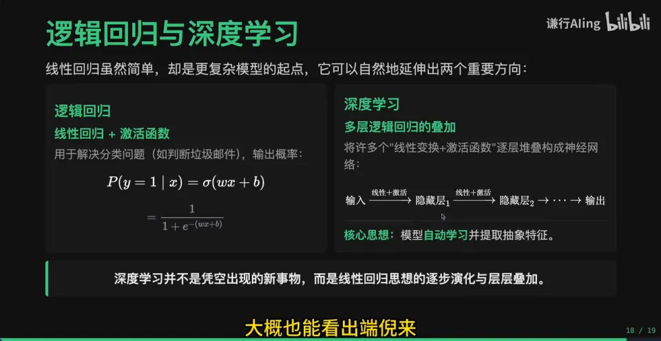

视频的总结是：线性回归包含了机器学习的核心步骤——用数据找规律、用模型表达规律、用损失函数衡量误差、用梯度下降优化参数、反复迭代直到收敛。几乎所有机器学习和深度学习模型，都可以看作对这个基本范式的拓展和升级（[【跳转到 19:36】](https://www.bilibili.com/video/BV1xrNGzrEJx/?t=1176)、[【跳转到 19:52】](https://www.bilibili.com/video/BV1xrNGzrEJx/?t=1192)）。

## 小结

- 线性回归预测的是连续值；模型形式是特征的加权和再加偏置，$\hat{y}=w^\top x+b$。
- “线性”指对参数线性（按比例、可叠加），不要求对特征线性；所以多项式回归仍可用线性回归的方法求解。
- 残差是预测值与真实值的差；残差平方和（MSE）把正负抵消和异常偏差两个问题一起处理，成为可优化的损失。
- 小数据、少特征时可用最小二乘一次解出参数；大数据、多特征时通常用梯度下降迭代求解。
- 多特征时把所有样本的特征排成设计矩阵 $X$（每行一个样本、每列一个特征），模型写成矩阵形式；样本数和特征数只改变矩阵形状，不改变模型结构。
- 逻辑回归和深度学习都可以看作线性回归骨架的延伸：换输出层、加激活函数、堆叠多层。

## 关键术语速查

| 术语 | 一句话解释 |
| --- | --- |
| 线性回归 | 用线性加权和预测连续值的模型。 |
| 权重 $w$ | 每个特征对预测值的贡献系数；单特征时是直线斜率。 |
| 偏置 $b$ | 所有特征为零时的预测基准；单特征时是直线截距。 |
| 残差 | 预测值与真实值之差，几何上是点到拟合直线的竖直距离。 |
| 均方误差（MSE） | 残差平方的平均值，越小表示拟合越好。 |
| 最小二乘 | 直接寻找使残差平方和最小的参数的一类方法。 |
| 梯度下降 | 沿损失下降方向小步更新参数的迭代优化方法。 |
| 学习率 | 梯度下降每一步迈出的步长。 |
| 设计矩阵 $X$ | 把 $N$ 个样本的 $d$ 个特征按行排成的 $N\times d$ 矩阵。 |
| 多项式回归 | 先把 $x,x^2,\dots$ 当作特征，再套线性模型的回归；对参数仍是线性的。 |