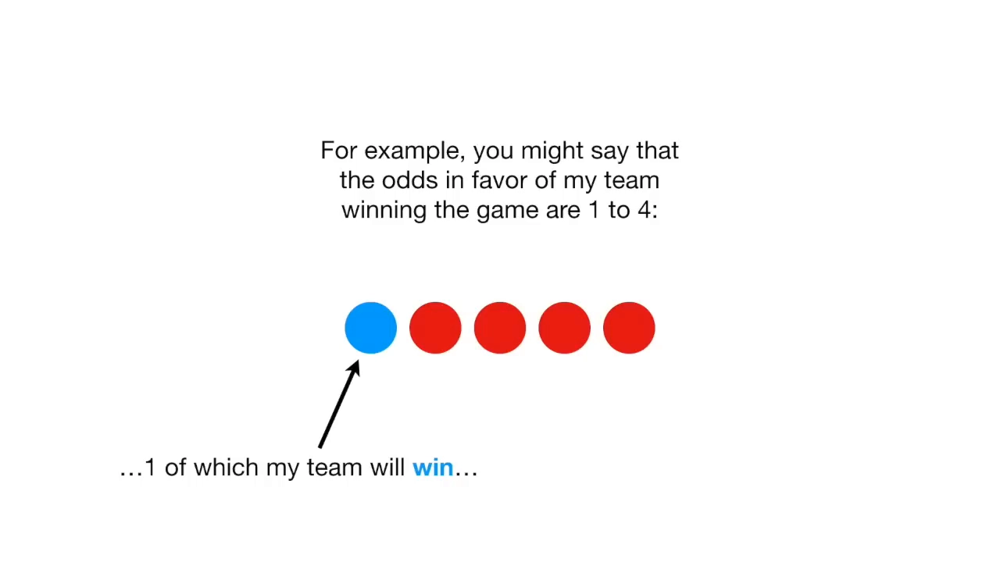
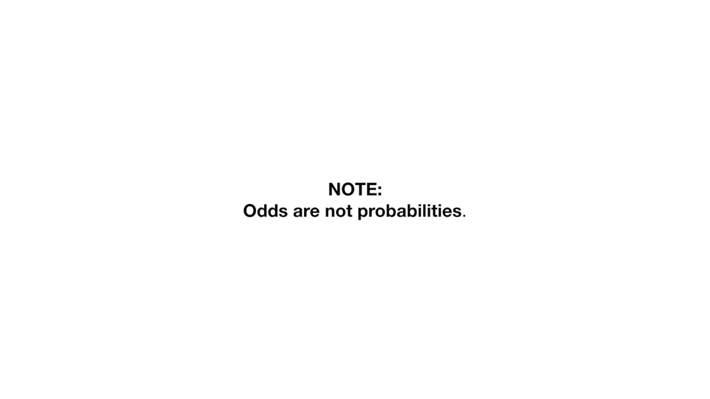
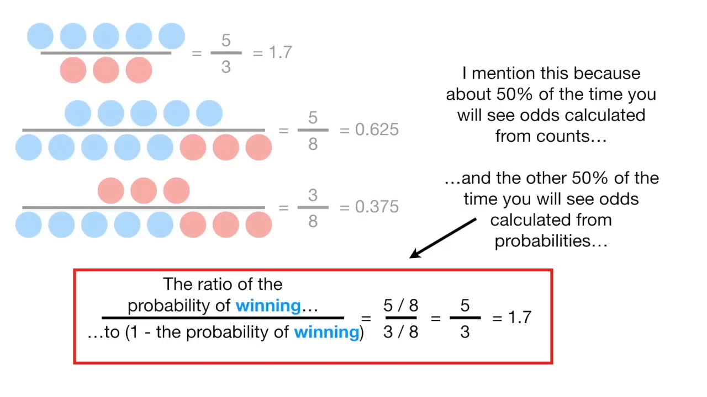
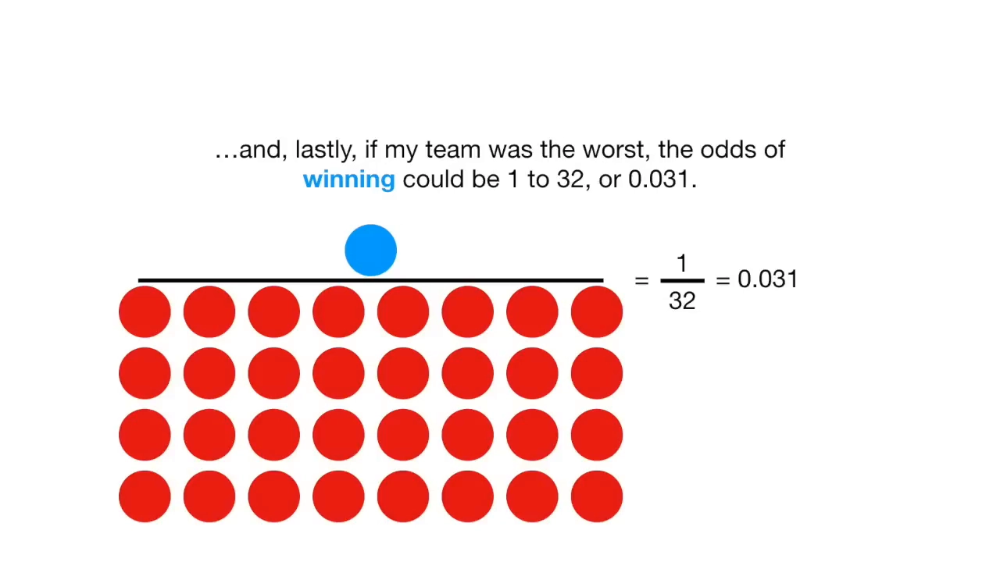
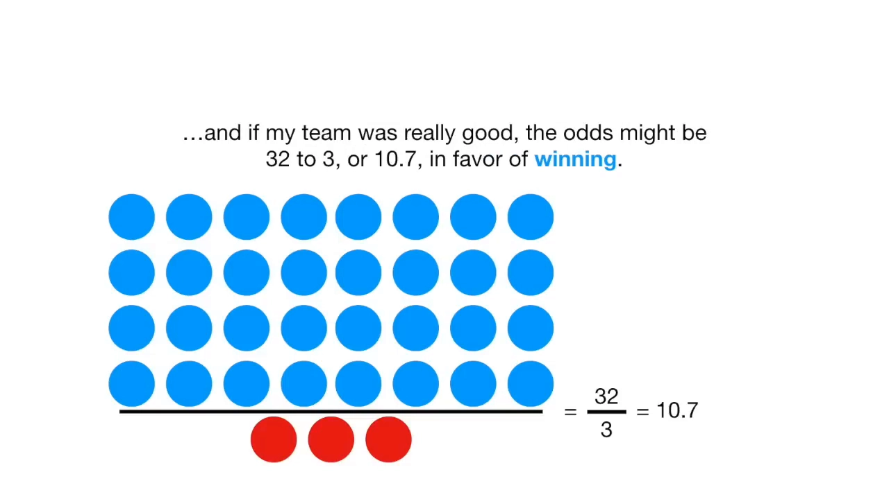
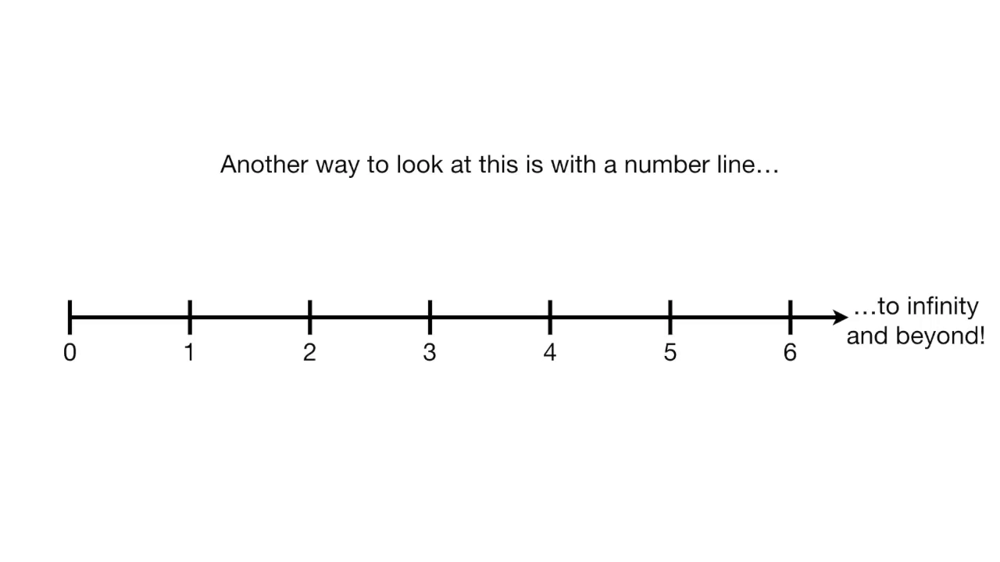
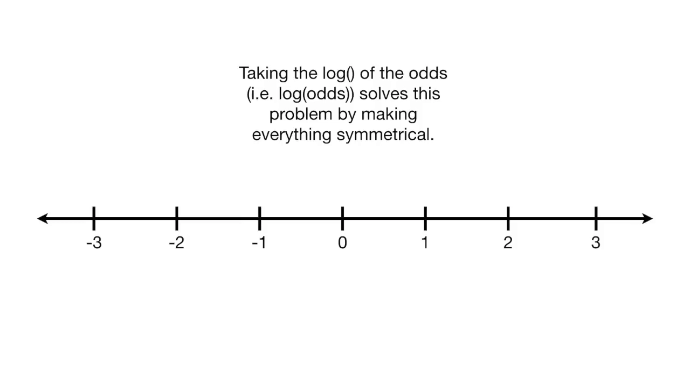
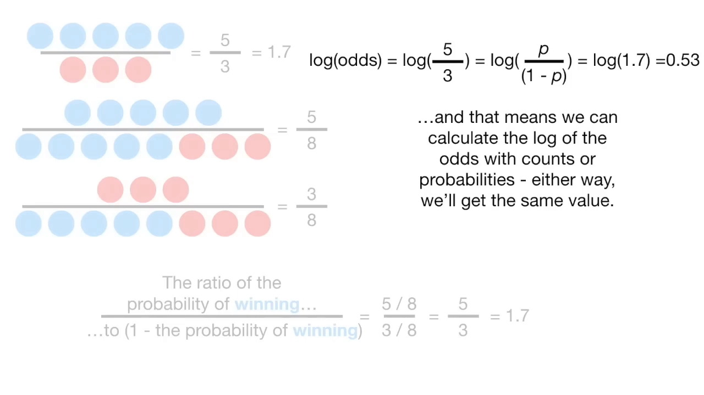
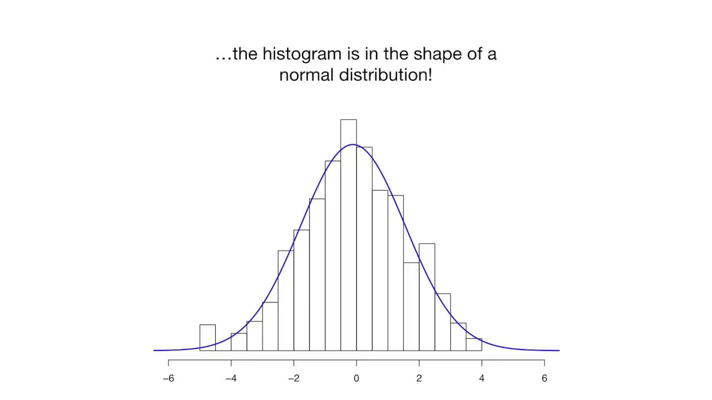

# 几率与对数几率：把概率换成对称的线性打分

> 视频来源：[Odds and Log(Odds), Clearly Explained!!!](https://www.youtube.com/watch?v=ARfXDSkQf1Y)（YouTube · StatQuest with Josh Starmer）｜时长约 11 分钟
> 导读：这支短片只做一件事——把"几率"和"对数几率"从赌球赔率讲到回归模型。它先用 1:4 与 5:3 两个具体赛果区分几率与概率，再说明几率为什么在 0 附近挤成一团、在 1 以上却能无限拉长，最后用取对数把这条尺子掰成对称的。本文按"定义 → 两种算法 → 尺子为什么歪 → 取对数 → logit 与逻辑回归"重排，并在末尾补上从对数几率反解出概率的一步代数推导（视频只点名 logit 是逻辑回归的基础，没有写出反函数）。

## 本讲要解决的核心问题（SCQA）

**背景**：分类模型最终要回答的是"这件事发生的可能性有多大"。可能性用概率表示，取值被限制在 0 到 1 之间；而线性模型最擅长的输出是 $z = \mathbf{w}^\top \mathbf{x} + b$，可以取任意实数，正负都行、绝对值可以很大。

**冲突**：概率这把尺子不但有边界，而且不对称。概率从 0.5 涨到 0.9 走了 0.4，从 0.9 涨到 0.99 只走了 0.09，可这两段在"支持这件事发生"的意义上其实是同一级别的变化。如果直接让线性打分去拟合概率，模型会被两端的边界压住：想表达"非常确定"时，打分只能无限逼近 1 却不能越过；想表达"非常确定不发生"时，又只能贴着 0。

**疑问**：有没有一个由概率变换出来的量，既保留"可能性"的全部信息，又能铺满整条实数轴、并且正负对称，好让线性打分去拟合？

**回答（中心思想）**：有，这就是**对数几率**（log odds，也叫 logit）。先把概率换成**几率** $p/(1-p)$——它比较的是"发生"与"不发生"，而不是"发生"与"全部"；几率虽然铺满 $0$ 到 $+\infty$，但仍然一头挤、一头长。再取一次对数，$0$ 到 $1$ 的概率就被拉成整条实数轴：$p=0.5$ 落在 $0$，支持与反对的两侧完全对称。这条 logit 尺子正是逻辑回归里线性打分所拟合的对象。

---

## 一、几率不是概率：它比的是"发生"与"不发生"

### 1.1 从两个赛果读出几率

视频用同一支球队的两组战绩开场 [【跳转到 00:16】](https://www.youtube.com/watch?v=ARfXDSkQf1Y&t=16)。

第一组：一共 5 场，赢 1 场、输 4 场。用赔率的口语说，"我队获胜的几率是 1 比 4"；写成分数就是

$$
\text{odds} = \frac{1}{4} = 0.25
$$

第二组：一共 8 场，赢 5 场、输 3 场，几率是 5 比 3，也就是

$$
\text{odds} = \frac{5}{3} \approx 1.7
$$

这里要盯住的是分母：**几率的分子是"发生"的次数，分母是"不发生"的次数**，两者加起来才是总场数。所以几率的分母不是"全部"，这一点是它和概率唯一但致命的区别。

### 1.2 几率与概率的分母不同，数值就不同

视频把这句话单独打成一屏提示："几率不是概率" [【跳转到 01:56】](https://www.youtube.com/watch?v=ARfXDSkQf1Y&t=116)。

两者的定义并排放：

- **几率**：发生 ÷ 不发生。5 胜 3 负时是 $5/3 \approx 1.7$。
- **概率**：发生 ÷ 全部。5 胜 3 负时是 $5/8 = 0.625$。

同一个 5 胜 3 负，几率是 1.7，概率是 0.625。数值不同不是算错了，而是问的问题不同：几率问"赢的次数是输的次数的几倍"，概率问"赢的次数占总次数的几成"。这也解释了为什么几率的取值范围和概率不一样——概率永远在 0 到 1 之间，几率却可以大于 1。

### 1.3 从计数算和从概率算，得到同一个数

视频接着补了一个常被忽略的等价性：几率既可以从原始计数算，也可以从概率算 [【跳转到 03:03】](https://www.youtube.com/watch?v=ARfXDSkQf1Y&t=183)。

从概率出发，先写出赢的概率 $p = 5/8 = 0.625$，输的概率就是 $1-p = 3/8 = 0.375$。两者相除：

$$
\frac{p}{1-p} = \frac{5/8}{3/8} = \frac{5}{3} \approx 1.7
$$

$8$ 在分子分母上同时出现、互相抵消，剩下的就是原始计数的比 $5/3$。视频特别说明，实际文献里大约一半的场合用计数算几率、另一半用概率算，两种写法结果一样 [【跳转到 04:36】](https://www.youtube.com/watch?v=ARfXDSkQf1Y&t=276)。于是统计里常把公式简写成

$$
\text{odds} = \frac{p}{1-p}
$$

这条式子请记住，它是后面所有变换的起点：**只要知道概率，就能算出几率；反过来，知道几率也能解出概率**（这一步在第四节做）。

---

## 二、几率的尺子一头挤、一头长

### 2.1 不利时，几率挤在 0 到 1 之间

视频把同一支球队越换越差，看几率怎么变 [【跳转到 05:21】](https://www.youtube.com/watch?v=ARfXDSkQf1Y&t=321)：

| 战绩（胜:负） | 几率 |
| --- | --- |
| 1:4 | 0.25 |
| 1:8 | 0.125 |
| 1:16 | 0.063 |
| 1:32 | 0.031 |

球队越差，几率越贴近 0，但**永远掉不到 0 以下**。也就是说，当结果偏向"不发生"时，几率被关在 $(0, 1)$ 这个区间里。

### 2.2 有利时，几率从 1 一路涨到无穷

反过来，球队越强，几率从 1 开始往上走 [【跳转到 06:24】](https://www.youtube.com/watch?v=ARfXDSkQf1Y&t=384)：

| 战绩（胜:负） | 几率 |
| --- | --- |
| 4:3 | 1.3 |
| 8:3 | 2.7 |
| 32:3 | 10.7 |

同样是"强一点"，几率可以涨到 10.7，而且没有上限——只要输的场次趋近于 0，几率就趋近于无穷。

### 2.3 不对称让"支持"和"反对"没法直接比

把两段拼到一条数轴上，问题就露出来了 [【跳转到 07:07】](https://www.youtube.com/watch?v=ARfXDSkQf1Y&t=427)：输的一侧只占 $0$ 到 $1$ 这短短一段，赢的一侧从 $1$ 一直延伸到无穷。

视频给了一对具体数字：几率 1 比 6（不利）算出 $1/6 \approx 0.17$；反过来 6 比 1（有利）算出 $6$。这两个局面在"支持与反对"的意义上恰好互为镜像，可数值上 0.17 和 6 差了几十倍，看起来完全不是一回事。**几率的尺子在 1 处被折了一下**，越靠近 0 越挤，越往右越松。

---

## 三、取对数把尺子掰直

### 3.1 一对镜像数字变成一对相反数

视频的解法是取对数 [【跳转到 07:32】](https://www.youtube.com/watch?v=ARfXDSkQf1Y&t=452)：

$$
\log\left(\frac{1}{6}\right) = \log(0.17) \approx -1.79, \qquad
\log\left(\frac{6}{1}\right) = \log(6) \approx 1.79
$$

两个数变成 $-1.79$ 与 $+1.79$，到原点 $0$ 的距离一模一样。原来"挤在 0 附近"的那一段被拉开，原来"无限延伸"的那一段被压回，整条尺子以 $0$ 为中心左右对称。

这一步的几何意义值得说透：对数把"乘法式的差距"翻译成"加法式的距离"。几率从 1 变到 6 是乘 6，从 1 变到 1/6 是除以 6，取对数后一个是 $+1.79$、一个是 $-1.79$，方向相反、幅度相同。**对称性就是这样来的**。

### 3.2 对数几率就是 logit

把上面两步合起来，就是本节的主角：

$$
\operatorname{logit}(p) = \log(\text{odds}) = \log\left(\frac{p}{1-p}\right)
$$

视频明确点名：这个"概率之比的 log"叫 **logit 函数**，它构成了逻辑回归的基础；只要做逻辑回归，就会反复见到它 [【跳转到 09:04】](https://www.youtube.com/watch?v=ARfXDSkQf1Y&t=544)。视频还算了一个具体值：5 胜 3 负时 $\log(1.7) \approx 0.53$。

把三把尺子并排看，关系就清楚了：

| 量 | 取值范围 | $p=0.5$ 时 | 对称性 |
| --- | --- | --- | --- |
| 概率 $p$ | $[0, 1]$ | $0.5$ | 以 0.5 为中心，但两端被截断 |
| 几率 $p/(1-p)$ | $[0, +\infty)$ | $1$ | 以 1 为界，左挤右松 |
| 对数几率 $\log\frac{p}{1-p}$ | $(-\infty, +\infty)$ | $0$ | 以 0 为中心，左右对称 |

### 3.3 为什么统计上偏爱对数几率

视频最后给了一个"为什么值得"的理由 [【跳转到 09:37】](https://www.youtube.com/watch?v=ARfXDSkQf1Y&t=577)：随机取一对加起来等于 100 的数，用它们算对数几率、画成直方图，形状接近正态分布。

正态分布是大量统计方法的地基（比如线性回归的误差假设，见 2.3.1）。对数几率落在正态形状上，意味着"是/否、赢/输、真/假"这类两结局问题，可以在对数几率的尺度上使用那些为正态分布准备的工具。视频把这一点列为 logit 的第三个好处：**让事情对称、好解释、也好交给统计方法处理**。

---

## 四、从对数几率回到概率：反解出 Sigmoid

视频只说到"logit 是逻辑回归的基础"就收尾了，没有写出反函数。但既然逻辑回归要输出概率，就必须能从对数几率走回去，这一步只是代数：

设线性打分为 $z$，并令它等于对数几率，

$$
z = \log\left(\frac{p}{1-p}\right)
$$

两边取指数：

$$
e^{z} = \frac{p}{1-p}
$$

两边乘 $1-p$：

$$
e^{z}(1-p) = p \;\Longrightarrow\; e^{z} - e^{z}p = p \;\Longrightarrow\; e^{z} = p(1 + e^{z})
$$

于是

$$
p = \frac{e^{z}}{1 + e^{z}} = \frac{1}{1 + e^{-z}}
$$

这就是 **Sigmoid 函数**，也就是逻辑回归里那条 S 形曲线。代几个数验证一下它的行为：

- $z = 0$：$p = 1/(1+1) = 0.5$，对应几率 $1$，也就是"支持与反对打平"；
- $z = 1.79$：$p = 1/(1+e^{-1.79}) \approx 0.857$，正好是几率 $6$ 对应的概率 $6/7$；
- $z \to +\infty$：$p \to 1$；$z \to -\infty$：$p \to 0$。

**Sigmoid 把整条实数轴压回 $(0,1)$，而且永远不越界。** 这正好补上了开头那个缺口：线性打分可以自由取值，Sigmoid 负责把它翻译成合法概率。下一节《逻辑回归：S 形曲线给出类别概率，最大似然替代最小二乘》会接着讲这条曲线怎么拟合、概率又怎么变成类别。

---

## 五、边界：三个容易混的量

- **几率 vs 概率**：分母不同（不发生 vs 全部），数值不同，取值范围不同。这一节的核心就是这句话。
- **几率 vs 几率比（odds ratio）**：几率比是"两组几率相除"，用于比较两个群体的相对风险；视频明确说它留到下一支 StatQuest，本节不展开。
- **对数几率 vs 概率**：logit 是打分尺度，不是概率。看到 $-1.79$ 不要读成"负的概率"，它对应的是 $p = 1/7 \approx 0.143$。任何要报告给读者的概率，都必须过一遍 Sigmoid 回到 $(0,1)$。

---

## 小结

- **几率比的是"发生"与"不发生"**：$\text{odds} = p/(1-p)$；5 胜 3 负时几率是 $5/3 \approx 1.7$，而概率是 $5/8 = 0.625$。
- **两种算法等价**：从原始计数算、从概率算，结果相同，因为总数在分子分母上抵消。
- **几率的尺子不对称**：不利时挤在 $(0,1)$，有利时从 $1$ 延伸到 $+\infty$；1 比 6 与 6 比 1 明明互为镜像，数值却是 0.17 与 6。
- **取对数把尺子掰直**：$\log(1/6) = -1.79$、$\log(6) = +1.79$，到 0 的距离相等，整条轴以 0 为中心对称。
- **logit 是逻辑回归的线性打分所拟合的对象**：$\operatorname{logit}(p) = \log\frac{p}{1-p}$，取值铺满实数轴，$p=0.5$ 对应 $0$。
- **反解回概率得到 Sigmoid**：$p = 1/(1+e^{-z})$，把任意实数打分压进 $(0,1)$，永不越界。
- **对数几率近似正态**：随机成对的数算出的 log odds 直方图接近正态分布，这是它在统计里好用的原因之一。

---

## 关键术语速查

| 术语 | 一句话解释 |
| --- | --- |
| 几率（odds） | 事件发生次数与不发生次数之比，$p/(1-p)$；不是概率 |
| 概率（probability） | 事件发生次数与总次数之比，取值 $[0,1]$ |
| 对数几率 / logit | 对几率取自然对数，$\log\frac{p}{1-p}$，取值铺满实数轴 |
| 对称性 | 取对数后 $k$ 比 $1$ 与 $1$ 比 $k$ 变成一对相反数，到 0 的距离相同 |
| Sigmoid | logit 的反函数 $1/(1+e^{-z})$，把实数打分压成 $(0,1)$ 的概率 |
| 几率比（odds ratio） | 两组几率相除，用于比较群体；本节不展开 |