# 梯度提升树：从均值叶子出发的逐轮残差加法

> 视频来源：[StatQuest: Gradient Boost Part 1 (of 4) - Regression Main Ideas](https://www.youtube.com/watch?v=3CC4N4z3GJc)（YouTube · StatQuest with Josh Starmer）｜时长约 16 分钟
> 导读：这支视频不推公式，只把"梯度提升做回归"的默认流程在六个人的身高体重表上走一遍：先放一片均值叶子，再一轮一轮往上加"拟合残差的树"，每棵树都乘同一个学习率。本文按这条流水线整理；公式推导与"为什么叫梯度"留给同目录的《梯度提升的算法细节：负梯度、叶节点输出与学习率更新》，与随机森林的组合方式对照见同目录《【机器学习八股文】集成学习，bagging，boosting，stacking》。

## 本讲要解决的核心问题（SCQA）

**背景**：Boosting 这一类算法里，AdaBoost 是最常被先讲到的代表：它一棵接一棵地建"树桩"（stump，只有一层的极短决策树），后一棵专门去补前一棵的错误。

**冲突**：梯度提升（Gradient Boost）看起来和 AdaBoost 很像——也是串行地一棵接一棵建树，也是后一棵盯着前一棵的错误。但它的第一件产物根本不是树，而是一片**叶子**；它的树也不再是树桩，而是一棵有若干叶子的正常回归树；而且它对所有树的缩放方式也和 AdaBoost 不同。

**疑问**：一个加法模型到底是怎么一轮一轮被"加"出来的？每一轮的新树在拟合什么？为什么明明可以一步拟合到位，却偏要乘一个小于 1 的学习率、走很多小步？

**回答（中心思想）**：梯度提升回归的默认流程只有四步循环——**用均值放一片初始叶子 → 算当前预测的残差 → 建一棵受叶子数限制的回归树去拟合这些残差 → 把这棵树乘上学习率再加进模型**。重复下去，模型就是一个"叶子 + 若干棵被缩放过的树"的加法链；学习率让每一轮只走一小步，用许多小步换取测试集上更低的方差。

## 一、先看差别：AdaBoost 建树桩，梯度提升先放一片叶子

用同一张表预测体重：六个人的身高、喜欢的颜色、性别和体重。

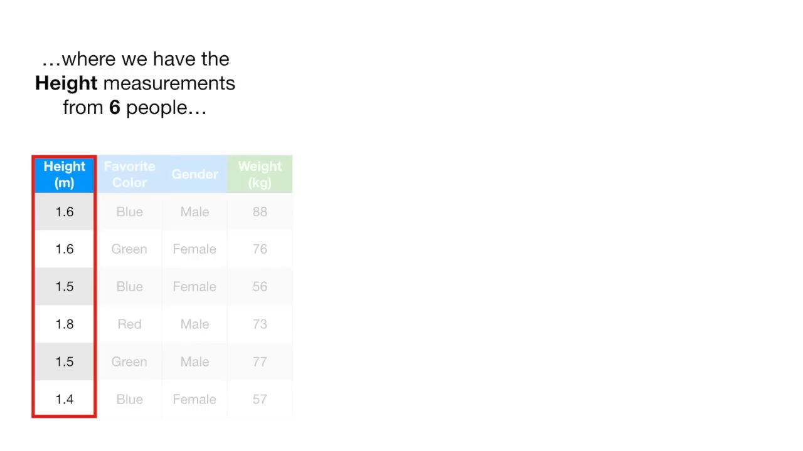

AdaBoost 的做法是先从训练数据建一个很短的树桩，这个树桩对最终输出的"话语权"（amount of say）取决于它多大程度补上了之前的错误；然后下一个树桩基于上一个树桩犯的错来建。如果新树桩补得不好，它的块头就小一点，表示话语权下降；补得好一点，块头就大一点。如此继续，直到建满你要求的数量，或者已经完美拟合。

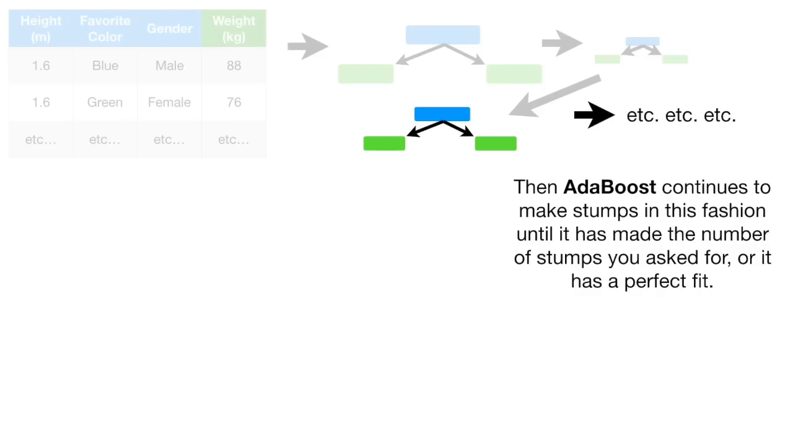

[【跳转到 03:53】](https://www.youtube.com/watch?v=3CC4N4z3GJc&t=233)

梯度提升的起点完全不同：它先建**一片叶子**（single leaf），而不是一棵树或一个树桩。这片叶子代表"对所有样本的初始猜测"——预测连续值时，这个初猜就是**平均值**。然后才开始建树。

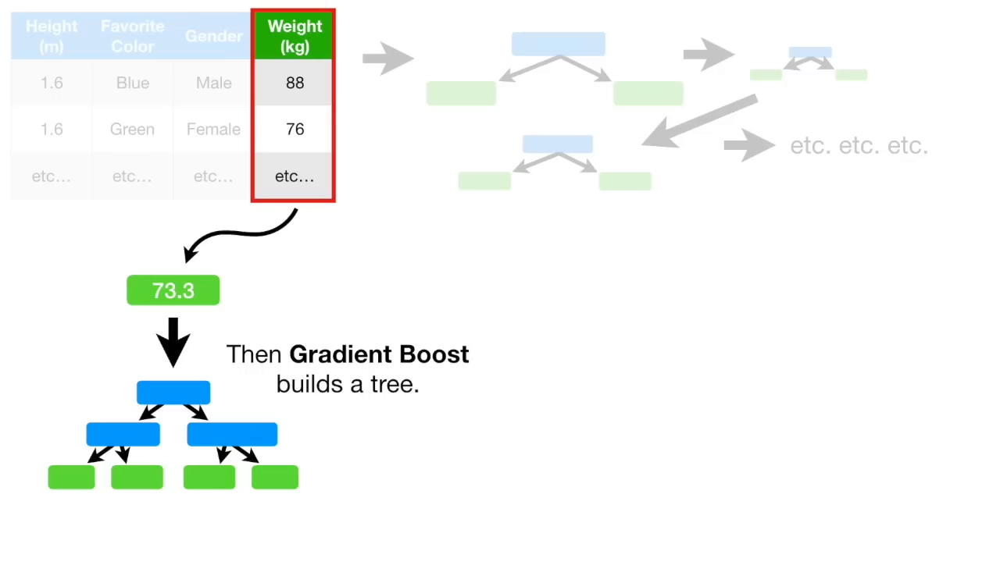

[【跳转到 04:18】](https://www.youtube.com/watch?v=3CC4N4z3GJc&t=258)

两者后续的动作对照起来看：

| | AdaBoost | 梯度提升 |
| --- | --- | --- |
| 起点 | 直接建第一个树桩 | 先放一片叶子，取目标值的平均 |
| 基学习器 | 树桩（一层） | 通常比树桩大，但仍限制叶子数 |
| 缩放方式 | 每个树桩的话语权各不相同 | **所有树都乘同一个学习率** |
| 停止条件 | 建满指定数量，或完美拟合 | 建满指定数量，或再加树也不再改善拟合 |

关于树的大小：视频里的例子只允许每棵树最多 4 片叶子。限制叶子总数，意味着叶子数少于样本数，于是必然有多个样本落进同一片叶子。实际使用中，人们常把最大叶子数设在 8 到 32 之间。

[【跳转到 04:43】](https://www.youtube.com/watch?v=3CC4N4z3GJc&t=283)

## 二、第一片叶子：用均值做初猜

现在把默认配置走一遍。第一步是算体重的平均值：88、76、56、73、77、57 六个值平均下来是 71.2。这就是对每个人体重的第一次预测——如果就此打住，我们会预测所有人都重 71.2 kg。

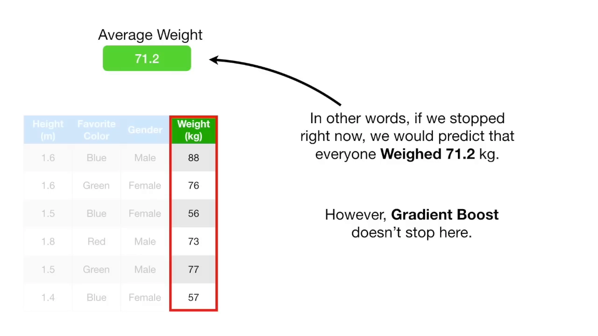

[【跳转到 06:07】](https://www.youtube.com/watch?v=3CC4N4z3GJc&t=367)

但梯度提升不会停在这里。下一步是**基于第一棵树的误差建一棵树**。所谓"上一棵树的误差"，就是观测体重与预测值 71.2 之间的差。把 71.2 当作预测值，与第一个观测值 88 相减，差是 16.8，存进新的一列。这个差有个专门名字：**伪残差**（pseudo residual）。

"伪"这个前缀来自线性回归的对照：线性回归里，观测值与预测值之差就叫残差；这里加上"伪"，是提醒我们正在做梯度提升而不是线性回归。视频把"为什么叫伪"留到第二部分讲数学时展开（本目录另一篇有完整推导）。

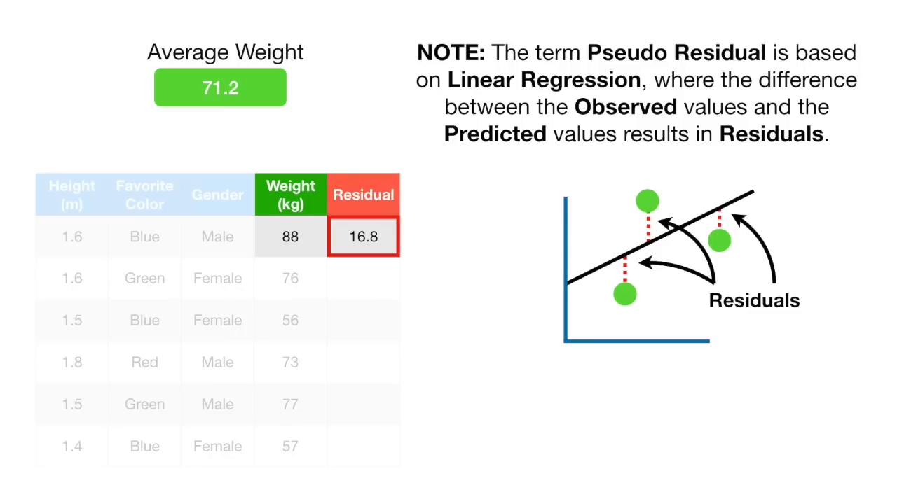

[【跳转到 06:57】](https://www.youtube.com/watch?v=3CC4N4z3GJc&t=417)

六个样本的残差依次是 16.8、4.8、−15.2、1.8、5.8、−14.2。接下来用身高、喜欢的颜色、性别去**预测这些残差**——而不是直接预测体重。这一步初看很怪，视频专门提示"先忍耐一下，很快就清楚了"。

## 三、第二棵树：拟合残差，叶子取组内平均

按最多 4 片叶子的限制建树，得到的划分是：

- 性别 = 女 → 再看身高是否小于 1.6：小于 1.6 的两行（残差 −15.2 和 −14.2）落在同一片叶子；不小于 1.6 的一行（残差 4.8）单独一片叶子；
- 性别 = 男 → 再看颜色是否不是蓝色：不是蓝色的两行（残差 1.8 和 5.8）落在一片叶子；蓝色的那行（残差 16.8）单独一片叶子。

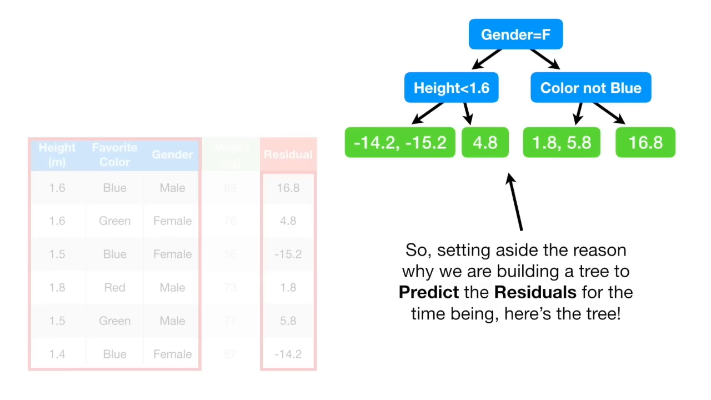

[【跳转到 07:35】](https://www.youtube.com/watch?v=3CC4N4z3GJc&t=455)

因为叶子数少于样本数，两行数据会落进同一片叶子。这时叶子的输出值取这些残差的**平均**：−15.2 和 −14.2 平均为 −14.7；1.8 和 5.8 平均为 3.8。另外两片叶子各只有一个样本，输出就是它自己的残差 4.8 和 16.8。

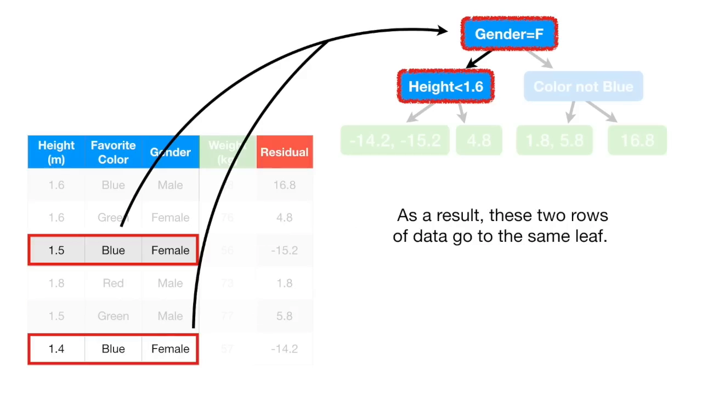

[【跳转到 08:05】](https://www.youtube.com/watch?v=3CC4N4z3GJc&t=485)

## 四、把叶子与树相加：一次就拟合过头

现在可以把"原来的叶子"和"新树"合起来，对训练样本做新预测。从初猜 71.2 出发，让数据顺着树走到 16.8 那片叶子，预测体重就是 71.2 + 16.8 = 88——正好等于观测体重。

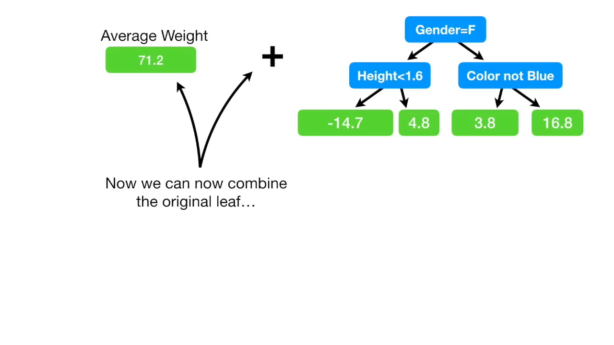

[【跳转到 08:22】](https://www.youtube.com/watch?v=3CC4N4z3GJc&t=502)

这值得高兴吗？视频的回答是"不"。模型把训练数据拟合得太好了：**偏差很低，但方差很可能非常高**。这正是过拟合的典型信号——在训练集上一步到位，换到新样本就未必。

## 五、学习率：把整棵树缩成一个"小步"

梯度提升处理这个问题的办法是引入**学习率**（learning rate），用它缩放新树的贡献。学习率是 0 到 1 之间的一个值，例子里取 0.1。

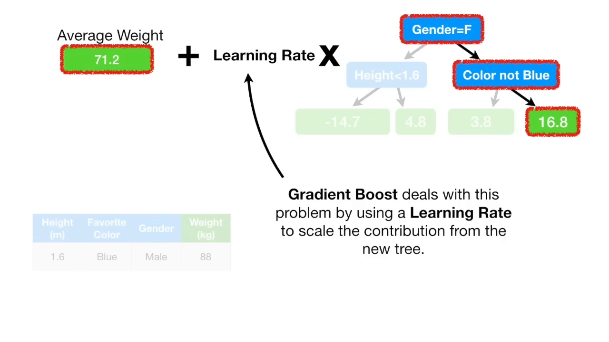

[【跳转到 09:11】](https://www.youtube.com/watch?v=3CC4N4z3GJc&t=551)

于是预测变成：

$$
\hat{y} = 71.2 + 0.1 \times 16.8 = 72.9
$$

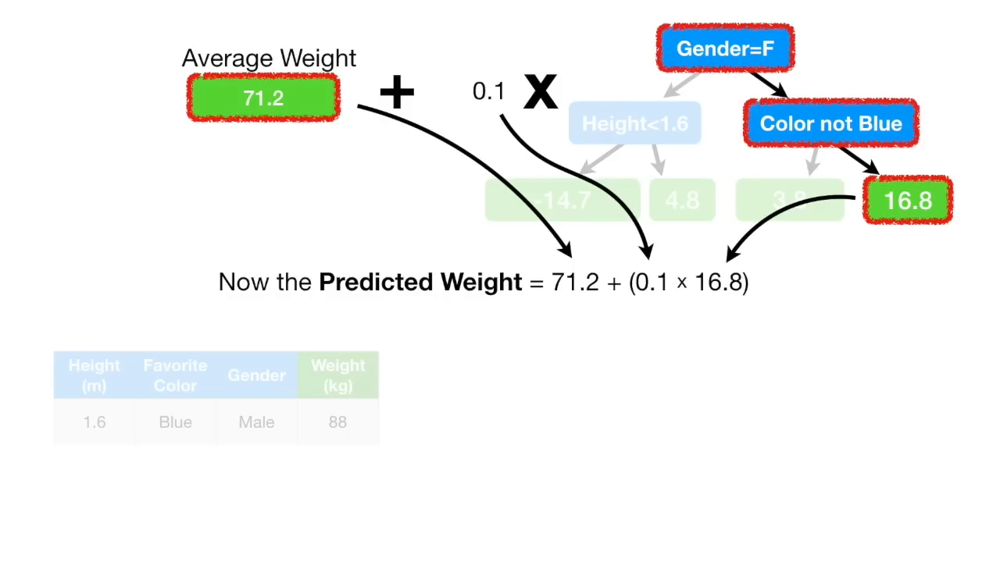

[【跳转到 09:36】](https://www.youtube.com/watch?v=3CC4N4z3GJc&t=576)

72.9 不如 88 那样"准"，但比只用初始叶子预测的 71.2 好一点。用视频的话说：用学习率缩放这棵树，结果是朝正确方向迈出的**一小步**。梯度提升的发明者 Jerome Friedman 给出的经验证据是：朝正确方向走很多小步，在测试数据上会得到更好的预测，也就是更低的方差。

## 六、继续加树：残差越来越小，加法链越来越长

第二棵树建好之后，重复同一套动作：用**最新的预测**重算残差。第一个样本的残差从 16.8 变成 15.1，其余依次是 4.3、−13.7、1.4、5.4、−12.7。用这些新残差再建一棵树（这个例子里分支恰好和上一棵一样，实际使用中每棵树可以不同），叶子同样取组内平均，得到 −13.2、4.3、3.4、15.1 四个输出值。然后把这棵新树和之前所有的树、以及最初的叶子加在一起，**每棵树都乘同一个学习率 0.1**：

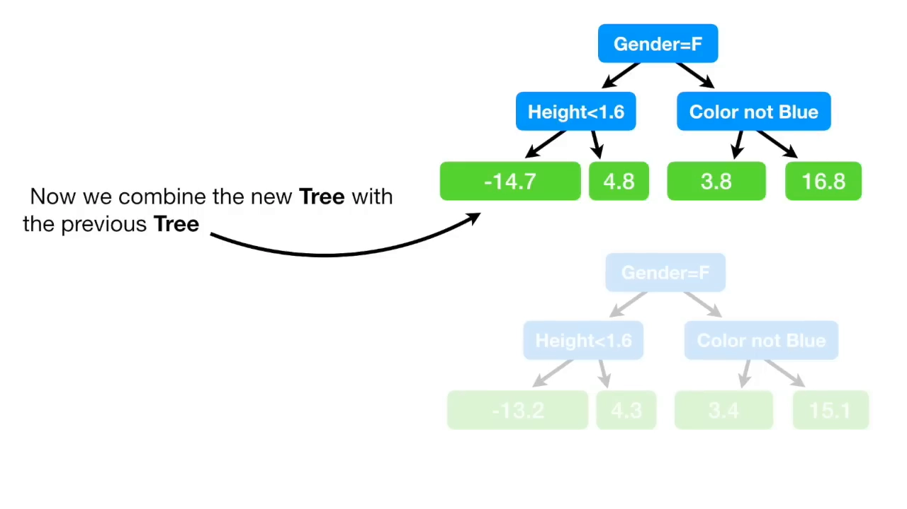

[【跳转到 11:54】](https://www.youtube.com/watch?v=3CC4N4z3GJc&t=714)

$$
\hat{y} = 71.2 + 0.1 \times 16.8 + 0.1 \times 15.1 = 74.4
$$

把三轮的残差列并排放在一起看，每一步都比上一步小：最初是 16.8，加进第一棵树后变成 15.1，再加进第二棵树后继续变小。这就是"朝正确方向走了一小步"的具体含义。

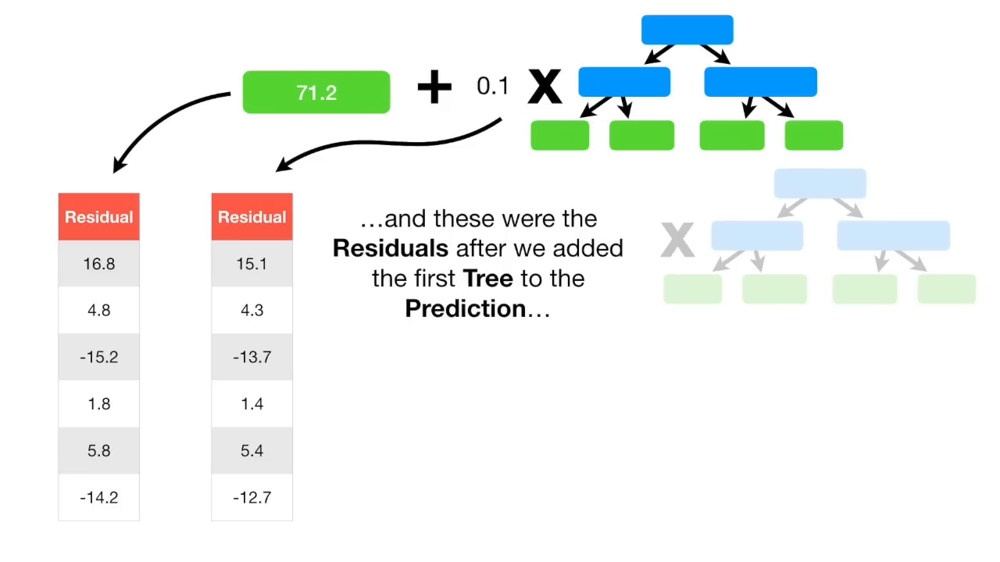

[【跳转到 13:05】](https://www.youtube.com/watch?v=3CC4N4z3GJc&t=785)

如此循环，直到达到指定的最大树数，或者再加树也不能显著减小残差为止。这时模型就是一条加法链：

$$
F(x) = \text{初始叶子} + \nu \cdot T_1(x) + \nu \cdot T_2(x) + \nu \cdot T_3(x) + \cdots
$$

其中 $\nu$ 是学习率，$T_m$ 是第 $m$ 棵树。拿到新测量值时，预测方式就是：从初始预测出发，加上第一棵树的缩放值、第二棵树的缩放值、第三棵树的缩放值……全部加完就是预测体重。

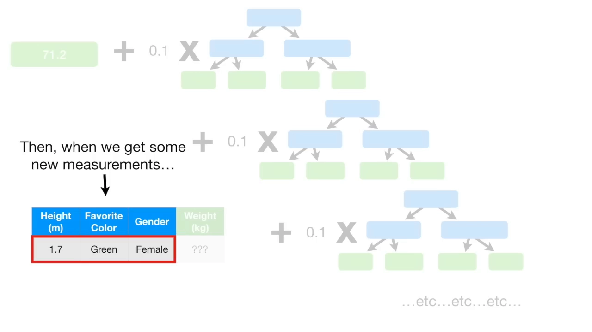

[【跳转到 13:50】](https://www.youtube.com/watch?v=3CC4N4z3GJc&t=830)

视频最后举了一个新样本：身高 1.7、喜欢绿色、女性，逐项加完后预测体重为 70 kg。

## 小结

- 梯度提升回归的默认流程是四步循环：**均值叶子 → 算残差 → 建受叶子数限制的回归树拟合残差 → 乘学习率加进模型**；
- 与 AdaBoost 的相同点：都串行建树、都用前一棵的错误指导后一棵、都限制树的规模、都在达到指定数量或不再改善时停止；
- 与 AdaBoost 的不同点：梯度提升以一片**叶子**（目标值平均）开局；树通常比树桩大（实际常设 8–32 片叶子）；**所有树乘同一个学习率**，而不是每棵树各有话语权；
- 残差叫**伪残差**，是为了和线性回归的残差区分——这里的"残差"其实是损失函数对预测值的负梯度（推导见同目录《梯度提升的算法细节》）；
- 不缩放地直接相加会在训练集上一步拟合到位（偏差低、方差高）；学习率把每棵树缩成一小步，用许多小步换测试集上更低的方差；
- 最终模型是一条加法链：$F(x) = F_0 + \nu T_1(x) + \nu T_2(x) + \cdots$，预测新样本就是把这条链逐项加起来；
- 与随机森林的对照（森林是并行、独立、投票/平均，Boosting 是串行、互相依赖、降偏差）见同目录《【机器学习八股文】集成学习，bagging，boosting，stacking》。

## 关键术语速查

| 术语 | 一句话解释 |
| --- | --- |
| 梯度提升（Gradient Boost） | 串行建树、每棵树拟合当前残差、再乘学习率加进模型的 Boosting 方法 |
| 树桩（stump） | 只有一层分裂的极短决策树，AdaBoost 的默认基学习器 |
| 初始叶子（initial leaf） | 梯度提升的第一个"模型"，对回归取目标值的平均，作为所有样本的初猜 |
| 伪残差（pseudo residual） | 观测值减当前预测值；因损失函数不同而未必等于线性回归的残差，故名"伪" |
| 学习率（learning rate） | 0 到 1 之间、用来缩放每棵树贡献的系数，让每轮只走一小步 |
| 加法模型（additive model） | 最终预测等于初始值加上若干棵树（各自缩放后）之和 |
| 叶子数限制 | 每棵树允许的最大叶子数（例中 4，实际常用 8–32），控制单棵树的复杂度 |
| 话语权（amount of say） | AdaBoost 中每个树桩对最终输出的权重，由它补错的效果决定 |