# 梯度提升的算法细节：负梯度、叶节点输出与学习率更新

> 视频来源：[StatQuest: Gradient Boost Part 2 (of 4) - Regression Details](https://www.youtube.com/watch?v=2xudPOBz-vs)（YouTube · StatQuest with Josh Starmer）｜时长约 27 分钟
> 导读：这篇是《梯度提升树：从均值叶子出发的逐轮残差加法》的数学版。上一支视频用六个人的表走完了流程，这一支把同一套流程写成"输入 → 三步算法"，逐步证明：初猜为什么是均值、每轮拟合的为什么是负梯度、每片叶子的输出为什么是残差均值、学习率在更新式里处在什么位置。字幕把两处 $-17.3$ 误识为 $-7.3$，本文按幻灯片画面订正。

## 本讲要解决的核心问题（SCQA）

**背景**：梯度提升做回归的默认流程已经在上一支视频里走通了：先放一片均值叶子，再一轮一轮加上"拟合残差的树"，每棵树乘同一个学习率。

**冲突**：但那套流程里每个动作都像约定俗成——初猜为什么偏偏取平均？为什么每轮去拟合残差，而不是直接拟合体重？叶子里的多个残差为什么要取平均？"梯度"两个字在算法里对应哪一行？

**疑问**：把梯度提升写成一份可执行的算法，每一步到底在优化什么？这些看似约定的做法，能不能从同一个损失函数里推出来？

**回答（中心思想）**：梯度提升就是在**函数空间里做梯度下降**。算法只有三步：用一个使总损失最小的常数初始化模型；循环 $M$ 轮，每轮先算损失对当前预测的**负梯度**（平方损失下正好退化为残差），再建一棵回归树去拟合它，然后为每片叶子解一个"使叶子内损失最小"的常数，最后乘学习率把整棵树加进模型；循环结束输出最终的加法模型。初猜取均值、叶子输出取残差均值，都不是约定，而是平方损失下解同一个最小化问题的结果。

## 一、输入：一张表和一条可微的损失函数

算法的输入只有两样东西：数据 $\{(x_i, y_i)\}_{i=1}^{n}$，以及一个**可微的损失函数** $L(y_i, F(x_i))$。这里 $x_i$ 是第 $i$ 行测量值（用来预测体重的那些特征），$y_i$ 是这行对应的观测体重，$n$ 是样本数。为了让例子不至于失控，视频只取三行数据：身高 1.6、蓝色、男性、88 kg；身高 1.6、绿色、女性、76 kg；身高 1.5、蓝色、女性、56 kg。

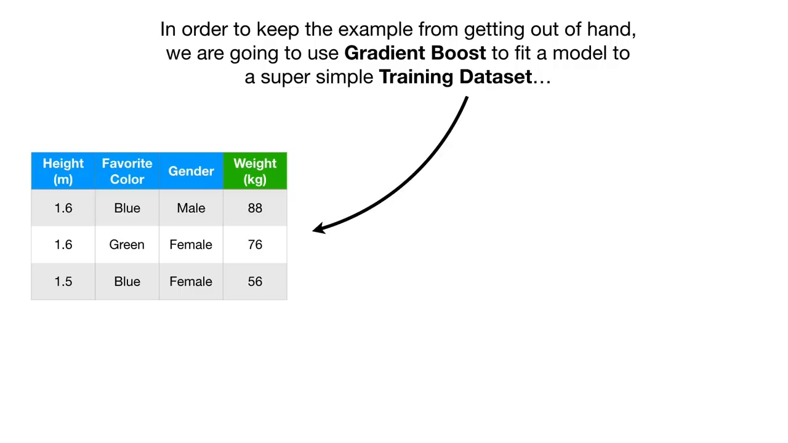

[【跳转到 00:57】](https://www.youtube.com/watch?v=2xudPOBz-vs&t=57)

所谓"损失函数"，在这里就是评价"体重预测得好不好"的东西。$F(x)$ 是给出预测值的函数——视频特意说明，$F(x)$ 到底是什么，后面再讲。

## 二、损失函数：为什么写成 $\frac{1}{2}$ 的平方误差

回归场景最常用的损失是

$$
L = \frac{1}{2}\left(\text{观测值} - \text{预测值}\right)^2
$$

先忽略前面的 $\frac{1}{2}$：去掉它之后，剩下的就是线性回归里用的那个损失——残差平方和。比如用一条线拟合身高与体重，残差是观测体重与线给出的预测体重之差；一条偏绿的线和一条粉线哪条拟合得更好，就看残差平方和：绿线 0.26，粉线 6.43，绿线更小，所以绿线拟合更好。两边同乘 $\frac{1}{2}$ 只会让数字变小，比较结论不变。

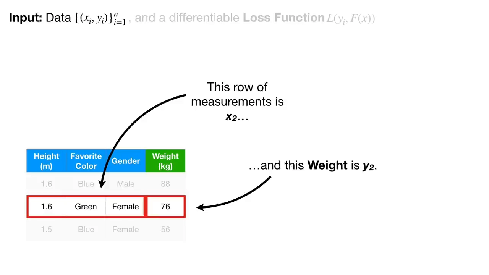

[【跳转到 02:28】](https://www.youtube.com/watch?v=2xudPOBz-vs&t=148)

那为什么还要多写一个 $\frac{1}{2}$？因为梯度提升要大量使用导数。对"预测值"求导时，平方项把 2 提到前面，再乘上 $-\text{预测值}$ 的导数 $-1$：

$$
\frac{d}{d\,\text{Predicted}}\ \frac{1}{2}\left(\text{Observed} - \text{Predicted}\right)^2 = \frac{2}{2}\left(\text{Observed} - \text{Predicted}\right)\times(-1)
$$

$\frac{2}{2}$ 正好抵消，结果就是"观测减预测"再取负号，也就是**负残差**。写成 $\frac{1}{2}$ 纯粹是为了让后面这一串求导结果干净。

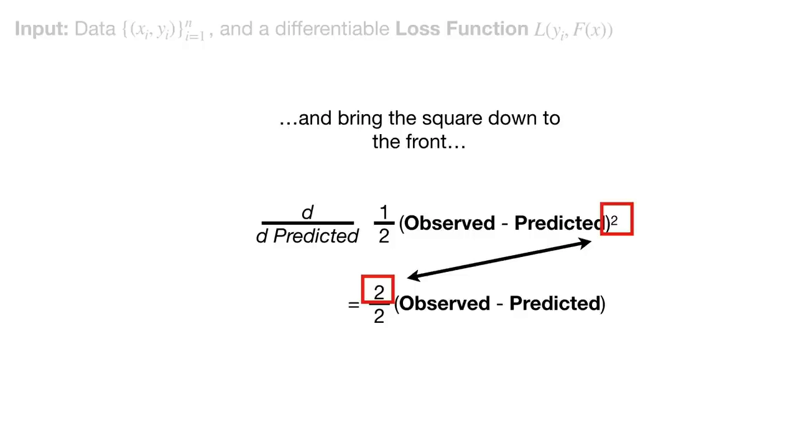

[【跳转到 05:21】](https://www.youtube.com/watch?v=2xudPOBz-vs&t=321)

有了数据、有了可微损失，算法的输入就备齐了。视频也提醒：回归还有别的损失可选，但这是最常用的一个。

## 三、第一步：用一个常数初始化模型

算法第一步是"用一个常数初始化模型"，这个常数由下式给出：

$$
F_0(x) = \arg\min_{\gamma} \sum_{i=1}^{n} L(y_i, \gamma)
$$

这个式子从右往左读最容易懂：$\sum$ 表示把每个观测值的损失加起来；$\arg\min_{\gamma}$ 表示"找一个预测值 $\gamma$，使这个总和最小"。换句话说，把所有观测体重画在一条数轴上，我们要找数轴上的一个点，使"各点到它的平方距离之和"最小。

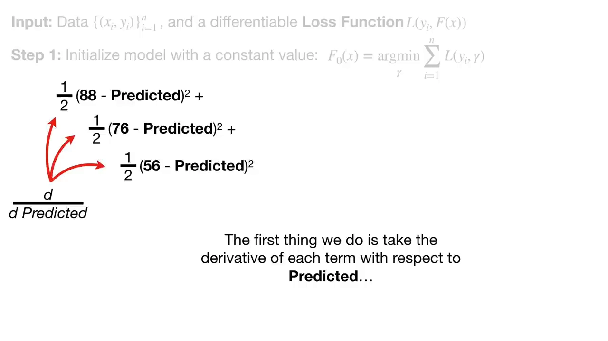

[【跳转到 07:54】](https://www.youtube.com/watch?v=2xudPOBz-vs&t=474)

这个最优点可以用梯度下降找，但数学不难，可以直接解：把每一项对预测值求导，令导数之和为零，解出来正好是**观测体重的平均**。三个体重 88、76、56 平均为 73.3，于是 $F_0(x) = 73.3$——也就是造出一片叶子，预测所有样本都重 73.3 kg。

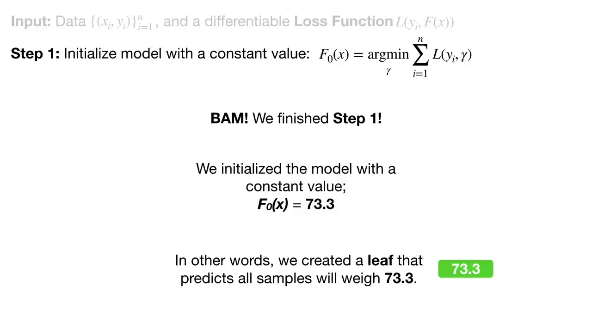

[【跳转到 09:09】](https://www.youtube.com/watch?v=2xudPOBz-vs&t=549)

这就是上一支视频里"初猜取均值"的来历：它不是随手定的，而是平方损失下第一步最小化问题的解析解。

## 四、第二步：$M$ 轮循环，每轮四个动作

第二步是一个循环：$m$ 从 1 到 $M$。$M$ 是要建多少棵树，实际使用中常设 100 甚至更多；小写 $m$ 指某一棵树，$m=1$ 是第一棵，$m=M$ 是最后一棵。

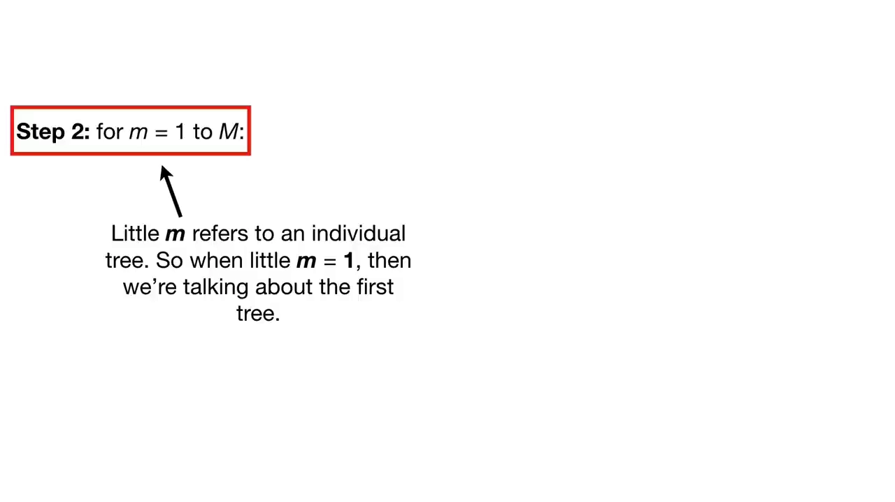

[【跳转到 09:39】](https://www.youtube.com/watch?v=2xudPOBz-vs&t=579)

### 4.1 动作 (A)：算负梯度，也就是残差

$$
r_{im} = -\left[\frac{\partial L(y_i, F(x_i))}{\partial F(x_i)}\right]_{F(x)=F_{m-1}(x)} \qquad \text{for } i = 1,\dots,n
$$

这个式子看起来吓人，其实只做一件事：把损失对"预测值"求导，再乘 $-1$，并在**上一轮的预测** $F_{m-1}(x)$ 处取值。我们已经算过这个导数：它等于"观测减预测"。所以这个式子算出来的就是**残差**。

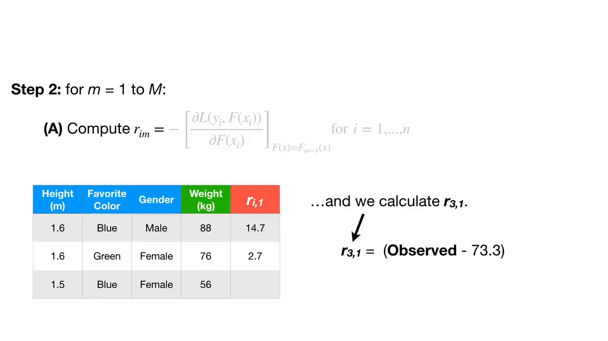

[【跳转到 11:44】](https://www.youtube.com/watch?v=2xudPOBz-vs&t=704)

第一轮里 $m=1$，上一轮预测就是 $F_0(x)=73.3$。于是三个样本的残差是：

- $r_{1,1} = 88 - 73.3 = 14.7$
- $r_{2,1} = 76 - 73.3 = 2.7$
- $r_{3,1} = 56 - 73.3 = -17.3$

视频在这里点明了两件事。第一，这个导数就是**梯度**——梯度提升的名字正来自它：每轮拟合的对象不是目标值，而是损失下降最快的方向。第二，这些 $r_{im}$ 严格来说叫**伪残差**（pseudo residual）：用当前这个损失时，算出来恰好是普通残差；如果换一个损失（比如不乘 $\frac{1}{2}$ 的那种），算出来的东西"像残差但不完全是残差"，所以统一叫"伪残差"。

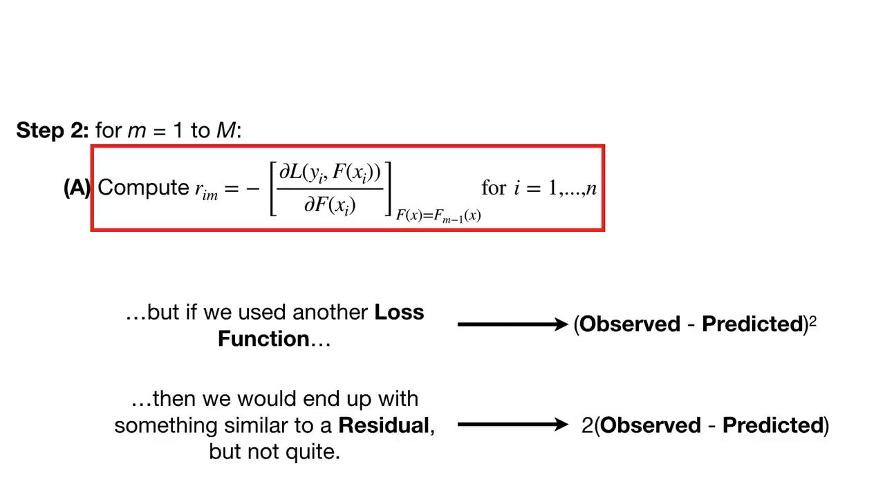

[【跳转到 12:34】](https://www.youtube.com/watch?v=2xudPOBz-vs&t=754)

### 4.2 动作 (B)：用回归树拟合残差，划出叶节点区域

$$
\text{用回归树拟合 } r_{im} \text{，得到叶节点区域 } R_{jm},\ j = 1,\dots,J_m
$$

这一步就是上一支视频里"用身高、颜色、性别去预测残差"。三行数据只能建出一个树桩（两片叶子）：身高小于 1.55 的那一行（残差 $-17.3$）落到左叶，另外两行（残差 14.7 和 2.7）落到右叶。视频特意说明：这里用树桩只是因为样本太少——三行数据最多只能有两片叶子；实际使用中梯度提升几乎总是用更大的树。

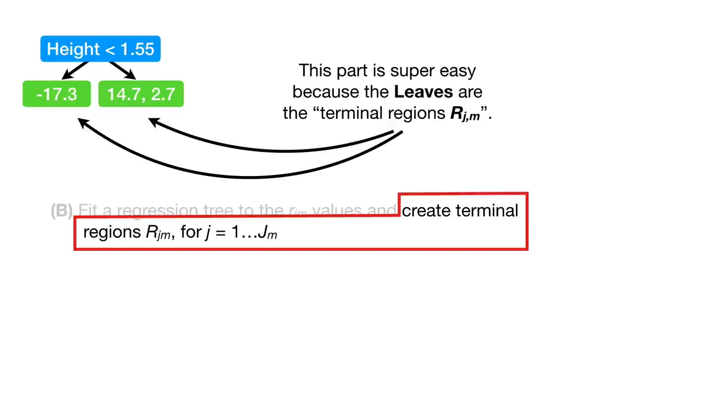

[【跳转到 13:57】](https://www.youtube.com/watch?v=2xudPOBz-vs&t=837)

叶子（leaf）就是这里的"叶节点区域"（terminal region）$R_{jm}$：$m$ 标记第几棵树，$j$ 标记这棵树里的第几片叶子。哪片叶子叫 $R_{1,1}$、哪片叫 $R_{2,1}$ 无所谓，但一旦命名就要一直沿用。

### 4.3 动作 (C)：每片叶子的输出值，是使叶子内损失最小的常数

$$
\gamma_{jm} = \arg\min_{\gamma} \sum_{x_i \in R_{ij}} L\left(y_i,\ F_{m-1}(x_i) + \gamma\right)
$$

一片叶子里落进了多个残差，这片叶子该输出什么数？答案是：找一个 $\gamma$，使得"把 $\gamma$ 加到上一轮预测上之后，这片叶子内所有样本的损失之和"最小。

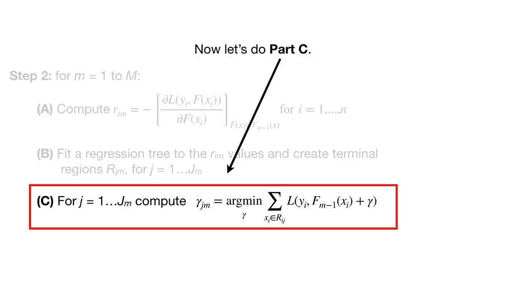

[【跳转到 14:52】](https://www.youtube.com/watch?v=2xudPOBz-vs&t=892)

它和第一步的最小化问题有两个区别：一是现在要把**上一轮的预测**算进去（第一步没有上一轮预测）；二是求和只覆盖**落在这片叶子里的样本**，而不是全部样本。

解法也一样：对 $\gamma$ 求导、令导数为零。左叶只有一个残差 $-17.3$，解出 $\gamma_{1,1} = -17.3$；右叶有两个残差 14.7 和 2.7，解出 $\gamma_{2,1} = 8.7$。视频由此给出一条通用观察：**在当前损失下，每片叶子的输出值总是落进这片叶子的残差的平均**——即使只有一条残差落进来，它的"平均"就是它自己（$-17.3/1 = -17.3$）。

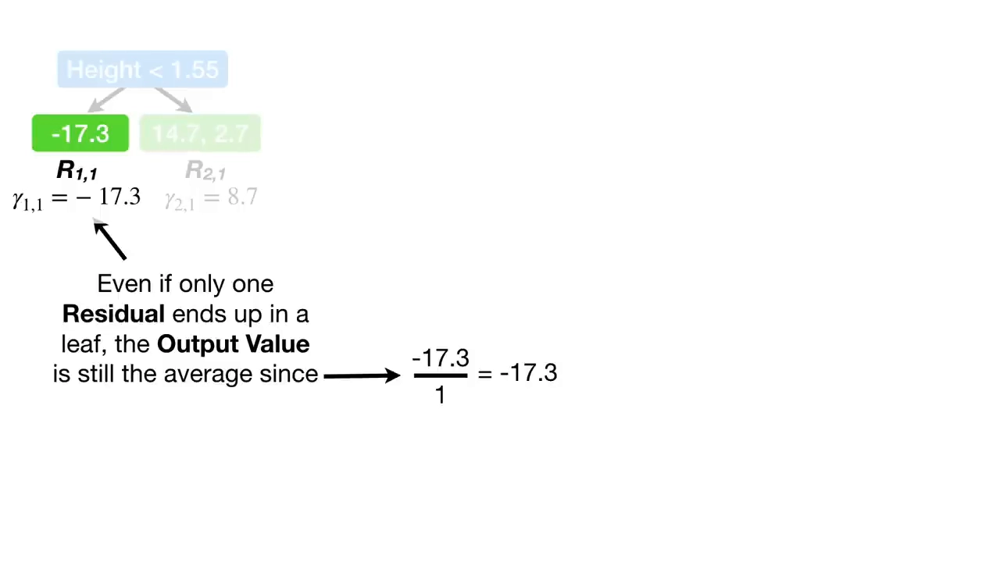

[【跳转到 20:23】](https://www.youtube.com/watch?v=2xudPOBz-vs&t=1223)

### 4.4 动作 (D)：乘学习率，更新模型

$$
F_m(x) = F_{m-1}(x) + \nu \sum_{j=1}^{J_m} \gamma_{jm}\, I\left(x \in R_{jm}\right)
$$

新预测 = 上一轮预测 + 学习率 $\nu$ 乘以"这个样本所在叶子的输出值"。求和号是为了兼容一个样本落进多片叶子的情形（比如某些实现里样本会软分配到多个区域）；指示函数 $I(x \in R_{jm})$ 在样本属于该叶子时取 1、否则取 0。

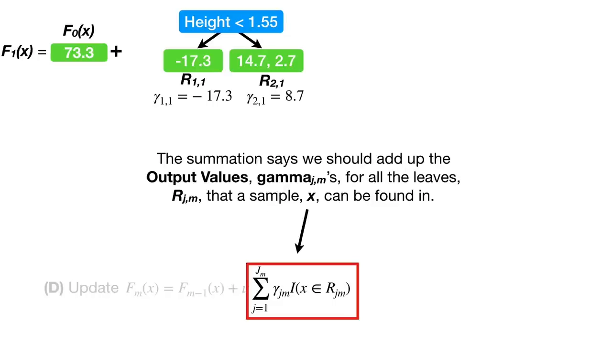

[【跳转到 21:13】](https://www.youtube.com/watch?v=2xudPOBz-vs&t=1273)

$\nu$ 是 0 到 1 之间的学习率。视频的解释是：**小的学习率削弱每棵树对最终预测的影响，从而在长期上提升准确率**。例子里取 $\nu = 0.1$，于是三个样本的新预测是：

- $x_1$：$73.3 + 0.1 \times 8.7 = 74.2$，比 73.3 更接近观测的 88；
- $x_2$：同样 $74.2$，比 73.3 更接近 76；
- $x_3$：$73.3 + 0.1 \times (-17.3) = 71.6$，比 73.3 更接近 56。

一轮结束后把 $m$ 设为 2，重复四个动作：算新残差、建新树、算新 $\gamma$、再做新预测。第二轮的两片叶子输出是 $-15.6$ 和 $7.8$，$F_2(x)$ 就在 $F_1(x)$ 的基础上再加一项。

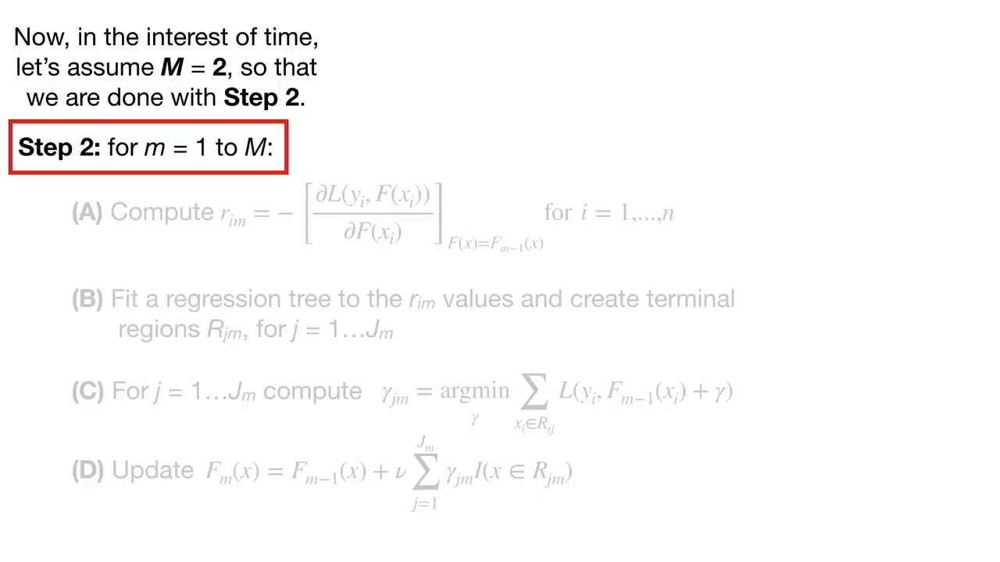

[【跳转到 24:45】](https://www.youtube.com/watch?v=2xudPOBz-vs&t=1485)

## 五、第三步：输出加法模型，并给新样本做预测

循环结束后，输出 $F_M(x)$ 就是梯度提升的最终模型。视频为了收尾假设 $M=2$，于是模型长这样：

$$
F_2(x) = \underbrace{73.3}_{F_0} + 0.1 \times T_1(x) + 0.1 \times T_2(x)
$$

其中 $T_1$ 的叶子输出是 $-17.3$ 与 $8.7$，$T_2$ 的叶子输出是 $-15.6$ 与 $7.8$。

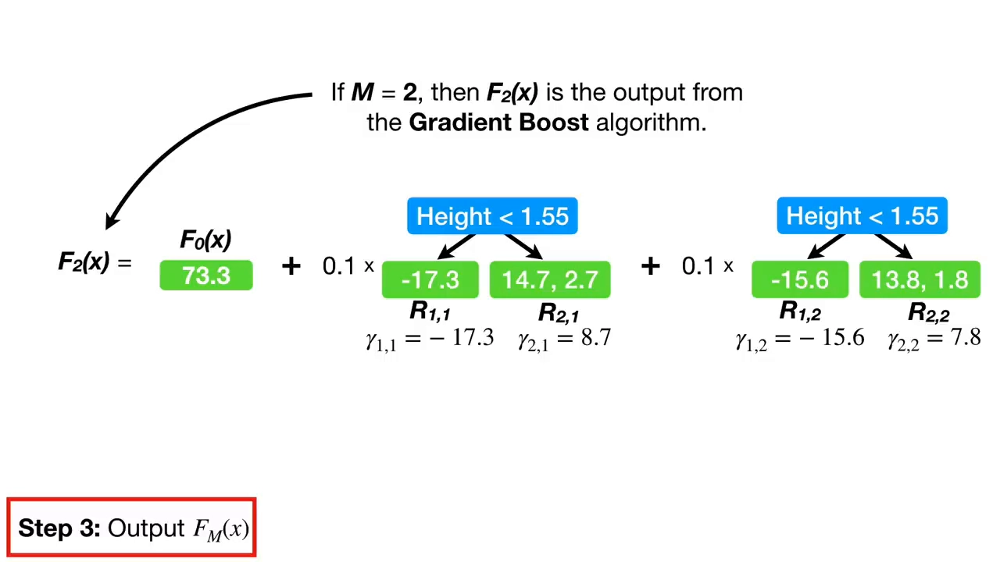

[【跳转到 25:03】](https://www.youtube.com/watch?v=2xudPOBz-vs&t=1503)

拿到新数据时，把这条链逐项加起来即可。视频的例子：新样本沿两棵树都走到左叶，预测体重为

$$
73.3 + 0.1 \times (-17.3) + 0.1 \times (-15.6) = 70\ \text{kg}
$$

## 六、这套流程里的过拟合控制点

把算法写出来之后，"梯度提升怎么防止过拟合"就有了具体位置，它们都落在算法的可调项上：

1. **每棵树的叶子数上限**（动作 B 的 $J_m$）：叶子越少，单棵树越弱，能拟合的残差结构越粗；例子里因为只有三行数据才被迫用树桩，实际常用更大的树，但仍设上限。
2. **学习率 $\nu$**（动作 D）：$\nu$ 越小，每棵树对最终预测的影响越小，需要更多轮才能走到同样的拟合程度——这正是"用许多小步换低方差"的机制。
3. **树的数量 $M$ 与停止条件**：$M$ 常取 100 以上；也可以在建到一定数量后，发现再加树不再显著降低残差就停。

这三项互相牵制：学习率调小通常要相应增加树的数量，而单棵树的叶子数又决定了每轮能"吃掉"多少残差。视频没有给出三者的具体取值建议，只强调默认配置在实践中高度集中——回归一种配置、分类一种配置。

## 小结

- 梯度提升的输入只有**数据 + 一个可微损失函数**；损失常用 $\frac{1}{2}(\text{观测}-\text{预测})^2$，写 $\frac{1}{2}$ 是为了让求导后平方项的 2 被约掉，只剩负残差；
- **第一步**：$F_0(x) = \arg\min_\gamma \sum_i L(y_i,\gamma)$，平方损失下解析解就是观测值的平均（例中 73.3），对应"一片叶子"；
- **第二步**循环 $M$ 轮，每轮四个动作：(A) 算损失对预测的负梯度，即伪残差；(B) 用回归树拟合伪残差，叶子即叶节点区域 $R_{jm}$；(C) 为每片叶子解 $\arg\min_\gamma \sum_{x_i \in R_{ij}} L(y_i, F_{m-1}(x_i)+\gamma)$，平方损失下就是叶子内残差均值；(D) $F_m = F_{m-1} + \nu\sum_j \gamma_{jm} I(x \in R_{jm})$；
- **第三步**：输出 $F_M(x)$，预测新样本就是把初值、各棵树的缩放输出逐项相加；
- "梯度"指的就是动作 (A) 里那个导数：每轮拟合的不是目标值，而是损失下降最快的方向；"伪"残差是因为换一个损失函数后它就不再是普通残差；
- 过拟合控制落在三个可调项上：叶子数上限、学习率 $\nu$、树的数量 $M$ 与停止条件；
- 与随机森林的组合机制对照（森林并行独立、投票/平均降方差；Boosting 串行依赖、逐轮降偏差）见同目录《【机器学习八股文】集成学习，bagging，boosting，stacking》。

## 关键术语速查

| 术语 | 一句话解释 |
| --- | --- |
| 可微损失函数 | 能对预测值求导的损失，梯度提升的第二个输入 |
| $F_0(x)$ | 用常数初始化的模型，平方损失下等于目标值均值 |
| 伪残差 $r_{im}$ | 损失对预测值的负梯度在当前预测处的取值；平方损失下等于观测减预测 |
| 叶节点区域 $R_{jm}$ | 第 $m$ 棵树的第 $j$ 片叶子所覆盖的样本集合 |
| 叶子输出 $\gamma_{jm}$ | 使该叶子内损失之和最小的常数；平方损失下等于叶子内残差均值 |
| 学习率 $\nu$ | 0 到 1 之间的步长，缩放每棵树对最终预测的贡献 |
| $M$ | 树的数量（循环轮数），实践中常取 100 以上 |
| 加法模型 | $F_M(x) = F_0(x) + \nu T_1(x) + \cdots + \nu T_M(x)$ |
| 指示函数 $I(\cdot)$ | 条件成立取 1、否则取 0，用来表示"样本是否落在这片叶子" |