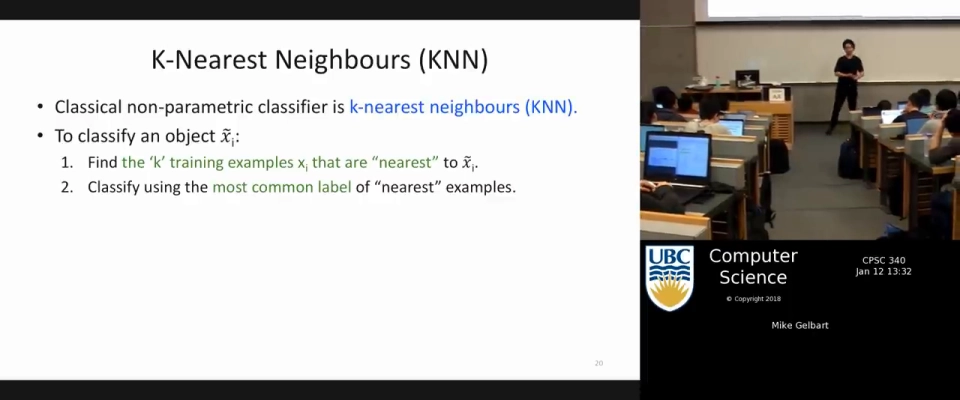
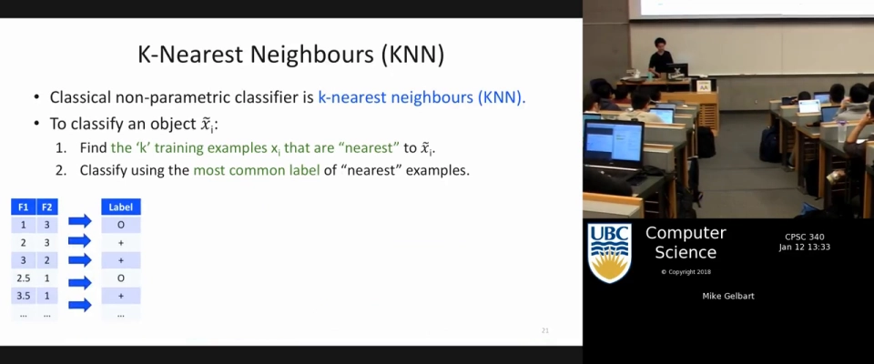
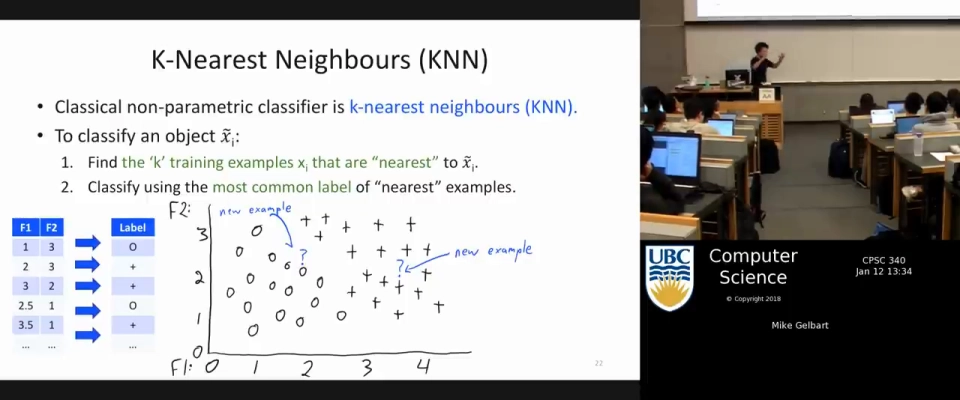
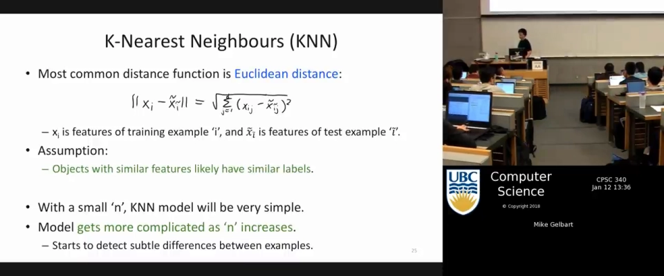
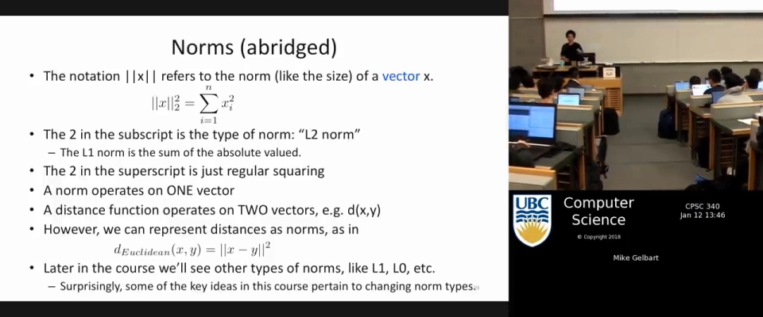
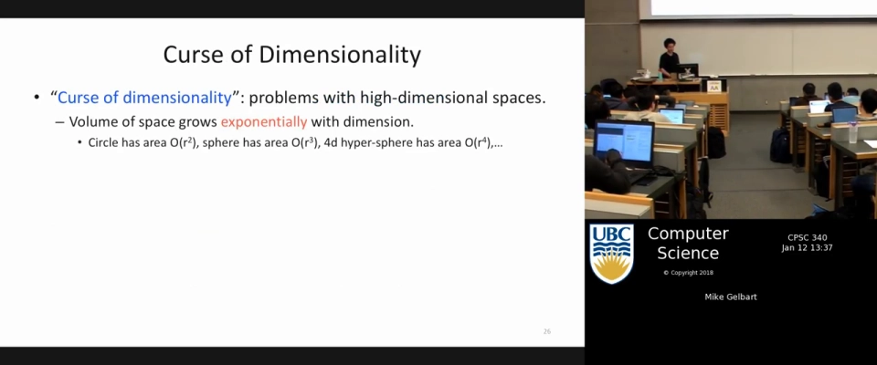
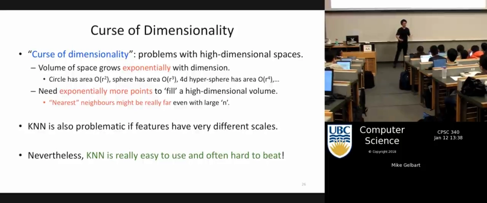
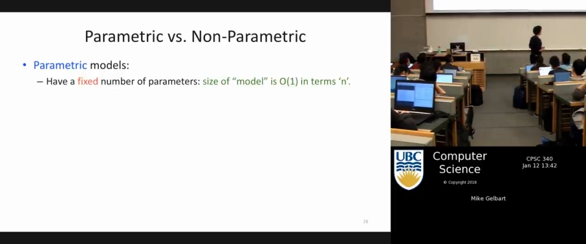
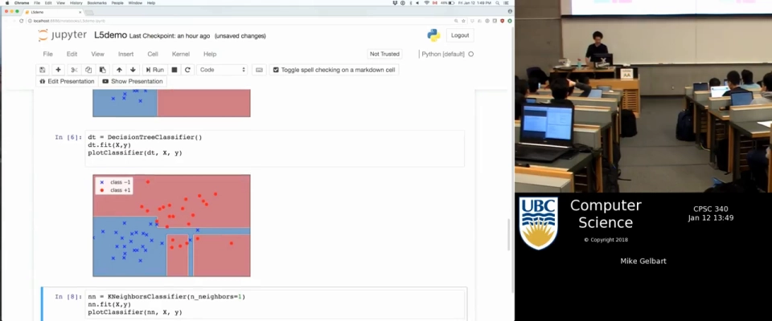
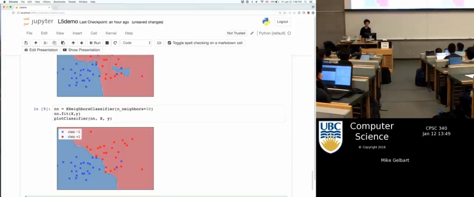

# kNN与维度灾难：最近邻投票、距离尺度与非参数基线

> 视频来源：[CPSC 340: k-Nearest Neighbours（YouTube JRF6oELLn0M）](https://www.youtube.com/watch?v=JRF6oELLn0M)，Mike Gelbart（UBC Computer Science），47 分 54 秒，2018-05-08。本文依据该视频的英文字幕与画面逐窗口整理，内容可回看核查。
> 对应知识体系条目：2.3.8 最近邻与相似性基线（kNN、相似度检索与适用条件）。
> 范围说明：视频前 25 分钟复习训练/验证切分、优化偏差与交叉验证，属于 2.2.5 的内容，本篇只在需要时引用其结论；正文从 29:26 起讲 kNN，一直到结尾的决策边界演示。相似度检索一侧（把向量检索当作检索基线、用 recall@K 验收）见同目录《CLS 池化 vs 均值池化：用 recall@K 实测，为检索任务选出更合适的句子向量》。

## 本讲要解决的核心问题（SCQA）

**背景**：前面几节讲了线性模型、树模型和集成模型，它们都要从训练数据里"学出"一组参数或规则，学完就可以把训练数据丢掉。

**冲突**：还有一类做法根本不做这件事——把训练集原样存下来，来一个新样本就去训练集里找最像的几个，用它们的标签投票。这种做法简单到几乎没有"训练"，却在很多任务上很难被打败；但它的成败完全押在"距离"上，而高维空间里的距离并不像二维图上那样听话。

**疑问**：kNN 到底怎么预测？为什么说它是"非参数"的？什么时候"最近"这个说法会失效？

**回答（中心思想）**：kNN 用**特征空间中的距离**定义"相似"，用 $k$ 个最近训练样本的多数标签作为预测。它的假设只有一句：**特征相近的样本，标签也相近**。因此三件事决定它能不能用——距离度量是否有意义（含特征尺度）、维度是否高到让"最近"失去区分度（维度灾难）、以及 $k$ 这个超参数把决策边界调到多平滑。它的代价也很明确：没有训练阶段，但每次预测都要和全部训练样本算距离。

## 一、kNN 的预测规则：找 $k$ 个最近的训练样本投票

[【跳转到 29:26】](https://www.youtube.com/watch?v=JRF6oELLn0M&t=1766)

要分类一个新样本 $\tilde{x}_i$，kNN 做两步：

1. 在训练集里找出与 $\tilde{x}_i$ **距离最近**的 $k$ 个样本 $x_i$；
2. 用这 $k$ 个样本中出现次数最多的标签作为预测。

老师用"今天会不会过敏"举例：翻自己的饮食日记，找出和今天吃的东西最像的 5 天，看那 5 天里有几天不舒服。如果 4 天不舒服、1 天没事，就预测今天也会不舒服——因为 4 比 1 大。这就是多数投票。

把训练集画在两个特征 $F_1$、$F_2$ 上，两类点分别用圆圈和加号表示，就能看到 kNN 的工作方式：待分类的问号点周围，哪一类近邻多就判哪一类。左边那个点靠近边界，但它的 5 个近邻里圆圈仍占多数，所以判圆圈；右边那个点的近邻全是加号，判加号。

> **读图提醒**：二维图只是为了能画出来。真实数据的特征数是几十、几百甚至上千，二维平面上的"近"不能直接外推到高维，这一点在第三节会变成具体问题。

## 二、距离必须有意义：欧氏距离、L2 范数与特征尺度

[【跳转到 33:36】](https://www.youtube.com/watch?v=JRF6oELLn0M&t=2016)

既然要"最近"，就得先定义距离。最常用的是**欧氏距离**：两个特征向量逐元素相减、平方、求和、再开方，本质上就是勾股定理。

$$d_{\text{Euclidean}}(x_i,\tilde{x}_i)=\lVert x_i-\tilde{x}_i\rVert_2=\sqrt{\sum_{j}(x_{ij}-\tilde{x}_{ij})^2}$$

公式下面那句假设才是关键：**特征相似的样本，标签也相似**。kNN 没有任何别的机制去校验这条假设——它把近邻的标签直接借给新样本。所以"距离"必须真的对应"相似"，否则整套推理从第一步就错了。

视频在这里顺手澄清了范数与距离的记号关系：范数作用于**一个**向量，衡量它的长度；距离作用于**两个**向量，衡量它们的间隔。两者可以互相表示——把两个向量相减再取范数，就得到距离；一个向量的范数，就是它到原点的距离。下标 2 表示范数的类型（L2），上标 2 只是普通的平方，不要混。

[【跳转到 43:19】](https://www.youtube.com/watch?v=JRF6oELLn0M&t=2599)

**尺度问题**是距离定义带来的直接后果。假设特征里有一列是"喝了多少牛奶"，用升记录时数值在 0–2 之间，用毫升记录时在 0–2000 之间，用纳升记录时是 $10^{12}$ 量级。欧氏距离要把各维的差平方后相加，单位一换，牛奶这一维就会把其他所有维的差异彻底淹没：距离实际上只剩下"牛奶量是否完全相同"这一条信息，其他特征等于被删掉了。

决策树没有这个毛病：把所有特征同乘一百万，它选的分裂阈值也同乘一百万，树只关心特征的**顺序**。kNN 关心的是**数值差**，所以对单位、量纲、缩放极其敏感。这也是为什么"装个 scikit-learn 跑一下 kNN"很容易得到看似合理、实则被某一列主导的结果。

> **实践含义**：用 kNN 之前先做特征标准化（或按业务含义归一化），并且这个标准化必须只在训练折上拟合、再应用到验证/测试折，否则会把测试集的分布信息泄漏进"距离"里。

## 三、维度灾难：高维空间里"最近"会失去意义

[【跳转到 35:16】](https://www.youtube.com/watch?v=JRF6oELLn0M&t=2116)

二维图上"附近一定有点"的直觉，来自低维空间体积增长得慢。维度一高，情况就反过来了：

- 半径为 $r$ 的圆面积是 $O(r^2)$，球体积是 $O(r^3)$，四维超球是 $O(r^4)$……**体积随维度指数增长**；
- 要"填满"这样一个空间，需要的样本点也随维度指数增长；
- 结果是：即使 $n$ 已经很大，一个测试点的"最近邻"也可能离它非常远。

[【跳转到 37:29】](https://www.youtube.com/watch?v=JRF6oELLn0M&t=2124)

课堂上有人追问：既然只关心点与点的距离，为什么要在意球的体积？老师的回答是这只是一个**直觉**：空间越大，越可能出现一个落在全新区域的测试点，它周围什么都没有。kNN 仍然会返回 5 个"最近"的样本，但这 5 个可能和它差得很远，借来的标签也就没有意义。换句话说，**kNN 永远给得出答案，但不保证答案有意义**。

幻灯片把两个问题并列在同一页：高维让"近"变稀，尺度差异让"近"被某一维劫持。两者都会让 kNN 的预测退化成噪声，但机制不同——前者是样本覆盖不足，后者是度量被扭曲。

同一页最后一句是老师的平衡判断：**kNN 依然非常易用，而且常常很难被打败**。维度灾难说明它会在某些数据上失效，不说明它没有价值；正确做法是把它当作基线跑一遍，看它是否已经够好，再决定要不要上更复杂的模型。

## 四、非参数与"懒学习"：没有训练，但预测很贵

[【跳转到 38:44】](https://www.youtube.com/watch?v=JRF6oELLn0M&t=2324)

kNN 和前面所有模型的一个结构性差别是：**它没有训练阶段**。所谓训练就是"把数据存起来"，因此这类方法被称为**懒学习（lazy learning）**。

代价转移到了预测端：对一个测试样本，要和全部 $n$ 个训练样本各算一次距离，每次距离计算要扫过 $d$ 个特征，所以单次预测是 $O(nd)$。数据越多、特征越多，预测越慢。这也是近似最近邻检索（ANN）这类工程方向存在的原因——用一点点召回损失换速度。

这也解释了 kNN 属于**非参数模型**：参数个数不固定，而是随数据量增长。kNN 需要保存 $O(nd)$ 的信息，模型复杂度跟着 $n$ 一起涨。

[【跳转到 40:24】](https://www.youtube.com/watch?v=JRF6oELLn0M&t=2424)

对比之下，参数模型的参数个数固定（决策树的规则数、朴素贝叶斯的计数表）：训练是把大数据集"蒸馏"进这组固定的数里，学完可以把数据丢掉，预测时只看参数。数据变多能让这些参数估得更准，但到一定程度就不再涨——模型本身太简单了。非参数模型没有这个上限：数据越多，模型能刻画的结构越细。

> 视频里老师也承认决策树在"参数/非参数"这条线上是个模糊案例，不必把它当典型。

## 五、$k$ 是控制平滑度的超参数

[【跳转到 45:29】](https://www.youtube.com/watch?v=JRF6oELLn0M&t=2729)

$k$ 和决策树的深度一样，是控制模型复杂度的**超参数**，不能用训练误差来选——$k=1$ 时训练误差恒为 0，越选越小没有意义。它要在验证集或交叉验证上选。

演示用同一份二维数据画出决策边界：$k=1$ 时，每个像素的颜色取决于离它最近的那一个训练点，边界碎而复杂，孤立的点会各自圈出一小块领地。

$k=10$ 时，边界被"投票"平滑掉：右侧那两个蓝色点不再能单独决定一小块区域，因为它们被周围的红点投出去了。

所以 **$k$ 越大，模型越简单、边界越平滑；$k$ 越小，模型越复杂、越容易记住训练集的局部噪声**。这和决策树深度、正则化强度是同一类"容量旋钮"，只是方向相反。

## 六、把 kNN 当基线时的检查清单

把上面的机制收拢成几条可操作的判据：

1. **先问距离是否有意义**。特征是不是同一量纲？类别特征怎么编码？用欧氏距离还是余弦相似度？如果两列的量纲差几个数量级，不标准化就等于删掉了小量纲的列。
2. **再问维度是否可承受**。特征数上百、样本数却只有几千时，近邻可能并不近。可以先降维（PCA）或在学到的嵌入空间里算距离，再跑 kNN；但降维本身也要在训练折内拟合。
3. **用验证集选 $k$**，不要用训练误差。$k$ 小则边界碎、方差大，$k$ 大则边界平滑、偏差大。
4. **把预测成本算进去**。$O(nd)$ 的单次预测在离线评估里无所谓，在实时检索里可能就是瓶颈。
5. **它常是强基线**。在把复杂模型推上线之前，先看 kNN 或相似度检索做到什么水平；跑不过它的复杂模型，收益需要额外解释。

## 小结

- kNN 的预测规则只有两步：找 $k$ 个最近邻，按多数标签投票；它唯一的假设是"特征相近则标签相近"。
- 距离是这套方法的全部依据。欧氏距离是各维差的平方和开方；范数作用于一个向量，距离作用于两个向量，距离可写成差向量的范数。
- 特征尺度会直接改写距离：单位一换，量纲大的那一维就会主导近邻选择。kNN 对缩放敏感，决策树不敏感。
- 维度灾难：空间体积随维度指数增长，需要指数级更多的点才能填满，因此高维下"最近邻"可能并不近；kNN 仍会给答案，但答案未必有意义。
- kNN 是非参数、懒学习方法：没有训练阶段，参数就是训练集本身，单次预测 $O(nd)$。
- $k$ 是控制平滑度的超参数：$k$ 小则边界复杂、易过拟合，$k$ 大则边界平滑、模型更简单；应在验证集上选。
- 尽管有上述限制，kNN 依然易用且常常难以打败，适合作为任何新任务的第一个非参数基线。

## 关键术语速查

| 术语 | 一句话解释 |
| --- | --- |
| kNN（k 近邻） | 用特征空间中最近的 $k$ 个训练样本的多数标签做预测的分类器 |
| 非参数模型 | 参数个数不固定、随数据量增长的一类模型；kNN 的"参数"就是训练集 |
| 懒学习（lazy learning） | 没有（或几乎没有）训练阶段，把计算推迟到预测时的方法 |
| 欧氏距离 | 两个向量逐元素差平方求和后开方，即差向量的 L2 范数 |
| L2 范数 | 向量各分量平方和的平方根，衡量向量长度 |
| 维度灾难 | 高维空间中体积指数增长、样本稀疏，导致"最近邻"失去区分度的现象 |
| 特征尺度 | 同一特征用不同单位记录造成的数值范围差异；会改变距离中各维的相对权重 |
| 超参数 $k$ | 控制近邻数量、进而控制决策边界平滑度的模型复杂度旋钮 |