# 聚类评价：轮廓系数、兰德指数与调整兰德指数

> 视频来源：
> - [Silhouette (clustering) - Validating Clustering Models - Unsupervised Machine Learning](https://www.youtube.com/watch?v=DpRPd274-0E)（YouTube · Krish Naik）｜约 20 分钟
> - [3.6.2 DS: Rand Index for Clustering Validation Pt. 1](https://www.youtube.com/watch?v=-UBChMttQOI)（YouTube）｜约 6 分钟
> - [External cluster validation: rand index (RI) and adjusted rand index (ARI) - Example with iris dataset](https://www.youtube.com/watch?v=pU5MaLe8Mxs)（YouTube）｜约 18.5 分钟
>
> 简要导读：三支视频分别讲“没有标签时怎么打分”“有标签时怎么按点对比较”“以及为什么要把随机一致性扣掉”。本文按“内部评价 → 外部评价 → 两者怎么配合”组织；公式、数值和 iris 例子都来自视频，口播中一处说反的地方按定义与上下文做了订正。

## 本讲要解决的核心问题（SCQA）

**背景**：聚类算法总会返回一组簇。k-means 要你先给 $K$，层次聚类要你决定在树上哪里切，DBSCAN 要你调 `eps` 和 `minPts`。只要参数一换，分组就换，所以“这组簇到底好不好”必须单独回答。

**冲突**：聚类没有训练标签，不能像分类那样直接算准确率。更麻烦的是，即使手里有一份“真实分组”，也不能逐行比较标签：算法把同一群细胞标成 `0`、真实标签写成 `2`，逐行看全是“错”的，但分组其实完全一致。另一方面，只靠一个总分也可能被骗：平均轮廓系数最高的方案，可能在某个簇里藏着一批“本该属于别处”的点。

**疑问**：没有标签时怎么评价聚类？有标签时又该怎么比？轮廓系数、兰德指数和调整兰德指数各自回答什么问题，分别在什么条件下会误导？

**回答（中心思想）**：**先分清评价有没有外部标签**。没有标签时用内部指标，轮廓系数把“簇内有多紧”和“到最近的其他簇有多远”合成一个 $[-1,1]$ 的分数；有标签时用外部指标，兰德指数按“点对是否被分到同一边”比较两种划分，调整兰德指数再把随机一致的部分扣掉。两者都不是“生物学正确”的证明：轮廓系数只衡量几何分离，ARI 只衡量与参考标签的一致性，参考标签本身是否独立、是否可信，决定了结论能走多远。

## 一、先分清两类评价：内部与外部

聚类评价的第一个分岔是：**有没有一份可信的外部标签**。

- **内部评价（internal validation）**：只用数据本身和聚类结果，不看任何外部标签。典型代表是轮廓系数、簇内平方和等。它回答“这组簇在几何上紧不紧、分得开不开”。
- **外部评价（external validation）**：拿一份参考划分（金标准、人工注释、已知类别）和算法输出比较。典型代表是兰德指数（RI）、调整兰德指数（ARI）、NMI 等。它回答“算法输出和参考划分有多一致”。

这个区分不是术语游戏。内部指标可以在任何数据上算，但它不知道“这些簇在生物学上意味着什么”；外部指标能告诉你“和已知分组像不像”，但前提是那份已知分组本身可靠，而且不是从被测方法里来的。

## 二、轮廓系数：每个点问两个问题——“自己人有多近”“外人有多远”

### 2.1 三个量：$a(i)$、$b(i)$、$s(i)$

轮廓系数（silhouette coefficient）对**每个样本点**算一个分数，再把所有点的分数平均。视频把它拆成三步 [【跳转到 03:20】](https://www.youtube.com/watch?v=DpRPd274-0E&t=200)。

设点 $i$ 属于簇 $C_i$。

**第一步，算 $a(i)$：点 $i$ 到自己所在簇的平均距离。**

$$
a(i)=\frac{1}{\lvert C_i\rvert-1}\sum_{j\in C_i,\,j\ne i} d(i,j)
$$

分母是 $\lvert C_i\rvert-1$，因为不把自己算进去 [【跳转到 05:00】](https://www.youtube.com/watch?v=DpRPd274-0E&t=300)。$a(i)$ 越小，说明点 $i$ 和同簇的点越紧。

**第二步，算 $b(i)$：点 $i$ 到“最近的另一个簇”的平均距离。**

$$
b(i)=\min_{k\ne i}\frac{1}{\lvert C_k\rvert}\sum_{j\in C_k} d(i,j)
$$

先对每个其他簇算“点 $i$ 到该簇所有点的平均距离”，再取最小值 [【跳转到 06:40】](https://www.youtube.com/watch?v=DpRPd274-0E&t=400)。这个最近的簇就是点 $i$ 的“邻居簇”。$b(i)$ 越大，说明点 $i$ 离外人越远。

**第三步，合成 $s(i)$。**

$$
s(i)=\frac{b(i)-a(i)}{\max\{a(i),b(i)\}}
$$

[【跳转到 10:25】](https://www.youtube.com/watch?v=DpRPd274-0E&t=625)

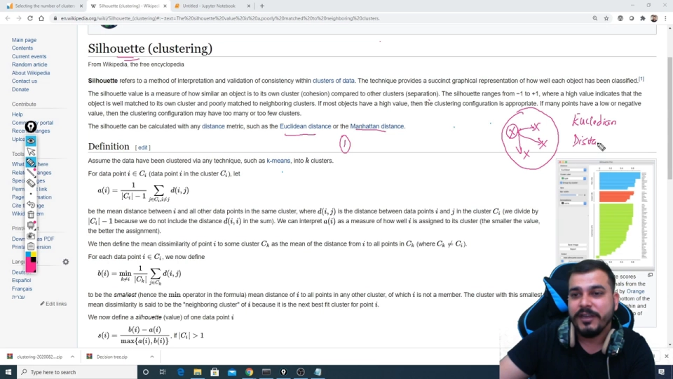

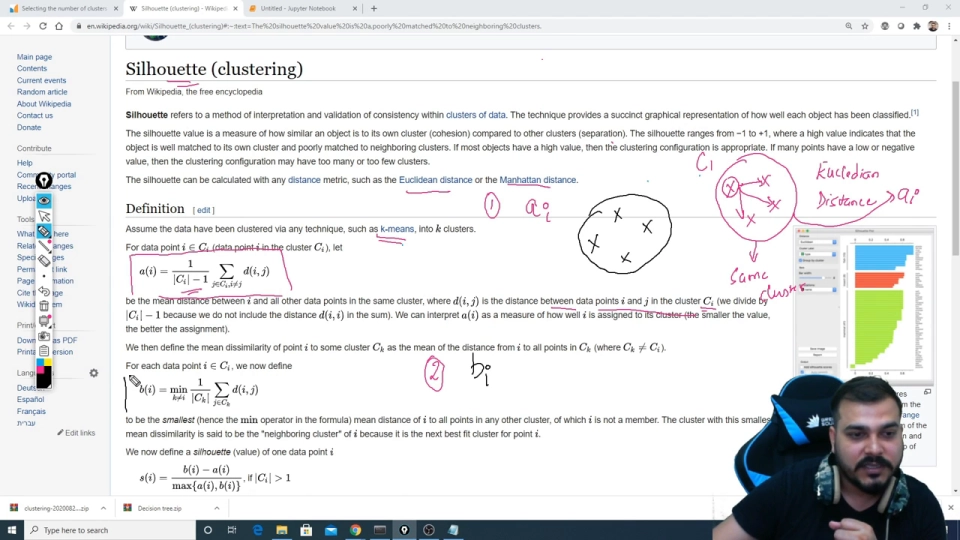

### 2.2 分数怎么读：$+1$ 好，$0$ 在边界，负分说明可能分错

$s(i)$ 的取值在 $[-1,1]$：

| 取值 | 含义 |
| :--- | :--- |
| 接近 $+1$ | 点 $i$ 离自己簇很近、离最近的其他簇很远，分配很合理 |
| 接近 $0$ | 点 $i$ 到自己簇和到邻居簇的距离差不多，处在边界上 |
| 小于 $0$ | 点 $i$ 到邻居簇的平均距离反而比到自己簇更近，可能被分错了 |

视频在这里有一处口播说反了：讲者在 10:25 附近说“如果值接近 $-1$，就非常确认聚类做得很好”。按定义和前后文，**$-1$ 是最差的情况**，$+1$ 才是最好；后文用 $k=3$ 的负值说明“有些点更像属于另一个簇”，也印证了这一点。读视频时以公式和后续例子为准。

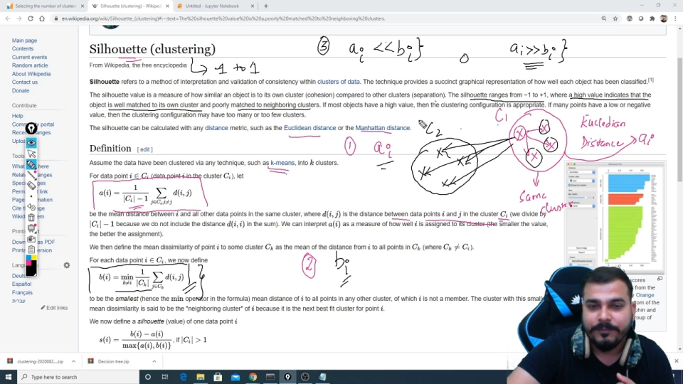

### 2.3 用轮廓系数选 $K$：先看平均值，再看每个簇有没有负分

视频用一个二维、500 个点的模拟数据演示：先用肘部图得到 $K=4$ 的候选，再用轮廓系数验证 [【跳转到 02:05】](https://www.youtube.com/watch?v=DpRPd274-0E&t=125)。

对 $K=2,3,4,5,6$ 分别跑 k-means，计算平均轮廓系数，得到大致如下的一组数 [【跳转到 15:49】](https://www.youtube.com/watch?v=DpRPd274-0E&t=949)：

| $K$ | 平均轮廓系数（约） |
| :--- | :--- |
| 2 | 0.70 |
| 3 | 0.59 |
| 4 | 0.65 |
| 5 | 0.57 |
| 6 | 0.44 |

只看平均值，$K=2$ 最高，似乎应该选 2。但视频没有停在这里，而是继续看**每个簇的轮廓图**：

- $K=2$ 时，所有点的分数基本都在正方向，簇分得很开；
- $K=3$ 时，某个簇里出现了**负值**，说明这些点离邻居簇更近，是被硬分进来的 [【跳转到 16:37】](https://www.youtube.com/watch?v=DpRPd274-0E&t=997)；
- $K=4$ 时，没有明显负值，各簇的轮廓也比较整齐 [【跳转到 17:49】](https://www.youtube.com/watch?v=DpRPd274-0E&t=1069)；
- $K=5$、$K=6$ 又开始出现负值，而且有些簇很薄。

所以视频最终选择和肘部图一致的 $K=4$，而不是平均值最高的 $K=2$ [【跳转到 18:50】](https://www.youtube.com/watch?v=DpRPd274-0E&t=1130)。

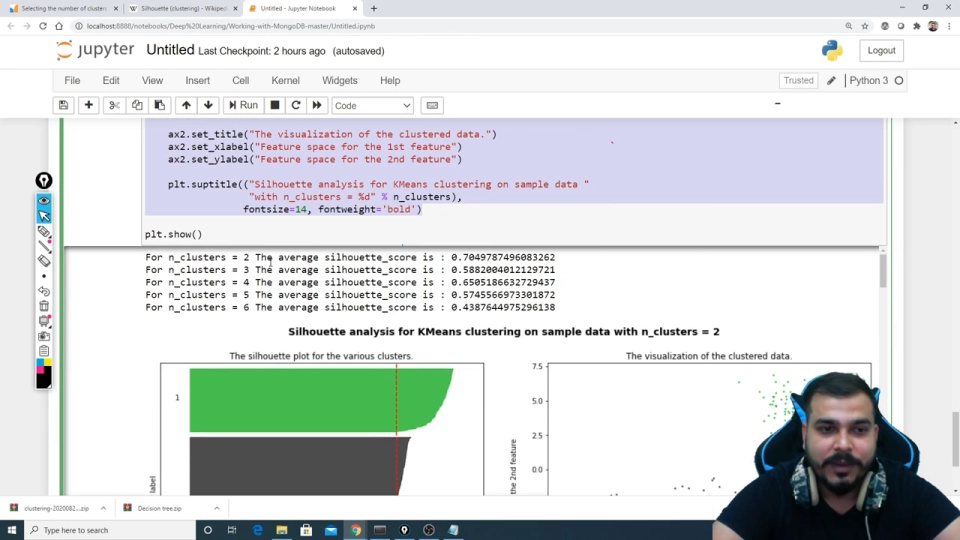

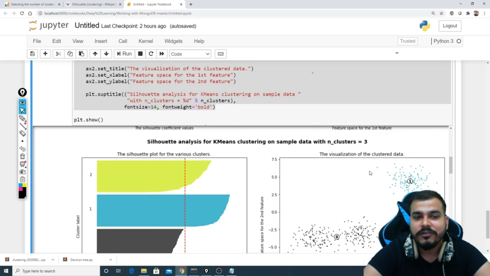

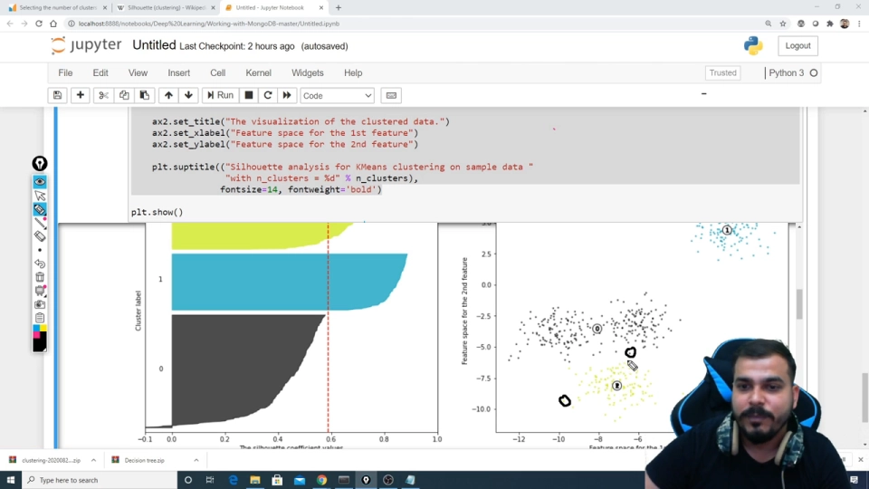

这里有一条比“取最大值”更稳的操作原则：

1. **先看平均轮廓系数**，排除明显很差的 $K$；
2. **再看每个簇的轮廓图**，负值多的方案要警惕，哪怕平均值更高；
3. **最后和肘部图、领域可解释性对照**，三者一致时再定 $K$。

轮廓系数也有边界：它依赖距离度量（视频用欧氏距离），只衡量“按这个距离算出来的几何分离”，不衡量生物学意义。换一种距离，分数就会变；一个轮廓系数很高的分组，也可能只是把技术批次分开了。

## 三、兰德指数：不看标签名字，只看“点对有没有被分到一起”

### 3.1 为什么不能逐行比较标签

假设算法把 5 个样本分成 `0, 0, 1, 2, 1`，真实标签是 `2, 2, 3, 3, 1`。逐行看，没有一个数字相等；但分组其实完全一致：算法标 `0` 的两行对应真实的 `2`，算法标 `1` 的两行对应真实的 `3`，算法标 `2` 的那一行对应真实的 `1` [【跳转到 01:01】](https://www.youtube.com/watch?v=-UBChMttQOI&t=61)。

这说明**簇标签的编号是任意的**。评价聚类时，不能把“标签相等”当“分组正确”，必须比较“哪些点被放在一起”这件事本身。

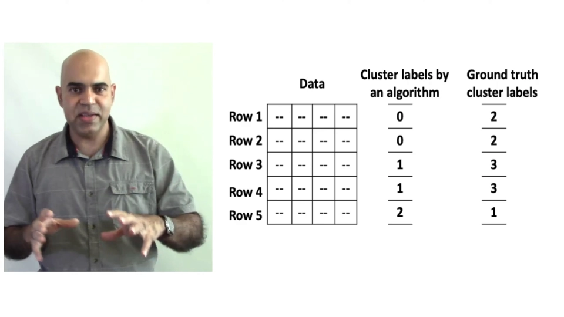

### 3.2 把“点对”分成四类

兰德指数（Rand Index, RI）的做法是：取出所有样本两两组成的点对，逐一检查两种划分是否把它们放在同一边 [【跳转到 03:01】](https://www.youtube.com/watch?v=-UBChMttQOI&t=181)。

| 记号 | 算法划分 | 真实划分 | 含义 |
| :--- | :--- | :--- | :--- |
| TP（true positive） | 同簇 | 同簇 | 该在一起的被放在一起 |
| FP（false positive） | 同簇 | 不同簇 | 不该在一起的被放在一起 |
| TN（true negative） | 不同簇 | 不同簇 | 该分开的被分开 |
| FN（false negative） | 不同簇 | 同簇 | 该在一起的被拆开 |

[【跳转到 04:01】](https://www.youtube.com/watch?v=-UBChMttQOI&t=241)

于是兰德指数就是“判断正确的点对”占“所有点对”的比例：

$$
\mathrm{RI}=\frac{\mathrm{TP}+\mathrm{TN}}{\mathrm{TP}+\mathrm{FP}+\mathrm{TN}+\mathrm{FN}}
$$

[【跳转到 05:09】](https://www.youtube.com/watch?v=-UBChMttQOI&t=309)

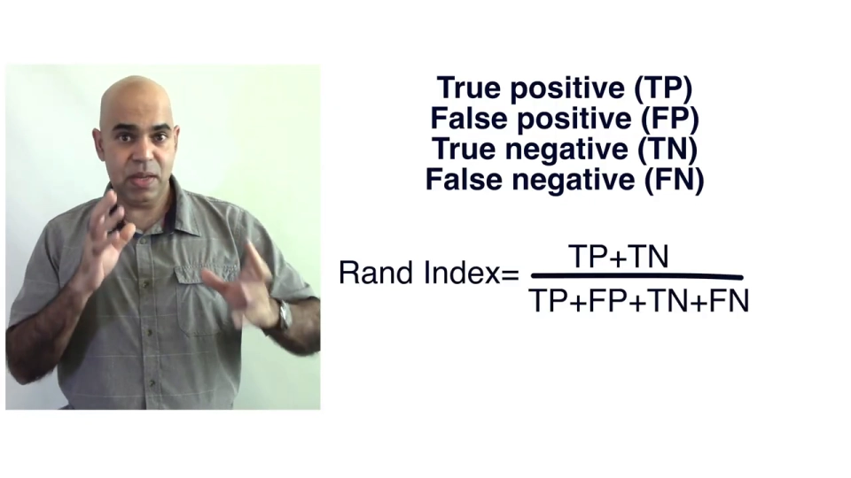

用前面的 5 行例子：算法 `0,0,1,2,1`，真实 `2,2,3,3,1`。第 3 行和第 5 行在算法里同属簇 `1`，但在真实里一个是 `3`、一个是 `1`，所以这一对是 FP；逐对统计后代入公式，就得到 RI。视频在这一步停在了“可以算”的位置，没有继续算完，但四类点对的定义已经足够手算。

### 3.3 RI 的毛病：错误不少，分数仍然很高

RI 的分母是**所有点对**，而点对总数随样本数平方增长。绝大多数点对本来就不在同一簇，TN 会非常多，于是即使算法把一些簇分错，RI 仍然可能很高。

视频用 iris 数据演示了这个现象 [【跳转到 12:50】](https://www.youtube.com/watch?v=pU5MaLe8Mxs&t=770)：

- 50 个 setosa 全部被 k-means 正确分到一组；
- 50 个 versicolor 中 39 个正确、11 个被分到 virginica；
- 50 个 virginica 中 33 个正确、17 个被分到 versicolor。

也就是说，后两类里有 28 个样本分错了。但 RI 仍然给出 **0.8196** [【跳转到 14:17】](https://www.youtube.com/watch?v=pU5MaLe8Mxs&t=857)。原因就是大量“本来就不在一起、算法也没放一起”的 TN 点对把分数撑高了。

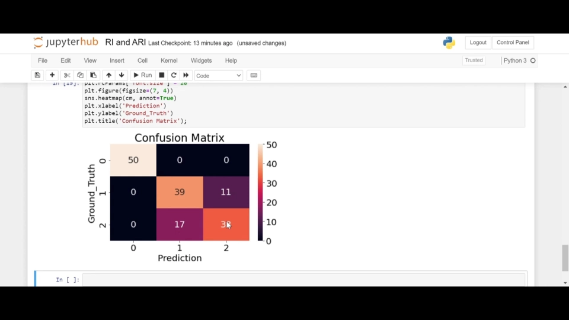

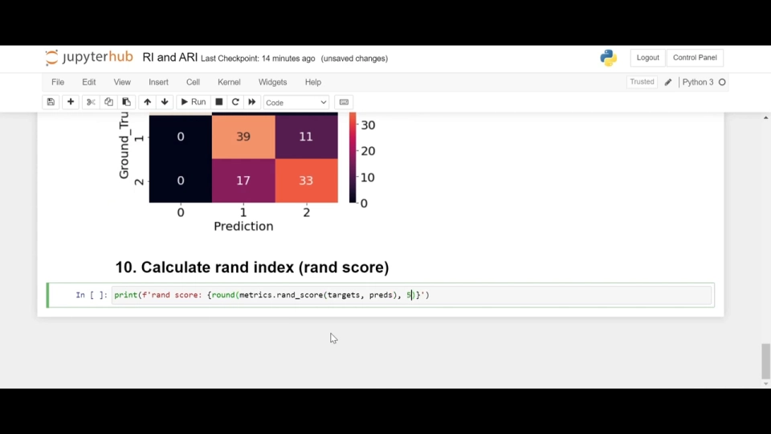

## 四、调整兰德指数：把“随机也能对上”的部分扣掉

### 4.1 为什么要调整

如果两组划分都是随机产生的，它们也会有一定比例的点对“碰巧”同簇或“碰巧”分开。RI 不扣除这部分，所以它的“基线”不是 0：随机划分也可能得到不低的分数，不同簇数、不同样本量的 RI 之间也不好直接比较。

调整兰德指数（Adjusted Rand Index, ARI）的做法是：**用随机划分的期望一致性做校正**，把“碰巧对上”的部分从分子和分母里扣掉。视频没有展开完整公式，但给出了最关键的读法：

- 随机划分的 ARI 期望约为 **0**；
- 完全一致的划分 ARI 为 **1**；
- 越高表示与参考划分越一致 [【跳转到 17:31】](https://www.youtube.com/watch?v=pU5MaLe8Mxs&t=1051)。

在 iris 例子里，同一组 k-means 结果的 ARI 是 **0.59233**，明显低于 RI 的 0.8196 [【跳转到 16:41】](https://www.youtube.com/watch?v=pU5MaLe8Mxs&t=1001)。这个下降不是“算法变差了”，而是 RI 里被 TN 撑高的水分被挤掉了。

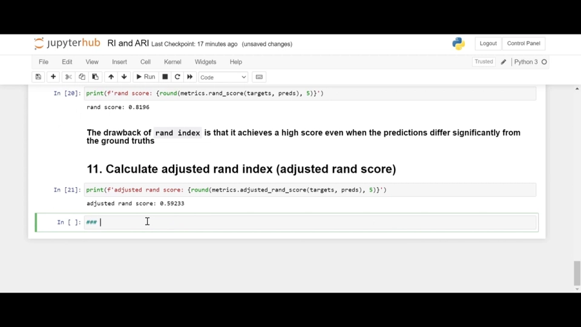

### 4.2 ARI 适合回答什么，不适合回答什么

ARI 适合：

- **有独立参考标签**时，比较不同算法、不同参数、不同 $K$ 的划分与参考的一致性；
- **比较两次聚类结果**：把其中一次当作“参考”，计算两次划分的 ARI，用来衡量稳定性；
- **跨数据集比较**时，因为随机基线被校正到 0，比 RI 更公平。

ARI 不适合：

- **没有参考标签**时，ARI 无从计算；这时只能用内部指标；
- **参考标签本身来自被测方法**时，会形成循环论证：用某个算法的聚类结果当金标准，再评价这个算法，它当然接近 1；
- **把 ARI 当成生物学正确性**：ARI 只说明“和这份参考划分一致”，不说明这份参考划分就是生物学真理。

## 五、把两类指标串成一套评价流程

### 5.1 没有标签：轮廓系数 + 稳定性

如果没有任何外部标签，可以按下面的顺序做：

1. **扫参数**：对 $K$（或层次聚类的切树高度、DBSCAN 的 `eps`/`minPts`）逐个跑，记录平均轮廓系数；
2. **看每簇轮廓图**：负值多的方案降级，不要只看平均值；
3. **看稳定性**：换随机种子、对样本做重采样（bootstrap）或对特征做扰动，重跑聚类，再用 ARI 比较两次划分。ARI 接近 1 说明分组稳定；ARI 很低说明结果对数据扰动敏感，不宜当作确定结论。

第 3 步的视频里没有展开，但它是 ARI 定义的自然延伸：ARI 本来就能比较“任意两组划分”，把同一算法在两次重采样上的输出当成两组划分即可。这一步在生物数据里尤其重要，因为样本量小、噪声大时，轮廓系数高但结果对样本扰动敏感的情况需要单独警惕。

### 5.2 有标签：ARI 为主，轮廓系数为辅

如果有独立的人工注释或已知类别：

1. **先确认标签独立**：标签不能来自被测算法，也不能只来自同一个模态/同一批特征；
2. **算 ARI**：和参考划分比较，同时报告 RI 作为对照，说明随机基线被扣除后差多少；
3. **仍然看内部结构**：ARI 高但轮廓系数很低，说明“和参考一致”但簇在几何上并不紧凑，可能是参考粒度太粗或特征空间被批次主导；
4. **报告混淆矩阵**：ARI 是一个总数，混淆矩阵能看出具体哪一类被并错、哪一类被拆开。

### 5.3 判断“是否支持生物学分组”的三条底线

无论用哪种指标，从“聚类分数”走到“生物学分组”都要过三道关：

- **独立性**：参考标签、marker、验证数据必须来自聚类所用特征之外的信息；用同一份表达矩阵既聚类又“验证”，是循环论证。
- **可复现性**：记录距离、链接方式、$K$ 或密度参数、随机种子、数据版本；否则别人无法判断 ARI 的差异来自方法还是来自随机性。
- **可解释性**：簇是否有稳定的 marker、是否对应已知细胞类型或状态、是否能在独立样本中复现。指标只能筛掉明显差的方案，不能替你做生物学判断。

同目录的《单细胞降维与聚类全流程：从PCA到UMAP与分辨率选择》给了一个具体场景：图聚类的 `resolution` 决定分几群，clustree 展示不同分辨率下的分裂谱系，UMAP 只负责展示；**聚类是某个分辨率下的划分，细胞类型要靠注释命名**。把那里的“分辨率稳定性”与这里的“重采样 ARI 稳定性”放在一起看，才是完整的稳定性检查。

## 小结

- **先问有没有标签**：没有标签用内部指标（轮廓系数），有标签用外部指标（RI/ARI）。
- **轮廓系数逐点计算**：$a(i)$ 是到同簇的平均距离，$b(i)$ 是到最近其他簇的平均距离，$s(i)=(b-a)/\max(a,b)$，取值 $[-1,1]$。
- **$+1$ 最好，负分最可疑**：视频口播在 10:25 附近把 $-1$ 说成“最好”，按定义和后续例子应订正为“$-1$ 最差”。
- **选 $K$ 不能只看平均轮廓系数**：$K=2$ 的平均值可能最高，但 $K=3$ 出现负值、$K=4$ 没有负值且与肘部图一致，最终应选 4。
- **RI 按点对比较**：TP/FP/TN/FN 四类点对，$\mathrm{RI}=(\mathrm{TP}+\mathrm{TN})/(\mathrm{TP}+\mathrm{FP}+\mathrm{TN}+\mathrm{FN})$；标签编号不影响结果。
- **RI 会被大量 TN 撑高**：iris 例子中 28 个样本分错，RI 仍有 0.8196。
- **ARI 扣除随机一致性**：同一组划分 ARI=0.59233，随机划分期望约为 0，完全一致为 1。
- **稳定性可以用 ARI 自己造**：换种子/重采样后比较两次划分的 ARI；这一步是 ARI 定义的延伸，视频未展开。
- **指标不等于生物学结论**：参考标签要独立，参数要记录，簇要有可解释的 marker 和独立验证。

## 关键术语速查

| 术语 | 一句话解释 |
| :--- | :--- |
| 内部评价 | 不使用外部标签，只看数据与聚类结果的几何性质 |
| 外部评价 | 用参考划分/金标准与聚类输出比较 |
| 轮廓系数 $s(i)$ | 综合“簇内紧密度”和“到最近其他簇的距离”的逐点分数，范围 $[-1,1]$ |
| $a(i)$ | 点 $i$ 到同簇其他点的平均距离 |
| $b(i)$ | 点 $i$ 到最近的其他簇的平均距离 |
| 轮廓图 | 每个点一条轮廓条，按簇排列；负值条表示该点更像属于邻居簇 |
| 兰德指数（RI） | 判断正确的点对占所有点对的比例 |
| TP/FP/TN/FN | 点对在“算法划分”和“真实划分”下同簇/不同簇的四种组合 |
| 调整兰德指数（ARI） | 扣除随机一致性后的 RI，随机划分期望约为 0，完全一致为 1 |
| 稳定性 | 换种子、重采样或扰动后聚类结果是否保持一致，可用 ARI 比较两次划分 |
| 循环论证 | 用被测方法产生的标签当金标准，再评价该方法自身 |