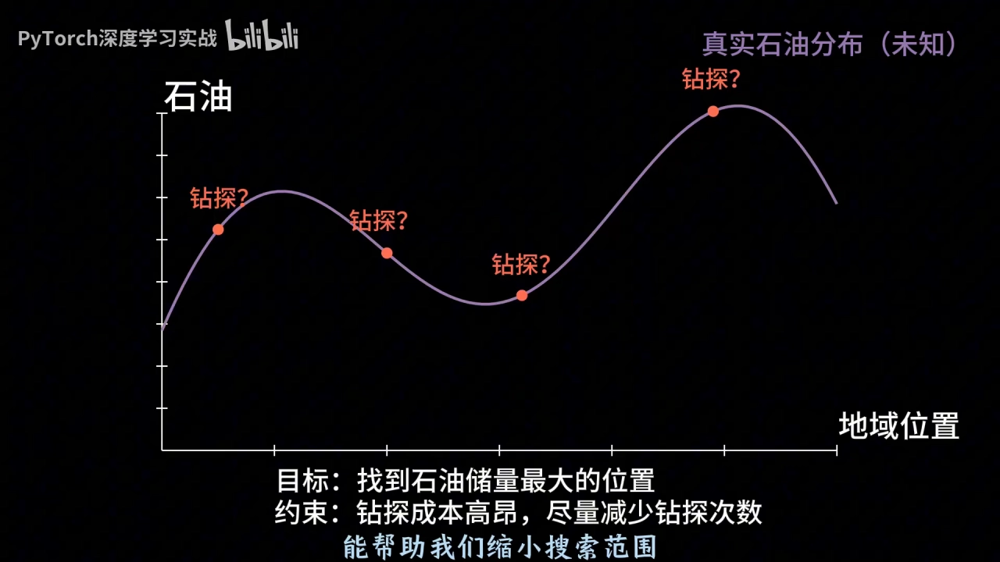
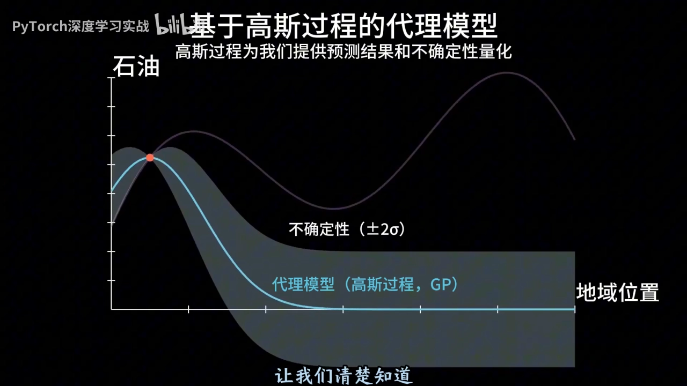
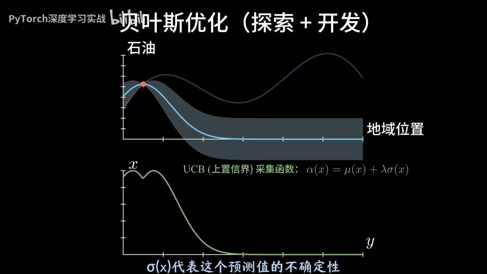
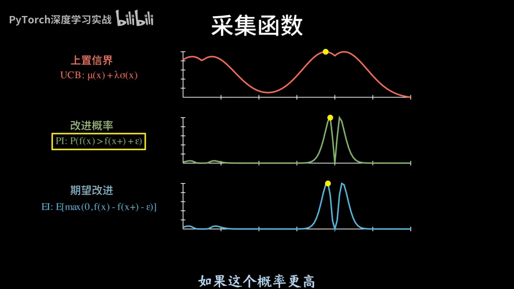
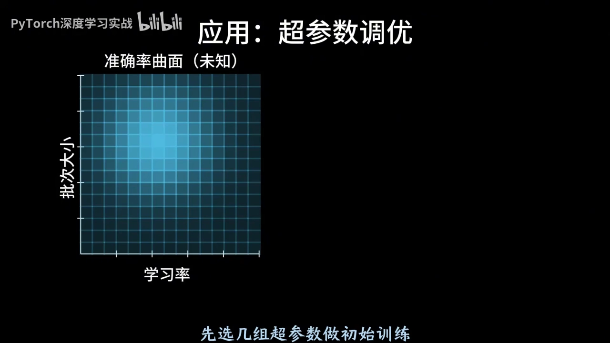

# 不确定性下的理性：UCB、改进概率与期望改进如何权衡探索和利用

> 视频来源：[不确定性下的理性：贝叶斯优化的核心思想](https://www.bilibili.com/video/BV1Tp2FBhEHj/)（B 站 · 算法菌不熬夜）｜时长约 10 分钟
> 导读：这支视频用"石油钻探"一个类比贯穿到底，把贝叶斯优化讲成三件事：代理模型给出预测和不确定性、采集函数在勘探与开发之间做权衡、以及它为什么比网格搜索和随机搜索更省评估次数。本文补上了视频里只给名字的三种采集函数（UCB、PI、EI）的对照。

## 本讲要解决的核心问题（SCQA）

**背景**：很多优化问题的目标函数是一个黑箱：给它一个输入，它返回一个输出，但内部公式不知道。更麻烦的是，每评估一次都很贵。

**冲突**：如果目标只是"把整张分布图画清楚"，那就去不确定性最高的地方采样；但我们的目标是"找到最大值所在的位置"，画地图式的采样会把预算花在无关区域。

**疑问**：怎样用尽量少的评估次数，既利用已知的高值区域，又探索可能藏着更高值、但目前还不确定的区域？

**回答（中心思想）**：用一个能同时给出**预测值**和**不确定性**的代理模型（高斯过程），再用一个**采集函数**把这两者合成一个分数。分数最高的点，就是下一次评估的位置。采集函数决定了探索与利用的比例，也决定了贝叶斯优化比网格搜索、随机搜索省多少次评估。

## 一、石油钻探：一个把抽象概念落地的类比

视频把场景设成一位石油勘探者：手里有一大片从未开发的土地，目标是找到石油含量最高的地方。但钻一个测试孔要花费数百万，不可能像试错一样到处钻（[【跳转到 00:30】](https://www.bilibili.com/video/BV1Tp2FBhEHj/?t=30)）。

更麻烦的是，一开始我们对石油分布毫无头绪：它可能扎堆藏在某一个区域，也可能零零散散分布在好几个地方，完全没有规律可循。

这正是**昂贵的黑箱优化**：目标函数没有解析式，每次评估都有成本，只能通过输入输出推测规律。

## 二、代理模型：高斯过程给出一条曲线和一层不确定性

假设我们只在一个位置钻一个孔。有了这个数据点后，贝叶斯优化就能生成一条覆盖整片区域的石油含量预测曲线。但它的厉害之处不止于此：还能给出**不确定性区间**，就是预测值上下浮动的标准差范围（[【跳转到 01:20】](https://www.bilibili.com/video/BV1Tp2FBhEHj/?t=80)）。

仔细观察这个区间：

- 在已经钻探过的数据点附近，区间很窄，说明我们对这里的石油含量把握很大；
- 一旦离数据点越来越远，区间就会越来越宽——没有探索过的地方，自然没有办法确定情况。

而且贝叶斯优化是能持续学习的：每当在新的位置钻探，把新数据点加入模型，那个位置的不确定性区间就会立刻缩小。随着数据越来越多，我们对整片区域石油分布的预测信心也会逐渐增强（[【跳转到 02:05】](https://www.bilibili.com/video/BV1Tp2FBhEHj/?t=125)）。

### 2.1 主动学习与贝叶斯优化的区别

视频在这里插入了一个重要区分。如果目标只是画出完整的石油分布图，用**主动学习**策略就够了：每次都往不确定性最高的地方钻一点点，把未知区域的空白填满，直到整片土地的石油分布都清晰起来。

但我们的核心目标是找到石油含量最高的地方，而不是画地图。主动学习虽然能画出精准的分布图，却可能要钻几十上百次孔，花掉巨额成本后才找到最大值点，这显然不划算（[【跳转到 02:39】](https://www.bilibili.com/video/BV1Tp2FBhEHj/?t=159)）。

贝叶斯优化的聪明之处就在于：它不止做勘探，还会在**勘探**（exploration）和**开发**（exploitation）之间找到平衡。

- **勘探**：搜索那些不确定性高的区域，看看有没有潜在的高油区；
- **开发**：在已经知道可能有高油区的区域进一步精确钻孔，锁定最大值。

## 三、采集函数：把探索与利用写成一个公式

这种平衡是通过**采集函数**实现的。采集函数就像一个决策助手，帮我们判断下一个勘探点该选择哪里。视频介绍了三种最常用的采集函数。

### 3.1 上置信界（UCB）：均值加一个不确定性奖励

上置信界（upper confidence bound，UCB）的公式是：

$$
\alpha(x) = \mu(x) + \lambda \sigma(x)
$$

其中：

- $\mu(x)$ 是在 $x$ 这个位置预测的石油含量；
- $\sigma(x)$ 是这个预测值的不确定性；
- $\lambda$ 是一个可调参数，用来控制我们对勘探和开发的偏重程度。

如果把 $\lambda$ 调大，就意味着更倾向于勘探，会优先选择不确定性高的区域，哪怕当前预测石油含量不高，也愿意花成本去验证；如果把 $\lambda$ 调小，就会更偏向开发，聚焦在当前预测石油含量高的区域，先把已知的潜在高油区挖透（[【跳转到 03:55】](https://www.bilibili.com/video/BV1Tp2FBhEHj/?t=235)）。

跟着 UCB 的指引一次次调整，就会越来越接近真实的石油含量最大值点。而且随着勘探次数增加，模型越来越精确，那些有潜力的区域不确定性逐渐降低，UCB 会自动从偏向勘探转向偏向开发，不用手动调整策略。

### 3.2 改进概率（PI）：只问"能不能超过"

另外两种常用采集函数分别是**改进概率**（probability of improvement，PI）和**期望改进**（expected improvement，EI）。

改进概率的作用很直白：它计算在某个位置钻探后，结果比当前找到的最佳位置更好的可能性。具体来说，就是计算该位置的石油含量 $f(x)$ 大于当前最佳值 $f(x^*) + \epsilon$ 的概率。如果这个概率更高，就说明这个位置值得一试（[【跳转到 04:45】](https://www.bilibili.com/video/BV1Tp2FBhEHj/?t=285)）。

### 3.3 期望改进（EI）：还问"能超过多少"

期望改进则比改进概率考虑得更周全：它不仅判断能不能改进，还估算能改进多少。计算逻辑是：

1. 先算出该位置石油含量比当前最佳值多出来的部分；
2. 如果差值是正数，就保留这个差值；如果是负数，就按零算；
3. 最后求这个结果的期望值。

期望值越高，说明这个位置能带来的潜在收益越大（[【跳转到 05:10】](https://www.bilibili.com/video/BV1Tp2FBhEHj/?t=310)）。

视频没有展开三者的数学细节，但对照可以看出它们的差别：

| 采集函数 | 关心什么 | 主要风险 |
| --- | --- | --- |
| UCB | 均值 + λ×不确定性 | λ 选得不好，会过度探索或过度保守 |
| PI | 超过当前最好值的概率 | 只看概率、不看幅度，容易挑"略好但没多少油水"的点 |
| EI | 超过当前最好值的期望幅度 | 需要后验分布可积分；噪声大时要额外处理 |

不管用哪种采集函数，都能通过调整参数来控制勘探与开发的平衡。比如调大 $\lambda$ 或 EI 的参数，就会更愿意探索未知区域；调小这些参数，就会更专注于挖掘已知的好区域，避免在没有把握的地方浪费成本。

## 四、为什么比网格搜索和随机搜索省

视频用一组对比实验展示差距（[【跳转到 06:00】](https://www.bilibili.com/video/BV1Tp2FBhEHj/?t=360)）：

- **网格搜索**（蓝色点）：从某个位置开始，严格按固定间隔选点，不管之前的结果好不好，都按流程来；
- **随机搜索**（红色点）：选点完全随机，没有规律；
- **贝叶斯优化**（绿色点）：从某个位置开始，但会从每次钻探结果里学习。

随着钻探次数增加，差异越来越明显：

- 网格搜索还是按部就班地打卡式钻探，哪怕某个区域已经证明没油，还是会按间隔钻；
- 随机搜索东一榔头西一棒，经常在没有潜力的区域浪费次数；
- 贝叶斯优化会慢慢把钻探点聚集到可能有高油的区域，每钻一次就调整一次策略，不断向最大值靠近。

等到第五次钻探结束，贝叶斯优化找到的最佳石油含量约为 8.2，网格搜索只到 7.2，随机搜索才到 6.8（[【跳转到 07:15】](https://www.bilibili.com/video/BV1Tp2FBhEHj/?t=435)）。

核心原因就是贝叶斯优化会从经验中学习：每次钻探后都会更新模型、优化策略；而随机搜索和网格搜索完全不管之前的结果，永远在盲目地尝试。

## 五、同一个循环：超参数调优

视频最后把石油钻探映射到机器学习里最常见的应用——超参数调优（[【跳转到 08:04】](https://www.bilibili.com/video/BV1Tp2FBhEHj/?t=484)）：

| 石油钻探 | 超参数调优 |
| --- | --- |
| 钻孔的位置 | 一组超参数（学习率、批次大小等） |
| 石油含量 | 模型的精度 |
| 钻探成本 | 训练一次模型的时间和算力 |
| 替代模型 | 超参数到模型精度的预测模型 |
| 采集函数 | 选下一组最值得试的超参数 |

流程完全一样：先选几组超参数做初始训练，相当于先钻几个孔；用这些结果建立超参数到精度的预测模型；然后用采集函数找下一组最有可能提升精度的超参数；训练后把新结果加入模型继续更新。

这种方法的优势在于实用性强：它能根据已经搜索过的超参数空间调整策略，采集函数会自动避开那些已经证明精度低的组合，把算力集中在有潜力的区域（[【跳转到 08:54】](https://www.bilibili.com/video/BV1Tp2FBhEHj/?t=534)）。

## 六、总结：三个核心逻辑

视频最后把贝叶斯优化总结为三点（[【跳转到 09:19】](https://www.bilibili.com/video/BV1Tp2FBhEHj/?t=559)）：

1. 用高斯过程这类替代模型模拟函数的分布，不用直接计算复杂函数；
2. 靠采集函数在勘探和开发之间找平衡，不盲目也不保守；
3. 能用最少的评估次数逼近最优解，大大降低成本。

它最适合解决**昂贵黑箱函数**的优化问题：每次评估成本高，且不知道模型的具体表达式，只能通过输入输出推测规律。不管是找石油、调整参数，还是做科学实验时找最佳条件，都可以试试贝叶斯优化。

## 小结

- 贝叶斯优化适合"评估很贵、函数是黑箱、想知道全局最优"的问题。
- 代理模型（高斯过程）同时给出预测值和不确定性；不确定性在数据附近窄、离数据远时宽。
- 主动学习只关心"把地图画满"，贝叶斯优化关心"找到最大值"，所以要在勘探与开发之间权衡。
- UCB 用"均值 + λ×不确定性"直接加权；PI 只看超过的概率；EI 还看超过的幅度。
- 与网格搜索、随机搜索相比，贝叶斯优化会从每次结果中学习，把评估次数集中到更有潜力的区域。
- 超参数调优是这套循环最典型的应用：一组超参数就是一次"钻探"。

## 关键术语速查

| 术语 | 一句话解释 |
| --- | --- |
| 昂贵黑箱优化 | 目标函数无解析式、无梯度，每次评估成本高 |
| 代理模型 | 用少量观测拟合出的廉价近似模型 |
| 高斯过程（GP） | 同时输出预测均值和不确定性的代理模型 |
| 采集函数 | 把均值和不确定性合成一个分数，决定下一个评估点 |
| UCB | 上置信界，$\mu(x) + \lambda\sigma(x)$ |
| PI | 改进概率，结果超过当前最好值的概率 |
| EI | 期望改进，超过当前最好值的幅度的期望 |
| 勘探 / 开发 | 去不确定性高的区域 / 去当前预测好的区域 |