# 贝叶斯优化：用后验不确定性决定下一次实验

> 视频来源：[贝叶斯优化算法原理讲解](https://www.bilibili.com/video/BV1nfpc6wEBR/)（B 站 · AI4S求知录）｜时长约 13 分钟
> 导读：这支视频用一个"温度—收率"的合成反应例子，把贝叶斯优化从"下一次实验选哪里"讲到完整循环。本文按它的叙事顺序整理，重点保留三处容易讲糊的地方：后验区间为什么可宽可窄、期望改进为什么不是"改进概率"、以及"预算内最好"为什么不能写成"全局最优"。

## 本讲要解决的核心问题（SCQA）

**背景**：很多实验一次只能测一个条件，测一次要花一天、一批原料，甚至一台设备。预算只够做十次，而可能的条件几乎无限。

**冲突**：前三次实验做完，我们只知道三个点。点与点之间是什么样，完全不知道。最直接的想法是去"当前预测最好"的地方再做一次，但预测均值最高的位置，未必是真正能带来最大提升的位置。

**疑问**：怎样用少量观测决定下一次实验？怎样把"去已知的好地方"和"去还不知道的地方"放进同一个可计算的规则里？

**回答（中心思想）**：贝叶斯优化把这件事拆成两个模块。**代理模型**（通常是高斯过程）用已有观测给出目标函数的后验分布——每个候选点不只有预测均值，还有一个不确定性；**采集函数**再把均值和不确定性合成一个分数，选分数最高的点做下一次实验，而不是选预测均值最高的点。实验做完，把结果并回数据、更新后验，循环继续。

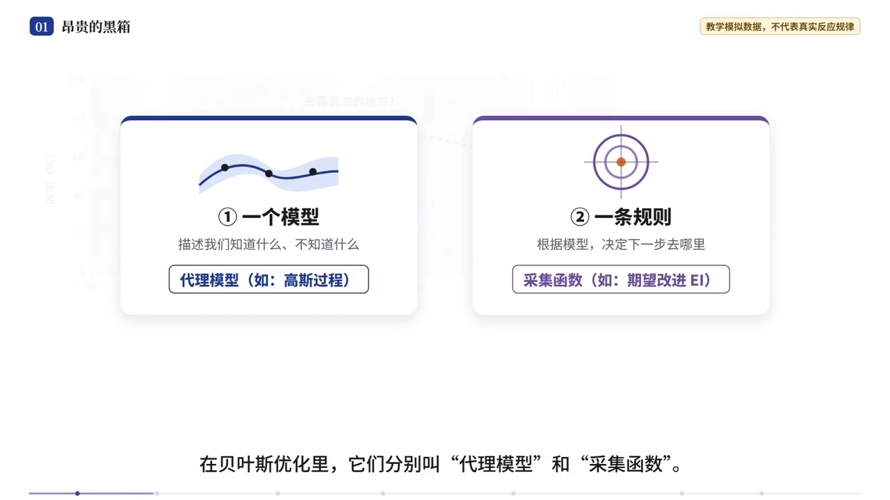

## 一、问题：昂贵的黑箱，像在浓雾里找山峰

视频把场景设成一个合成反应：温度可以设在 60 到 140℃ 之间，目标是找到收率最高的温度。每做一次实验要花一天和一批原料，预算只够十次；如果每隔一度做一次，需要 80 次实验，预算只够八分之一（[【跳转到 00:00】](https://www.bilibili.com/video/BV1nfpc6wEBR/?t=0)）。

这个反应对我们是黑箱：输入一个温度，等一天，输出一个收率，中间公式不知道。每打开一次黑箱代价都很高——这类问题叫**昂贵的黑箱优化**（expensive black-box optimization）。

先在低、中、高三个温度各做一次：70℃ 收率 43.1%，100℃ 收率 40.3%，130℃ 收率 49%。目前最好是 130℃ 的 49%。但三个点之间是什么样子，我们并不知道，就像在浓雾里找山峰：只有测过的地方是清楚的，其余都藏在雾里（[【跳转到 01:06】](https://www.bilibili.com/video/BV1nfpc6wEBR/?t=66)）。

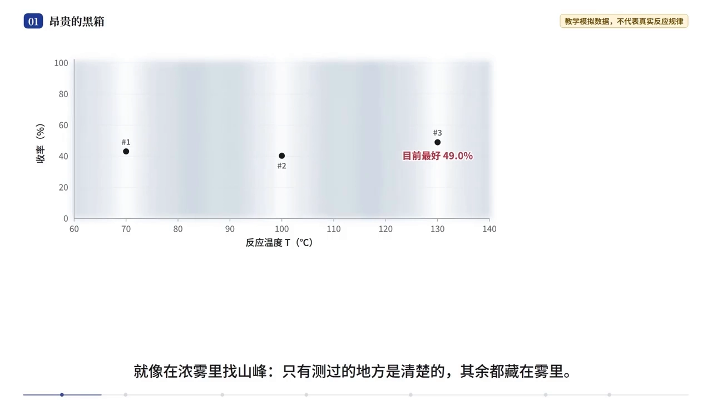

要决定下一次去哪，需要两样东西：

1. **一个模型**：描述我们知道什么、不知道什么；
2. **一条规则**：根据模型决定下一步去哪里。

在贝叶斯优化里，它们分别叫**代理模型**（surrogate model）和**采集函数**（acquisition function）。

## 二、代理模型：高斯过程给出"一条线 + 一条带"

### 2.1 先验：把"曲线应该平滑"写成概率

做实验之前，我们对这条曲线并非一无所知。比如收率应该随温度平滑变化，不会在相差一两度的地方忽高忽低。把这种事先的认识用概率表达出来，就叫**先验**（prior）。

视频用一束细线表示先验：每一条细线，都是先验认为可能的一种温度—收率关系（[【跳转到 01:56】](https://www.bilibili.com/video/BV1nfpc6wEBR/?t=116)）。

这里的关键不是"猜中哪一条线"，而是承认有很多条线都说得通。先验不是一条确定曲线，而是一个**函数分布**。

### 2.2 后验：用数据筛掉不相符的曲线

把三次实验结果放进来，模型只保留与数据相符的曲线——它们都必须穿过这三个点。这就是**后验**（posterior），也就是用证据修正之后的信念。贝叶斯这个名字说的正是这件事：先有信念，再用证据更新它。

视频用的这种模型叫**高斯过程**（Gaussian process，GP）。它给出的不是一条线，而是一整套可能性（[【跳转到 02:21】](https://www.bilibili.com/video/BV1nfpc6wEBR/?t=141)）。

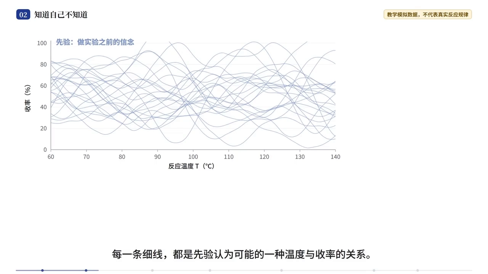

### 2.3 均值与区间：把"知道"和"不知道"分开画

把这一整套可能性概括一下，就得到两样东西：

- **预测均值**：深蓝色的线，代表模型在每个温度上的最佳猜测；
- **95% 区间**：浅蓝色的带，代表模型有多不确定。

在做过实验的地方，带子收得很窄；离数据越远，带子越宽（[【跳转到 03:11】](https://www.bilibili.com/video/BV1nfpc6wEBR/?t=191)）。

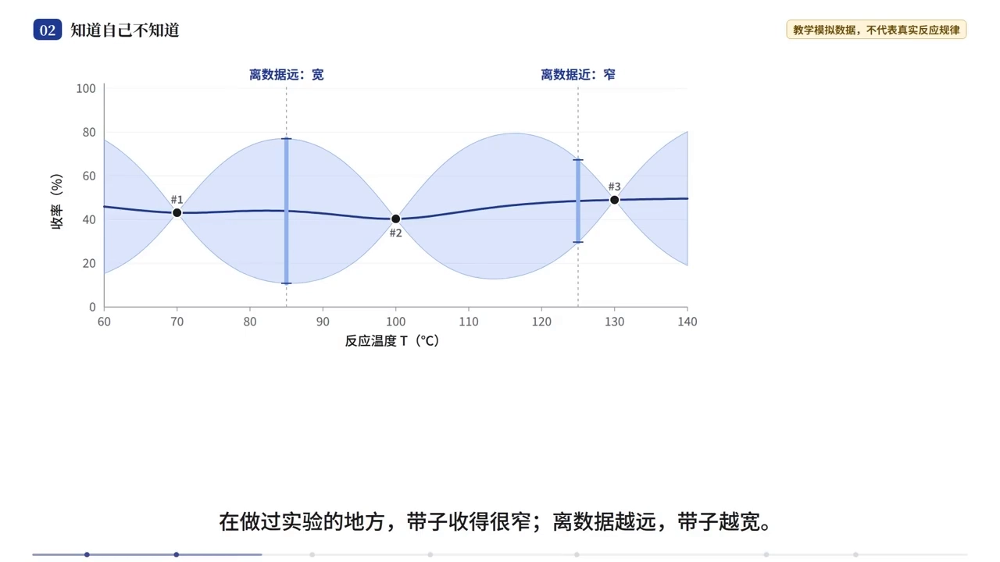

这条带子正是"雾"的数学版本。一个好的模型不但要给出预测，还要诚实地标出哪里它其实不知道。不过，带子的宽窄依赖模型的假设：假设曲线变化得更快，带子就更宽；假设它更平缓，带子就更窄。所以它是**模型的判断**，而不是对真实世界的保证（[【跳转到 03:36】](https://www.bilibili.com/video/BV1nfpc6wEBR/?t=216)）。

## 三、第一次失败：预测均值最高，不等于最优实验

有了模型，最直接的想法是去预测均值最高的地方。此刻均值最高的位置在 140℃，正好在温度范围的边上，那就试一次。

结果只有 29.2%，比之前最好的 49% 还低（[【跳转到 04:01】](https://www.bilibili.com/video/BV1nfpc6wEBR/?t=241)）。

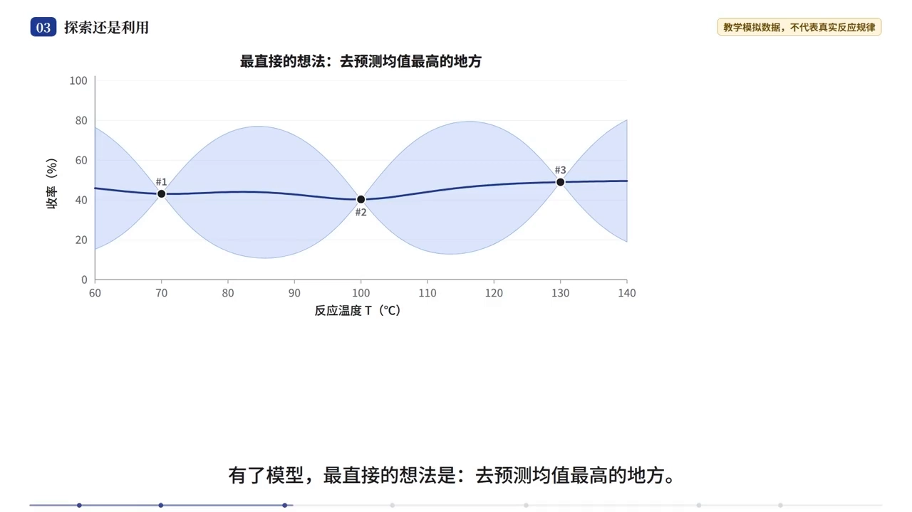

这次实验白做了吗？并不完全是：它告诉我们高温的那一头并不好。把新结果加入模型，曲线和不确定性都随之更新。

这个反例是整支视频的转折点。它说明：

- 预测均值只是后验分布的一个摘要，**不等于"做了这次实验会得到的最好结果"**；
- 一次实验的价值，不只是"验证当前判断"，还包括"减少下一次判断的不确定性"；
- 因此选择下一次实验时，不能只按均值排序。

## 四、探索与利用：A 和 B 该选谁

现在有四个数据点。视频比较两个候选位置（[【跳转到 04:26】](https://www.bilibili.com/video/BV1nfpc6wEBR/?t=266)）：

| 候选 | 温度 | 预测均值 | 不确定性 σ |
| --- | --- | --- | --- |
| A | 123.5℃ | 53.8% | ±10.9 |
| B | 119.5℃ | 52.7% | ±15.0 |

A 的均值更高，B 的均值略低但模型对它更不确定。

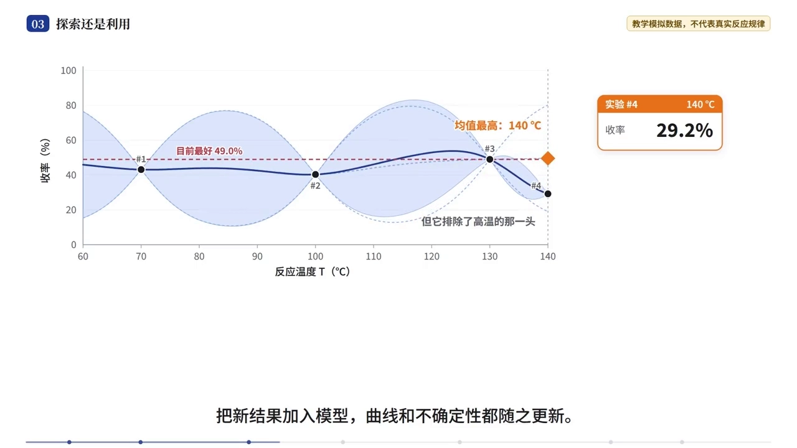

- 选 A，是相信目前的判断，在看起来最好的地方深挖，这叫**利用**（exploitation）；
- 选 B，是去了解还不够、却可能藏着惊喜的地方看看，这叫**探索**（exploration）。

视频用"周末选餐厅"作类比：常去的那家很稳妥，但难有惊喜；新开的那家可能踩雷，也可能更好。只会利用，容易困在一座小山头上；只会探索，又会把预算花在漫无目的的尝试上。好的策略每一次都在两者之间权衡（[【跳转到 05:16】](https://www.bilibili.com/video/BV1nfpc6wEBR/?t=316)）。

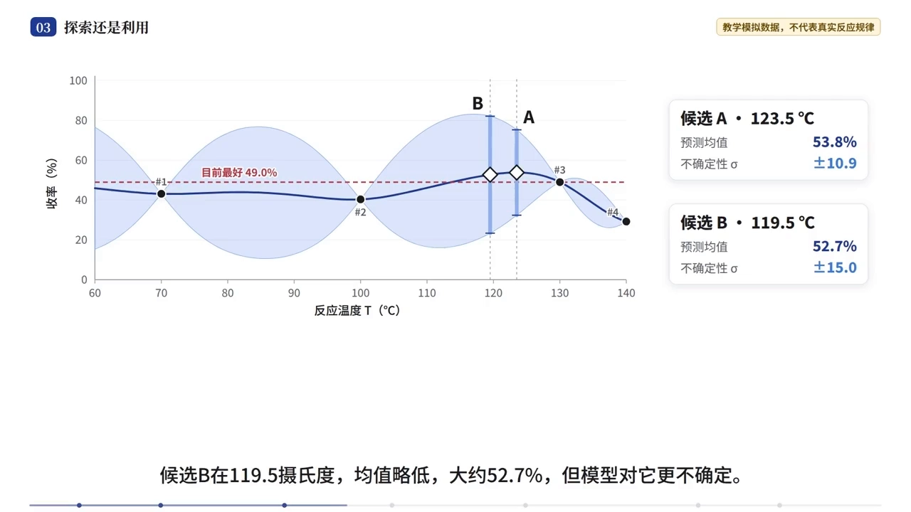

问题是，这种权衡能不能算成一个数？

## 五、期望改进：把"改进"算成一个数

### 5.1 先定义什么叫改进

目前最好的收率是 49%。画一条红色虚线作为参考线：

- 如果新实验的结果低于这条线，改进就是零；
- 如果高于它，高出多少，改进就是多少。

可实验还没做，模型能告诉我们的是：结果可能落在哪里、可能性各有多大。把 A 和 B 的预测分布放大，纵轴仍然是收率，分布越宽越不确定（[【跳转到 05:41】](https://www.bilibili.com/video/BV1nfpc6wEBR/?t=341)）。

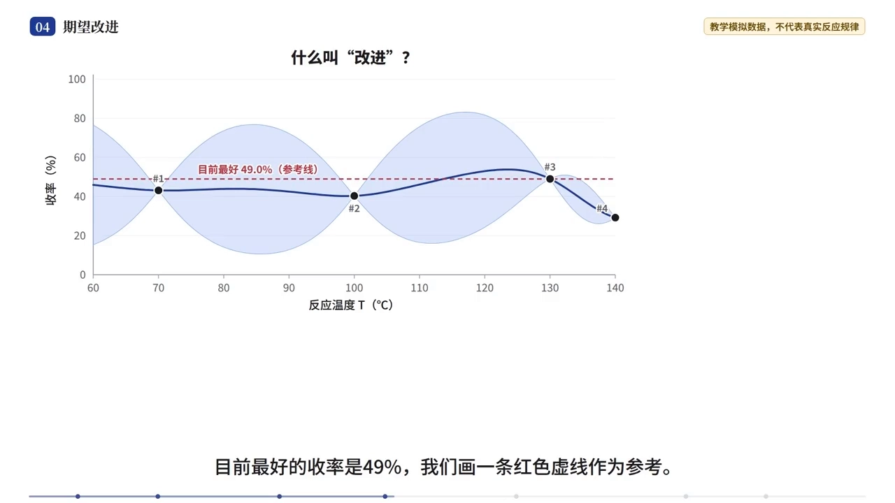

### 5.2 用 40 个概率小块求平均

视频给了一个很直观的算法：把每个预测分布切成 40 份概率相等的小块，每一块用一个点代表一种可能的结果。

- 低于参考线的结果，改进记作零；
- 高于参考线的，画出它们的改进幅度；
- 把所有可能结果的改进求平均，就是**期望改进**（expected improvement，EI）。

候选 A 的可能结果比较集中，超过参考线的机会多一些，但大多只高出一点；候选 B 的可能结果分布更宽，超过的机会少一些，可一旦超过，往往高出很多（[【跳转到 06:06】](https://www.bilibili.com/video/BV1nfpc6wEBR/?t=366)）。

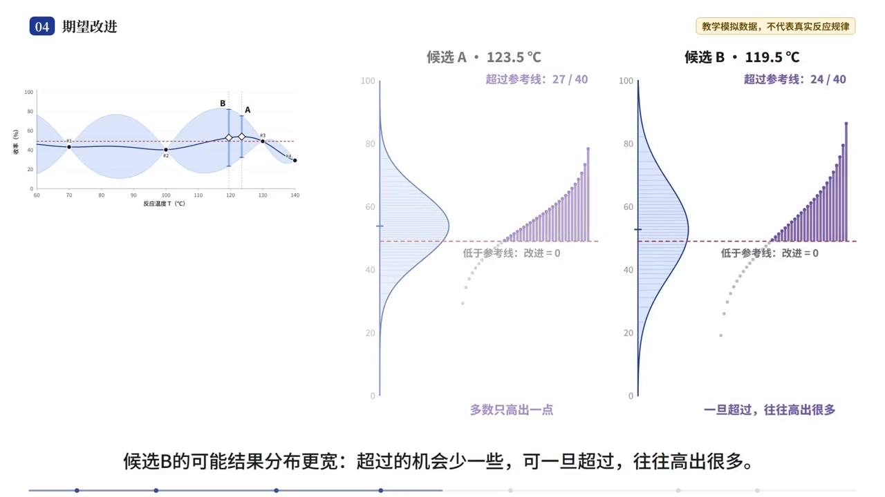

算下来，A 的 EI 约为 7.2 个百分点，B 约为 8.0 个百分点，B 更高。

### 5.3 EI 不是"改进概率"

这是最容易混淆的一步。视频专门停下来提醒：

- 论"超过参考线的概率"，A 是 67%，B 是 60%，A 更高；
- 但论期望改进，A 是 7.19，B 是 8.03，B 更高。

因为 EI 不只看"能不能超过"，还看"能超过多少"。A 更常超过参考线，但每次只超过一点；B 超过的机会少，可一旦超过，幅度更大（[【跳转到 06:31】](https://www.bilibili.com/video/BV1nfpc6wEBR/?t=391)）。

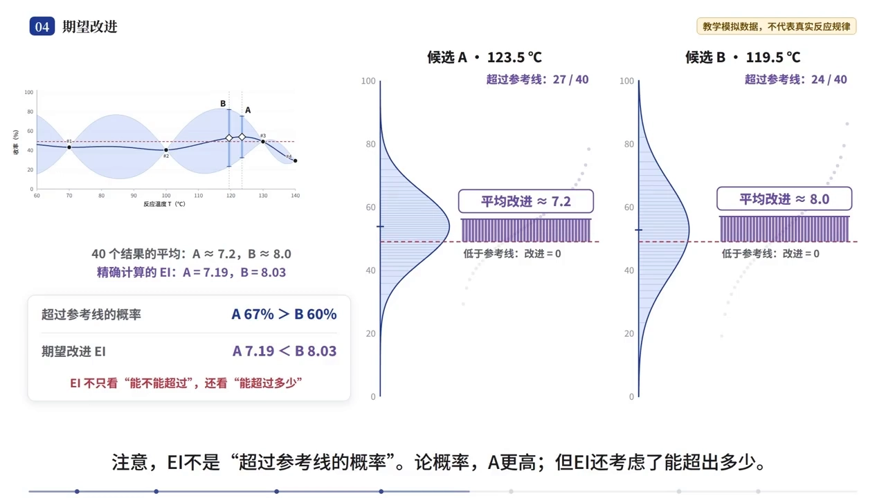

对每一个温度都这样打分，就得到一条 **EI 曲线**；EI 最高的位置，就是下一次实验的推荐点。这里推荐 119.5℃，正是 B。选择这里不是因为确定这里最好，而是因为在这里可能的收获最大（[【跳转到 06:56】](https://www.bilibili.com/video/BV1nfpc6wEBR/?t=416)）。

### 5.4 闭式公式与两个单调性

在高斯模型下，这个平均可以直接写成公式，不必记住它，只要看出两个方向：

- 均值越高，EI 越大；
- 不确定性越大，EI 越大；
- 而在已经测过的地方，不确定性等于零，EI 也是零。

这解释了 EI 为什么天然在探索与利用之间平衡：它奖励"看起来好"，也奖励"还不知道"。

## 六、实验循环：从 119.5℃ 到第二座山峰

把这些步骤连起来，就是贝叶斯优化的完整循环（[【跳转到 07:21】](https://www.bilibili.com/video/BV1nfpc6wEBR/?t=441)）：

1. 用已有数据建立模型；
2. 用采集函数选出下一个实验；
3. 做实验，得到结果；
4. 把结果加进数据，再更新模型；
5. 回到第 2 步。

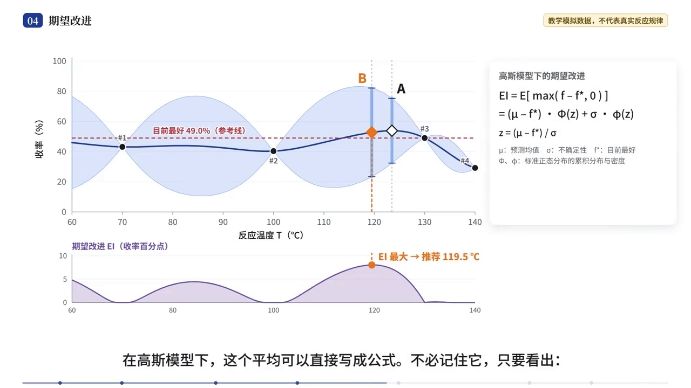

按推荐在 119.5℃ 做第五次实验。结果揭晓之前，我们只有模型的预测：大约 53%，而且很不确定。结果是 75.1%，比之前的最好结果高出一大截（[【跳转到 07:46】](https://www.bilibili.com/video/BV1nfpc6wEBR/?t=466)）。

它远高于预测均值，但仍落在模型给出的区间之内。加入新数据更新模型，新点附近的不确定性收缩，曲线被拉了起来，参考线也升到 75.1%。重新计算 EI，下一轮推荐 115.5℃。

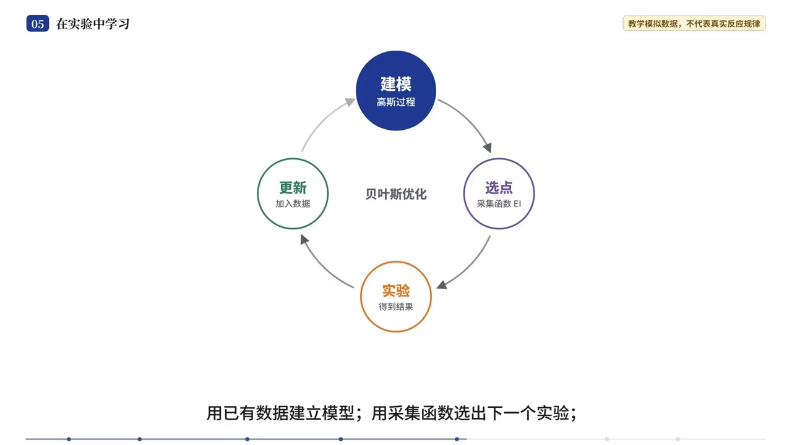

接下来几轮：

- 第六次 115.5℃，63.8%，没有超过最好结果；
- 第七次 121.5℃，76%，小幅提高；
- 第八次，采集函数把目光投向远处的 84.5℃。模型原本预计这里只有 44% 左右，结果却是 62%。它没有刷新记录，却发现了模型此前没有看到的**第二座山峰**（[【跳转到 08:36】](https://www.bilibili.com/video/BV1nfpc6wEBR/?t=516)）。

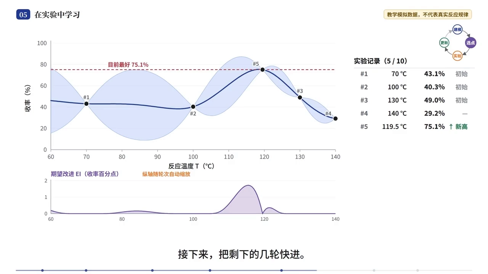

这就是探索的价值：一次实验即使没有刷新最好成绩，也可能改变我们对整个函数形状的认识。

第九次 121℃，76.1%，只提高了 0.14 个百分点；第十次 60℃，31.1%。预算用完，回头看，十次推荐里只有三次刷新了最好结果。**贝叶斯优化并不保证每一步都进步**（[【跳转到 09:01】](https://www.bilibili.com/video/BV1nfpc6wEBR/?t=541)）。

## 七、边界：预算内最好，不等于被证明的全局最优

十次实验里最好的结果是 121℃、76.1%。视频特意强调：它是这十次里最好的，而不是被证明的全局最优。在模拟里我们可以揭开真实的曲线，而在真实研发中，你永远看不到那条灰线（[【跳转到 09:51】](https://www.bilibili.com/video/BV1nfpc6wEBR/?t=591)）。

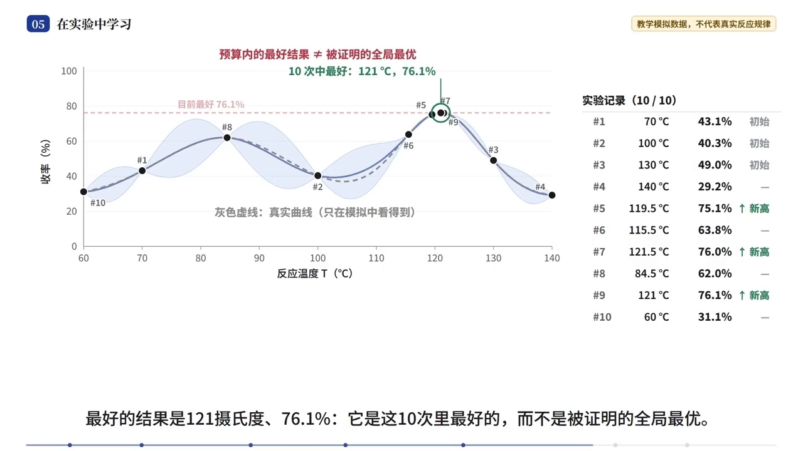

而且在这个只有一个变量的例子里，均匀铺开十次实验，最好也能做到 75.4%。贝叶斯优化真正的用武之地，是**变量更多、实验更贵、均匀铺点根本铺不开**的问题。

### 7.1 维度：为什么均匀铺点会爆炸

真实的研发很少只有一个变量：温度、时间、催化剂用量、溶剂比例……如果每个变量取十个水平：

- 一个变量要 10 次；
- 两个变量要 100 次；
- 三个变量要 1000 次；
- 五个变量就要 10 万次。

穷举已不可能。模型的作用，就是把有限的实验花在最有可能、也最值得了解的地方（[【跳转到 10:16】](https://www.bilibili.com/video/BV1nfpc6wEBR/?t=616)）。

### 7.2 约束、批量与多目标

配方问题还有约束：几种组分加起来必须是 100%，各自还有上下限，可选的只是其中一块区域。有些约束要做了实验才知道，比如粘度不能太高，这时还需要另一个模型来预测是否可行。

如果既要性能高又要成本低，往往没有唯一的最好，而是一组各有取舍的方案，叫做**帕累托前沿**（Pareto front）。此外：

- 实验有噪声时，要考虑重复测量；
- 想一次并行做几组实验，需要专门的批量策略。

这些都有成熟的扩展方法，但核心思想不变：模型描述已知与未知，采集函数决定下一步（[【跳转到 11:06】](https://www.bilibili.com/video/BV1nfpc6wEBR/?t=666)）。

### 7.3 不能盲信模型

视频最后给出三条限制（[【跳转到 11:31】](https://www.bilibili.com/video/BV1nfpc6wEBR/?t=691)）：

1. **数据很少时，模型可能判断错误**：还记得 84.5℃ 吗？模型并不看好那里，那里却藏着一座山峰。
2. **实验噪声大时，偶然一次的高值未必可靠**：需要重复实验，也需要能处理噪声的模型。
3. **原料批次、设备或工艺变了，旧数据可能不再适用**。

所以贝叶斯优化给出的是**下一步的建议**，而不是最终答案；推荐的条件仍然需要重复验证、放大试验和工程确认（[【跳转到 11:56】](https://www.bilibili.com/video/BV1nfpc6wEBR/?t=716)）。

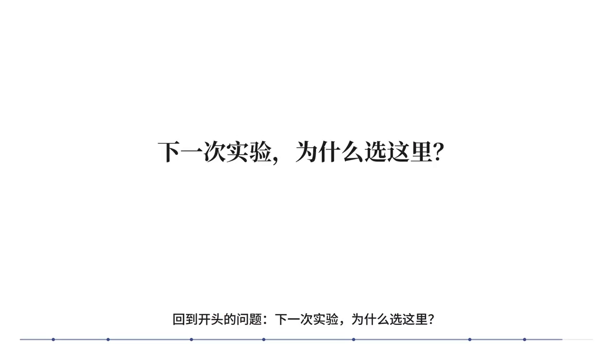

## 小结

- 贝叶斯优化解决的是**昂贵黑箱**问题：目标函数没有解析式、没有梯度，每次评估都要花时间或成本。
- **代理模型**（高斯过程）给出的不是一条预测曲线，而是一个后验分布：每个点都有均值和不确定性。
- **预测均值最高 ≠ 最优实验**。视频里 140℃ 均值最高，实测只有 29.2%。
- **采集函数**把均值和不确定性合成一个分数。期望改进（EI）奖励"看起来好"也奖励"还不知道"，且不等于"改进概率"。
- 完整循环是：建模 → 选点 → 实验 → 更新 → 再选点。它不保证每一步都进步。
- 预算内最好不等于全局最优；噪声、约束、批量和多目标都需要额外处理，模型判断也不能盲信。

## 关键术语速查

| 术语 | 一句话解释 |
| --- | --- |
| 昂贵的黑箱优化 | 目标函数没有解析式、没有梯度，每次评估都要付出较高时间或成本 |
| 代理模型（surrogate model） | 用少量观测拟合出的、可廉价评估的目标函数近似 |
| 高斯过程（GP） | 给每个候选点输出预测均值和不确定性的函数分布模型 |
| 先验 / 后验 | 做实验前的信念 / 用数据修正后的信念 |
| 采集函数（acquisition function） | 把后验均值和不确定性合成一个分数，用来挑下一个实验点 |
| 期望改进（EI） | 对所有可能结果，计算"超过当前最好值的幅度"再求平均 |
| 探索 / 利用 | 去不确定性高的地方 / 去当前预测好的地方 |
| 帕累托前沿 | 多目标下没有唯一最好、只有一组各有取舍的方案 |