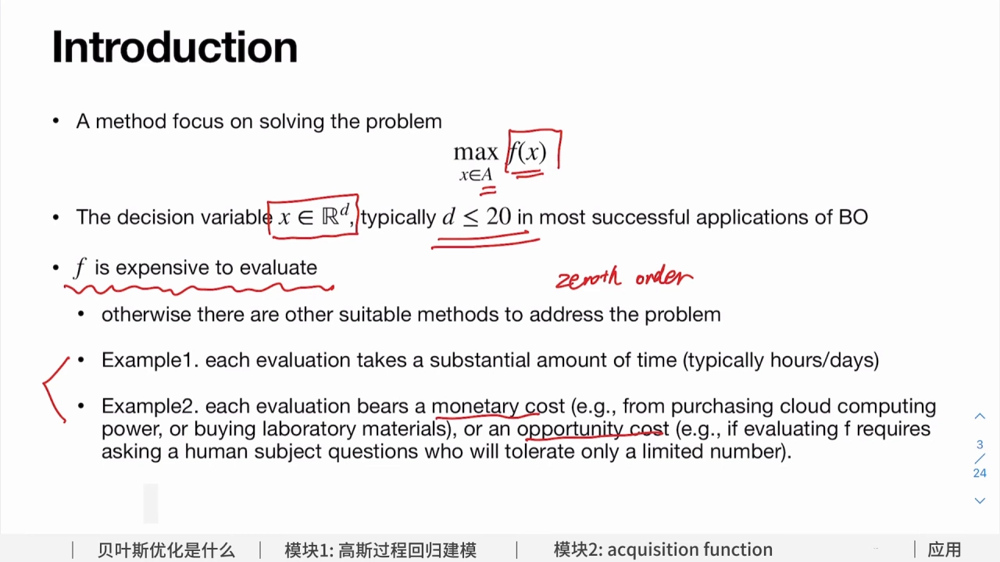
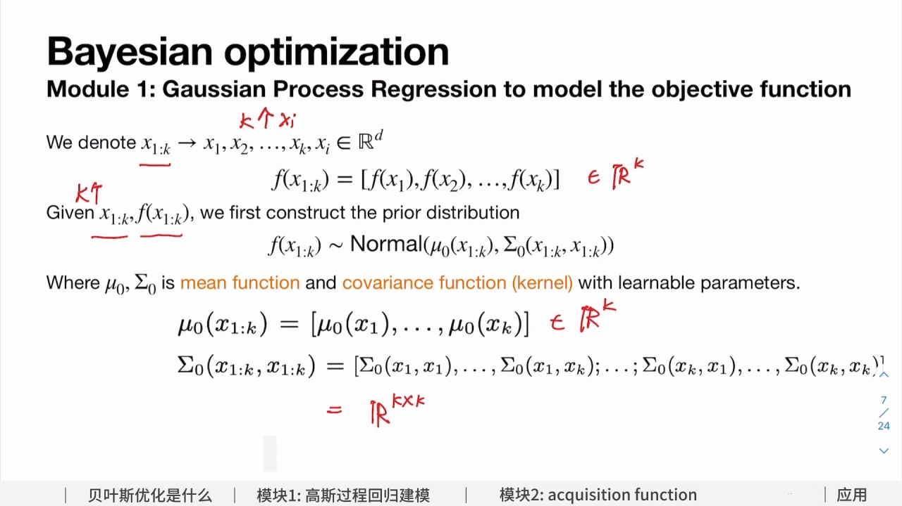
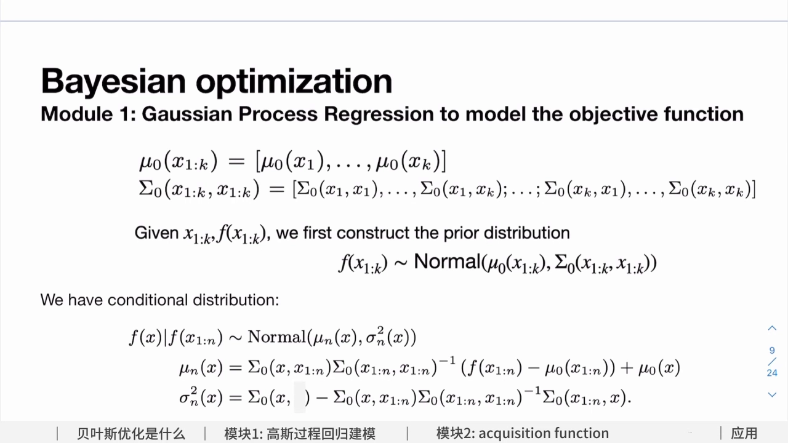
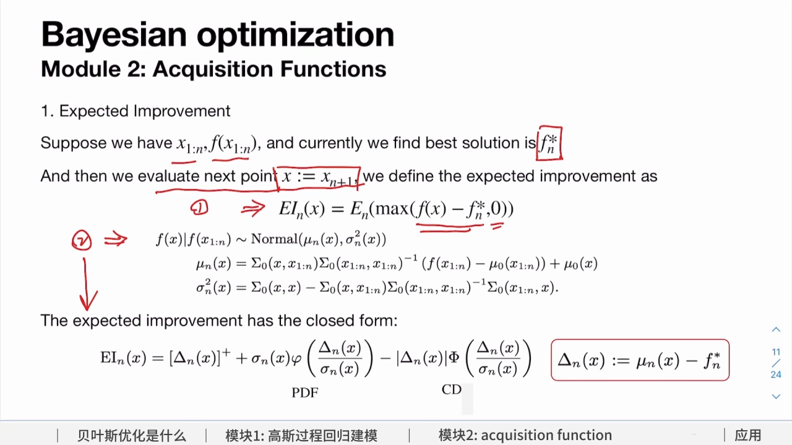
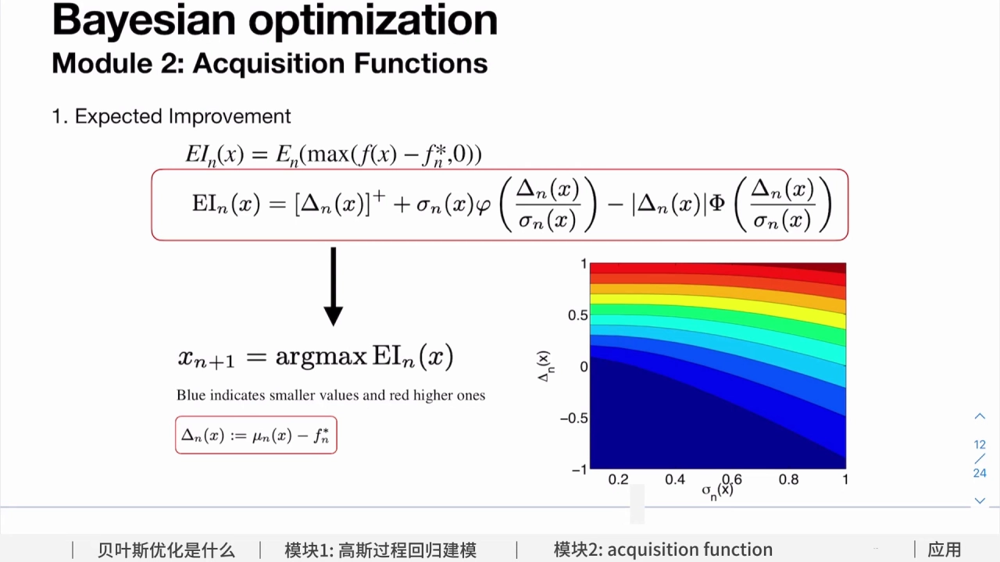
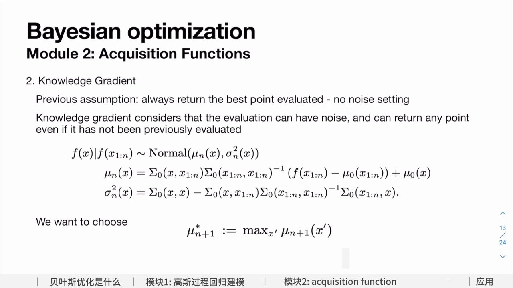
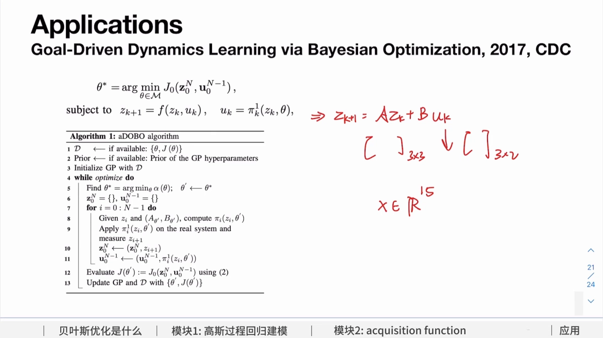

# 贝叶斯优化：高斯过程后验、期望改进与知识梯度

> 视频来源：[贝叶斯优化 ｜ 黑盒优化+全局最优方法 ｜ Bayesian Optimization](https://www.bilibili.com/video/BV1wC4y1Q7pa/)（B 站 · alwaysvbyx）｜时长约 19 分钟
> 导读：这是一支偏公式的讲解：先把贝叶斯优化拆成"高斯过程回归"和"采集函数"两个模块，再给出后验均值/方差的条件高斯推导、期望改进的闭式，以及面向噪声观测的知识梯度。本文按这条推导链整理，并在公式符号处补上视频口述里省略的定义。

## 本讲要解决的核心问题（SCQA）

**背景**：贝叶斯优化常被一句话概括成"用代理模型加采集函数找全局最优"。但真正落地时，代理模型到底输出了什么？采集函数为什么能在"预测好"和"不确定"之间取舍？

**冲突**：如果只记住"高斯过程"和"期望改进"两个名字，遇到噪声观测、非观测点、计算代价这些问题时，就不知道该怎么换假设、换采集函数。

**疑问**：高斯过程的后验均值和方差从哪里来？期望改进的闭式怎么读？当观测有噪声、且允许返回任意未观测点时，采集函数要怎样改？

**回答（中心思想）**：贝叶斯优化把目标函数当成一个随机函数。高斯过程先给先验，再用观测做条件化，得到每个点的后验均值 $\mu_n(x)$ 与后验方差 $\sigma_n^2(x)$；采集函数在这个后验上构造一个标量分数，取分数最大者为下一次观测点。期望改进适合无噪声、只返回已观测最优值的设定；知识梯度则把"观测可能有噪声、可以返回任意点"纳入，代价是需要蒙特卡洛模拟。

## 一、问题设定：小维度、昂贵、黑箱、无梯度

视频先把优化问题写成（[【跳转到 01:08】](https://www.bilibili.com/video/BV1wC4y1Q7pa/?t=68)）：

$$
\max_{x \in A} f(x)
$$

其中 $x$ 是决策变量，定义域是集合 $A$，$f(x)$ 是目标函数。

贝叶斯优化在以下条件下最合适：

- **维度不高**：当 $x$ 是 $D$ 维向量时，$D \le 20$ 通常表现较好；
- **评估昂贵**：每次观测 $f(x)$ 要花很多时间，或要付出金钱、机会成本；
- **黑箱**：不知道 $f$ 的具体表达式，也不知道它是否凸、是否线性；
- **没有梯度**：拿不到一阶、二阶导数，否则可以用梯度法或牛顿法；
- **要全局最优**：不满足于局部最优。

视频举了两个"昂贵"的例子：神经网络的超参数选择，训练一次要很多天；以及每次观测都要花钱或占用机会成本，所以希望尽量少观测。

## 二、与模拟退火的对照：随机扰动 vs 贝叶斯建模

在进入公式前，视频用**模拟退火**作对照。模拟退火也是一个黑盒优化方法，流程是：

1. 随机生成一个 $x$；
2. 随机生成一个步长 $\Delta x$；
3. 如果移动后目标值变大了，只以一定概率移动；如果变小了，就一定移动到该位置。

贝叶斯优化有相似的两段式结构，但每一段都更"有策略"：

- 用贝叶斯统计模型去建模目标函数；
- 用采集函数决定下一步往哪里走。

差别在于：模拟退火是随机生成 $\Delta x$，而贝叶斯优化利用贝叶斯的特性去模拟目标函数，从而更有策略地找到下一步（[【跳转到 04:11】](https://www.bilibili.com/video/BV1wC4y1Q7pa/?t=251)）。

## 三、模块一：高斯过程回归如何建模目标函数

### 3.1 符号与先验

假设已经有 $K$ 个观测点 $x_1, \dots, x_K$，每个 $x_i \in \mathbb{R}^D$；对应的观测值是 $f(x_1), \dots, f(x_K)$，组成一个 $K$ 维向量。

贝叶斯优化的核心假设是：这些观测目标值来自一个高斯分布。高斯分布有均值函数 $\mu_0$ 和方差函数 $\Sigma_0$，两者都带可学习参数：

$$
f(x_{1:K}) \sim \mathcal{N}\left(\mu_0(x_{1:K}), \Sigma_0(x_{1:K}, x_{1:K})\right)
$$

其中 $\mu_0(x_{1:K})$ 是 $K$ 维向量，$\Sigma_0(x_{1:K}, x_{1:K})$ 是 $K \times K$ 的协方差矩阵（[【跳转到 05:42】](https://www.bilibili.com/video/BV1wC4y1Q7pa/?t=342)）。

### 3.2 均值函数、核函数与最大似然

视频给出的均值函数是一个线性形式：

$$
\mu_0(x) = \mu + \beta^\top x
$$

可学习参数是 $\mu$ 和 $\beta_i$，共 $P+1$ 个。协方差函数用高斯核（RBF 核）表示，可学习参数是 $\alpha_0, \dots, \alpha_D$，共 $D+1$ 个。

这些参数可以用**最大似然**求解。参数学完之后，目标函数的"建模"就完成了（[【跳转到 06:48】](https://www.bilibili.com/video/BV1wC4y1Q7pa/?t=408)）。

### 3.3 后验：条件高斯给出均值和方差

视频先给结论：有了先验分布，下一个目标值在给定已有数据后，仍然服从高斯分布：

$$
f(x) \mid f(x_{1:n}) \sim \mathcal{N}\left(\mu_n(x), \sigma_n^2(x)\right)
$$

其中

$$
\mu_n(x) = \Sigma_0(x, x_{1:n}) \Sigma_0(x_{1:n}, x_{1:n})^{-1}\left(f(x_{1:n}) - \mu_0(x_{1:n})\right) + \mu_0(x)
$$

$$
\sigma_n^2(x) = \Sigma_0(x, x) - \Sigma_0(x, x_{1:n}) \Sigma_0(x_{1:n}, x_{1:n})^{-1} \Sigma_0(x_{1:n}, x)
$$

这两个式子要分开读：

- **后验均值** = 先验均值 + 用观测残差做的修正。离观测点越近、核相关性越强，修正越大。
- **后验方差** = 先验方差 − 观测能解释掉的那部分方差。在观测点处方差最小；离观测点越远，减掉的部分越少，方差越接近先验方差。

### 3.4 证明思路：构造一个与 B 独立的 Z

视频用条件高斯的构造法给出证明（[【跳转到 07:47】](https://www.bilibili.com/video/BV1wC4y1Q7pa/?t=467)）。把待预测的 $f(x)$ 记作 $A$，把已有观测 $f(x_{1:n})$ 记作 $B$，假设 $(A, B)$ 联合高斯。

定义

$$
Z = A - CB
$$

希望 $Z$ 与 $B$ 独立，于是令协方差为零：

$$
\operatorname{Cov}(Z, B) = \operatorname{Cov}(A, B) - C\operatorname{Cov}(B, B) = 0
$$

解得

$$
C = \operatorname{Cov}(A, B)\operatorname{Cov}(B, B)^{-1}
$$

再把 $A = Z + CB$ 代入，利用 $Z$ 与 $B$ 独立，就得到

$$
\mathbb{E}[A \mid B] = \mathbb{E}[Z] + CB
= \mathbb{E}[A] + C\left(B - \mathbb{E}[B]\right)
$$

这正是前面的后验均值公式；同理可写出后验方差（[【跳转到 09:57】](https://www.bilibili.com/video/BV1wC4y1Q7pa/?t=597)）。

这段推导的意义不在于手算，而在于说明：**后验均值和方差不是拍脑袋的插值，而是联合高斯假设下的条件分布**。换核函数、换先验均值，本质上是在换这个联合高斯的协方差结构。

## 四、模块二：采集函数

有了后验分布，接下来的问题是：怎样有效地找下一个观测点？视频介绍了两个方法。

### 4.1 期望改进：定义与闭式

假设已经有 $n$ 个观测点和观测值，当前找到的最优值是 $f_n^*$。定义下一个点的**期望改进**为：

$$
\mathrm{EI}_n(x) = \mathbb{E}_n\left[\max\left(f(x) - f_n^*, 0\right)\right]
$$

也就是说：如果下一个点的值大于当前最优值，改进就是超出部分；如果小于当前最优值，改进记为零；再对所有可能结果求期望（[【跳转到 10:33】](https://www.bilibili.com/video/BV1wC4y1Q7pa/?t=633)）。

在高斯后验下，这个期望有闭式。记

$$
\Delta_n(x) = \mu_n(x) - f_n^*
$$

则

$$
\mathrm{EI}_n(x) = \Delta_n(x)\,\Phi\!\left(\frac{\Delta_n(x)}{\sigma_n(x)}\right)
+ \sigma_n(x)\,\varphi\!\left(\frac{\Delta_n(x)}{\sigma_n(x)}\right)
$$

其中 $\varphi$ 是标准正态的 PDF，$\Phi$ 是 CDF（[【跳转到 11:23】](https://www.bilibili.com/video/BV1wC4y1Q7pa/?t=683)）。

> 核对说明：视频幻灯片上的闭式写法在 $\Delta_n(x) > 0$ 时符号容易读错。按定义 $\mathbb{E}[\max(f-f^*,0)]$ 展开，得到的是上式；可以直接用两个极限检查：当 $\sigma \to 0$ 且 $\Delta > 0$ 时，EI 应趋近 $\Delta$；当 $\Delta \ll 0$ 时，EI 应趋近 0。

下一次观测点取

$$
x_{n+1} = \arg\max_x \mathrm{EI}_n(x)
$$

### 4.2 EI 的几何：均值差与不确定性

视频给了一张 $\mathrm{EI}$ 关于 $\Delta_n(x)$ 和 $\sigma_n(x)$ 的等高线图（[【跳转到 12:18】](https://www.bilibili.com/video/BV1wC4y1Q7pa/?t=738)）：

- $\Delta_n(x)$ 越高（均值越超过当前最优），EI 越大；
- $\sigma_n(x)$ 越大（不确定性越高），EI 也越大；
- 在已经观测过的点，$\sigma_n(x) \approx 0$，EI 也接近 0。

这解释了 EI 为什么天然平衡探索与利用：它奖励"看起来好"，也奖励"还不知道"。

### 4.3 知识梯度：把噪声和任意点纳入

期望改进有两个隐含假设：

1. 观测没有噪声；
2. 只能返回已经观测过的点、以及观测过的值。

**知识梯度**（knowledge gradient，KG）放松了这两条：它考虑观测值可能有噪声，而且可以返回任意点，即使这个点没有被观测过（[【跳转到 13:01】](https://www.bilibili.com/video/BV1wC4y1Q7pa/?t=781)）。

它的思想是：给定条件分布，希望最大化**均值函数**。因为当我们最大化均值函数，观测值也有更大的可能变成最高。定义

$$
\mathrm{KG}_n(x) = \mathbb{E}_n\left[\mu_{n+1}^* - \mu_n^* \mid x_{n+1} = x\right]
$$

其中 $\mu_n^* = \max_{x'} \mu_n(x')$ 是当前后验均值的最大值，$\mu_{n+1}^*$ 是加入新观测后后验均值的最大值。

下一次观测点取

$$
x_{n+1} = \arg\max_x \mathrm{KG}_n(x)
$$

关键差别在于：KG 不用"已经观测过的最大值"，而用"均值函数的最大值"来表示。所以它可以允许观测点上有噪声，因为我们根本不用这个可能有噪声的观测值（[【跳转到 14:34】](https://www.bilibili.com/video/BV1wC4y1Q7pa/?t=874)）。

### 4.4 代价：没有闭式，只能蒙特卡洛

知识梯度的代价是计算效率低：它没有闭式表达式，需要用蒙特卡洛方法模拟（[【跳转到 14:52】](https://www.bilibili.com/video/BV1wC4y1Q7pa/?t=892)）。

对每个候选 $x$：

1. 在给定 $x$ 的情况下，对下一个目标值进行采样；
2. 用采样结果更新后验，求 $\mu_{n+1}^*$；
3. 与 $\mu_n^*$ 相减，得到这一次模拟的改进；
4. 重复多次，用均值作为 $\mathrm{KG}_n(x)$ 的估计；
5. 在候选集上取最大者。

每一步还要用非线性优化去找 $\mu_n^*$ 和 $\mu_{n+1}^*$，所以整体计算量很大。

视频提到，2016 年有工作用知识梯度的梯度做近似，减少计算：每次在当前点用梯度上升找一个还不错的点，循环几次估计 KG，再返回最大值点（[【跳转到 16:26】](https://www.bilibili.com/video/BV1wC4y1Q7pa/?t=986)）。

### 4.5 两种采集函数的取舍

视频的总结是（[【跳转到 17:21】](https://www.bilibili.com/video/BV1wC4y1Q7pa/?t=1041)）：

- 在有噪声的设定下，KG 可以比 EI 工作得更好；
- KG 不局限于已观测值，可以在全局定义域上对目标函数建模，然后找最好的 $x$；
- 代价是计算复杂，需要蒙特卡洛与数值优化。

## 五、一个应用：动态系统辨识

视频最后给了一个 2017 年 CDC 上的应用（[【跳转到 18:11】](https://www.bilibili.com/video/BV1wC4y1Q7pa/?t=1091)）：用贝叶斯优化找动态系统的动态函数 $f(x)$。

设定是一个线性动态系统：

$$
z_{k+1} = A z_k + B u_k
$$

其中 $A$ 比如是 $3 \times 3$ 矩阵，$B$ 是 $3 \times 2$ 矩阵。把 $A$、$B$ 的元素拉直，决策变量就是一个 15 维向量。用贝叶斯优化、以期望改进作为采集函数，找到最优的 $x$，从而实现控制。

实验表明贝叶斯优化有很好的收敛特性（[【跳转到 19:07】](https://www.bilibili.com/video/BV1wC4y1Q7pa/?t=1147)）。

## 小结

- 贝叶斯优化适合 $D \le 20$、评估昂贵、黑箱、无梯度、要全局最优的问题。
- 模块一用高斯过程回归建模目标函数：先验给出函数分布，条件化后得到后验均值与后验方差。
- 后验均值 = 先验均值 + 观测残差修正；后验方差 = 先验方差 − 观测解释掉的方差。
- 模块二用采集函数选点。EI 的闭式由 $\Delta_n(x) = \mu_n(x) - f_n^*$ 与 $\sigma_n(x)$ 通过标准正态 PDF、CDF 组合而成。
- EI 假设无噪声、只返回已观测最优值；KG 允许噪声和任意点，用后验均值最大值的变化衡量信息价值。
- KG 没有闭式，需要蒙特卡洛模拟和数值优化，计算代价明显更高。

## 关键术语速查

| 术语 | 一句话解释 |
| --- | --- |
| 高斯过程回归 | 用联合高斯先验建模函数，再用观测做条件化 |
| 后验均值 $\mu_n(x)$ | 给定已有观测后，对 $f(x)$ 的最佳猜测 |
| 后验方差 $\sigma_n^2(x)$ | 给定已有观测后，对 $f(x)$ 还剩多少不确定 |
| 期望改进（EI） | $\mathbb{E}[\max(f(x)-f^*,0)]$，超过当前最优值的期望幅度 |
| 知识梯度（KG） | 一次观测能让"后验均值最大值"提高多少的期望 |
| 蒙特卡洛模拟 | 用大量随机采样近似没有闭式的期望 |
| 采集函数 | 把后验分布压缩成一个标量分数，用来选下一个观测点 |