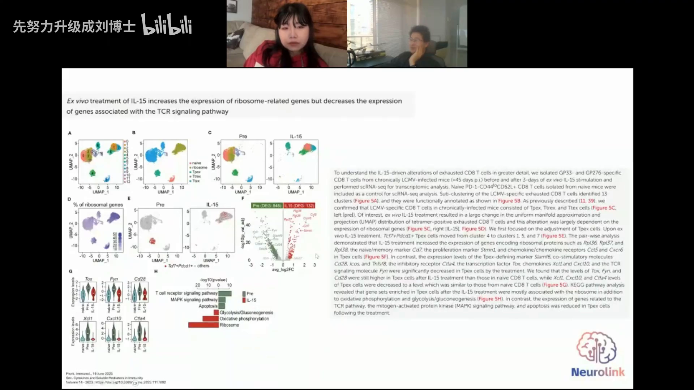
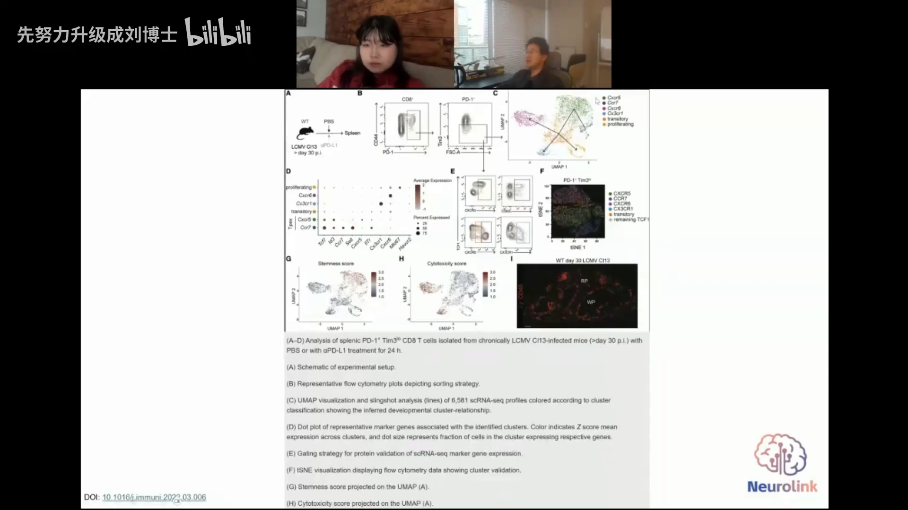
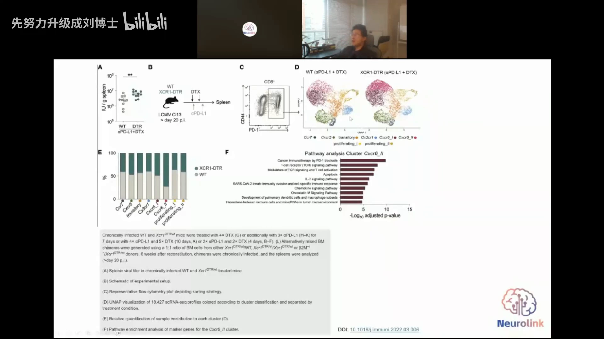
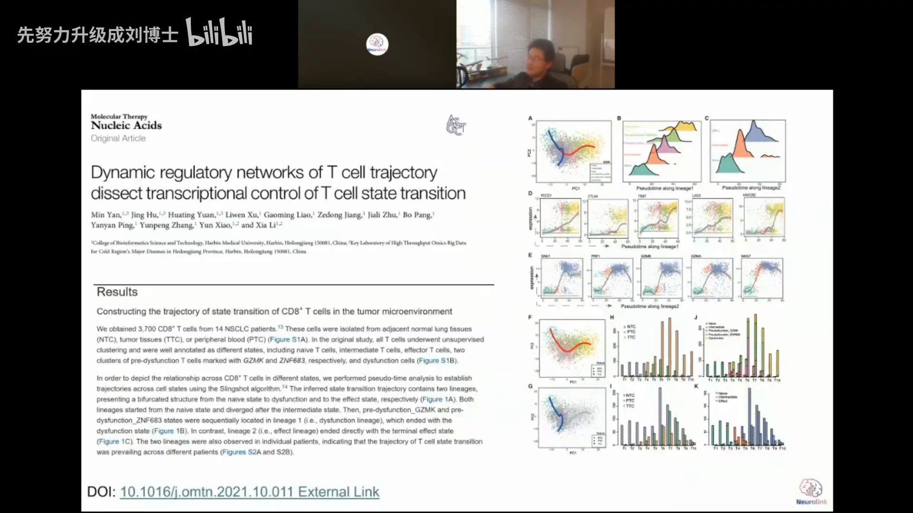
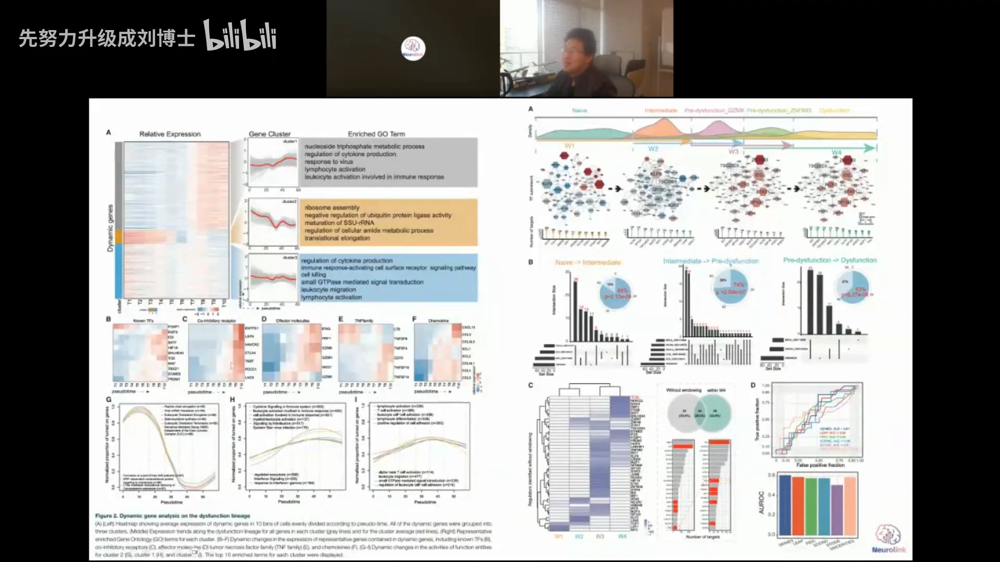
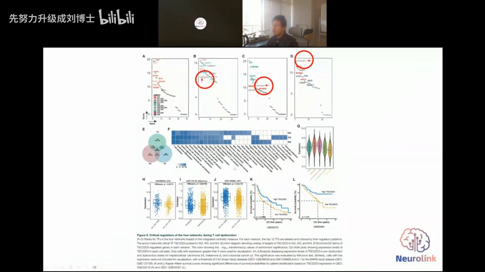
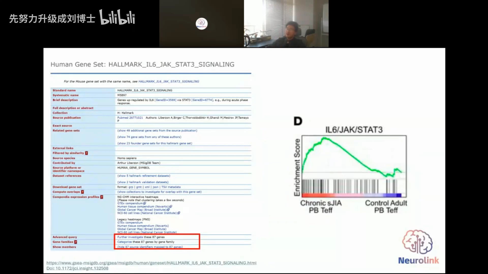
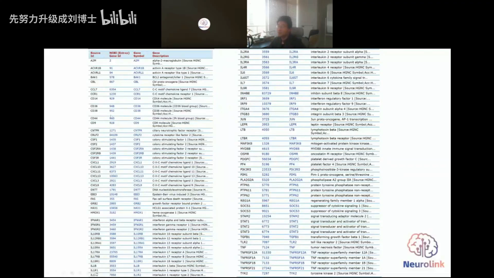
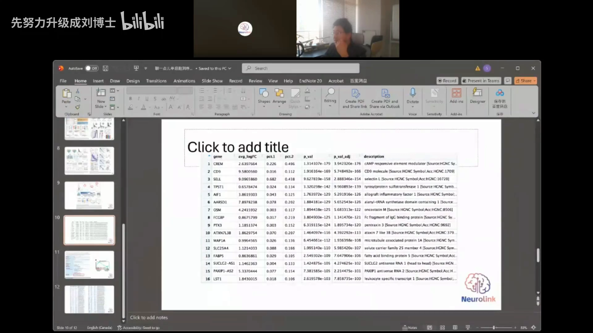

# 单细胞组间比较的读数原则：对照怎么选、效应量怎么看

> 视频来源：[批判性地讨论一下单细胞测序分析](https://www.bilibili.com/video/BV1xwB1BAEEN/)（Bilibili · 我是然哥的万能号儿）｜时长约 48 分钟
> 导读：这是一场直播式的文献复盘。讲者拿了三篇真实论文，逐张图问同一个问题——「这个比较到底比出了什么」。本文按「对照组怎么设、比较在哪一层、效应量够不够」重新组织，操作细节从简，重点放在判读规则上；字幕为 AI 生成，术语已按上下文订正。

## 本讲要解决的核心问题（SCQA）

**背景**：单细胞测序在国内已经很便宜，很多实验室「干什么都顺手送一个单细胞」。测序做完，代码跑通，你会拿到一堆图：UMAP、火山图、差异基因表、几千条富集通路。

**冲突**：这些图里绝大多数是「看起来有差异」。讲者举的第一个例子就很典型：两个样本比某个基因，图上只有 0.0 几倍的变化，上面却画了四颗星；通路分析一下给你几千条通路，你根本不知道该信哪一条。更麻烦的是，很多论文只做了「有差异」这一步，就当成结论发表了。

**疑问**：既然写代码已经不构成门槛（讲者直言：不会写代码，把需求告诉大模型也能跑出基础流程），那真正的门槛在哪里？面对一堆「显著」的结果，怎么判断哪一条值得继续做实验？

**回答（中心思想）**：**组间比较的可靠程度，取决于三件事同时成立——对照组选得对不对、比较发生在哪一层、效应量大不大。** 显著性只是三者之一，而且是最容易被细胞数「喂」出来的那一个。讲者的判读规则可以压缩成一句话：先看效应量和表达比例，再看 FDR；先看比较的层次对不对，再看 p 值有多小。

> 说明：具体的检验方法（Wilcoxon、pseudobulk + limma/edgeR、MAST、混合模型）属于差异表达与 pseudobulk 的专门内容，本文不展开；对照的**实验设计**原理属于实验设计层面的问题，也不在本文范围。本文只讨论分析阶段「和谁比、比出什么」这件事。

## 一、门槛不在写代码，而在「这张图说明了什么」

讲者开场的判断很直接：单细胞分析里**写代码是最不重要的一部分**。理由有两条——现在的大模型基本能生成基础流程的代码，第一遍跑不通、多调几遍也能跑；有些实验室还配了专职的生信分析员，你只需要说清想做什么 [【跳转到 01:40】](https://www.bilibili.com/video/BV1xwB1BAEEN/?t=100)。

真正需要纠结的是结果出来之后怎么解读。他给了两个具体的痛点 [【跳转到 03:20】](https://www.bilibili.com/video/BV1xwB1BAEEN/?t=200)：

- 两个样本比某个基因，图上只有 0.0 几倍的变化，却标了四颗星；
- 差异通路动辄几千条，不知道从哪一条看起。

这两件事其实是同一个问题的两面：**「显著」和「重要」不是一回事**。细胞数一多，极小的差异也能算出极小的 p 值；通路一多，总有一条会「显著」。所以他把单细胞定位成「一个非常高通量的流式细胞术」——它是推动研究往下走的工具，不是终点 [【跳转到 04:10】](https://www.bilibili.com/video/BV1xwB1BAEEN/?t=250)。

后面三篇论文，就是拿同一把尺子去量三种不同的「比较」。

## 二、案例一：对照组设对了，但比出来的东西不可靠

第一篇是 IL-15 与 CD8 T 细胞耗竭的工作（Frontiers in Immunology）。实验设计本身清楚：两组小鼠，一组实验组、一个对照组，先感染病毒造成慢性感染，然后给实验组打白细胞介素 15，七天后分选脾脏里病毒特异性的 CD8 T 细胞做单细胞测序 [【跳转到 05:36】](https://www.bilibili.com/video/BV1xwB1BAEEN/?t=336)。

这个对照是合格的：同一批感染、同一时间点、同一个分选门，唯一变量是 IL-15。所以「差异来自 IL-15」这个归因没有问题。问题出在**差异用什么指标去解释**。

论文只说了三点：核糖体基因（RPL 系列）上调、TCR 信号通路下调、代谢更旺盛。讲者对每一点都提出了质疑。

### 2.1 RPL 基因：一个「几乎每份数据都在动」的指标

讲者的原话是：这些 RPL 基因不知道为什么，在几乎每一份单细胞测序里都会有非常大的不同；**同一份样品分成两次测序，这些基因都会有差异** [【跳转到 08:31】](https://www.bilibili.com/video/BV1xwB1BAEEN/?t=511)。

这句话的分量在于：如果一个指标在同一处理组内部重复测都会变，那它就不能用来支撑「处理改变了翻译强度」这种生物学结论。它更像是技术噪音或者细胞状态的自然波动。讲者说他要是审稿人，会对这个结果表示非常大的质疑。

### 2.2 通路下调：只看几个下游分子不算证据

第二点是 TCR 通路下调。讲者的批评是：从通路层面下结论，却只看了几个下游分子（比如 TOX、CD28、PD-1），非常不全面，也完全没有说服力 [【跳转到 09:21】](https://www.bilibili.com/video/BV1xwB1BAEEN/?t=561)。

这里其实是一个**层次错配**的问题：结论说的是「通路」，证据却是「几个基因」。中间缺了两样东西——这条通路里到底有多少个基因、其中哪些真的变了、变化幅度多大。

### 2.3 最可惜的一点：这些分子本来很容易验证

讲者补了一句很实际的批评：TOX、CD28、PD-1 这些分子**非常容易用流式验证**，但论文没有做 [【跳转到 10:11】](https://www.bilibili.com/video/BV1xwB1BAEEN/?t=611)。

把这三条批评合起来看，第一篇论文的病灶很清楚：**对照没问题，比较的层次也没跑偏，但效应量的证据链断了**——用不稳定的指标下结论、用几个基因代表一条通路、又缺少一个独立的验证。讲者的评价是「读这篇浪费了 20 分钟」，也顺带解释了它为什么只能发在 Frontiers 上。

## 三、案例二：一张比例图就说「加速分化」，问题出在样本数

第二篇是 2022 年 Immunity 上关于 PD-L1 治疗与树突状细胞的工作，用了两张单细胞图。第一张图（figure 1）把耗竭的 CD8 T 细胞分成五群——CXCR5、CXCR6、CX3CR1、transitory、proliferating——再用 slingshot 画出分化轨迹 [【跳转到 12:35】](https://www.bilibili.com/video/BV1xwB1BAEEN/?t=755)。

### 3.1 轨迹分析的起点，是你自己指定的

讲者对 trajectory analysis 的批评很具体：slingshot 这类方法的**起点由人指定**，你让它定在哪儿它就定在哪儿。这篇文章因为本来就知道 progenitor 是起点，所以把起点放在那里，然后画出几条线说这是分化路径 [【跳转到 14:15】](https://www.bilibili.com/video/BV1xwB1BAEEN/?t=855)。

更关键的是，从 progenitor 到 intermediate 到 effector、以及到 terminal exhausted 这两条路径，2016 年就已经由体内实验验证过了 [【跳转到 13:50】](https://www.bilibili.com/video/BV1xwB1BAEEN/?t=830)。所以这张图的「比较」并没有产生新信息——它只是把已知的分化关系在另一份数据里重画了一遍。

### 3.2 真正的问题是：两组之间比的是比例，而每组只有一个样本

第二张图（figure 6）才是这一节的重点。实验设计是：两组小鼠都打 PD-L1，其中一组用 XCR1-DTR 小鼠加白喉毒素，把表达 XCR1 的树突状细胞（cDC1）全部杀掉，于是这组没有 cDC1，但仍然接受 PD-L1 治疗 [【跳转到 17:48】](https://www.bilibili.com/video/BV1xwB1BAEEN/?t=1068)。

这是一个**设计上很漂亮**的对照：两组唯一的差别就是 cDC1 在不在，所以「差异归因于 cDC1」是成立的。但论文从这张图得出的结论是「没有 DC 时打 PD-L1 会加速从 progenitor 到 effector 的分化」，依据是 CXCR6+ 那一群的比例明显增加 [【跳转到 18:38】](https://www.bilibili.com/video/BV1xwB1BAEEN/?t=1118)。

讲者认为这个推论有三层问题：

1. **比例变化不等于分化速度**。要说「加速分化」，需要看到 progenitor 的数量减少、下游群体的数量增加，而且最好用流式去数绝对数量——他把数量变化称为「银标准」 [【跳转到 19:28】](https://www.bilibili.com/video/BV1xwB1BAEEN/?t=1168)。
2. **要真正证明加速，需要体内 adoptive transfer**：把细胞从供体小鼠取出来打到受体小鼠里，再观察分化速度。单细胞的一个比例变化根本说明不了 [【跳转到 19:53】](https://www.bilibili.com/video/BV1xwB1BAEEN/?t=1193)。
3. **最要命的是样本数**：做单细胞时，绝大多数人是一组实验只测一个样品。一个样品对一个样品，**根本没法做统计检验** [【跳转到 20:18】](https://www.bilibili.com/video/BV1xwB1BAEEN/?t=1218)。

第三点正是扰动分析里最典型的「伪重复」陷阱：图上确实有两条柱子、两种颜色，看起来像两组数据，实际上每一组只有一个观测值。这时候任何「显著」的说法都无从谈起——不是 p 值小不小的问题，是**根本没有 p 值可算**。

### 3.3 通路条形图只给了 p 值，没给倍数

同一张图里还有一块通路分析（figure 6F）。讲者的批评是：它只写了 adjusted p 值，比如第一条通路 cancer immunotherapy by PD-1 blockade 的 p 值可能到 $10^{-10}$ 量级，但**没有给 fold change** [【跳转到 21:08】](https://www.bilibili.com/video/BV1xwB1BAEEN/?t=1268)。

这就回到开篇那个「四颗星」的问题：p 值小只说明「不太可能是偶然」，不说明「变化很大」。完全可能出现 p 值是 $10^{-10}$、而这条通路整体只变化了 0.0001 倍的情况——这种差异在生物学上没有任何意义。讲者的结论很干脆：**没有效应量的显著性，无法判断生物学意义**。

他还顺带吐槽了通路列表的组成：一个做 LCMV、分选 CD8 T 细胞的实验，通路里却出现了 innate immunity、invasion、miRNA in tumor microenvironment 这些和主题完全无关的条目 [【跳转到 22:23】](https://www.bilibili.com/video/BV1xwB1BAEEN/?t=1343)。这些条目对文章要说的论点没有任何贡献，属于「为了凑图而凑图」。

至于怎样才算有意义，讲者给了一个可操作的标准：如果通路分析说白细胞介素 2 有变化，那就在原有实验基础上再阻断或再补一次白细胞介素 2，看细胞能不能回到野生型的状态——**能被干预实验复现的差异，才算差异** [【跳转到 23:13】](https://www.bilibili.com/video/BV1xwB1BAEEN/?t=1393)。
## 四、案例三：六张图里，只有最后一张在做「可验证的比较」

第三篇是 2022 年 Molecular Therapy Nucleic Acids 上的工作：人非小细胞肺癌中 3700 个 CD8 T 细胞的单细胞测序，把从 naive 到 progenitor 到 terminal exhausted 的分化关系完整描述了一遍。整篇文章六张图全是单细胞，没有任何湿实验验证 [【跳转到 24:28】](https://www.bilibili.com/video/BV1xwB1BAEEN/?t=1468)。

讲者的评价是：六张图里五张半都没必要，只有最后一张图的几张小图重要。这个判断值得展开看，因为它正好演示了**比较的层次**该怎么往上走。

### 4.1 figure 1：换了一个「对照」，但结论只是重述

这篇文章把细胞分成三类来源：癌旁正常肺组织、肿瘤组织、外周血。有意思的是，论文把癌旁正常组织写作 **NTC**（normal tissue control）——这里的 NTC 指「正常组织对照」，和我们做 CRISPR 时说的 non-targeting control 完全不是一回事，读文献时要小心这种缩写撞车。

figure 1 用 slingshot 画出两条谱系：一条从 naive 经中间态走向 dysfunction，另一条走向 terminal effector [【跳转到 26:08】](https://www.bilibili.com/video/BV1xwB1BAEEN/?t=1568)。

讲者的评价是「独特性有，创新性有限」：在人非小细胞肺癌里做 CD8 T 细胞的轨迹分析确实是第一次，但轨迹本身描述的现象——检查点分子（PD-1、CTLA-4）从 naive 到 terminal 越来越高，效应分子（颗粒酶、穿孔素）先升后降——在其他肿瘤里早就知道 [【跳转到 27:38】](https://www.bilibili.com/video/BV1xwB1BAEEN/?t=1658)。

换句话说：**换了物种、换了癌种，比较确实做了，但比出来的是「已知答案的复现」**。这类结果不是错，只是不产生新知识。

### 4.2 figure 2 到 figure 5：从「十个时间点」到「四个模块」

接下来的几张图是层层堆叠的描述：把 pseudotime 切成十个时间点，列出转录因子、检查点、效应分子、趋化因子在这十个点上怎么变；再把十个时间点聚类成四个 module，说每个 module 由哪些转录因子主导 [【跳转到 30:18】](https://www.bilibili.com/video/BV1xwB1BAEEN/?t=1818)。

讲者在这里给了一个很硬的判据：**想说「转录调控发生了变化」，金标准是 scATAC，而不是 scRNA** [【跳转到 31:08】](https://www.bilibili.com/video/BV1xwB1BAEEN/?t=1868)。

原因很朴素：单细胞转录组只能告诉你某个转录因子的表达变了，不能告诉你它调控了哪些基因。即便 SP100 在第二个 module 里变化很大，你也不知道 SP100 到底结合了哪些位点、哪些基因的启动子因此开放。这些要靠 single-cell ATAC 才能回答。所以这一层比较的产物是「候选调控因子名单」，不是「调控关系」。

### 4.3 figure 6：把「现象」变成「可检验的假设」

真正有价值的是最后一张图。讲者在四个 module 里发现，TSC22D3 这个转录因子在三个 module 中持续高表达 [【跳转到 32:48】](https://www.bilibili.com/video/BV1xwB1BAEEN/?t=1968)。

接下来是三步外部验证，每一步都在换一个「对照」：

1. 用黑色素瘤、肝细胞癌、结直肠癌三种肿瘤的临床样本，看肿瘤里 TSC22D3 是不是也低——**跨癌种的对照** [【跳转到 34:26】](https://www.bilibili.com/video/BV1xwB1BAEEN/?t=2066)；
2. 用 TSC22D3 的表达高低给患者分层，做生存分析——**患者内部的对照**，高表达组 vs 低表达组 [【跳转到 34:51】](https://www.bilibili.com/video/BV1xwB1BAEEN/?t=2091)；
3. 结论：高表达 TSC22D3 的患者生存率显著更高。

到这里，比较才真正「比出了东西」——从一个细胞状态里的高表达，变成一个有预后价值的候选靶点。

讲者同时指出这篇文章的遗憾：作者没有继续做体内实验（小鼠敲除 TSC22D3，看肿瘤和免疫细胞怎么变），所以只能发在影响因子六分的子刊上 [【跳转到 35:16】](https://www.bilibili.com/video/BV1xwB1BAEEN/?t=2116)。他还提到，文章里其实已经测出了 SATB1、SP100 这些后来被别人发表的线索，却没有跟进——**单细胞数据的价值，往往就藏在这些「测出来了但没做」的基因里**。

## 五、GSEA 为什么容易假阳性：回到 reference 去看基因数

讲者把最后 20 分钟专门留给通路分析（GSEA，gene set enrichment analysis）。这一段是全文最实用的部分，因为它解释了「为什么几千条通路里大部分不能信」。

### 5.1 富集分析的原理：比的是「排序位置」

以 HALLMARK_IL6_JAK_STAT3_SIGNALING 为例，这个基因集有 87 个基因，定义是「被 IL-6 经 STAT3 上调的基因」[【跳转到 38:36】](https://www.bilibili.com/video/BV1xwB1BAEEN/?t=2316)。

算法做的事其实很朴素 [【跳转到 39:51】](https://www.bilibili.com/video/BV1xwB1BAEEN/?t=2391)：

1. 把实验组和对照组的所有基因按表达量排序；
2. 把这 87 个基因在排序里的位置标出来；
3. 如果这 87 个基因大量集中在实验组的高表达端（条形码密集、曲线向左拐），就判定这条通路在实验组富集。

注意这里比较的仍然是**实验组 vs 对照组**——富集分数是一个「组间比较」的统计量，不是单组的属性。所以对照选错，富集结果同样会错。

### 5.2 假阳性的来源一：基因集太小

讲者点开这 87 个基因的成员表，然后说：不是所有通路都有这么多基因 [【跳转到 41:31】](https://www.bilibili.com/video/BV1xwB1BAEEN/?t=2491)。

有些通路只有五个基因，有些甚至只有三个。设想一条只有三个基因的通路，正巧这三个基因在你的实验组里都高表达，算法就会判它富集——于是你得到一条「白细胞介素 7 通路增强」的结论。但讲者说得很直白：**你打一针白细胞介素 7 的阻断抗体到小鼠里，基本不会有变化**，因为支撑这个结论的只有三个基因 [【跳转到 41:56】](https://www.bilibili.com/video/BV1xwB1BAEEN/?t=2516)。

这就是他说的「通路变化非常敏感、很容易假阳性」的机制：基因集越小，随机波动越容易凑成「显著富集」。

### 5.3 假阳性的来源二：基因集之间有交集

第二个来源更隐蔽：不同通路共享基因。白细胞介素 6 的基因集可能和白细胞介素 1、干扰素的基因集有大量交集 [【跳转到 43:36】](https://www.bilibili.com/video/BV1xwB1BAEEN/?t=2616)。

后果是**归因错误**：真正变化的是 IL-1 或 IFN，但因为共享基因被算进了 IL-6 的基因集，你看到的是「IL-6 通路也变了」。这时候如果直接下结论说「IL-6 信号被激活」，就错了。

### 5.4 三条可操作的检查

讲者给出的检查清单只有三步，但每一步都指向「回到原始基因」：

- **看基因集大小**：这条通路由多少个基因构成？只有个位数的，先打问号 [【跳转到 42:21】](https://www.bilibili.com/video/BV1xwB1BAEEN/?t=2541)；
- **看哪些基因真的变了**：reference 里哪些高表达、哪些低表达，不要只看一个总分；
- **看 leading edge**：富集信号到底由哪几个基因贡献 [【跳转到 43:11】](https://www.bilibili.com/video/BV1xwB1BAEEN/?t=2591)。

只有当这条通路里**特异性的**那些基因确实变了，才能说这条通路很可能真的变了，然后才谈得上设计下一步实验去验证。

## 六、差异基因怎么筛：效应量 × 表达比例 × FDR

最后一段回到最日常的操作：拿到每一群细胞「实验组 vs 对照组」的差异基因表，怎么挑出值得做实验的那几个。

讲者先给了一个正面例子。CREM 的变化是 2.6 倍，表达它的细胞比例从对照组的 23% 升到实验组的 50%，校正 p 值是 $10^{-176}$ 量级——基数够、变化够、显著性也够，这种就非常值得关注 [【跳转到 44:56】](https://www.bilibili.com/video/BV1xwB1BAEEN/?t=2696)。

### 6.1 三条阈值

讲者给出的筛选参数是 [【跳转到 45:21】](https://www.bilibili.com/video/BV1xwB1BAEEN/?t=2721)：

| 维度 | 阈值 | 说明 |
| :--- | :--- | :--- |
| 效应量 | $\lvert \log_2 FC \rvert \geq 1.2$，严谨一点用 $1.4$ 以上 | 对应约 2.3 倍与 2.6 倍以上的变化 |
| 表达比例 | 至少在 20% 以上的细胞表达，想放宽可用 15% | 对应结果表里的 `pct.1` 与 `pct.2` |
| 显著性 | adjusted p value $< 0.05$ | 用校正后的值，不用原始 p 值 |

按这套参数筛，一张表通常还剩一两千个基因。讲者的建议是：**全都看一遍、全都注解一遍**，重点是前 200 个，尤其是变化 1.5 到 2 倍以上、表达比例超过 50% 的那些。

### 6.2 两个反例：为什么必须同时看三个维度

只看倍数会踩坑。讲者举了两个对照案例 [【跳转到 46:36】](https://www.bilibili.com/video/BV1xwB1BAEEN/?t=2796)：

- **CD9**：变化 9.6 倍，看起来非常惊人，但最多只有 10% 的细胞表达它。讲者的原话是「关注了也白关注」——在一个只有一成细胞表达的基因上做文章，很难有生理层面的影响；
- **ARSD1**：变化将近 8 倍，有 20% 的细胞表达，这个就值得关注一下。

把这两个例子和 CREM 放在一起，筛选逻辑就完整了：**倍数决定「变化大不大」，表达比例决定「影响面广不广」，FDR 决定「是不是偶然」**。三者缺一个，都可能选错目标。

而这也回到了全文的起点：一千多个差异基因，要说有用肯定都有用，但真正能撑起一篇论文的可能就那么几个。挑出那几个的方法，不是把 p 值排序取前十，而是把三个维度摆在一起看。

## 小结

- **对照组决定你能问出什么问题**。IL-15 那篇的对照（同样感染、同样分选、只差 IL-15）是干净的，所以「差异来自 IL-15」成立；NSCLC 那篇用癌旁正常组织作 NTC，问的是「肿瘤微环境里 T 细胞怎么变」——换对照就是换问题。
- **先确认比较发生在哪一层**。整体（轨迹、比例）、逐基因（差异表）、模块（调控网络）、临床（预后分层）是四个不同的层次，结论不能跨层引用：几个下游基因说明不了整条通路，转录因子的表达变化也说明不了调控关系。
- **一个样品一组，就没有统计可言**。Immunity 那篇用两组 UMAP 和一张比例图讲「加速分化」，讲者的批评是：一个样品对一个样品，连检验都做不了，更别说因果。
- **p 值小 ≠ 变化大**。通路条形图只给 −log10 校正 p 值、不给倍数，是这类图最常见的缺陷；0.0 几倍变化配四颗星也是同一个病。
- **通路富集要回到基因集本身**。基因集只有三个基因、或者和其他通路共享基因，都会造出假阳性；判断依据是基因集大小、真正变化的基因、以及 leading edge。
- **差异基因按「效应量 × 表达比例 × FDR」筛**：$\lvert \log_2 FC \rvert \geq 1.2$、表达比例 $\geq 20\%$、校正 p $< 0.05$，然后重点看前 200 个。
- **能验证的才算发现**。讲者反复回到同一个标准：这个差异能不能被一个独立的干预实验复现？能，才算结论；不能，就还只是描述。

## 关键术语速查

| 术语 | 一句话解释 |
| :--- | :--- |
| NTC | 本视频里出现两种含义：CRISPR 语境下是 non-targeting control（不靶向任何基因的对照 gRNA）；NSCLC 论文里是 normal tissue control（癌旁正常组织对照）。读文献时要按上下文区分 |
| 伪重复 | 把同一组的多个细胞当成多个独立重复。单细胞里细胞数成千上万，但生物学重复往往只有一个样品 |
| 效应量 | 差异的幅度，常用 $\log_2 FC$（log2 倍数变化）表示；它回答「变了多少」，而 p 值回答「像不像偶然」 |
| `pct.1` / `pct.2` | 差异结果表里两组中表达该基因的细胞比例；比例太低时，再大的倍数也难有生理影响 |
| adjusted p value | 多重检验校正后的 p 值（如 BH 法），比原始 p 值保守；通路分析里常写作 p_val_adj |
| slingshot | 一种轨迹推断方法，在降维空间里连接细胞群、画出分化谱系；起点需要人为指定 |
| pseudotime | 拟时间，按轨迹上的位置给细胞排出的「进展程度」，不是真实时间 |
| GSEA | 基因集富集分析：把基因按组间表达差异排序，看某个基因集是否集中在排序的一端 |
| leading edge | 富集信号里贡献最大的那部分基因；判断一条通路是否可信，要看这几个基因是否真的变化 |
| scATAC | 单细胞染色质可及性测序，用来判断转录因子是否真的结合并开放了靶基因，是调控关系的金标准 |
