# 显著不等于效应大：效应量的度量、阈值与样本量陷阱

> 视频来源：[Effect sizes and power analysis 2nd tutorial lecture in PSYC3052/2071](https://www.youtube.com/watch?v=9zLGh2qmJR4)（YouTube · Gilad Feldman 频道，讲者 Qinyu Xiao）｜时长约 87 分钟
> 导读：这是一堂研究生统计课的第二次辅导课，前半段讲「效应量是什么、有哪些度量、阈值从哪来」，后半段讲「效应量、样本量、α 三者如何共同决定功效」，最后用 R、JASP、G\*Power 现场演示怎么算、怎么报。本文按课堂顺序完整覆盖这条链路，并在最后一节把「效应量」这套语言翻译回单细胞扰动分析：当细胞数上万时，为什么 p 值必然显著、而效应量才是你真正要报的数字。字幕为自动生成，术语与人名已按上下文校正。

## 本讲要解决的核心问题（SCQA）

**背景**：做扰动实验的标准动作，是对每个基因做一次统计检验，然后按 p 值或校正后的 Q 值挑出「显著差异基因」。这套流程在 bulk 转录组里已经跑了二十年，在单细胞里更是被原样搬了过来——一个扰动对上万个基因，检验次数直接乘以基因数。

**冲突**：p 值只回答「这个差异有没有可能只是随机波动」，不回答「这个差异有多大」。讲者用两个数字点破这件事：$p = .049$ 和 $p = .051$ 在统计上被判成「显著」和「不显著」两拨，但这两个数字之间的差别，可能只是多算或少算了一个数据点 [【跳转到 05:30】](https://www.youtube.com/watch?v=9zLGh2qmJR4&t=330)。更麻烦的是，p 值的大小同时被「效应有多大」和「样本量有多大」两个因素推动，你无法从 p 值反推出效应大小。

**疑问**：那「效应有多大」到底该怎么量？量出来之后，多大的数字才算大？阈值是从哪来的、能不能直接照抄？样本量又在其中扮演什么角色？

**回答（中心思想）**：**效应量是「量纲无关的差值」，显著性则是「效应量 + 样本量」共同决定的产物**。所以报结论时两者必须并列：效应量告诉你「差多少」，置信区间告诉你「这个差多少算得准不准」，p 值只告诉你「这个差有没有可能纯属巧合」。而 Cohen 的 0.2/0.5/0.8 只是「不荒唐的约定」，真实领域的效应往往比它小——阈值必须按领域重新校准，不能跨领域照抄。

## 一、P 值回答不了「有多大」

### 1.1 P 值算的是「数据给定假设」，我们要的是「假设给定数据」

讲者先复习 p 值的定义。p 值不等于「备择假设为假的概率」，也不等于「零假设为真的概率」；它算的是：**在零假设成立的前提下，得到手上这份数据（或更极端数据）的概率** [【跳转到 03:30】](https://www.youtube.com/watch?v=9zLGh2qmJR4&t=210)。用条件概率写出来就是

$$
p = P(D \mid H_0)
$$

而我们真正想知道的是反过来的东西——$P(H \mid D)$：看到这份数据之后，假设成立的可能性有多大 [【跳转到 04:00】](https://www.youtube.com/watch?v=9zLGh2qmJR4&t=240)。

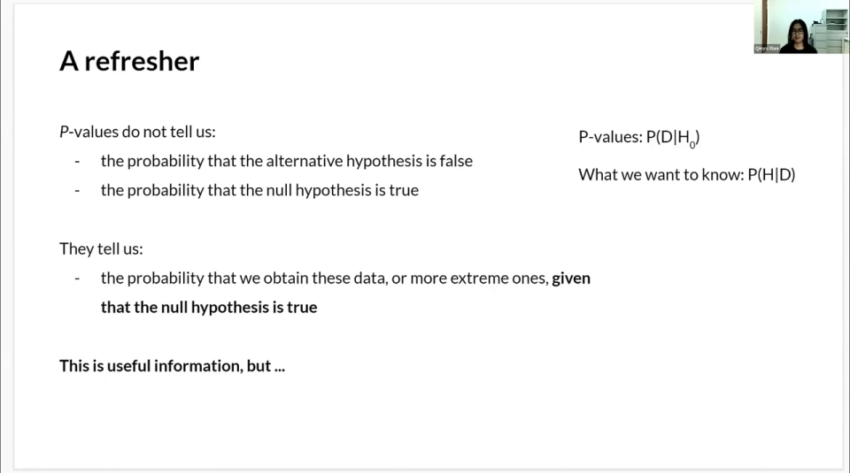

### 1.2 三个盲点：不能比较、鼓励二分、不告诉你幅度

讲者把 p 值的问题归成三条 [【跳转到 04:30】](https://www.youtube.com/watch?v=9zLGh2qmJR4&t=270)：

1. **不能用来比较研究结果**。$p = .01$ 并不比 $p = .1$「更显著」——0.05 这条线只负责把结果分成「显著/不显著」两堆，堆内的数字大小没有可比性 [【跳转到 05:00】](https://www.youtube.com/watch?v=9zLGh2qmJR4&t=300)。
2. **鼓励二分思维**。$p = .049$ 与 $p = .051$ 被贴上完全相反的标签，但两者实质差别可能为零——只要增删一个数据点就能在两边横跳 [【跳转到 05:30】](https://www.youtube.com/watch?v=9zLGh2qmJR4&t=330)。
3. **不提供幅度信息**。研究真正要问的是「两组差多少」「两个变量关系多强」「两个分布差多远」，这些都需要另一个量来度量 [【跳转到 06:08】](https://www.youtube.com/watch?v=9zLGh2qmJR4&t=368)。

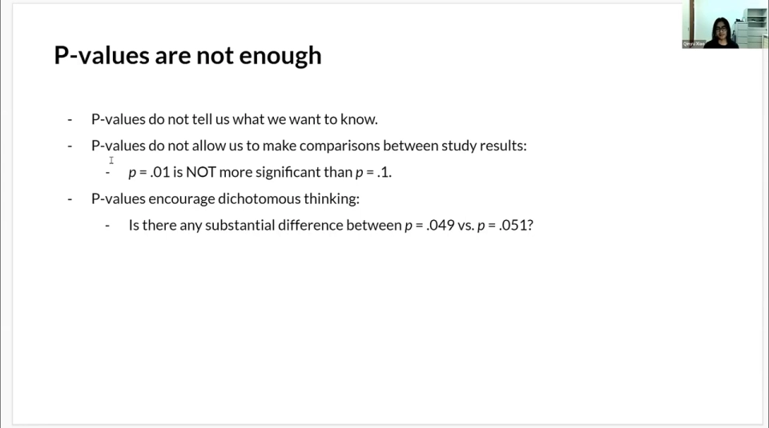

> 对单细胞扰动的含义：这一条几乎是为扰动数据写的。细胞数动辄上万，p 值被样本量推到极小，于是「显著」变成默认状态——此时唯一还能区分「强扰动」和「弱扰动」的量，就只剩效应量本身。

## 二、效应量：把差值除以一把「量纲无关的尺子」

### 2.1 原始均值差：同样的 0.25，图景可以完全不同

最直白的效应量就是**两组均值之差**。讲者举了一个教学干预的例子：对照组 GPA 均值 3，处理组 3.25，平均提高 0.25 [【跳转到 08:02】](https://www.youtube.com/watch?v=9zLGh2qmJR4&t=482)。

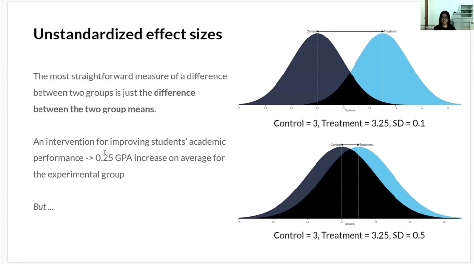

关键在于：上面那张图里两个分布几乎不重叠，下面那张图里两个分布大面积重叠。**均值差一样，但「随机抽一个处理组学生、再抽一个对照组学生，前者更高的概率」差别巨大** [【跳转到 08:56】](https://www.youtube.com/watch?v=9zLGh2qmJR4&t=536)。所以原始均值差不是好的效应量——它没有把「数据的离散程度」算进去。

### 2.2 换一套量纲，就没法比了

第二个理由是量纲。同样是「成绩提高」，美国 GPA 满分 4，香港 GPA 满分 4.3，德国用 1 到 6 且 1 是最高分 [【跳转到 09:26】](https://www.youtube.com/watch?v=9zLGh2qmJR4&t=566)。同一个干预在不同国家做，原始差值根本没法放在一起看。

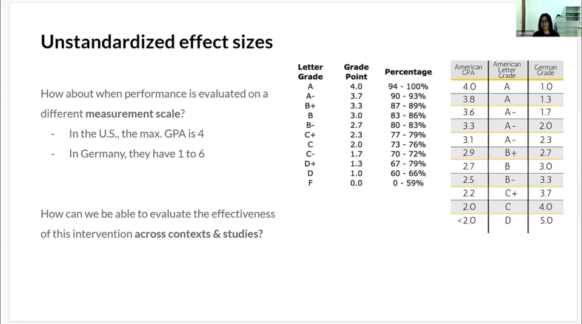

讲者用了一个很贴切的类比：我们之所以能比较长度，是因为有「公里」这个国际通用单位；有些国家还在用英里，数字就没法直接比 [【跳转到 10:52】](https://www.youtube.com/watch?v=9zLGh2qmJR4&t=652)。**标准化就是把「米」和「英里」统一成同一种尺子**：把差值除以数据的离散程度，得到无量纲的数字 [【跳转到 10:22】](https://www.youtube.com/watch?v=9zLGh2qmJR4&t=622)。

### 2.3 「效应量」和「效应量度量」是两件事

讲者特意区分了两个词：**效应量（effect size）是那个数字、那个幅度；效应量度量（effect size measure）是表达它的单位** [【跳转到 11:22】](https://www.youtube.com/watch?v=9zLGh2qmJR4&t=682)。同一个效应，用 Cohen's d 报是 0.5，用原始分报是「提高 0.25 分」，两者说的是同一件事，只是单位不同。

### 2.4 Cohen's d 与它的两个近亲

最常用的标准化均值差是 **Cohen's d**，名字来自统计学家 Jacob Cohen [【跳转到 11:30】](https://www.youtube.com/watch?v=9zLGh2qmJR4&t=690)：

$$
d = \frac{\bar{x}_1 - \bar{x}_2}{s}, \qquad
s = \sqrt{\frac{(n_1 - 1)s_1^2 + (n_2 - 1)s_2^2}{n_1 + n_2 - 2}}
$$

分子是两组均值差，分母是**合并标准差** $s$（pooled standard deviation）。讲者强调课上不会手算，但要知道这个式子的意思：**它把「差多少」换算成了「差几个标准差」** [【跳转到 12:08】](https://www.youtube.com/watch?v=9zLGh2qmJR4&t=728)。同族的还有两个变体：**Hedges' g** 与 **Glass's delta**，用哪个取决于两组样本量是否相等、方差是否可比 [【跳转到 12:08】](https://www.youtube.com/watch?v=9zLGh2qmJR4&t=728)。

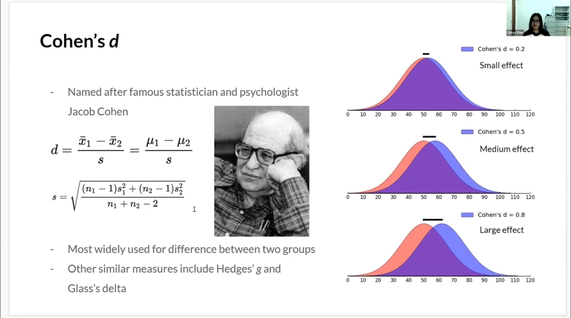

## 三、效应量的家族：d、r、比值比，各管一类数据

### 3.1 相关系数 r 本身就是标准化效应量

讲者提醒：很多人以为效应量就是 Cohen's d，其实效应量的范围宽得多 [【跳转到 18:18】](https://www.youtube.com/watch?v=9zLGh2qmJR4&t=1098)。**相关系数 $r$ 本身就是一个标准化效应量**，它衡量两个连续变量共同变化的强度，不需要再做任何标准化 [【跳转到 14:08】](https://www.youtube.com/watch?v=9zLGh2qmJR4&t=848)。

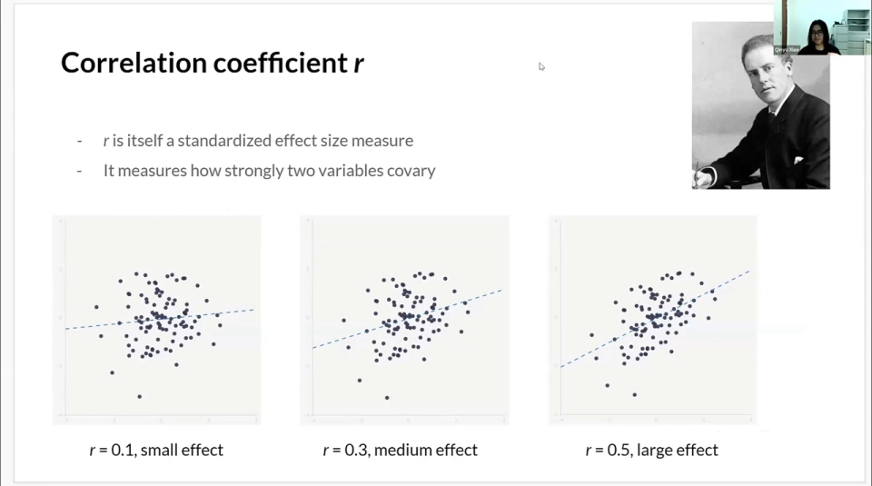

### 3.2 分类数据用比值比

当变量是分类变量（比如「戒烟/没戒烟」「用了干预/没用干预」），对应的标准化效应量是**比值比（odds ratio, OR）**。讲者先定义「几率」：事件 A 发生的概率除以不发生的概率；比值比就是两个几率的比 [【跳转到 16:56】](https://www.youtube.com/watch?v=9zLGh2qmJR4&t=1016)。

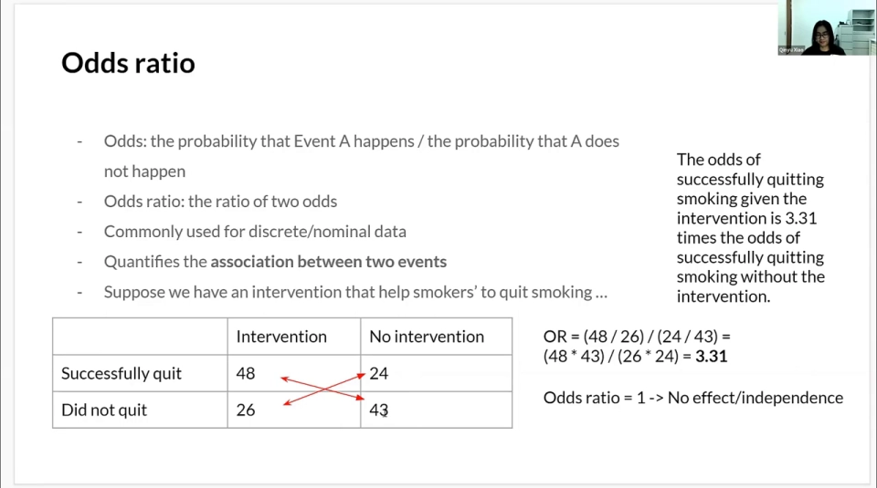

按这个四格表算：干预组戒烟几率是 $48/26$，对照组是 $24/43$，两者相除得到 **OR = 3.31** [【跳转到 17:25】](https://www.youtube.com/watch?v=9zLGh2qmJR4&t=1045)。读法是「干预让戒烟的几率变成原来的 3.31 倍」；**OR = 1 意味着没有效应、两个事件独立** [【跳转到 17:48】](https://www.youtube.com/watch?v=9zLGh2qmJR4&t=1068)。

### 3.3 按数据类型选度量，别拿一把尺子量所有东西

讲者给出一张分类表：比较组间差异用 $d$、Hedges' $g$、Glass's $\delta$；相关与比例用 $r$、$\phi$ 系数、Cramér's $V$、Cohen's $h$；方差分析用 $\eta^2$ 一类 [【跳转到 18:18】](https://www.youtube.com/watch?v=9zLGh2qmJR4&t=1098)。**选错度量，读者就不知道你报的数字是什么意思**——这是讲者反复强调的一句话 [【跳转到 18:48】](https://www.youtube.com/watch?v=9zLGh2qmJR4&t=1128)。

> 对单细胞扰动的含义：扰动分析里最常见的「效应量」其实是 **log fold change**，它属于上面说的「原始效应量」——单位是 log 表达量的差，没有除以离散程度。所以 logFC 大不等于扰动强：一个低表达、噪声大的基因可以有很夸张的 logFC，而一个高表达、稳定的基因 logFC 只有 0.3 也可能非常可靠。这也是为什么跨基因、跨扰动比较时，标准化度量（d、r）比 logFC 更可移植。
## 四、阈值从哪来：0.2/0.5/0.8 只是「不荒唐的约定」

### 4.1 Cohen 本人并不想给基准

学生总会问：d 等于多少才算大？讲者还原了这段历史：**Cohen 一开始非常抗拒给基准**，因为他认为效应的大小必须放在具体研究情境里解释——在某个领域算「小」的 0.5，换到认知心理学或神经科学可能完全不是那个意思 [【跳转到 12:38】](https://www.youtube.com/watch?v=9zLGh2qmJR4&t=758)。但大家坚持要一个可操作的指导，Cohen 只好妥协，提出 0.2 为小、0.5 为中、0.8 为大 [【跳转到 13:38】](https://www.youtube.com/watch?v=9zLGh2qmJR4&t=818)。

这段历史很重要，因为它决定了这些数字的**地位**：它们是约定，不是自然常数。

### 4.2 实证基准：真实效应比约定基准更小

更麻烦的是，这些约定可能整体偏大。讲者引用 2003 年发表的一篇社会心理学百年综述（Richard、Bond 与 Stokes-Zoota），该文汇总了一个世纪的社会心理学研究，给出的经验基准是：**$r = .10$ 算小、$r = .20$ 算中、$r = .30$ 算大**——比 Cohen 约定的 0.1/0.3/0.5 整体下移了一档 [【跳转到 15:37】](https://www.youtube.com/watch?v=9zLGh2qmJR4&t=937)。

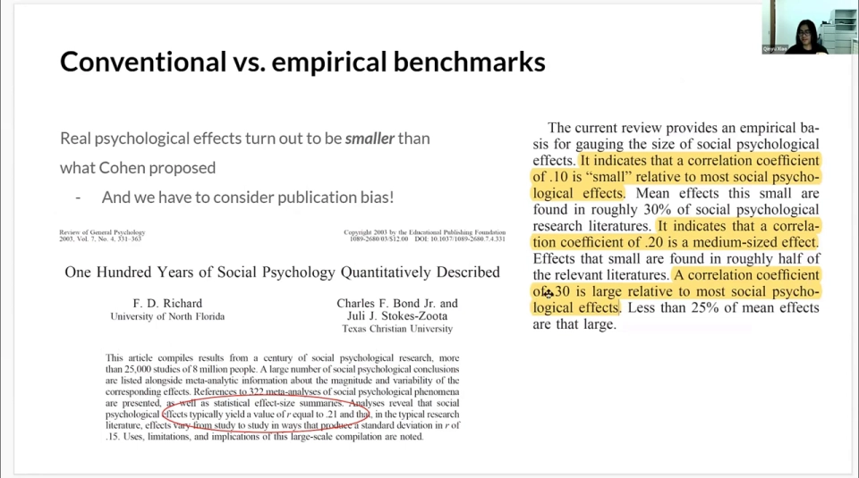

原因之一是**发表偏倚**：只有显著的结果更容易被发表，于是文献里报出来的效应量系统性偏高 [【跳转到 16:04】](https://www.youtube.com/watch?v=9zLGh2qmJR4&t=964)。讲者还提醒，这套基准只对社会心理学成立，认知心理学或神经科学的数字很可能不同 [【跳转到 16:34】](https://www.youtube.com/watch?v=9zLGh2qmJR4&t=994)——这正是 Cohen 不愿意给通用基准的理由 [【跳转到 16:48】](https://www.youtube.com/watch?v=9zLGh2qmJR4&t=1008)。

### 4.3 阈值的正确用法：先问「这个领域多大算大」

把三节连起来，讲者给出的判读原则是：

1. **阈值是领域约定的，不是普适的**。同一个 0.3，在某个领域是「大」，在另一个领域是「失望」。
2. **先查本领域的实证基准**，再决定自己报的数字算大算小。
3. **不要卡在阈值边界上做二分**。0.49 和 0.5 之间没有实质差别，报出数字本身比贴标签更有信息量。

> 对单细胞扰动的含义：扰动数据里常见的「logFC 大于 1、校正 p 小于 0.05」这套阈值，同样是约定而非定律。它来自 bulk 差异表达的习惯，搬到单细胞后既没有按细胞类型重新校准，也没有考虑不同基因的表达量级——这正是同一套阈值在不同数据集上「有时挑出几百个基因、有时挑出上万个」的原因之一。

## 五、置信区间：效应量的「精度刻度」

### 5.1 置信区间的正确读法

讲者用一个课堂投票引出常见误解：拿到「GPA 差 0.25，95% 置信区间 [0.1, 0.4]」，多数人会说「真实差值落在 0.1 到 0.4 之间的概率是 95%」——这是错的 [【跳转到 22:35】](https://www.youtube.com/watch?v=9zLGh2qmJR4&t=1355)。

正确说法是：**如果把这个研究重复无数次，其中 95% 的置信区间会覆盖真实差值** [【跳转到 26:20】](https://www.youtube.com/watch?v=9zLGh2qmJR4&t=1580)。真实值是固定的，不会随抽样变化，所以不能说「它落在某个区间里的概率是多少」；区间本身才是随机的那个东西 [【跳转到 29:37】](https://www.youtube.com/watch?v=9zLGh2qmJR4&t=1777)。

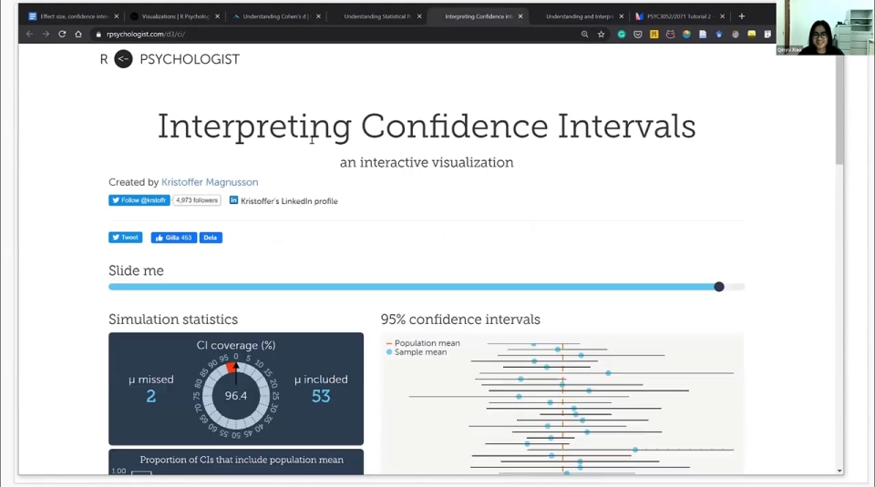

在演示里，讲者反复抽样并统计覆盖率，跑下来大约 95% 的区间覆盖真实值，少数没覆盖的纯属随机 [【跳转到 28:37】](https://www.youtube.com/watch?v=9zLGh2qmJR4&t=1717)。

### 5.2 区间宽度 = 精度；跨零 = 不显著

既然单个区间不能对真实值下概率判断，那为什么还要报它？讲者说，因为**置信区间提供的是「点估计有多准」的信息** [【跳转到 31:05】](https://www.youtube.com/watch?v=9zLGh2qmJR4&t=1865)。他用三个研究举例：

- 研究一：效应量很小、区间很窄；
- 研究二：效应量很大，但区间很宽、甚至跨到负值；
- 研究三：效应量中等、区间较窄。

结论有两条。第一，**区间跨零就等价于不显著** [【跳转到 32:05】](https://www.youtube.com/watch?v=9zLGh2qmJR4&t=1925)。第二，**效应量大不等于结论可靠**——研究二虽然效应量大，但区间太宽，没法说服别人这不是运气 [【跳转到 32:35】](https://www.youtube.com/watch?v=9zLGh2qmJR4&t=1955)。

### 5.3 统计显著与实用显著是两件事

由研究二还能推出一个更尖锐的结论：如果那个大效应是真的，它的**实用意义**比研究三更大；但它在统计上不显著，而研究三显著 [【跳转到 33:35】](https://www.youtube.com/watch?v=9zLGh2qmJR4&t=2015)。反过来，一个稳稳高于零、但效应量极小的结果，统计上显著却未必值得据此规划后续研究 [【跳转到 34:05】](https://www.youtube.com/watch?v=9zLGh2qmJR4&t=2045)。**统计显著性与实用显著性之间是分离的**。

## 六、效应量与样本量：到底是谁在驱动显著性

### 6.1 功效是「有效应时能测出来」的概率

进入后半段，讲者先定义**功效（power）**：在效应真实存在的前提下，研究能把它检测出来（即得到统计显著结果）的概率 [【跳转到 35:05】](https://www.youtube.com/watch?v=9zLGh2qmJR4&t=2105)。

- I 类错误（假阳性）：没有效应却宣称有效应，概率记为 $\alpha$；
- II 类错误（假阴性）：有效应却宣称没有，概率记为 $\beta$；
- 功效就是 $1 - \beta$ [【跳转到 35:58】](https://www.youtube.com/watch?v=9zLGh2qmJR4&t=2158)。

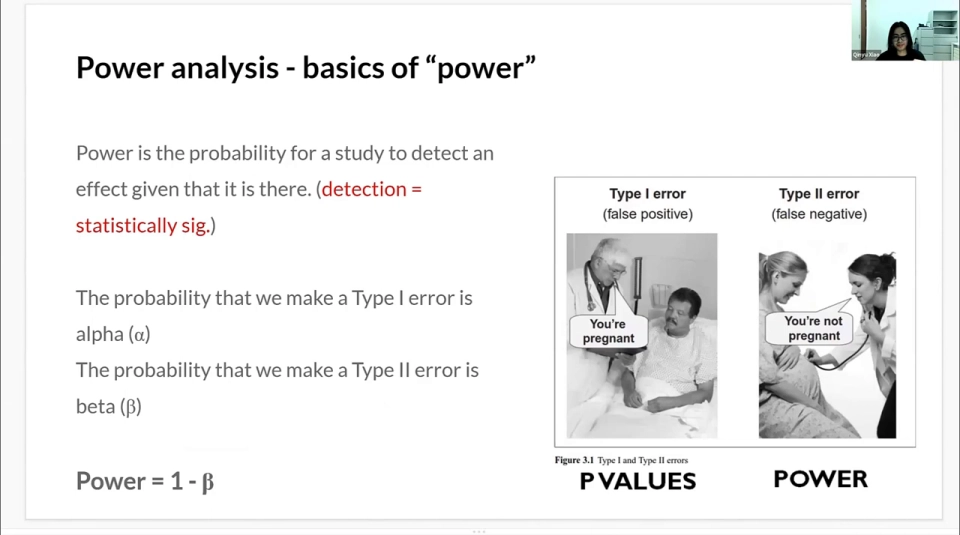

### 6.2 四个旋钮：效应量、样本量、α、检验设计

讲者用交互式可视化逐个演示四个因素 [【跳转到 36:28】](https://www.youtube.com/watch?v=9zLGh2qmJR4&t=2188)。图里两条曲线不是原始数据的分布，而是**均值在重复抽样下的分布（采样分布）**：左边是零假设下的分布，右边是真实效应存在时的分布，中间那条竖线是临界值；红色面积是 I 类错误率，深蓝色面积是 II 类错误率，右侧浅蓝色面积就是功效 [【跳转到 37:18】](https://www.youtube.com/watch?v=9zLGh2qmJR4&t=2238)。

**旋钮一：效应量。** 效应量变小时两条分布靠近，临界值不变、深蓝面积变大，功效下降；效应量变大时功效上升 [【跳转到 38:48】](https://www.youtube.com/watch?v=9zLGh2qmJR4&t=2328)。**效应量越大，越容易被测出来** [【跳转到 39:48】](https://www.youtube.com/watch?v=9zLGh2qmJR4&t=2388)。

**旋钮二：样本量。** 样本量越大，采样分布越瘦，深蓝面积越小，功效越高 [【跳转到 40:18】](https://www.youtube.com/watch?v=9zLGh2qmJR4&t=2418)。

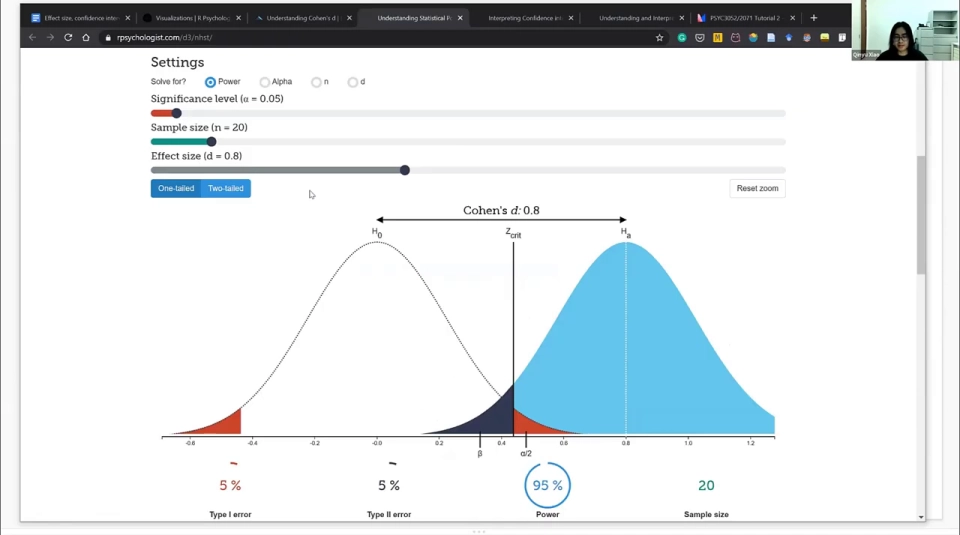

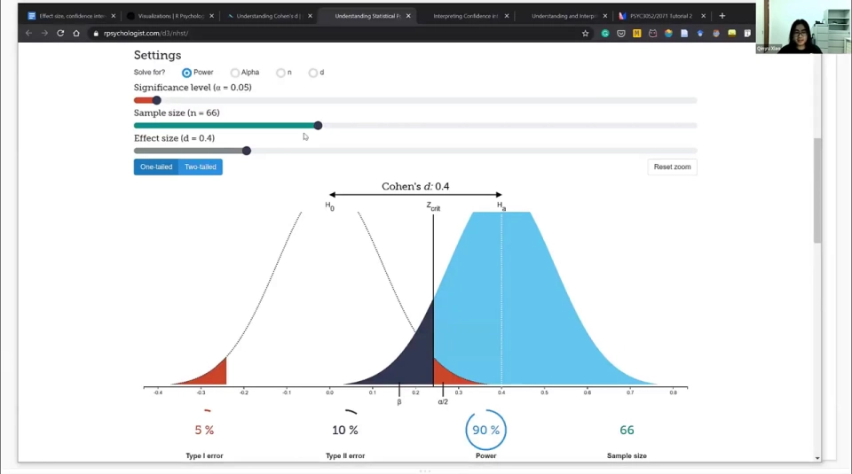

讲者强调：**在实践中，样本量是唯一容易改的因素**。真实效应量改不了，α 通常固定在 0.05，研究设计定了也不容易动——所以「提高功效」在实践中几乎等于「加样本」 [【跳转到 41:08】](https://www.youtube.com/watch?v=9zLGh2qmJR4&t=2468)。

**旋钮三：α。** 把显著性水平放宽，临界值往中间移，红色面积变大、深蓝面积变小，功效上升——这是 I 类错误与 II 类错误之间的**权衡** [【跳转到 41:51】](https://www.youtube.com/watch?v=9zLGh2qmJR4&t=2511)。讲者补充了一个领域差异：神经科学常把 α 压得远低于 0.05，因为 fMRI 要比较大量体素，多重比较让假阳性风险变高 [【跳转到 44:13】](https://www.youtube.com/watch?v=9zLGh2qmJR4&t=2653)；社会心理学则普遍沿用 0.05。

**旋钮四：检验与设计。** 同样的数据，单尾检验比双尾检验功效高（临界值只在一侧，另一侧的红色面积被腾出来）[【跳转到 45:20】](https://www.youtube.com/watch?v=9zLGh2qmJR4&t=2720)；被试内设计比被试间设计功效高，因为它能把个体差异「扣掉」，让效应更凸显 [【跳转到 45:50】](https://www.youtube.com/watch?v=9zLGh2qmJR4&t=2750)；参数检验比非参数检验功效高，所以数据满足假设时应优先用参数检验 [【跳转到 46:08】](https://www.youtube.com/watch?v=9zLGh2qmJR4&t=2768)。

### 6.3 低功效的三重代价：假阳性、假阴性、效应量高估

讲者把「低功效为什么坏」拆成三条 [【跳转到 48:38】](https://www.youtube.com/watch?v=9zLGh2qmJR4&t=2918)：

1. **假阴性变多**——功效低就是「测不出来」，这条最好理解。
2. **假阳性也变多**——这条反直觉。讲者的解释是：样本小的时候，抽样结果不代表性，容易抽到极端均值；两组都抽到极端值时，即使来自同一个总体也会显得「显著」，而且重复实验时方向可能反过来 [【跳转到 49:08】](https://www.youtube.com/watch?v=9zLGh2qmJR4&t=2948)。
3. **效应量被系统性高估**——这是与本节最相关的一条。讲者现场演示：真实效应是 0.4，样本量越小，要达到显著所需的观测差值就越大（小样本时要 0.62 才显著，大样本时 0.4 就够）[【跳转到 51:06】](https://www.youtube.com/watch?v=9zLGh2qmJR4&t=3066)。再加上发表偏倚只让显著结果进入文献，**文献里报出来的效应量就会系统性大于真实效应** [【跳转到 51:35】](https://www.youtube.com/watch?v=9zLGh2qmJR4&t=3095)。

三条合起来，最终损伤的是**可重复性** [【跳转到 52:35】](https://www.youtube.com/watch?v=9zLGh2qmJR4&t=3155)。

### 6.4 事前功效分析：反解「需要多少样本」

**事前功效分析（a priori power analysis）** 是唯一在收数据之前做的功效分析：已知想检测的效应量、研究设计与统计检验、α 水平、目标功效，求**需要多少样本** [【跳转到 47:08】](https://www.youtube.com/watch?v=9zLGh2qmJR4&t=2828)。

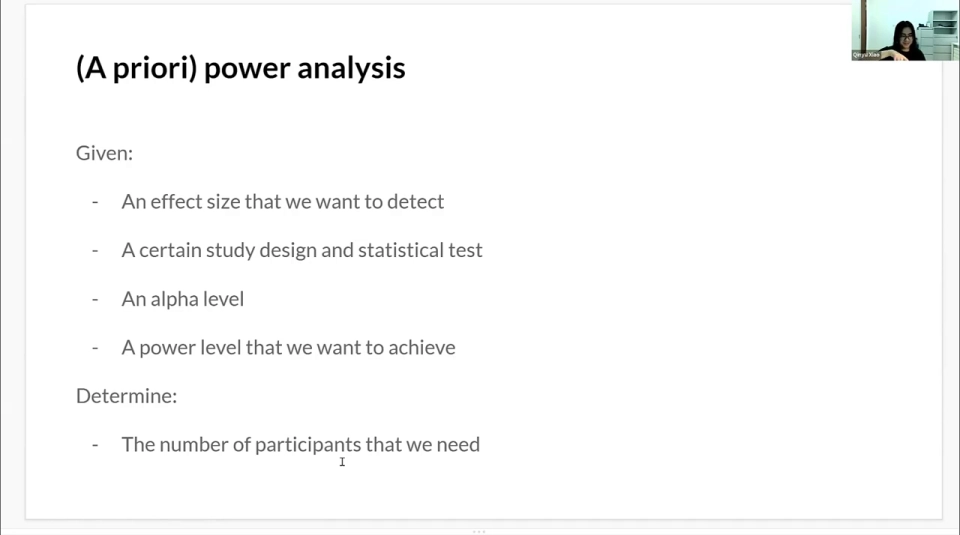

讲者列出这一环节的完整流程 [【跳转到 78:59】](https://www.youtube.com/watch?v=9zLGh2qmJR4&t=4739)：

1. **确定最小可检测效应量**。最常用的是原文献报告的效应量（复制研究场景）；也可以来自预实验，或来自元分析——讲者认为元分析的估计最可靠，因为它汇总了多个研究并（理论上）校正了发表偏倚 [【跳转到 79:59】](https://www.youtube.com/watch?v=9zLGh2qmJR4&t=4799)；实在没有，就退回 Cohen 之类的经验基准 [【跳转到 80:29】](https://www.youtube.com/watch?v=9zLGh2qmJR4&t=4829)。
2. **确定目标功效**。课程项目里普遍瞄准 0.95，因为不想漏掉效应 [【跳转到 80:59】](https://www.youtube.com/watch?v=9zLGh2qmJR4&t=4859)。
3. **确定统计检验与单双尾**。
4. **用工具算出样本量**，并**完整报告**。

## 七、怎么算、怎么报：三个工具与一份报告模板

### 7.1 R：用 MOTE 从已发表的统计量反算效应量

课堂演示用的是独立样本 t 检验。讲者先说明一个现实约束：**复制研究往往拿不到原始数据，只能从原文报告的统计量反算效应量** [【跳转到 61:23】](https://www.youtube.com/watch?v=9zLGh2qmJR4&t=3683)。如果有原始数据就直接算，没有才走「反算」这条路 [【跳转到 61:53】](https://www.youtube.com/watch?v=9zLGh2qmJR4&t=3713)。

演示分两步：先用 `psych` 包的 `describeBy` 拿分组描述统计，再跑 t 检验；然后用 `MOTE` 包的 `d.ind.t.t` 从描述统计算出 $d$ 与置信区间——演示里得到 $d = -0.62$，95% 置信区间 $[-1.25, 0.01]$ [【跳转到 63:53】](https://www.youtube.com/watch?v=9zLGh2qmJR4&t=3833)。如果原文只报了 $t$ 值和样本量，也可以用另一个函数从 $t$ 反算，但结果会有细微差异，因为这些数字本身是近似值 [【跳转到 65:53】](https://www.youtube.com/watch?v=9zLGh2qmJR4&t=3953)。

![R 演示界面：左侧脚本依次是生成数据、describeBy 描述统计、t 检验、MOTE 计算 Cohen's d 与置信区间、pwr.t.test 功效分析；右侧控制台输出 d = -0.637、95% CI 约 [-1.25, 0.01] 以及 pwr 的样本量结果](assets/显著不等于效应大：效应量的度量、阈值与样本量陷阱/04119.webp)

讲者对「不同包算出不同数字」的态度值得记住：**只要把计算过程透明地报出来，别人能复现，数字略有出入没关系**；真正糟糕的是把计算藏起来，谁也复现不了 [【跳转到 67:02】](https://www.youtube.com/watch?v=9zLGh2qmJR4&t=4022)。

功效分析则用 `pwr` 包的 `pwr.t.test`：给定 $d = 0.62$、目标功效 0.95、双尾独立样本 t 检验，算出**每组需要 69 人** [【跳转到 68:39】](https://www.youtube.com/watch?v=9zLGh2qmJR4&t=4119)。

### 7.2 JASP：点选式界面，结果自带解释

JASP 是开源版的 SPSS，界面相似但更简洁，底层同样跑 R [【跳转到 69:25】](https://www.youtube.com/watch?v=9zLGh2qmJR4&t=4165)。功效分析要用第三方开发的 jpower 模块；输入「最小可检测效应量 0.62、目标功效 0.95、每组 20 人、α = 0.05、双尾」后，它给出的结论同样是**每组 69 人**，并附一张「真实效应量 vs 能否检出」的参考表和功效等高线图 [【跳转到 71:12】](https://www.youtube.com/watch?v=9zLGh2qmJR4&t=4272)。

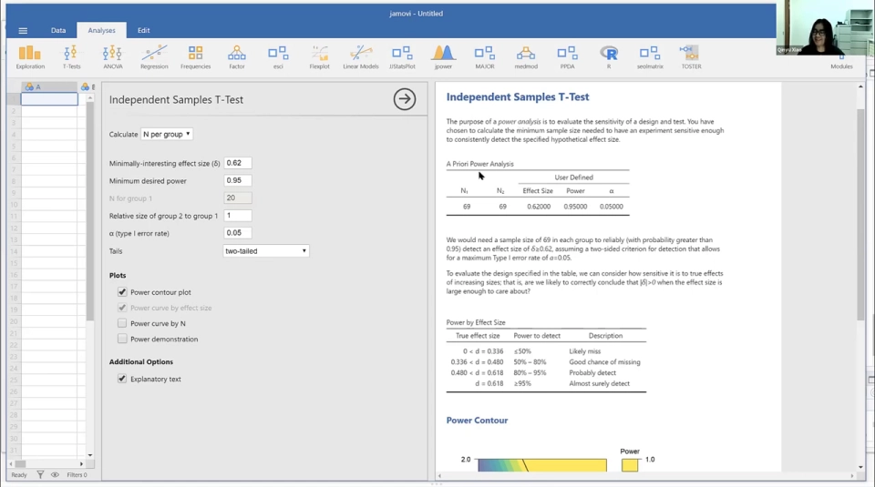

讲者也指出这类模块的局限：只支持很简单的设计 [【跳转到 73:12】](https://www.youtube.com/watch?v=9zLGh2qmJR4&t=4392)。

### 7.3 G\*Power：测试种类最多，但界面老旧

G\*Power 是专门做功效分析的软件，界面过时，但支持的检验种类比 JASP 多 [【跳转到 73:55】](https://www.youtube.com/watch?v=9zLGh2qmJR4&t=4435)。它还区分了几种功效分析的类型：**事前分析**求样本量，**敏感性分析**则反过来——样本量已定，求这个设计能可靠检出多小的效应 [【跳转到 76:11】](https://www.youtube.com/watch?v=9zLGh2qmJR4&t=4571)。事前分析的操作路径是：先选检验族（t 检验）→ 再选具体检验（两独立均值之差）→ 选分析类型（事前分析）→ 填效应量、α、功效、分配比 → 点 Calculate [【跳转到 76:41】](https://www.youtube.com/watch?v=9zLGh2qmJR4&t=4601)。

讲者特意强调一件事：**在 G\*Power 里做完分析，必须把「计算协议」复制到补充材料里**，让别人知道用了哪些参数、能自己复现 [【跳转到 77:11】](https://www.youtube.com/watch?v=9zLGh2qmJR4&t=4631)。他也明确表达偏好：**能不用 G\*Power 就不用**，优先用 R，因为 R 更开放、更可核查 [【跳转到 78:12】](https://www.youtube.com/watch?v=9zLGh2qmJR4&t=4692)。

### 7.4 报告模板：六件事必须写清

讲者给出一份功效分析的报告模板，并逐条标注了审稿人会追问的点 [【跳转到 81:44】](https://www.youtube.com/watch?v=9zLGh2qmJR4&t=4904)：

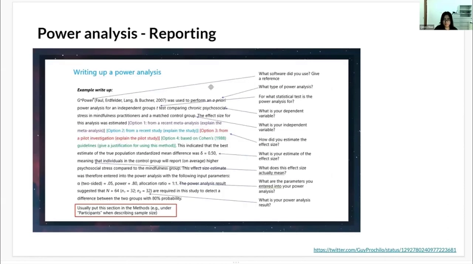

1. 用了什么软件（给出引用）；
2. 是哪一类功效分析（事前/敏感性等）；
3. 为哪个统计检验做的；
4. 因变量、自变量是什么；
5. 效应量是怎么估出来的（原文效应、元分析、预实验还是经验基准）；
6. 输入了哪些参数、得到了什么结果。

### 7.5 一个完整例子：从原文 t 值到「每组 39 人」

讲者用一个复制研究收尾。原文结论是：参加过工作坊的学生对心理学的态度更积极，$t(38) = 2.57$、$p = .014$，每组 20 人 [【跳转到 84:14】](https://www.youtube.com/watch?v=9zLGh2qmJR4&t=5054)。

复制研究的第一步是**先算出原文的效应量**：按公式算得 $d = 0.83$，并给出置信区间——之所以要置信区间，是因为后面要用它和复制结果做比较（比如画森林图判断「信号一致/不一致」）[【跳转到 84:44】](https://www.youtube.com/watch?v=9zLGh2qmJR4&t=5084)。讲者提醒：**能从均值和标准差算就从那里算，比从 t 值反算更准确** [【跳转到 85:14】](https://www.youtube.com/watch?v=9zLGh2qmJR4&t=5114)。

接着做功效分析：以 $d = 0.83$ 为目标效应、功效 0.95，R 与 G\*Power 都给出**每组 39 人** [【跳转到 85:44】](https://www.youtube.com/watch?v=9zLGh2qmJR4&t=5144)。最后两条经验规则：**你的样本量不应小于原研究的样本量**——如果算出来比原文需要的还少，至少也要对齐原文的样本量 [【跳转到 86:14】](https://www.youtube.com/watch?v=9zLGh2qmJR4&t=5174)；另一个经验做法叫「小望远镜法」，把某个基准效应量按比例放大后当作目标效应量来规划样本 [【跳转到 86:44】](https://www.youtube.com/watch?v=9zLGh2qmJR4&t=5204)。

## 八、把这套语言翻译回单细胞扰动

课堂例子是心理学实验，但整套逻辑可以逐条映射到扰动数据上——而且映射之后，问题的形状会更清楚。

### 8.1 「显著」在扰动数据里是默认状态

讲者反复讲的一件事是：**样本量驱动显著性**——样本一大，再小的均值差也会显著；样本一小，再大的效应也可能测不出来 [【跳转到 41:08】](https://www.youtube.com/watch?v=9zLGh2qmJR4&t=2468)。单细胞扰动数据正好落在「样本极大」这一端：一个扰动的处理组和对照组各有成千上万个细胞，检验的 $n$ 是细胞数而不是供体数。于是几乎每个基因都能算出极小的 p 值，**「显著差异基因」这个标签在扰动数据里几乎没有筛选力**。

对应到本小节的另一半：多重检验校正解决的是「检验太多次」的问题（见 3.1.4 多重检验校正与假发现率），但它**不解决「样本太大」的问题**。校正后的 Q 值再小，也只说明「这个差异不太可能是噪声」，不说明「这个差异值得关注」。要判断值不值得关注，只能看效应量。

### 8.2 logFC 是原始效应量，d 是标准化效应量

按第二节的区分，扰动分析里最常报的 **log fold change 属于原始效应量**：它是两组表达量对数均值之差，没有除以离散程度。这带来两个后果：

- **同一个 logFC，在不同基因上含义不同**。高表达、低噪声的基因，logFC = 0.3 可能非常稳定；低表达、高 dropout 的基因，logFC = 2 可能主要来自少数几个细胞。
- **同一个 logFC，在不同扰动上也不可比**。不同扰动的整体转录组位移幅度不同，用原始差值横向比较，等于用不同的尺子量长度。

这正是讲者说「标准化是为了跨研究比较」的地方 [【跳转到 10:52】](https://www.youtube.com/watch?v=9zLGh2qmJR4&t=652)：如果要给一批扰动排序、或者跨数据集比较扰动强度，标准化度量（$d$、$r$）比 logFC 更可移植。

### 8.3 阈值要按扰动数据重新校准

第四节的结论在这里同样成立：**0.2/0.5/0.8 是社会心理学的约定，logFC > 1 是 bulk 差异表达的习惯，两者都不是自然常数**。扰动数据要设阈值，至少要先回答两个问题：

1. 这个数据集的**技术噪声底**在哪里？同一扰动的技术重复之间，效应量分布是什么样？
2. 这个领域的**实证基准**是多少？同一细胞类型里，已知的强扰动（阳性对照）和已知的弱扰动（阴性对照）分别落在什么区间？

没有这两个参照，任何阈值都只是拍脑袋——而拍脑袋的阈值在细胞数上万的数据上，会把「统计上必然显著」误读成「生物学上必然重要」。

### 8.4 两个方向的风险：假阳性与效应量高估

第六节讲的低功效代价，在扰动数据里会以两种相反的形式出现：

- **细胞数很多、供体很少**：检验的 $n$ 被细胞数撑大，假阳性风险被放大——这就是**伪重复（pseudo-replication）**：同一供体的细胞被当成独立重复，样本量被人为放大。这正是「显著但微小」的效应大量出现的原因。讲者关于「样本量驱动显著性」的演示 [【跳转到 40:18】](https://www.youtube.com/watch?v=9zLGh2qmJR4&t=2418) 在这里可以直接套用：把 $n$ 从细胞数换回供体数，功效曲线会整体左移。
- **供体少、细胞也少**：这时风险反过来，变成效应量被高估——讲者演示过，小样本要达到显著，观测差值必须比真实效应更大（0.62 vs 0.4）[【跳转到 51:06】](https://www.youtube.com/watch?v=9zLGh2qmJR4&t=3066)。扰动筛选里那些「效应惊人」的小规模实验，很可能正是这种机制的产物。

所以扰动分析报效应量时，最好同时报**精度**：效应量的置信区间，或者至少报清楚「这个效应量是在多少个细胞、多少个供体上估出来的」。

> **视频之外的一点补充**：本讲覆盖的是均值差、相关系数、比值比这几类度量，没有涉及「分布之间的距离」这一类。在单细胞里另有一族做法，把两组细胞的整体分布差异直接当作效应量（例如 energy distance 一类的分布距离），好处是不依赖「哪个基因差异最大」，能反映细胞状态整体位移。它和本讲的 $d$、$r$ 是同一层概念——都是「量纲无关的差值」——只是把「差多少」定义在分布层面而不是均值层面。

## 小结

- **p 值只说「有没有」，不说「有多大」**。它算的是 $P(D \mid H_0)$，不是我们想要的 $P(H \mid D)$；它不能跨研究比较，还鼓励二分思维。
- **效应量 = 量纲无关的差值**。原始均值差不考虑离散程度，换量纲就没法比；标准化（除以合并标准差）之后才能跨变量、跨研究比较。
- **效应量有一整个家族**：组间差异用 $d$、Hedges' $g$、Glass's $\delta$；相关用 $r$；分类数据用比值比；方差分析用 $\eta^2$。选错度量，读者就不知道数字的含义。
- **阈值是约定，不是常数**。Cohen 的 0.2/0.5/0.8 连他本人都嫌武断；实证基准（如社会心理学的 $r = .10/.20/.30$）往往更小，且必须按领域校准。
- **置信区间是效应量的精度刻度**。区间跨零等价于不显著；效应量大但区间宽，仍然不能信；统计显著与实用显著是两件事。
- **显著性是「效应量 + 样本量」的合成结果**。样本量是实践中唯一容易调的旋钮；低功效同时带来假阳性、假阴性和效应量高估。
- **报结论的标准动作**：效应量 + 置信区间 + 样本量（以及样本量的层级），三者缺一不可。在单细胞扰动里，「样本量」到底是细胞数还是供体数，必须写清楚。

## 关键术语速查

| 术语 | 一句话解释 |
| --- | --- |
| 效应量（effect size） | 描述差异或关系「有多大」的数字，与量纲无关 |
| 效应量度量（effect size measure） | 表达效应量所用的单位，如 Cohen's d、r、比值比 |
| 标准化均值差（Cohen's d） | 两组均值差除以合并标准差，单位是「几个标准差」 |
| Hedges' g / Glass's delta | Cohen's d 的两个变体，区别在于用哪个标准差做分母 |
| 比值比（odds ratio） | 两个几率之比，用于分类数据；等于 1 表示无效应 |
| 置信区间（CI） | 重复抽样下会以指定比例覆盖真实值的区间，宽度反映精度 |
| 功效（power） | 效应真实存在时能被检测出来的概率，等于 1 减去 II 类错误率 |
| 事前功效分析（a priori power analysis） | 收数据前，由效应量、α、目标功效反解所需样本量 |
| 发表偏倚（publication bias） | 显著结果更容易被发表，导致文献中的效应量系统性偏大 |
| 伪重复（pseudo-replication） | 把同一供体的多个细胞当作独立重复，人为放大样本量 |
