# 样本量与检验效能：p 大于 0.05 不等于没有效应

> 视频来源：[样本量与检验效能 沈毅老师主讲](https://www.bilibili.com/video/BV1F5411B78Y/)（Bilibili · 奔跑的黑楚骑士，讲者 沈毅）｜时长约 71 分钟
> 导读：这是一场面向临床与公卫研究者的直播讲座，前半段讲「样本量怎么算」——四个参数、四类公式、四个算例；后半段讲「算出来以后怎么用」——检验效能分析，尤其是**结果不显著时如何判断是「没有效应」还是「没看见效应」**。讲者用难产儿体重、交叉设计降压、大肠癌辅助化疗三个真实案例演示了事后功效分析。字幕为自动识别，公式与数字已按幻灯片核对；文中「power」「功效」「检验效能」是同一个概念。

## 本讲要解决的核心问题（SCQA）

**背景**：医学研究本质上是抽样研究——从总体抽一个样本，测指标、算统计量，再推断回总体。既然是抽样，就绕不开一个问题：**抽多少？**

**冲突**：实际研究里最常见的两种做法都不算「算」：一种是凭经验拍一个数（做 36 例行不行？26 例可不可以？），另一种是做完再说——反正 p 小于 0.05 就发文章。可一旦结果 p 大于 0.05，麻烦就来了：这到底是「真的没有效应」，还是「我这个样本量根本看不见效应」？这两句话在论文里长得几乎一样，含义却完全相反。

**疑问**：样本量到底由什么决定、怎么算？算出来之后，如果结果不显著，我还能不能救一下、判断这次实验到底有没有能力看见效应？

**回答（中心思想）**：**样本量不是拍出来的，是从四个参数倒推出来的**——检验水准 $\alpha$、检验效能 $1-\beta$、最小差值 $\delta$、标准差 $\sigma$。而「未检出」只说明这次实验的证据不足，**要判断它是不是「不存在效应」，必须回头算一次检验效能**：功效足够低时，不显著只能说明「没看见」，不能说明「没有」。

## 一、样本量不是拍脑袋：它由四个参数倒推

### 1.1 先看清研究模式：一切都是抽样

讲者用一张经典的示意图开场 [【跳转到 04:29】](https://www.bilibili.com/video/BV1F5411B78Y/?t=269)：从总体（population）随机抽样得到样本（sample），对样本观察测量，算出统计量，再推断回总体。所以**统计结论不是「做」出来的，是「推断」出来的**。

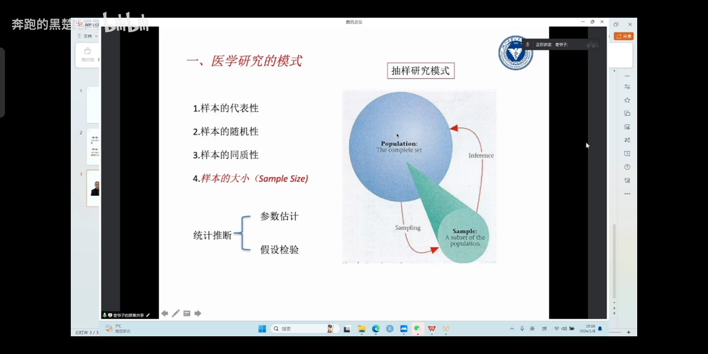

对样本有四项要求：代表性、随机性、同质性，以及**样本的大小**。前三条决定样本「像不像总体」，第四条决定样本「够不够用」 [【跳转到 05:24】](https://www.bilibili.com/video/BV1F5411B78Y/?t=324)。

### 1.2 样本量过大和过小都要付代价

为什么非要算？讲者给了两个方向的理由 [【跳转到 07:29】](https://www.bilibili.com/video/BV1F5411B78Y/?t=449)：

- **过大**：工作量、人力、物力、财力、时间都增加，测量误差也随之增加——因为误差本身具有传递性和放大性。做 100 例能解决的问题，做 200 例就是浪费。
- **过小**：对总体缺乏代表性（拿 200 人代表 14 亿人显然不行），推断的精度和可靠性都会下降。

于是有了「最小样本量」的概念，它有两个维度 [【跳转到 08:44】](https://www.bilibili.com/video/BV1F5411B78Y/?t=524)：一是在既定成本下让抽样误差尽可能小、保证精度与可靠性；二是在既定精度与可靠性下让成本尽可能省。

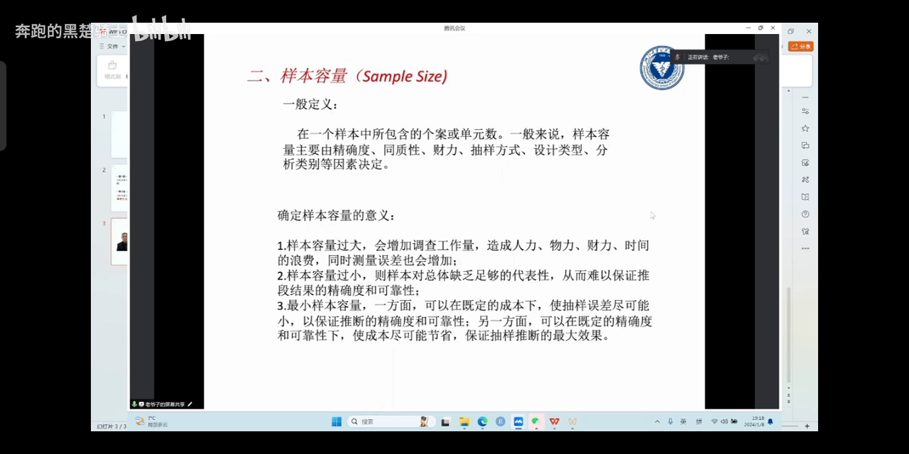

### 1.3 四个参数：α、β、δ、σ

估算样本量必须先确定四个统计学参数 [【跳转到 09:34】](https://www.bilibili.com/video/BV1F5411B78Y/?t=574)：

1. **检验水准 $\alpha$（第一类错误）**，默认 0.05。α 越小，精度越高、可靠性越好，但所需样本量越多——α 取 0.01 比取 0.1 要多得多 [【跳转到 10:24】](https://www.bilibili.com/video/BV1F5411B78Y/?t=624)。
2. **检验效能 $1-\beta$（第二类错误 $\beta$）**。它的含义是：两个总体客观上确实有差异时，你按 α 水准把这种差异发现出来的能力 [【跳转到 10:49】](https://www.bilibili.com/video/BV1F5411B78Y/?t=649)。效能越大，β 越小，所需样本量越多——样本量与检验效能是正相关。
3. **最小差值 $\delta$**，即在 α 与 β 水准下期待检测的最小差异，或客观上可能存在的差异。δ 越小，所需样本量越多。但 δ **不是统计学问题，而是专业问题**：比如某种肿瘤 5 年生存率现在是 30%，新药要把它提到多少才算「值得做这个研究」？提高 1% 还是 5%，要靠临床知识来定 [【跳转到 12:04】](https://www.bilibili.com/video/BV1F5411B78Y/?t=724)。
4. **标准差 $\sigma$（定量数据）或率 $p$（定性数据）**。假设检验有方差齐性的前提，所以两组的标准差应视为相等。变异越大，需要越多样本才能反映真实变异；变异小，所需样本量就少 [【跳转到 13:44】](https://www.bilibili.com/video/BV1F5411B78Y/?t=824)。σ 通常从预实验、同类研究文献甚至动物实验中获得。

讲者补了一句：α 一般用 0.05，但如果是单侧研究，α 可能是 0.025；有的研究也可以放宽到 0.12，要看你做什么研究 [【跳转到 14:59】](https://www.bilibili.com/video/BV1F5411B78Y/?t=899)。

### 1.4 除了参数，还有三个外在因素

相同的统计参数下，样本量还会被这些因素影响 [【跳转到 15:24】](https://www.bilibili.com/video/BV1F5411B78Y/?t=924)：

| 因素 | 影响方向 |
| --- | --- |
| 研究指标的类型 | 定量指标比定性指标所需样本量少（比如用「血压值」还是用「血压高不高」） |
| 研究设计的类型 | 交叉设计比平行对照所需样本量少（同等条件下可减半） |
| 单侧还是双侧检验 | 单侧检验比双侧检验所需样本量少 |

## 二、怎么算：经验法与公式法

### 2.1 经验法：能救急，但不一定对

讲者把估算方法分成两类。第一类是**经验法** [【跳转到 16:39】](https://www.bilibili.com/video/BV1F5411B78Y/?t=999)：

- 动物实验：大动物 5~10、中动物 10~20、小动物 15~30 头；
- 难治但疗效显著的疾病（如肿瘤）：5~16 例；
- 病死率高的疾病（休克、心衰、肾衰、呼吸衰竭）：可到 50 例；
- 一般性疾病和慢性病：100、300、500 例；
- 确定参考范围时每组约 100 例；恶性肿瘤流行病学调查至少 10 万人（因为发病率本身就低，比如 17/10 万）；
- 多因素分析：样本量至少是研究因素个数的 5~10 倍。

他的评语是：经验是在很多研究基础上累积起来的，**但经验不一定是正确的**。

### 2.2 公式法（一）：样本均数与总体均数比较

第二类是**公式法**，本质是倒推 [【跳转到 17:54】](https://www.bilibili.com/video/BV1F5411B78Y/?t=1074)。单样本（或配对）均数比较用

$$
n=\left[\frac{(u_\alpha+u_\beta)s}{\delta}\right]^2
$$

其中 $n$ 是所需样本量，$s$ 是总体标准差 $\sigma$ 的估计值，$\delta$ 是容许误差，$u_\alpha$ 与 $u_\beta$ 由正态分布界值表（$\nu=\infty$）查得；$u_\alpha$ 有单侧与双侧之分，$u_\beta$ 只取单侧值 [【跳转到 18:44】](https://www.bilibili.com/video/BV1F5411B78Y/?t=1124)。

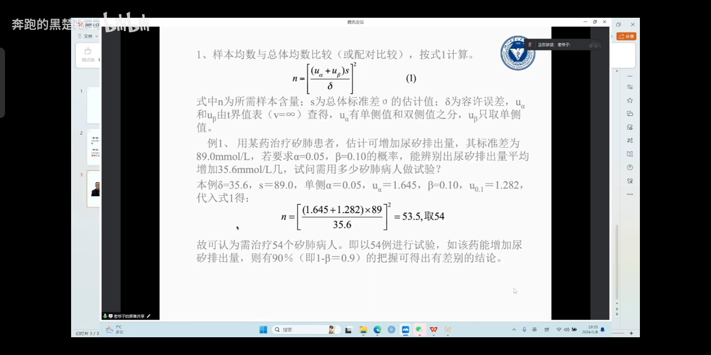

**例 1：矽肺患者的尿矽排出量** [【跳转到 19:09】](https://www.bilibili.com/video/BV1F5411B78Y/?t=1149)。用某药治疗矽肺患者，估计可增加尿矽排出量，其标准差为 89.0 mmol/L；要求 $\alpha=0.05$、$\beta=0.10$ 时能辨别出尿矽排出量平均增加 35.6 mmol/L，问需要多少矽肺病人？

这里 $\delta=35.6$ 是怎么来的？讲者解释：人自然也会排尿矽，吃药以后排出量要增加多少，我们才认为这个药起作用？这个「至少要增加多少」是根据预实验或专业知识定的 [【跳转到 19:59】](https://www.bilibili.com/video/BV1F5411B78Y/?t=1199)。

代入：单侧 $\alpha=0.05$ 时 $u_\alpha=1.645$，$\beta=0.10$ 时 $u_\beta=1.282$，

$$
n=\left[\frac{(1.645+1.282)\times 89.0}{35.6}\right]^2=53.5,\ \text{取 }54
$$

为什么是单侧而不是双侧？讲者说：这个药只会让排出量增加，不会减少，所以是单侧 [【跳转到 20:59】](https://www.bilibili.com/video/BV1F5411B78Y/?t=1259)。这也解释了单侧为什么样本量更少：单侧 α=0.05 的临界值是 1.645，双侧就是 1.96，分子变大，样本量自然变大。

**54 例是什么意思？** 讲者强调这是概率陈述：如果我用 54 例做这个实验，我有 **90% 的把握在一次实验里得出有差别的结论**；反过来也有 10% 的可能这次实验失败 [【跳转到 21:24】](https://www.bilibili.com/video/BV1F5411B78Y/?t=1284)。所以它不保证你「一定」能得出期望的结果。

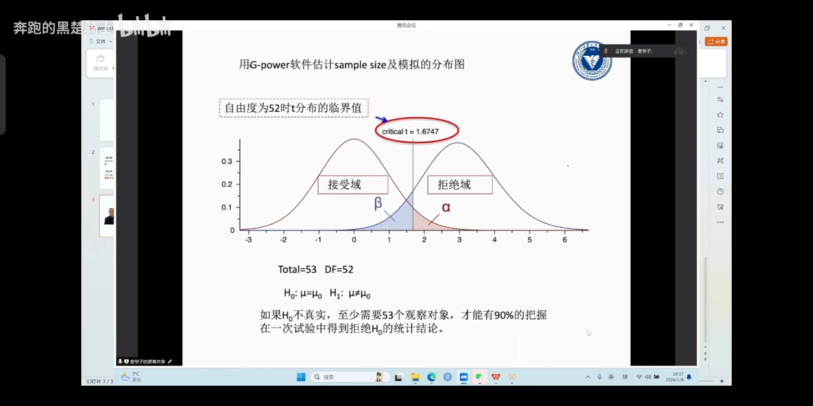

（幻灯片里公式算得 53.5、向上取整为 54，而这张 G*Power 模拟图直接取 Total=53——两者是同一个结果在取整方向上的差别，不影响「五十几例」这个量级判断。）

### 2.3 公式法（二）：两样本均数比较

两样本的算法一样，只是标准差换成两样本的合并标准差，且 $n_1=n_2$，所以公式里多一个系数 2；$\delta$ 就是两均数之差 [【跳转到 23:54】](https://www.bilibili.com/video/BV1F5411B78Y/?t=1434)。

**例 2：黄芪与生血汤对白细胞减少症的疗效** [【跳转到 24:19】](https://www.bilibili.com/video/BV1F5411B78Y/?t=1459)。根据以往经验，黄芪可增加粒细胞 1000 个，生血汤可增加 2000 个，两组合并标准差为 1800 个；用双侧 $\alpha=0.05$、$\beta=0.1$，问每组需要多少例？

讲者特意让听众注意这组参数的反差：**两组均值只差 1000 个，而标准差有 1800 个**——说明数据本身变异很大，所以估出来的样本量会比较大 [【跳转到 25:09】](https://www.bilibili.com/video/BV1F5411B78Y/?t=1509)。算出来每组 68 例，合计 136 例。

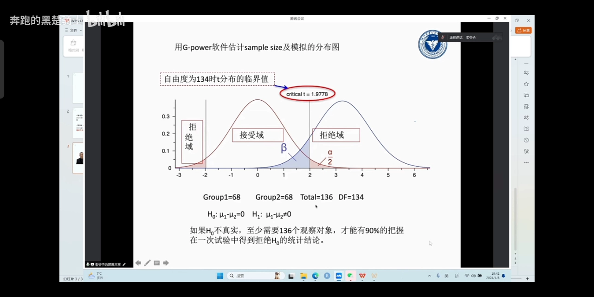

讲者顺带讲了一个实用细节：自由度 134 时 t 临界值是 1.9778，已经非常接近 1.96，所以自由度大于 100 时用 1.96 替代也问题不大 [【跳转到 25:59】](https://www.bilibili.com/video/BV1F5411B78Y/?t=1559)。

### 2.4 公式法（三）：两样本率比较

率的比较用另一个公式，$p_1$、$p_2$ 是两个总体的估计值，$p$ 是两样本合并率 [【跳转到 27:14】](https://www.bilibili.com/video/BV1F5411B78Y/?t=1634)。这个公式假定 $p$ 不能太小、$1-p$ 也不能太小——因为率的分布实际是二项分布，只有满足近似条件（$np$ 与 $n(1-p)$ 均大于 5）时，才能用标准正态分布来处理 [【跳转到 28:04】](https://www.bilibili.com/video/BV1F5411B78Y/?t=1684)。如果你用二项分布精确法，那就不是这个式子了。

**例 3：两种中药对肝炎表面抗原阴转的疗效** [【跳转到 28:29】](https://www.bilibili.com/video/BV1F5411B78Y/?t=1709)。实验药阴转率 30%，对照药 50%，取 $\alpha=0.05$、$\beta=0.1$，问需要多少病例？

合并率 $p=0.4$，两率之差为 0.2，代入算得**每组 124 例，合计 248 例** [【跳转到 29:19】](https://www.bilibili.com/video/BV1F5411B78Y/?t=1759)。讲者在这里补了一条非常实用的经验：**248 是最小样本量，临床试验通常还要在它基础上加 20% 的脱落率**——因为随访过程中会有病人失访，不加就会导致最终样本量不足。

### 2.5 配对分类数据

如果同一个标准用两种方法检测（比如两种血清学方法查同一批病人），就是配对设计，要用配对分类数据的公式 [【跳转到 30:09】](https://www.bilibili.com/video/BV1F5411B78Y/?t=1809)。讲者举的参数是：一种方法阳性率 92%、另一种 70%、两种方法符合率 64%，问需要多少份血清。他没有展开代入过程，只说明这类设计要按配对的方式估。
## 三、检验效能：为什么它值得单独做一次分析

### 3.1 定义与三个影响因素

讲者把 power analysis 拆成三个问题：为什么要做、做什么、怎么做 [【跳转到 30:59】](https://www.bilibili.com/video/BV1F5411B78Y/?t=1859)。先看定义：**检验效能是总体之间确实存在差异时，按规定的检验水准 α 能够发现这种差异的能力**，也就是两条分布中拒绝域那一侧的面积 $1-\beta$ [【跳转到 39:46】](https://www.bilibili.com/video/BV1F5411B78Y/?t=2386)。

影响检验效能的因素有三个 [【跳转到 40:11】](https://www.bilibili.com/video/BV1F5411B78Y/?t=2411)：

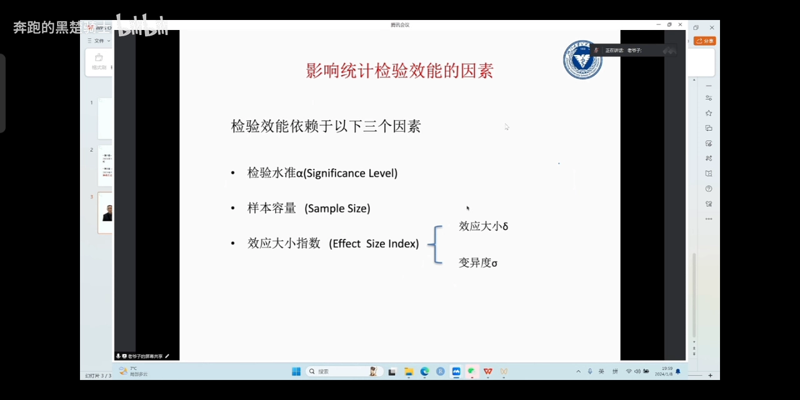

1. **检验水准 α**；
2. **样本容量**；
3. **效应大小指数（effect size index）**，它又由效应大小 δ 与变异度 σ 共同决定。

讲者特别强调第三项的含义：**效应规模指的是总体中零假设与备择假设之间的差异**。当显著水平与样本规模固定时，效应越小，检验效能越低 [【跳转到 41:01】](https://www.bilibili.com/video/BV1F5411B78Y/?t=2461)。这也解释了为什么「同样做一个实验，检出小效应比检出大效应难得多」。

### 3.2 效应量有参考表，但阈值要按学科校准

效应量指数怎么定？讲者给了一张 Cohen（1992）的参考表 [【跳转到 41:26】](https://www.bilibili.com/video/BV1F5411B78Y/?t=2486)：

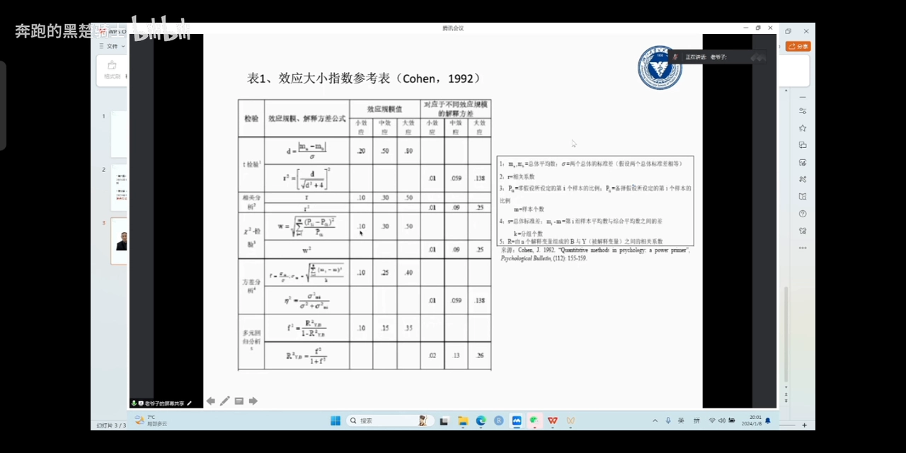

不同检验族的「大中小」标准并不一样：t 检验的 d 是 0.2/0.5/0.8，相关分析的 r 是 0.1/0.3/0.5，卡方检验的 w 是 0.1/0.3/0.5，方差分析的 f 要到 0.4 以上才算大效应，多元回归的 $f^2$ 是 0.02/0.15/0.35 [【跳转到 42:16】](https://www.bilibili.com/video/BV1F5411B78Y/?t=2536)。讲者的态度是：这张表可以参照，但**不能跨检验族直接套用**——同一个数字在不同检验里对应的「大」不一样。

### 3.3 两类风险：α 风险与 β 风险

为什么要专门做效能分析？讲者从「统计决策」讲起 [【跳转到 32:14】](https://www.bilibili.com/video/BV1F5411B78Y/?t=1934)。假设一种新疗法与对照组比较：

- 如果真实情况**没有差异**，你却推断有差异，就会推广一个无效的疗法——病人不但不能获益，还浪费医疗资源。这叫 **α 风险**；
- 如果真实情况**有差异**，你却推断没有差异，就会放弃一个有效的新方法——病人失去本该获得的效益。这叫 **β 风险** [【跳转到 34:02】](https://www.bilibili.com/video/BV1F5411B78Y/?t=2042)。

讲者的批评很直接：现在很多研究（包括临床试验的多重比较、多指标重复测量）都在拼命控制 α 风险，**却忽略了对 β 风险的控制** [【跳转到 34:21】](https://www.bilibili.com/video/BV1F5411B78Y/?t=2061)。

他用挑战者号航天飞机做类比 [【跳转到 34:46】](https://www.bilibili.com/video/BV1F5411B78Y/?t=2086)：规则是「O 型圈没有变化就发射，有变化就不能发射」。

- **α 风险**：O 型圈其实没变化，你却得出「有变化」的结论，于是本可以发射却没发射——错过；
- **β 风险**：O 型圈其实有变化，你却得出「没有变化」的结论，于是发射后爆炸 [【跳转到 36:01】](https://www.bilibili.com/video/BV1F5411B78Y/?t=2161)。

事后调查发现，爆炸的原因正是当时使用的 O 型圈与以前的存在差别。这就是「可能有差别，但统计上做出来没有差别，于是当成相等」的代价。

## 四、结果不显著怎么办：事后功效分析

### 4.1 一个真实的小样本案例

这是全讲最核心的一段。讲者给了一个例子 [【跳转到 43:56】](https://www.bilibili.com/video/BV1F5411B78Y/?t=2636)：观察 35 名难产儿的体重，一般出生体重 3.3 kg、标准差 0.4 kg，难产儿平均体重 3.42 kg。问：难产是否与出生体重有关？

先写出模型。医学研究数据通常写成

$$
Y=\mu+T+e
$$

即「观测值 = 总平均效应 + 处理（暴露）效应 + 随机效应」。讲者用体温打比方：一群人平均体温 37.1 度，那 0.1 度可以看成偶然性（个体变异、随机误差）；但如果是 38.5 度，多出来的 1.5 度就不是偶然性了，它包含暴露效应加随机效应 [【跳转到 43:31】](https://www.bilibili.com/video/BV1F5411B78Y/?t=2611)。

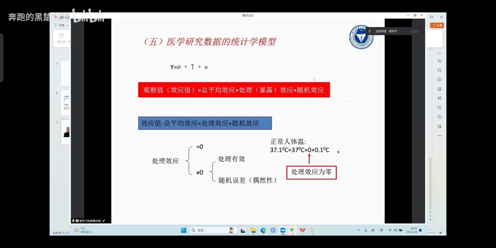

对应到难产儿：$H_0$ 是「难产与出生体重无关」（难产效应为零），$H_1$ 是「有关」（难产效应不为零），用单样本 t 检验 [【跳转到 44:46】](https://www.bilibili.com/video/BV1F5411B78Y/?t=2686)。

### 4.2 算出来 p=0.085，然后呢

代入数据：

$$
t=\frac{3.42-3.30}{0.40/\sqrt{35}}=1.77,\qquad \nu=35-1=34
$$

双侧 $\alpha=0.05$ 时临界值 $t_{0.05/2,34}=2.032$。因为 $1.77<2.032$，所以 $p=0.085>0.05$，**不拒绝 $H_0$** [【跳转到 45:36】](https://www.bilibili.com/video/BV1F5411B78Y/?t=2736)。

讲者在这里把「不拒绝」的含义说得非常克制：现有的证据不支持研究假设，**或者研究假设成立的证据不足**——注意，这不等于研究假设不成立 [【跳转到 45:11】](https://www.bilibili.com/video/BV1F5411B78Y/?t=2711)。

那研究是不是白做了？讲者说：也不一定，可以做一个 power 分析。而且他明确了**事后功效分析的前提**：研究假设在理论上成立（即 $H_0$ 不真实），但现有数据不支持它——换句话说，可能只是样本量不够大 [【跳转到 46:01】](https://www.bilibili.com/video/BV1F5411B78Y/?t=2761)。

### 4.3 功效只有 0.407：这次实验「没能力看见」

把参数代进去：效应量指数 $d=(3.42-3.30)/0.4=0.3$，算得 $\beta=0.593$，于是

$$
\text{power}=1-\beta=1-0.593=0.407
$$

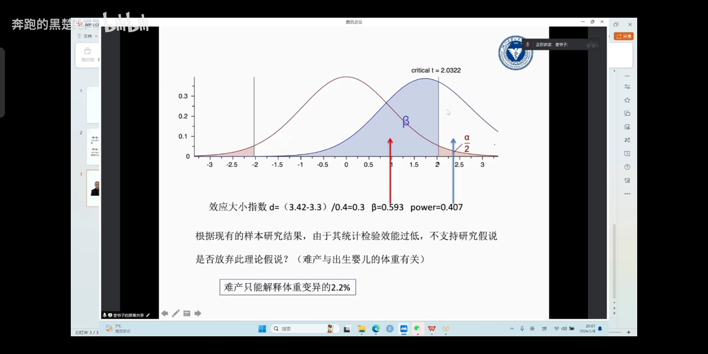

这个数字怎么读？讲者说得很清楚：如果 $H_1$ 是真实的，根据你现有的数据，**你在一次实验里能发现统计差别的可能性只有 40.7%**——做 100 次实验，大约 40 次能发现差异，那么只做一次很可能就发现不了 [【跳转到 47:16】](https://www.bilibili.com/video/BV1F5411B78Y/?t=2836)。

而且这个例子里，难产只能解释体重变异的 2.2%，解释度本来就不高 [【跳转到 47:41】](https://www.bilibili.com/video/BV1F5411B78Y/?t=2861)。所以此时要做的是决策：继续做（加样本量），还是放弃这个理论假设。

### 4.4 power 曲线：要 96 例，或者换一个效应量

讲者用 G*Power 画了 power 曲线 [【跳转到 48:06】](https://www.bilibili.com/video/BV1F5411B78Y/?t=2886)：横轴是总样本量，纵轴是 power，曲线对应 $d=0.3$。

- 现有样本 35 例时，power 只有 40% 多；
- 要让 power 上到 80%，样本量至少要到 **96 例** [【跳转到 49:21】](https://www.bilibili.com/video/BV1F5411B78Y/?t=2961)；
- 如果不想加样本量，另一条路是改变效应量：当 $d=0.5$（中等效应）时，**即使只有 35 例，power 也能到 81%** [【跳转到 50:11】](https://www.bilibili.com/video/BV1F5411B78Y/?t=3011)。

后一条路讲者马上补了一个警告：如果 $d=0.5$ 就能让现有样本达到 81%，那说明**你前面那个效应量估计有问题**——真实效应可能比 0.3 大。所以这不是「随便调参数把功效调上去」，而是反过来检查自己的效应量假设是否合理。

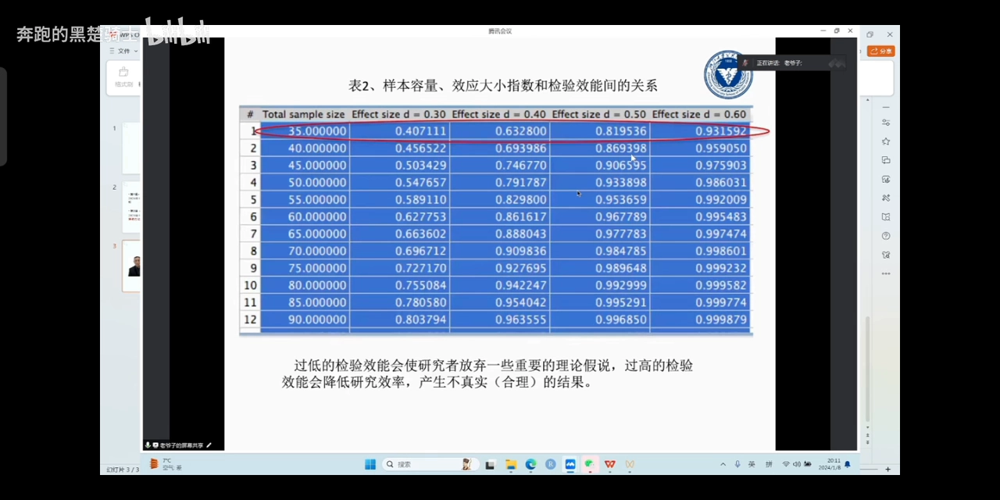

### 4.5 功效过高也是问题

讲者没有把「功效越高越好」当成结论。他说：**过低的检验效能会让研究者放弃重要的理论假设**（做一次 p 大于 0.05 就没信心了，其实可能只是功效太低）；但**过高的检验效能也会降低研究效率、产生不真实不合理的结果** [【跳转到 51:10】](https://www.bilibili.com/video/BV1F5411B78Y/?t=3070)。

原因在于：功效是通过「放大效应量」或「堆样本量」提上去的，而把效应量硬放大到 0.6 就不真实了，内部真实性下降。所以效应量必须和临床专家充分沟通，取一个合理的值 [【跳转到 51:35】](https://www.bilibili.com/video/BV1F5411B78Y/?t=3095)。

### 4.6 案例二：交叉设计，p=0.058、power=0.491

第二个案例是一个 2×2 两阶段两序列交叉设计，12 名受试者，A、B 两种治疗方法，比较降压疗效 [【跳转到 52:05】](https://www.bilibili.com/video/BV1F5411B78Y/?t=3125)。讲者顺带点出交叉设计的最大好处：同等条件下可以把样本量减半。

模型是三因素方差分析，包括药物效应、阶段效应和个体效应，再加随机效应；$H_0$ 是治疗效应相等 [【跳转到 52:30】](https://www.bilibili.com/video/BV1F5411B78Y/?t=3150)。用 SPSS 的一般线性模型勾选「检验效能分析」，得到处理效应的 $p=0.058$、**power=0.491** [【跳转到 53:20】](https://www.bilibili.com/video/BV1F5411B78Y/?t=3200)。

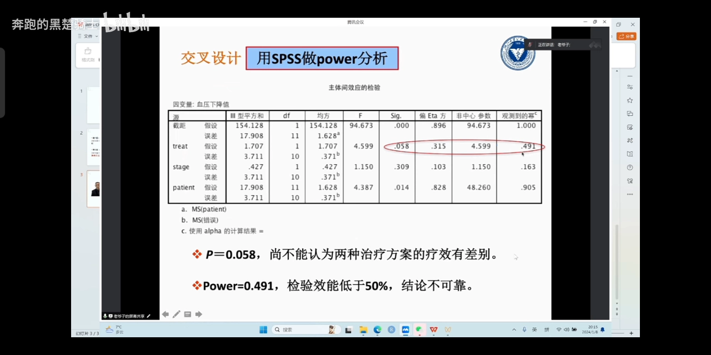

讲者的判读是：$p=0.058$ 尚不能认为两种治疗方案有疗效差别，但**功效低于 50%，结论不可靠**——也就是说，「没有差别」这个结论不成立，只是这次没看见 [【跳转到 53:45】](https://www.bilibili.com/video/BV1F5411B78Y/?t=3225)。

再用 power 曲线看：F 临界值 2.296，p 落在这个区间，所以 β 比较大。若效应量保持不变，要让 power 达到 80%，样本量至少要 50 例 [【跳转到 54:10】](https://www.bilibili.com/video/BV1F5411B78Y/?t=3250)。但讲者立刻反问：这条曲线对应的效应量是 0.8，而**方差分析里 0.4 以上就已经是大效应**，把效应量设成 0.8 合理吗？[【跳转到 54:35】](https://www.bilibili.com/video/BV1F5411B78Y/?t=3275) 这是同一个陷阱：为了让样本量看起来「够」，把效应量设得过大，结果反而不真实。

### 4.7 案例三：Cox 回归，假设全部死亡也只有 75% 把握

第三个案例来自一篇已发表的大肠癌术后辅助化疗临床研究（J Clin Oncol, 2010），比较辅助化疗与无辅助化疗的 5 年 DFS 与 OS [【跳转到 55:25】](https://www.bilibili.com/video/BV1F5411B78Y/?t=3325)。讲者用这份数据做了事后功效分析：

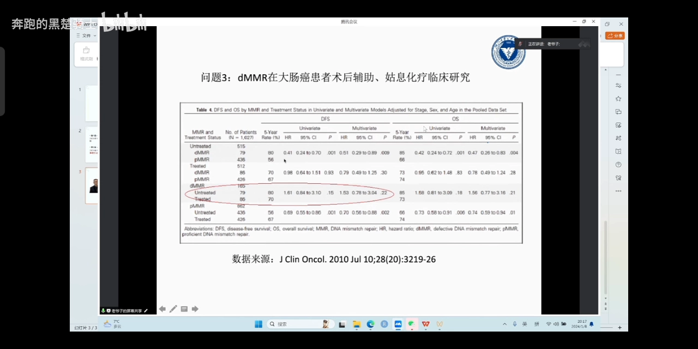

- 按 Cox 回归分析，**即使假设所有病人在随访期内全部死亡**，两组 HR 在 0.05 水准上达到统计学差异的把握也只有 75% [【跳转到 56:15】](https://www.bilibili.com/video/BV1F5411B78Y/?t=3375)；
- 而现实中肿瘤治疗里不可能所有病人都死亡，还会有病人活着——这意味着这个研究的样本量可能不够大；
- 若要求 power 80%、HR=1.5、死亡比例 0.4，大约需要 490 个病人 [【跳转到 56:40】](https://www.bilibili.com/video/BV1F5411B78Y/?t=3400)；
- 讲者还展示了固定事件发生比例（0.3）、不同 HR 下 power 与样本量的关系曲线，以及固定样本量时 power 随死亡比例变化的曲线，并指出其中某条「基本没有变化」的曲线对应的是不现实的假设 [【跳转到 57:30】](https://www.bilibili.com/video/BV1F5411B78Y/?t=3450)。

他的落点是：**用现实数据做事后功效分析，能帮你在设计下一个研究（比如临床试验）时有一个充分的预计** [【跳转到 57:05】](https://www.bilibili.com/video/BV1F5411B78Y/?t=3425)。

## 五、软件与几个高频问题

### 5.1 用什么软件

讲者列了一份清单 [【跳转到 58:20】](https://www.bilibili.com/video/BV1F5411B78Y/?t=3500)：

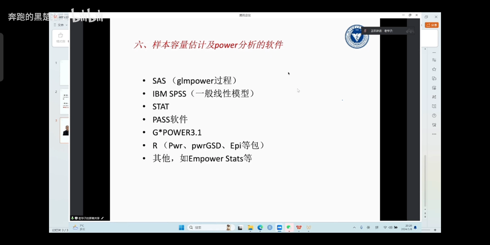

- **SAS** 的 `glmpower` 过程、**SPSS** 的一般线性模型：能做常见设计的功效分析；
- **G\*Power**：讲者首推，能做一般线性模型的 power 过程，还能画出前面那些分布图；
- **PASS**：讲者说它「比较热门」，能估的样本量类型最多，但**没有分布图**；
- **R** 的 `pwr`、`pwrGSD`、`Epi` 等包，以及 Empower Stats。

问答环节里讲者还补充了 G\*Power 的局限：它能估的类型比较少，只有 t 检验、方差分析、回归分析、相关分析；而 PASS 几乎覆盖临床上常用的设计，包括新型设计、风险预测模型、多中心临床干预等 [【跳转到 62:42】](https://www.bilibili.com/video/BV1F5411B78Y/?t=3762)。

### 5.2 问答里的几条实用结论

- **回顾性研究也要算样本量**。写论文时一般都需要；如果事先没算，事后可以反推 power 看样本量够不够，国外有些杂志会要求作者报告 power [【跳转到 61:27】](https://www.bilibili.com/video/BV1F5411B78Y/?t=3687)。
- **预实验本身不需要算样本量** [【跳转到 64:22】](https://www.bilibili.com/video/BV1F5411B78Y/?t=3862)。
- **单臂研究**用单组的方法估算，常用置信区间法而不是点估计 [【跳转到 65:12】](https://www.bilibili.com/video/BV1F5411B78Y/?t=3912)。
- **预测模型**按「真正纳入模型的预测变量个数」估算，而不是最初纳入的变量个数——如果用 LASSO 删过变量，要按留下的算 [【跳转到 66:27】](https://www.bilibili.com/video/BV1F5411B78Y/?t=3987)。
- **logistic 回归**按每个变量的阳性事件数 5~10 倍来算，也就是常说的 EPV（events per variable）[【跳转到 67:17】](https://www.bilibili.com/video/BV1F5411B78Y/?t=4037)。
- **横截面调查**同样要估算样本量，取决于你的调查目的是估计总体参数还是做关联分析 [【跳转到 68:32】](https://www.bilibili.com/video/BV1F5411B78Y/?t=4112)。

## 小结

- 样本量由四个参数倒推：**α、1−β、δ、σ**（定性数据用率 $p$ 代替 σ）。δ 是专业问题不是统计问题，必须由临床意义来定。
- 样本量过大浪费且放大误差，过小则失去代表性——「最小样本量」是在成本与精度之间的平衡点。
- 单样本均数用 $n=\left[(u_\alpha+u_\beta)s/\delta\right]^2$；两样本多一个系数 2；率的比较另有一套公式，且要求 $np$、$n(1-p)$ 均大于 5。
- 单侧检验比双侧省样本；交叉设计比平行对照省样本；临床试验要在最小样本量上再加约 20% 脱落率。
- 检验效能由 **α、样本量、效应量** 三者决定；α 风险与 β 风险都要控制，只控 α 会漏掉真效应（挑战者号）。
- **结果不显著时，事后功效分析能区分「没看见」与「没有」**：难产儿例子 power 只有 0.407，交叉设计例子只有 0.491——这类「不显著」不能当作「无效应」的证据。
- 但功效不是越高越好：靠放大效应量堆出来的高功效会牺牲内部真实性。

## 关键术语速查

| 术语 | 一句话解释 |
| --- | --- |
| 样本容量（sample size） | 样本中包含的个体数，由 α、β、δ、σ 四个参数倒推 |
| 检验效能（power） | 总体确有差异时，按 α 水准发现该差异的概率，等于 1−β |
| 第一类错误 α | 无差异却判为有差异（假阳性），默认 0.05 |
| 第二类错误 β | 有差异却判为无差异（假阴性），经验上要求小于 0.2 |
| 最小差值 δ | 你希望检出的最小临床意义差异，由专业知识确定 |
| 效应大小指数 | 把 δ 与 σ 合成一个无量纲量（如 d、f、w、$f^2$），决定检出难度 |
| 事后功效分析 | 研究做完后反推 power，用于判断「不显著」是不是因为样本量不足 |
| 脱落率 | 随访中失访的比例，临床试验常在最小样本量上加 20% |
| EPV | events per variable，logistic 回归按阳性事件数的 5~10 倍估样本量 |
