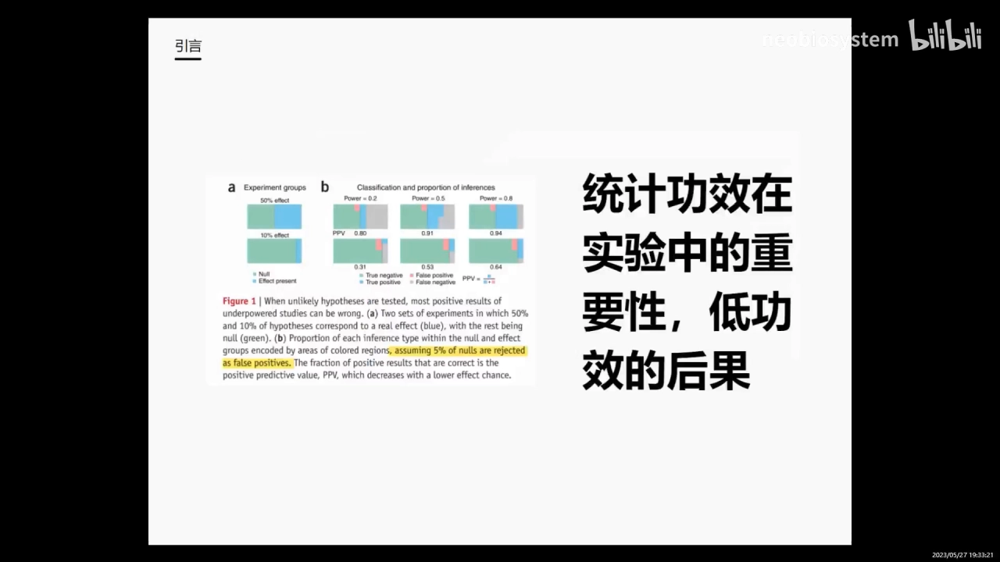
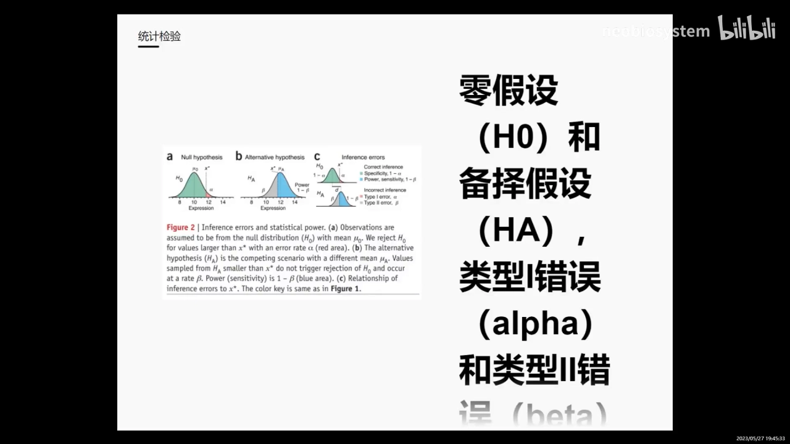
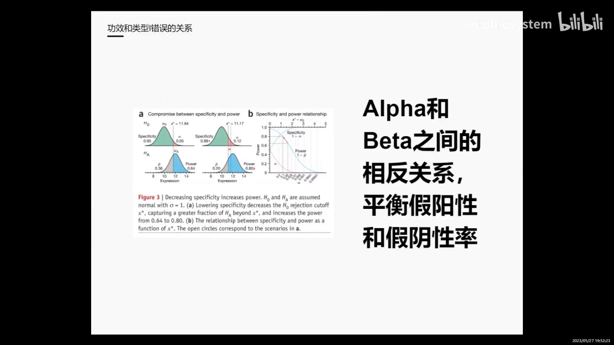
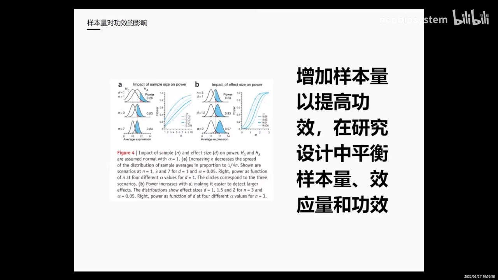

# 统计功效为什么重要：低功效实验的阳性结果里有多少是假的

> 视频来源：[04功效与样本量](https://www.bilibili.com/video/BV13u411s73C/)（Bilibili · neobiosystem）｜时长约 32 分钟
> 导读：这是一节结构清晰的统计课，用三张图把「功效」讲透：先用一张彩色方格图算出低功效实验里假阳性占多大比例，再用两条正态分布曲线定义 α、β 与功效，最后用曲线说明「α 与功效此消彼长，只有样本量能同时改善两者」。字幕为自动识别，术语与数字已按幻灯片核对。

## 本讲要解决的核心问题（SCQA）

**背景**：做实验的人几乎都会看 p 值。p 小于 0.05 就宣布「有差异」，p 大于 0.05 就宣布「没差异」，这套动作在生物医学研究里已经成了肌肉记忆。

**冲突**：p 值只约束了一件事——当零假设为真时，你错误地宣布「有效」的概率（α，通常取 0.05）。它完全没有约束另一件事：当效应真实存在时，你有多少概率能把它检出来。后者就是**统计功效（power）**。讲者一开场就点明：正因为大家只盯 p 值、不看功效，低功效的研究会系统性地产出错误结论 [【跳转到 01:20】](https://www.bilibili.com/video/BV13u411s73C/?t=80)。

**疑问**：功效到底是什么？它低下来会造成多严重的后果？如果 α 和功效互相拉扯，有没有办法同时把两者都做上去？

**回答（中心思想）**：**功效是「效应真实存在时，你能正确宣布它存在」的概率，等于 1−β**。低功效最直接的后果不是「少发现几个基因」，而是**在你宣布为阳性的那批结果里，假阳性可能占到大半**（在某些典型的多组学场景下，即使功效做到 0.8，阳性结果里仍有约 1/3 是假的）。α 与功效此消彼长，唯一能同时改善两者的杠杆是**样本量**（以及效应量本身）。

## 一、功效是「抓住真效应」的概率，不是「结论正确」的概率

### 1.1 一句定义，两个关键词

讲者给出的定义是：功效指在假设检验中**拒绝零假设 $H_0$ 之后、接受正确的备择假设 $H_A$ 的概率** [【跳转到 00:30】](https://www.bilibili.com/video/BV13u411s73C/?t=30)。他强调要抓住两个关键词：一是「拒绝 $H_0$」，二是「备择假设 $H_A$ 是正确的」。换句话说，功效衡量的不是「我的结论对不对」，而是「当效应真的存在时，我这次实验能不能把它检出来」。

用条件概率写出来，功效就是

$$
\text{power} = P(\text{拒绝 } H_0 \mid H_A \text{ 为真}) = 1-\beta
$$

其中 $\beta$ 是第二类错误率，也就是「效应真实存在、但实验没能检出」的概率。所以功效和 β 是一枚硬币的两面：功效越高，β 越小。

### 1.2 用一个「方格图」把功效的后果算清楚

讲者用一张来自文献的彩色方格图（图 1）来演示低功效的后果 [【跳转到 01:40】](https://www.bilibili.com/video/BV13u411s73C/?t=100)。读图的关键是先分清两类格子：

- **绿色**：真实无效应（符合零假设）的假设；
- **蓝色**：真实有效应的假设；
- **红色**：被错误地判为阳性的假阳性（false positive）；
- **灰色**：真实有效应、却没被检出的假阴性（false negative）。

讲者先假设一个「一半有效、一半无效」的群体：总共 200 个假设，100 个有效、100 个无效 [【跳转到 02:30】](https://www.bilibili.com/video/BV13u411s73C/?t=150)。因为我们把拒绝水平定在 0.05，那 100 个无效假设里会有 5%（也就是 5 个）被错误地判成阳性——这就是图 1b 里那块**大小恒定为 5 的红色方格** [【跳转到 02:55】](https://www.bilibili.com/video/BV13u411s73C/?t=175)。

蓝色方格的大小则由功效决定：功效 0.2 时，100 个真效应里只有 20 个被检出；功效 0.5 时是 50 个；功效 0.8 时是 80 个 [【跳转到 05:00】](https://www.bilibili.com/video/BV13u411s73C/?t=300)。

### 1.3 PPV：你宣布的阳性结果里，有多少是真的

讲者接着引入**阳性预测值 PPV（positive predictive value）**：在你判为阳性的结果中，真正是阳性的比例 [【跳转到 05:25】](https://www.bilibili.com/video/BV13u411s73C/?t=325)。从方格图上看，它就是

$$
\text{PPV} = \frac{\text{蓝色}}{\text{蓝色}+\text{红色}}
$$

代入「一半有效」的情形：功效 0.2 时 $\text{PPV}=20/(20+5)=0.80$；功效 0.5 时 $50/55\approx 0.91$；功效 0.8 时 $80/85\approx 0.94$ [【跳转到 06:40】](https://www.bilibili.com/video/BV13u411s73C/?t=400)。讲者顺带说明：**功效 0.8 是实际应用中一个可以接受的经验值，地位类似于 p 值取 0.05** [【跳转到 07:30】](https://www.bilibili.com/video/BV13u411s73C/?t=450)。

## 二、真正的麻烦：有效应的假设本来就很少

### 2.1 多组学实验里，绝大多数检验都符合零假设

上面「一半有效」的设定其实对实验很友好。讲者提醒：真实场景中，有效应的那部分往往只占很小比例——转录组、蛋白质组、基因组这类多组学实验就是典型：我们想看处理之后或与疾病相关的那些基因，但这些基因占全部基因的比例并不高，**绝大部分基因、绝大部分蛋白其实都符合零假设** [【跳转到 08:20】](https://www.bilibili.com/video/BV13u411s73C/?t=500)。

### 2.2 同样的功效，PPV 会塌下来

于是讲者换成「只有 10% 有效」的设定重新算一遍 [【跳转到 08:45】](https://www.bilibili.com/video/BV13u411s73C/?t=525)：群体共 100 个假设，90 个无效、10 个有效。红色方格变成 $90\times0.05=4.5$，而蓝色方格是 $10\times\text{power}$。结果是：

| 功效 power | 蓝色（真阳性） | 红色（假阳性） | PPV |
| --- | --- | --- | --- |
| 0.2 | 2 | 4.5 | $2/6.5\approx0.31$ |
| 0.5 | 5 | 4.5 | $5/9.5\approx0.53$ |
| 0.8 | 8 | 4.5 | $8/12.5\approx0.64$ |

（数据来自讲者在 [09:10](https://www.bilibili.com/video/BV13u411s73C/?t=550) 到 [10:50](https://www.bilibili.com/video/BV13u411s73C/?t=650) 的逐步计算。）

结论很刺眼：**即使功效达到大家公认满意的 0.8，PPV 也只有 0.64——你看到的阳性结果里仍有约 1/3 是假阳性** [【跳转到 10:50】](https://www.bilibili.com/video/BV13u411s73C/?t=650)。讲者把这一段的落点总结为一句话：低功效导致的结果，就是我们所观测到的阳性结果中，可能大部分并不是真正的阳性结果 [【跳转到 11:40】](https://www.bilibili.com/video/BV13u411s73C/?t=700)。

> 这一节是整支视频最值得记住的部分：它把「功效」从一个抽象概率，翻译成了一个可以直接读的数字——**你的阳性列表里有多少是假的**。

## 三、两条曲线：α、β 与功效的几何含义

### 3.1 从一条分布到两条分布

讲者用一个 Western blot 的例子把定义画出来 [【跳转到 12:37】](https://www.bilibili.com/video/BV13u411s73C/?t=757)：

- **零假设 $H_0$**：蛋白表达量的真实均值 $\mu_0=10$，但受实验误差影响，观测值服从一个以 10 为中心的正态分布，可能观测到 8、10 或 12（图 2a）；
- **备择假设 $H_A$**：处理确实让表达量上升，真实均值到 12，观测值同样服从一个正态分布（图 2b）。

假设我们观测到 $x^*=11.6$。它既可能来自 $H_0$，也可能来自 $H_A$——这正是统计检验要裁决的地方。

### 3.2 四块面积，四种结局

把两条分布叠在一起（图 2c），四块面积就对应四种结局 [【跳转到 17:12】](https://www.bilibili.com/video/BV13u411s73C/?t=1032)：

- **α（红色）**：真实来自 $H_0$，却因为观测值超过了判定线而被判为阳性——**假阳性，类型一错误**；
- **β（灰色）**：真实来自 $H_A$，却没达到判定线、没能拒绝 $H_0$——**假阴性，类型二错误**；
- **1−β（蓝色）**：真实来自 $H_A$，并且成功拒绝 $H_0$——**功效**；
- **1−α**：真实来自 $H_0$，并且没有拒绝 $H_0$——判断正确。

讲者在这里给出两个经验阈值：**α 一般要求小于 0.05，β 一般要求小于 0.2（即功效大于 0.8）** [【跳转到 20:32】](https://www.bilibili.com/video/BV13u411s73C/?t=1232)。他还把这两个量翻译成诊断试验的语言：特异性 $=1-\alpha$，敏感性 $=1-\beta=$ 功效 [【跳转到 20:32】](https://www.bilibili.com/video/BV13u411s73C/?t=1232)。

### 3.3 为什么 α 的阈值被压得那么低

讲者提了一个很实际的问题：既然 α 和 β 都是错误，为什么 α 被要求小于 0.05，而 β 只要求小于 0.2？他的解释是：α 是「实际没效、你却宣布有效」，这类错误会直接污染结论的正确性，所以阈值压得更低；β 是「可能有效、但你没发现」，代价是错过，相对可以容忍一些 [【跳转到 21:22】](https://www.bilibili.com/video/BV13u411s73C/?t=1282)。

## 四、α 与功效此消彼长，只有样本量能同时改善

### 4.1 放宽判定线：α 涨，功效也涨

讲者把判定线 $x^*$ 从 11.64 挪到 11.17，也就是让拒绝 $H_0$ 更容易 [【跳转到 23:12】](https://www.bilibili.com/video/BV13u411s73C/?t=1392)。结果是：α 从 0.05 涨到 0.12，功效从 0.64 涨到 0.80。这就是图 3a 展示的权衡。

图 3b 把这种关系画成两条曲线：随着 α 降低，特异性 $1-\alpha$ 上升，但功效下降 [【跳转到 24:52】](https://www.bilibili.com/video/BV13u411s73C/?t=1492)。讲者的结论很直白：**你无法同时满足 α<0.05 和功效>0.8**——当 α 是 0.05 时功效只有 0.64，把功效提到 0.8 时 α 又升到 0.12 [【跳转到 24:27】](https://www.bilibili.com/video/BV13u411s73C/?t=1467)。

### 4.2 换一个杠杆：让分布变窄

既然移动判定线只是「拆东墙补西墙」，那就得换思路。讲者指出关键事实：统计检验看的不是原始数据的分布，而是**样本均值的分布**，而样本均值的方差是

$$
\operatorname{Var}(\bar{X}) = \frac{\sigma^2}{n}
$$

随着 n 增加，这个方差变小，分布变得更集中、更狭长 [【跳转到 28:37】](https://www.bilibili.com/video/BV13u411s73C/?t=1717)。分布一窄，两条曲线就更容易分开，于是**在 α 不变的前提下，功效自己就上去了**。

图 4 把两个杠杆并排放在一起 [【跳转到 29:02】](https://www.bilibili.com/video/BV13u411s73C/?t=1742)：

- **图 4a（加样本量）**：效应量固定 $d=1$、α=0.05，n=1 时功效只有 0.26，n=3 时 0.53，n=7 时 0.84；
- **图 4b（加效应量）**：样本量固定 n=3，$d=1$ 时功效 0.53，$d=1.5$ 时 0.83，$d=2$ 时 0.97。

两条路径的差别在于可控性：效应量是自然给定的（你能做的是选更强的干预、更均匀的样本），而样本量是设计阶段可以自己决定的。所以讲者把结论落在样本量上。

## 五、结论：设计阶段就要把功效算进去

讲者在最后总结 [【跳转到 30:58】](https://www.bilibili.com/video/BV13u411s73C/?t=1858)：在实验研究设计中，为了能区分出实验结果、并且让阳性结果中真正阳性的比例达到一定水平，**应该确保实验的统计功效；而为了确保功效，就应该保证足够的样本量**。

这句话反过来读，就是本小节要区分的那件事：

- **未检出**（p 大于 0.05、功效不足）说的是「这次实验没有能力看见效应」；
- **不存在效应**说的是「世界上真的没有这个效应」。

低功效的实验只能支持前者，永远不能支持后者。而如果一篇研究报告了阳性结果却没有报告功效，你也不知道该把它的 PPV 打折打多少。

## 小结

- **功效 = 1−β**，是「效应真实存在时能把它检出来」的概率；α 管的是「没效应却说有效」，β 管的是「有效应却没发现」，两者分工不同。
- 低功效的直接后果不是「结论少」，而是**阳性结果里假阳性比例升高**：在只有 10% 假设真实有效的场景下，即使功效 0.8，PPV 也只有 0.64。
- 功效 0.8、α 0.05 是经验阈值，地位相当于「及格线」，不是自然定律。
- α 与功效此消彼长：移动判定线只能在两者之间做交换，**不能同时改善**。
- 能同时改善两者的杠杆是**样本量**（让样本均值的分布变窄）和**效应量**（让两条分布离得更远）。
- 「p 大于 0.05」只说明证据不足，不说明效应为零——除非你先证明了这次实验有足够的功效。

## 关键术语速查

| 术语 | 一句话解释 |
| --- | --- |
| 统计功效（power） | 效应真实存在时，实验能正确宣布它存在的概率，等于 1−β |
| 类型一错误（α） | 零假设为真却被拒绝，即假阳性；经验阈值 0.05 |
| 类型二错误（β） | 备择假设为真却没被检出，即假阴性；经验阈值 0.2 |
| 敏感性／特异性 | 敏感性 = 1−β = 功效；特异性 = 1−α |
| PPV（阳性预测值） | 被判为阳性的结果中真正为阳性的比例，随功效下降而下降 |
| 效应量（d） | 两个分布中心之间的距离，用标准差做单位；越大越容易检出 |
| 样本均值的标准误 | $\sigma/\sqrt{n}$，n 越大分布越窄，功效越高 |