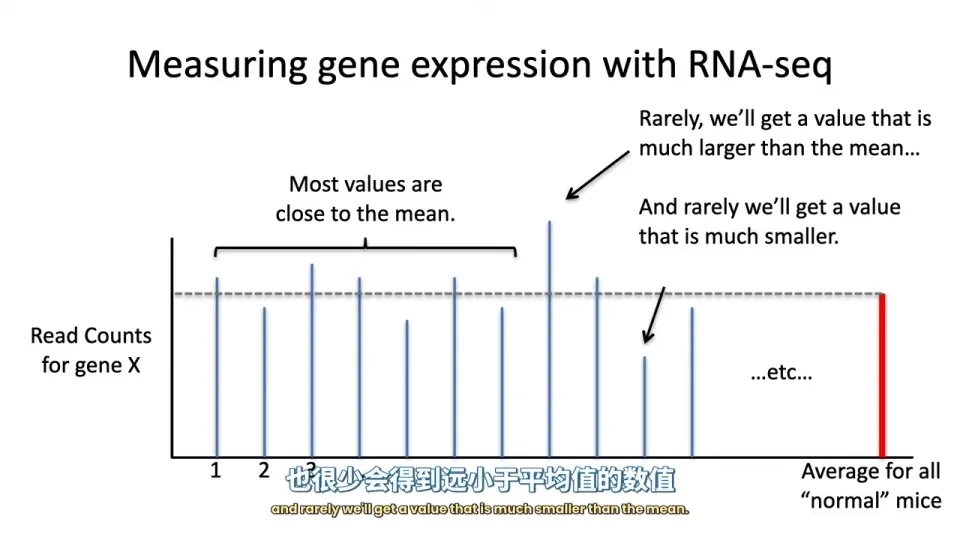
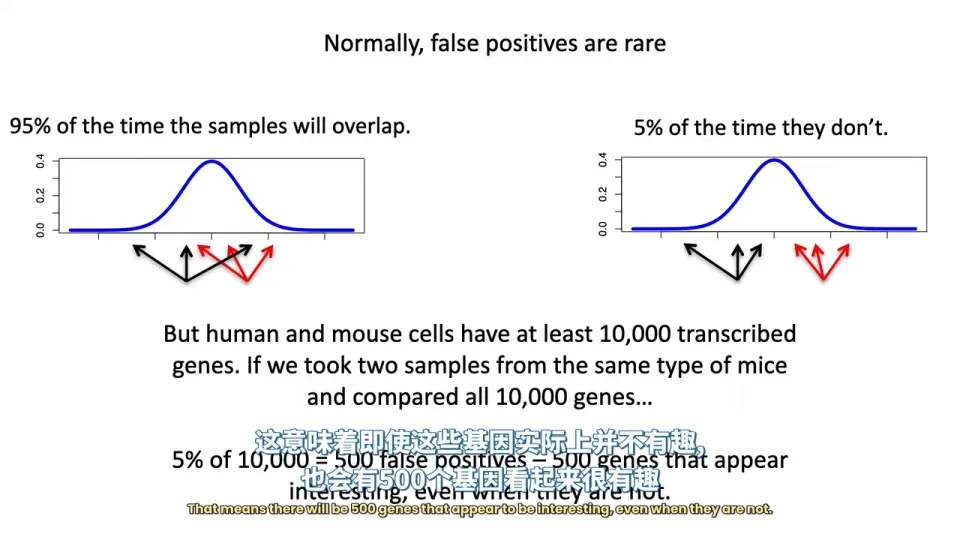
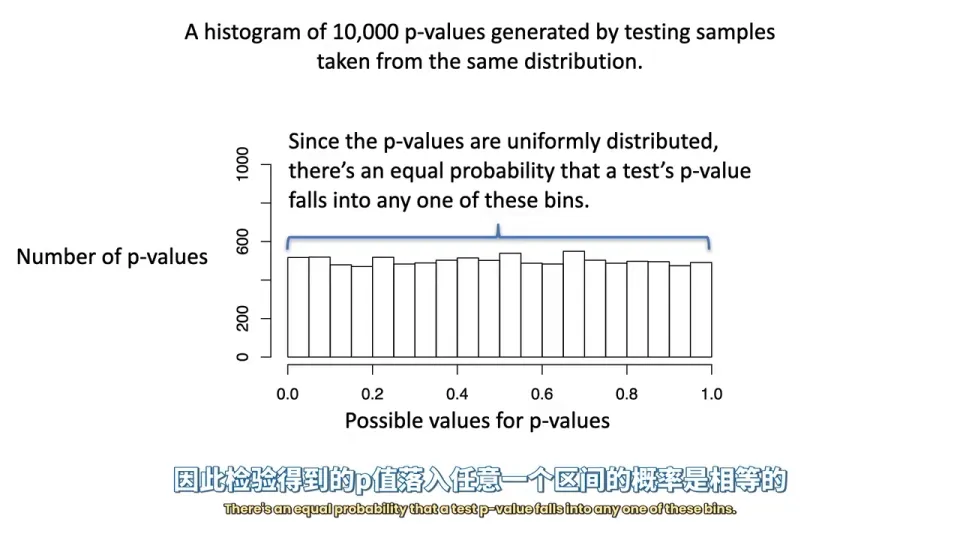
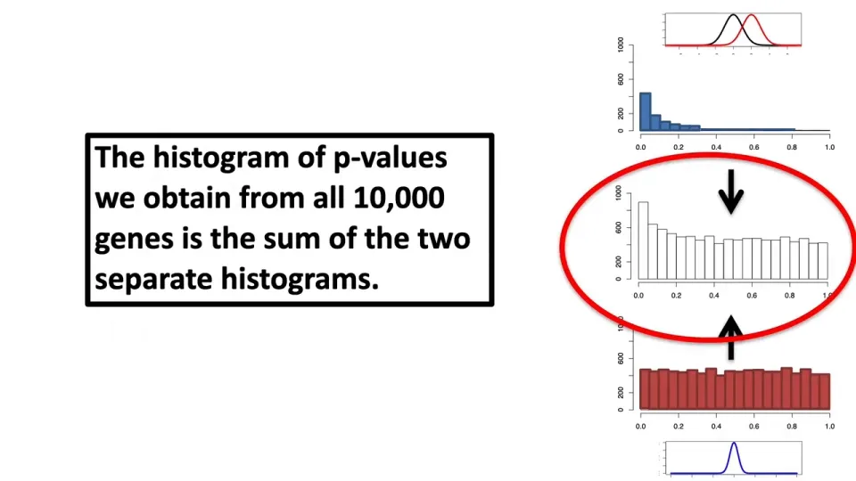
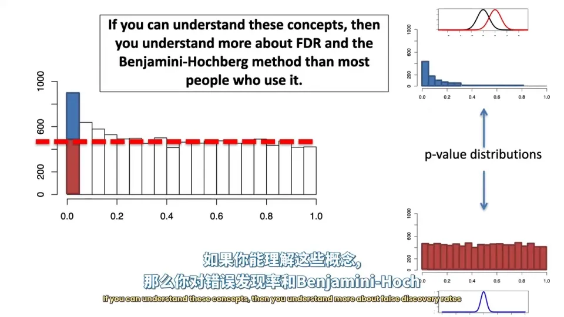
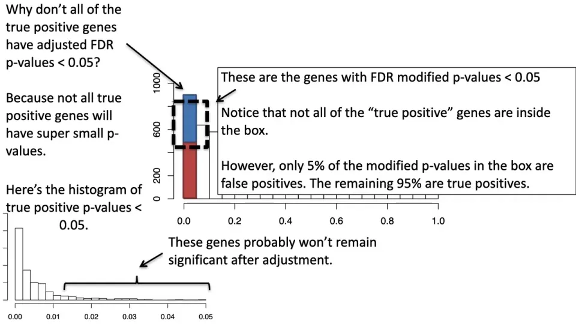
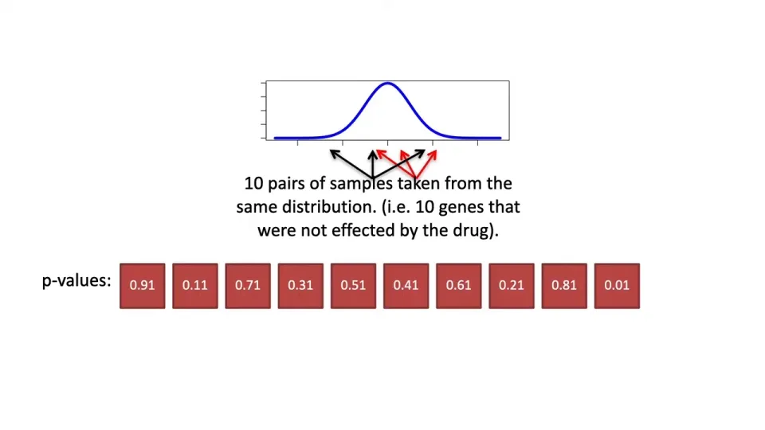
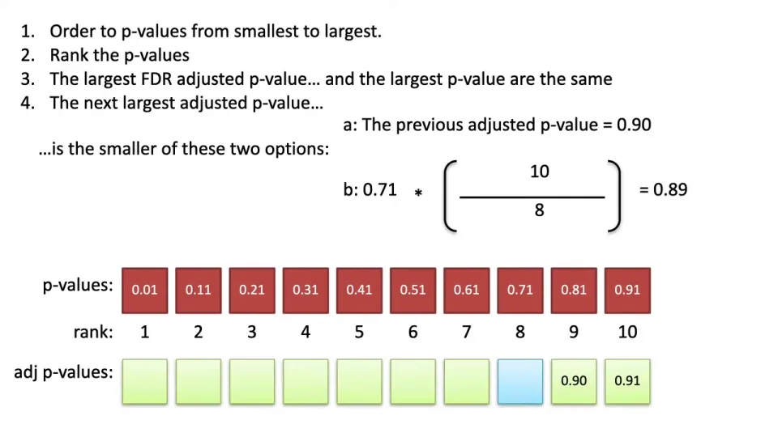
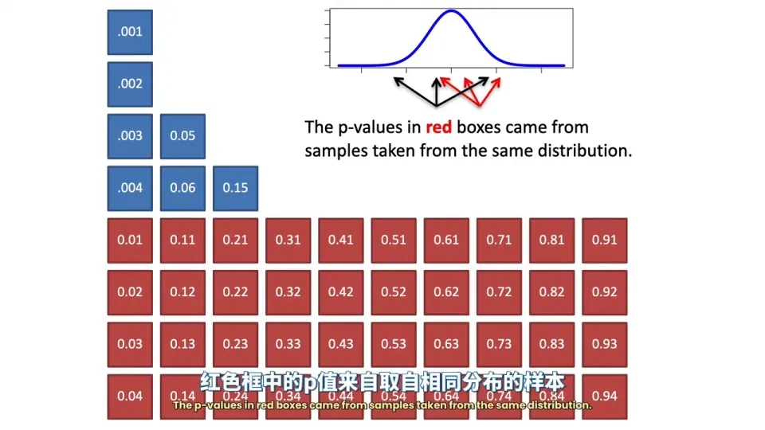
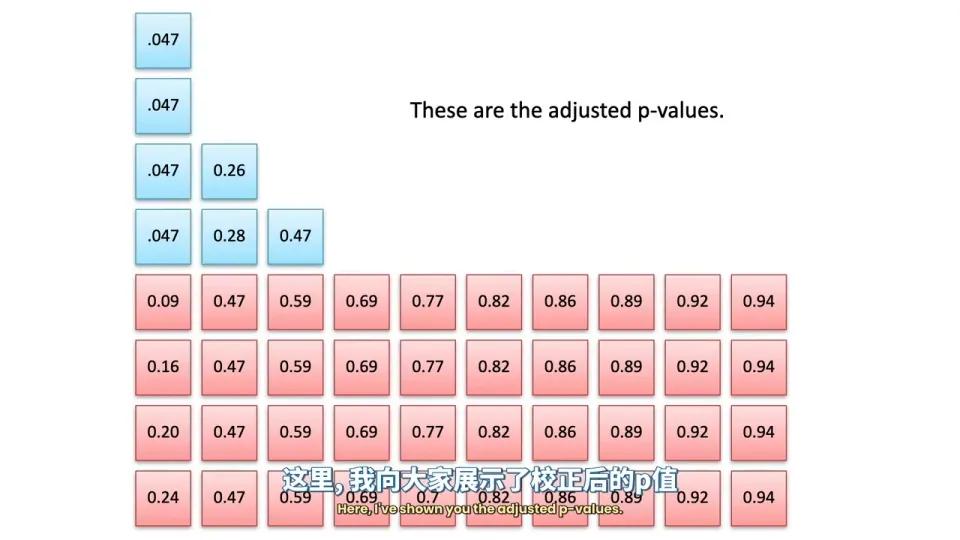

# 多重检验校正：为什么一万个基因里必然有五百个假阳性，以及 BH 怎么把它们挑出来

> 视频来源：[避免多重检验假阳性：错误发现率FDR与BH校正法详解](https://www.bilibili.com/video/BV1s5T666E7H/)（Bilibili · UP 主 认真的笨笨，搬运/汉化自 StatQuest）｜时长约 18 分钟
> 导读：这是 StatQuest 讲 FDR 与 Benjamini-Hochberg 方法的那一集，全片只做一件事——用直方图把「p 值的分布形态」讲透，然后从这张图推出 BH 的每一步公式。它不讲代码、不讲具体 R 包，正好适合用来搞清楚「adj.P 到底是什么、为什么必须做」。字幕为中英双语（原片英文幻灯片 + 中文字幕），术语按上下文订正（原文把 Benjamini 识别成「本杰明」、把 false positive 识别成「假阳性结果」等，含义不变）。

## 本讲要解决的核心问题（SCQA）

**背景**：做一次统计检验时，p < 0.05 意味着「如果两组其实没差别，出现这么大差异的概率不到 5%」。这个约定在只比较一个基因时是合理的。

**冲突**：但转录组一次要比较上万个基因。如果所有基因其实都没被扰动影响，那按 5% 的阈值，仍然会有 5% 的基因「显著」——一万个基因里就是 500 个。视频里的原话是：这意味着会有 500 个基因看似有趣，「即使它们其实没有」，而 500 个假阳性很多 [【跳转到 05:02】](https://www.bilibili.com/video/BV1s5T666E7H/?t=302)。

**疑问**：怎么把「看起来显著」和「真的显著」分开？校正之后 p 值变大，是不是把真结果也一起扔掉了？

**回答（中心思想）**：**多重检验的问题不是「p 值算错了」，而是「你做了太多次 5% 的赌博」。** 解决办法是看 p 值的整体分布：没被影响的基因，p 值在 0 到 1 之间均匀铺开；被影响的基因，p 值堆在靠近 0 的一侧。两者的叠加图给出了一条「基线」，基线以上的那部分才是真信号。Benjamini-Hochberg 方法就是把这条「目测基线」翻译成公式——按排名把每个 p 值乘以「总数 / 排名」，再强制单调，得到校正后的 p 值（也叫 q 值、adj.P、FDR）[【跳转到 12:34】](https://www.bilibili.com/video/BV1s5T666E7H/?t=754)。

## 一、先建立一个直觉：同一群小鼠里取两次样，p 值应该长什么样

讲者从最简单的场景开始：用 RNA-seq 测一个虚构基因 X 的表达量，纵轴是 read counts，横轴是样本 [【跳转到 02:29】](https://www.bilibili.com/video/BV1s5T666E7H/?t=149)。

要点是：**同一群正常小鼠里，同一个基因的测量值也不是一个定值**。RNA-seq 不完美，不同样本之间总有差异。大多数值靠近均值，偶尔会有远高于或远低于均值的值，这些分布可以用一条钟形曲线概括 [【跳转到 02:04】](https://www.bilibili.com/video/BV1s5T666E7H/?t=124)。

于是可以做一次「本来不该有差异」的检验：从同一群野生型小鼠里取两组各三只，比较基因 X。因为两组都来自同一条分布，三个测量值都落在中间区域，两组会大量重叠，p 值会很大（视频里举的例子是 0.83、0.9）[【跳转到 03:18】](https://www.bilibili.com/video/BV1s5T666E7H/?t=198)。

**但重叠不是必然的。** 95% 的时间两组会重叠，p > 0.05；剩下 5% 的时间它们恰好不重叠，p < 0.05——这就是假阳性 [【跳转到 04:12】](https://www.bilibili.com/video/BV1s5T666E7H/?t=252)。

5% 听起来很小，但乘上一万个基因就不小了。这就是整集的出发点。

## 二、关键一步：p 值的分布形态本身就是信息

接下来讲者做了两件「模拟实验」，这两张直方图是理解 FDR 的全部基础。

**实验一：一万次「本来没有差异」的检验。** 从同一分布里反复取两组样本、算 p 值，重复一万次，画出 p 值的直方图 [【跳转到 06:48】](https://www.bilibili.com/video/BV1s5T666E7H/?t=408)。

结果是**平的**：每个区间大约 500 个 p 值 (5%)，510 个 p 值小于 0.05。这就是「均匀分布」——当原假设为真时，p 值落在任何区间的概率相等。

**实验二：一万次「真的有差异」的检验。** 换成两个不同分布（对照组 vs 给药组），p 值就严重偏向 0 一侧 [【跳转到 08:53】](https://www.bilibili.com/video/BV1s5T666E7H/?t=533)。

**真实数据是两者叠加。** 假设药物只影响 1000 个基因，剩下 9000 个不受影响，那么总的 p 值直方图就是「偏态的 1000 个」加上「均匀的 9000 个」[【跳转到 10:50】](https://www.bilibili.com/video/BV1s5T666E7H/?t=650)：

这张叠加图是整集的核心。它告诉你两件事：

1. **右侧那段平坦区域，全部是「没被影响」的基因。** 因为它们的 p 值均匀分布，所以每个区间的高度就是「假阳性的密度」。
2. **把这条平线向左延长，就得到一条基线。** 基线以上的部分才是真信号。

讲者把这条思路叫做「目测法」：在均匀分布 p 值的顶部画一条线，线以上的就是真阳性 [【跳转到 12:34】](https://www.bilibili.com/video/BV1s5T666E7H/?t=754)。

在这个例子里，每个区间约 450 个 p 值来自「没被影响」的基因。于是 0 到 0.05 这个区间里，虚线以下约 450 个是假阳性，虚线以上约 450 个是真阳性 [【跳转到 11:31】](https://www.bilibili.com/video/BV1s5T666E7H/?t=691)。**这就是 FDR 的字面含义：在被判定为显著的那一堆里，假阳性占多大比例。**

## 三、校正之后 p 值变大，为什么真结果没被一起扔掉

讲者先回答一个常见的误解：FDR 校正会**把 p 值调大**，原本 0.04 的显著结果，校正后可能变成 0.06、不再显著 [【跳转到 13:24】](https://www.bilibili.com/video/BV1s5T666E7H/?t=804)。这看起来像是「把真结果也扔了」。

但看这张图就明白了 [【跳转到 14:07】](https://www.bilibili.com/video/BV1s5T666E7H/?t=847)：

- 黑框里是校正后 p 值仍小于 0.05 的基因，**框内只有 5% 是假阳性，95% 是真阳性**。
- 框外确实还留着一些真阳性基因——它们是真的有差异，但 p 值本来就不够小（落在 0.03、0.04 附近），校正后自然过不了线。
- 换句话说，**FDR 校正牺牲的是一部分「效应弱、证据也弱」的真阳性，换来的是「报出来的显著结果里假阳性不超过 5%」这个承诺。**

讲者用一句话概括：如果你把显著性阈值设为 FDR 小于 0.05，那么显著结果中不到 5% 会是假阳性。

## 四、BH 的公式：把「目测基线」写成四步

讲者说，Benjamini 和 Hochberg 做的事，「就是将我们刚才演示的流程转化为数学公式」[【跳转到 12:34】](https://www.bilibili.com/video/BV1s5T666E7H/?t=754)。他用十次检验的小例子把四步走了一遍。

**第一步：造一个只有十个基因、全是假阳性的场景。** 从同一分布抽十对样本，得到十个 p 值，其中恰好有一个小于 0.05 [【跳转到 14:59】](https://www.bilibili.com/video/BV1s5T666E7H/?t=899)：

**第二步：从小到大排序并给排名。** 排序后是 0.01、0.11、0.21、0.31、0.41、0.51、0.61、0.71、0.81、0.91，排名 1 到 10。

**第三步：最大的校正 p 值 = 最大的原始 p 值。** 也就是 adj.P(10) = 0.91。

**第四步：从大到小递推，每一步取两个候选值里较小的那个。** 两个候选是：

- 候选 a：上一个（排名更靠后的）已算出的校正 p 值；
- 候选 b：当前 p 值 × 总数 / 当前排名。

写成公式，对第 $i$ 个（按 p 值升序排名）检验：

$$
\text{adj.P}_{(i)} = \min\left\{ \text{adj.P}_{(i+1)},\; p_{(i)} \times \frac{m}{i} \right\}
$$

其中 $m$ 是检验总数（这里是 10），$i$ 是排名，$\text{adj.P}_{(m)} = p_{(m)}$。

视频里的具体算式是排名 9 的那个：当前 p 值 0.81，总数 10，排名 9，得到 $0.81 \times 10/9 = 0.90$；候选 a 是 0.91，取较小值 → 0.90。再往前一步，排名 8 的当前 p 值是 0.71，$0.71 \times 10/8 = 0.89$，候选 a 是 0.90，取较小值 → 0.89 [【跳转到 16:39】](https://www.bilibili.com/video/BV1s5T666E7H/?t=999)。

**为什么要「取较小值」这一步？** 因为 $p_{(i)} \times m/i$ 单独算出来可能不单调（排名靠前的反而算出更大的值），而校正后的 p 值必须随排名单调不减，否则会出现「p 值更小、校正后反而更大」的荒谬结果。这一步就是强制单调。

## 五、放到一万个基因上：假阳性被压下去，真阳性留下来

讲者最后把同一套流程用在「蓝色方框 = 受药物影响、红色方框 = 未受影响」的大规模例子上 [【跳转到 17:09】](https://www.bilibili.com/video/BV1s5T666E7H/?t=1029)：

跑完 BH 之后：

结果就是讲者说的「双喜临门」：**假阳性现在全部大于 0.05，真阳性仍然小于 0.05** [【跳转到 18:04】](https://www.bilibili.com/video/BV1s5T666E7H/?t=1084)。

## 六、这套逻辑怎么用到单细胞扰动实验上

把上面这套东西搬回单细胞场景，有三条推论值得记住，它们决定了你在扰动实验里该怎么读差异基因表。

**第一，检验次数 $m$ 要按「实际检验了多少个基因」算，不是按「你关心几个基因」算。** BH 里的 $m$ 是这一轮检验的全部基因数（通常是过滤后的 1 万到 2 万个）。这也解释了为什么单细胞数据里 adj.P 常常比裸 p 值大一个量级以上——不是数据变差了，而是分母本来就大。

**第二，p 值直方图的形状是一个免费的质量检查。** 如果一张扰动实验的 p 值直方图在 0 附近堆起一个高尖峰，说明扰动确实造成了大量基因变化；如果整张图几乎是平的，说明这个扰动在转录组层面基本没动静。这个检查和扰动专题里「扰动是否生效」的判读是同一件事的统计版本。

**第三，adj.P 小不等于效应大。** BH 只处理「这个差异有多大把握是真的」，完全不看「差异有多大」。一个 log2FC = 0.05 的基因，只要细胞数够多、测量够稳，adj.P 一样可以很小。所以筛选差异基因时，**FDR 阈值和效应量阈值必须同时用**——这两条线怎么画，是火山图那一类判读要解决的问题。

> 本节边界：FDR 校正的具体实现与工具（`p.adjust`、DESeq2 内置的独立过滤等）属差异表达流程的实现细节，本节不展开；效应量与检验统计量的选择见 3.1.1；本节只回答「为什么必须校正、校正到底改了什么」。

## 小结

- 一次检验用 p < 0.05 是合理的；上万次检验里，5% 的假阳性率意味着 500 个假阳性。
- **p 值的分布形态是信息**：原假设为真时 p 值均匀分布；真有差异时 p 值堆在 0 附近；真实数据是两者的叠加。
- 叠加图上那段平坦区域的**高度**就是假阳性的密度；把这条平线向左延长，就得到「目测法」的基线。
- **FDR = 被判为显著的结果里假阳性的比例**；FDR < 0.05 的意思是「显著结果中不到 5% 是假阳性」。
- BH 的四步：排序排名 → 最大 adj.P 等于最大 p 值 → 每个位置取「前一个 adj.P」与「p × m / i」的较小值 → 从大到小递推，保证单调。
- 校正会牺牲一部分「效应弱、证据也弱」的真阳性，这是为「控制假阳性」付的代价。
- 校正后的 p 值（adj.P / q value / FDR）只说明「有多大把握是真的」，**不说明差异有多大**，必须配合效应量一起筛。

## 关键术语速查

| 术语 | 一句话解释 |
| --- | --- |
| 假阳性（false positive） | 两组其实没差异，检验却给出 p < 0.05 |
| 假阴性（false negative） | 两组其实有差异，检验却没判显著；样本量增大可以减少 |
| 均匀分布 | 原假设为真时 p 值的分布形态，每个区间概率相同 |
| FDR（false discovery rate，错误发现率） | 被判为显著的结果中，假阳性所占的比例 |
| q value / adj.P / adjusted p value | FDR 校正后的 p 值，三者常混用 |
| Benjamini-Hochberg（BH） | 最常用的 FDR 控制方法：按排名把 p 值乘以 m / i，再强制单调 |
| 目测法 | 在 p 值直方图的平坦段画一条基线，基线以上的部分视为真阳性 |