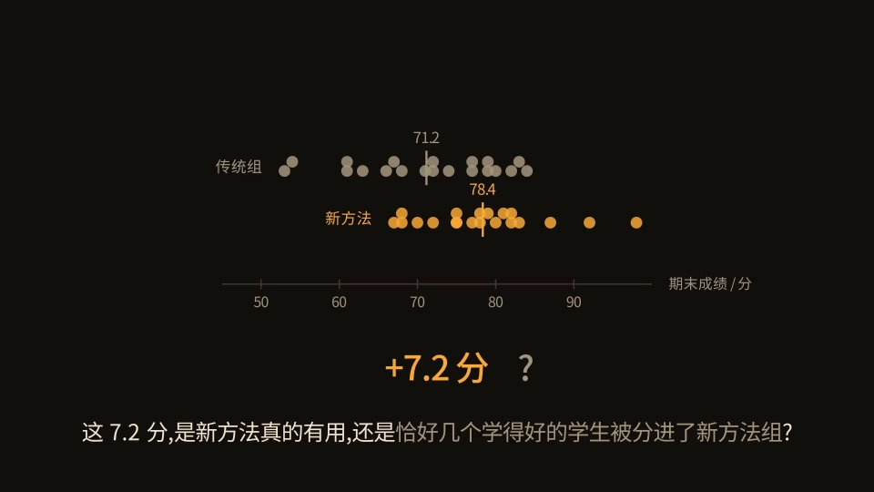
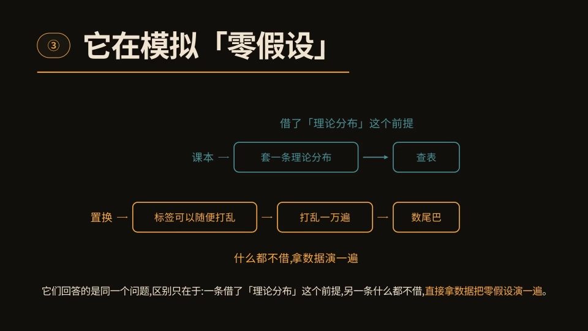
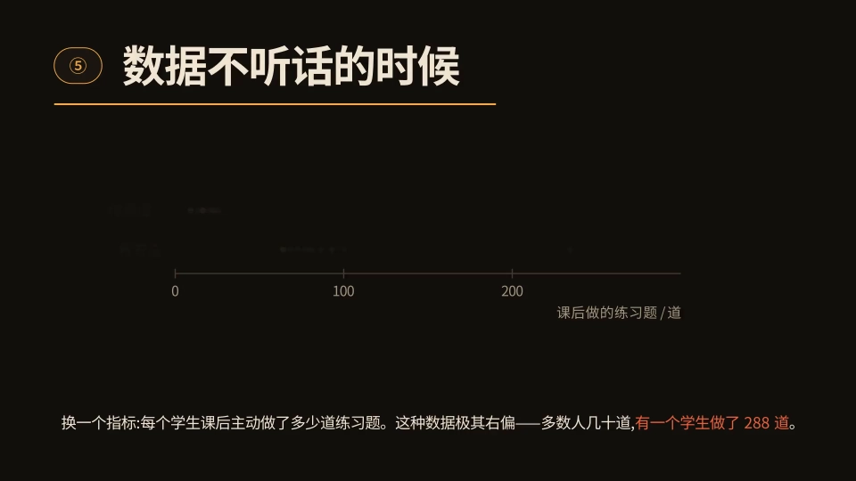
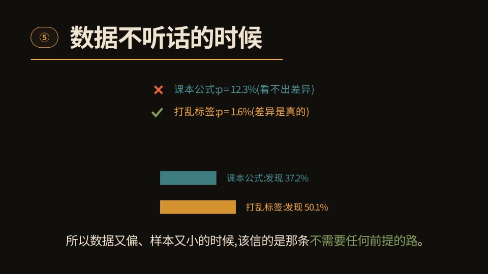
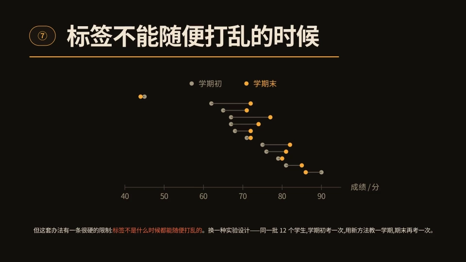
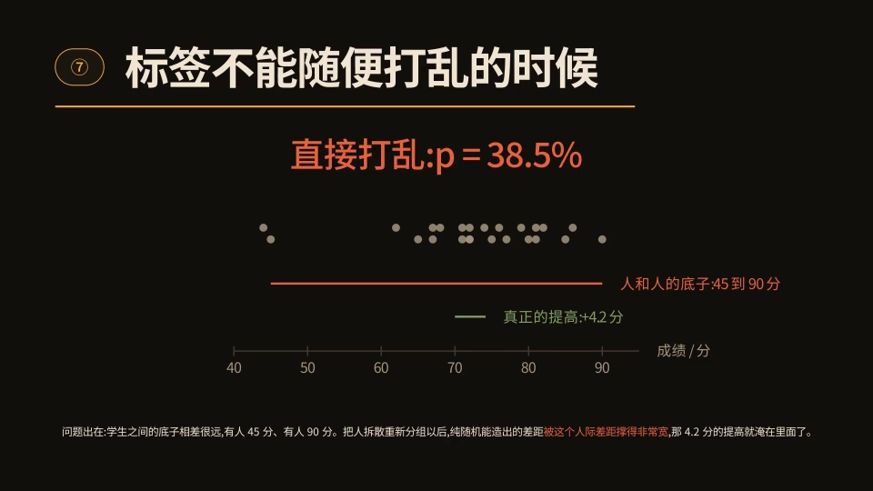
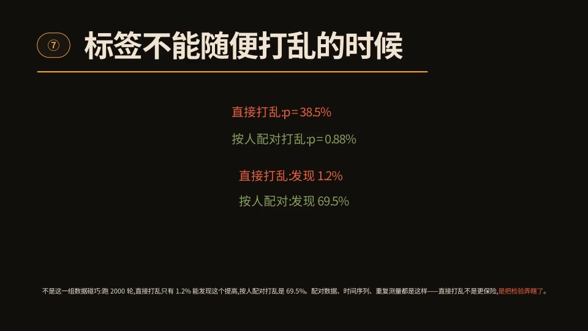

# 置换检验：把分组标签打乱一万遍

> 视频来源：[ByDesign｜置换检验：两组相差 7 分，是真的有差别吗](https://www.bilibili.com/video/BV1oqe36jEwm/)（Bilibili · kopi_c）｜时长约 7 分 35 秒
> 导读：这篇用一个班 40 个学生的分数，把置换检验的整条链路走了一遍：先假设“新方法没用”，于是“谁在哪一组”就只是一张可以随手重贴的标签；把标签重贴一万遍，就得到“纯靠分组能差多少”的零分布；再看真实那次 7.2 分落在什么位置。它不套理论分布，也不要求你只会算均值——最高分、中位数、及格率、相关系数都能这样检验。但打乱方式必须跟着数据结构走，配对数据混着打乱会把检验弄瞎。

## 本讲要解决的核心问题（SCQA）

**背景**：同一个班 40 个学生随机分成两组，一组用老办法教，一组用新方法教。一学期后考同一张试卷，传统组平均 71.2 分，新方法组 78.4 分，新方法高出 7.2 分 [【跳转到 00:00】](https://www.bilibili.com/video/BV1oqe36jEwm/?t=0)。

**冲突**：7.2 分可能是新方法真的有用，也可能只是几个学得好的学生恰好被分进了新方法组。只把两组均值画出来，无法回答“这 7.2 分是不是分组运气”。

**疑问**：如果不套 t 检验、不假设数据服从某个理论分布，还能不能判断这 7.2 分罕不罕见？

**回答（中心思想）**：能。**置换检验的做法是直接把零假设“造”出来**：如果新方法一点用都没有，那谁被分进哪一组就只是一张随手贴上去的标签；把 40 个分数原封不动，标签撕下来重新贴一万遍，每一遍都算一次两组均值之差，就得到“纯靠分组能差多少”的零分布。真实那次 7.2 分落在这条分布最右边的尾巴上，一万次里只有 125 次能凑出 7.2 分或更大的差距，比例 1.2%，这就是 p 值 [【跳转到 01:15】](https://www.bilibili.com/video/BV1oqe36jEwm/?t=75)。

## 一、零假设不是一句口号，而是一个可以执行的动作

置换检验的起点和课本一样：先假设“新方法没有作用”。但接下来它没有去查 t 分布表，而是把这个假设翻译成一个动作——**既然新方法没有作用，那“谁在哪一组”这张标签就是随手贴的；标签既然是随手贴的，就可以撕下来重新贴一次** [【跳转到 00:25】](https://www.bilibili.com/video/BV1oqe36jEwm/?t=25)。

重新贴一次，再算一次两组平均分之差：第一次高出 1.2 分，第二次低了 0.2 分，第三次低了 3.1 分，第四次低了两分。新方法压根没有参与，光是分组这一件事，两组的平均分就能相差一两分到三四分 [【跳转到 00:50】](https://www.bilibili.com/video/BV1oqe36jEwm/?t=50)。

这一步是整个方法的关键：**零假设不再是一个抽象命题，而是一个可以反复执行的随机化操作**。你不需要知道两组均值之差服从什么分布，只需要知道“如果没有作用，标签可以怎么换”。

## 二、重贴一万遍，得到一条以零为中心的零分布

一次两次不够。讲者把标签重新贴一万遍，每一遍都算一次两组平均分之差。一万个差距堆起来，是一条以零为中心的分布——这就是“新方法没有作用时，光靠分组能相差多少”的经验分布 [【跳转到 01:15】](https://www.bilibili.com/video/BV1oqe36jEwm/?t=75)。

真实那次的 7.2 分跑到了这条分布最右边的尾巴上：一万次里只有 125 次能凑出 7.2 分或者更大的差距。比例 1.2%，就是 p 值。讲者的说法是“100 次里碰不上一两次”，这就算得上罕见了。

这条分布的形状完全由数据自己决定：数据偏斜，零分布也跟着偏斜；数据里有极端值，零分布也会反映出来。**它不是从某条理论曲线查出来的，而是从“打乱—重算”这个动作里长出来的**。

## 三、p 值在读什么：数据有多罕见，不是假设有多可能

1.2% 到底在说什么？讲者把它拆得很清楚：

- 它说的是：**如果新方法其实没有作用**，那光靠分组的运气也能相差 7.2 分或更多，这种情况占 1.2%；
- 它不是说：新方法有用的概率是 98.8%。

这是关于 p 值最常见的一个误解。p 值是站在“新方法没有作用”这个前提上算出来的，它回答的是**数据在这个前提下有多罕见**，不是**这个前提本身有多可能成立** [【跳转到 02:30】](https://www.bilibili.com/video/BV1oqe36jEwm/?t=150)。

记住这个“如果……那么……”的形状，就不容易把 p 值读反。

## 四、什么时候特别值得把置换检验拿出来

### 4.1 不太信课本公式背后的前提

第一个场景是：数据明显不满足公式假设。讲者换了一个指标——每个学生课后主动做了多少道练习题。这种数据极其右偏，多数人几十道，有一个学生做了 288 道；每组只有 10 个人 [【跳转到 03:20】](https://www.bilibili.com/video/BV1oqe36jEwm/?t=200)。

同一批数据，课本公式算出 p = 12.3%，说看不出差异；打乱标签算出 p = 1.6%，说差异是真的。两条路这次分道扬镳了。该信哪一条？讲者用模拟回答：让两组真的没有任何差异，跑 6000 轮公式，说好的 5% 误报率实际只有 3.2%；打乱标签是 4.5%。公式在这种数据上偏保守，代价是真有差异的时候更容易漏掉——同样跑 6000 轮，公式只发现了 37.2%，打乱标签发现了 50.1% [【跳转到 03:45】](https://www.bilibili.com/video/BV1oqe36jEwm/?t=225)。

所以讲者的结论是：**数据又偏、样本又小的时候，该信的是那条不需要任何分布前提的路**。

### 4.2 统计量根本没有现成公式

第二个场景更能体现置换检验的灵活性。回到那 40 个学生，换一个问题：新方法有没有教出更强的尖子生？那就比两组的最高分。传统组最高 84 分，新方法组最高 98 分，高出 14 分 [【跳转到 04:10】](https://www.bilibili.com/video/BV1oqe36jEwm/?t=250)。

“最高分之差”没有任何课本公式可以套——极值服从什么分布，取决于原始数据本身是什么形状，谁也说不准。可是打乱标签这个动作根本不在乎你算的是什么：照样重新贴一万遍，照样得出 p = 20%，3.34 次里就有将近一次，纯靠分组也能拉开这么大的最高分差距。所以“教出了更强的尖子”这个说法站不住 [【跳转到 04:35】](https://www.bilibili.com/video/BV1oqe36jEwm/?t=275)。

平均分是真的提上去了，但最高分由一个学生撑着，本来就不稳。换成中位数、及格率、相关系数，任何你自己定义的指标，这套动作一个字都不用改。

## 五、一条很硬的限制：打乱方式必须跟数据结构走

置换检验不是“把标签随便打乱”这么简单。讲者换了一种实验设计：同一批 12 个学生，学期初考一次，用新方法教一学期，期末再考一次。12 个人里有 10 个提高了，平均提高 4.2 分 [【跳转到 05:00】](https://www.bilibili.com/video/BV1oqe36jEwm/?t=300)。

如果照刚才的做法，把 24 个分数倒进一个池子，随便重新分成两组，算出来 p = 38.5%，看不出任何差异。问题出在学生之间的底子相差很远：有人 45 分，有人 90 分。把人拆散重新分组以后，纯随机能造出的差距被这个人际差距撑得非常宽，4.2 分的提高就淹在里面了 [【跳转到 05:25】](https://www.bilibili.com/video/BV1oqe36jEwm/?t=325)。

修法是把打乱限制在每个人内部：只交换学期初和学期末这两张标签，不跨人。这样算出来的 p = 0.88%。讲者还用模拟对比：同一组数据跑 2000 轮，直接打乱只有 1.2% 能发现这个提高，按人配对打乱是 69.5% [【跳转到 05:50】](https://www.bilibili.com/video/BV1oqe36jEwm/?t=350)。

配对数据、时间序列、重复测量都是这样。**直接打乱不是更保险，而是把检验弄瞎了**。一句话：数据是怎么产生的，就怎么打乱。

## 六、把整套动作收成一条流水线

讲者把置换检验收成五步 [【跳转到 06:15】](https://www.bilibili.com/video/BV1oqe36jEwm/?t=375)：

1. 原始数据，打乱标签，重新分组；
2. 算一次统计量；
3. 重复一万次；
4. 堆出零假设下的经验分布；
5. 看真实那次在什么位置，读出 p 值。

整条链上只有两个地方需要你自己拿主意：

- **算什么统计量**：平均分、中位数、最高分，任何你自己定义的量都可以；
- **怎么打乱才合法**：数据是怎么产生的，就怎么打乱。分两组的整体打乱；同一个人前后两次的，只在这个人内部打乱。

## 小结

| 要点 | 含义 |
| --- | --- |
| 零分布怎么来 | 不是查表，而是把“谁在哪一组”的标签反复打乱，重算统计量，堆出经验分布 |
| p 值怎么读 | 在“没有作用”的前提下，观察到当前或更极端结果的概率；不是“有作用的概率” |
| 适用场景 | 不信公式前提、数据偏斜且样本小、统计量没有现成理论分布 |
| 核心假设 | 标签在零假设下可交换；打乱方式必须匹配数据结构（配对/重复测量要在个体内打乱） |
| 样本量与重复次数 | 视频用 40 人、每组 10 人、配对 12 人等小样本例子；用一万次重贴近似零分布，重复次数决定经验分布的精细程度 |
| 最大优势 | 统计量可以自己定义，不依赖理论分布 |
| 最大陷阱 | 打乱方式错了，检验就失去意义；配对数据混着打乱会把真实效应淹没 |

讲者的三句话可以当作速记：**不套公式，打乱标签一万遍就能得出 p 值；统计量随便挑，最高分没有公式照样能测出不显著；但打乱方式要跟着数据结构走，配对数据混着打乱就瞎了** [【跳转到 07:05】](https://www.bilibili.com/video/BV1oqe36jEwm/?t=425)。