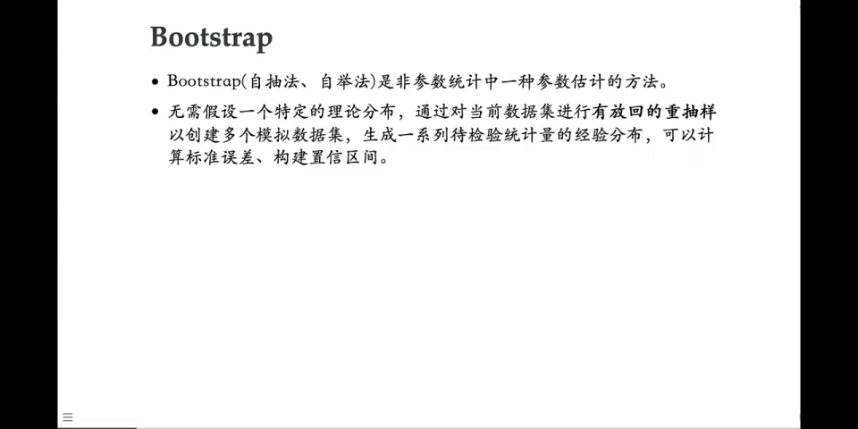
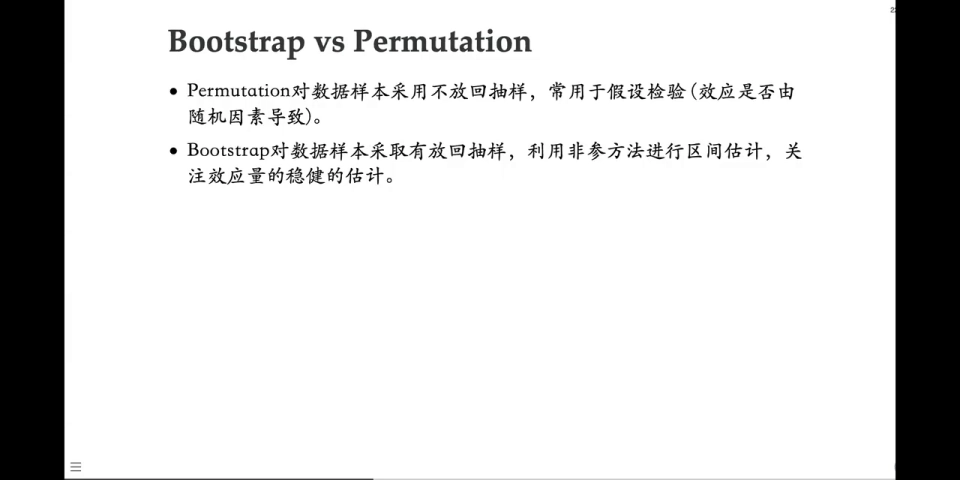
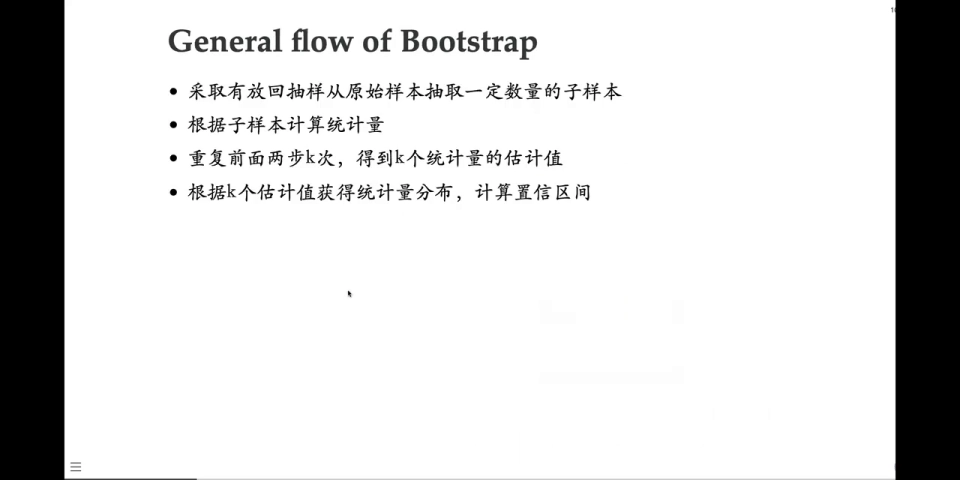
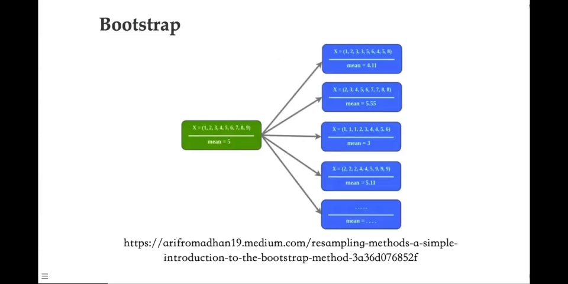
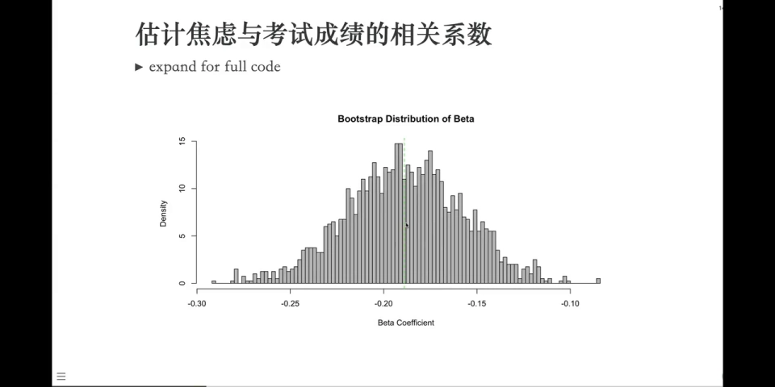
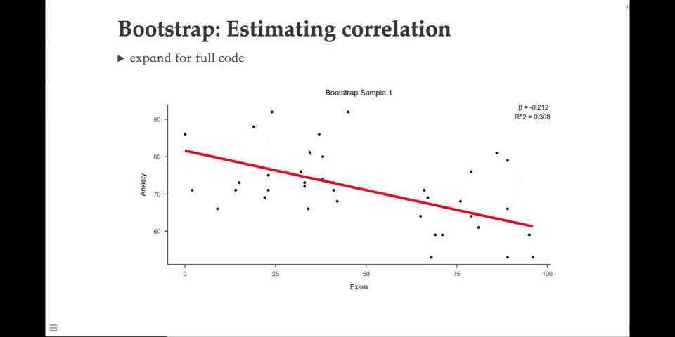
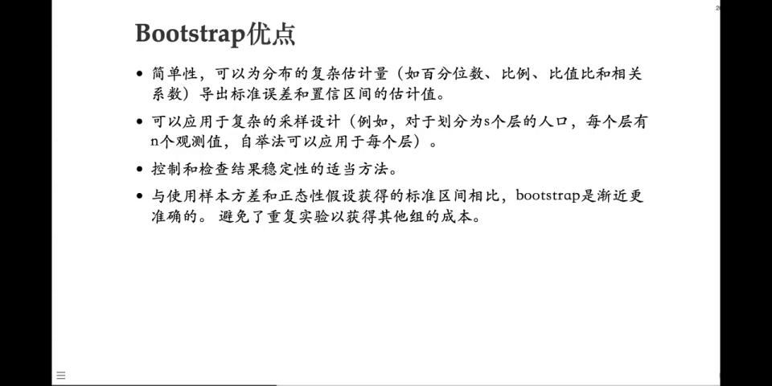
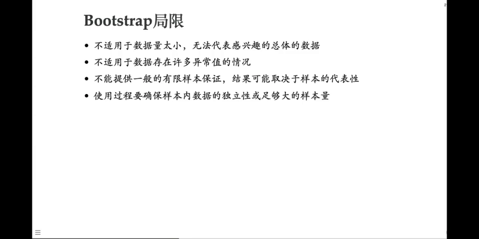

# 自助法与置信区间：有放回重采样怎样给出稳健估计

> 视频来源：[第十四讲 专题2：置换检验、Bootstrap 与模拟](https://www.bilibili.com/video/BV18EjhzbEfr/)（Bilibili · OpenScience_CN）｜时长约 100 分钟
> 导读：这一讲把置换检验、Bootstrap 和模拟放在同一条“用重复计算代替公式”的思路上。本文聚焦其中 Bootstrap 的部分（约 38:34–64:48）：它不构造零分布，而是从原始样本里有放回地重抽样，得到统计量的经验分布，再用这个分布估计标准误和置信区间。文章会走完“有放回抽样—算统计量—重复—取区间”四步，说明它为什么适合相关系数、回归系数、效应量这类没有现成公式的估计量，也会说明它的硬限制：样本太小、异常值太多、数据不独立或不能代表总体时，重采样也救不了。

## 本讲要解决的核心问题（SCQA）

**背景**：很多研究关心的不是一个“有没有差异”的二元判断，而是一个效应量到底有多大、这个估计有多准。传统做法是套一个理论分布，用样本方差和正态假设算标准误、构造置信区间。

**冲突**：一旦统计量不是均值，而是相关系数、回归系数、决定系数、Cohen's d、百分位数或比值比，理论分布往往很复杂，甚至没有现成的标准误公式；样本量小、分布偏斜时，正态假设也不可靠。

**疑问**：能不能不假设统计量服从什么分布，直接用手里的数据估计它的不确定性？

**回答（中心思想）**：能。**Bootstrap（自助法、自举法）是一种非参数的重采样方法**：把原始样本当作总体的代表，从中有放回地抽取和原来一样大的新样本，每抽一次就算一次关心的统计量，重复成千上万次，得到这个统计量的经验分布；这个分布的标准差可以作为标准误的估计，取它的 95% 最高密度区就是置信区间 [【跳转到 40:14】](https://www.bilibili.com/video/BV18EjhzbEfr/?t=2414)、[【跳转到 42:41】](https://www.bilibili.com/video/BV18EjhzbEfr/?t=2561)。

## 一、先分清：置换检验和自助法不是同一件事

讲者在进入 Bootstrap 之前，先把它和置换检验摆在一起对比 [【跳转到 38:34】](https://www.bilibili.com/video/BV18EjhzbEfr/?t=2314)：

- **置换检验**：对数据样本采用**不放回**的随机抽取，打乱原有结构，构造“零假设成立时”的分布，常用于**假设检验**——判断观察到的效应是否可能由随机因素导致。
- **Bootstrap**：对数据样本采用**有放回**的随机抽取，利用非参数方法做**区间估计**，关注效应量的稳健估计。

一句话：**置换检验回答“这个效应像不像随机产生的”，Bootstrap 回答“这个效应大概是多少、估得准不准”**。两者都靠反复重采样，但抽法不同、目的不同。

## 二、Bootstrap 的四步：把“一个估计值”变成“一个分布”

讲者把 Bootstrap 的流程收成四步 [【跳转到 42:16】](https://www.bilibili.com/video/BV18EjhzbEfr/?t=2536)：

1. **有放回抽样**：从原始样本中抽取一定数量的子样本。每个被抽中的观测放回去，所以同一个观测可能被抽中多次，也可能一次都没被抽中。
2. **算统计量**：在这个子样本上计算你关心的统计量——均值、方差、中位数、相关系数、回归系数、Cohen's d 都可以。
3. **重复 k 次**：把前两步重复几千到几万次，得到 k 个统计量的估计值。
4. **得到经验分布**：用这 k 个估计值构成统计量的分布，从这个分布计算标准误、构造置信区间。

关键在第一步的“有放回”。讲者用一个很小的例子说明：原始数据是 `X = (1,2,3,4,5,6,7,8)`，均值是 5；有放回抽一次可能得到 `(1,2,3,3,5,6,4,5)`，均值 4.11；再抽一次可能得到 `(2,3,4,5,6,7,7,8)`，均值 5.55；也可能得到 `(1,1,1,2,3,4,4,5)`，均值 3。**原始数据里只有一个 1，重采样后可能出现三个 1**——这正是有放回抽样允许的 [【跳转到 41:09】](https://www.bilibili.com/video/BV18EjhzbEfr/?t=2469)。

如果不做 Bootstrap，你直接算一个均值，它就是一个值；做了 Bootstrap，你就得到一个关于均值的分布。这个分布不是凭空假设的，而是从原始数据里反复“抽自己”得到的，因此带有原始数据的形状信息 [【跳转到 41:34】](https://www.bilibili.com/video/BV18EjhzbEfr/?t=2494)。

## 三、从经验分布到置信区间：95% 最高密度区

有了 k 个统计量估计值，怎么变成置信区间？讲者的做法是取这个经验分布的 **95% 最高密度区**（highest density interval）：把估计值按密度从高到低排，取覆盖 95% 概率质量的那一段，作为置信区间 [【跳转到 42:41】](https://www.bilibili.com/video/BV18EjhzbEfr/?t=2561)。

这和“均值 ± 1.96 倍标准误”不是同一种构造。后者依赖正态假设和标准误公式；前者直接读经验分布的分位数/密度，不要求统计量服从正态分布。讲者说，用这个分布算出来的置信区间，会比传统意义上基于样本方差和正态假设的区间**更稳健** [【跳转到 43:56】](https://www.bilibili.com/video/BV18EjhzbEfr/?t=2636)。

### 3.1 一个具体例子：焦虑与考试成绩的回归系数

讲者用“焦虑”和“考试成绩”的数据做演示。先按传统做法跑一次回归，得到回归系数 β = 0.189，接近生成数据时设定的真值 0.2，但还是有误差 [【跳转到 49:37】](https://www.bilibili.com/video/BV18EjhzbEfr/?t=2977)。

然后做 Bootstrap：写一个函数，从数据里有放回地抽 50 个观测，算一次回归系数；重复很多次（讲者演示时先重复 3 次，实际一般重复几千次），得到很多个 β 值。重复 3 次时，三个 β 分别是 −0.212、−0.194、−0.265，每个子样本的拟合线都不一样 [【跳转到 53:22】](https://www.bilibili.com/video/BV18EjhzbEfr/?t=3202)。

重复 5000 次，就得到 5000 个 β 值，形成 β 的分布；取这个分布的 95% 最高密度区，就是 β 的置信区间 [【跳转到 53:45】](https://www.bilibili.com/video/BV18EjhzbEfr/?t=3225)。同样的流程可以换成决定系数 R²、Cohen's d，或者任何你关心的效应量——**唯一要改的是“每次重采样后算哪个统计量”** [【跳转到 56:53】](https://www.bilibili.com/video/BV18EjhzbEfr/?t=3413)。

## 四、为什么它稳健：不依赖理论分布，能处理复杂估计量

讲者把 Bootstrap 的优点收在几张幻灯片上 [【跳转到 61:33】](https://www.bilibili.com/video/BV18EjhzbEfr/?t=3693)：

- **简单性**：可以为分布复杂的估计量（百分位数、比例、比值比、相关系数）导出标准误差和置信区间。
- **适合复杂采样设计**：例如分层抽样，每个层有 n 个观测值，Bootstrap 可以在每个层内分别重采样。
- **能控制和检查结果稳定性**：增加重采样次数，看结果是否稳定。
- **与样本方差 + 正态假设得到的标准区间相比，Bootstrap 是渐近更准确的**；它还避免了重复实验以获得其他组数据的成本。

其中“复杂估计量”是重点。比如你想比较两个相关系数是否有差异：参数方法需要知道“两个相关系数之差”服从什么分布、零假设下是什么分布；Bootstrap 不需要知道这些，只要分别算出两个相关系数的 95% 置信区间，看看区间有没有重合。讲者把这种做法称为“非常简单粗暴”，但也正因如此，它把很多原本需要复杂推导的问题变成了可执行的重采样 [【跳转到 45:39】](https://www.bilibili.com/video/BV18EjhzbEfr/?t=2739)。

需要说明的是，“看两个 95% 置信区间是否重合”是一个粗略的目视判断，不能替代严格的区间检验；讲者在这里是用它说明 Bootstrap 的易用性，而不是把它推荐为唯一的比较方法。

## 五、它不能做什么：四条硬限制

Bootstrap 不是万能的。讲者在讲完优点后，紧接着列了它的局限 [【跳转到 61:33】](https://www.bilibili.com/video/BV18EjhzbEfr/?t=3693)：

1. **不适用于数据量太小、无法代表感兴趣总体的数据**。Bootstrap 把原始样本当作总体的代表；如果样本本身太小或太偏，重采样只是把同样的偏差放大。
2. **不适用于数据存在许多异常值的情况**。Bootstrap 反映的是数据内在的统计分布特点；数据里异常值太多，重采样会把异常值的影响反复复制出来。讲者用一句话概括：**garbage in, garbage out**。
3. **不能提供一般的有限样本保证**。结果可能取决于样本的代表性；Bootstrap 的“渐近更准确”是大样本性质，不是任何小样本下都成立。
4. **使用过程要确保样本内数据的独立性，或足够大的样本量**。如果观测之间不独立（比如重复测量、聚类数据），简单的逐点重采样会低估不确定性；这时需要按数据结构做分层/嵌套的 Bootstrap。

这四条正好对应学习目标里的“假设和适用样本量”：**Bootstrap 的合法性来自“原始样本能代表总体”和“观测独立（或按设计分层）”这两个前提，而不是来自重采样次数**。重采样次数再多，也不能把一个没有代表性的小样本变成有代表性的样本。

## 六、重采样次数不是样本量：5000、10000、30000 在调什么

讲者特别提到，Bootstrap 的结果如果不稳定，可以增加重采样次数：5000 次不够就 1 万次，1 万次不够就 2 万、3 万次；数据量大时还可以并行运算加速 [【跳转到 46:29】](https://www.bilibili.com/video/BV18EjhzbEfr/?t=2789)。

这里要区分两个“次数”：

- **原始样本量 n**：你实际观测到多少个独立单位。它决定 Bootstrap 能提取多少信息，也决定经验分布有多可靠。n 太小，重采样次数再多也救不了。
- **重采样次数 k**：你从原始样本里抽了多少次、算了多少个统计量。它决定经验分布的精细程度和 Monte Carlo 误差；k 越大，区间端点越稳定，但不会增加原始数据的信息。

讲者的演示里，重复 3 次只能看到三个 β 值，每个子样本的拟合线都不同；重复 5000 次才能形成一条像样的分布。**k 是计算量，n 是信息量**，两者不能混为一谈。

## 七、置换 vs 自助：一张对照表

| 维度 | 置换检验（Permutation） | 自助法（Bootstrap） |
| --- | --- | --- |
| 抽样方式 | 不放回，打乱标签/结构 | 有放回，抽和原样本一样大的子样本 |
| 构造什么分布 | 零假设成立时的零分布 | 统计量的经验分布（围绕估计值） |
| 主要用途 | 假设检验：效应是否可能由随机因素导致 | 区间估计：效应量多大、估得准不准 |
| 需要什么前提 | 零假设下标签可交换；打乱方式匹配数据结构 | 原始样本能代表总体；观测独立或按设计分层 |
| 典型输出 | p 值 | 标准误、置信区间 |
| 适用统计量 | 任何可重算的统计量 | 任何可重算的统计量，尤其适合复杂估计量 |
| 主要风险 | 打乱方式错误会把检验弄瞎 | 样本太小、异常值太多、数据不独立时结果不可信 |

## 小结

- **Bootstrap 的核心动作是“有放回地抽自己”**：从原始样本中反复抽取同样大小的子样本，每次算一个统计量，重复几千到几万次，得到统计量的经验分布。
- **经验分布可以直接给出标准误和置信区间**：讲者用 95% 最高密度区作为置信区间；它不要求统计量服从正态分布，因此适合相关系数、回归系数、Cohen's d 等复杂估计量。
- **它和置换检验的分工不同**：置换检验不放回、造零分布、回答“像不像随机”；Bootstrap 有放回、造统计量分布、回答“效应多大、估得准不准”。
- **它的前提是样本有代表性、观测独立**：样本太小、异常值太多、数据不独立或不能代表总体时，重采样不能凭空创造信息；讲者的说法是“garbage in, garbage out”。
- **重采样次数 k 不是样本量 n**：k 决定经验分布的精细程度，n 决定信息量；增加 k 可以让区间更稳定，但不能弥补 n 的不足。