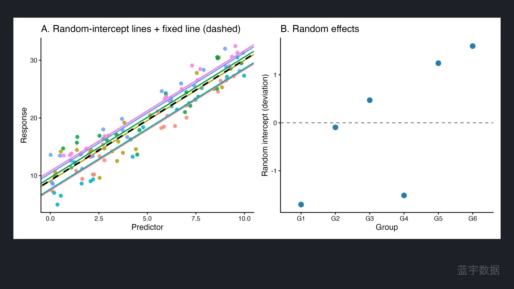
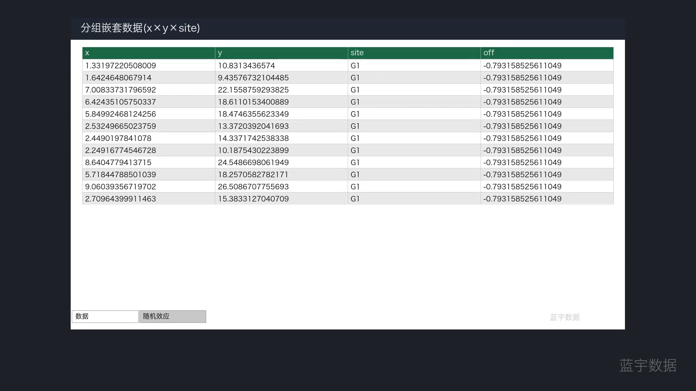
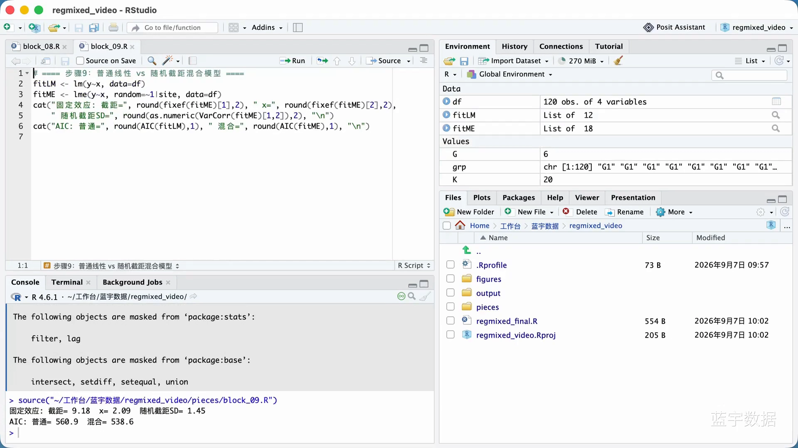
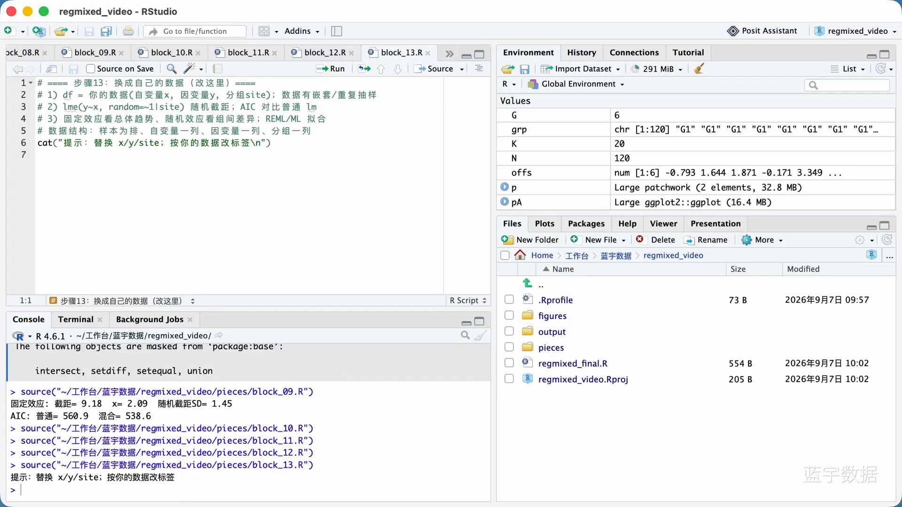

# 分组嵌套与随机截距：把组间差异交给随机效应，把总体趋势留给固定效应

> 视频来源：[数据是分组嵌套的？别再用普通回归！混合效应模型（随机截距）！R语言（附代码+数据）](https://www.bilibili.com/video/BV18obN66E8G)（Bilibili · 云程数据）｜时长约 8 分钟
> 导读：一支 8 分钟的实操短讲，用「6 个样点 × 每个样点 20 个样本」的模拟数据，从普通回归的独立同分布假设讲到 `nlme::lme()` 的随机截距模型，再落到固定效应、方差分量、AIC 三个读数和四个常见坑。字幕为 B 站 AI 字幕，`lme4`、`lme`、`fixef`、`VarCorr`、REML 等术语已按画面代码订正；视频里一带而过的「为什么」在文中标注为补充说明。

## 本讲要解决的核心问题（SCQA）

**背景**：回归课教的模型是 $y = a + bx + \varepsilon$，其中误差 $\varepsilon$ 必须独立同分布。只要拿到一张「自变量一列、因变量一列」的表，很多人就直接 `lm()` 跑下去了。

**冲突**：真实数据常常是分组的——6 个样点，每个样点采 20 个样本。同一个样点里的样本共享土壤本底、共享实验条件、共享那几天的小气候，它们彼此相似，**不独立**。普通回归却假设所有样本独立，等于把「伪重复」当成「真重复」，p 值会虚到离谱。[【跳转到 00:00】](https://www.bilibili.com/video/BV18obN66E8G/?t=0)

**疑问**：分组信息到底该怎么进模型？固定效应和随机效应怎么分？模型跑完该看哪几个数，又该怎么向审稿人证明「我没有把数据当一锅粥处理」？

**回答（中心思想）**：**把截距拆成两层**——所有组共享的总体趋势写成固定效应，每组自己的整体抬高或压低写成随机效应，并同时承认「组间」和「组内」两层误差。这样既用上了分组信息，又不虚报自由度；模型跑完看三个读数：固定效应、方差分量、AIC。

## 一、先看成品：六条平行线，加一张组间偏移点图

讲者一开场就把最终结果图放了出来，因为随机截距模型的「长相」本身就是最好的解释。



左图 A 有 6 个组、每组 20 个点，每组一条回归线。注意这些线**斜率相同、只错开截距**——这就是「随机截距」最直观的名片：所有组跟着同一个总趋势走，但每组整体抬高或压低一点。中间那条黑色虚线是固定效应，代表总体趋势。

右图 B 把每条彩色线相对黑色虚线的偏移量化成点：G1 明显偏低，G6 偏高。这就是随机效应——**组间差异的具体数值**。[【跳转到 00:50】](https://www.bilibili.com/video/BV18obN66E8G/?t=50)

这两张图合起来，就是「组间差异 + 组内趋势」的完整故事。讲者的评价很直白：审稿人一秒钟就能看明白，你没有把数据当一锅粥处理。

## 二、为什么分组数据需要特殊对待：独立同分布假设被组内相似性破坏

普通回归的公式是：

$$
y_i = a + b x_i + \varepsilon_i, \qquad \varepsilon_i \sim \text{i.i.d.}
$$

关键在最后那个「i.i.d.」——误差必须独立、同分布。但分组数据里，同一个组内的样本共享一些组特性：土壤本底、个体差异、实验条件。这些共同因素让组内样本相互关联，独立性假设当场失效。[【跳转到 01:40】](https://www.bilibili.com/video/BV18obN66E8G/?t=100)

后果不是「估计稍微不准」，而是**不确定性的尺度错了**：检验把组内的几十个观测都当成独立证据，分母上的标准误被压小，p 值随之假性变小。伪重复的机制在 3.2.1 已经拆过，这里要解决的是「怎么修」。

混合模型的修法是把回归系数拆成两部分：

- **固定效应**：所有组共享的总体趋势；
- **随机效应**：每个组自己的偏移。

并且承认误差有**两层**：组与组之间的差异是一层，组内样本围绕本组水平的波动是另一层。讲者的概括是：这样既利用分组信息，又不虚报自由度。

写成公式就是：

$$
y_{ij} = a + b x_{ij} + u_j + \varepsilon_{ij}, \qquad u_j \sim N(0, \sigma_u^2),\quad \varepsilon_{ij} \sim N(0, \sigma^2)
$$

下标 $j$ 是组、$i$ 是组内样本。$u_j$ 是第 $j$ 组的随机截距偏移，$\sigma_u^2$ 是组间方差；$\varepsilon_{ij}$ 是组内残差，$\sigma^2$ 是组内方差。**一个模型里出现两个方差参数，这就是「混合」的含义**：固定效应管趋势，随机效应管分组结构。

## 三、固定效应与随机效应：分工只看一句话

| | 固定效应 | 随机效应 |
| --- | --- | --- |
| 回答什么 | 总体趋势是什么 | 每个组偏离总体多少 |
| 典型变量 | 处理、剂量、时间、你关心的自变量 | 样点、区组、临床中心、供体、个体 |
| 报告形式 | 系数（截距、斜率）及其区间 | 方差或标准差（组间 SD） |
| 是否可外推 | 是，针对这些具体水平 | 是，把组看作从总体中抽样 |

判断标准不是「这个变量重要不重要」，而是**这个分组变量的水平是不是「从中抽样」来的**。讲者在四个坑里把这条讲得最清楚：像样点这种不可重复的取样单元，一般做随机效应更合理，结果也更概括；把它当固定效应，等于给每个样点单独估一个参数，结论只对这几个样点成立。[【跳转到 06:55】](https://www.bilibili.com/video/BV18obN66E8G/?t=415)

随机截距之外还有随机斜率：`random = ~1 | site` 只让截距随组变化；`random = ~1 + x | site` 让斜率也随组变化。讲者提醒这是「进阶款」——组间不仅水平不同、变化速度也不同时才需要。两者的区别在图上就是「平行线」与「扇形散开的线」。

## 四、一次完整建模：数据、代码、三个读数

### 4.1 数据长什么样

数据表是「一行一个样本」：`x` 自变量、`y` 因变量、`site` 分组列，外加一列 `off` 记录每组的固定偏移。6 组 × 20 个样本 = 120 行。



讲者特别强调：换成你自己的数据，真正要准备的就是**一个分组列**——样点、区组、个体、中心都行，把它排好，模型才知道谁和谁同组。[【跳转到 04:15】](https://www.bilibili.com/video/BV18obN66E8G/?t=255)

### 4.2 两个模型，四行代码

```r
fitLM <- lm(y ~ x, data = df)                  # 普通做法：所有样本独立
fitME <- lme(y ~ x, random = ~1 | site, data = df)  # 随机截距：截距随 site 变

fixef(fitME)      # 固定效应：总体截距与斜率
VarCorr(fitME)    # 方差分量：组间 SD 与残差 SD
AIC(fitLM); AIC(fitME)   # 两个模型比高下
```

`random = ~1 | site` 读作「截距（那个 1）随 site 随机变化」。`lme` 默认用 REML（约束极大似然）估计方差分量，讲者的说法是它对组间/组内方差的估计更公平；如果要比较不同固定效应结构的模型，则要用 ML 重估。



### 4.3 三个读数怎么读

| 读数 | 这次的值 | 怎么解释 |
| --- | --- | --- |
| `fixef` 固定效应 | 截距 9.18，斜率 2.09 | 总体趋势：$x$ 每增加 1，$y$ 平均增加约 2.09 |
| `VarCorr` 组间 SD | 1.45 | 各组截距相对总体截距的标准差，与残差 SD 同量级 → 组间差异实打实 |
| `VarCorr` 残差 SD | 2.07 | 组内样本围绕本组线的波动 |
| AIC | 普通 560.9，混合 538.6 | 低 22 分，数据自己说该用混合模型 |

第三行最容易被忽略：组间 SD 1.45 不是「噪声」，它是**结果的一部分**——它告诉你分组结构解释了多少变异。讲者把它列进四个坑的第四条：只看固定效应、不报方差分量，等于把一半结论丢了。

### 4.4 图是这么画出来的

左面板：先按组画散点，再用「固定效应 + 该组随机效应」算出每组的完整截距和斜率，画彩色线；最后把固定效应画成黑色虚线做对照。右面板：把每组截距减去固定截距，得到随机效应偏移，画成点图并加一条零线——高于零的组整体偏高，低于零的整体偏低。[【跳转到 05:05】](https://www.bilibili.com/video/BV18obN66E8G/?t=305)

两张图并排导出，就是「结构图 + 效应图」：一张说清模型结构，一张说清组间差异。

## 五、三个提醒与四个坑

讲者在把代码交给观众之前，先给了三条使用提醒：

1. **随机效应不是越多越好**。数据里有几个分组层级就设几层，别为了「显得严谨」硬加。
2. **比较固定效应用 ML，报方差用 REML**，并且在报告里写清用的是哪一个。
3. **随机截距和随机斜率是两个概念**。组间只是整体高低不同，用 `~1 | site`；连变化速度都不同，才上 `~1 + x | site`。

然后是四个坑，按后果从重到轻：

| 坑 | 后果 | 正确做法 |
| --- | --- | --- |
| 把分组当固定效应 | 结论只对这几个样点成立，无法外推 | 不可重复的取样单元做随机效应 |
| 忽略嵌套结构直接 `lm` | 伪重复，p 值虚高 | 加随机截距，或改用聚合后的样本级分析 |
| 样本太少、组数太多、每组一个样本 | 组方差估计崩掉 | 每组至少 3–5 个观测 |
| 只看固定效应、不报方差分量 | 组间/组内方差分割这个结果被丢掉 | `VarCorr` 的 SD 写进报告 |

第二条是讲者说的「目前生态学审稿必查项」；第三条则直接给出了可执行的阈值——**每组至少 3–5 个**，低于这个数，随机效应的方差估不出来，模型会给你一个看似收敛、实则没有信息的结果。

## 六、什么时候该想到它：三类场景与一句判断

讲者列了三类最常见的分组嵌套数据：



- **生态样点**：不同样点的重复采样，样点做随机效应；
- **医学多中心**：多个医院、多个病例中心，中心做随机效应；
- **纵向重复测量**：同一个人测多次，个体做随机效应。

这三类的共同点是：**它们都是伪重复的高发区**。所以判断句可以压缩成一句：只要数据里有一个「组」字，就问一下这个组在统计上值不值得特殊对待。[【跳转到 06:30】](https://www.bilibili.com/video/BV18obN66E8G/?t=390)

> 与「聚合」的分界：把每组压成一个均值再回归，也能避开伪重复，但那等于承认「组内没有信息」。组内变异大不大，正是下一节组内相关系数（ICC）要量的东西——ICC 接近 1 时聚合几乎不损失信息，ICC 居中时混合模型同时用上了组间和组内两层，比先聚合再回归多用了数据。ICC 的算法与判读见本小节另一篇《方差分解与组内相关系数 ICC》。

## 小结

- **分组嵌套数据的病根**是独立同分布假设失效：同组样本共享组特性，彼此不独立，普通回归把伪重复当真重复，p 值虚高。
- **混合模型的解法**是把截距拆成固定效应（所有组共享的总体趋势）与随机效应（每组自己的偏移），并承认组间、组内两层误差。
- **固定效应与随机效应的分工**看「这个分组变量的水平是不是抽样来的」：处理、剂量、时间做固定效应；样点、中心、个体做随机效应。
- **一次随机截距建模看三个读数**：`fixef` 的固定效应、`VarCorr` 的组间 SD 与残差 SD、以及和普通模型比的 AIC（本例 560.9 对 538.6）。
- **组间 SD 本身就是结果**，不报方差分量等于丢掉一半结论。
- **四个坑**：分组当固定效应、忽略嵌套直接 `lm`、每组样本太少（建议 ≥3–5）、只看固定效应。
- **随机截距与随机斜率是两件事**：`~1 | site` 是平行线，`~1 + x | site` 才允许斜率不同。

## 关键术语速查

| 术语 | 一句话解释 |
| --- | --- |
| 混合效应模型 | 同时含固定效应与随机效应的回归模型，把误差分成组间、组内两层 |
| 固定效应 | 对所有个体相同的变量效应，报告为截距/斜率 |
| 随机效应 | 分组单元自己的偏移，报告为方差或标准差 |
| 随机截距 | 只允许各组截距不同、斜率相同的模型，代码写作 `random = ~1` 竖线 `site` |
| 随机斜率 | 允许各组斜率也不同的模型，代码写作 `random = ~1 + x` 竖线 `site` |
| 方差分量 | 组间方差与组内（残差）方差的估计值，`VarCorr()` 的输出 |
| REML / ML | 两种似然估计方式：REML 估方差分量更公平，ML 用于比较固定效应结构 |
| AIC | 兼顾拟合与复杂度的模型比较指标，越小越好 |
| 伪重复 | 把同一分组单元内的观测当独立重复，导致标准误被低估、p 值虚高 |