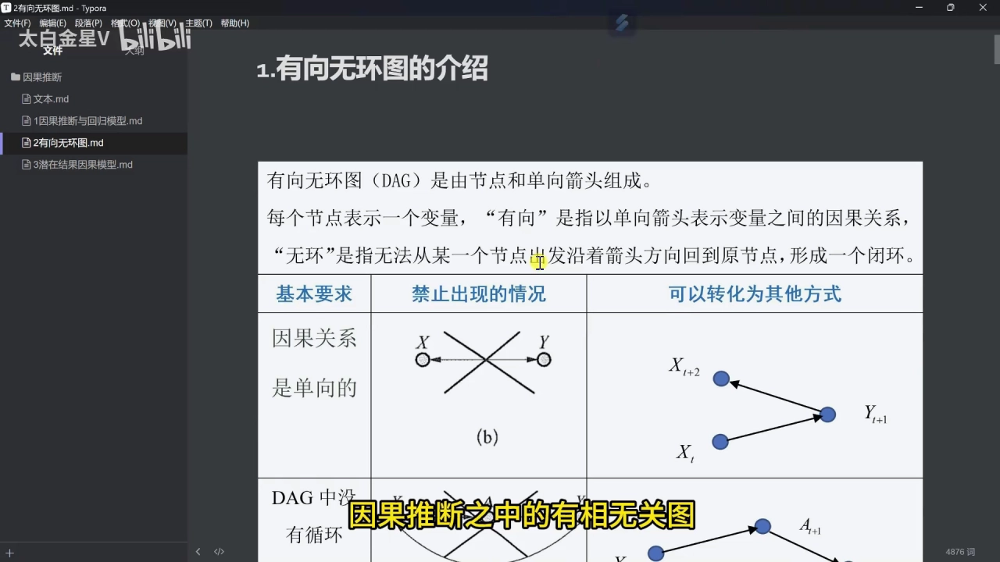
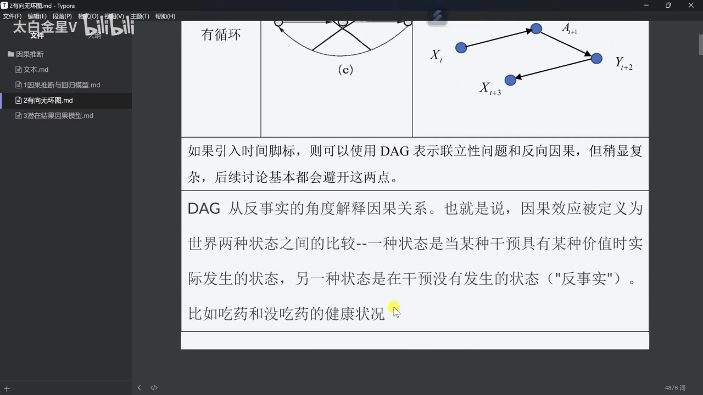
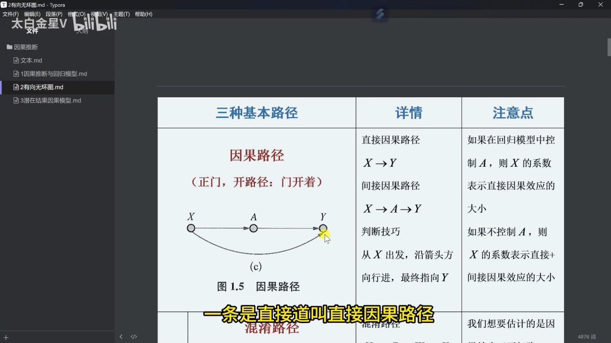
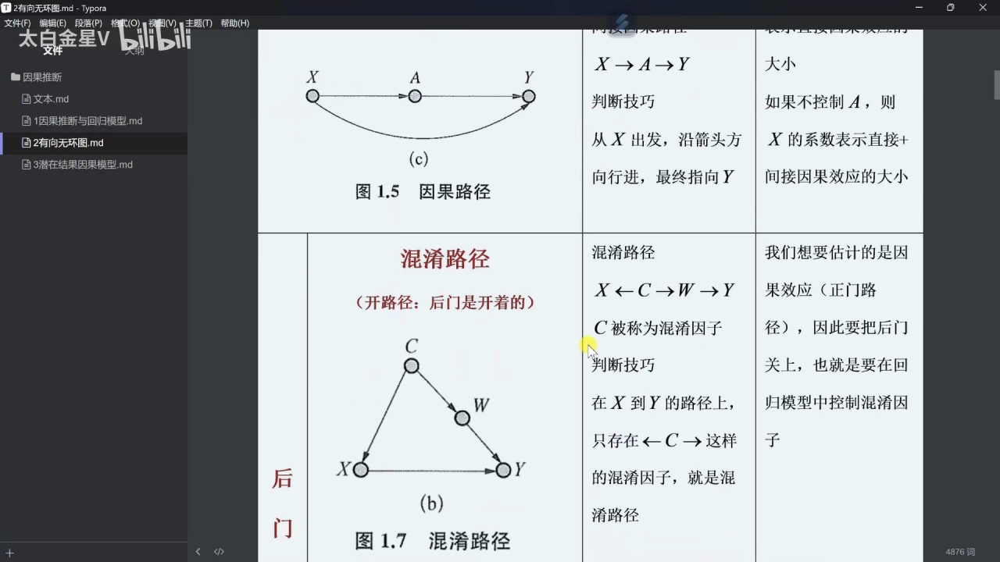
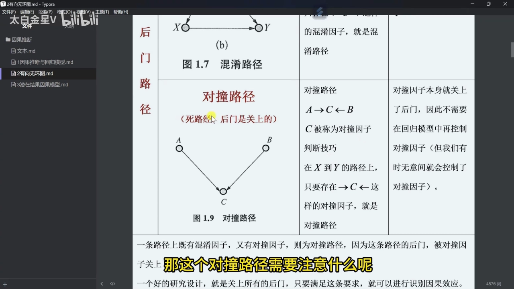
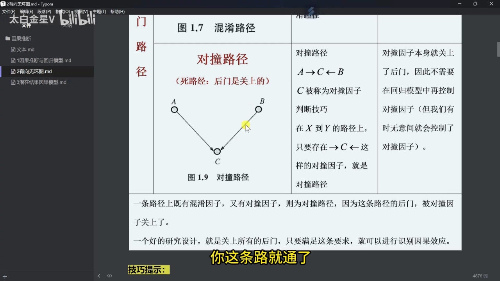
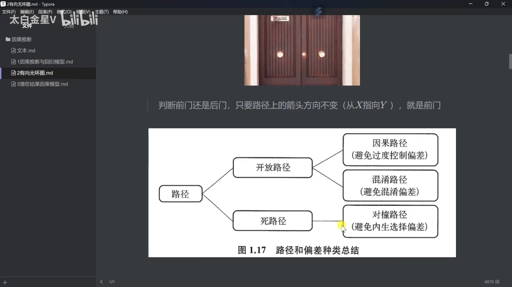

# 因果图三种路径：混杂路径要堵死后门，对撞路径别去碰

> 视频来源：[十分钟了解因果图](https://www.bilibili.com/video/BV1NC411s7AT/?t=0)（Bilibili · 太白金星V博士）｜时长约 10 分钟
> 本文基于视频演说图文稿整理，配图截自视频。视频讲稿把 confounding 说成"混淆"，本文统一写作"混杂"，指同一件事。

## 本讲要解决的核心问题（SCQA）

**背景**：观察数据里，两个变量常常"一起动"。想研究 $X$ 对 $Y$ 的影响，最省事的做法是把 $Y$ 对 $X$ 回归，看系数大不大。

**冲突**：系数大不等于 $X$ 真的在推动 $Y$。可能有一个第三变量同时影响两者；也可能样本本身就是被某个条件筛出来的，筛选这一步凭空造出了关联。两种情况下回归系数都很大，但都不能解释成"改变 $X$ 会让 $Y$ 变多少"。

**疑问**：怎么在动手算之前，先判断哪些关联能解释成因果、哪些不能？

**回答（中心思想）**：把关于因果的假设画成一张**有向无环图（DAG）**，然后检查 $X$ 到 $Y$ 之间的每一条路径。路径只有三类：**因果路径**（前门，要保留）、**混杂路径**（后门开着，必须堵）、**对撞路径**（后门本来就关着，千万不要去堵）。一句话准则：**好的研究设计就是关上所有的后门**，而"堵"在回归里的具体动作就是把这个变量放进模型控制住。

---

## 一、DAG 是因果假设的图：节点是变量，箭头是单向因果

有向无环图由**节点**和**单向箭头**组成：节点表示随机变量，单向箭头表示变量之间的单向因果关系 [【跳转到 00:10】](https://www.bilibili.com/video/BV1NC411s7AT/?t=10)。

它的名字里就写着两条硬要求 [【跳转到 00:10】](https://www.bilibili.com/video/BV1NC411s7AT/?t=10)：

1. **有向**：因果关系只能单向，不允许出现双向箭头。真遇到"互为因果"，可以引入时间角标把它拆成链条——$X_t$ 影响 $Y_{t+1}$，$Y_{t+1}$ 再影响 $X_{t+2}$ [【跳转到 00:32】](https://www.bilibili.com/video/BV1NC411s7AT/?t=32)。
2. **无环**：从某个节点出发沿箭头走，不能最后又回到这个节点形成闭环。同样可以靠时间角标展开，只是图会变复杂，所以后面讨论基本避开这两点 [【跳转到 00:52】](https://www.bilibili.com/video/BV1NC411s7AT/?t=52)。

### 1.1 因果效应本身是"两种状态的对比"

DAG 是从**反事实**角度解释因果关系的：因果效应被定义为世界两种状态之间的比较——一种是某种干预实际发生时的状态，另一种是同一个世界在干预没有发生时的状态（反事实）。比如吃药的健康状况与没吃药的健康状况 [【跳转到 01:26】](https://www.bilibili.com/video/BV1NC411s7AT/?t=86)。

这一点决定了后面所有讨论的立足点：我们要估的从来不是"$X$ 和 $Y$ 有多像"，而是"改变 $X$ 会让 $Y$ 变成什么样"。观察数据里能直接看到的只有前者。

---

## 二、因果路径：前门，$X$ 沿箭头能走到 $Y$

三种基本路径里，第一种是**因果路径**，也叫**前门路径**——它是我们真正想估的那条 [【跳转到 01:51】](https://www.bilibili.com/video/BV1NC411s7AT/?t=111)。

判断方法很朴素：你研究 $X$ 对 $Y$ 的影响，就只看 $X$ 和 $Y$，看从 $X$ 出发、顺着箭头方向能不能走到 $Y$ [【跳转到 01:56】](https://www.bilibili.com/video/BV1NC411s7AT/?t=116)。

图里有两条：$X \to Y$ 是**直接因果路径**，$X \to A \to Y$ 是**间接因果路径** [【跳转到 01:56】](https://www.bilibili.com/video/BV1NC411s7AT/?t=116)。

### 2.1 控制中介等于把中介这扇门堵死

这里有个容易踩的坑。视频用"门"来打比方：A 这扇门本来是开着的，你在回归里一控制 A，就等于把它堵死了 [【跳转到 02:21】](https://www.bilibili.com/video/BV1NC411s7AT/?t=141)。

- 控制 A：$X$ 只能直接到 $Y$，估出来的是**直接因果效应**。
- 不控制 A：$X$ 走两条路到 $Y$，估出来的是**直接效应 + 间接效应**的总效应 [【跳转到 02:46】](https://www.bilibili.com/video/BV1NC411s7AT/?t=166)。

所以"控制得越多越好"是错的：如果 A 是 $X$ 影响 $Y$ 的中间环节（中介），控制它就把你想研究的那部分效应亲手删掉了。视频把这个后果叫**过度控制偏差**。

---

## 三、混杂路径：共同原因同时指向 $X$ 和 $Y$

除了前门，还有两条**后门路径**：混杂路径和对撞路径 [【跳转到 03:04】](https://www.bilibili.com/video/BV1NC411s7AT/?t=184)。

先看混杂路径。判断时先**抛开箭头方向**，看 $X$ 能不能到 $Y$：$X \leftarrow C \to W \to Y$ 这条线上，$X$ 和 $Y$ 确实连着。再看这条路上有没有**混杂因子** [【跳转到 03:04】](https://www.bilibili.com/video/BV1NC411s7AT/?t=184)。

混杂因子 $C$ 的形态很好认：**它的箭头从中间向两边指**，也就是 $C \to X$、$C \to Y$ 同时成立 [【跳转到 03:29】](https://www.bilibili.com/video/BV1NC411s7AT/?t=209)。只要路径上有这种因子，这条路径就叫混杂路径，$X$ 和 $Y$ 是两头。

### 3.1 为什么后门必须堵

混杂路径上的混杂因子相当于**一扇开着的门**。$X$ 既可以走前门到 $Y$，也可以走后门到 $Y$；而我们要估的只有前门那条，后门带来的关联不是因果效应 [【跳转到 03:54】](https://www.bilibili.com/video/BV1NC411s7AT/?t=234)。

在回归分析里堵后门的动作就是**把混杂因子控制住** [【跳转到 04:19】](https://www.bilibili.com/video/BV1NC411s7AT/?t=259)。举个具体的例子：研究"是否参加培训"对"收入"的影响，"培训前的收入水平"同时影响是否参加（收入低的人更愿意报名）和之后的收入，它就是 $C$；不控制它，回归系数里就混进了"两组人本来就不同"的那部分差别。

---

## 四、对撞路径：两条箭头都指向 $C$，门本来是关的

第二种后门路径是**对撞路径**，它的形态和混杂正好相反 [【跳转到 04:19】](https://www.bilibili.com/video/BV1NC411s7AT/?t=259)。

看 $A$ 到 $B$ 有什么路径：只有一条 $A - C - B$，考虑箭头方向是 $A \to C \leftarrow B$，两个箭头都指向 $C$，像被撞在一起，所以 $C$ 叫**对撞因子**，这条路径叫对撞路径 [【跳转到 04:44】](https://www.bilibili.com/video/BV1NC411s7AT/?t=284)。

### 4.1 对撞路径的关键：千万不要控制

对撞因子虽然也是个"后门"，但它是**封死的**，所以正确的做法是**不管它** [【跳转到 05:34】](https://www.bilibili.com/video/BV1NC411s7AT/?t=334)。

- 不控制 $C$：$A$ 和 $B$ 之间没有前门，也就是真的没有因果关系。你直接分析，得出"两者无因果效应"，这是正常的、科学的结论 [【跳转到 05:34】](https://www.bilibili.com/video/BV1NC411s7AT/?t=334)。
- 控制 $C$：一旦控制，它原有的门状态就被翻转了——原先开着的关了，原先关着的开了。这时 $A$ 可以"走后门"到 $B$，两者之间凭空多出一条关联，而这条关联**完全是后门带来的** [【跳转到 05:59】](https://www.bilibili.com/video/BV1NC411s7AT/?t=359)。

这就是观察研究里最反直觉的一类偏差：**为了"控制得更干净"而多放一个变量，结果把本来没有的关系造了出来**。视频把它归到"内生选择偏差"名下（统计文献里常叫对撞偏差、选择偏差，典型例子是只统计"被录取的人"或"住院病人"时冒出来的假关联）。

### 4.2 一条路上同时有混杂因子和对撞因子怎么办

答案是：**按对撞路径处理**。因为对撞因子已经把这条后门封死了，这条路本来就不通 [【跳转到 06:46】](https://www.bilibili.com/video/BV1NC411s7AT/?t=406)。

不通是好事——我们只想看前门的因果效应，后门不通正合心意 [【跳转到 07:11】](https://www.bilibili.com/video/BV1NC411s7AT/?t=431)。

---

## 五、一条准则：关上所有后门，别堵不该堵的门

把三类路径放在一起，就得到一套可以直接用的判读流程 [【跳转到 07:11】](https://www.bilibili.com/video/BV1NC411s7AT/?t=431)：

| 路径类型 | 门的状态 | 该不该控制路径上的关键节点 | 控制错了会怎样 |
| --- | --- | --- | --- |
| 因果路径（前门） | 开着 | 不控制中介 | 只剩直接效应，过度控制偏差 |
| 混杂路径（后门） | 开着 | 必须控制混杂因子 | 混杂偏差，关联被误读成因果 |
| 对撞路径（后门） | 关着 | 千万不要控制对撞因子 | 内生选择偏差，凭空造出关联 |

### 5.1 两个速判技巧

视频给了两个很实用的口诀，都围绕"门"这个比喻 [【跳转到 08:03】](https://www.bilibili.com/video/BV1NC411s7AT/?t=483)：

- **看门是开是关**：两个箭头同时指向中间（$\to C \leftarrow$），就像两扇门往中间关上，是关着的；箭头同向（都往右或都往左），或者都往外指（一个往左一个往右），都是开着的 [【跳转到 08:08】](https://www.bilibili.com/video/BV1NC411s7AT/?t=488)。
- **看是前门还是后门**：从你研究的 $X$ 出发，箭头方向一路不变、最终指向 $Y$，就是前门；否则是后门 [【跳转到 08:41】](https://www.bilibili.com/video/BV1NC411s7AT/?t=521)。

### 5.2 落到实践：三种偏差对应三个动作

- 遇到**混杂因子**：把它开着的门封死，也就是控制它，避免混杂偏差 [【跳转到 09:29】](https://www.bilibili.com/video/BV1NC411s7AT/?t=569)。
- 遇到**对撞因子**：尽量不要控制它，避免内生选择偏差 [【跳转到 09:04】](https://www.bilibili.com/video/BV1NC411s7AT/?t=544)。
- 在**因果路径**上：尽量不要控制间接路径上的因子，否则只剩直接效应 [【跳转到 09:29】](https://www.bilibili.com/video/BV1NC411s7AT/?t=569)。

---

## 小结

- **DAG 是因果假设的图**：节点是变量，箭头是单向因果，图里不能有环；双向因果和循环都可以用时间角标展开。
- **因果效应是反事实对比**：干预发生时的状态 vs 同一对象在干预没发生时的状态，不是"两个变量有多像"。
- **因果路径 = 前门**，是唯一想估的那条；控制中介会把它截成只剩直接效应。
- **混杂路径 = 后门开着**，混杂因子的箭头指向两边，必须控制它才能关上后门。
- **对撞路径 = 后门天生关着**，对撞因子的两个箭头都指向它自己；控制它反而打开后门，造出虚假关联。
- **一条准则**：好的研究设计就是关上所有后门；同时有混杂因子和对撞因子的路径按对撞路径处理。
- 视频末尾的定位很清楚：后面整门课讲的都是"怎么关后门" [【跳转到 07:56】](https://www.bilibili.com/video/BV1NC411s7AT/?t=476)。

## 关键术语速查

| 术语 | 一句话解释 |
| --- | --- |
| 有向无环图（DAG） | 节点表示变量、单向箭头表示因果、不允许成环的因果假设图 |
| 前门路径 / 因果路径 | 从 $X$ 出发沿箭头方向最终到达 $Y$ 的路径，分直接与间接两种 |
| 后门路径 | 除因果路径之外、让 $X$ 与 $Y$ 在图上相连的路径，会带来非因果关联 |
| 混杂因子 | 同时指向 $X$ 和 $Y$ 的共同原因，形态是箭头向两边指 |
| 混杂路径 | 含有混杂因子的后门路径，门是开着的，必须控制混杂因子 |
| 对撞因子 | 两条箭头都指向它的变量（$\to C \leftarrow$），门天生关着 |
| 对撞路径 | 含有对撞因子的路径，控制对撞因子会打开后门、造出虚假关联 |
| 过度控制偏差 | 控制了中介变量，把想估的间接效应从系数里删掉 |
| 内生选择偏差 | 因控制对撞因子（或按对撞因子筛选样本）而产生的偏差 |