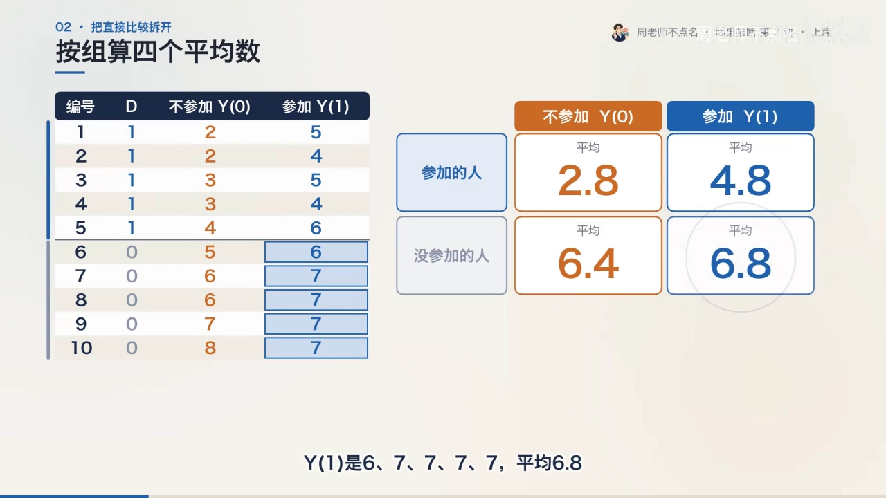
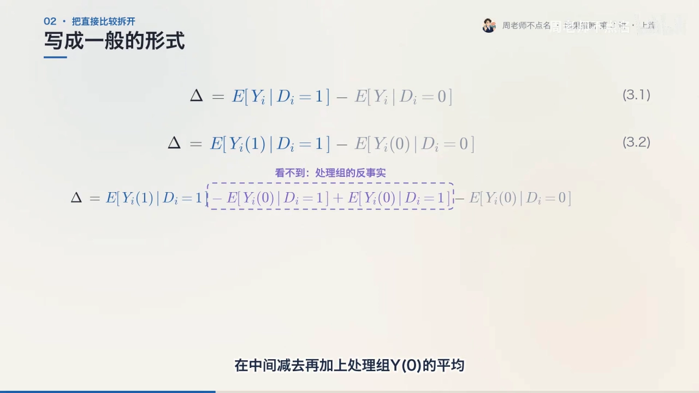
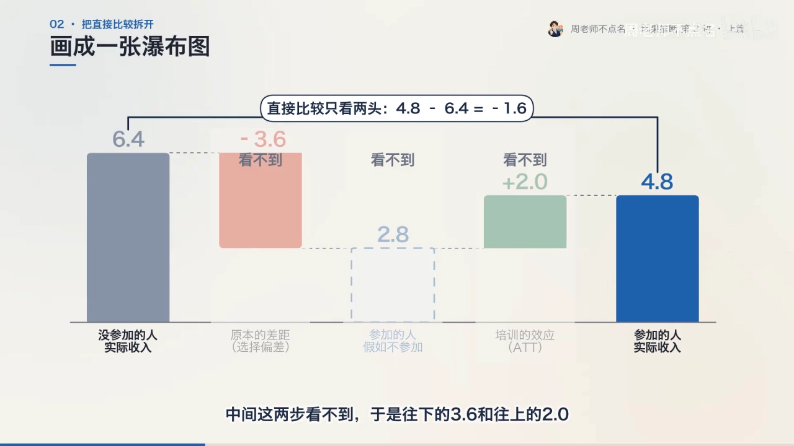
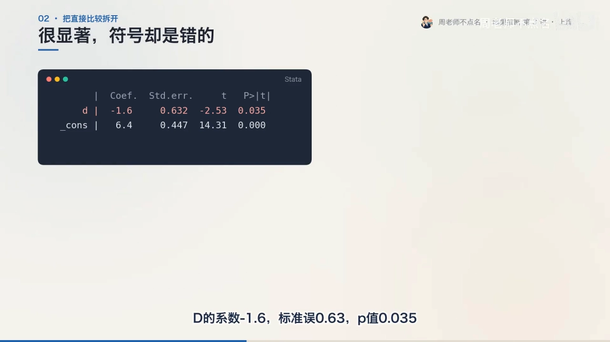
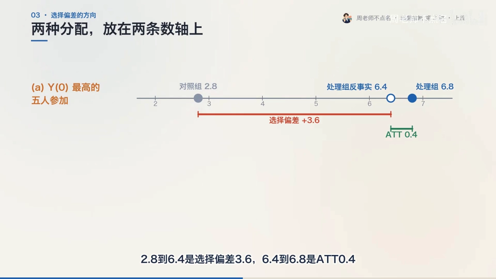
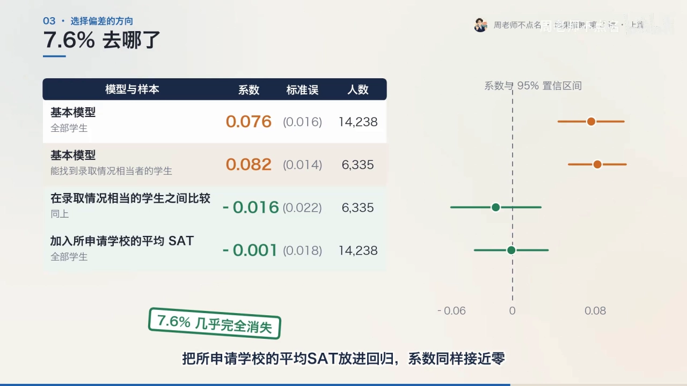
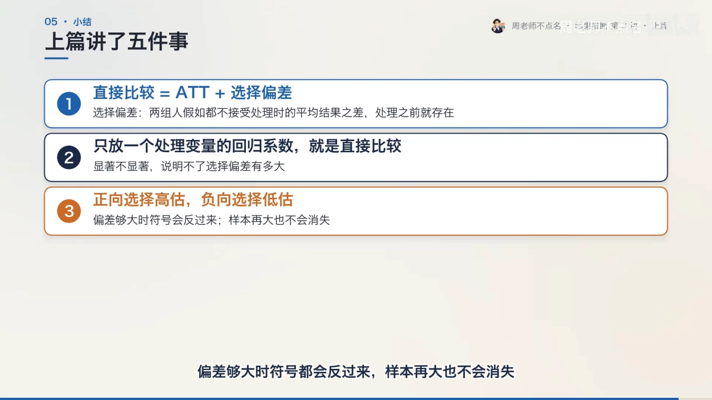

# 直接比较等于 ATT 加选择偏差：观察研究里的关联为什么不是干预效果

> 视频来源：[因果推断系列课 03 上：选择偏差从哪来、往哪边偏？](https://www.bilibili.com/video/BV1po4j6pE3Q/?t=0)（Bilibili · 周老师不点名）｜时长约 27 分钟
> 本文基于视频演说图文稿整理，配图截自视频。讲稿里的"全知表"指同时列出每个人两个潜在结果的表，现实数据里只可能看到其中一格。

## 本讲要解决的核心问题（SCQA）

**背景**：想评价一个项目有没有用，最直接的做法是拿参加的人的平均结果，减去没参加的人的平均结果。这个数叫**直接比较**。

**冲突**：直接比较经常和真实效应差得很远，甚至符号相反。视频给的第一个例子是十位求职者的就业培训：全知表显示培训让参加者平均每月多挣 2000 元，可"参加的人 4.8 千 vs 没参加的人 6.4 千"一减，直接比较是 $-1.6$ 千——一个有用的培训被算成了有害的。

**疑问**：直接比较到底比真实效应多算了什么？这块多出来的东西往哪个方向偏、有多大？有没有办法去掉？

**回答（中心思想）**：直接比较可以**恒等地**拆成两项

$$
\Delta \;=\; \underbrace{E\big[Y_i(1) \mid D_i=1\big] - E\big[Y_i(0) \mid D_i=1\big]}_{\text{ATT}} \;+\; \underbrace{E\big[Y_i(0) \mid D_i=1\big] - E\big[Y_i(0) \mid D_i=0\big]}_{\text{选择偏差}}
$$

前一项是真正的因果效应（对参加者的平均处理效应 ATT），后一项是**两组人在处理发生之前就已经存在的差别**，叫**选择偏差**。它可正可负、算不出来、也不随样本量变小。所以：**观察数据里的直接比较（以及只放一个处理变量的回归系数）不能解释成"干预会让结果变多少"**。

---

## 一、先分清三个平均效应，再看直接比较能算出哪一个

每个人有两个潜在结果：参加培训时的收入 $Y_i(1)$、不参加时的收入 $Y_i(0)$。现实里每人只走一条路，另一个永远看不到 [【跳转到 00:21】](https://www.bilibili.com/video/BV1po4j6pE3Q/?t=21)。

于是有三个不同的"平均效应"，问的问题不一样 [【跳转到 00:21】](https://www.bilibili.com/video/BV1po4j6pE3Q/?t=21)：

- **ATE**（平均处理效应）：对**全体**求平均，回答"如果所有人都参加，平均会怎样"。
- **ATT**：对**参加的人**求平均，回答"已经参加的人，参加比不参加多多少"。
- **ATU**：对**没参加的人**求平均。

十位求职者的全知表里，这三个数分别是 1.2、2.0 和 0.4。而现实里能算出来的只有一个数：参加的人和没参加的人平均收入一减，直接比较是 $-1.6$，跟哪个平均效应都对不上 [【跳转到 00:46】](https://www.bilibili.com/video/BV1po4j6pE3Q/?t=46)。

### 1.1 四个平均数，只有两个能算

把两组人 × 两个潜在结果排成一张小表，一共四个平均数 [【跳转到 04:31】](https://www.bilibili.com/video/BV1po4j6pE3Q/?t=271)：

| 组 | 不参加 $Y(0)$ | 参加 $Y(1)$ |
| --- | --- | --- |
| 参加的人（$D=1$） | 2.8（反事实，看不到） | 4.8（能算） |
| 没参加的人（$D=0$） | 6.4（能算） | 6.8（反事实，看不到） |

现实里参加的人只看得到 $Y(1)$，没参加的人只看得到 $Y(0)$，所以四个格子里能算的只有 4.8 和 6.4；另外两个是**反事实**，只有在全知表上才存在 [【跳转到 04:53】](https://www.bilibili.com/video/BV1po4j6pE3Q/?t=293)。

### 1.2 直接比较其实是"拿没参加的人当替身"

- 直接比较：$4.8 - 6.4 = -1.6$，减去的是**另一群人的实际收入**。
- ATT：$4.8 - 2.8 = 2.0$，减去的是**参加的人自己假如不参加时的收入**。

两者都从 4.8 出发，区别只在减去哪个数 [【跳转到 05:18】](https://www.bilibili.com/video/BV1po4j6pE3Q/?t=318)。替身合格的条件是：替身的收入要等于"参加的人假如不参加时的收入"。这里一个是 6.4、一个是 2.8，替身明显不合格 [【跳转到 05:43】](https://www.bilibili.com/video/BV1po4j6pE3Q/?t=343)。

---

## 二、把直接比较拆开：恒等式里的两项

在直接比较中间"减去 2.8 再加回 2.8"，数值不变，但可以凑成两对 [【跳转到 06:08】](https://www.bilibili.com/video/BV1po4j6pE3Q/?t=368)：

$$
\underbrace{4.8 - 6.4}_{\text{直接比较}} = \underbrace{(4.8 - 2.8)}_{\text{ATT}} + \underbrace{(2.8 - 6.4)}_{\text{选择偏差}} = 2.0 + (-3.6) = -1.6
$$

写成一般形式，就是本讲的核心式子 [【跳转到 08:20】](https://www.bilibili.com/video/BV1po4j6pE3Q/?t=500)：

$$
\Delta = E\big[Y_i(1)\mid D_i=1\big] - E\big[Y_i(0)\mid D_i=0\big]
$$

在中间减去再加回 $E[Y_i(0)\mid D_i=1]$（处理组的反事实，虚线框里那一项），得到

$$
\Delta = \underbrace{E[Y_i(1)\mid D_i=1] - E[Y_i(0)\mid D_i=1]}_{\text{ATT}} + \underbrace{E[Y_i(0)\mid D_i=1] - E[Y_i(0)\mid D_i=0]}_{\text{选择偏差}}
$$

选择偏差的含义很直白：**两组人假如都不接受处理时的平均结果之差**，也就是培训还没开始、参加的人和没参加的人收入就已经不一样的那部分 [【跳转到 08:45】](https://www.bilibili.com/video/BV1po4j6pE3Q/?t=525)。

### 2.1 这个式子是恒等式，不是假设

要特别强调：这个式子对任何数据、任何分组办法都成立，里面没有假设 [【跳转到 09:10】](https://www.bilibili.com/video/BV1po4j6pE3Q/?t=550)。它的用处是把问题看清楚——直接比较到不了 ATT，碍事的只有一项 [【跳转到 09:25】](https://www.bilibili.com/video/BV1po4j6pE3Q/?t=565)。

而这一项恰好**算不出来**：它要用到处理组的反事实 $E[Y_i(0)\mid D_i=1]$。所以只能靠假设去判断它有多大、往哪边偏，或者用研究设计让它等于零 [【跳转到 09:50】](https://www.bilibili.com/video/BV1po4j6pE3Q/?t=590)。随机实验、匹配、双重差分、工具变量，说到底都在对付这一项。

---

## 三、瀑布图：为什么符号会翻过来

把上面的计算画成瀑布图，中间两步就露出来了 [【跳转到 06:33】](https://www.bilibili.com/video/BV1po4j6pE3Q/?t=393)：

1. 从没参加的人的实际收入 **6.4** 出发；
2. 减去两组人原本的差距 **3.6**，落到 **2.8**——这是参加的人假如不参加时的收入，用虚线画，因为现实里看不到；
3. 再加上培训的效应 **2.0**，落到 **4.8**——这是参加的人的实际收入。

直接比较只看到起点 6.4 和终点 4.8，中间这两步看不到，于是"往下的 3.6"和"往上的 2.0"混成了一个 $-1.6$ [【跳转到 06:58】](https://www.bilibili.com/video/BV1po4j6pE3Q/?t=418)。符号之所以会反，就是因为往下的那一步比往上的那一步大。

---

## 四、只放一个处理变量的回归系数，就是直接比较

实证论文更常见的写法是跑回归 [【跳转到 10:15】](https://www.bilibili.com/video/BV1po4j6pE3Q/?t=615)：

$$
Y_i = \alpha + \beta D_i + \varepsilon_i,\qquad D_i \in \{0,1\}
$$

$D$ 只取 0 和 1 时，最小二乘估计的斜率**恰好等于两组平均数之差**，截距等于对照组的平均数。在十个人的数据上跑一下：斜率 $-1.6$、截距 $6.4$，和直接比较一模一样 [【跳转到 10:35】](https://www.bilibili.com/video/BV1po4j6pE3Q/?t=635)。

### 4.1 显著不等于无偏

回归软件给出的结果是：$D$ 的系数 $-1.6$，标准误 $0.63$，$p$ 值 $0.035$，在 5% 的水平上显著 [【跳转到 10:55】](https://www.bilibili.com/video/BV1po4j6pE3Q/?t=655)。

可真实的效应是正的。一个**连符号都错了**的数，照样可以很显著。原因在于：标准误和显著性只说明这个数的抽样误差有多大，说明不了里面有多少是选择偏差 [【跳转到 10:55】](https://www.bilibili.com/video/BV1po4j6pE3Q/?t=655)。

---

## 五、偏差往哪边偏：正向选择与负向选择

判断方向只需要问一个问题：**假如处理组的人没有接受处理，他们的结果会比对照组好还是不如对照组？** [【跳转到 15:27】](https://www.bilibili.com/video/BV1po4j6pE3Q/?t=927)

- 处理组本来就更好 → 选择偏差大于零，叫**正向选择**，直接比较**高估**。
- 处理组本来就不如对照组 → 选择偏差小于零，叫**负向选择**，直接比较**低估** [【跳转到 11:20】](https://www.bilibili.com/video/BV1po4j6pE3Q/?t=680)。

这里的"好/坏"指的是**结果变量的数值高低**，不是价值判断。收入、利润数值高是好事；发病率、违约率数值高反而是坏事，判断方向要以数值为准 [【跳转到 11:45】](https://www.bilibili.com/video/BV1po4j6pE3Q/?t=705)。

### 5.1 几个可以直接套用的例子

视频列了一串经管研究里的情形 [【跳转到 16:08】](https://www.bilibili.com/video/BV1po4j6pE3Q/?t=968)：

| 研究的问题 | 谁更可能进入处理组 | 偏差方向 |
| --- | --- | --- |
| 读研与收入 | 学习能力强、更自律的人 | 正向选择，高估 |
| 职业培训与收入 | 刚失业、收入在下滑的人 | 负向选择，低估 |
| 住院与健康（结果用死亡率） | 身体本来就不好的人 | 负向选择，低估 |
| 风险投资与企业成长 | 机构看好的企业，本来就涨得快 | 正向选择，高估 |
| 纾困资金与企业存活 | 经营已陷入困境的企业 | 负向选择，低估 |
| 高新技术企业认定与研发 | 研发基础本来就好的企业 | 正向选择，高估 |

也有**方向定不下来**的情形：课外辅导班和考试成绩，家庭条件好的学生更可能报班（正向选择），成绩落后的学生也更可能被家长送去补课（负向选择），两股力量同时存在，谁更强只能靠数据说话 [【跳转到 17:53】](https://www.bilibili.com/video/BV1po4j6pE3Q/?t=1073)。这时论文里应该把两种可能都写出来，再说明研究设计怎么应对。

---

## 六、同一张表、同样十个人，换一种分配，直接比较从 $-1.6$ 变到 $4.0$

这是全片最反直觉的一段。全知表不变，只换谁参加 [【跳转到 12:15】](https://www.bilibili.com/video/BV1po4j6pE3Q/?t=735)：

- 让 $Y(0)$ **最低**的五个人参加（第二讲的分配）：直接比较 $-1.6$，ATT $2.0$，选择偏差 $-3.6$。
- 让 $Y(0)$ **最高**的五个人参加：直接比较 $4.0$，ATT 只有 $0.4$，选择偏差 $3.6$。

两条数轴上选择偏差一样大（都是 3.6），方向正好相反 [【跳转到 13:13】](https://www.bilibili.com/video/BV1po4j6pE3Q/?t=793)。于是出现了两个荒谬结论：

- 上面那种分配：参加的人是**受益最小**的一群（ATT 只有 0.4），直接比较却显示培训效果惊人（$4.0$，是 ATT 的十倍）。
- 下面那种分配：参加的人是**收益最大**的一群（ATT 有 2.0），直接比较却显示培训有害（$-1.6$）[【跳转到 13:38】](https://www.bilibili.com/video/BV1po4j6pE3Q/?t=818)。

### 6.1 符号翻转需要两个条件同时成立

直接比较的符号和 ATT 相反，要同时满足：**第一**，选择偏差和 ATT 符号相反；**第二**，选择偏差的绝对值比 ATT 大 [【跳转到 14:03】](https://www.bilibili.com/video/BV1po4j6pE3Q/?t=843)。

只满足第一条时，直接比较会被压小，但符号不变；两条都满足，符号才翻过来 [【跳转到 14:20】](https://www.bilibili.com/video/BV1po4j6pE3Q/?t=860)。

反过来也成立：**正向选择可以让一个完全没用的项目看起来有用**。设想某个项目对谁都没有效果（ATT 是零），只要参加的人本来就比别人强，直接比较就是正的，样本量够大时还会高度显著 [【跳转到 14:45】](https://www.bilibili.com/video/BV1po4j6pE3Q/?t=885)。

---

## 七、两个常见的误会：样本量救不了它，换目标它也跟着换

### 7.1 选择偏差不随样本量变小

样本越大，算出来的直接比较越接近"ATT + 选择偏差"，可**不会越来越接近 ATT** [【跳转到 15:02】](https://www.bilibili.com/video/BV1po4j6pE3Q/?t=902)。第二讲的 1 万人模拟里，自己决定参加时直接比较是 $0.03$，ATT 是 $1.80$，低了 1700 多；样本从十个人加到 1 万个人，偏差一点没少 [【跳转到 15:27】](https://www.bilibili.com/video/BV1po4j6pE3Q/?t=927)。

原因很简单：选择偏差是**两组人在总体里的差别**，不是抽样噪声。这也解释了为什么"多收数据"解决不了混杂和选择问题。

### 7.2 换目标，偏差项跟着换

同一个 $-1.6$，可以按三种目标拆 [【跳转到 22:02】](https://www.bilibili.com/video/BV1po4j6pE3Q/?t=1322)：

| 目标参数 | 目标参数的值 | 偏差项 | 直接比较 |
| --- | --- | --- | --- |
| ATT | 2.0 | 选择偏差 $-3.6$ | $-1.6$ |
| ATU | 0.4 | $Y(1)$ 上的差别 $-2.0$ | $-1.6$ |
| ATE | 1.2 | 选择偏差 $-3.6$ 加异质性项 $0.8$ | $-1.6$ |

"偏差"这个词总是相对于目标说的，目标换了，偏差就跟着换 [【跳转到 22:07】](https://www.bilibili.com/video/BV1po4j6pE3Q/?t=1327)。以 ATE 为目标时多出来的第三项，等于"没参加的人所占比例 × (ATT − ATU)"，来自两组人的平均效应不一样，视频把它叫**效应异质性带来的偏差** [【跳转到 21:09】](https://www.bilibili.com/video/BV1po4j6pE3Q/?t=1269)。

由此也能看出各目标对数据的要求不同 [【跳转到 22:30】](https://www.bilibili.com/video/BV1po4j6pE3Q/?t=1350)：

- 要 ATT：只需两组人的 $Y(0)$ 平均相同（对照组只用来顶替"处理组不参加时的样子"）。
- 要 ATU：需要两组人的 $Y(1)$ 平均相同。
- 要 ATE：两样都要，所以要求最高。

这也解释了为什么匹配法和双重差分法多半估计的是 ATT：它们只要为处理组找到 $Y(0)$ 可比的对照 [【跳转到 22:55】](https://www.bilibili.com/video/BV1po4j6pE3Q/?t=1375)。

### 7.3 碰巧对上某个参数，不代表没有偏差

把分配改成单号参加、双号不参加，直接比较算出来恰好是 1.2，和 ATE 一样。拆开看：ATT 是 1.6，选择偏差是 $-0.4$，异质性项是 0.4，一正一负正好抵消 [【跳转到 23:20】](https://www.bilibili.com/video/BV1po4j6pE3Q/?t=1400)。

所以：**直接比较碰巧等于某个参数，不能说明没有选择偏差**。

---

## 八、名校的 7.6% 去哪了：一个真实研究

回到开头的第二个例子。这项研究是戴尔和克鲁格 2002 年发表的，用美国 30 所大学 1976 年入学学生的调查数据，学校难不难考用该校学生的平均 SAT 成绩衡量，结果变量是 1995 年的年收入 [【跳转到 18:18】](https://www.bilibili.com/video/BV1po4j6pE3Q/?t=1098)。

问题在于：名校录取时看的不只是考试成绩和高中成绩，还看申请文书、面试和推荐信里体现的动机、志向和成熟程度。这些信息研究者看不到，可它们很可能也是日后收入高的原因——典型的**正向选择** [【跳转到 18:43】](https://www.bilibili.com/video/BV1po4j6pE3Q/?t=1123)。

作者的办法是：只比较**申请了同一档次学校、且被同一批学校录取和拒绝**的学生。比如小张和小李都申请了甲乙丙三所学校，都被甲和乙录取、被丙拒绝，招生委员会看到的那些隐性品质在两人之间应该差不多，区别只在最后去了哪儿 [【跳转到 19:08】](https://www.bilibili.com/video/BV1po4j6pE3Q/?t=1148)。

结果很清楚 [【跳转到 19:38】](https://www.bilibili.com/video/BV1po4j6pE3Q/?t=1178)：

- 通常做法：学校平均 SAT 每高 100 分，收入高 7.6% 到 8.2%。
- 在录取情况相当的学生之间比较：系数变成 $-0.016$，和零没有显著差别。
- 换思路，把"所申请学校的平均 SAT"放进回归（申请哪些学校反映学生对自己的判断）：系数同样接近零。

### 8.1 为什么控制了 SAT 和高中排名还会高估

因为**招生委员会依据的信息比研究者多**，研究者看不到的那部分仍然在起作用 [【跳转到 20:03】](https://www.bilibili.com/video/BV1po4j6pE3Q/?t=1203)。这也是"加了控制变量不等于消除了选择偏差"的最直观例子。

不过作者也发现，对来自低收入家庭的学生，上名校确实能带来更高的收入——被高估的是**平均**的回报，不是"名校一律没用" [【跳转到 20:19】](https://www.bilibili.com/video/BV1po4j6pE3Q/?t=1219)。

---

## 小结

- **直接比较 = ATT + 选择偏差**。选择偏差是两组人假如都不接受处理时的平均结果之差，在处理发生之前就已经存在 [【跳转到 25:19】](https://www.bilibili.com/video/BV1po4j6pE3Q/?t=1519)。
- **只放一个处理变量的回归系数就是直接比较**；显著不显著说明不了选择偏差有多大。
- **正向选择高估、负向选择低估**；偏差够大时符号都会反过来，样本再大也不会消失。
- **判断方向只问一个问题**：假如处理组的人没有接受处理，结果会比对照组好还是不好。
- **换目标，偏差项跟着变**；ATE 对数据的要求最高（$Y(0)$ 和 $Y(1)$ 都要可比）。
- **直接比较碰巧等于某个参数，不能说明没有偏差**——两个偏差项可能刚好互相抵消。
- 视频最后留了三个常见疑问的答案：选择偏差算不出来、样本大不会变小、系数显著不等于可信 [【跳转到 24:54】](https://www.bilibili.com/video/BV1po4j6pE3Q/?t=1494)。

## 关键术语速查

| 术语 | 一句话解释 |
| --- | --- |
| 潜在结果 | 同一个人在接受处理和不接受处理两种状态下的结果，现实里只能看到其中一个 |
| 直接比较 | 处理组观测结果的平均减去对照组观测结果的平均，也叫"观测差异" |
| ATT | 对**参加的人**求平均的处理效应，$E[Y(1)-Y(0) \mid D=1]$ |
| ATU / ATE | 对没参加的人 / 对全体求平均的处理效应 |
| 选择偏差 | 两组人假如都不接受处理时的平均结果之差，在处理之前就存在 |
| 正向选择 / 负向选择 | 处理组原本就更好 / 更差，分别导致高估 / 低估 |
| 全知表 | 同时列出每个人两个潜在结果的表，只有它才能直接算出选择偏差 |
| 反事实 | 现实中观察不到的那一半潜在结果 |
| 效应异质性项 | 以 ATE 为目标时多出的第三项，等于未处理比例 × (ATT − ATU) |