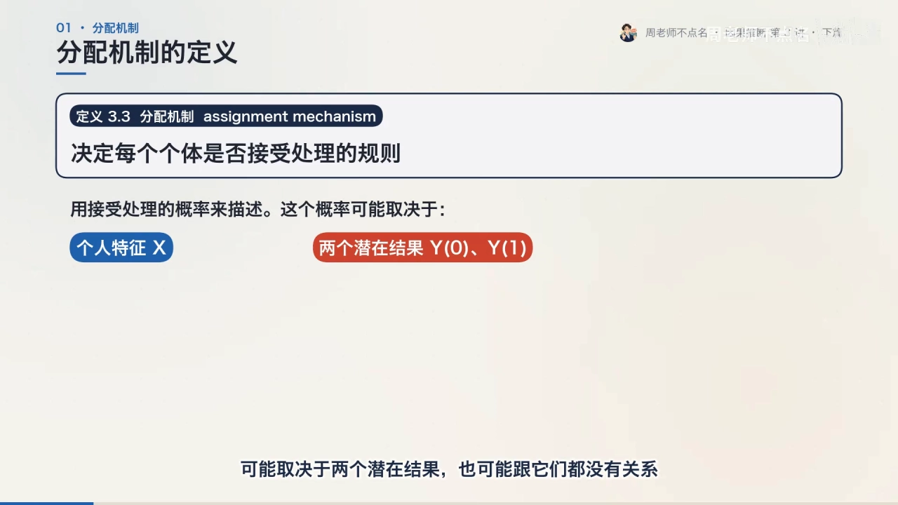
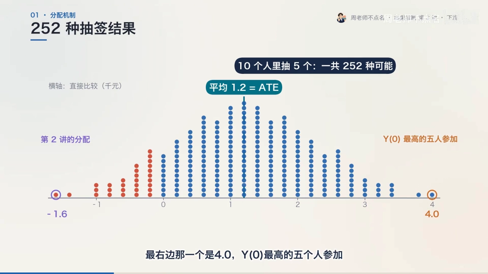
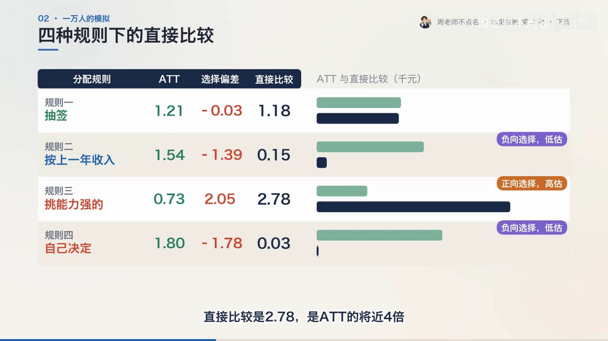
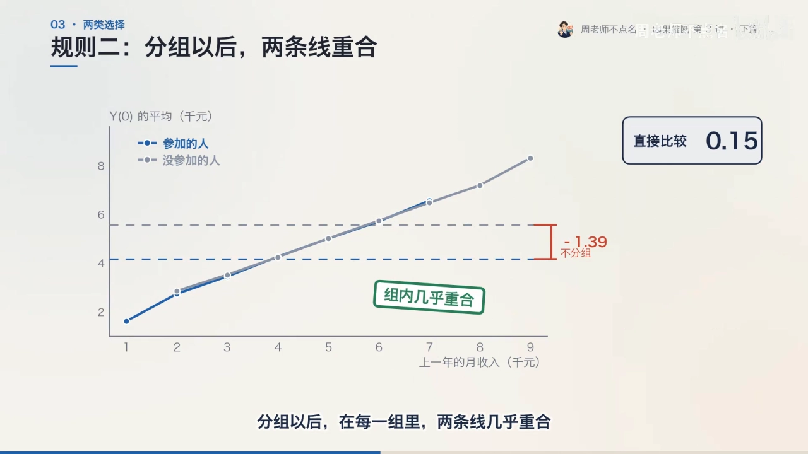
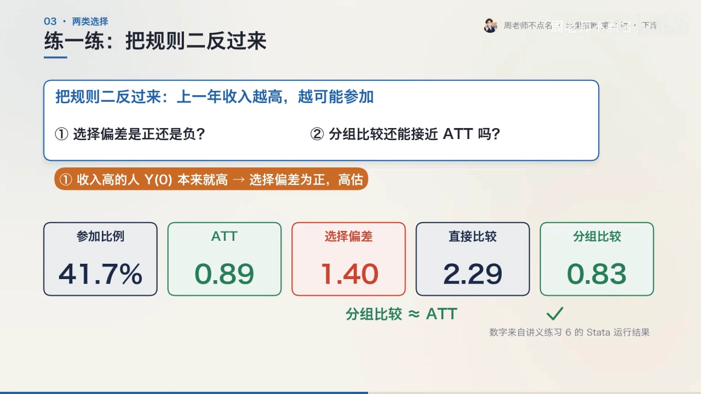
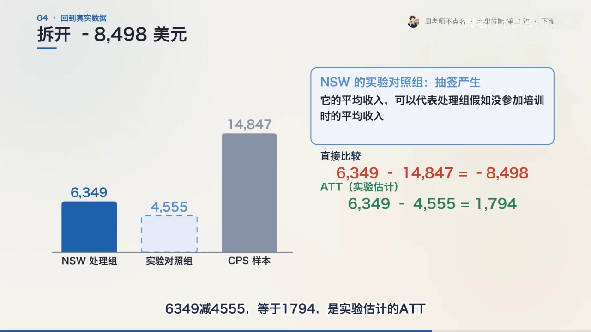
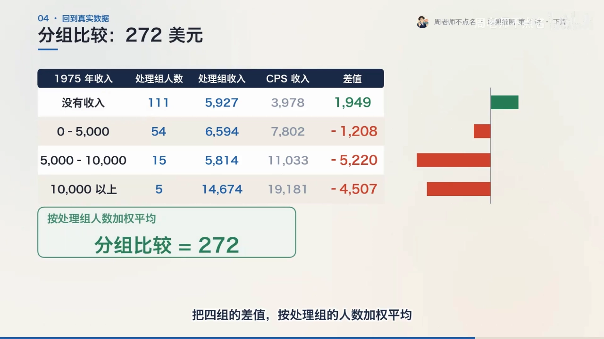

# 选择偏差从哪里来：分配机制决定偏差方向，分组比较能消掉多少

> 视频来源：[因果推断系列课 03 下：选择偏差从哪来（下）](https://www.bilibili.com/video/BV1K2WD67EhU/?t=0)（Bilibili · 周老师不点名）｜时长约 27 分钟
> 本文基于视频演说图文稿整理，配图截自视频。本文是 03 上的续篇：上篇把直接比较拆成"ATT + 选择偏差"，本篇回答"什么样的选择能消掉、什么样的消不掉"。

## 本讲要解决的核心问题（SCQA）

**背景**：上篇已经证明，直接比较恒等于 ATT 加选择偏差，而选择偏差要用到处理组的反事实，**算不出来**。

**冲突**：既然算不出来，是不是所有观察研究都只能认命？并不。有些选择偏差能靠"分组比较"消掉，有些无论怎么分组都去不掉，而这两类在数据里长得几乎一样。

**疑问**：偏差从哪里来？凭什么判断一项研究属于哪一类？分组比较到底能消掉多少？

**回答（中心思想）**：偏差来自**分配机制**——决定"谁接受处理"的那条规则。按它取决于什么，分成三类：**随机分配**（偏差平均为零）、**可观测变量上的选择**（在可观测变量相同的人之间比较就能消掉）、**不可观测变量上的选择**（分组比较只能消掉看得到的那一部分）。所以挑研究方法的第一步，是判断你的研究属于哪一类——而这**没法用数据检验**，只能靠对分配过程的了解去论证。

---

## 一、分配机制：谁接受处理，决定了偏差有多大、往哪边偏

同一个培训班可以有好几种招人办法：让求职者自己报名、由培训机构面试挑人、按上一年的收入划一条线、或者干脆抽签。办法不同，进来的人就不同，两组人的 $Y(0)$ 也就不同 [【跳转到 02:13】](https://www.bilibili.com/video/BV1K2WD67EhU/?t=133)。

正式的定义是：**决定每个个体是否接受处理的规则**叫分配机制，它可以用"每个人接受处理的概率"来描述 [【跳转到 02:30】](https://www.bilibili.com/video/BV1K2WD67EhU/?t=150)：

$$
e_i(X_i) = P\big(D_i = 1 \mid X_i,\; Y_i(0),\; Y_i(1)\big)
$$

其中 $X_i$ 是研究者能观测到的特征（年龄、学历、上一年的收入等）。按这个概率取决于什么，分配机制分成三类 [【跳转到 02:50】](https://www.bilibili.com/video/BV1K2WD67EhU/?t=170)：

| 类别 | 接受处理的概率取决于 | 例子 | 偏差能否消掉 |
| --- | --- | --- | --- |
| 随机分配 | 跟谁的条件都无关，对所有人相同 | 抽签 | 平均为零 |
| 可观测变量上的选择 | 只取决于研究者看得到的 $X$，与潜在结果无关 | 只按年龄、学历、上一年收入挑人 | 在 $X$ 相同的人之间比较即可 |
| 不可观测变量上的选择 | 还取决于研究者看不到、又影响潜在结果的因素 | 求职者按自己对培训收益的估计报名；名校按申请材料里的才能和动机录取 | 分组比较只能消掉一部分 |

社会科学研究用的大多是观测数据，谁接受处理通常是个人或机构自己选的，不由研究者分配，所以**第三类最常见也最难处理**，这门课后面的大部分方法都是为了对付它 [【跳转到 03:40】](https://www.bilibili.com/video/BV1K2WD67EhU/?t=220)。

### 1.1 四个小练习

视频给了四个场景让你分类 [【跳转到 04:05】](https://www.bilibili.com/video/BV1K2WD67EhU/?t=245)：

- 保障房按抽签分配 → **随机分配**（跟任何条件都无关）。
- 银行只看信用评分、超过 650 分就放贷，且研究者手里也有这个评分 → **可观测变量上的选择**。
- 员工自己决定要不要读在职 MBA → **不可观测变量上的选择**（看的是志向、能力、对回报的预期，研究者大多看不到）。
- 学校按入学考试分数分快慢班，分数在数据里 → **可观测变量上的选择** [【跳转到 04:55】](https://www.bilibili.com/video/BV1K2WD67EhU/?t=295)。

---

## 二、十个人的数据：换一种分配，就换一个偏差

全知表不变，只换谁参加 [【跳转到 05:12】](https://www.bilibili.com/video/BV1K2WD67EhU/?t=312)：

| 分配方式 | 选择偏差 | 直接比较 |
| --- | --- | --- |
| $Y(0)$ 最低的五个人参加 | $-3.6$ | $-1.6$ |
| $Y(0)$ 最高的五个人参加 | $3.6$ | $4.0$ |
| 单号参加、双号不参加 | $-0.4$ | 接近 ATE |
| 十个人里随机抽五个 | 平均为 $0$ | 平均等于 ATE $1.2$ |

单号参加、双号不参加时偏差小了很多，可**还不是零**——编号和收入没有关系，但这一次恰好抽到的人不太一样。

### 2.1 抽签：252 种结果，平均为零但不总是零

十个人里抽五个，一共有 252 种可能。把 252 种结果都算出来，选择偏差的平均恰好是零，直接比较的平均恰好是 1.2，就是 ATE [【跳转到 05:37】](https://www.bilibili.com/video/BV1K2WD67EhU/?t=337)。

这张图说明两点 [【跳转到 06:20】](https://www.bilibili.com/video/BV1K2WD67EhU/?t=380)：

1. **抽签让选择偏差平均为零**，直接比较平均来说等于 ATE。
2. **平均为零不等于每一次都为零**：252 种结果里选择偏差恰好为零的只有 28 种；直接比较落在 0.8 到 1.6 之间的有 90 种（1/3 多一点）；还有 29 种直接比较是负的。

只有十个人的时候抽签的运气成分很大；人数多了，直接比较会越来越集中在 ATE 附近 [【跳转到 06:45】](https://www.bilibili.com/video/BV1K2WD67EhU/?t=405)。

---

## 三、1 万人的模拟：四种规则，四种偏差

回到第二讲 1 万名求职者的模拟数据：每个人的能力观测不到，能力高的人不参加培训时收入也高，从培训中得到的收益却小，个体效应的平均 ATE 是 1.2（1200 元）。再给这批人加一个**看得到**的变量：上一年的月收入（取整到千元，1 到 9）[【跳转到 07:10】](https://www.bilibili.com/video/BV1K2WD67EhU/?t=430)。

上一年收入和能力有关（与 $Y(0)$ 的相关系数 0.76），但它**不等于**能力：上一年收入相同的人，能力还是有高有低 [【跳转到 07:35】](https://www.bilibili.com/video/BV1K2WD67EhU/?t=455)。

在这批人身上用四种规则分配，每种规则下都有大约四成的人参加 [【跳转到 07:50】](https://www.bilibili.com/video/BV1K2WD67EhU/?t=470)：

1. **抽签**：每人四成机会被抽中。
2. **按上一年的收入挑人**：收入越低参加概率越高，收入相同的人概率相同，最后选不选中再由抽签决定。
3. **机构挑能力强的人**：培训机构通过面试挑它认为有潜力的人——面试看到的能力研究者观测不到。
4. **自己决定**：预期收益大、眼下收入低的人更愿意报名。

其中规则一是随机分配，规则二是可观测变量上的选择，规则三和规则四是不可观测变量上的选择 [【跳转到 08:53】](https://www.bilibili.com/video/BV1K2WD67EhU/?t=533)。

结果 [【跳转到 09:13】](https://www.bilibili.com/video/BV1K2WD67EhU/?t=553)：

- 抽签：直接比较 $1.18$，和 ATT $1.21$ 只差一点抽样误差。
- 规则二、规则四：挑的都是收入低的人，属于负向选择，直接比较分别是 $0.15$ 和 $0.03$，严重低估。
- 规则三：挑的是能力强的人，属于正向选择，直接比较 $2.78$，是 ATT 的将近四倍。

四行都满足同一个式子：ATT + 选择偏差 = 直接比较，个别行因为四舍五入有 0.01 的出入 [【跳转到 09:38】](https://www.bilibili.com/video/BV1K2WD67EhU/?t=578)。

### 3.1 一个容易误导决策的组合

注意 ATT 本身也在变：四种规则下从 0.73 到 1.80 不等，因为参加的是不同的人。规则三挑的是能力强的人，他们从培训中得到的收益最小，ATT 只有 0.73 [【跳转到 09:52】](https://www.bilibili.com/video/BV1K2WD67EhU/?t=592)。

于是出现了最坏的一种组合：**机构挑它认为最有潜力的人，结果把名额给了最不需要培训的人；而直接比较却显示培训效果最好**。这种组合在现实里并不少见，很容易误导下一步的决策 [【跳转到 10:08】](https://www.bilibili.com/video/BV1K2WD67EhU/?t=608)。

---

## 四、可观测变量上的选择：分组比较怎么把偏差消掉

规则二里，是否参加只取决于上一年的收入，而这个变量研究者看得到。上一年收入相同的人参加不参加完全由抽签决定，所以**在上一年收入相同的人当中，参加的和没参加的是可比的** [【跳转到 10:19】](https://www.bilibili.com/video/BV1K2WD67EhU/?t=619)。

写成条件就是：

$$
E\big[Y_i(0) \mid X_i = x,\; D_i = 1\big] = E\big[Y_i(0) \mid X_i = x,\; D_i = 0\big]
$$

注意它比"全体处理组和全体对照组可比"弱得多：**只要求 $X$ 取值相同的人可比** [【跳转到 10:43】](https://www.bilibili.com/video/BV1K2WD67EhU/?t=643)。

条件成立时的做法叫**分组比较**：先在 $X$ 的每个取值里比较两组人的观测收入，得到组内差值，再按处理组在各组的人数加权平均 [【跳转到 11:04】](https://www.bilibili.com/video/BV1K2WD67EhU/?t=664)。

### 4.1 手算一遍：负数怎么变成正数

视频用两个收入组的小例子演示 [【跳转到 11:23】](https://www.bilibili.com/video/BV1K2WD67EhU/?t=683)：

| 组 | 参加人数 | 参加平均 | 没参加人数 | 没参加平均 | 组内相减 |
| --- | --- | --- | --- | --- | --- |
| 低收入组 | 60 | 4.0 | 40 | 3.0 | $+1.0$ |
| 高收入组 | 20 | 7.0 | 80 | 6.5 | $+0.5$ |

- **直接比较**：参加的 80 人平均 $4.75$，没参加的 120 人平均约 $5.33$，一减是 $-0.58$，看起来培训有害。
- **分组比较**：低收入组 $1.0$、高收入组 $0.5$，按参加人数加权 $\frac{60 \times 1.0 + 20 \times 0.5}{80} = 0.875$——一个负数分组以后变成了正数 [【跳转到 11:48】](https://www.bilibili.com/video/BV1K2WD67EhU/?t=708)。

原因是**构成**：参加的人大多在低收入组，没参加的人大多在高收入组，整体一比，比的其实是"收入低的一群"和"收入高的一群" [【跳转到 12:13】](https://www.bilibili.com/video/BV1K2WD67EhU/?t=733)。

### 4.2 在模拟数据里看：组内两条线重合

在 1 万人的模拟数据里，上一年收入有九个取值，就分成九组 [【跳转到 12:21】](https://www.bilibili.com/video/BV1K2WD67EhU/?t=741)：

- 不分组时：参加的人 $Y(0)$ 平均 $4.18$，没参加的人 $5.57$，选择偏差 $-1.39$。
- 分组以后：在每一组里两条线**几乎重合**，选择偏差完全来自两组人的构成不同。

分组比较的结果是 $1.50$，和 ATT $1.54$ 只差一点抽样误差 [【跳转到 12:46】](https://www.bilibili.com/video/BV1K2WD67EhU/?t=766)。

### 4.3 把规则二反过来，分组比较照样有效

练习：改成"上一年收入越高越可能参加"，先预测偏差方向。收入高的人 $Y(0)$ 本来就高，所以选择偏差是正的，直接比较会高估 [【跳转到 13:24】](https://www.bilibili.com/video/BV1K2WD67EhU/?t=804)。

跑出来的结果：ATT $0.89$、选择偏差 $1.40$、直接比较 $2.29$（比 ATT 高出的正好是选择偏差）；分组比较是 $0.83$，和 ATT 只差一点抽样误差 [【跳转到 13:49】](https://www.bilibili.com/video/BV1K2WD67EhU/?t=829)。

**分配仍然只取决于看得到的上一年的收入，方向反过来，分组比较照样有效**。

---

## 五、不可观测变量上的选择：分组比较只能消掉一部分

### 5.1 规则三：按收入分组，两条线始终分开

同样按上一年的收入分组，在每一组里参加的人 $Y(0)$ 还是比没参加的人高出 0.7 到 0.9 千元，两条线始终分开 [【跳转到 14:14】](https://www.bilibili.com/video/BV1K2WD67EhU/?t=854)。

原因：面试挑中的是能力强的人，而上一年收入相同的人能力并不相同。研究者只能按收入分组，**没法按能力分组**。分组比较的结果是 $1.55$，比直接比较 $2.78$ 更接近 ATT $0.73$，可还是高出一倍多 [【跳转到 14:39】](https://www.bilibili.com/video/BV1K2WD67EhU/?t=879)。

### 5.2 规则四：罗伊模型

规则四的分组比较是 $1.03$，比 ATT $1.80$ 还低 $0.77$ [【跳转到 14:56】](https://www.bilibili.com/video/BV1K2WD67EhU/?t=896)。

规则四代表的情形在经济学里有名字：罗伊 1951 年研究职业选择时提出，**人们会选对自己收益最大的那条路**，所以选择的结果本身就带着个人潜在结果的信息。这种按收益自选择的模型后来叫**罗伊模型** [【跳转到 15:10】](https://www.bilibili.com/video/BV1K2WD67EhU/?t=910)。

只要个人比研究者更了解自己的收益、自己决定是否接受处理，就会造成不可观测变量上的选择。求职者报不报名培训、学生读不读研、企业申不申请补贴，大多属于这种情形 [【跳转到 15:35】](https://www.bilibili.com/video/BV1K2WD67EhU/?t=935)。

注意规则三和规则四的**方向相反**：一个高估、一个低估。方向还是要靠上篇那个问题去判断。

### 5.3 方法地图

区分两类选择是挑研究方法的第一步 [【跳转到 15:54】](https://www.bilibili.com/video/BV1K2WD67EhU/?t=954)：

| 分配机制 | 应对思路 | 课程里的位置 |
| --- | --- | --- |
| 随机分配 | 直接比较就行 | 第 4 讲：随机实验 |
| 可观测变量上的选择 | 在可观测变量相同的人之间比较 | 回归、匹配、倾向得分（第 6–12 讲） |
| 不可观测变量上的选择 | 找不受这些因素影响的处理变化 | 工具变量、双重差分、断点回归（第 13–27 讲） |

第三类方法并不需要把看不到的因素找出来，它们换一个比较对象，或者只用处理里跟这些因素无关的那一部分变化。可它们各自需要另外的假设，比如双重差分要**平行趋势**假设。**没有哪种方法能不做任何假设就消除不可观测变量上的选择** [【跳转到 16:24】](https://www.bilibili.com/video/BV1K2WD67EhU/?t=984)。

一项研究属于哪一类，**没法用数据检验**，只能靠对分配过程的了解去论证：谁提出申请、谁做决定、依据什么做决定，这些信息常常比统计方法更重要 [【跳转到 16:49】](https://www.bilibili.com/video/BV1K2WD67EhU/?t=1009)。

### 5.4 三个小练习

- 某城市按家庭收入分档、每档里抽签发消费券，研究者知道每户的收入 → **能消掉**：分档以后同一档里谁拿到券完全靠抽签 [【跳转到 17:14】](https://www.bilibili.com/video/BV1K2WD67EhU/?t=1034)。
- 企业自己决定申不申请创新补贴 → **消不掉**：申请与否看的是企业对研发前景的判断，按规模、行业分组只能消掉看得到的那一部分。
- 医生看化验结果、也看自己对病人的观察决定用不用新药，病历里只有化验结果 → **只能消掉一部分**：化验结果可以用来分组，医生对病人的观察不进病历，这部分偏差还在 [【跳转到 17:39】](https://www.bilibili.com/video/BV1K2WD67EhU/?t=1059)。

---

## 六、真实数据：把 $-8498$ 美元拆开

NSW 是美国 20 世纪 70 年代中期的一个就业支持项目，给参加者提供 6 到 18 个月的工作机会。项目有四类服务对象：长期领取救济的单身母亲、戒毒人员、有犯罪前科的失业者、年轻的辍学者 [【跳转到 17:59】](https://www.bilibili.com/video/BV1K2WD67EhU/?t=1079)。

报名还有两个条件：目前失业（此前四周工作不超过 40 小时），且此前六个月里在任何一份每周 20 小时以上的正式工作上都没有做满三个月。视频用的男性样本来自后三类人：参加者平均 26 岁左右，七成没有高中文凭，培训前一年的收入只有 1000 多美元 [【跳转到 18:15】](https://www.bilibili.com/video/BV1K2WD67EhU/?t=1095)。

对照组 CPS 是同期 55 岁以下的美国男性，平均 33 岁，培训前一年的收入超过 1 万 3000 美元。用上篇那个问题判断：假如 NSW 的参加者没有参加培训，他们 1978 年的收入会比 CPS 样本里的人高还是低？**显然会低得多** [【跳转到 18:40】](https://www.bilibili.com/video/BV1K2WD67EhU/?t=1120)。

报名条件本身就要求目前失业、近期没有稳定工作，项目专门挑就业最困难的人，这是一个**强烈的负向选择** [【跳转到 19:01】](https://www.bilibili.com/video/BV1K2WD67EhU/?t=1141)。

### 6.1 实验对照组提供了反事实

NSW 的特别之处是它有一个**由抽签产生的实验对照组**，它的平均收入可以代表处理组假如没参加培训时的平均收入 [【跳转到 19:25】](https://www.bilibili.com/video/BV1K2WD67EhU/?t=1165)。

三个数：处理组 $6349$、实验对照组 $4555$、CPS 样本 $14847$。于是 [【跳转到 19:50】](https://www.bilibili.com/video/BV1K2WD67EhU/?t=1190)：

$$
\underbrace{6349 - 14847}_{-8498} = \underbrace{(6349 - 4555)}_{1794\;=\;\text{ATT}} + \underbrace{(4555 - 14847)}_{-10292\;=\;\text{选择偏差}}
$$

画成瀑布图：从 CPS 样本的 14847 出发，减去选择偏差 10292 落到 4555，再加上培训效应 1794 到达 6349 [【跳转到 20:06】](https://www.bilibili.com/video/BV1K2WD67EhU/?t=1206)。

**选择偏差是 ATT 的 5.7 倍**：培训让参加者的年收入多了大约 1800 美元，可这些人原本就比 CPS 样本里的人少挣 1 万多美元，前者完全被后者淹没了 [【跳转到 20:22】](https://www.bilibili.com/video/BV1K2WD67EhU/?t=1222)。

### 6.2 按 1975 年收入分组：$-8498$ 变成 272

这个选择偏差有多少来自看得到的变量？培训前的收入看得到，又和 1978 年的收入关系密切。按 1975 年的收入把样本分成四组（没有收入、0–5000、5000–1 万、1 万以上），两组人的构成截然不同 [【跳转到 20:32】](https://www.bilibili.com/video/BV1K2WD67EhU/?t=1232)：

- 处理组 185 人里有 111 人 1975 年没有收入，而 CPS 样本里这个比例只有一成多；
- CPS 样本里有将近 1 万人 1975 年收入在 1 万美元以上，处理组只有 5 人。

在每一组里比较，再把四组差值按处理组人数加权平均 [【跳转到 21:21】](https://www.bilibili.com/video/BV1K2WD67EhU/?t=1281)：

$$
\frac{111 \times 1949 + 54 \times (-1208) + 15 \times (-5220) + 5 \times (-4507)}{185} = 272
$$

按一个变量分组，$-8498$ 就变成了 $272$，符号变成了正；可它离实验结果 1794 还有大约 1500 的距离——**选择偏差的大部分来自培训前收入这个看得到的差别，但还没有完全消除** [【跳转到 21:46】](https://www.bilibili.com/video/BV1K2WD67EhU/?t=1306)。

### 6.3 剩下的偏差从哪来

看 1974 年和 1975 年都没有收入的人：NSW 处理组 109 人，1978 年平均收入 5954 美元；实验对照组 171 人、4112 美元；CPS 样本 1181 人、2947 美元 [【跳转到 22:16】](https://www.bilibili.com/video/BV1K2WD67EhU/?t=1336)。

在这群人里，实验对照组反而比 CPS 样本**多挣** 1165 美元，选择偏差变成了正的。这说明两年都没有收入的人，在两个样本里**不是同一种人**：NSW 的参加者都主动申请了项目，至少有找工作的意愿；CPS 里两年没有收入的人有些可能根本没在找工作，数据里分不出这两种人 [【跳转到 23:00】](https://www.bilibili.com/video/BV1K2WD67EhU/?t=1380)。

这就是不可观测变量上的选择。这里之所以算得出剩下多少偏差，是因为手里有实验对照组做参照——**绝大多数研究没有这个条件** [【跳转到 23:25】](https://www.bilibili.com/video/BV1K2WD67EhU/?t=1405)。

---

## 七、四个容易混淆的问题

视频最后澄清了四组概念 [【跳转到 23:50】](https://www.bilibili.com/video/BV1K2WD67EhU/?t=1430)：

1. **选择偏差 vs 样本选择偏差**：选择偏差说的是"谁接受处理"，样本选择偏差说的是"谁进入样本"。前者让两组人不可比，后者让样本代表不了总体；赫克曼两步法处理的是后者。
2. **选择偏差 vs 混杂偏差**：混杂偏差是**共同原因**同时影响处理和结果造成的，共同原因让两组人的 $Y(0)$ 不同，所以混杂偏差是选择偏差的一种来源——规则三里的能力就是一个共同原因 [【跳转到 24:15】](https://www.bilibili.com/video/BV1K2WD67EhU/?t=1455)。
3. **加了控制变量不等于消除了选择偏差**：控制变量只能处理可观测变量上的选择，还得控制得足够细。名校的例子里本人 SAT 和高中排名都控制了，偏差依然很大。
4. **显著不等于无偏**：回归系数显著只说明它不太像是抽样误差造成的，跟选择偏差无关 [【跳转到 24:40】](https://www.bilibili.com/video/BV1K2WD67EhU/?t=1480)。

---

## 小结

- **分配机制决定选择偏差的大小和方向**：随机分配让它平均为零；可观测变量上的选择能在 $X$ 相同的人之间比较来消除；不可观测变量上的选择，分组比较只能消掉看得到的那一部分。
- **抽签平均为零，但不保证每一次为零**：252 种抽签结果里只有 28 种偏差恰好为零，还有 29 种直接比较是负的。
- **分组比较是可观测选择的标准解法**：先在各组内相减，再按处理组人数加权平均；它能把"构成不同"造成的偏差消掉。
- **不可观测选择靠换比较对象**：匹配、双重差分、工具变量、断点回归，各自需要额外假设，没有哪种方法能不做假设就解决问题。
- **判断研究属于哪一类没法用数据检验**，只能靠对分配过程的了解去论证——谁申请、谁决定、依据什么。
- **NSW 的真实例子**：$-8498$ 美元里约 $-10292$ 是选择偏差；按 1975 年收入分组后变成 $272$，剩下的部分方向不定。

## 关键术语速查

| 术语 | 一句话解释 |
| --- | --- |
| 分配机制 | 决定每个个体是否接受处理的规则，用"接受处理的概率"描述 |
| 随机分配 | 接受处理的概率对所有人相同、与潜在结果无关，如抽签 |
| 可观测变量上的选择 | 接受处理的概率只取决于研究者看得到的 $X$ |
| 不可观测变量上的选择 | 概率还取决于研究者看不到、又影响潜在结果的因素 |
| 分组比较 | 在 $X$ 的每个取值内比较两组，再按处理组人数加权平均 |
| 罗伊模型 | 人们按自身收益最大化自选择的模型，是典型的不可观测选择 |
| 平行趋势假设 | 双重差分需要的假设：没有处理时两组的变化趋势相同 |
| 样本选择偏差 | 谁进入样本造成的偏差，与"谁接受处理"的选择偏差不同 |