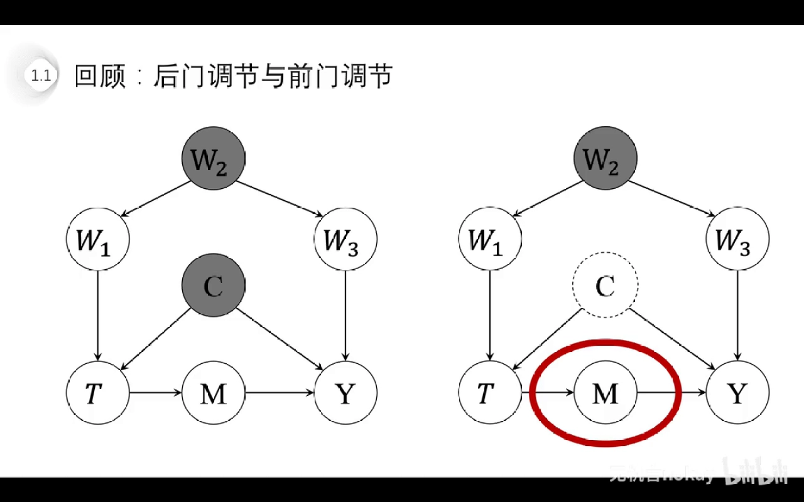
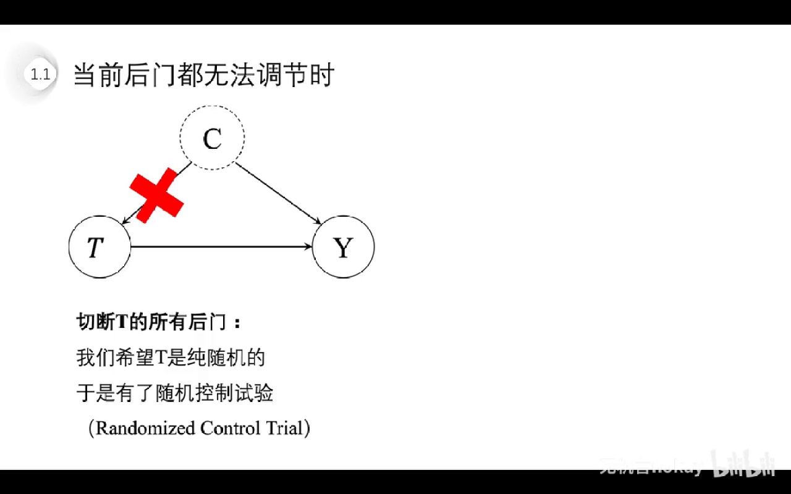
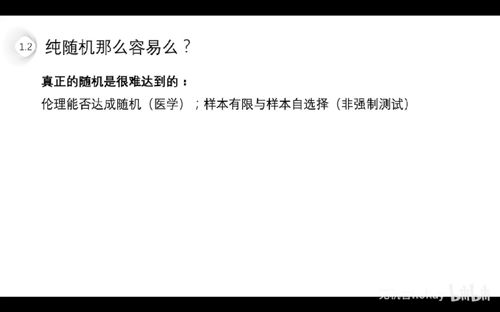
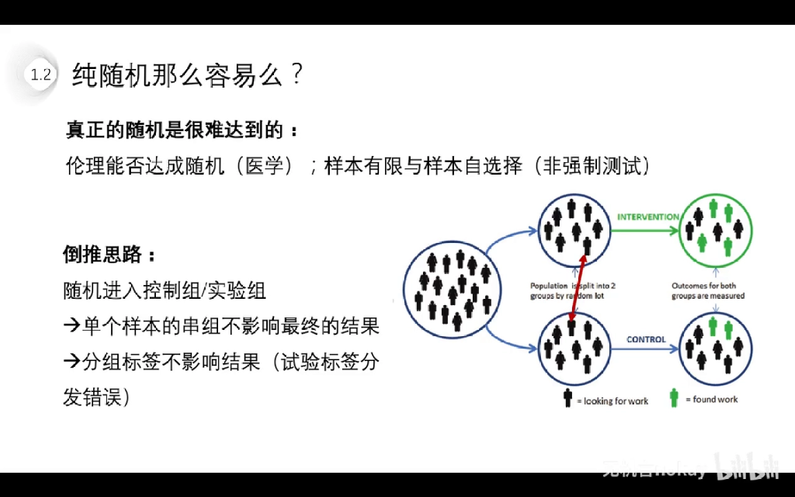
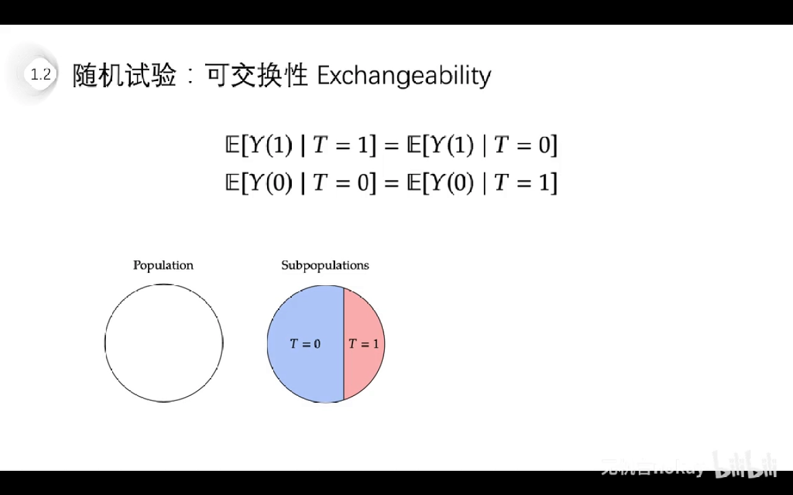
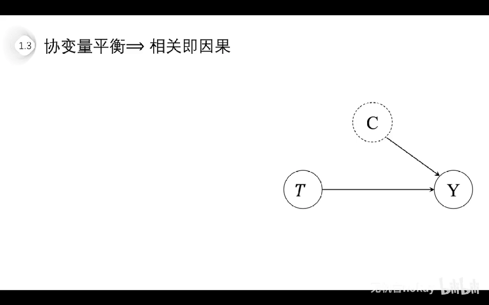
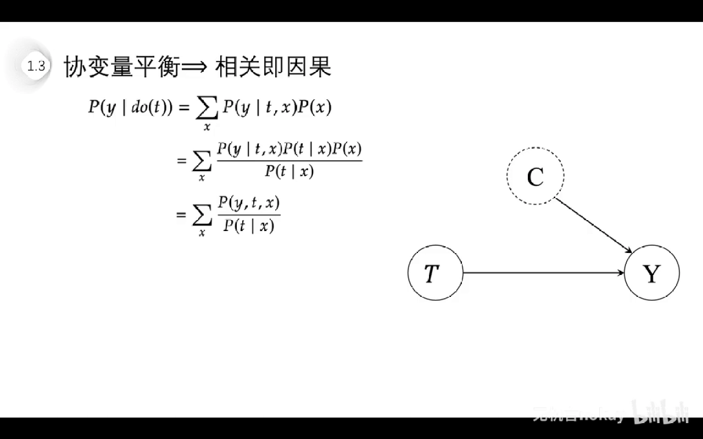

# 随机实验的识别条件：可交换性、协变量平衡与相关即因果

> 视频来源：[【金融科技工具箱3】因果推断：4.随机试验｜4.1 随机试验的理论原理](https://www.bilibili.com/video/BV1Mh411v7xU/?p=1)（Bilibili · 无机言_nokay）｜时长约 16 分钟
> 导读：这一讲接着前几节的后门调节、前门调节往下走，回答一个更根本的问题：如果后门堵不住、前门也找不到，还能怎么办？答案是**改造实验本身**——让"是否进入实验组"变成一次纯随机事件，于是指向处理变量的所有后门被一次性切断。本文按原讲顺序整理：先回顾后门/前门调节的共同目标，再讲随机实验的两个可检验性质（可交换性、协变量平衡），最后走一遍"协变量平衡 ⇒ 相关即因果"的推导。字幕为本地语音识别生成，错拼（如"谐变量/鞋变量"→协变量、"知应币"→掷硬币、"相关机因果"→相关即因果、"AVT"→AB test）已按上下文订正。

## 本讲要解决的核心问题（SCQA）

**背景**：前面几节讲的都是"从观测数据里把因果挖出来"：后门调节控制住一组协变量，前门调节借一个中介变量做两步调整。两者都在做同一件事——把从混淆变量 C 指向处理 T 的那条路切断。

**冲突**：这两种办法都有前提。后门调节要求调整集**可观测**；前门调节要求存在一个满足三条性质的中介变量 M。如果 C 是不可观测的、又找不到合适的 M，这条路就断了。do 演算虽然告诉我们"所有可识别的因果都能识别"，但代价是复杂的函数估计。

**疑问**：有没有一种办法，不是去**算**得更聪明，而是直接**改**因果图？如果我能控制"谁进入实验组"，能不能让 C → T 这条边根本不存在？

**回答（中心思想）**：能。把"是否进入实验组"变成一次**纯随机事件**（掷硬币），C → T 这条边就被切断了，因为 T 不再由任何变量决定。这就是随机控制实验（RCT）。随机化带来两个性质：**可交换性**（谁进哪一组，其潜在结果分布相同）和**协变量平衡**（两组的协变量分布相同）。前者是思想实验，后者可以拿数据检验；而协变量平衡一旦成立，"相关即因果"就能一步步推出来。

[【跳转到 02:40】](https://www.bilibili.com/video/BV1Mh411v7xU/?p=1&t=160)

## 一、回顾：后门与前门都在切断 C → T

讲者先用一张图把上节课的内容收一遍。从 T 到 Y 有一条我们想分析的因果路径 T → M → Y，另外还有两条（或多条）路径：它们不是因果路径，但因为和 T、Y 共享影响变量，变成了混淆路径。后门调节的思路就是把这些后门路径全部切断——控制住 W2 和 C，剩下的相关关系就只保留在 T → M → Y 这条因果路径上。**控制了后门路径之后，相关就是因果。**

前门调节则用于后门调节做不了的情形，比如共同的影响因素是一个不可观测的变量。这时需要一个中介变量 M，它满足两个条件：第一，所有 T 到 Y 的因果路径全部经过 M；第二，M 到 Y 的后门路径全部被 T 控制住。在这样特殊的因果图状态下，可以用前门调节。

## 二、换一个思路：不改算法，改图

那么当前门、后门都无法调节时怎么办？讲者说，do 演算确实能识别所有可识别的因果关系，但这里先不做那么复杂的，而是"往后撤一步"：**因果图长这个样子，有没有办法把它改变一下？**

观察一下就会发现，后门调节和前门调节无一例外都在干同一件事——想把 C 到 T 这条路切断，让实验不受任何外在因素影响。那么怎样才能达到这个效果？答案是：**切断 T 的所有后门，也就是让我构造的这个实验里，"是否进入实验组"是一个完全随机的事件。**

[【跳转到 04:20】](https://www.bilibili.com/video/BV1Mh411v7xU/?p=1&t=260)

按这个思路，就有了随机控制实验，也就是 RCT。讲到随机，我们往往讲的是掷硬币：通过一个完全随机的处置（比如掷硬币）来决定一组人是进入实验组，还是留在控制组。

### 2.1 纯随机并不容易

讲者紧接着泼了一盆冷水：**真正的随机其实很难达到**。

- **医学上的难点是伦理**。一个药经过一期、二期临床或预实验，你大概已经知道它是有用的。这时候来了一个危重病人，你能强行把他分配到控制组吗？在做"一组有效药物、一组安慰剂"的试验时，这个问题尤其尖锐。
- **经济学与互联网上的难点是样本自选择**。你只能控制"来的人被分到哪个组"，控制不了"什么样的人会来"。比如给不同用户推送方案 A 和方案 B，推送这一步可以做到纯随机，但什么样的用户此刻打开手机、打开 APP，你决定不了。

[【跳转到 05:00】](https://www.bilibili.com/video/BV1Mh411v7xU/?p=1&t=300)

这段提醒很重要：随机化是一个**设计目标**，不是一句声明。真实实验里"随机"能做到什么程度，本身就要打问号。

## 三、可交换性：把标签打乱，结果不变

讲者用一个思想实验引出随机实验的第一个性质。假设 A 组里有个人说不想待在 A 组了，已经和 B 组一个人说好要换——如果你的随机分组是真的随机，理论上**应该答应他**，因为所有人的分配本来就是完全随机的。再比如，你给两组人编号，编号 1 接受方案 A、编号 2 接受方案 B；实验进行到一半，助手说"对不起老师，我把 1 和 2 的标签发混了"。如果你的分组是纯随机的，你**不应该在乎**，因为无论怎样它都是一个随机方案。

[【跳转到 08:20】](https://www.bilibili.com/video/BV1Mh411v7xU/?p=1&t=500)

由此得到随机实验的第一个特性：**可交换性**。它的意思是，无论一个人被分到实验组（$T=1$）还是控制组（$T=0$），他隐含的最终结果分布是相同的：

$$
\mathbb{E}[Y(1) \mid T=1] = \mathbb{E}[Y(1) \mid T=0], \qquad
\mathbb{E}[Y(0) \mid T=0] = \mathbb{E}[Y(0) \mid T=1]
$$

[【跳转到 09:20】](https://www.bilibili.com/video/BV1Mh411v7xU/?p=1&t=560)

讲者解释符号：$T=1$、$T=0$ 指被分到哪一组；$Y(1)$、$Y(0)$ 指这组人接受实验和被控制时预期的 outcome。为什么要假定这件事？因为我们能观察到的数据是一个总体被分成两个组，而我们真正想算的是整个群体"被干预"与"被控制"之间的差别。可交换性保证的正是：被干预的预期和被控制的预期**可比**——无论编号怎样、分到哪组，实际被干预的值和被控制的预期值都是一样的。

用微观的话说：实验对象之间可以交换，不影响结果；标签可以被整体打乱，也不影响结果。它的实际思想是**在群体层面做一个反事实的对照**。

## 四、协变量平衡：可交换性中可检验的那一半

讲者接着追问：两个男生对调，我们觉得没问题；但一个男生和一个女生对调呢？这时两组的性别比例可能就变了，心里会觉得"有点区别"。

所以个体层面的可交换还蕴含一个条件：除了关心的 outcome $Y$ 和实验控制 $T$ 之外，**一切协变量 $X$ 在两个群体之间要同分布**；或者说 $T$ 和 $X$ 在样本内不相关——$X$ 无论怎么变，都不会影响 $T$。

这就引出随机实验的第二个重要性质：**协变量平衡**。它的意思是，在 $T=1$ 的实验组和 $T=0$ 的控制组，$X$ 在分布上相等。注意这不是要求每个个体的 $X$ 相同，而是要求两组里这些协变量的**分布**具有一样的性质。

[【跳转到 12:00】](https://www.bilibili.com/video/BV1Mh411v7xU/?p=1&t=720)

讲者特意点出两者的分工：**可交换性更接近一个思想实验，而协变量平衡是我们可以去验证的**。想看两组数据里 $X$ 的分布是否相似、是否相同，跑一个回归或者对每一个 $X$ 跑一个 t 检验就能看出来。因此协变量平衡有非常强的可验证性——这也是实际论文里"基线表"存在的意义。

## 五、协变量平衡 ⇒ 相关即因果

有了协变量平衡，就能推出一个"我们非常喜欢"的性质：**相关即因果**。如果实验组和控制组所有的协变量都平衡，那么算出来的相关值就是我们想要的因果值；用图的话说，C 到 T 的所有后门路径全部被切断了。

[【跳转到 13:40】](https://www.bilibili.com/video/BV1Mh411v7xU/?p=1&t=820)

推导本身很简单，讲者一步步走了一遍：

1. 从后门控制公式出发，把干预后的 $P(y \mid do(t))$ 写成 $\sum_x P(y \mid t, x) P(x)$；
2. 上下同乘 $P(t \mid x)$，这是做数学证明的常用技巧；
3. 分子用贝叶斯法则写成联合分布 $P(y, t, x)$，分母就是 $P(t \mid x)$；
4. **关键一步**：由协变量平衡，$X$ 与 $T$ 正交，于是分母里的 $P(t \mid x)$ 可以把 $x$ 去掉，写成 $P(t)$；
5. 再用一次贝叶斯法则，把 $P(t)$ 挪下去，得到 $P(y \mid t)$。

[【跳转到 14:40】](https://www.bilibili.com/video/BV1Mh411v7xU/?p=1&t=880)

讲者总结：纵观整个证明，用到的协变量平衡特性**只有这一步**——把 $P(t \mid x)$ 变成 $P(t)$。这就是"协变量平衡导致相关即因果"的全部机制。

## 六、这一讲在实验设计里意味着什么

**（1）随机化是"改图"，不是"算得更准"。** 后门调节和前门调节都是在给定的因果图上做条件化；随机化则是直接把 C → T 这条边删掉。前者依赖"调整集可观测"或"中介变量存在"，后者依赖"分配机制真的随机"。

**（2）随机化要能被检验。** 可交换性无法直接验证（潜在结果只观测到一个），但协变量平衡可以：对每个基线变量做组间比较。因此"随机化成功了吗"这个问题在实践中被翻译成"基线平衡吗"——这也解释了为什么论文里必须报告基线表。

**（3）协变量平衡是充分条件式的承诺，不是自动事实。** 小样本、分层不当、分配隐藏不严，都可能让平衡不成立。讲者在前半段已经提醒：伦理与样本自选择会让"纯随机"打折扣。

**（4）这里的"相关即因果"有明确范围。** 它说的是这个实验样本内的平均效应。样本如何招募、随机化在什么人群里执行，决定了这个结论能推到哪里——这是外部真实性的问题，不在这一讲的识别框架之内。

## 小结

- **后门与前门调节的共同目标**是切断 C → T；当两者都做不到时，可以改造实验本身。
- **随机化的图论含义**是让"是否进入实验组"变成纯随机事件，从而切断 T 的所有后门。
- **纯随机并不容易**：医学受伦理约束，互联网与经济学受样本有限与样本自选择约束。
- **可交换性**：无论分到哪组，潜在结果的预期相同；它是思想实验层面的假设。
- **协变量平衡**：两组协变量分布相同；它可以拿数据检验（逐变量做组间比较）。
- **相关即因果的推导**只在一处用到协变量平衡——把 $P(t \mid x)$ 换成 $P(t)$。

## 关键术语速查

| 术语 | 一句话解释 |
| :--- | :--- |
| 后门调节 | 控制一组可观测变量，切断从混淆变量指向处理的所有路径 |
| 前门调节 | 后门堵不住时，借一个中介变量做两步调整 |
| 随机控制实验（RCT） | 用随机机制决定谁进入实验组，从而切断指向处理的后门 |
| 可交换性 | 分到实验组或控制组的人，其潜在结果分布相同 |
| 协变量平衡 | 实验组与控制组的协变量分布相同，可用组间检验核查 |
| 相关即因果 | 协变量平衡成立时，观测到的组间相关等于因果效应 |
| do 演算 | 一套判断因果效应是否可识别的形式化工具 |