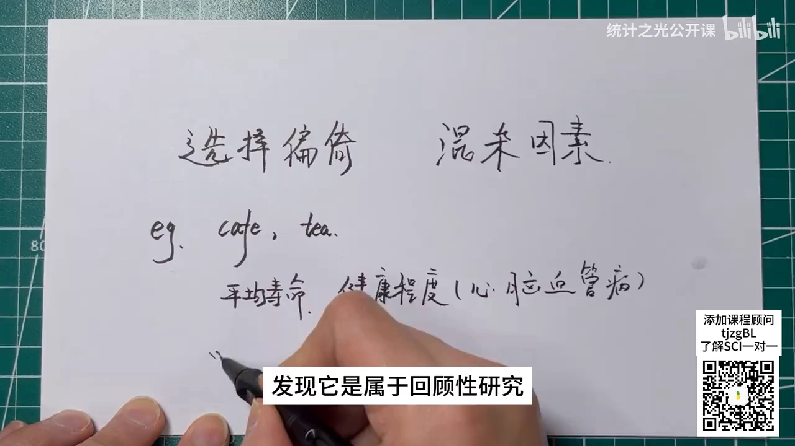
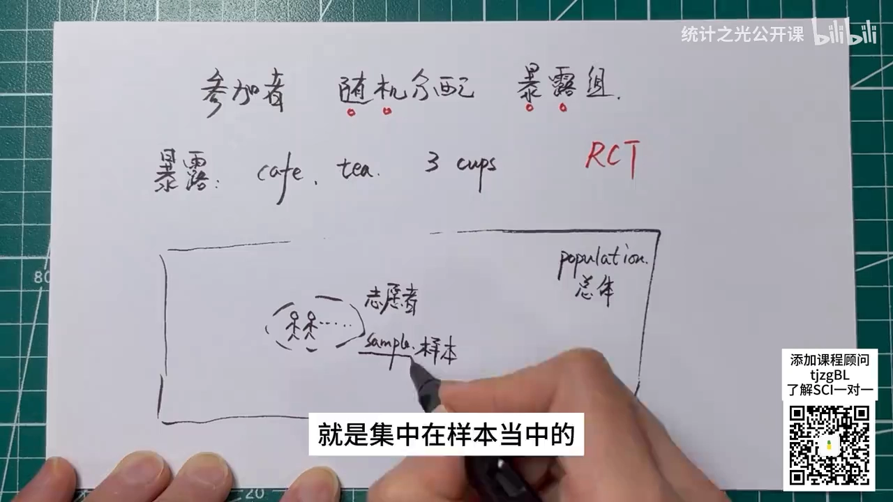
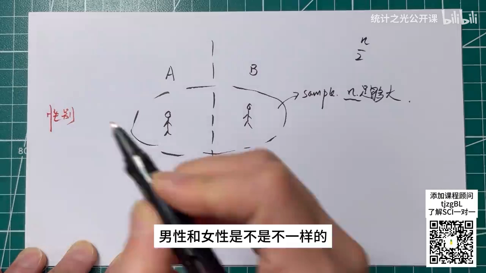
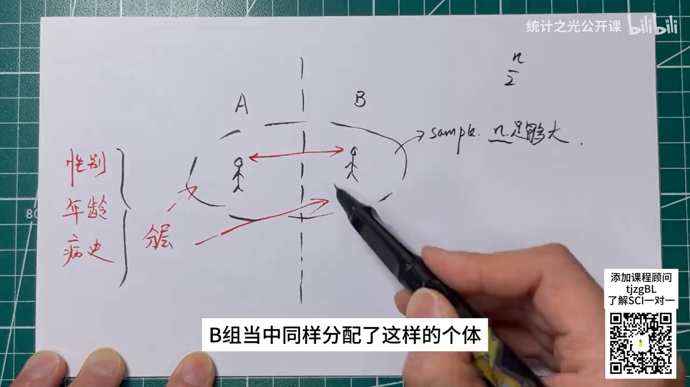
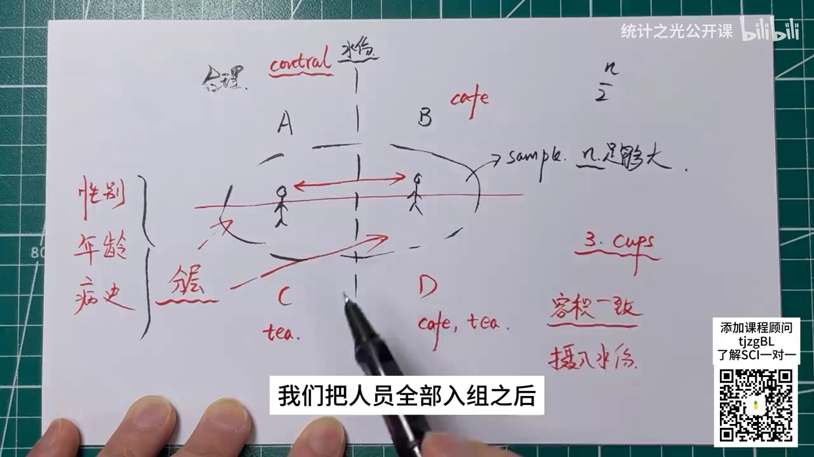
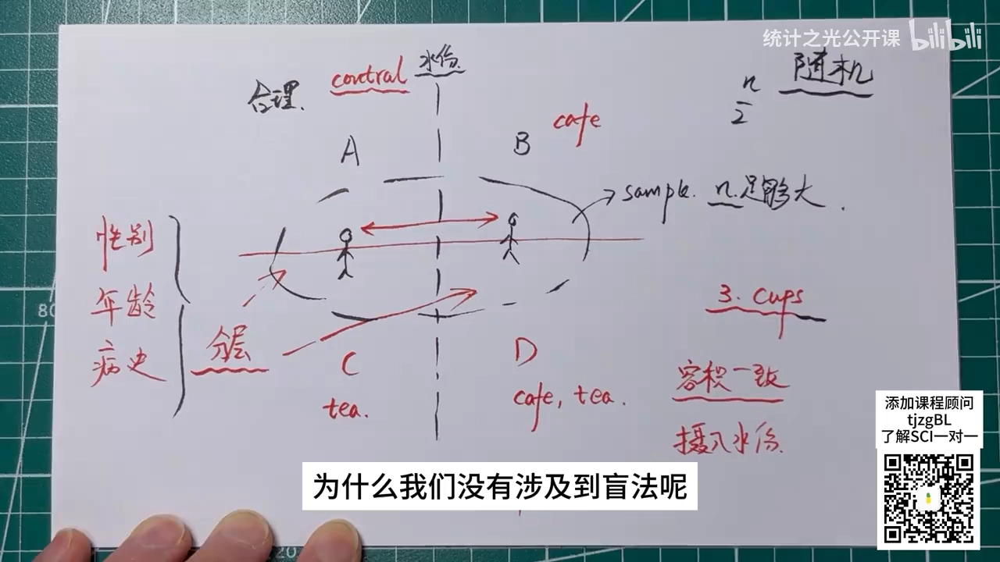
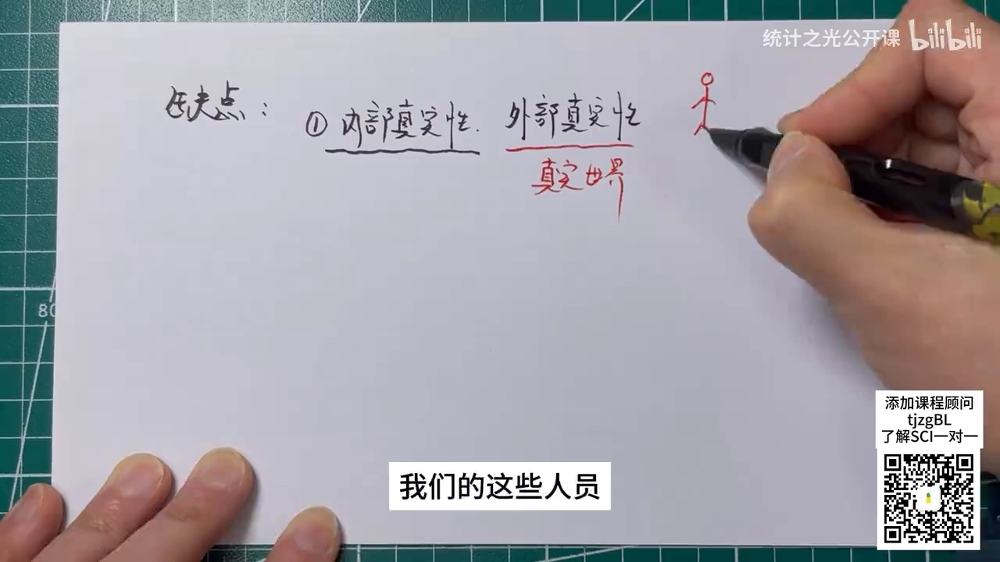
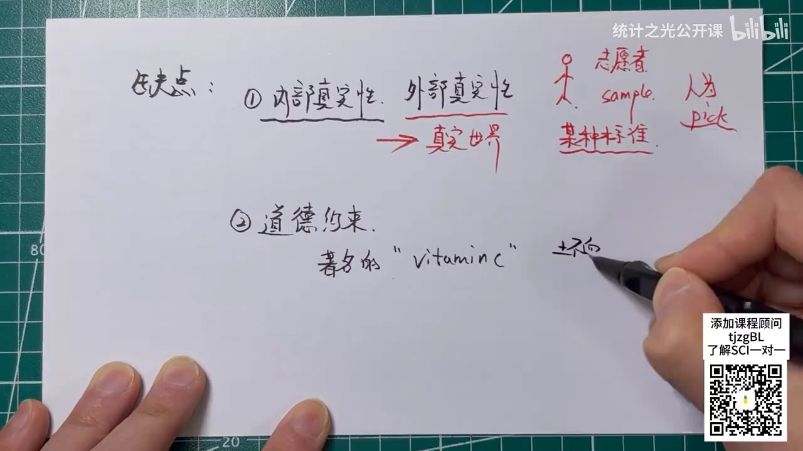
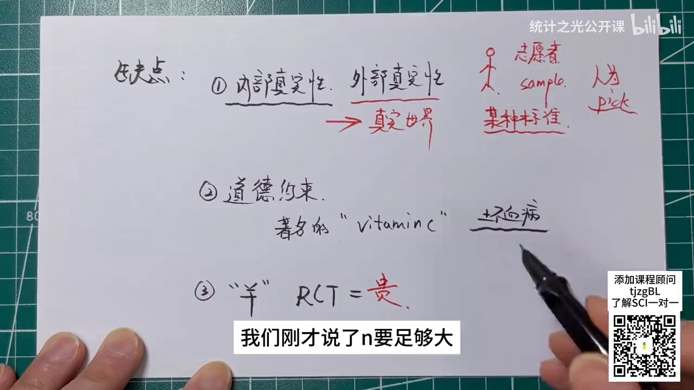

# 随机对照实验：随机分配、合理对照与内部外部真实性

> 视频来源：[随机对照实验的优缺点15分钟直接讲清楚｜轻松理解医学统计46](https://www.bilibili.com/video/BV1nC4y1Y7z3/)（Bilibili · 统计之光公开课）｜时长约 18 分钟
> 导读：这支视频用手写板书从零讲清随机对照实验（RCT）的骨架：它到底解决了哪两个问题、处理组与对照组怎样才算"可比的"、随机分配为什么能替代"把混杂因素都测出来再校正"、以及它做完之后仍然留下的两处限制——外部真实性与伦理。本文按原讲顺序整理，最后把"处理组—对照组—目标效应"和"外推限制"两条线单独拎出来，便于与因果图、意向性分析两节对接。字幕为本地语音识别生成，错拼（如"选择偏移"→选择偏倚、"Consult 声明"→CONSORT 声明、"对列实验"→队列实验）已按上下文订正。

## 本讲要解决的核心问题（SCQA）

**背景**：在医学证据体系里，Meta 分析常被画在金字塔顶端，而 Meta 的原料正是 RCT。RCT 被称为临床研究的"金标准"，这个说法在教科书里反复出现，但它到底金在哪一步，往往说不清。

**冲突**：现实中的观察性研究给不出干净的答案。讲者举的例子是当时《柳叶刀》上一篇对比中国和英国人群的文章：经常喝咖啡的人和喝中国茶的人，平均寿命与心脑血管病的发生情况不同，看上去"喝三杯最健康"。但这篇是**回顾性研究**，用的是大型数据库里已有的资料——喝咖啡的人和不喝咖啡的人，本来就不是同一群人。

**疑问**：为什么同样的比较，换成 RCT 做就更可信？RCT 到底解决了哪一类问题，又解决不了哪一类问题？

**回答（中心思想）**：RCT 的价值集中在两件事上——**随机分配**和**合理的对照**。随机分配让处理组与对照组在基线（年龄、性别、病史等一切可能的混杂因素）上"可比"，于是两组之差可以归给处理本身；合理的对照保证两组之间除处理之外没有别的系统差异。但 RCT 只保证**内部真实性**：结论在它自己的样本里成立。样本是按标准人为招募的志愿者，能不能推广到真实世界是另一个问题（外部真实性）；此外它还有伦理约束和成本两处硬限制。

[【跳转到 02:40】](https://www.bilibili.com/video/BV1nC4y1Y7z3/?t=160)

## 一、RCT 的定义：两个关键词

讲者把 RCT 的定义压缩成一句话：**把参加者随机分配到暴露中去**。这句话里藏着两个关键词，缺一不可。

- **随机**：谁进哪一组由随机机制决定，不由研究者或受试者挑选；
- **人为分配的暴露**：暴露（这里是喝咖啡还是喝茶、喝几杯）是研究者主动安排的，不是受试者自己决定的。

这正是 RCT 与队列研究的最大差别。队列研究里，暴露是人群自己"选"的——爱喝咖啡的人自己选择喝咖啡，研究者只是记录；RCT 里，暴露是研究者分配的。讲者强调，只要这两个因素同时存在，这个实验就属于随机对照实验。

在这个例子里，暴露是"咖啡和茶饮用的杯数"，而已知的最适饮用量是三杯——这个"三杯"来自那篇回顾性研究。讲者的设计思路因此很清楚：**用一个能控制混杂的设计，去检验一个从观察数据里得来的结论**。

## 二、总体、样本与入组

讲者在纸上画了一个大方框：这是**研究的总体**，也就是真实世界当中的全体人群。真正进入实验的只是其中一小群志愿者，这是**样本**。

[【跳转到 05:00】](https://www.bilibili.com/video/BV1nC4y1Y7z3/?t=300)

第一步是"入组"：找到足够的、愿意参加 RCT 的人员。这一步在视频里被一带而过，但它已经埋下了后面"外部真实性"的伏笔——能进组的从来不是全体人群，而是符合某种招募标准、并且愿意参加的那部分人。

## 三、随机分配：用"大数"换来基线可比

入组之后要把样本分成两组。讲者先讲最简单的情形：当样本量 $N$ 足够大时，按随机分配的原则把人员分成两半，每组 $N/2$。

这时**选择偏倚和混杂因素都被控制住了**。理由不是"随机"这个词本身有魔力，而是大数：当 $N$ 足够大，$N/2$ 也足够大，那么 A 组和 B 组里年龄、性别这些混杂因素的构成会自然接近，两组的人"相互之间是能够匹配上的"。

[【跳转到 06:00】](https://www.bilibili.com/video/BV1nC4y1Y7z3/?t=360)

这里有一个容易被忽略的要点：随机分配**不需要先知道混杂因素是什么**。观察性研究里，你要校正年龄、校正性别，前提是你把它们测到了；而随机分配对"已发现的和未发现的"混杂一视同仁。讲者后面列混杂因素时特意补了一句"发现了的或者是没发现的"，说的就是这件事。

### 3.1 N 不够大时：分层

大数只在 $N$ 足够大时管用。$N$ 不够大怎么办？讲者给的做法是**分层**：先按混杂因素把人群分成层，再在每个层内部把对象均匀分配到 A 组和 B 组。

最常见的分层变量是性别、年龄和病史（身体基线、有没有基础病）。比如把男性和女性分别分成两层，两层内部各自均匀分配，于是"A 组当中的性别比和 B 组当中的性别比是一致的"。如果同时考虑性别、年龄、病史，极端情况下 A 组和 B 组的人可以一一配对：女性、60 岁以上、身体健康、没有病史——A 组分配了几个这样的个体，B 组也分配几个。

[【跳转到 07:20】](https://www.bilibili.com/video/BV1nC4y1Y7z3/?t=440)

分层和随机分配解决的是同一件事，代价不同：随机分配靠样本量，分层靠你**知道该分哪些层**。这也说明随机化并非"什么都不用想"——样本量不够时，你仍然要决定哪些变量值得拿来分层。

## 四、分组可以更复杂，但"合理对照"是前提

分完 A、B 两组之后，实验还可以继续细分：A 组不饮用咖啡和茶，B 组只喝咖啡，C 组只喝茶，D 组又喝咖啡又喝茶。讲者提醒，再往细里分（比如按剂量分）就会出问题——因为这个实验要验证的是"三杯"这个已经由别人研究得出的剂量，无限细分会让每组样本量迅速摊薄。

更重要的是，**在所有人员被分配到各组之前，必须先解决对照组的设置问题**。讲者的原话是：对照组（control）的设置一定要合理。

什么叫合理？回到咖啡茶的例子：B 组每天喝三杯咖啡，C 组每天喝三杯茶，D 组又喝咖啡又喝茶。这三组饮用的**剂量或溶剂必须一致**——溶剂一致意味着摄入的水分一致。于是对照组也要摄入等量的水分，而且只能是普通的水，不能是奶茶或别的东西。

[【跳转到 10:20】](https://www.bilibili.com/video/BV1nC4y1Y7z3/?t=620)

这一步正是"用对照控制无关变量"的具体化：**处理组和对照组之间，除了要比较的那一个因素，其他一切都应当一致**。实操上也不复杂——把人员全部入组、调查他们原本的饮水与饮用习惯，然后给对照组发矿泉水或纯净水，要求每天喝够量。

## 五、随机化是报告清单上的第一条

讲者把话题收回到"随机"这两个字：人员最后入组时，要随机地把人放进分组流程。他提到**CONSORT 声明**的核对清单里，排在首位的就是随机化。

[【跳转到 11:40】](https://www.bilibili.com/video/BV1nC4y1Y7z3/?t=700)

同一段里讲者也说明了这个例子的一个例外：**这里没法设盲**。咖啡和茶都是日常饮品，受试者一喝就知道自己喝的是什么，蒙上眼睛也知道。但在一般的 RCT 里，盲法尤其是双盲非常重要——把盲法挂上去，前面说的偏倚和混杂基本就都被规避了。这正是 RCT 被称作金标准的原因：它用一套方法把偏倚和混杂系统性地挡在外面。

## 六、RCT 的三处限制

讲者把 RCT 的缺点归为三条，第一条最关键。

### 6.1 内部真实性与外部真实性

这是一对必须分开的词。

- **内部真实性**：按实验计划做了统计检验，结果在统计学上真实可靠、基于数据站得住。RCT 本身是为内部真实性设计的。
- **外部真实性**：实验结果能不能外推到真实世界。

[【跳转到 13:50】](https://www.bilibili.com/video/BV1nC4y1Y7z3/?t=830)

为什么外部真实性不自动成立？因为入组的志愿者是**按某种标准招募来的，是人为筛选、人为 pick 出来的**。文章发表出来，读者所在的真实世界并不等于这个样本。讲者用建模打了一个比方：训练集对应内部，验证集起到的正是替代外部真实性的作用——RCT 做完了，还需要另外去验证它的外部真实性。

这条限制对读组学数据的人尤其要紧：一个在特定细胞系、特定供体、特定剂量下测出来的扰动效应，内部再干净，也不能直接搬到另一个背景里当作同样的效应。

### 6.2 道德约束

第二条是伦理。讲者用历史上著名的**维他命 C 实验**举例：一位海军军官把得了坏血病的水手分成两组，一组除了新鲜水果蔬菜之外其他照旧（包括饮酒），另一组给蔬菜和各种各样的水果，观察坏血病的进展。这可能是历史上第一次 RCT，但道德上确实存在缺陷。今天的 RCT 一旦涉及疾病诊治，就会面对"给谁吃、不给谁吃"的问题——同样都是患者。

[【跳转到 15:40】](https://www.bilibili.com/video/BV1nC4y1Y7z3/?t=940)

### 6.3 成本

第三条很现实：**RCT 等于贵**。要入组很多人（$N$ 要足够大），样本不够还要分层；整个实验要跟踪、要设计，每一项都昂贵。这也解释了为什么 Meta 分析的最后总要写上一句"由于当前 RCT 数量不足或质量不高，需要更多 RCT 证据"——RCT 少，很大程度上是因为它贵。

[【跳转到 17:00】](https://www.bilibili.com/video/BV1nC4y1Y7z3/?t=1020)

## 七、把这一讲接到"目标效应"上

视频是医学统计视角，没有写公式。下面三句是整理者把它的说法翻译成本脉络的语言（潜在结果记号 $Y(1)$、$Y(0)$ 来自同节的《随机实验的识别条件》，不是本视频原话）：

**（1）目标效应是"处理组减对照组"，而这个差只有在两组可比时才有意义。** 讲者反复强调的"基线可比""性别比一致""摄入水分一致"，都是在保证这个减法里除了处理之外没有别的项。用潜在结果的写法，我们想估的是 $E[Y(1)] - E[Y(0)]$，而手上只有 $E[Y \mid T=1] - E[Y \mid T=0]$；随机分配正是让这两个量对上的机制。

**（2）随机分配解决的是混杂，不是全部偏差。** 它把"谁进哪一组"与一切基线变量（包括没测到的）解耦，因此后门被切断。但它对**入组之后**发生的事无能为力：受试者可能不依从、可能中途退出、可能被换组——这些都属于依从性问题，需要另一套分析规则来处理（见本节的《不依从与意向性分析》）。

**（3）随机化保证的是内部真实性，外推要另做论证。** 样本是按标准招募的，因此"这个效应在这个人群里成立"和"这个效应在真实世界里成立"是两个命题。讲者用训练集/验证集的类比说的就是这件事：内部干净不等于外部成立。

## 小结

- **RCT 的定义可以压缩成一句话**：参加者被随机分配到人为安排的暴露中。"随机"与"人为分配的暴露"两个关键词缺一不可，这也是它与队列研究的最大差别。
- **随机分配靠大数换来基线可比**：$N$ 足够大时两组混杂因素构成自然接近；$N$ 不够大时用分层，在层内均匀分配。
- **合理对照是前提**：处理组与对照组除要比较的那一个因素外，其他条件（这里是饮用量与摄入水分）必须一致。
- **随机化是报告清单的第一条**（CONSORT），盲法在能设的时候极其重要；本例因咖啡茶是日常饮品而无法设盲。
- **RCT 只保证内部真实性**：外部真实性要另做验证，因为样本是人为招募的志愿者。
- **两处硬限制**：涉及疾病诊治时的伦理约束，以及高昂的成本。

## 关键术语速查

| 术语 | 一句话解释 |
| :--- | :--- |
| 随机对照实验（RCT） | 参加者被随机分配到研究者人为安排的暴露组与对照组 |
| 选择偏倚 | 进入各组的人本身在某些特征上系统性地不同，导致组间比较失真 |
| 混杂因素 | 同时影响"是否接受处理"和"结果"的第三变量 |
| 分层 | 先按混杂因素分层，再在层内均匀分配，使各组构成一致 |
| 对照组（control） | 除被比较的那一个因素外，其他条件与处理组保持一致的一组 |
| 盲法 | 让受试者或评价者不知道分组，避免行为与判读引入偏倚 |
| CONSORT 声明 | 随机对照试验报告的核对清单，随机化排在首位 |
| 内部真实性 | 结果在自己的样本与设计下统计上可靠 |
| 外部真实性 | 结果能否推广到真实世界的人群与场景 |