# 全因子试验设计：主效应、交互效应与中心点

> 视频来源：[第5章 完全析因/全因子试验设计 第1节 二水平全因子实验概述](https://www.bilibili.com/video/BV1ES4y1h7tF/)（Bilibili · 木木及格）｜时长约 30 分钟
> 导读：这是一节六西格玛/DOE 课程里讲「二水平全因子试验」的课，讲者用温度与时间两个因子把设计矩阵、正交表、中心点与代码化从头推了一遍。本文保留这条推导链，并在末尾把它翻译成扰动组学的语言——组合扰动与剂量梯度实验，本质上也是往同一张设计矩阵里填「因子 × 水平」的组合。

## 本讲要解决的核心问题（SCQA）

**背景**：做多因素实验时，最直觉的做法是「一次只动一个因素」：固定其他条件，扫温度；温度定下来，再扫时间。这样得到的每条曲线都干净、好解释。

**冲突**：但这种一次一因素的做法回答不了一个问题——**两个因素一起变时，效果是不是各自效果之和**。如果温度的效果依赖于时间（或者反过来），单独扫出来的两条曲线拼不出真实响应；更糟的是，你还无从知道这种依赖存在。另一方面，一旦把「所有因素的所有水平都组合一遍」当成原则，实验次数会按指数爆炸：6 个两水平因子是 64 次，6 个四水平因子是 4096 次。

**疑问**：那么，怎样安排实验才能同时估计出每个因素单独的效应和它们之间的交互效应？实验次数爆炸时该砍哪里、不该砍哪里？只做一次的组合，误差又从哪里估计？

**回答（中心思想）**：**全因子试验把「所有因子的所有水平组合」至少各做一次，用一张正交的设计矩阵把主效应和所有阶交互效应分开估计；代价是 2 的 K 次方次实验。控制代价的手段不是减少组合，而是（1）把水平数压到两个、用中心点补出弯曲信息，（2）按「部分因子筛选 → 全因子分析 → 响应面优化」的分工把实验分批做。** 而这一切能成立的前提，是设计矩阵的两条性质——均衡性与正交性。

## 一、全因子试验：所有组合至少各做一次

讲者给的定义很直接：完全析因实验设计，也称全因子试验设计，简称全因子设计，**指全部因子的所有水平的所有组合都至少要进行一次实验**。因为包含了所有组合，所需实验总数较多；但它的优点是可以估计出**所有的主效应和所有的各阶交互效应**。所以当因子个数不太多、而且确实需要考察较多交互效应时，常常选用全因子设计。[【跳转到 01:27】](https://www.bilibili.com/video/BV1ES4y1h7tF/?t=87)

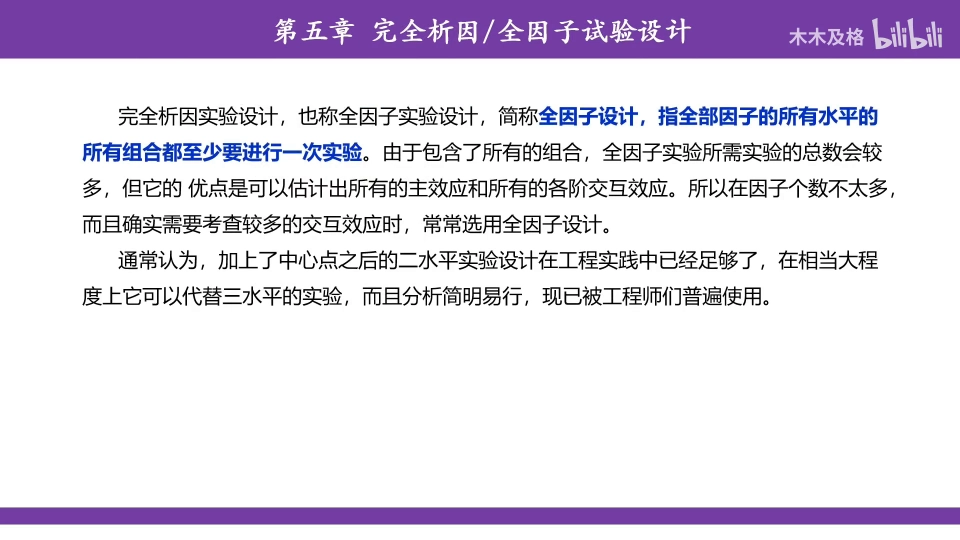

### 1.1 两因子两水平：4 次实验与一个带交互项的方程

讲者用温度和时间举例：因子 A 是温度，取 100 ℃ 和 200 ℃；因子 B 是时间，取 1 小时和 2 小时。两因子两水平的全因子试验记作 $2^2$：第一个 2 是每个因子有两个水平，指数 2 是有两个因子，所以 $2\times2=4$ 次实验。[【跳转到 02:42】](https://www.bilibili.com/video/BV1ES4y1h7tF/?t=162)

四次实验就是四个组合：100 ℃ 配 1 小时、100 ℃ 配 2 小时、200 ℃ 配 1 小时、200 ℃ 配 2 小时，每个组合各做一次。

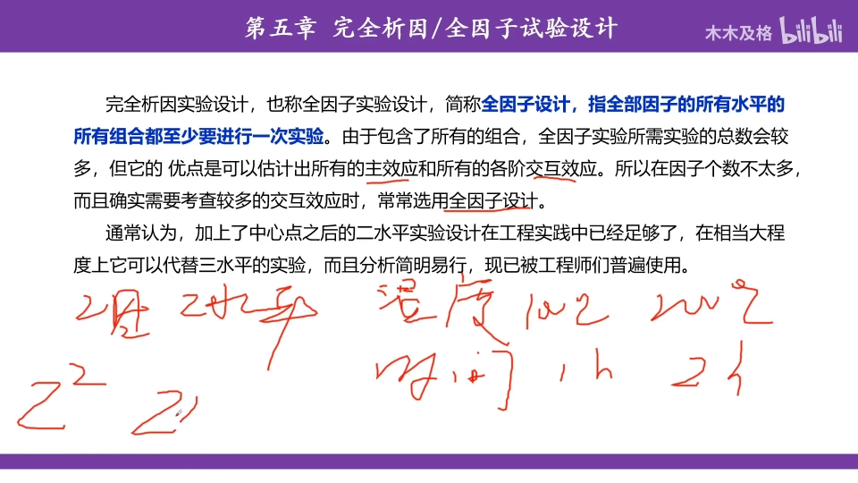

这四个组合能拟合出什么？假设研究温度 $T$、时间 $H$ 对某药物合成量 $Y$ 的影响，方程是：

$$
Y = A + B\,T + C\,H + D\,(T \times H)
$$

其中 $B$、$C$ 是温度和时间的主效应，$D$ 是交互效应。[【跳转到 03:32】](https://www.bilibili.com/video/BV1ES4y1h7tF/?t=212)

**这里正是全因子与「一次一因素」的分水岭**：一次一因素的实验只能估计 $B$ 和 $C$，因为每次实验里只有一个因子在变，$T\times H$ 这一项没有独立的变化去支撑它；而全因子的四个组合里，$T$ 与 $H$ 的四种搭配都出现了，交互项才有数据可估。

### 1.2 K 个因子就是 2 的 K 次方次

因子数推广到 K 时，每个因子两个取值，第一个因子 2 种、第二个 2 种、一直到第 K 个，所以实验次数是 $2^K$。[【跳转到 04:25】](https://www.bilibili.com/video/BV1ES4y1h7tF/?t=265)

K=6 时是 64 次。讲者提醒：64 听起来不算大，但真做实验就很多了——无论机加工、化学合成还是生物实验，周期都可能很长，一种组合要做几小时甚至半天，失败了还要重做。[【跳转到 04:50】](https://www.bilibili.com/video/BV1ES4y1h7tF/?t=290)

> 讲者在这里点出了全因子试验的现实约束：**实验次数是设计矩阵的行数，而每一行都要真实消耗一次实验资源**。后面所有「怎么少做几次」的技巧，都是在不破坏主效应与交互效应可估计性的前提下压缩行数。

## 二、正交表：让主效应和交互效应可以分开算

全因子试验采用**正交表**设计。讲者说正交表有两个特点：**均衡性**与**正交性**，所以这类设计又叫正交实验。[【跳转到 08:35】](https://www.bilibili.com/video/BV1ES4y1h7tF/?t=515)

先把记号说清楚：温度 100 ℃ 称为低水平，记作 $-1$；200 ℃ 称为高水平，记作 $+1$。中心点则是 $0$。[【跳转到 09:00】](https://www.bilibili.com/video/BV1ES4y1h7tF/?t=540)

### 2.1 均衡性：每个因子的高低水平出现次数相等

**均衡性**指任意一列中正号和负号出现次数各占一半，也就是每个因子取低水平和高水平的次数相等。

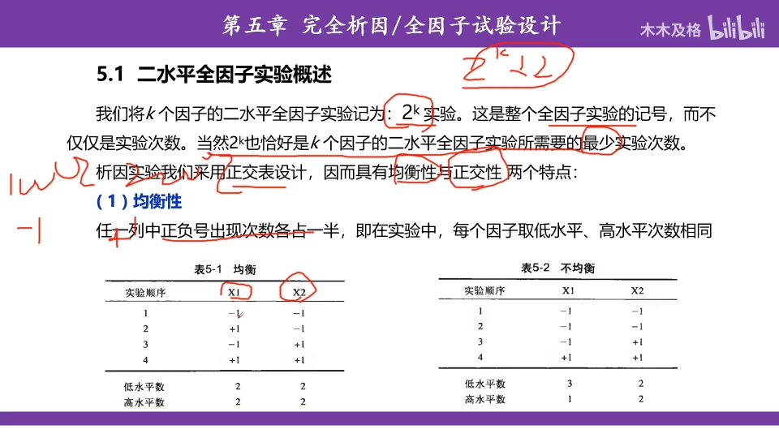

讲者用两张表对比：均衡的排法是第一列 $-1,+1,-1,+1$、第二列 $-1,-1,+1,+1$，四种组合各出现一次；不均衡的排法是 $-1,-1,-1,-1$，低-低组合做了两次，其他组合只做一次，此时 X1 列低水平出现三次、高水平只出现一次。[【跳转到 09:25】](https://www.bilibili.com/video/BV1ES4y1h7tF/?t=565)

**为什么均衡重要**：如果某个因子在高水平上多做了一次，那么响应均值的变化里就混进了「多做的这一次」的影响，主效应估计会被系统性拉偏。均衡保证了每个水平的「曝光量」相同，主效应才是干净的对照。

### 2.2 正交性：两列搭配次数相等，乘积之和为零

**正交性**指任意两列中，正正、正负、负正、负负四种搭配出现的次数相等。对两因子两水平来说一共就这四种组合，搭配次数都相等。用数学表示，就是两列乘积之和为零——代数上说的两列「正交」。[【跳转到 10:40】](https://www.bilibili.com/video/BV1ES4y1h7tF/?t=640)

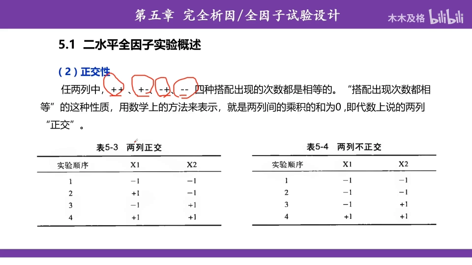

**正交性的实际含义**：它保证一个因子的列与另一个因子的列「不共享变化」。于是当你估计温度的主效应时，时间的高低不会系统性地偏袒某一边；反过来说，两个因子的效应不会互相冒充。这正是「主效应和交互效应可以分开估计」的代数基础。

### 2.3 交互列就是主效应列相乘

三因子两水平（$2^3$）要做 8 次实验，8 个点位于立方体的八个顶点。因子 A 左边是 $-1$、右边是 $+1$；B 下面是 $-1$、上面是 $+1$；C 靠近我们是 $-1$、靠里面是 $+1$。[【跳转到 13:35】](https://www.bilibili.com/video/BV1ES4y1h7tF/?t=815)

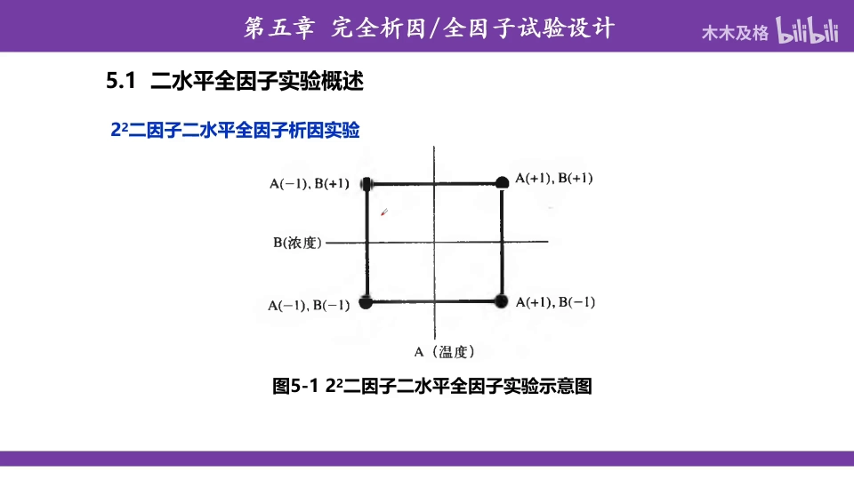

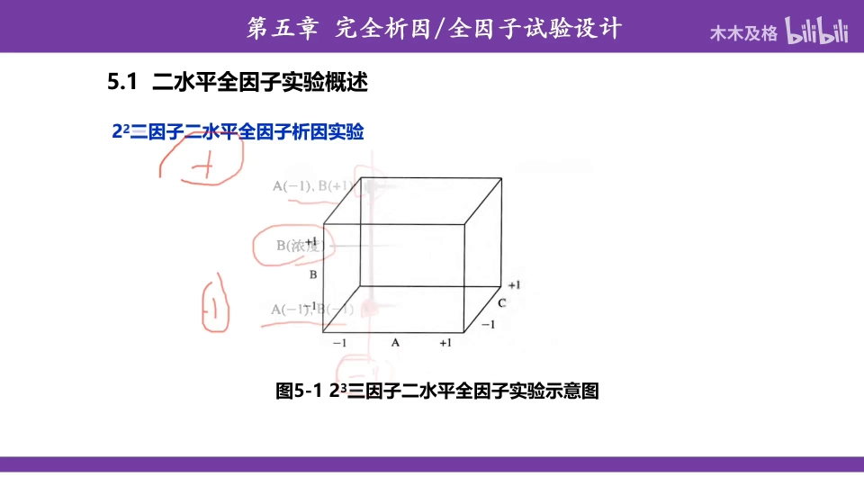

8 次实验能估计出：三个主因子 A、B、C；三个两阶交互项 AB、AC、BC；以及一个三阶交互项 ABC。讲者的说法是——**全因子试验是没有混杂的**。[【跳转到 14:50】](https://www.bilibili.com/video/BV1ES4y1h7tF/?t=890)

交互列怎么来？直接把主因子列相乘：AB 列等于 A 列乘 B 列，AC 等于 A 列乘 C 列，ABC 等于 A 乘 B 乘 C。[【跳转到 16:30】](https://www.bilibili.com/video/BV1ES4y1h7tF/?t=990)

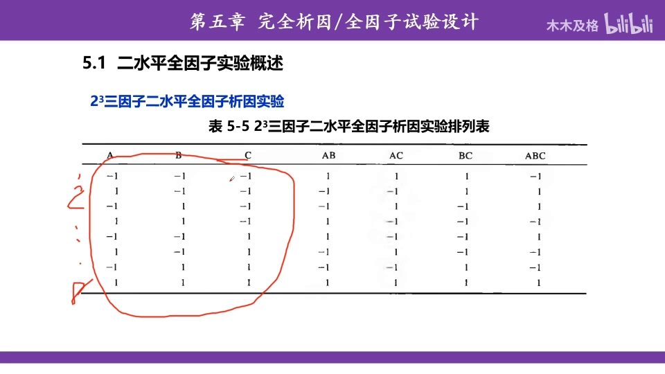

这张表有两个可以直接读出来的性质：每一列正负号各出现四次（均衡）；任意两列相乘等于零（正交）。**交互列不是另做的实验，而是同一批实验数据的另一种线性组合**——所以全因子试验做一次，就能同时检验主效应和交互效应。

### 2.4 四因子：两个立方体拼起来

四因子两水平（$2^4$）在立体图上不好画。讲者的画法是：把第四个因子 D 摘出来，左边是 D 低水平、右边是 D 高水平；D 取低水平时 ABC 有 8 种组合，D 取高水平时 ABC 也有 8 种组合，总共 16 次，即 $2^4=16$。[【跳转到 17:20】](https://www.bilibili.com/video/BV1ES4y1h7tF/?t=1040)

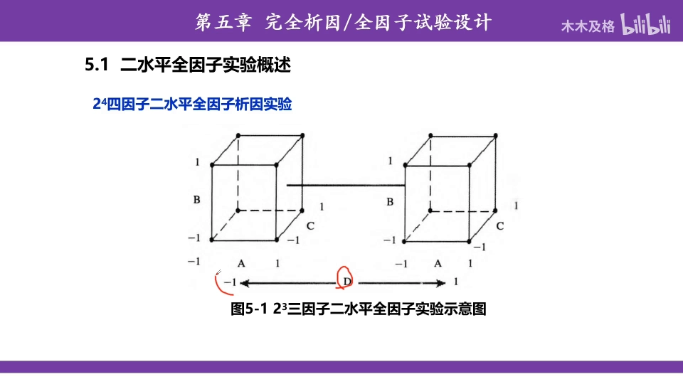

## 三、水平数：为什么默认只做两水平

全因子试验的次数不只随因子数指数增长，也随水平数指数增长。讲者算了一笔账：6 个因子、每个因子 4 个水平，要做 $4^6 = 16\times16\times16$ 次，完全做不动。[【跳转到 06:30】](https://www.bilibili.com/video/BV1ES4y1h7tF/?t=390)

于是有了工程上的标准做法：**两水平加上中心点，基本可以代替三水平及三水平以上的实验**，而且分析简单、实验次数少，所以被很多工程师普遍采用。[【跳转到 06:55】](https://www.bilibili.com/video/BV1ES4y1h7tF/?t=415)

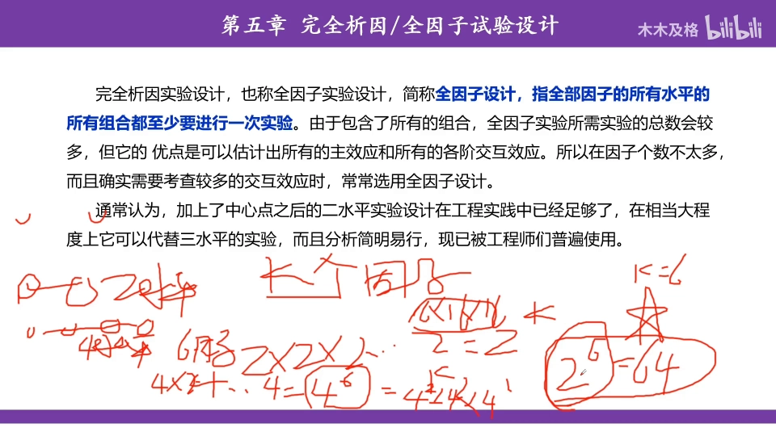

**为什么中心点能补上水平数不足**：两水平的每个因子只有两个取值，只能确定一条直线；中心点（所有因子取中间值）提供了第三个位置的信息，于是可以检验响应是否存在**弯曲**。这一点在第五节还会再出现。

> 讲者也说明了这个记号的另一层含义：$2^K$ 不只是实验次数，而是整个全因子试验的记号。每种组合只做一次时它恰好等于最少实验次数；如果每种组合重复两次，就是 $2^K \times 2$。[【跳转到 08:10】](https://www.bilibili.com/video/BV1ES4y1h7tF/?t=490)

## 四、全因子、部分因子与响应面：三种设计的分工

讲者把 DOE 的常规流程讲成了一条分批推进的路线：[【跳转到 18:10】](https://www.bilibili.com/video/BV1ES4y1h7tF/?t=1090)

1. **先用部分因子试验做因子筛选**。因子很多时，全因子做不起，部分因子用更少的实验次数找出哪些因子值得关注。
2. **因子数不超过五个时，再用全因子试验**。此时可以全面分析主效应和交互效应，进一步筛选。
3. **因子数不超过三个时，用响应曲面法**。目的是确定更精细的回归关系、求最优设置。

三者的差别，讲者归纳为两点：**部分因子试验通常只是为了筛选因子**，也可以做回归分析但比较粗糙——粗糙换来的是实验次数少；**全因子试验既有筛选作用，也有回归分析作用**，因为它能估计全部主效应和交互效应，但只能估计线性关系。[【跳转到 18:50】](https://www.bilibili.com/video/BV1ES4y1h7tF/?t=1130)

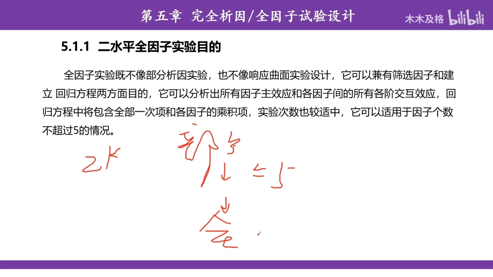

| 设计 | 主要用途 | 能估计什么 | 代价 |
| --- | --- | --- | --- |
| 部分因子 | 因子筛选 | 主效应与部分交互（有混杂） | 实验次数少，回归较粗糙 |
| 全因子 | 筛选 + 回归 | 全部主效应与各阶交互（无混杂） | $2^K$ 次，随因子数指数增长 |
| 响应面 | 优化、求最优设置 | 二次项与弯曲 | 因子数少（≤3）时才可行 |

这张表也解释了为什么「全因子还是部分因子」不是一个品味问题：**你要的结论决定了你需要哪种设计**。只想知道哪些因子有影响，部分因子够用；要判断「两个因子是否真的互相影响」，就必须让交互项有独立的数据支撑。

## 五、重复、随机化与区组：误差从哪里来

讲者先重申实验设计的三个基本原则：**完全重复、随机化和划分区组**。[【跳转到 19:39】](https://www.bilibili.com/video/BV1ES4y1h7tF/?t=1179) 这一节重点讲重复。

### 5.1 完全重复：最直接，但代价最高

以两因子两水平为例，$2^2=4$ 次实验、每种组合只做一次。只做一次的话，误差的随机性可能很大：比如 100 ℃、1 小时下合成量是 85，但也许真实均值是 84，这一次恰好偏高。为了排除误差影响，可以每种组合各做四次或五次取平均，这就是完全重复。[【跳转到 20:04】](https://www.bilibili.com/video/BV1ES4y1h7tF/?t=1204)

但代价立刻显现：两因子六水平要做 64 次，每种组合重复三次就是 192 次。[【跳转到 21:04】](https://www.bilibili.com/video/BV1ES4y1h7tF/?t=1264)

### 5.2 中心点：用最少的重复估计随机误差

条件不允许完全重复时，讲者给的办法是**在中心点安排实验**：用完全相同条件下的重复来估计实验误差，也就是随机误差。[【跳转到 21:19】](https://www.bilibili.com/video/BV1ES4y1h7tF/?t=1279)

温度 100 和 200 的中心是 150 ℃，时间 1 小时和 2 小时的中心是 1.5 小时，只在这个组合下做三次就够了。如果三次结果波动很小，说明误差小；波动很大，就说明实验误差大。[【跳转到 22:09】](https://www.bilibili.com/video/BV1ES4y1h7tF/?t=1329)

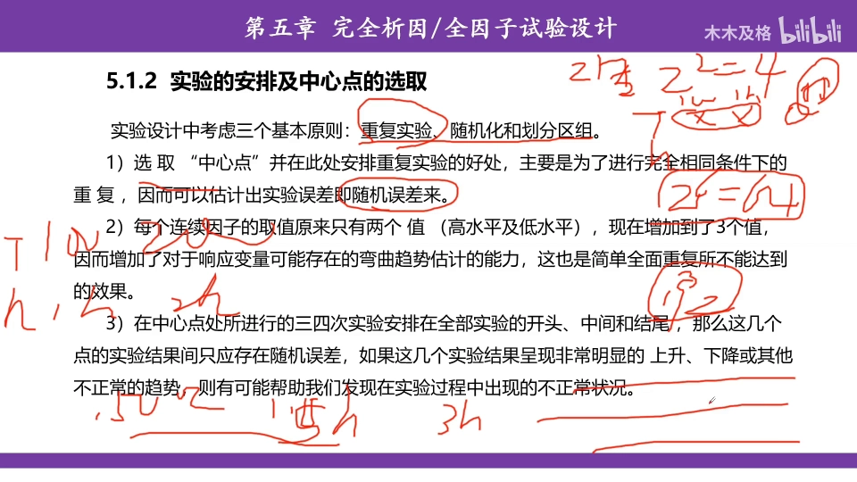

讲者把中心点的好处总结为三条：

1. **估计随机误差**。不需要每种组合都多做几次，在中心点做 3 到 5 次就够。
2. **估计弯曲**。每个连续因子原来只有高低两个取值，加上中心点后变成三个值，于是增加了对响应可能存在的弯曲趋势的估计能力——这是简单重复做不到的。
3. **发现异常趋势**。把三四次中心点实验安排在全部实验的开头、中间和结尾；如果这几个结果呈现明显的上升、下降或其他不正常趋势，就说明实验过程中出现了系统性影响。[【跳转到 24:48】](https://www.bilibili.com/video/BV1ES4y1h7tF/?t=1488)

> **第 3 条其实是一个很实用的诊断**：中心点在三个时间点上条件完全相同，按理只应有随机波动；一旦出现单调趋势，就说明有时间相关的因素（仪器漂移、试剂批次、操作者状态）在起作用。这正是「区组」要处理的问题——把同一批、同一天、同一板的实验归为一组，让批间差异有地方落脚，而不是混进因子效应里。

## 六、代码化：把不同量纲的因子放到同一把尺子上

最后一个技术点是**代码化**（也叫编码）。前面温度 100 ℃ 用 $-1$、200 ℃ 用 $+1$、150 ℃ 用 $0$ 表示，为什么？[【跳转到 25:03】](https://www.bilibili.com/video/BV1ES4y1h7tF/?t=1503)

讲者的解释是：代码化其实就是统计分析和机器学习里常说的归一化。假设温度是几千度量级，而时间是毫秒或秒量级，两者量级差很大；归一化之后再比较、再计算方程都更简单，算完再换算回真实值就行。[【跳转到 25:28】](https://www.bilibili.com/video/BV1ES4y1h7tF/?t=1528)

换算公式是：

$$
\text{代码值} = \frac{\text{真实值} - M}{D}, \qquad M = \frac{\text{Low} + \text{High}}{2}, \quad D = \frac{\text{High} - \text{Low}}{2}
$$

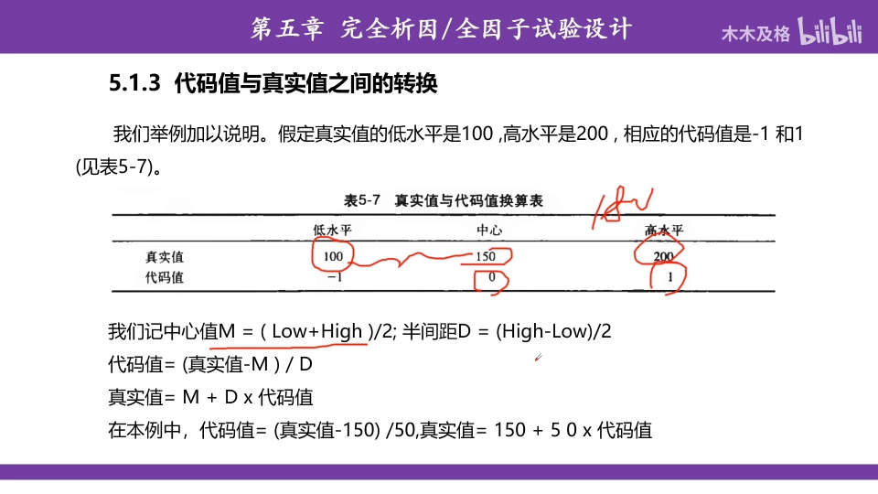

以温度为例，$M=150$、$D=50$：200 ℃ 的代码值是 $(200-150)/50=1$；180 ℃ 是 $(180-150)/50=0.6$；反过来，代码值 $-0.6$ 对应 $150+50\times(-0.6)=120$ ℃。[【跳转到 28:23】](https://www.bilibili.com/video/BV1ES4y1h7tF/?t=1703)

讲者给出代码化的三点好处：

1. **系数可以直接比较**。不做代码化，不能因为某个系数大就说它显著——那可能是量纲造成的。都归一到 $[-1,+1]$ 后，系数绝对值大的才更显著。
2. **各项系数估计量之间不相关**。这让「哪个项重要」的判断不必反复校正其他项。
3. **截距有了物理意义**。中心点恰好是零，把所有自变量取零代入方程得到的响应值就是截距，它等于全部实验结果的平均值，也是实验范围中心点上的预测值。[【跳转到 26:43】](https://www.bilibili.com/video/BV1ES4y1h7tF/?t=1603)

## 七、这套设计语言怎么落到扰动实验上

把「因子」换成扰动实验里的自变量，上面这套结构几乎原样成立：

- **组合扰动**：两个基因同时敲低，就是两因子两水平（敲/不敲）的 $2^2$ 设计——单敲 A、单敲 B、双敲 AB、对照，四个组合缺一不可。缺了单扰动臂，交互项就没有基线；这正是组合扰动判定协同/拮抗时必须先有单药剂量效应曲线的原因（见本目录《组合扰动如何判定真交互：加性基线与协同拮抗》）。
- **剂量—反应**：药物浓度不是「有/没有」的二值因子，而是多水平连续因子。此时「水平怎么取、取几个、按什么间隔」决定了设计矩阵的行；对数间隔、覆盖中段、两端各有着落，是剂量梯度设计的三条经验（见本目录《小分子药物为什么必须做剂量梯度：量效曲线、EC50 与治疗指数》）。
- **区组**：同一批细胞、同一天上机、同一张 96 孔板，就是天然的区组。把批次当区组而不是当因子，才能让批间差异从误差里分离出来，而不是伪装成扰动效应。
- **中心点**：在扰动实验里对应「溶剂对照 + 空载体对照」这类不施加扰动的基准孔。它们不提供新的因子组合，但提供纯误差估计，也提供「实验过程中是否漂移」的检查点。

## 小结

- **全因子试验 = 所有因子的所有水平组合至少各做一次**，实验次数是 $2^K$（两水平），代价随因子数指数增长，换来的是所有主效应和各阶交互效应都可估计、无混杂。
- **交互效应不是额外实验，而是主效应列的乘积**。这也是「一次一因素」估计不出交互的原因：交互项需要两个因子同时变化的组合才有数据。
- **正交表的两条性质**：均衡性保证每个水平曝光量相同，正交性保证两列不共享变化——两者合起来，主效应与交互效应才能分开算。
- **水平数默认取两个**，因为 $4^6$ 这类次数做不动；两水平加中心点，在工程实践中已能代替三水平实验。
- **三种设计有明确分工**：部分因子筛选因子（粗糙但省），全因子分析主效应与交互（无混杂但贵），响应面求最优（因子少时才可行）。
- **重复、随机化、区组是三个基本原则**；完全重复太贵时，用中心点的 3–5 次重复估计纯误差、检验弯曲、发现系统性漂移。
- **代码化把因子放到 $[-1,+1]$ 的同一把尺子上**，使系数可比较、估计量不相关、截距等于中心点预测值。

## 关键术语速查

| 术语 | 一句话解释 |
| --- | --- |
| 全因子试验（完全析因设计） | 全部因子的所有水平的所有组合至少各做一次的实验设计 |
| $2^K$ 设计 | K 个两水平因子的全因子试验记号，每种组合做一次时等于最少实验次数 |
| 主效应 | 单个因子水平变化对响应的平均影响 |
| 交互效应 | 一个因子的效应随另一个因子水平而改变的部分，用两列相乘的交互列估计 |
| 正交表 | 满足均衡性与正交性的实验排列表，全因子试验的排布形式 |
| 均衡性 | 任意一列中正负号出现次数各占一半，即每个因子高低水平次数相等 |
| 正交性 | 任意两列四种搭配出现次数相等，等价于两列乘积之和为零 |
| 混杂 | 两个效应共用同一列、无法分开估计；全因子设计没有混杂 |
| 部分因子试验 | 只做全部组合的一部分，用于因子筛选，代价是效应之间存在混杂 |
| 响应曲面设计 | 用二次模型拟合弯曲并求最优设置，适用于因子数较少的情形 |
| 中心点 | 所有因子取中间值的实验点，用于估计纯误差、检验弯曲、发现漂移 |
| 区组 | 把同批、同日、同板的实验归为一组，使批间差异不混入因子效应 |
| 代码化（编码） | 把因子真实值线性变换到 $[-1,+1]$，使系数可比较、截距有物理意义 |