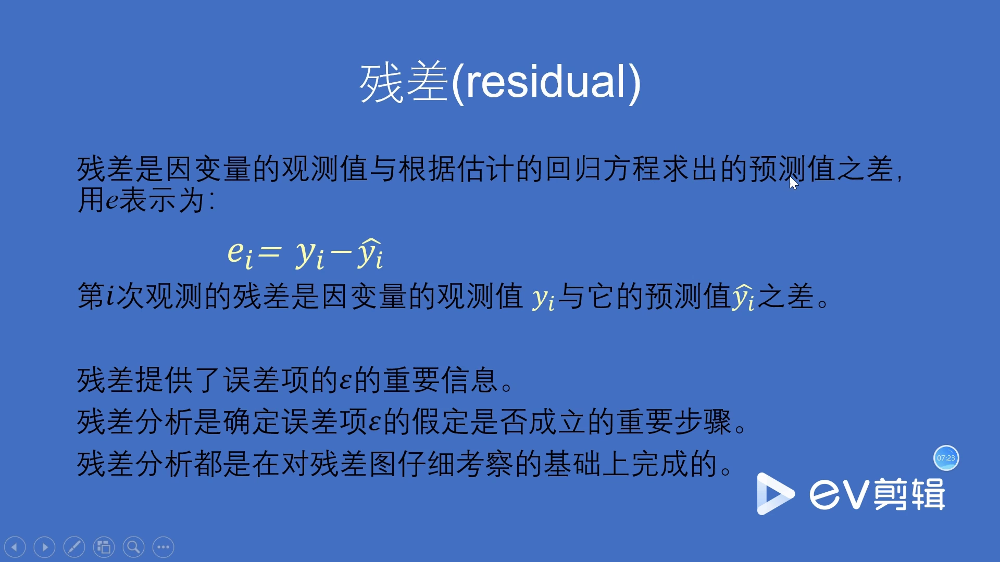
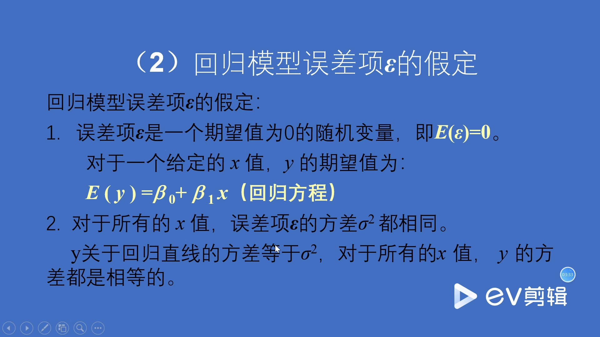
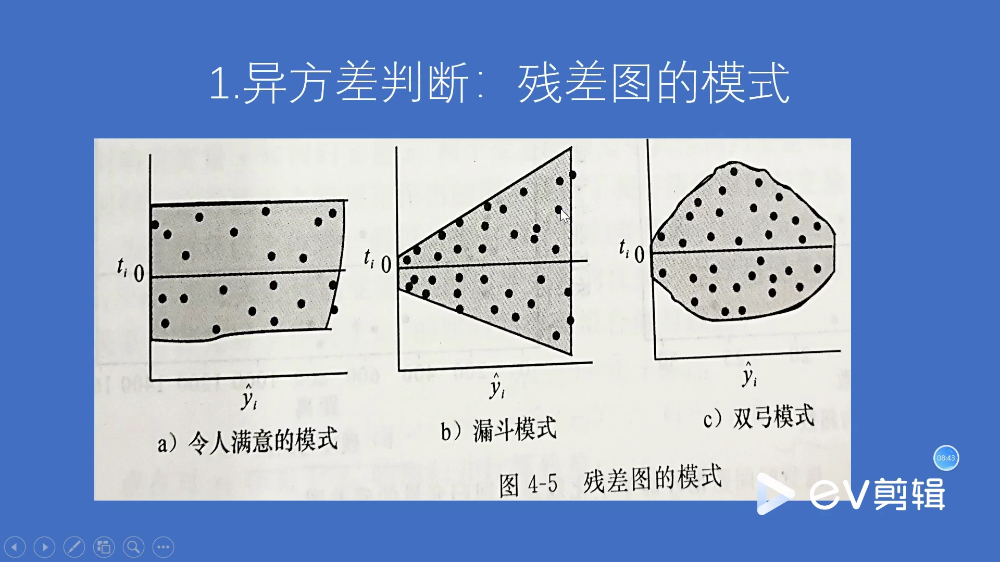
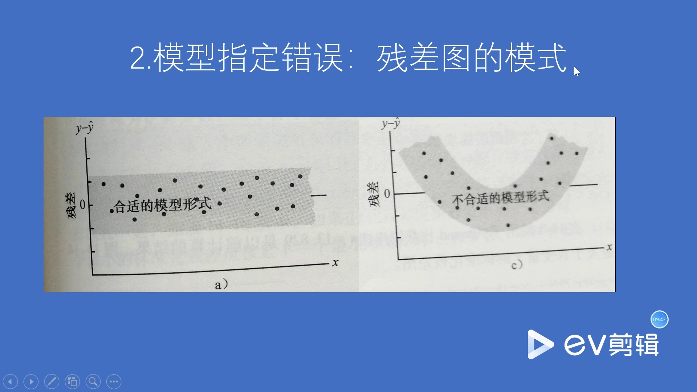
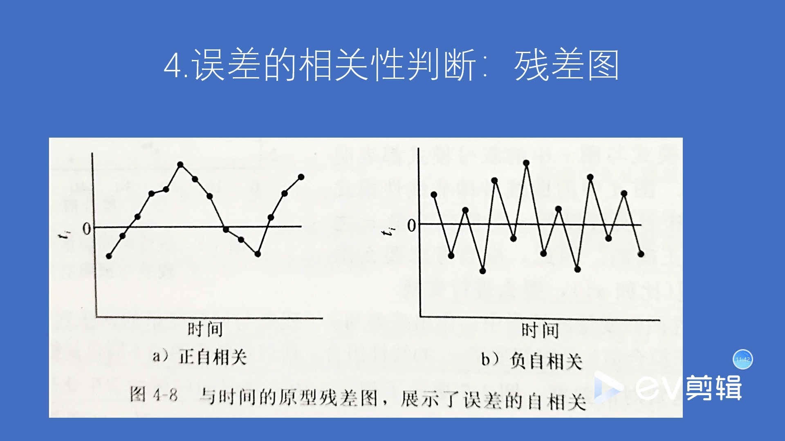
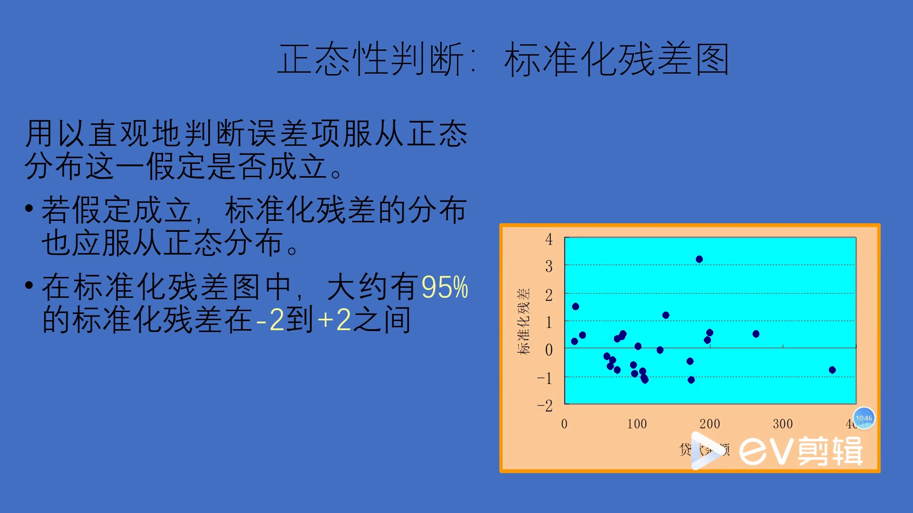
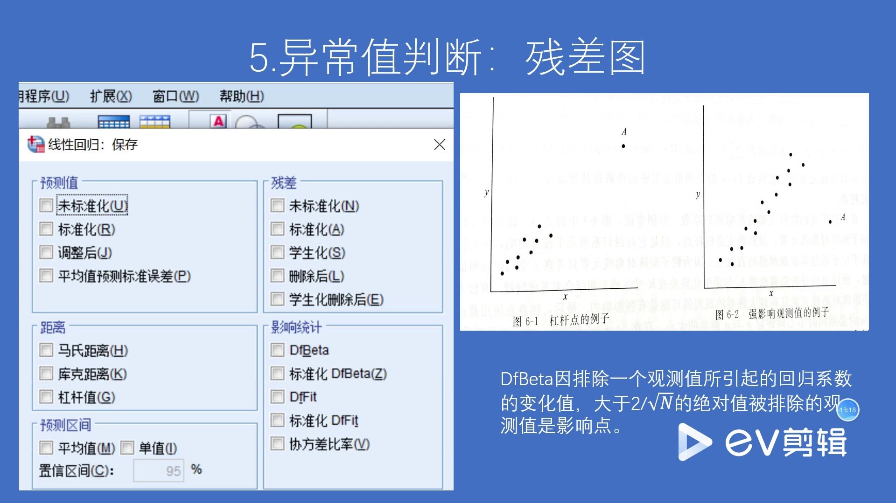
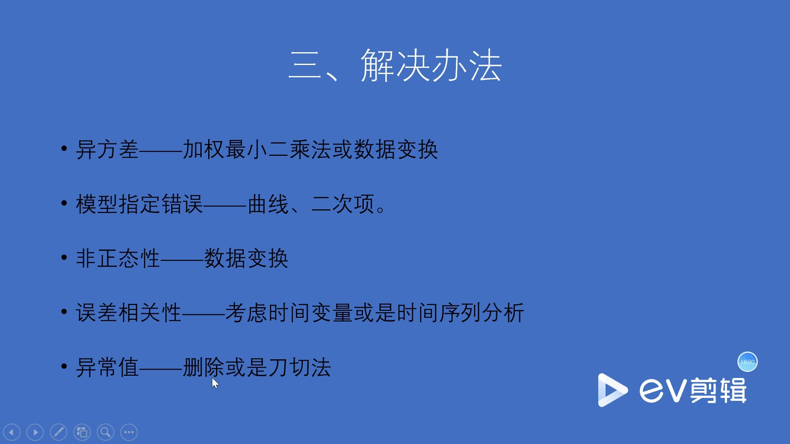

# 回归分析中的残差分析（上）

> 视频来源：[回归分析中的残差分析（上）](https://www.bilibili.com/video/BV1fk4y1q7dh/)（Bilibili）｜时长约 16 分钟
> 简要导读：从"残差不是误差项"讲起，把回归的四条误差假定逐一对应到残差图的四种形状，再讲怎么用残差图、库克距离、杠杆值与 DFBETA 找出异常值和强影响点，最后给出每类问题的处理办法。

## 本讲要解决的核心问题（SCQA）

**背景**：回归模型拟合完，每个样本都有一个残差——观测值减去预测值。把残差画成图，是检查模型是否可信最直接的办法。

**冲突**：残差看起来只是"没拟合好的部分"，但它其实承担着一个更重要的任务：**替看不见的误差项做体检**。残差图不是随机散点就万事大吉，不同的形状对应不同的问题——方差不等、模型形式选错、误差不独立、混进了异常值。而"残差大"和"这个点影响了回归线"还不是一回事。

**疑问**：一张残差图该怎么读？什么样的形状算正常，什么样的形状说明哪条假定被违反了？发现异常值之后又该怎么处理？

**回答（中心思想）**：残差图是回归假定的**体检表**：理想状态是残差在 $\pm 2$ 个标准差内无规律散开；**漏斗形/双弓形**指向异方差，**弯曲形**指向模型设定错误，**随时间起伏**指向误差自相关，**孤立的远点**指向异常值。异常值还要区分"杠杆点"（位置远但不一定拉动回归线）和"强影响点"（真的改变了系数）；判断可以用标准化残差、库克距离和 DFBETA。发现问题后，异方差用加权最小二乘或变换、设定错误加曲线项、非正态做变换、自相关引入时间、异常值先查原因再谨慎删除或用刀切法评估影响。

## 一、残差不是误差项：它只是误差的"代言人"

要读懂残差，先要分清两个东西。

**误差项** $\varepsilon$ 是总体回归模型里的随机成分。一元回归模型写成

$$
y = \beta_0 + \beta_1 x + \varepsilon
$$

其中 $\beta_0$ 是截距、$\beta_1$ 是回归系数、$\varepsilon$ 是随机误差项。总体的参数我们不知道，只能抽一个样本、估计出样本统计量，再通过抽样分布去推断总体参数，最后写出回归方程 [【跳转到 02:04】](https://www.bilibili.com/video/BV1fk4y1q7dh/?t=124)。

**残差**则是拿到样本之后能算出来的量 [【跳转到 06:59】](https://www.bilibili.com/video/BV1fk4y1q7dh/?t=419)：

$$
e_i = y_i - \hat{y}_i
$$

第 $i$ 次观测的残差，就是因变量的观测值 $y_i$ 与它的预测值 $\hat{y}_i$ 之差。

两者的关系是：**误差项看不见，残差是它留下的痕迹**。残差提供了误差项 $\varepsilon$ 的重要信息，所以残差分析就是判断"误差项的假定是否成立"的重要步骤；而残差分析基本都是在仔细考察残差图的基础上完成的 [【跳转到 07:24】](https://www.bilibili.com/video/BV1fk4y1q7dh/?t=444)。

## 二、四条假定，决定了残差图该长什么样

最小二乘法不是无条件可用的，它对误差项有四条严格假定 [【跳转到 03:34】](https://www.bilibili.com/video/BV1fk4y1q7dh/?t=214)：

1. **期望为零**：$\varepsilon$ 是一个期望值为 0 的随机变量，即 $E(\varepsilon)=0$。只有这样，给定 $x$ 时 $y$ 的期望才能写成回归方程 $E(y)=\beta_0+\beta_1 x$。
2. **方差相同（同方差）**：对所有的 $x$，误差项的方差 $\sigma^2$ 都相同；也就是 $y$ 关于回归直线的方差恒等于 $\sigma^2$。
3. **正态性**：$\varepsilon$ 是正态分布的随机变量。在一元线性模型下，这同时意味着给定 $x$ 时 $y$ 也是正态分布。
4. **相互独立**：误差项的值彼此不相关。这条假定可以排除时间序列、遗漏变量带来的相关问题。

这四条假定合起来，才保证最小二乘给出**无偏、有效、一致**的估计 [【跳转到 06:59】](https://www.bilibili.com/video/BV1fk4y1q7dh/?t=419)。而残差图的作用，就是逐条检查它们有没有被违反。

## 三、正常的残差图：无规律地散在 $\pm 2$ 个标准差内

什么叫"令人满意"？视频给的标准很具体 [【跳转到 08:44】](https://www.bilibili.com/video/BV1fk4y1q7dh/?t=524)：

- 残差在**两个标准差以内**；
- 分布**无规律**、散乱，不呈现任何形状；
- 大约 **95%** 的点落在两个标准差以内。

反过来，只要残差呈现出**有规律**的形状，就说明某条假定可能不成立。视频把典型形状分成四类，分别对应四类问题。

## 四、四种形状，对应四类问题

### 4.1 漏斗形与双弓形：异方差

第一种典型形状是**漏斗型（喇叭型）**：残差的散布范围随预测值增大而张开，像一个横放的漏斗；反过来开口收缩也算。第二种是**双弓形**：残差带中间窄、两头宽，像两张弓 [【跳转到 09:09】](https://www.bilibili.com/video/BV1fk4y1q7dh/?t=549)。

这两种形状都指向**方差不相等**（异方差）：误差的波动幅度不是常数，而是随 $x$ 或 $\hat{y}$ 变化。这直接违反了第二条假定。

### 4.2 弯曲形：模型设定错误

如果残差图呈现出**曲线**——比如一条 U 形或倒 U 形的带——说明模型形式选错了 [【跳转到 09:48】](https://www.bilibili.com/video/BV1fk4y1q7dh/?t=588)。

直白地说：真实关系是弯的，你却用一条直线去拟合，残差就会系统性地"先正后负"或"先负后正"。这通常意味着模型里缺少二次项、曲线项。

### 4.3 随时间起伏：误差自相关

如果横轴是时间，残差呈现出**连续的正值段和负值段交替**——一段都在零线上方，下一段都在下方——说明误差之间存在相关性 [【跳转到 11:44】](https://www.bilibili.com/video/BV1fk4y1q7dh/?t=704)。

这种规律性通常出现在时间序列数据里：前一期的数据会影响后一期。它违反了第四条"相互独立"的假定。

### 4.4 正态性：用标准化残差图看 95% 的落点

正态性假定怎么查？画**标准化残差图**：把残差标准化之后，如果假定成立，标准化残差也应服从正态分布，大约 **95% 的点落在 $-2$ 到 $+2$ 之间** [【跳转到 10:48】](https://www.bilibili.com/video/BV1fk4y1q7dh/?t=648)。

除了看图，也可以用 P-P 图、Q-Q 图做直观判断。

## 五、异常值、杠杆点与强影响点：三种"远"不是一回事

残差图还有一个作用：**判断异常值** [【跳转到 12:05】](https://www.bilibili.com/video/BV1fk4y1q7dh/?t=725)。最直接的办法是看有没有超过两个或三个标准差以外的点。但"远"有好几种，需要分清：

- **异常值（outlier）**：残差特别大的点，即预测值和观测值差得远。
- **杠杆点（leverage）**：在 $x$ 方向上离其他点特别远。它可能并不影响回归系数——回归线还是原来那条。
- **强影响点（influential point）**：真的把回归线拉动了。本来没有这个点能拟合出一条线，加入它之后线被拉成另一个方向。

除了肉眼看残差图，还有两类定量工具 [【跳转到 12:30】](https://www.bilibili.com/video/BV1fk4y1q7dh/?t=750)：

- **库克距离（Cook's distance）**等距离指标，衡量单个观测对整体拟合的影响；
- **DFBETA** 等影响统计量，衡量**排除一个观测值所引起的回归系数变化**。判据是：若其绝对值大于 $2/\sqrt{n}$，该观测就被认为是影响点。

这三者的区别很重要：**残差大不等于影响大**。一个杠杆点可能残差很小，却把回归线整体抬起来；一个残差很大的点，如果它落在 $x$ 的中间位置，对斜率的影响可能有限。所以判断"要不要处理这个点"，不能只看残差大小。

## 六、发现问题之后：五类问题各有对策

视频最后按问题类型给出了处理办法 [【跳转到 14:01】](https://www.bilibili.com/video/BV1fk4y1q7dh/?t=841)：

| 残差暴露的问题 | 处理办法 |
| --- | --- |
| 异方差（方差不稳定） | 加权最小二乘法，或对数据做变换使方差趋于一致 |
| 模型设定错误 | 在模型里加入曲线项，比如二次项 |
| 非正态性 | 对 $Y$ 做数据变换，使其分布趋于正态 |
| 误差相关性 | 考虑时间因素；复杂时改用时间序列分析方法 |
| 异常值 | 先查原因；确认是正确值后，谨慎删除，或用刀切法逐个评估影响 |

**异常值要格外小心**：第一步不是删，而是判断它是录入/记录错误，还是真实的极端值。如果是真实值，删除要谨慎；更稳妥的做法是"刀切法"——一次去掉一个点，看回归结果变化多大，再决定这个点该不该保留 [【跳转到 15:16】](https://www.bilibili.com/video/BV1fk4y1q7dh/?t=916)。

至于方差稳定性的变换，视频给了几种常见对应 [【跳转到 15:47】](https://www.bilibili.com/video/BV1fk4y1q7dh/?t=947)：

- 数据是**泊松分布**（1、2、3、4、5 这样的离散计数）→ 取平方根转换；
- 数据是**二项比例**，方差在 0.5 时最大（就是双弓形那种）→ 用反正弦（arcsin）转换；
- 此外还有对数变换、平方根的倒数或倒数等一类变换。

## 七、和误差指标连起来读：为什么 RMSE 会被少数点带偏

这一节的内容可以和回归误差指标接上。RMSE 的定义是"残差平方的平均再开根号"，MAE 是"残差绝对值的平均"。**两者都建立在同一批残差上，只是一个先平方、一个先取绝对值**。

于是残差图提供了指标之外的信息：

- 如果残差图显示大部分点都贴着零线、只有**少数几个孤立的远点**，那么 RMSE 会被这几个点显著抬高，而 MAE 几乎不受影响——两个指标的差距，就是这几个点的"重量"。
- 如果残差图呈现**漏斗形**，说明误差的波动幅度本身随预测值变化，此时一个笼统的 RMSE 其实混合了不同量级的误差，应该分区间报告或先做变换。
- 如果残差图呈现**弯曲**，说明模型有系统性偏差，此时指标再好也只说明"平均而言接近"，不代表模型学到了正确的关系。

所以读一个回归指标时，最好同时看一眼残差图：**指标告诉你"平均差多少"，残差图告诉你"差在哪里、为什么差"**。只看指标，容易把少数异常点的问题误读成模型整体不行；只看图，又难以量化比较。两者配合，才能判断这个误差是噪声、是异常值，还是模型设定错了。

## 小结

- **残差不是误差项**：$\varepsilon$ 是总体模型里看不见的随机成分，$e_i=y_i-\hat{y}_i$ 是样本上算出来的痕迹；残差分析就是用痕迹反推假定是否成立。
- **四条假定**：期望为零、同方差、正态、独立；它们保证最小二乘估计无偏、有效、一致。
- **正常残差图**：在 $\pm 2$ 个标准差内无规律散开，约 95% 的点落在带内。
- **四种形状四类问题**：漏斗形/双弓形→异方差；弯曲→模型设定错误；随时间起伏→误差自相关；标准化残差超出 $\pm 2$ 太多→正态性存疑。
- **三种"远"要分清**：异常值看残差大小，杠杆点看 $x$ 方向的位置，强影响点看是否真的改变了回归系数；DFBETA 绝对值大于 $2/\sqrt{n}$ 可判为影响点。
- **处理要对症**：异方差用加权最小二乘或变换，设定错误加曲线项，非正态做变换，自相关引入时间，异常值先查原因再谨慎删除或用刀切法。
- **与指标连读**：MAE 与 RMSE 的差距来自少数大残差；残差图的形状决定了这个差距该被解释成异常值、异方差还是模型设定错误。

## 关键术语速查

| 术语 | 一句话解释 |
| --- | --- |
| 误差项 $\varepsilon$ | 总体回归模型中的随机成分，期望为零、方差为 $\sigma^2$、正态、独立 |
| 残差 $e_i$ | 观测值减预测值，$e_i=y_i-\hat{y}_i$；误差项的样本痕迹 |
| 同方差 | 对所有 $x$，误差项方差都等于 $\sigma^2$；违反它叫异方差 |
| 残差图 | 以预测值或自变量为横轴、残差为纵轴的散点图，用来检查假定 |
| 漏斗形 / 双弓形 | 残差散布随 $x$ 张开或两头宽中间窄，指向异方差 |
| 模型设定错误 | 真实关系是曲线却用直线拟合，残差呈 U 形弯曲 |
| 自相关 | 误差之间相关，残差图随时间呈现连续正段、负段交替 |
| 标准化残差 | 残差除以标准差；正态假定下约 95% 落在 $-2$ 到 $+2$ |
| 杠杆点 | 在 $x$ 方向远离其他点的观测，不一定影响回归系数 |
| 强影响点 | 真的改变了回归系数或拟合线的观测 |
| 库克距离 | 衡量单个观测对整体拟合影响的距离指标 |
| DFBETA | 排除一个观测后回归系数的变化量；绝对值大于 $2/\sqrt{n}$ 判为影响点 |
| 加权最小二乘 | 按方差大小给样本不同权重的拟合方法，用于处理异方差 |
| 刀切法 | 一次去掉一个观测、重算模型，观察结果变化以评估该点影响 |