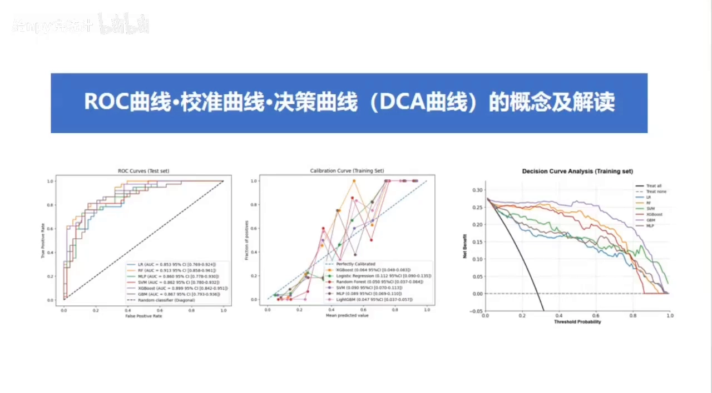
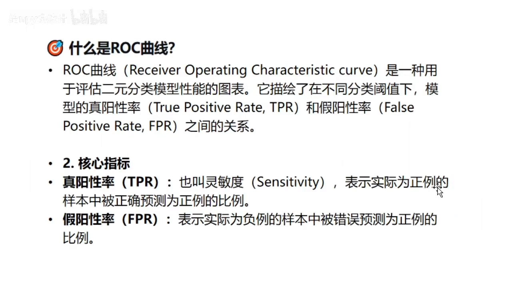
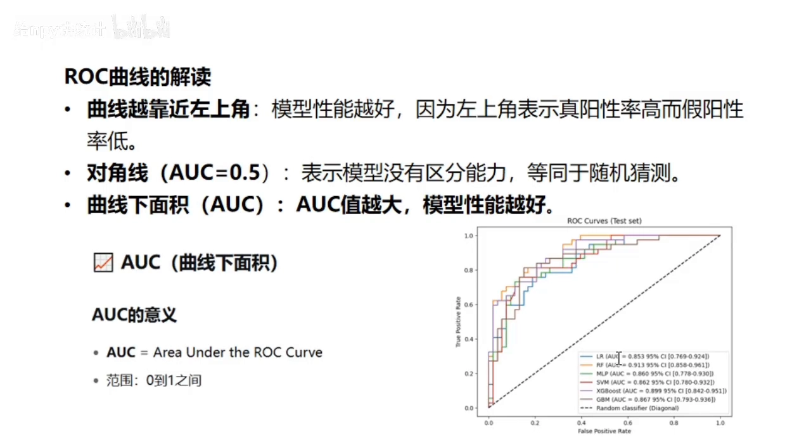
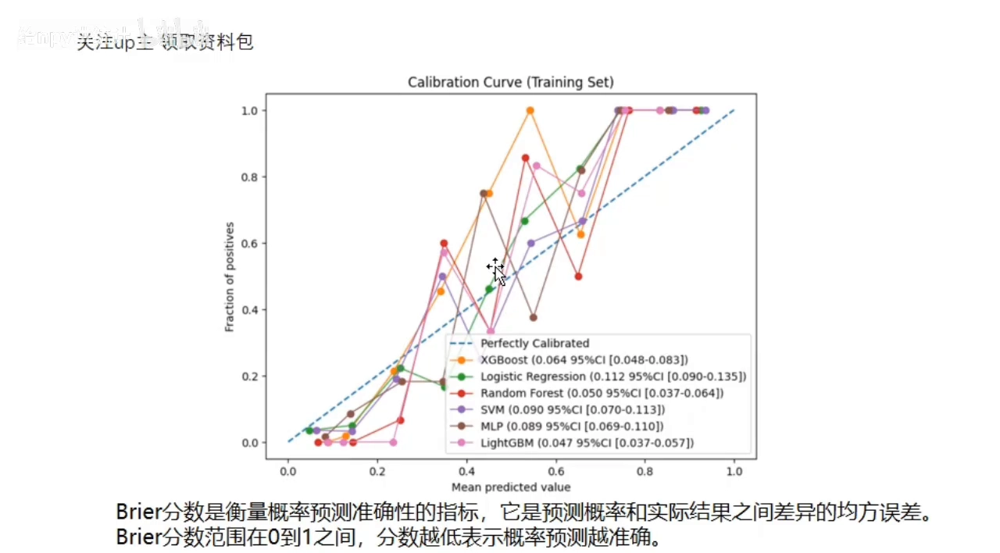
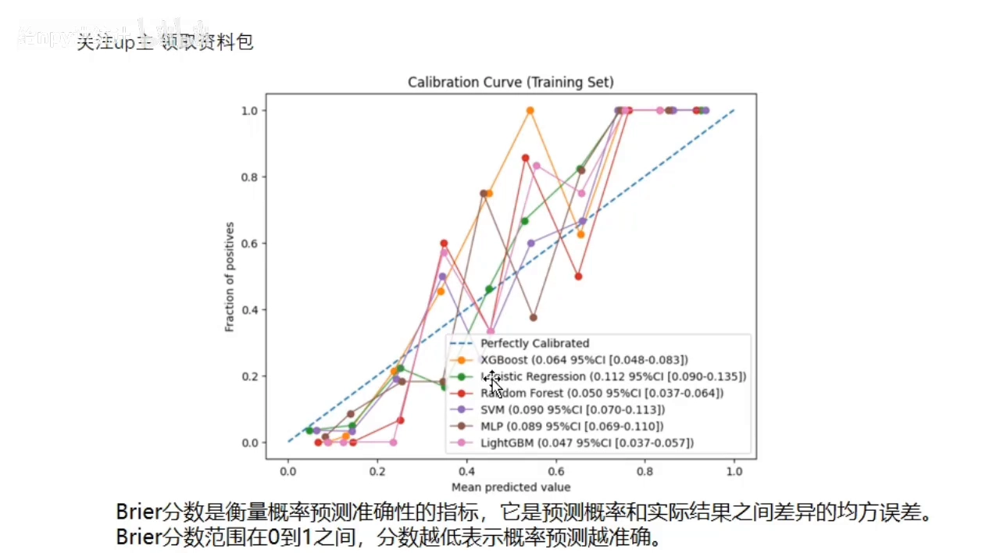
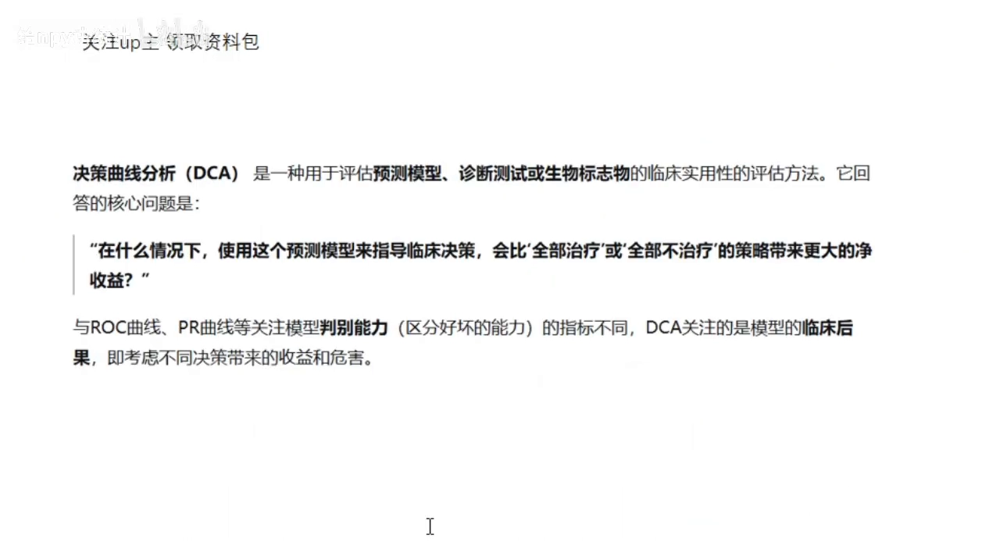
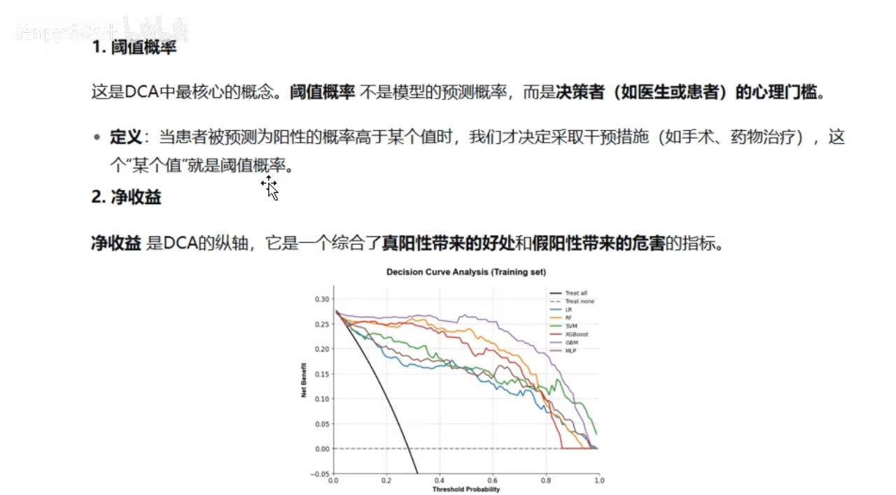
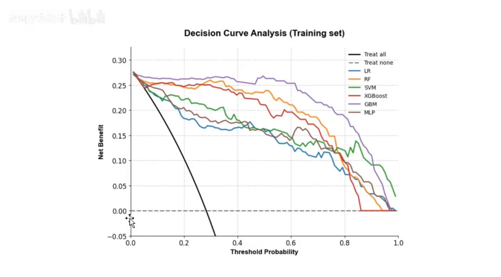

# AUC 高不等于模型靠谱：区分、校准与决策是三把不同的尺子

> 视频来源：[评估指标——ROC曲线校准曲线DCA曲线](https://www.bilibili.com/video/BV1UmxxziETk/)（Bilibili · 大金子统计）｜时长约 10 分钟
> 导读：这支短视频用"天气预报"一条线索，把临床风险预测模型的三张评估图讲成三个递进的问题：排序对不对（ROC/AUC）、说出的概率可不可信（校准曲线/Brier）、拿它做决定划不划算（DCA）。本节另外两篇材料讲相关系数与排序指标，本篇补上"校准"这把尺子，并说明三者为什么不能互相替代。

## 本讲要解决的核心问题（SCQA）

**背景**：评估一个会输出概率的模型时，最常见的报告方式是算一个 AUC。AUC 越高，论文里越容易写成"模型性能良好"。

**冲突**：AUC 只统计"把正例排在负例前面"的比例，它不检查模型说的概率是不是真的。一个模型可以几乎把所有人排对，却把"实际只有三成会下雨"的天气报成 70%。

**疑问**：既然 AUC 高不等于概率准，那该用什么图、什么数来看"模型说的概率可不可信"？又该用什么来看"拿它做决定值不值"？

**回答（中心思想）**：这是三个不同的问题，需要三把尺子：**ROC/AUC 量区分能力（排序），校准曲线与 Brier 分量概率可靠性（数值与频率是否对齐），DCA 量决策价值（净收益）。** 一个"优秀"的模型要同时过前两关；而要判断它能不能用，还得看第三关。视频里那组例子最说明问题：六个模型的 AUC 都在 0.85–0.9 附近，但校准曲线离对角线很远。

## 一、ROC 与 AUC：只回答"排序对不对"

### 1.1 两个核心指标：真阳性率与假阳性率

ROC 曲线（Receiver Operating Characteristic curve）是评估二元分类模型的图表，它描绘**在不同分类阈值下，真阳性率与假阳性率的关系**（[【跳转到 00:19】](https://www.bilibili.com/video/BV1UmxxziETk/?t=19)）。

- **真阳性率（TPR）**，也叫灵敏度：实际为正的样本中，被正确预测为正的比例。
- **假阳性率（FPR）**：实际为负的样本中，被错误预测为正的比例。

视频用天气预报来对齐这两个词：模型每天给出一个"明天下雨的概率"，比如 30% 或 70%；真阳性率就是**实际下雨的日子里，模型预报对了下雨的比例**，假阳性率就是**实际没下雨、模型却误报下雨的比例**（[【跳转到 00:44】](https://www.bilibili.com/video/BV1UmxxziETk/?t=44)）。

### 1.2 怎么读这张图

ROC 图的横坐标是假阳性率，纵坐标是真阳性率，两者取值范围都是 0 到 1（[【跳转到 01:39】](https://www.bilibili.com/video/BV1UmxxziETk/?t=99)）。

- **曲线越靠左上角越好**：左上角意味着横坐标小（假阳性率低）、纵坐标大（真阳性率高），也就是"该报的雨都报出来了，不该报的没乱报"。
- **对角线（AUC = 0.5）**：模型没有区分能力，等同于随机猜测。
- **曲线下面积 AUC**：取值 0 到 1，越大表示排序能力越强。

注意 AUC 的计算只用到"谁排在谁前面"。它把每个可能的阈值都扫一遍，看正例被排在前面的程度，**不关心模型输出的那个数是不是概率、是不是偏大偏小**。这正是下一张图要补的缺口。

## 二、校准曲线：回答"说 70%，是不是真有 70%"

### 2.1 校准在问什么

校准曲线是评估分类模型**概率预测准确性**的工具：它比较模型预测的概率与实际观察到的概率，衡量输出概率的可靠性（[【跳转到 02:54】](https://www.bilibili.com/video/BV1UmxxziETk/?t=174)）。

它回答的核心问题很朴素：**模型说下雨概率 70%，那在所有被报成 70% 的日子里，实际下雨的比例真的是 70% 吗？**

- 横坐标：模型预测的概率（平均预测值）。
- 纵坐标：实际发生的比例（实际阳性率）。
- 完美校准：一条从 (0,0) 到 (1,1) 的对角线，预测概率与实际频率完全一致。

### 2.2 曲线在对角线上方还是下方

- 曲线在**对角线上方**：Y 值（实际发生比例）大于 X 值（预测比例），说明模型**低估**了概率。
- 曲线在**对角线下方**：说明模型**高估**了概率（[【跳转到 04:15】](https://www.bilibili.com/video/BV1UmxxziETk/?t=255)）。

画法是：把所有预测按概率分组，比如 0–10%、10–20%、20–30%……分成十组，再看每组内实际发生的比例，得到十个点，连成线就是校准曲线（[【跳转到 04:40】](https://www.bilibili.com/video/BV1UmxxziETk/?t=280)）。

### 2.3 同一组模型上的反差：排序好，校准却不好

视频最有说服力的一处，是把两张图并排展示。ROC 图（测试集）里几个模型的 AUC 分别是 0.853、0.913、0.860、0.862、0.899、0.867，全都在 0.85 以上；可校准曲线（训练集）上，各模型的折线在 0.2–0.7 的预测区间里大幅偏离对角线，有的高估、有的低估，彼此交叉（[【跳转到 03:25】](https://www.bilibili.com/video/BV1UmxxziETk/?t=205)）。

这张图就是"排序好但数值不可信"的直接证据：**AUC 高只说明这些模型把正例排在负例前面的顺序大致对，不说明它们给出的概率能直接当频率使用。** 若下游要按"70% 概率"来决定要不要干预、要备多少资源，就必须再看校准。

### 2.4 Brier 分数：把校准压成一个数

校准曲线也有配套的数值指标：**Brier 分数**。它是预测概率与实际结果（0 或 1）之间差异的均方误差，取值 0 到 1，**越低表示概率预测越准确**（[【跳转到 05:05】](https://www.bilibili.com/video/BV1UmxxziETk/?t=305)）。

这与 AUC 的方向相反，读论文时要特别小心：AUC 越大越好，Brier 越小越好。

## 三、DCA：回答"拿它做决定划不划算"

### 3.1 决策曲线分析在问什么

决策曲线分析（DCA）评估预测模型、诊断测试或生物标志物的**临床实用性**。它回答的核心问题是：**在什么情况下，用这个模型指导决策，会比"全部治疗"或"全部不治疗"带来更大的净收益？**（[【跳转到 05:41】](https://www.bilibili.com/video/BV1UmxxziETk/?t=341)）

视频明确区分了它和 ROC/PR 一类指标：后者关注**判别能力**（能不能区分好坏），DCA 关注**临床后果**，即不同决策带来的收益和危害。

### 3.2 横轴阈值概率，纵轴净收益

- **阈值概率**：当患者被预测为阳性的概率高于某个值时，我们才决定采取干预措施，这个"某个值"就是阈值概率。它不是模型的输出，而是**决策者的心理门槛**。
- **净收益**：综合真阳性带来的好处与假阳性带来的危害，取值有正有负。净收益越高策略越划算；为 0 表示不赚不赔；为负说明这个策略反而有害（[【跳转到 07:21】](https://www.bilibili.com/video/BV1UmxxziETk/?t=441)）。

视频继续用带伞类比：阈值概率就是"下多大雨的概率你才愿意带伞"——越接近 0 说明你特别怕淋湿，哪怕 10% 可能下雨也带伞；越接近 1 说明你特别讨厌带伞，除非百分之百确定否则不带（[【跳转到 06:31】](https://www.bilibili.com/video/BV1UmxxziETk/?t=391)）。

### 3.3 两条参照线与六条模型曲线

图里有两类参照线：

- **黑色实线 "Treat all"（全部治疗）**：所有患者都接受治疗，相当于不管天气预报如何每天都带伞。好处是永远不会被淋湿，坏处是大量不需要治疗的人也被用药，浪费资源。
- **黑色虚线 "Treat none"（全部不治疗）**：所有患者都不治疗，相当于从来不带伞。不会浪费资源，但也没有任何人被治愈，净收益恒为 0，是一条过零点、平行于横轴的直线（[【跳转到 08:36】](https://www.bilibili.com/video/BV1UmxxziETk/?t=516)）。

六条彩色曲线代表六个机器学习模型。判断标准很直接：**在同一阈值概率下，哪条曲线的净收益更高，哪个模型在该决策门槛下更划算**。这组例子里紫色曲线（GBM）始终在最上方，净收益最好（[【跳转到 09:26】](https://www.bilibili.com/video/BV1UmxxziETk/?t=566)）。

## 四、三把尺子怎么配合（编者补充）

视频只讲了这三张图的读法，没有直接谈相关系数。把它的框架接回本节的主题，可以得到一张分工表：

| 问题 | 尺子 | 看什么 | 高分的含义 | 高分**不**保证什么 |
| --- | --- | --- | --- | --- |
| 两组数是否同向变动 | Pearson / Spearman 相关 | 方向与单调性 | 趋势一致 | 幅度、零点、概率是否可信 |
| 候选的先后顺序对不对 | ROC/AUC、top-k、NDCG@k、质心准确率 | 排序 | 该排前面的排前面了 | 输出的数值能否直接使用 |
| 说出的概率/数值可不可信 | 校准曲线、Brier、预测值—观测值图 | 预测值与观测频率是否对齐 | 预测值可当频率/数值读 | 排序一定好、决策一定划算 |
| 拿它做决定值不值 | DCA、净收益、错误代价 | 决策后果 | 在该门槛下比"全做/全不做"更好 | 模型本身一定正确 |

三条结论：

1. **相关系数与 AUC 都是"相对"指标。** 它们对整体平移、缩放不敏感，所以"排序好、相关高"完全可以和"概率全偏"同时成立。视频里 AUC 0.85–0.9 与远离对角线的校准曲线并存，就是最直观的例子。
2. **校准是"绝对"指标。** 它要求预测值本身能对齐观测频率，因此对系统性高估/低估极其敏感——这正是相关系数看不见的部分。
3. **决策价值又是另一层。** 即使校准良好，某个阈值下用模型是否划算仍取决于错误代价（带伞的麻烦 vs 淋湿的代价），这由 DCA 回答，不能由任何一个单一分数代替。

## 小结

- ROC/AUC 只衡量**区分（排序）能力**：曲线越靠左上角越好，对角线等于随机猜测。
- 校准曲线衡量**概率可靠性**：横轴预测概率、纵轴实际频率，越贴对角线越好；在上方是低估，在下方是高估。
- Brier 分数把校准压成一个数，**越低越好**，方向与 AUC 相反。
- DCA 衡量**决策价值**：横轴是决策者的阈值概率，纵轴是净收益，并与"全部治疗/全部不治疗"两条参照线比较。
- 同一组模型可以 **AUC 很高而校准很差**；因此报告 AUC 时不能顺手把它当成"概率可信"或"可以拿来做决定"的证据。
- 三把尺子对应三个问题：排序、校准、决策。缺哪一把，结论就会在对应的方向上失去依据。

## 关键术语速查

| 术语 | 一句话解释 |
| --- | --- |
| 真阳性率（TPR/灵敏度） | 实际为正的样本中被正确判为正的比例。 |
| 假阳性率（FPR） | 实际为负的样本中被误判为正的比例。 |
| ROC 曲线 | 扫描所有阈值，画出 TPR 对 FPR 的轨迹。 |
| AUC | ROC 曲线下面积，0.5 相当于随机排序，1 为完美排序。 |
| 校准曲线 | 预测概率对实际发生频率的图，理想情形是对角线。 |
| Brier 分数 | 预测概率与实际结果（0/1）之差的均方误差，越低越好。 |
| 阈值概率 | 决策者愿意采取干预的最低预测概率，是决策门槛而非模型输出。 |
| 净收益 | 综合真阳性收益与假阳性危害后的决策收益，可正可负。 |
| DCA | 决策曲线分析，比较模型与"全治/全不治"策略的净收益。 |