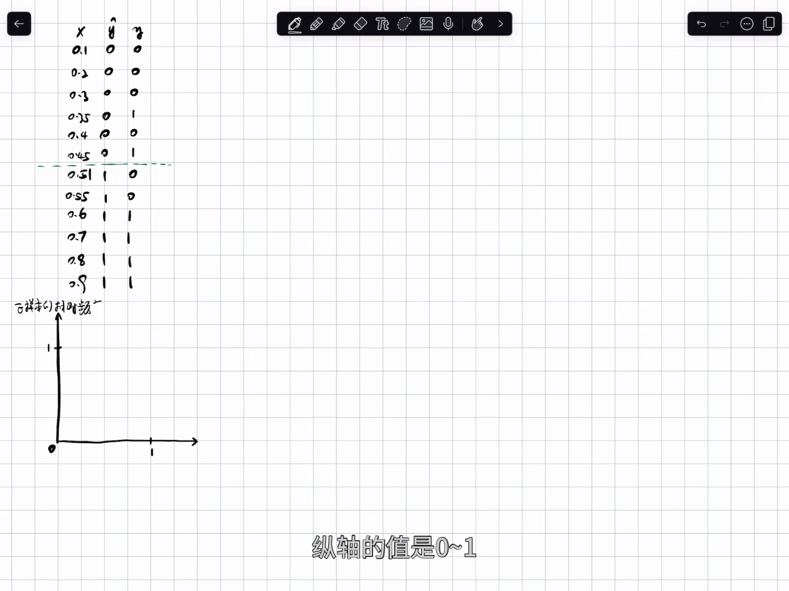
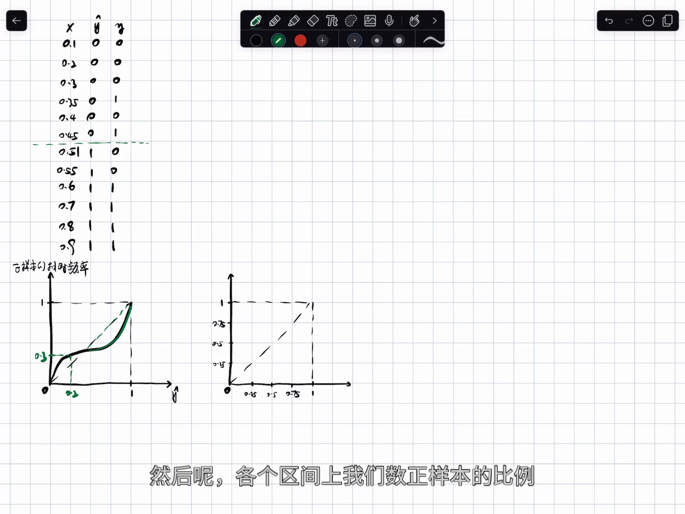
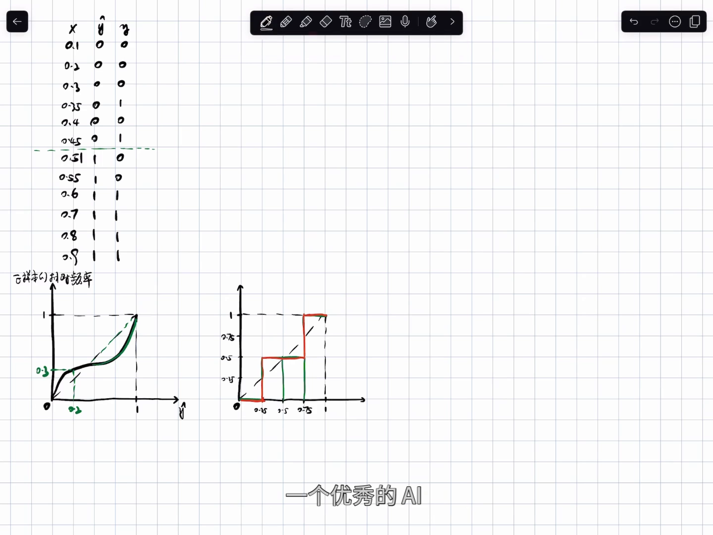
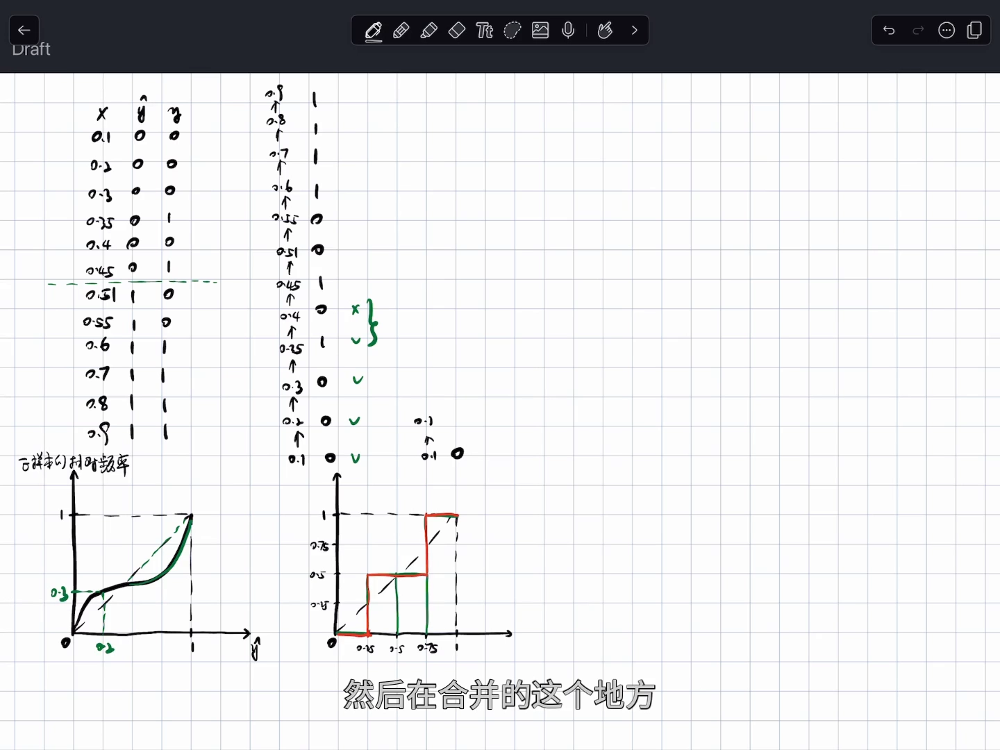
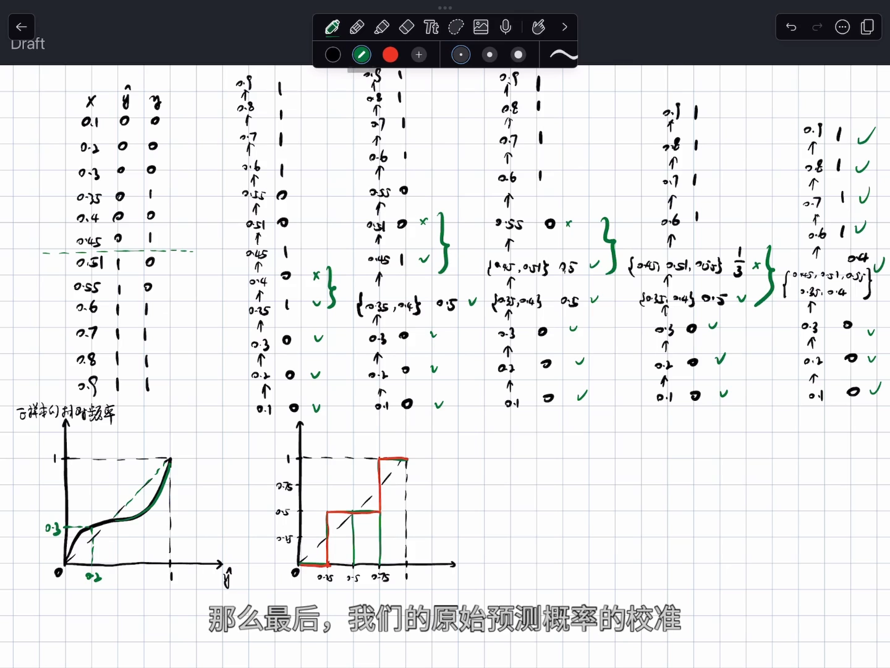
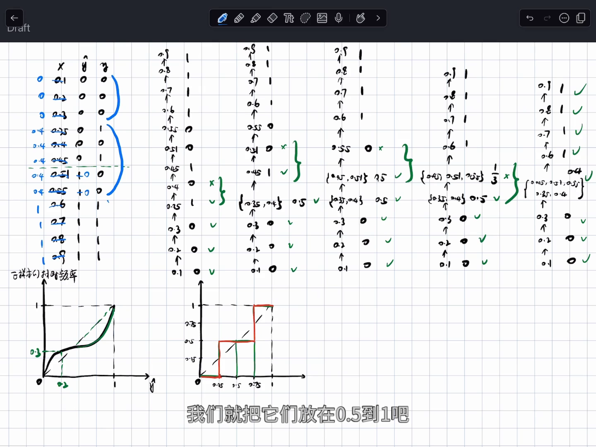

# 概率校准：可靠性曲线怎么读，保序回归怎么把打分拉回对角线

> 视频来源：[概率校准与保序回归手把手入门](https://www.bilibili.com/video/BV1PGZ6YgEWr/)（B 站 · 手写板书讲解）｜时长约 9.5 分钟
> 本文按视频的板书顺序整理：先用一个刹车打分的小例子说明"正确率高不等于概率可信"，再手画可靠性曲线、讲清分箱与对角线的含义，最后用保序回归（isotonic regression）演示怎样把打分拉回对角线。文中的数字与结论均来自视频画面和口播。

## 本讲要解决的核心问题（SCQA）

**背景**：分类模型通常不只输出"是/否"，还输出一个 0–1 之间的分数，表示它认为事件发生的概率。我们习惯用正确率、AUC 这类指标评价模型。

**冲突**：一个模型可以分类正确率很高，但它给出的"80% 会出事"却可能名不副实——真实发生率也许只有 50%。这时按概率做决策（比如要不要刹车、要不要收治）就会出错。

**疑问**：怎么判断模型输出的概率本身可不可信？一条可靠性曲线（reliability curve）到底该怎么读？读出来偏离对角线之后，又能怎么修？

**回答（中心思想）**：可靠性曲线把"模型预测的概率"和"实际观测到的正例频率"按区间对照起来，理想情况下应落在对角线上；概率校准就是在分类器外面再套一个单调的校准模型（视频以保序回归为例），让这条曲线尽量贴近对角线，而不改变模型对样本的排序。

## 一、正确率回答不了"概率准不准"

### 1.1 一个刹车打分的例子

视频设定了一个自动驾驶场景：系统要实时算出一个 risk 分数，决定要不要刹车。板书里随机列了 12 个打分，从 0.1、0.2、0.3 一直到 0.9，中间补了 0.35、0.45、0.51、0.55 等值 [【跳转到 00:22】](https://www.bilibili.com/video/BV1PGZ6YgEWr/?t=22)。

规则很简单：risk 大于 0.5 就预测为"危险、需要刹车"，输出 1；小于 0.5 就预测为"安全"，输出 0。再假设真实标签是板书第三列那样一串 0/1 [【跳转到 00:57】](https://www.bilibili.com/video/BV1PGZ6YgEWr/?t=57)。

数一数会发现：12 个样本里错了 4 个，正负样本各错 2 个，正确率是 $8/12 \approx 2/3$ [【跳转到 01:23】](https://www.bilibili.com/video/BV1PGZ6YgEWr/?t=83)。视频在这里提出关键问题：**这个指标好吗？判断一个模型的预测是否可靠，光靠正确率够不够？**

### 1.2 0.5 分本身可能才是正确答案

为了说明"正确率"漏掉了什么，视频举了一个与模型无关的例子：看一张照片判断里面的人是男是女，如果实在看不出来，我们给的分很可能就在 0.5 上下——这并不说明我们"无能"，而是如实表达了**很高的不确定性** [【跳转到 01:48】](https://www.bilibili.com/video/BV1PGZ6YgEWr/?t=108)。

对 AI 也一样。同一个路况下，"刹车"和"不刹车"本来就该是一半一半，那么模型打 0.5 分就是合理的。换句话说，**分数除了要"选对边"，还要"说对有多确定"**。正确率只看选没选对，看不到后半件事。

## 二、可靠性曲线：横轴预测概率，纵轴实际频率

### 2.1 两个轴各放什么

视频随后画出可靠性曲线的坐标轴：横轴和纵轴都取 0 到 1 [【跳转到 02:13】](https://www.bilibili.com/video/BV1PGZ6YgEWr/?t=133)。

- **横轴**：模型预测这个样本为正样本的概率，也就是 $\hat{y}$；
- **纵轴**：这一组样本里正样本实际占的比例，也就是相对频率。

板书举了一个点：横坐标 0.2、纵坐标 0.3 [【跳转到 02:38】](https://www.bilibili.com/video/BV1PGZ6YgEWr/?t=158)。

它的读法是：对于"汽车匀速行驶、旁边突然出现黑影"这一类特征，真实情况是有 30% 的可能发生危险；模型却只给了 20%，**低估**了危险性。反过来，落在对角线**下方**的点，表示模型给的概率高于实际发生频率，也就是**高估**了危险性 [【跳转到 03:28】](https://www.bilibili.com/video/BV1PGZ6YgEWr/?t=208)。

### 2.2 对角线是"完全一致"的参照

把横轴和纵轴都画成 0–1 之后，那条 45° 对角线就有了明确含义：**预测多少概率，实际就发生多少频率**。预测 0.3、实际也 0.3，点就落在对角线上 [【跳转到 02:33】](https://www.bilibili.com/video/BV1PGZ6YgEWr/?t=153)。

所以读可靠性曲线的第一句话是：**点离对角线越近，概率越可信；点在对角线上方是低估，在下方是高估。** 这条规则不依赖具体模型，逻辑回归、随机森林、神经网络都适用。

## 三、曲线是"数"出来的：分箱、算频率、连点

### 3.1 为什么必须分箱

理论上，我们可以对每个可能的预测概率都统计一次实际正例比例。但 0–1 之间的实数有无穷多个，逐点描不现实。实践中的做法是：**把横轴 0–1 切成若干区间，在每个区间里数正样本占多少** [【跳转到 03:53】](https://www.bilibili.com/video/BV1PGZ6YgEWr/?t=233)。

视频强调了两点：

- 区间越窄，曲线越精细；
- 但区间宽度受数据量限制。数据少的时候，区间必须开得大，否则每个箱里只有一两个样本，频率会剧烈跳动。

板书里因为只有 12 个样本，就把横轴切成 0–0.25、0.25–0.5、0.5–0.75、0.75–1 四段，逐段数正例比例 [【跳转到 04:18】](https://www.bilibili.com/video/BV1PGZ6YgEWr/?t=258)。

### 3.2 一个具体的读图练习

按视频的统计结果：

- 0–0.25 这一段没有正样本，频率记为 0；
- 0.25–0.5 这一段正好一半是正样本，频率 50%；
- 0.5–0.75 这一段也有一半，频率 50%；
- 0.75–1 这一段全是正样本，频率 1。

把四个点连起来，就得到板书上那条红色阶梯线 [【跳转到 04:43】](https://www.bilibili.com/video/BV1PGZ6YgEWr/?t=283)。

对照对角线读：

- 0.25–0.5 段：模型给的是 0.25–0.5 之间的分数，实际却有一半发生，点在对角线上方，**低估**；
- 0.5–0.75 段：模型给的是 0.5–0.75 之间的分数，实际只有一半，点在对角线下方，**高估**。

这就是可靠性曲线最实用的地方：它不只告诉你"整体偏不偏"，还告诉你**在哪一段偏、往哪个方向偏**。

## 四、正确率高，不等于校准好

视频特别提醒：**完全可能出现一个 AI 预测正确率很高，但可靠性曲线离对角线很远的情况** [【跳转到 05:01】](https://www.bilibili.com/video/BV1PGZ6YgEWr/?t=301)。

原因在于两个指标看的是不同的事：

| 指标 | 回答的问题 | 只看什么 |
| --- | --- | --- |
| 正确率 / AUC | 有没有把正负样本排对、分对 | 排序与阈值 |
| 可靠性曲线 | 给出的概率数值是否等于真实频率 | 概率的绝对大小 |

一个模型可以把所有样本都排在正确的一侧（AUC 很高），但整体分数被系统性地压低或抬高（校准很差）。反过来，一个校准很好的模型也可能区分能力一般。**排序好，不代表概率数值可信**；要判断后者，必须看可靠性曲线。

## 五、校准：在分类器外面再套一层

### 5.1 校准的目标

既然曲线偏离对角线，能不能修？视频给出的思路是：**在一个分类器上面再套一个校准模型**，让它的打分对应的可靠性曲线尽可能贴近对角线 [【跳转到 05:01】](https://www.bilibili.com/video/BV1PGZ6YgEWr/?t=301)。

这里有一个隐含但重要的约束：校准模型只应该调整"分数到概率"的映射，**不应打乱样本之间的顺序**。否则校准虽然让概率变准了，排序能力却被破坏。

### 5.2 保序回归（isotonic regression）

视频介绍的经典算法是 **isotonic regression**，中文叫**保序回归** [【跳转到 05:26】](https://www.bilibili.com/video/BV1PGZ6YgEWr/?t=326)。它适用于偏序数据，也就是任何一种有向图结构；而打分的大小关系是一种全序，可以看成一条线性的链。

算法流程可以按板书画出的几步来理解：

1. **把样本按打分从小到大排好**，每个打分旁边写上它的真实标签（0 或 1）。
2. **从下往上检查单调性**：校准后的输出应当随打分单调不减。如果出现"前面的标签是 1、后面的标签是 0"这种破坏顺序的地方，就把这两个点**合并**。
3. **合并后的块取标签平均值**，然后重新画图、重复检查，直到整条链满足单调不减 [【跳转到 06:16】](https://www.bilibili.com/video/BV1PGZ6YgEWr/?t=376)。

这个过程就是常说的"池化相邻违规者"（pool adjacent violators）：不断把违反单调性的相邻块合并、求平均，直到不再有违规。

### 5.3 校准后的结果

视频最后给出校准结果：0.1、0.2、0.3 校准后为 0；0.35、0.4、0.45、0.51、0.55 这一块校准后为 0.4；0.6 到 0.9 校准后为 1 [【跳转到 07:31】](https://www.bilibili.com/video/BV1PGZ6YgEWr/?t=451)。

几个值得注意的观察：

- **输出变成阶梯状**：同一块内的样本拿到相同的校准概率，这是保序回归的典型形态；
- **排序没有改变**：原来分数低的仍在低段，高的仍在高段；
- **按 0.5 阈值重新决策后，错误数反而减少了**：原来被判错的 0.51、0.55（真实标签为 0）校准后落到 0.4 一侧、改判为 0；代价是 0.35、0.45 两个正例被并进 0.4 后改判为 0。整体错误数从 4 个降到 2 个。

把校准后的曲线和原来的曲线画在一起，可以看到蓝线（校准后）与红线的差别 [【跳转到 08:21】](https://www.bilibili.com/video/BV1PGZ6YgEWr/?t=501)。

### 5.4 为什么不能直接把真实标签当输出

视频在最后重新解释了一遍保序回归，点出它为什么能起作用 [【跳转到 08:41】](https://www.bilibili.com/video/BV1PGZ6YgEWr/?t=521)：

- 初始化时，最"准"的做法似乎是把每个样本的真实标签直接当作校准后的输出；
- 但这样等于把训练集背下来，**过拟合、泛化极差**；
- 所以要把**校准前的打分顺序**作为必须保留的序，只允许在这个约束下调整数值；
- 具体手段就是把破坏顺序的点并进更大的块、取平均，从而把输出"拉平"，大大降低过拟合风险。

这也解释了校准模型与普通分类器的分工：分类器负责排序，校准器负责把排序上的位置翻译成可信的概率。

视频末尾提到，scikit-learn 里的 isotonic regression 已经实现得很好，复杂度是 $O(n)$，可以当作一层直接套在分类器后面，"完全不亏" [【跳转到 09:06】](https://www.bilibili.com/video/BV1PGZ6YgEWr/?t=546)。

## 小结

- **正确率与校准是两件事**：正确率看有没有分对，可靠性曲线看给出的概率数值是否等于真实频率。
- **可靠性曲线的读法**：横轴是预测概率，纵轴是该概率区间内的实际正例频率；对角线代表完全一致，点在上方是低估，在下方是高估。
- **曲线是分箱数出来的**：把 0–1 切成区间，逐段统计正例比例再连点；箱宽受数据量限制，数据越少箱越宽。
- **校准的目标**：在分类器外套一个校准模型，让曲线贴近对角线，同时不破坏样本排序。
- **保序回归的做法**：按打分排序，遇到破坏单调性的相邻点就合并取平均，反复迭代直到单调；输出呈阶梯状，能降低过拟合风险。
- **读图时同时看两件事**：整体离对角线多远，以及在哪一段、朝哪个方向偏。

## 关键术语速查

| 术语 | 一句话解释 |
| --- | --- |
| 概率校准（calibration） | 让模型输出的概率数值与真实发生频率一致 |
| 可靠性曲线（reliability curve） | 横轴预测概率、纵轴实际正例频率的对照曲线，也叫校准曲线 |
| 对角线（ideal line） | 预测概率等于实际频率的参照线，完美校准的曲线应落在这里 |
| 分箱（binning） | 把 0–1 的预测概率切成若干区间，逐段统计正例比例 |
| 高估 / 低估 | 点在对角线下方表示给的概率偏高（高估），在上方表示偏低（低估） |
| 保序回归（isotonic regression） | 在保持输出单调不减的约束下拟合标签的校准方法，输出为阶梯函数 |
| 池化相邻违规者（PAV） | 保序回归的求解过程：合并违反单调性的相邻块并取平均 |
| 区分度 vs 校准度 | 区分度看排序（如 AUC），校准度看概率数值是否可信，两者不能互相替代 |